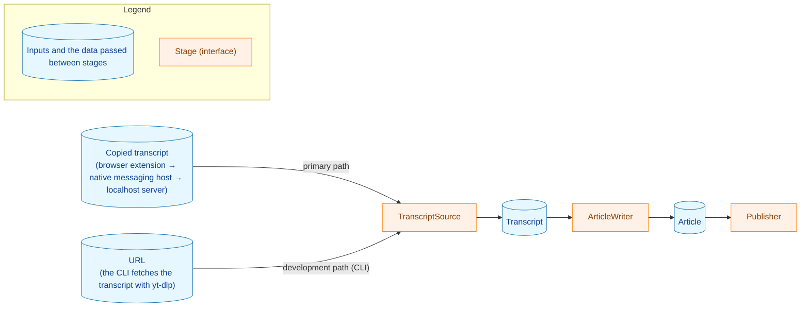

# CLAUDE.md

This file provides guidance to Claude Code (claude.ai/code) when working with code in this repository.

## Quick Links

**Project:**
- [Project Overview](docs/dev/project_overview.md) - Decided policies, pipeline, constraints, configuration (Japanese). **Read this before designing anything.**
- [Production Profile](docs/dev/production_profile.md) - The production profile (the template, provider, model, and effort of each step), the quality target and the results behind it, and the product limitations of this profile (Japanese)
- [Security Considerations](docs/dev/security.md) - yt-dlp invocation, secrets, network, cache, untrusted text
- [Cache Consistency](docs/dev/cache_consistency.md) - What the transcript cache guarantees across failures and power loss, and why (Japanese). Check its checklist before changing cache code.
- [ADR Index](docs/dev/adr/README.md) - The major design decisions in effect now, each with its reasons, the alternatives not taken, and its history across tasks (Japanese). Look here for the current decisions and their reasons before designing.
- [ADR Convention](docs/dev/conventions/adr.md) - How to write, change, and retire an ADR

**Development Guides:**
- Requirements and Acceptance Criteria Process: [requirements_process.md](docs/dev/conventions/requirements_process.md) - Process for implementing new features
- Test Organization Guide: [test_organization.md](docs/dev/conventions/test_organization.md) - Test helper file organization
- [Package Reference](docs/dev/conventions/package_reference.md) - A one-row summary of each package's responsibility, its main exported names, and where its detailed specification lives
- [Updating the Pricing Table](docs/dev/guides/pricing_update.md) - How to update the LLM rate table in `internal/pricing`
- [Claude Output Limit](docs/dev/guides/claude_output_limit.md) - When and how to re-measure the basis of the Claude adapter's default output limit (`max_tokens`)
- [OpenAI Output Limit](docs/dev/guides/openai_output_limit.md) - When and how to re-measure the basis of the OpenAI adapter's default output limit (`max_output_tokens`)
- [mergepr Guide](docs/dev/guides/mergepr_guide.md) - Setup, usage, guarantees, and troubleshooting for the `/mergepr` tool
- [fixprguard Guide](docs/dev/guides/fixprguard_guide.md) - Setup, subcommands, guarantees, scope rules, and recovery for the `fixprguard` guard tool for `/fixpr` and `/runpr`

## Documents

- Documents should be placed under docs. Exception: `README.md` and its
  English version `README.en.md` sit at the repository root (see "Document
  language" below).
- A document's language follows "Document language" below.
- Default format is markdown
- Use Mermaid for diagrams, following the conventions in
  [mermaid_reference.md](docs/dev/conventions/mermaid_reference.md) (node-label
  quoting, `<br>` line breaks, cylinder `[(...)]` data nodes, the standard classDef
  palette, and Legend blocks).
- Each task lives in `docs/tasks/NNNN_<name>/` (four-digit sequence number).
  `docs/tasks/0000_template/requirements.md` is the starting point for
  `01_requirements.md`.

### Document language

A document's language follows from who reads it and who approves it, not from
where it lives. Three principles decide it:

- **(a) Japanese: documents a human decides on or approves, and guides for
  humans.** Task documents under `docs/tasks/`, the documents directly under
  `docs/dev/` (such as `project_overview.md` and `security.md`), the ADRs
  and their index under `docs/dev/adr/`, `docs/translation_glossary.md`, the
  guides under `docs/dev/guides/`, the research records under
  `docs/research/`, and `prompts/README.md` and `testdata/README.md`.
- **(b) English: instructions that control an agent's run, and the code in the
  repository.** `CLAUDE.md`, `AGENTS.md`, the command definitions under
  `.claude/commands/`, the conventions under `docs/dev/conventions/` that agents
  follow, and source code with its comments, identifiers, and string literals
  ("Language" below, and "Go Idioms" for the literal exceptions). The
  principle governs the language of the instruction text itself: an
  instruction may give an agent a principle-(a) document to read as material,
  such as a task document to implement or `security.md` to check against.
- **(c) The end-user document: Japanese primary, English kept in sync.** The
  end users are the users of the browser extension, and their document is the
  README: `README.md` is the primary version, in Japanese, and `README.en.md`
  is its English version.

Applied to directories: `docs/dev/conventions/` is English, and
`docs/dev/guides/` and `docs/research/` are Japanese. A new document takes the language its reader and
approver give it under these principles.

Exceptions:

- **The bilingual README.** The README is the only document kept in two
  languages (`README.md` and `README.en.md`). Change `README.md` first, then
  carry the change to `README.en.md` with `/mktrans` ("Translation Guidelines"
  below).
- **Where `README.en.md` lives.** It sits at the repository root next to
  `README.md`, not under `docs/`. Reason: an English reader moves from the link
  at the top of `README.md` to the English version at the same level, and
  GitHub lists it next to the README it shows at the root.
- **Japanese guides an agent reads.** A command definition under
  `.claude/commands/` (`_context.md` and `_lib/` included) may refer an agent to
  a Japanese guide under `docs/dev/guides/` as the manual of a tool the command
  drives (today `fixpr.md` and `_context.md` refer to `fixprguard_guide.md`, and
  `mergepr.md` to `mergepr_guide.md`), an exception to principle (b), because
  the agent follows the guide as instructions rather than reading it as
  material. Scope: only a command definition's reference to a guide under
  `docs/dev/guides/`; every other instruction an agent follows stays English.
  Reason: a guide is written for a human using a tool, and keeping the same
  content in English as well would bring back the double maintenance the
  guides left behind. An agent reads Japanese.

### Translation Guidelines (Japanese to English)

The only translation pair is `README.md` (Japanese, primary) → `README.en.md`
(English). Change `README.md` first, then run `/mktrans README.md`, which
carries the change into `README.en.md`, and commit both in one commit. When `README.en.md` does not
exist yet, `/mktrans` run by itself makes a full translation (and stops when
`README.md` is not in Japanese), while the sub-step another command runs does
nothing. The first line of `README.en.md` is a sync marker naming the blob of
the `README.md` content it was translated from; `/mktrans` translates the difference between that blob and the current
`README.md` and then updates the marker. `TestReadmeSyncMarker` checks the
marker against the current `README.md`; it runs in `make test`, in CI's
`doc-guard` job, and in a pre-commit hook for the two READMEs
(`make readme-sync-check` runs it alone), so a `README.md` change is not
committed or merged without the sync, whoever makes it. `/runplan`, `/fixpr`,
and `/runpr` run `/mktrans` when the check fails. `/mktrans` stops
and asks on any other file. The translation principles (accuracy over fluency,
faithful translation, structural consistency) and the glossary workflow live in
[mktrans.md](.claude/commands/mktrans.md); the glossary is
[docs/translation_glossary.md](docs/translation_glossary.md).

### Design decisions (ADR)

Major design decisions are recorded as ADRs under `docs/dev/adr/`, one living
document per subject, listed in the index
[docs/dev/adr/README.md](docs/dev/adr/README.md). How to write, number,
change, retire, and withdraw an ADR is in the convention,
[docs/dev/conventions/adr.md](docs/dev/conventions/adr.md); follow it.

- **Rule:** a PR that makes or changes a major decision creates or updates the
  ADR in the same PR. This applies to every PR and every change to one,
  including changes made outside the commands that settle decisions (a
  `/fixpr` round, a standalone PR). The PR's review and merge
  approve the ADR. The same rule is in the convention ("Approval and the
  PR"); when you change it, change both in the same PR.
- **What counts as major:** a decision whose effect reaches beyond the task
  that makes it: it binds later tasks or more than one component, or
  reversing it would change more than one place. Examples are the structure
  and the boundaries between components, a protocol, an external dependency
  or service, a security assumption, the product's scope, and a policy on the
  development process and its tools. A decision that changes the decision of
  an existing ADR is always major. A decision that closes inside one task — a
  test's name, a wording, the shape of one function, the value of a constant,
  the order of implementation — is not major and stays in the task documents
  only. The same criterion is in the convention ("What counts as a major
  decision"); when you change it, change both in the same PR.
- **Who holds what:**
  - A task document records the decisions its task made, with their reasons,
    and links to the ADR of each major one. The link is required of task
    documents written after this rule reached `main`; existing task documents
    are not changed to add one.
  - An ADR holds the summary of the decision in effect, its reasons, the
    alternatives not taken, and its history across tasks.
  - A document that holds the current specification of a subject (such as
    `docs/dev/security.md` or `docs/dev/production_profile.md`) keeps that
    specification; the ADR summarizes it and links to it.
  - `docs/dev/project_overview.md` keeps the summary of the current policies
    and links to the ADRs.
  - The rules and cross-cutting principles of this file are not ADRs.

  The split between an ADR and a document that holds the current
  specification is also in the convention ("Writing an ADR"); when you change
  it, change both in the same PR.

## Language

- **Conversation in a Claude Code session: Japanese.** This includes the
  explanation of test results, tool output, and review findings.
- **Code and commit messages in the git repository: English** — source code,
  comments, identifiers, string literals (with the literal exceptions in "Go
  Idioms"), and commit messages. A squash commit's subject and body are
  English too: `/mergepr` writes the subject from the PR material
  (`.claude/commands/mergepr.md` step 2), not by copying the PR title.
  Documents in the repository (under `docs/`, the README, and the instruction
  files) follow "Document language" above.
- **Prompts to AI: English** — subagent prompts, review prompts, and the
  command definitions under `.claude/commands/`.
- **What lives on GitHub: Japanese** — PR titles, PR descriptions, issues,
  review replies, and PR comments. A PR title keeps its conventional-commit
  prefix in ASCII and writes the summary after it in Japanese; the forms are in
  `.claude/commands/_context.md`, "PR title and squash subject". The exception
  is a bot command, such as the PR review request (`_context.md`, "PR review
  request").

## Commands

### Build Commands
- `make build` - Build the three binaries (`yt2column`, `yt2column-server`, `yt2column-nmhost`) into `build/`; it installs nothing
- `make build-dev` - Build the development server (`yt2column-devserver`) into `build/dev/`; it runs on the fake LLM (`internal/llm/devfake`) and is not a production binary
- `./build/yt2column-nmhost install <browser>` / `./build/yt2column-nmhost uninstall <browser>` - Register or remove the Native Messaging host manifest (`<browser>` is `chrome` or `brave`)
- `make clean` - Clean build artifacts
- `make all` - Default build target
- `make install-mergepr` - Install the `/mergepr` developer tool (`go install ./cmd/mergepr`)
- `make install-fixprguard` - Install the `fixprguard` guard tool (`go install ./cmd/fixprguard`); rerun it after a merge that changes the tool
- `make install-codexreview` - Install the `codexreview` developer tool, which runs Codex CLI's local review when the CodeRabbit CLI fails (`go install ./cmd/codexreview`); rerun it after a merge that changes the tool

### Test Commands
- `make test` - Run all tests with race detection, then `make test-parse-norace`
- `make readme-sync-check` - Run `TestReadmeSyncMarker` alone: `README.en.md`'s sync marker names the blob of `README.md` (passes while `README.en.md` does not exist); the pre-commit hook for the READMEs runs it
- `make coverage-compare BASE=<commit>` - Run the Go test suite at BASE and at HEAD with coverage and compare the product code's coverage function by function; the last line is `coverage-compare: PASS`, `FAIL`, or `STOP <kind>`. For a commit that deletes Go tests, with its parent as BASE
- `make test-parse-norace` - Run `TestParseCopiedLargeInputs` alone without race detection; the parse-time deadline is checked only in builds without race detection, so this target and the plain `go test` commands below check it and `make test`'s race run does not
- `go test -tags test -v ./...` - Run all tests directly
- `go test -tags test -v ./internal/specific/package` - Run tests for specific package

### Code Quality
- `make lint` - Run golangci-lint (version pinned in `Makefile`; includes `govet`) and `make wasm-check`
- `make wasm-check` - Build `internal/transcript`, `internal/writer`, `internal/llm/claude`, and `internal/pricing` for `GOOS=js GOARCH=wasm` and vet the first two, so the core stays buildable as WebAssembly (it checks the build only, not run-time behavior); CI's `lint` job runs it too
- `make fmt` - Format changed Go files with gofumpt (`make fmt-all` for every file)
- `make deadcode` - Report unreachable functions across the whole module and its
  tests (`test` and `integration` tags); any output or non-zero exit status fails

### Claude Commands (`.claude/commands/`)
Project-specific values these commands depend on are defined once in
[_context.md](.claude/commands/_context.md).
- `/mkreq <issue> [task]` - Create `01_requirements.md` from a GitHub issue and open its PR, after asking whether the task takes the full process or the simple process; in the simple process it also writes `02_architecture.md` and `03_implementation_plan.md` and opens one PR for the three documents
- `/mkarch <task>` - Create `02_architecture.md` (requires approved requirements) and open its PR; it stops without writing for a task that takes the simple process, whose documents `/mkreq` writes
- `/mkplan <task>` - Create `03_implementation_plan.md` with its PR boundaries (requires approved architecture) and open its PR; it stops without writing for a task that takes the simple process, whose documents `/mkreq` writes
- `/mkplan2 <task>` - Embed PR boundaries into an approved plan that lacks them (plans written before `/mkplan` did it) and open its PR
- `/runplan <task>` - Implement the phase groups of an approved plan up to the next PR checkpoint, then open the PR
- `/runpr [PR | branch | task]` - Drive a PR through Codex's PR review and CI, record its bookkeeping (a document's approval, a plan checkpoint), merge it, and show the next command, which it does not run; for a standalone change it also creates the PR
- `/weakreview [range | PR] [--no-fix | --fix]` - Opus review of a commit range: a correctness review and a weak-model failure review run on Opus in one pass; by default it fixes the Critical and Major findings and commits the fixes on the current branch without pushing, and `--no-fix` only reports
- `/fixpr [PR]` - Resolve unresolved PR review threads
- `/mergepr [PR]` - Squash-merge a PR with a generated commit message and clean up its branch
- `/japrose <file>` - Japanese prose-quality pass
- `/mktrans README.md` - Carry `README.md` changes into `README.en.md` (the only translation pair)

Each task PR is handled by two commands. The command that produces it —
`/mkreq`, `/mkarch`, `/mkplan`, `/mkplan2`, or `/runplan` — works on its own
feature branch, reviews its work (subagent review, `japrose` for documents,
the local CLI review — the CodeRabbit CLI, or Codex CLI when it fails —),
opens the PR, pings the reviewer, and stops. `/mkreq`,
`/mkarch`, and `/mkplan` first ask the human about the decisions their input
leaves open; `/runplan` asks when implementation meets a decision change.
Before it opens the PR, `/runplan` also runs the Opus review
(`_lib/opus-review.md`: a correctness review and a weak-model failure review
on Opus, whose Critical and Major findings it fixes) when the PR's
implementation model requirement is `opus`, `sonnet+opus-review`, or
unreadable, and some commit of the PR is not recorded as implemented on Opus. After reviewing, the reviewer runs `/runpr`, which drives
it: it waits for Codex's PR review and CI and resolves the threads with `/fixpr`. It
then asks, after a deferred question when deferred review threads are left, the
merge question that decides the bookkeeping (for a document, its
`approved` status) and the merge with `/mergepr`, and shows the next command
when there is one; the user runs it, which opens the next PR and stops again.

Codex does the PR review. Its allowance is shared with the user's other
ChatGPT use and its size is not published, so a PR gets one PR review, when it
opens. Codex is set up outside the repository, by the user: it reviews
automatically only when a PR is created, never on a push, and its thorough
code review is off.
`.coderabbit.yaml` turns CodeRabbit's automatic review off, so the PR is not
reviewed twice. Later changes are reviewed with the local CLI review — the
CodeRabbit CLI, or Codex CLI when it fails. The CodeRabbit CLI's allowance is
separate from the PR review's, but the fallback Codex CLI spends the same
allowance as the PR review. `/runpr` requests another PR review only when
the changes are of a kind the local review cannot stand in for
([pr-review-escalation.md](.claude/commands/_lib/pr-review-escalation.md)) or
when the user asks in the merge question (its "先に PR レビューを依頼" option).

### Extension Commands

The Chrome/Brave extension lives in `extension/` (TypeScript). Its Node.js
version is pinned in `extension/.node-version`; every `ext-*` target below
refuses to run when `node --version` does not match.
- `make ext-install` - Install the pinned dev dependencies with `npm ci` (needs the network)
- `make ext-typecheck` - Type-check with `tsc`
- `make ext-lint` - Lint with ESLint
- `make ext-fmt-check` - Check formatting with Prettier
- `make ext-fmt` - Rewrite files with Prettier (CI runs `ext-fmt-check` instead)
- `make ext-test` - Run the extension unit tests (`node --test`)
- `make ext-build` - Build into `extension/dist/`
- `make ext-check` - Run the checks CI runs after `ext-install`: typecheck, lint, fmt-check, test, build
- `make ext-coverage-compare BASE=<commit>` - Run the extension test suite at BASE and at HEAD with coverage and compare, function by function, whether each product function that ran still runs; the last line is `coverage-compare: PASS`, `FAIL`, or `STOP <kind>`. For a commit that deletes extension tests, with its parent as BASE

## Architecture Overview

yt2column turns a YouTube video into a magazine-column-style article with an
LLM. The primary path starts in the browser: the extension collects the transcript
copied from YouTube's transcript panel, the native messaging host relays it to
the localhost server, and the server generates the article. The extension shows
the article in its viewer page, from which the user chooses to save it as a
Markdown file or copy its Markdown. The CLI is the development path: it takes a video URL and fetches the
transcript with `yt-dlp`.



- `TranscriptSource` (`internal/transcript`): `CopiedSource` implements it by
  parsing the copied transcript text a user takes from YouTube's transcript
  panel (the primary path). `YtDlpSource` (`internal/ytdlpsource`) fetches
  subtitles and info.json by invoking the external `yt-dlp` command, parses
  json3, and caches per video ID (the CLI uses it); it lives in its own package
  so `internal/transcript` can be built for WebAssembly.
- `internal/strictjson`: strict JSON extraction shared by several packages
  (the list of them is in [package_reference.md](docs/dev/conventions/package_reference.md));
  rejects the byte sequences and structural shapes `encoding/json` would
  silently repair.
- `ArticleWriter` (`internal/writer`): provider-independent prompt assembly and
  output post-processing; calls an `LLMClient`. After generation it runs the two
  post-generation steps by default: shorten an over-long body with the
  generation client, then review the article against the source material with a
  separately configured provider and model, applying the returned list of
  corrections.
- `LLMClient` (`internal/llm`, implementations in `internal/llm/<provider>`):
  thin per-provider adapter — system + user prompt in, text out. `deepseek`,
  `claude`, and `openai` (the Responses API) exist today;
  `internal/llm/llmhttp` holds the HTTP send path they share (redirect
  refusal, body cap, failure classification),
  `internal/llm/claudeparam` holds the Claude effort and workspace-ID types that
  `internal/config` and `internal/llm/claude` share,
  `internal/llm/deepseekparam` holds the DeepSeek `reasoning_effort` type that
  `internal/config` and `internal/llm/deepseek` share, and
  `internal/llm/openaiparam` holds the OpenAI reasoning effort type that
  `internal/config` and `internal/llm/openai` share.
  `internal/llm/devfake` is not a production adapter: it is the fake the
  development server (`cmd/yt2column-devserver`) links, returning fixed
  articles and selected failures without an LLM, and no production binary may
  depend on it.
- `Publisher` (`internal/publisher`): local file (`FilePublisher`). The package
  also builds the neutralized display Markdown the viewer displays and copies.
- `internal/pipeline` orchestrates the stages; `internal/config` reads environment
  variables for the CLI and the configuration file for the server;
  `cmd/yt2column` wires everything together.

Two entry points share the stages: the CLI (`cmd/yt2column`, above), which runs
them through the pipeline, and a localhost server (`cmd/yt2column-server` +
`internal/server`) that takes a copied transcript from the browser extension
over HTTP on a Unix domain socket, generates the article, and returns it on
request. The extension uses the server's job API: its service worker sends
the generation start and the popup and the viewer poll the status. The server's supporting packages are
`internal/serversock` (the socket directory, the start lock, and the socket
itself), `internal/privatefile` (the checked read and the safe creation of the
server's configuration file, which the server reads its settings from and
`yt2column-server config init` creates), `internal/redact` (secret redaction
for every output), and `internal/signalrun` (signal handling both entry points
share). The
extension does not connect to the socket itself: the browser starts the Native
Messaging host (`cmd/yt2column-nmhost` + `internal/nmhost`), which relays one
request to the socket per exchange and manages its own manifest with `install` and
`uninstall`.

See [Project Overview](docs/dev/project_overview.md) for the decided policies and
constraints, and [Package Reference](docs/dev/conventions/package_reference.md)
for the packages that exist today. The server's startup is documented in the
[README](README.md) (and its English version, `README.en.md`), its HTTP API in
[development.md](docs/dev/guides/development.md), and both in
`docs/dev/security.md` §8.

### Key Design Patterns
- **Separation of Concerns**: Each package has a single responsibility. Core logic
  stays out of `cmd/`, so the CLI and the localhost server share it and a further
  entry point can be added without touching it.
- **Interface-based Design**: Every pipeline component (`TranscriptSource`,
  `ArticleWriter`, `LLMClient`, `Publisher`) is an interface with a fake for tests.
- **Provider details stay in their adapter package**: request/response shapes of
  a provider API (e.g. DeepSeek's `thinking` parameter and `reasoning_content`)
  live only under `internal/llm/<provider>`. If a provider SDK is added later
  (for example `google.golang.org/genai` for `internal/llm/gemini`), it is
  imported only there; `depguard` in `.golangci.yml` already enforces that.
- **Delegate the fragile part**: subtitle retrieval is delegated to `yt-dlp`. Do
  not reimplement YouTube scraping in Go. Exception: the copied-transcript parser
  (`internal/transcript`) depends on the format of YouTube's transcript-panel
  output, an undocumented and fragile format. The dependency is confined to that
  parser — no Go code fetches or parses YouTube's page or panel — and the
  `yt-dlp` retrieval path stays as the fallback while the panel format is
  rejected.
- **YAGNI**: Use simple and clear approach to satisfy the requirement. Don't take complex approach for not-yet-planned features. No LangChain-style frameworks or multi-provider abstraction libraries.
- **DRY**: Don't repeat yourself. Before adding new code, check the codebase and prefer reusing existing implementations.
- **Declare, don't infer**: Do not choose behavior by inspecting the content of a
  string supplied by a caller (`strings.Contains`/`HasPrefix` over caller data to
  pick a code path). Put the choice in the type: an enum field whose zero value is
  the interpretation that assumes least about its input, dispatched by a `switch`
  whose `default` fails secure. Changing a struct's shape is cheap here — the
  project has no consumers outside the repository, so "it would change the exported
  API" is not on its own a reason to keep inferring.
  Exception: the copied-transcript parser (`internal/transcript`) chooses behavior
  by inspecting the content of the `Raw` string. Scope: it parses the copied
  transcript format — form A and form B, the timestamp grammar, and the
  arrangement of timestamp, screen-reader label, and text — to build segment
  boundaries and `Segments`; this parse is the only place the text's content
  selects behavior. Reason: that string is produced by YouTube's transcript panel
  and copied by the user, an external value the caller (the browser extension, the
  server) cannot express in a type, and the format is YouTube's UI contract, so
  changing our type would not change the input. Boundary: the exception covers only
  the copied-transcript parser in `internal/transcript` and the `Raw` parse in
  `CopiedSource`; an input that matches neither form is rejected, not accepted by
  widening the interpretation.
  The parse also skips four kinds of panel line that are not segments: the
  prefix before the first segment line, form A chapter heading lines
  (`Chapter N: ` or its Japanese equivalent, followed by a title), form B
  headings at a timestamp-expected position, and the trailing region of blank
  lines and operation labels such as `Sync to video time`. These skips keep the
  boundary: the prefix ends where the timestamp grammar finds the first segment
  line; a form B heading is identified by its position, not its content; and
  after the first segment line only the explicitly defined lines are skipped. A
  prefix or form B heading-position line that could be a damaged timestamp (a
  digit-colon-digit run, a control character, or in form B a whitespace-only
  line) is rejected, not skipped.
  Exception: the browser extension's locale resolution (`resolveLocale` in
  `extension/src/core/i18n/locale.ts`) chooses the display language by
  inspecting the content of the browser's UI-language string. Scope: it compares
  the part of that string before the first `-`, lowercased, with the keys of
  `locales`; this is the only place the UI-language string's content selects
  behavior, and everything after it passes only a `Locale` value and chooses
  behavior by `switch` or `Record` key. Reason: the UI language is an external
  value returned by the browser (`chrome.i18n.getUILanguage()`), which the
  extension cannot express in a type. Boundary: the exception covers only
  `resolveLocale`; a value that matches no locale is not interpreted more
  widely but resolves to English. "Reject, don't normalize" does not apply: a
  UI language other than Japanese is not malformed input but a valid one that
  the extension shows in English.
  Exception: the browser extension's article parse (`parseArticleMarkdown` in
  `extension/src/core/articleMarkdown.ts`) chooses the blocks and inline
  pieces of the viewer's article by inspecting the content of the display
  Markdown. Scope: it reads the display Markdown by the fixed block and inline
  rules of `docs/tasks/0063_viewer_markdown/01_requirements.md` §3.2 (the
  decision is ADR-0017) and returns a typed article tree; this is the only
  place the article's content selects behavior.
  Reason: the display Markdown is an LLM's output and a channel name, external
  values the extension cannot express in a type, and drawing it is the
  purpose of the viewer's article display. Boundary: the exception covers
  only `parseArticleMarkdown`; an input that matches no rule is not
  interpreted more widely but is kept as text, and a link is made only from
  an `https` autolink that meets every link condition, as the `LinkUrl` type.
  Exception: `codexreview` chooses whether Codex CLI's final message reports
  findings, reports none, or cannot be read by inspecting the content of that
  message (`parseFinalMessage` in `internal/codexreview/message.go`). Scope:
  the parse of the final message only — the summary paragraph, the heading
  line, and the shape of each finding line and its indented body decide the
  findings' boundaries and the message's form. Telling a completed run from
  `codex exec review --json` output is not part of it: those lines are chosen
  by their declared `type` member. Reason: the final message is an external
  value written by `codex`, which the tool cannot express in a type, and the
  published output has no structured member that declares completion or the
  list of findings. Boundary: a message that matches neither accepted form is
  not read more widely but is reported as unreadable, with none of the
  findings read before the line that broke the form.
  Exception: the coverage-compare tool's input parsers choose behavior by
  inspecting the content of the reports and the diff they read
  (`parseTAP` in `internal/coveragecompare/tap.go`, `parseLCOV` in
  `lcov.go`, and `parseDiff` in `diff.go`). Scope: the parse of those three
  inputs only — a TAP line's `# tests`, `# fail`, and `# cancelled` summary
  prefixes, its `not ok` lines, and the `---`/`...` diagnostic block with its
  `location:` line; an lcov line's record prefix (`SF:`, `FN:`, `FNDA:`,
  `end_of_record`, and the record kinds it reads past); and a diff line's
  header, mode, `---`/`+++`, `@@`, and hunk-line prefixes. Telling extension
  product code from other files by the `extension/src/` and
  `extension/scripts/` path elements is part of it. The `go test -json`
  events are not: they are chosen by their declared `Action` member. Reason:
  the inputs are text written by `node --test`'s TAP and lcov reporters and
  by `git diff`, external values the tool cannot express in a type, and none
  of the three formats has a structured member that declares a line's kind.
  Boundary: an lcov record or diff line that matches no accepted form stops
  the run, and a missing, repeated, or malformed TAP summary line stops it;
  the only lines read past are the lcov record kinds the requirements list
  and the TAP lines that are neither a summary nor a failure.
  Exception: the mention neutralization in `internal/publisher`
  (`NeutralizedDisplayMarkdown` and `NeutralizeHeading`, with the rule in
  `neutralizeAts` in `mention.go`) chooses where to insert U+200B by
  inspecting the content of the display Markdown, the video title, and the
  channel name. Scope: it finds the '@' units (a raw '@' or a look-alike, and
  a character reference that can stand for '@'), judges whether each is a
  target and, in the display Markdown, whether it is a URL path '/@', and
  inserts U+200B after the targets it does not keep; this is the only place
  their content selects behavior, and the status response passes on only
  the resulting strings and a boolean. Reason: the display Markdown is an
  LLM's output with a title and a channel name from outside, external values
  the server cannot express in a type, and judging them is the purpose of the
  neutralization. Boundary: a form the rule is unsure of is neutralized, not
  kept: only an '@' inside a word and a URL path '/@' that meets every
  condition are left as they are; and the neutralization inserts U+200B and
  changes no other character.
- **Enforce invariants with the type, not with convention**: if a value must pass
  validation before use (e.g. a video ID), make the compiler the thing that
  guarantees it — unexported fields plus a mandatory constructor — rather than
  relying on every caller remembering to validate. Before preserving an exported
  field as an extension point, count its real uses; an extension point nobody uses
  costs the guarantee and buys nothing.
- **Keep internals unobservable**: a value an API returns but does not define
  the meaning of — an identifier, a key, an ordering, a message's wording — is
  opaque. Do not let a caller compute, parse, or rely on how it is made; make
  that impossible where it is cheap (e.g. the article key is an HMAC with a
  per-process secret, so it can only be obtained from the API), because every
  observable behavior will be depended on by somebody (Hyrum's Law). State
  such a measure's purpose as API design, not as a security defense, unless it
  also defends against an attacker outside the trust boundary.
- **Reject, don't normalize**: when code can either quietly repair a caller's
  malformed input or reject it, reject it. Silent repair makes a wrong definition
  indistinguishable from a right one, so the mistake never surfaces and propagates
  into whatever someone copies next. Prefer a `validate` method returning a
  sentinel error, rejection at the construction boundary, and a test over the real
  defaults that fails the build when they are edited into an invalid shape.
- **Empty is an error**: an empty LLM response, a missing subtitle file after a
  successful `yt-dlp` exit, or a truncated generation is reported as an error,
  never published.

### Accessibility

User-facing UI — the browser extension's popup and any page it opens
(such as the Viewer) — meets WCAG 2.2 Level AA. A requirements document
for such UI states acceptance criteria for the points below, or says why
one does not apply:

- **Keyboard:** every operation works without a pointing device (Tab,
  Shift+Tab, Enter, Space); the focus order follows the visual order and
  never traps focus (2.1.1, 2.1.2, 2.4.3).
- **Visible focus:** the focused element is visibly marked, with a 3:1
  contrast against adjacent colors (2.4.7, 1.4.11). Do not remove the
  browser's focus outline without a replacement that meets this.
- **Names, roles, and states:** every control has an accessible name that
  matches its visible label, and its state (disabled, expanded) is
  exposed (1.3.1, 2.5.3, 4.1.2). Prefer native HTML elements (`<button>`,
  `<details>`, headings) to ARIA attributes.
- **Status messages:** progress and results are announced without moving
  focus (4.1.3).
- **Contrast:** text 4.5:1 and meaningful graphics 3:1 against their
  background, in both light and dark themes (1.4.3, 1.4.11).
- **Not by color alone:** state is also conveyed by shape and text, and
  never depends on telling red from green (1.4.1).
- **Language:** the page's `lang` matches the display language (3.1.1).
- **Target size:** interactive targets are at least 44×44 CSS pixels. This
  is stricter than Level AA (24×24, 2.5.8): the project adopts the AAA
  value (2.5.5).
- **Motion:** animation stops under `prefers-reduced-motion`. This goes
  beyond Level AA: the project adopts the AAA criterion (2.3.3).

Exception: a prototype, or a minimal UI built only to verify a function,
may defer these criteria. When it does, before its PR is merged:

1. File an accessibility issue that names the unmet criteria and the
   screen, from the template `.github/ISSUE_TEMPLATE/accessibility.md`,
   with the `accessibility` label, and link it to the issue under
   development (as a sub-issue where possible,
   otherwise by reference in both bodies).
2. List the deferred criteria and the issue in the requirements
   document's out-of-scope section, and in the PR description.

A deferral without a linked issue is not allowed; the review treats
missing criteria without one as a defect.

### Performance

- **A benchmark regression is not by itself a defect.** Justify an optimization
  against an *absolute* budget — wall time of a real run — never against a relative
  delta versus the previous commit. A run is dominated by `yt-dlp` and the LLM API
  call (seconds to tens of seconds); local processing that costs milliseconds is
  not worth a mechanism.
- **Profile before optimizing** to confirm the cost is where you assume. If the
  stage you are about to optimize is a small fraction of its path's total cost,
  stop.
- **An optimization that adds a correctness obligation** — encoding assumptions,
  cache invalidation, a fast path that must agree with the slow path — must clear a
  much higher bar. State the obligation in the commit message and pin it with a
  test that fails if the optimization is later changed unsafely.
- **Optimizations go in their own commit**, separable by revert, and never in the
  same commit as the behavior change that motivated them.
- **Do not close a review finding by adding a mechanism until the finding's premise
  is verified.** Measure whether the reported cost is real harm in absolute terms
  first.

### Testing Strategy

Unit tests never invoke `yt-dlp` or an LLM API. Each pipeline
interface has a fake (see the Test Organization Guide); `ArticleWriter` is tested
with a fake `LLMClient`, HTTP code with `net/http/httptest`, and the json3 /
info.json parsers with real samples under `testdata/`.

- **Error Testing**: Use `errors.Is` / `errors.AsType[T]` to validate error types,
  never string matching on error messages.
- **Every test must be able to fail for its stated reason.** Before committing a
  test, disable the thing it claims to cover — nil the collaborator, revert the
  branch, break the default — and confirm it fails. Say in the commit message that
  you did. This is checked by breaking the code, never by arguing it in prose: a
  design or planning document must not claim that a test "would fail if the
  implementation were X", because that is a statement about code nobody has written
  and no reviewer can check.
- **A layered path needs inputs only one layer can handle.** Where two mechanisms
  can produce the same output, an input both layers match proves nothing about
  either. Construct the input so only the layer under test can act, and assert
  first that the other layer alone leaves it untouched.
- **Do not assert that a constant equals its own literal**, or that a struct field
  holds what was just assigned to it. These pass unconditionally and reach nothing.
- **Check for duplication before adding a table test for a helper.** If the helper
  differs from its caller only by a loop, and the caller's table already covers the
  same rows with the same literals, one table is enough.
- **Deleting a test is a claim that must be checked.** Commit the deletion by
  itself and compare the coverage before and after it:
  - Run `make coverage-compare BASE=<the parent commit>` for a deleted Go test
    and `make ext-coverage-compare BASE=<the parent commit>` for a deleted
    extension test; run both when both were deleted.
  - One run executes the whole test suite twice and takes minutes for Go. Run it
    with a command time limit of at least ten minutes, or in the background, so
    the comparison is not cut off.
  - The deletion passes when no Go function's statement coverage goes down and
    no extension function that ran at BASE has a run count of 0 at HEAD. The
    deleted functions are listed, not failed. A run that measured nothing, saw a
    failing test, or could not match the functions stops instead of passing.
  - Write the passing output through its last line into the deleting commit's
    message, amending the message only so the tree ID stays the same, and into
    the pull request description. The `head` commit ID in that output is the
    commit as it stood before the amend; the tree ID is the one that still
    identifies the change.
  - The extension comparison is not an exception to this rule: it is how an
    extension test deletion is checked.
- **Document tests check values, structure, and executable examples, never prose.**
  A test that reads a document may compare a value in it with the code or
  configuration that defines it (flags, exit codes, protocol numbers, extension
  IDs and permissions, `make` targets, rejection tables), check the heading
  structure, or parse or run a command example. It must not try to establish the
  meaning of a sentence by matching words, pin a literal copied into the test,
  assert that an old name is absent from a document, or check a task's own
  record. A change to a document's wording is checked by reading it in the PR
  review (`manual`), because a test cannot tell a reworded sentence from a
  reversed one. A change to a documented value or structure still needs the
  matching test. Two exceptions stay tested: the automated-reviewer list, and the
  commands the agents run at their trust boundary (the `fixprguard` call sites,
  the commands that would bypass it, the mention check, the `--jq` filters
  that must not print a body, the `--protocol` value of the `codexreview`
  calls, and the absence of a command that runs `codex` directly). A mistake
  there disables a guard at run time, so a test is worth its brittleness. A
  property of the change itself, such as "the diff of section S is limited to
  rewriting one line", is not a document test either: it is a `diff`
  verification, done once against the merge-base, either as a script under
  the task's `_checks/` directory or as a recorded diff reading of a small
  document change (`requirements_process.md` §4, "`diff` verification").
  Three more rules follow from the same cost. Do not add a permanent test that
  a document still holds a retired specification — a retired environment
  variable, a migration step, a replaced section — or a value inside that description: deleting the description would
  fail the test, so the document would be forced to keep the retired
  specification after the specification changed. That the code rejects a retired
  value is checked by a code test. Do not check the same value of the same
  document against the same source in more than one test. Do not add a document
  check whose mistake is unlikely, whose harm is small, or whose upkeep costs
  more than the mistake it prevents.

See [Test Organization Guide](docs/dev/conventions/test_organization.md) for test helper file structure.

## Development Notes

- Go version: see `go.mod`.
- After editing go files, make sure to run `make fmt` to format the files.
- After editing files, make sure to run `make test` and `make lint` and fix errors.
- After changing the browser extension under `extension/`, run `make ext-check`.
- A change that touches only documents (`README.md`, `README.en.md`,
  `CLAUDE.md`, `docs/`) does not need `make ext-test`, except the two READMEs
  and `docs/dev/guides/development.md`: the extension's node tests read the
  expand prompt, the popup and viewer names, and the step names in each
  README's browser extension section (`metadataDocs.test.ts`), the minimum
  Chrome version each README states (`manifest.test.ts`), and the
  rejection-reason table of `development.md` (`serverReasons.test.ts`), so a
  change to them needs `make ext-test`. The
  other text-sync guards that read documents (the
  extension ID, the `ext-` targets in this file, the two coverage-compare
  targets in its commands sections (`TestCoverageCompareDocumented`), the
  manifest permissions, the
  `project_overview.md` notes (the environment variable names and
  `costPrefix`), the production profile's configuration block and step table in
  `docs/dev/production_profile.md`, the configuration block of both READMEs,
  the values `cli.md` and `development.md` hold, the
  `/fixpr` and `/runpr` command documents, the `codexreview`
  permission and command-document checks, the ADR guard
  `TestADRRecords`) are Go tests included
  in `make test` and need no node. `cmd/yt2column-nmhost`'s
  `TestReadmeHostExitCodes` reads both READMEs too, but the `doc-guard` job
  does not run it: the local `make test`, and the CI `test` job when the change
  includes code, do. A change to the READMEs alone is therefore checked by
  neither CI job for this test. The `doc-guard` CI job runs the other guards
  (`go test -tags test ./cmd/yt2column ./cmd/yt2column-server ./cmd/fixprguard ./cmd/codexreview ./internal/pipeline`)
  on every pull request, so a documentation-only change is checked in CI by
  those guards even though `check-changes` classifies it as non-code.
- A change that touches only `.gitignore` can still break the extension's
  ignore-rule check, which stays in its node tests. Run `make ext-test` locally
  before committing such a change.
- `yt-dlp` must be on `PATH` (or set `YT2COLUMN_YTDLP_PATH`) to run the CLI; it is
  not needed for `make test`.
- `make test` needs `jq` on `PATH`: `TestRunprDocContract`,
  `TestHandoffListingPrintsNoBody`, and `TestFixprPhase6CountFilter` run the
  `--jq` filters of `runpr.md` step 3, `_lib/task-pr-handoff.md` Part B step
  5, and `fixpr.md` Phase 6 with it, and fail instead of skipping when it is
  missing. The `doc-guard` CI job runs these tests too.
- Secrets (`DEEPSEEK_API_KEY`, `ANTHROPIC_API_KEY`, ...) go in `.envrc` / `.env`,
  which are git-ignored, for the CLI; the localhost server reads them only from
  its configuration file, `$HOME/.config/yt2column/config.env` (mode `0600`,
  outside the repository). Never commit them and never print them.
- Real captured data committed under `testdata/` must come from a video licensed
  for redistribution and must not identify whoever captured it; full-page browser
  snapshots are never committed and live outside the repository. See
  [Security Considerations §7](docs/dev/security.md) before adding any.

### Dependencies

Keep external libraries to a minimum. HTTP, JSON, CLI flags, and configuration use
the standard library. The allowed modules are listed in the `depguard` `deps` rule
in `.golangci.yml`; adding one means adding it there, and the commit message (and
the task's architecture document, when there is one) must state why the standard
library is not enough. Currently no module outside the standard library is
allowed: the initial LLM provider (DeepSeek) exposes an OpenAI-compatible HTTP API
that is called with `net/http` and `encoding/json`.

The browser extension's npm packages are development-only (build, type-check,
lint, test); the code that ships is only what this repository writes. They are
pinned by `extension/package-lock.json` and installed with
`npm ci --ignore-scripts`, so an install script never runs. To add or update one,
run `npm install --ignore-scripts <pkg>` by hand and commit the updated lockfile;
the Makefile and CI never call `npm install`. Each package's purpose is recorded
in the extension task's architecture document.

## Go Idioms

Modern-idiom drift (`any` over `interface{}`, `for range n`, `min`/`max`, the
`slices`/`maps` packages, `strings.Cut`, `slices.SortFunc` over `sort.Slice`, …) is
enforced mechanically by the `modernize`, `intrange`, `copyloopvar`, and
`usestdlibvars` linters in `.golangci.yml`, most of them auto-fixable with
`golangci-lint run --fix`. Run `make lint` rather than working from a list here.

Only the conventions a linter does not check are worth stating:

- Prefer `errors.AsType[T]` over `errors.As` — it eliminates the `var target T`
  declaration. This is a Go 1.26 API, so it is not what habit produces:
  ```go
  // Before
  var pathErr *fs.PathError
  if errors.As(err, &pathErr) { ... }

  // After
  if pathErr, ok := errors.AsType[*fs.PathError](err); ok { ... }
  ```
- Use `map[T]struct{}` rather than `map[T]bool` for set semantics.
- In tests, prefer `t.Cleanup` over manual `defer` chains and `t.TempDir` over
  `os.MkdirTemp` + `defer os.RemoveAll`.
- Go comments, identifiers, and string literals are English. One exception, the
  guard-test literal exception: a guard test's literal that must match text in
  a Japanese document. Scope: the Go guard tests (`_test.go` files that read a
  document) and the test-only package `internal/doctestutil` that holds their
  locators (the headings and
  column names they find a section or table by); the literal is a heading, a
  table cell, an item label at the start of a line (such as the socket-path
  labels `TestServerDocsContract` finds), or a bold marker (such as
  `**実行関連ファイル。**` in `cmd/fixprguard/docs_test.go`). Reason: the
  literal has to equal the document's text, and the document is Japanese
  ("Document language" above). Comments and identifiers in those files stay
  English.
- The same exception covers a script under `docs/tasks/*/_checks/`, in whatever
  language the script is written. In that scope a literal of any kind — a word,
  a fragment of a sentence, or a whole sentence — may be Japanese when it has
  to equal the text of a Japanese document, so no Japanese string has to be
  moved into a separate data file. Comments and identifiers stay English, and
  so does a literal that does not have to equal the document's text, such as a
  message the script prints. Reason: the same as the exception above; unlike
  there, the kinds are not limited, because a task's check has to compare
  words, fragments, and sentences of a document, and limiting the kinds would
  keep the `data.json` file this extension exists to remove.
- The same exception covers one script outside the guard tests and
  `_checks/`: the Opus review's decision script
  `.claude/commands/_lib/opus-review-decision.sh`. Scope: a literal that has
  to equal a heading's text or a fixed part of it, a field label, or a value
  line's prefix in an implementation plan (such as `作成ポイント`,
  `**実装モデル要件**: `, and `PR 構成`), which the script reads to find the
  plan's implementation model requirement. Comments, identifiers, the
  script's arguments, and the literals of the lines it prints stay English.
  Reason: the plan is a Japanese document, so the literal has to equal its
  text, as for a guard test; passing the labels in from an English command
  document instead would make a mistyped label read as no value, which skips
  the review.
  Boundary: no other `.claude/commands/` script takes this exception.
- The same rule applies to the browser extension: its comments, identifiers,
  and string literals are English. There are three exceptions: the messages in
  a catalog file for a language other than English under
  `extension/src/core/i18n/` or `extension/static/_locales/` (today `ja.ts`
  and `ja/messages.json`); a string literal in a test that checks the
  properties of such a catalog's messages (a per-language word table); and the
  guard-test literal exception above, applied to the extension's guard tests
  and their helpers under `extension/test/`. Every string shown to the user
  lives in the message catalogs, and both the English and the Japanese catalog
  must have it. Logs written for
  developers stay in English.

## Requirements and Acceptance Criteria

When implementing new features, follow the process documented in [Requirements Process Guide](docs/dev/conventions/requirements_process.md).

**Quick summary:**
1. Create an issue, then run `/mkreq <issue>` to create `01_requirements.md` with explicit acceptance criteria
2. Create `02_architecture.md` with high-level design (Mermaid diagrams, which the simple process may omit)
3. Create `03_implementation_plan.md` with progress tracking (checkboxes) and AC traceability
4. Verify each acceptance criterion with a test, a static check, a diff check for an AC that states a before/after relation, or a manual reading for an AC that specifies prose alone
5. Link each verification to its acceptance criterion in the implementation plan

Each document is created as `draft`; the next one is not started until a human
reviewer sets the previous one to `approved`. The exception is the simple
process below.

**Simple process.** `/mkreq` asks for each task whether to take the full
process above or the simple process, and records the answer in the `Process`
row of `01_requirements.md`. In the simple process, `/mkreq` writes the three
documents, kept as short as the change allows, before any of them is approved
and opens one PR for them; the reviewer approves all three in one answer to
`/runpr`, which can instead return the PR to the full process before the merge.
No implementation code is written until all three are `approved`. A change
that alters a security rule or premise or a trust boundary of the development
tools, or that adds or changes an external dependency, is excluded unless the
human overrides the judgment.
What may and may not be omitted, the exclusions, and the return are in the
[Simple Process](docs/dev/conventions/requirements_process.md#simple-process)
section of the Requirements Process Guide.

## Tool Execution Safety

**CRITICAL**
- Don't run following commands without user's explicit approval
  - commands interacting with network, e.g. git pull
  - merging pull requests on GitHub
  - running the CLI against real services (LLM API calls)
- `git commit` and `git push` may be executed without explicit approval
- `coderabbit review` (the local CodeRabbit CLI, a development tool used on every
  change) may be executed without explicit approval, although it sends the diff to
  CodeRabbit's service
- `codexreview` (the developer tool the local CLI review runs only when the
  CodeRabbit CLI fails, as its fallback) may be executed without explicit approval,
  in the form `.claude/commands/_lib/local-cli-review.md` gives, although it runs
  Codex CLI (`codex exec review`), which sends the diff and whatever Codex reads
  during the review to OpenAI's service and spends the Codex allowance the PR
  review shares. Codex CLI itself is never run directly, and the agents never
  install or build `codexreview`: the user installs it from `main`
