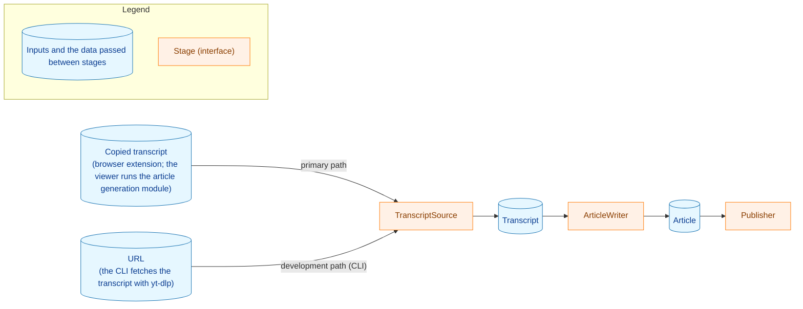

# CLAUDE.md

This file provides guidance to Claude Code (claude.ai/code) when working with code in this repository.

## Quick Links

**Project:**
- [Project Overview](docs/dev/project_overview.md) - Decided policies, pipeline, constraints, configuration (Japanese). **Read this before designing anything.**
- [Production Profile](docs/dev/production_profile.md) - The production profile (the template, provider, model, and effort of each step), the quality target and the results behind it, and the product limitations of this profile (Japanese)
- [Security Considerations](docs/dev/security.md) - yt-dlp invocation, secrets, network, cache, untrusted text
- [Cache Consistency](docs/dev/cache_consistency.md) - What the transcript cache guarantees across failures and power loss, and why (Japanese). Check its checklist before changing cache code.
- [ADR Index](docs/dev/adr/README.md) - The major design decisions in effect now, each with its reasons, the alternatives not taken, and its history across tasks (Japanese). Look here for the current decisions and their reasons before designing.
- [ADR Convention](docs/dev/conventions/adr.md) - How to write, change, and retire an ADR

**Development Guides:**
- Requirements and Acceptance Criteria Process: [requirements_process.md](docs/dev/conventions/requirements_process.md) - Process for implementing new features
- Test Organization Guide: [test_organization.md](docs/dev/conventions/test_organization.md) - Test helper file organization
- [Package Reference](docs/dev/conventions/package_reference.md) - A one-row summary of each package's responsibility, its main exported names, and where its detailed specification lives
- [Updating the Pricing Table](docs/dev/guides/pricing_update.md) - How to update the LLM rate table in `internal/pricing`
- [Claude Output Limit](docs/dev/guides/claude_output_limit.md) - When and how to re-measure the basis of the Claude adapter's default output limit (`max_tokens`)
- [OpenAI Output Limit](docs/dev/guides/openai_output_limit.md) - When and how to re-measure the basis of the OpenAI adapter's default output limit (`max_output_tokens`)
- [mergepr Guide](docs/dev/guides/mergepr_guide.md) - Setup, usage, guarantees, and troubleshooting for the `/mergepr` tool
- [fixprguard Guide](docs/dev/guides/fixprguard_guide.md) - Setup, subcommands, guarantees, scope rules, and recovery for the `fixprguard` guard tool for `/fixpr` and `/runpr`
- [chief Guide](docs/dev/guides/chief_guide.md) - Setup, usage, guarantees, the settings' herdr denials, and known limits of the `chief` tool that `/chief` drives. The subcommands, flags, output, state directory, and records are specified in [chief Architecture](docs/dev/chief_architecture.md)
- [tools Guide](docs/dev/guides/tools_guide.md) - Purpose and usage of the developer scripts under `tools/`: the low-cost `/chief` launcher and the scripts that estimate `/chief`'s token cost
- [numreserve Guide](docs/dev/guides/numreserve_guide.md) - Installation, invocation, stop reasons and what to do next, the record ruleset and removing a wrong record tag, and the cloud-session limits of the `numreserve` tool that decides task and ADR numbers
- [Developer Tools](docs/dev/conventions/dev_tools.md) - Rules for adding or changing a developer tool: write it in Go with tests, install installed tools from `main` (the user installs them; agents never install or build them), and keep its arguments, output, and exit codes as a contract

## Documents

- Documents should be placed under docs. Exception: `README.md`, its
  English version `README.en.md`, and `INSTALL.md` sit at the repository root
  (`INSTALL.md` sits there so users can find it next to the README and
  GitHub Releases and zip packages can point to it directly; see "Document
  language" below).
- A document's language follows "Document language" below.
- Default format is markdown
- Use Mermaid for diagrams, following the conventions in
  [mermaid_reference.md](docs/dev/conventions/mermaid_reference.md) (node-label
  quoting, `<br>` line breaks, cylinder `[(...)]` data nodes, the standard classDef
  palette, and Legend blocks).
- Japanese documents use bold and structure a section with many items as
  [document_formatting.md](docs/dev/conventions/document_formatting.md) says
  (labels and easy-to-miss qualifiers only; a summary first, then subheadings or
  nested lists).
- Each task lives in `docs/tasks/NNNN_<name>/` (four-digit sequence number).
  `docs/tasks/0000_template/requirements.md` is the starting point for
  `01_requirements.md`.

### Document language

A document's language follows from who reads it and who approves it, not from
where it lives. Three principles decide it:

- **(a) Japanese: documents a human decides on or approves, and guides for
  humans.** Task documents under `docs/tasks/`, the documents directly under
  `docs/dev/` (such as `project_overview.md` and `security.md`), the ADRs
  and their index under `docs/dev/adr/`, `docs/translation_glossary.md`, the
  guides under `docs/dev/guides/`, the research records under
  `docs/research/`, and `prompts/README.md` and `testdata/README.md`.
- **(b) English: instructions that control an agent's run, and the code in the
  repository.** `CLAUDE.md`, `AGENTS.md`, the command definitions under
  `.claude/commands/`, the Antigravity skill entries under `.agents/skills/`, the conventions under `docs/dev/conventions/` that agents
  follow, and source code with its comments, identifiers, and string literals
  ("Language" below, and "Go Idioms" for the literal exceptions). The
  principle governs the language of the instruction text itself: an
  instruction may give an agent a principle-(a) document to read as material,
  such as a task document to implement or `security.md` to check against.
- **(c) The end-user document: Japanese primary, English kept in sync.** The
  end users are the users of the browser extension, and their document is the
  README: `README.md` is the primary version, in Japanese, and `README.en.md`
  is its English version. `INSTALL.md` at the root is also an end-user
  document, written in Japanese only for now. The Japanese text of both is
  addressed to the reader and uses the polite form (です・ます); quoted
  messages from the extension's catalog stay as they are. Other Japanese
  documents keep the plain form (である). The readers of the end-user
  documents are general users who are somewhat comfortable with IT but are
  not engineers. Write them in plain words: do not assume knowledge of
  programming, of the browser's internals (storage areas, permissions,
  service workers), or of an API's terms, and explain a necessary term where
  it first appears or link to where it is explained. Technical detail belongs
  in the developer documents.

Applied to directories: `docs/dev/conventions/` is English, and
`docs/dev/guides/` and `docs/research/` are Japanese. A new document takes the language its reader and
approver give it under these principles.

Exceptions:

- **The bilingual README.** The README is the only document kept as a
  translated pair of two files (`README.md` and `README.en.md`). Change
  `README.md` first, then
  carry the change to `README.en.md` with `/mktrans` ("Translation Guidelines"
  below).
- **The Chrome Web Store listing in one bilingual file.**
  `docs/store/chrome_web_store.md` holds both the Japanese and the English
  detailed description, and it stays outside the two-language sync of
  `/mktrans` and `TestReadmeSyncMarker` ([ADR-0035](docs/dev/adr/0035-language-policy.md)).
  Change both languages together in that one file. Reason: the listing is a
  final text pasted into the store, not a document translated change by change.
- **`INSTALL.md` in Japanese only (time-bounded).** `INSTALL.md` is an
  end-user document (principle (c)), but it is kept in Japanese only until the
  extension is submitted to the Chrome Web Store, because initial zip users are
  Japanese speakers. Adding its English version and generalizing `/mktrans` and
  the sync checks are tracked in `#1044`.
- **Where `README.en.md` lives.** It sits at the repository root next to
  `README.md`, not under `docs/`. Reason: an English reader moves from the link
  at the top of `README.md` to the English version at the same level, and
  GitHub lists it next to the README it shows at the root.
- **Japanese guides an agent reads.** A command definition under
  `.claude/commands/` (`_context.md` and `_lib/` included) may refer an agent to
  a Japanese guide under `docs/dev/guides/` as the manual of a tool the command
  drives (today `fixpr.md` and `_context.md` refer to `fixprguard_guide.md`,
  `mergepr.md` to `mergepr_guide.md`, and `chief.md` to `chief_guide.md`), an exception to principle (b), because
  the agent follows the guide as instructions rather than reading it as
  material. Scope: only a command definition's reference to a guide under
  `docs/dev/guides/`; every other instruction an agent follows stays English.
  Reason: a guide is written for a human using a tool, and keeping the same
  content in English as well would bring back the double maintenance the
  guides left behind. An agent reads Japanese.

### Translation Guidelines (Japanese to English)

The only translation pair is `README.md` (Japanese, primary) → `README.en.md`
(English). Change `README.md` first, then run `/mktrans README.md`, which
carries the change into `README.en.md`, and commit both in one commit. When `README.en.md` does not
exist yet, `/mktrans` run by itself makes a full translation (and stops when
`README.md` is not in Japanese), while the sub-step another command runs does
nothing. The first line of `README.en.md` is a sync marker naming the blob of
the `README.md` content it was translated from; `/mktrans` translates the difference between that blob and the current
`README.md` and then updates the marker. `TestReadmeSyncMarker` checks the
marker against the current `README.md`; it runs in `make test`, in CI's
`doc-guard` job, and in a pre-commit hook for the two READMEs
(`make readme-sync-check` runs it alone), so a `README.md` change is not
committed or merged without the sync, whoever makes it. `/runplan`, `/fixpr`,
and `/runpr` run `/mktrans` when the check fails. `/mktrans` stops
and asks on any other file. The translation principles (accuracy over fluency,
faithful translation, structural consistency) and the glossary workflow live in
[mktrans.md](.claude/commands/mktrans.md); the glossary is
[docs/translation_glossary.md](docs/translation_glossary.md).

### Design decisions (ADR)

Major design decisions are recorded as ADRs under `docs/dev/adr/`, one living
document per subject, listed in the index
[docs/dev/adr/README.md](docs/dev/adr/README.md). How to write, number,
change, retire, and withdraw an ADR is in the convention,
[docs/dev/conventions/adr.md](docs/dev/conventions/adr.md); follow it.

- **Rule:** a PR that makes or changes a major decision creates or updates the
  ADR in the same PR. This applies to every PR and every change to one,
  including changes made outside the commands that settle decisions (a
  `/fixpr` round, a standalone PR). The PR's review and merge
  approve the ADR. The same rule is in the convention ("Approval and the
  PR"); when you change it, change both in the same PR.
- **What counts as major:** a decision whose effect reaches beyond the task
  that makes it: it binds later tasks or more than one component, or
  reversing it would change more than one place. Examples are the structure
  and the boundaries between components, a protocol, an external dependency
  or service, a security assumption, the product's scope, and a policy on the
  development process and its tools. A decision that changes the decision of
  an existing ADR is always major. A decision that closes inside one task — a
  test's name, a wording, the shape of one function, the value of a constant,
  the order of implementation — is not major and stays in the task documents
  only. The same criterion is in the convention ("What counts as a major
  decision"); when you change it, change both in the same PR.
- **Who holds what:**
  - A task document records the decisions its task made, with their reasons,
    and links to the ADR of each major one. The link is required of task
    documents written after this rule reached `main`; existing task documents
    are not changed to add one.
  - An ADR holds the summary of the decision in effect, its reasons, the
    alternatives not taken, and its history across tasks.
  - A document that holds the current specification of a subject (such as
    `docs/dev/security.md` or `docs/dev/production_profile.md`) keeps that
    specification; the ADR summarizes it and links to it.
  - `docs/dev/project_overview.md` keeps the summary of the current policies
    and links to the ADRs.
  - The rules and cross-cutting principles of this file are not ADRs.

  The split between an ADR and a document that holds the current
  specification is also in the convention ("Writing an ADR"); when you change
  it, change both in the same PR.

## Language

- **Conversation in an interactive agent session (Claude Code, Antigravity CLI, and
  any other harness): Japanese.** This includes the
  explanation of test results, tool output, and review findings.
- **Code and commit messages in the git repository: English** — source code,
  comments, identifiers, string literals (with the literal exceptions in "Go
  Idioms"), and commit messages. A squash commit's subject and body are
  English too: `/mergepr` writes the subject from the PR material
  (`.claude/commands/mergepr.md` step 2), not by copying the PR title.
  Documents in the repository (under `docs/`, the README, and the instruction
  files) follow "Document language" above.
- **Prompts to AI: English** — subagent prompts, review prompts, the
  command definitions under `.claude/commands/`, and the skill entries under
  `.agents/skills/`.
- **What lives on GitHub: Japanese** — PR titles, PR descriptions, issues,
  review replies, and PR comments. A PR title keeps its conventional-commit
  prefix in ASCII and writes the summary after it in Japanese; the forms are in
  `.claude/commands/_context.md`, "PR title and squash subject". The exception
  is a bot command, such as a PR review request (`_context.md`, "PR reviewers").

## Commands

### Build Commands
- `make build` - Build the CLI (`yt2column`) into `build/`; it installs nothing. The extension's builds are `make ext-build` and `make ext-build-dev` (below)
- `make clean` - Clean build artifacts
- `make all` - Default build target
- `make install-mergepr` - Install the `/mergepr` developer tool (`go install ./cmd/mergepr`)
- `make install-fixprguard` - Install the `fixprguard` guard tool (`go install ./cmd/fixprguard`); rerun it after a merge that changes the tool
- `make install-chief` - Install the `chief` developer tool that `/chief` drives (`go install ./cmd/chief`); rerun it after a merge that changes the tool
- `make install-numreserve` - Install the `numreserve` developer tool, which decides a task or ADR number by creating a record tag on GitHub (`go install ./cmd/numreserve`); rerun it after a merge that changes the tool

### Test Commands
- `make test` - Run all tests with race detection, then `make test-parse-norace`
- `make readme-sync-check` - Run `TestReadmeSyncMarker` alone: `README.en.md`'s sync marker names the blob of `README.md` (passes while `README.en.md` does not exist); the pre-commit hook for the READMEs runs it
- `make coverage-compare BASE=<commit>` - Run the Go test suite at BASE and at HEAD with coverage and compare the product code's coverage function by function; the last line is `coverage-compare: PASS`, `FAIL`, or `STOP <kind>`. For a commit that deletes Go tests, with its parent as BASE
- `make test-parse-norace` - Run `TestParseCopiedLargeInputs` alone without race detection; the parse-time deadline is checked only in builds without race detection, so this target and the plain `go test` commands below check it and `make test`'s race run does not
- `go test -tags test -v ./...` - Run all tests directly
- `go test -tags test -v ./internal/specific/package` - Run tests for specific package

### Code Quality
- `make lint` - Run golangci-lint (version pinned in `Makefile`; includes `govet`) and `make wasm-check`
- `make wasm-check` - Build the two article generation modules (`cmd/yt2column-wasm` and the development `cmd/yt2column-wasm-dev`), and with them every package they depend on, for `GOOS=js GOARCH=wasm`, and vet the packages with a file only a js build compiles (`internal/llm/llmhttp`, `internal/llm/claude`, `internal/extjob/jsmodule`, and the two modules) along with `internal/writer` and `internal/transcript`, so the core stays buildable as WebAssembly (it checks the build only, not run-time behavior); CI's `lint` job runs it too
- `make fmt` - Format changed Go files with gofumpt (`make fmt-all` for every file)
- `make deadcode` - Report unreachable functions across the whole module and its
  tests (`test` and `integration` tags); any output or non-zero exit status fails

### Claude Commands (`.claude/commands/`)
Project-specific values these commands depend on are defined once in
[_context.md](.claude/commands/_context.md). The command definitions under
`.claude/commands/` are the single source of each procedure and, except `chief.md`
(which stays on Claude Code), are written independently of the harness
(Claude Code or Antigravity CLI): they name
abstract operations, and the adapter that
[_lib/harness.md](.claude/commands/_lib/harness.md) selects for the session
(`_lib/harness-claude.md` or `_lib/harness-antigravity.md`) maps them to the
harness's tools and models. `.agents/skills/<command>/SKILL.md` is the thin
entry through which Antigravity CLI finds each command except `/chief`; it only
points at the command definition, `_context.md`, the adapter, and the
prohibitions of this file and `AGENTS.md`, and copies no procedure.
- `/mkreq <issue> [task]` - Create `01_requirements.md` from a GitHub issue and open its PR, after asking whether the task takes the full process or the simple process; in the simple process it also writes `02_architecture.md` and `03_implementation_plan.md` and opens one PR for the three documents
- `/mkarch <task>` - Create `02_architecture.md` (requires approved requirements) and open its PR; it stops without writing for a task that takes the simple process, whose documents `/mkreq` writes
- `/mkplan <task>` - Create `03_implementation_plan.md` with its PR boundaries (requires approved architecture) and open its PR; it stops without writing for a task that takes the simple process, whose documents `/mkreq` writes
- `/mkplan2 <task>` - Embed PR boundaries into an approved plan that lacks them (plans written before `/mkplan` did it) and open its PR
- `/runplan <task>` - Implement the phase groups of an approved plan up to the next PR checkpoint, then open the PR
- `/runpr [PR | branch | task]` - Drive a PR through CI and its review threads, record its bookkeeping (a document's approval, a plan checkpoint), merge it, and show the next command, which it does not run; it requests a PR review (CodeRabbit or Sourcery AI) only when the user chooses it in the merge question; for a standalone change it also creates the PR
- `/weakreview [range | PR] [--no-fix | --fix]` - High-model review of a commit range: a correctness review and a weak-model failure review run on the harness's high-role model in one pass; by default it fixes the Critical and Major findings and commits the fixes on the current branch without pushing, and `--no-fix` only reports
- `/fixpr [PR]` - Resolve unresolved PR review threads
- `/mergepr [PR]` - Squash-merge a PR with a generated commit message and clean up its branch
- `/mergemain <PR>` - Merge `origin/main` into a PR's branch through `mergepr`, resolve allowed conflicts (`.md` files and protocol-number declarations), apply take-in rules, run checks, and push to the PR's head branch (or restore and report on stop)
- `/japrose <file>` - Japanese prose-quality pass
- `/mktrans README.md` - Carry `README.md` changes into `README.en.md` (the only translation pair)
- `/chief [once]` - Show the task workspaces in Herdr, ask the human about what waits on them, and keep watching, sending the next command after a merge by itself; `once` shows and asks once without watching. It also starts a new task from an issue the human names, making its worktree and workspace and sending `/mkreq`, and removes a finished task's workspace that it made, after the human confirms. It also finds an open PR in a merge conflict and sends `/mergemain` to its workspace by itself when every condition holds, or when the human chooses it; the human decides the merge afterwards. Run it in a Claude Code pane of its own Herdr workspace ([chief_guide.md](docs/dev/guides/chief_guide.md))

Each task PR is handled by two commands. The command that produces it —
`/mkreq`, `/mkarch`, `/mkplan`, `/mkplan2`, or `/runplan` — works on its own
feature branch, reviews its work (subagent review, `japrose` for documents,
the local CodeRabbit CLI review),
opens the PR, pings the reviewer, and stops. Before it opens the PR, it also
runs the cross-check partial review (`_lib/cross-check-review.md`): a worker on
the harness's cross-check-role model (Fable on Claude Code) reviews only the places that meet its scope criteria (a trust boundary, the
prior documents, a claim about outside behavior, a choice made without
asking), in parallel with the local CLI review, whose triage takes its
findings; `/runplan` runs it once per PR, with the last phase group before
the PR, and its checkpoint reviews the commits a valid record does not
cover. When that model cannot run, the command records `not run` and goes on.
`/mkreq`,
`/mkarch`, and `/mkplan` first ask the human about the decisions their input
leaves open; `/runplan` asks when implementation meets a decision change.
Before it opens the PR, `/runplan` also runs the high-model review
(`_lib/high-review.md`: a correctness review and a weak-model failure review
on the high-role model, whose Critical and Major findings it fixes) when the PR's
implementation model requirement is `high`, `standard+high-review`, or
unreadable (an old value reads as a new one through the table of `_context.md`, "PR marker conventions"),
and some commit of the PR is not recorded as implemented on a high-role model. After reviewing, the reviewer runs `/runpr`, which drives
it: it waits for CI and resolves the threads with `/fixpr`. It
then asks, after a deferred question when deferred review threads are left, the
merge question that decides the bookkeeping (for a document, its
`approved` status) and the merge with `/mergepr`, and shows the next command
when there is one; the user runs it, which opens the next PR and stops again.

CodeRabbit reviews a PR only when it is asked (`.coderabbit.yaml` turns its
automatic review off), while Sourcery AI reviews a PR automatically on push as
well as when it is asked. Both reviewers are in the `PR reviewers` table of
`_context.md`, which holds each one's profile, request comment, and accepted
request texts. `/runpr` waits while a manual request comment is outstanding,
whether the user chose it in the merge question or wrote it by hand. It also
waits up to fifteen minutes for an automatic Sourcery AI review running on
`head`, handles the threads it opens, and shows its state and URL in the merge
question's summary, but does not count its completion as reviewed. CodeRabbit's
allowance is shared across the user's PR reviews. Later changes are reviewed
with the CodeRabbit CLI, whose allowance is separate from the PR review's.
`/runpr` never requests a PR review by itself: it turns the escalation's
answer into a recommendation in the merge question (its "先に PR レビューを依頼"
option) and, when the user chooses it, asks which reviewer to request
(CodeRabbit, Sourcery AI, or back to the merge question) and posts only that
reviewer's request comment
([pr-review-escalation.md](.claude/commands/_lib/pr-review-escalation.md)).
For a change that falls only under the escalation's other criteria, the
local review stands in when the branch's records show it saw every commit
since the last completed review (`_lib/review-records.sh`, run from
`origin/main`); otherwise the merge question recommends the PR review.

### Extension Commands

The Chrome/Brave extension lives in `extension/` (TypeScript). Its Node.js
version is pinned in `extension/.node-version`; every `ext-*` target below
refuses to run when `node --version` does not match.
- `make ext-preflight` - Check that the pinned Node.js and npm versions and `extension/node_modules` are present (never installs dependencies)
- `make ext-install` - Install the pinned dev dependencies with `npm ci` (needs the network)
- `make ext-typecheck` - Type-check with `tsc`
- `make ext-lint` - Lint with ESLint
- `make ext-fmt-check` - Check formatting with Prettier
- `make ext-fmt` - Rewrite files with Prettier (CI runs `ext-fmt-check` instead)
- `make ext-test` - Run the extension unit tests (`node --test`)
- `make ext-build` - Build into `extension/dist/` and check the output; the build also runs `go` (with `GOTOOLCHAIN` set to `go.mod`'s version, which the first build may download) to build the release article generation module (`cmd/yt2column-wasm`) and copy that toolchain's `wasm_exec.js`
- `make ext-build-dev` - Build the development extension into `extension/dist-dev/` and check the output: the development article generation module (`cmd/yt2column-wasm-dev`) on the fake LLM, with the scenario chosen by `FAKE_ARTICLE`, `FAKE_FAILURE`, `FAKE_FAIL_AT`, `FAKE_DELAY`, and `FAKE_SETTINGS_CHECK` (defaults in `Makefile`), and a manifest without `key`; see [development.md](docs/dev/guides/development.md)
- `make ext-check` - Run the checks CI runs after `ext-install`: typecheck, lint, fmt-check, test, build, build-dev
- `make ext-coverage-compare BASE=<commit>` - Run the extension test suite at BASE and at HEAD with coverage and compare, function by function, whether each product function that ran still runs; the last line is `coverage-compare: PASS`, `FAIL`, or `STOP <kind>`. For a commit that deletes extension tests, with its parent as BASE

## Architecture Overview

yt2column turns a YouTube video into a magazine-column-style article with an
LLM. The primary path runs in the browser alone: the extension collects the
transcript copied from YouTube's transcript panel, and its article generation
module (Go built to WebAssembly) generates the article inside the viewer tab,
calling the Anthropic API with the API key the user saved on the options page.
The extension shows the article in its viewer page, from which the user
chooses to save it as a Markdown file or copy its Markdown. The CLI is the
development path: it takes a video URL and fetches the transcript with
`yt-dlp`.



- `TranscriptSource` (`internal/transcript`): `CopiedSource` implements it by
  parsing the copied transcript text a user takes from YouTube's transcript
  panel (the primary path). `YtDlpSource` (`internal/ytdlpsource`) fetches
  subtitles and info.json by invoking the external `yt-dlp` command, parses
  json3, and caches per video ID (the CLI uses it); it lives in its own package
  so `internal/transcript` can be built for WebAssembly.
- `internal/strictjson`: strict JSON extraction shared by several packages
  (the list of them is in [package_reference.md](docs/dev/conventions/package_reference.md));
  rejects the byte sequences and structural shapes `encoding/json` would
  silently repair.
- `ArticleWriter` (`internal/writer`): provider-independent prompt assembly and
  output post-processing; calls an `LLMClient`. After generation it runs the two
  post-generation steps by default: shorten an over-long body with the
  generation client, then review the article against the source material with a
  separately configured provider and model, applying the returned list of
  corrections.
- `LLMClient` (`internal/llm`, implementations in `internal/llm/<provider>`):
  thin per-provider adapter — system + user prompt in, text out. `deepseek`,
  `claude`, and `openai` (the Responses API) exist today;
  `internal/llm/llmhttp` holds the HTTP send path they share (redirect
  refusal, body cap, failure classification),
  `internal/llm/claudeparam` holds the Claude effort and workspace-ID types that
  `internal/config` and `internal/llm/claude` share,
  `internal/llm/deepseekparam` holds the DeepSeek `reasoning_effort` type that
  `internal/config` and `internal/llm/deepseek` share, and
  `internal/llm/openaiparam` holds the OpenAI reasoning effort type that
  `internal/config` and `internal/llm/openai` share.
  `internal/llm/devfake` is not a production adapter: it is the fake the
  development article generation module (`cmd/yt2column-wasm-dev`) and the
  development command (`cmd/yt2column-extjob`) link, returning fixed articles
  and selected failures without an LLM, and no production binary may depend
  on it.
- `Publisher` (`internal/publisher`): local file (`FilePublisher`). The package
  also builds the neutralized display Markdown the viewer displays and copies.
- `internal/pipeline` orchestrates the stages; `internal/config` reads environment
  variables for the CLI and the two settings the extension saved for the
  article generation module; `cmd/yt2column` wires everything together.

Two entry points share the stages: the CLI (`cmd/yt2column`, above), which runs
them through the pipeline, and the article generation module
(`cmd/yt2column-wasm` + `internal/extjob`, with the `syscall/js` registration in
`internal/extjob/jsmodule`), which the browser extension loads into a Worker of
the viewer page. The extension's service worker coordinates the jobs and is the
only writer of the job records in `chrome.storage.session`; the viewer that
runs a job takes its input from the service worker, calls the module, and
reports progress and the result; the popup and the viewers show the records
through their change events. The options page saves the Anthropic API key and
workspace ID in `chrome.storage.local`. The extension starts no server and no
host. `internal/privatefile` (the checked read and the safe
creation of files only their owner may read) serves `internal/chief`,
`internal/redact` redacts secrets from every output, and `internal/signalrun`
handles signals for the CLI.

See [Project Overview](docs/dev/project_overview.md) for the decided policies and
constraints, and [Package Reference](docs/dev/conventions/package_reference.md)
for the packages that exist today. The extension's overview is documented in the
[README](README.md) (and its English version, `README.en.md`), its installation
and usage procedures in [INSTALL.md](INSTALL.md), its build, loading, job records,
and development build in [development.md](docs/dev/guides/development.md), and
its security rules in `docs/dev/security.md` §8.

### Key Design Patterns
- **Separation of Concerns**: Each package has a single responsibility. Core logic
  stays out of `cmd/`, so the CLI and the article generation module share it and a further
  entry point can be added without touching it.
- **Interface-based Design**: Every pipeline component (`TranscriptSource`,
  `ArticleWriter`, `LLMClient`, `Publisher`) is an interface with a fake for tests.
- **Provider details stay in their adapter package**: request/response shapes of
  a provider API (e.g. DeepSeek's `thinking` parameter and `reasoning_content`)
  live only under `internal/llm/<provider>`. If a provider SDK is added later
  (for example `google.golang.org/genai` for `internal/llm/gemini`), it is
  imported only there; `depguard` in `.golangci.yml` already enforces that.
- **Delegate the fragile part**: subtitle retrieval is delegated to `yt-dlp`. Do
  not reimplement YouTube scraping in Go. Exception: the copied-transcript parser
  (`internal/transcript`) depends on the format of YouTube's transcript-panel
  output, an undocumented and fragile format. The dependency is confined to that
  parser — no Go code fetches or parses YouTube's page or panel — and the
  `yt-dlp` retrieval path stays as the fallback while the panel format is
  rejected.
- **YAGNI**: Use simple and clear approach to satisfy the requirement. Don't take complex approach for not-yet-planned features. No LangChain-style frameworks or multi-provider abstraction libraries.
- **DRY**: Don't repeat yourself. Before adding new code, check the codebase and prefer reusing existing implementations.
- **Declare, don't infer**: Do not choose behavior by inspecting the content of a
  string supplied by a caller (`strings.Contains`/`HasPrefix` over caller data to
  pick a code path). Put the choice in the type: an enum field whose zero value is
  the interpretation that assumes least about its input, dispatched by a `switch`
  whose `default` fails secure. Changing a struct's shape is cheap here — the
  project has no consumers outside the repository, so "it would change the exported
  API" is not on its own a reason to keep inferring.
  Exception: the copied-transcript parser (`internal/transcript`) chooses behavior
  by inspecting the content of the `Raw` string. Scope: it parses the copied
  transcript format — form A and form B, the timestamp grammar, and the
  arrangement of timestamp, screen-reader label, and text — to build segment
  boundaries and `Segments`; this parse is the only place the text's content
  selects behavior. Reason: that string is produced by YouTube's transcript panel
  and copied by the user, an external value the caller (the browser extension, the
  article generation module) cannot express in a type, and the format is YouTube's UI contract, so
  changing our type would not change the input. Boundary: the exception covers only
  the copied-transcript parser in `internal/transcript` and the `Raw` parse in
  `CopiedSource`; an input that matches neither form is rejected, not accepted by
  widening the interpretation.
  The parse also skips four kinds of panel line that are not segments: the
  prefix before the first segment line, form A chapter heading lines
  (`Chapter N: ` or its Japanese equivalent, followed by a title), form B
  headings at a timestamp-expected position, and the trailing region of blank
  lines and operation labels such as `Sync to video time`. These skips keep the
  boundary: the prefix ends where the timestamp grammar finds the first segment
  line; a form B heading is identified by its position, not its content; and
  after the first segment line only the explicitly defined lines are skipped. A
  prefix or form B heading-position line that could be a damaged timestamp (a
  digit-colon-digit run, a control character, or in form B a whitespace-only
  line) is rejected, not skipped.
  Exception: the browser extension's locale resolution (`resolveLocale` in
  `extension/src/core/i18n/locale.ts`) chooses the display language by
  inspecting the content of the browser's UI-language string. Scope: it compares
  the part of that string before the first `-`, lowercased, with the keys of
  `locales`; this is the only place the UI-language string's content selects
  behavior, and everything after it passes only a `Locale` value and chooses
  behavior by `switch` or `Record` key. Reason: the UI language is an external
  value returned by the browser (`chrome.i18n.getUILanguage()`), which the
  extension cannot express in a type. Boundary: the exception covers only
  `resolveLocale`; a value that matches no locale is not interpreted more
  widely but resolves to English. "Reject, don't normalize" does not apply: a
  UI language other than Japanese is not malformed input but a valid one that
  the extension shows in English.
  Exception: the browser extension's article parse (`parseArticleMarkdown` in
  `extension/src/core/articleMarkdown.ts`) chooses the blocks and inline
  pieces of the viewer's article by inspecting the content of the display
  Markdown. Scope: it reads the display Markdown by the fixed block and inline
  rules of `docs/tasks/0063_viewer_markdown/01_requirements.md` §3.2 (the
  decision is ADR-0017) and returns a typed article tree; this is the only
  place the article's content selects behavior.
  Reason: the display Markdown is an LLM's output and a channel name, external
  values the extension cannot express in a type, and drawing it is the
  purpose of the viewer's article display. Boundary: the exception covers
  only `parseArticleMarkdown`; an input that matches no rule is not
  interpreted more widely but is kept as text, and a link is made only from
  an `https` autolink that meets every link condition, as the `LinkUrl` type.
  Exception: the coverage-compare tool's input parsers choose behavior by
  inspecting the content of the reports and the diff they read
  (`parseTAP` in `internal/coveragecompare/tap.go`, `parseLCOV` in
  `lcov.go`, and `parseDiff` in `diff.go`). Scope: the parse of those three
  inputs only — a TAP line's `# tests`, `# fail`, and `# cancelled` summary
  prefixes, its `not ok` lines, and the `---`/`...` diagnostic block with its
  `location:` line; an lcov line's record prefix (`SF:`, `FN:`, `FNDA:`,
  `end_of_record`, and the record kinds it reads past); and a diff line's
  header, mode, `---`/`+++`, `@@`, and hunk-line prefixes. Telling extension
  product code from other files by the `extension/src/` and
  `extension/scripts/` path elements is part of it. The `go test -json`
  events are not: they are chosen by their declared `Action` member. Reason:
  the inputs are text written by `node --test`'s TAP and lcov reporters and
  by `git diff`, external values the tool cannot express in a type, and none
  of the three formats has a structured member that declares a line's kind.
  Boundary: an lcov record or diff line that matches no accepted form stops
  the run, and a missing, repeated, or malformed TAP summary line stops it;
  the only lines read past are the lcov record kinds the requirements list
  and the TAP lines that are neither a summary nor a failure.
  Exception: the mention neutralization in `internal/publisher`
  (`NeutralizedDisplayMarkdown` and `NeutralizeHeading`, with the rule in
  `neutralizeAts` in `mention.go`) chooses where to insert U+200B by
  inspecting the content of the display Markdown, the video title, and the
  channel name. Scope: it finds the '@' units (a raw '@' or a look-alike, and
  a character reference that can stand for '@'), judges whether each is a
  target and, in the display Markdown, whether it is a URL path '/@', and
  inserts U+200B after the targets it does not keep; this is the only place
  their content selects behavior, and the article generation module's result
  passes on only the resulting strings and a boolean. Reason: the display Markdown is an
  LLM's output with a title and a channel name from outside, external values
  the article generation module cannot express in a type, and judging them is the purpose of the
  neutralization. Boundary: a form the rule is unsure of is neutralized, not
  kept: only an '@' inside a word and a URL path '/@' that meets every
  condition are left as they are; and the neutralization inserts U+200B and
  changes no other character.
  Exception: `fixprguard review-state` (`internal/fixprguard/review_state.go`)
  chooses behavior by inspecting the content of a reviewer check run's `name`,
  `status`, `conclusion`, and `title`, and `fixprguard mentions`
  (`internal/fixprguard/mentions.go`) chooses behavior by inspecting PR comment
  and review bodies. Scope: `review_state.go` requires `name` to match the
  declared check-run name of the caller's `ReviewProfile` (`CodeRabbit` for
  `coderabbit`, `Sourcery review` for `sourcery`) exactly, compares the check
  run's `(status, conclusion, title)` triple against that profile's fixed
  classification table (`checkRun.kind`) and nothing else about the check run's
  text, and prints only the resulting kind, never the title; `mentions.go`
  inspects a comment or review body only for (1) exact
  first-line matches (after stripping a single trailing CR) against the
  observed fixed status-comment headers declared for each `ReviewProfile` and
  Sourcery's fixed-format 7-day budget notice first line matching the
  authenticated user's login and an ASCII digit/comma count (`Bot` accounts
  with the matching `[bot]` login only, and for `ProfileSourcery` conversation
  comments only), (2) exact full-body matches (after
  `strings.TrimSpace`) against the caller-supplied manual request texts via
  `isRequestComment` (conversation comments by the authenticated `User` only),
  and (3) ASCII case-insensitive substring matches against `RejectedMentions()`,
  and never prints a body. Reason: the check run name and title and comment or review
  bodies are written by reviewer services and GitHub accounts, external values
  the tool cannot express in a type, and verifying the check run name,
  classifying check runs per profile, excluding
  observed bot status comments and the user's own manual requests, and
  detecting rejected mentions are the purposes of these checks. Boundary: in
  `review_state.go`, a check run whose `name` does not match the profile's
  declared name is rejected (`UnreadableRejected`), a `COMPLETED` triple that
  is not in the profile's table is
  `RunUnknown` and is never read as a finished review, names and titles are
  compared in full and not repaired, and a status other than `COMPLETED` is a
  run in progress whatever its title; in `mentions.go`, any item whose author kind,
  login, or first line does not match an observed status-comment rule exactly
  is not excluded (a `User` with a matching login or a non-matching header is
  never excluded), bodies are compared without repair, and the output carries
  only source, URL, timestamps, and author booleans, never body text.
  Exception: the chief tool's screen readers (the files of `internal/chief`
  whose names start with `screen`) choose behavior by inspecting the content
  of an agent's pane screen and of Claude Code's transcript. Scope: they read
  whether an agent waits on a question and the question's shape
  (single-select, multi-select, tabbed, permission), the question and option
  texts, whether it is `/runpr`'s merge question, the unsent text left in the
  input line, OpenCode's model line and its screen after `/new`, the NEXT of a
  `/runpr` report, the last report on a pane and the PR numbers it names
  (an OpenCode pane's from its screen, a Claude Code pane's from the last
  finished response of its transcript), and the transcript's record of a
  model switch, of the human's last command, and of the human's last task
  command with whether the human typed anything after it, never what (a
  line is the human's only by the origin Claude Code declares on it, never
  by its text), and of the text of the last finished response; a PR record is
  a value the transcript declares and is not in scope; the chief session's
  summary of the report of the command that created a PR is in scope too. Every other file of the tool, other than the two
  status table files of the exception below, chooses behavior only by the
  types the screen readers return. Reason: the screens are drawn by
  Claude Code and OpenCode and the transcript is written by Claude Code,
  external values the tool cannot express in a type, and OpenCode's question
  screen cannot be changed. Boundary: a screen that matches no shape read
  from the real samples under `internal/chief/testdata/screens/` is not read
  more widely but read as unmatched, which marks the workspace as needing a
  check or sends nothing (a transcript line likewise, from the samples under
  `internal/chief/testdata/transcript/`); a report in a transcript is read
  only in a shape read from those samples, and any other is read as no
  report (a kind or a value the samples do not show) or as unreadable (a
  line the reader uses that lacks a member or holds one of another type);
  and the trigger of chief's automatic send is the
  state of GitHub and git, never a screen: a screen reading only stops a send
  or narrows its conditions.
  Exception: the chief tool's status table (`internal/chief/table.go` and
  `internal/chief/textwidth.go`) chooses behavior by inspecting the content
  of the values the table shows. Scope: it counts each character's display
  width (`textwidth.go`, by a table of East Asian Width generated from one
  fixed Unicode version) and decides where the content column and the name
  column break and are cut (`table.go`); this is the only place those
  values' content selects behavior. Whether a newline or a tab shows as a
  space is chosen by the kind `sanitizeUnits` declares on each unit
  (`displayUnit.kind`), and whether a question pane shows its tab's label or
  its pane ID by the value the tab list reader declares
  (`tabLabel.hasLabel`), so neither reads the content; reading an empty
  label as no label is the Herdr reader's work (`herdr.go`), which checks
  the output's shape and moves it into the type. Reason: the values are text
  other agents, GitHub, Herdr, and the human write, external values the tool
  cannot express in a type, and lining up columns on a monospace terminal
  needs each character's width, which only its content gives. Boundary: the
  result is used for the table's layout only, never to decide what is sent,
  a row's state or urgency, or the values of `rows`; a value is changed only
  by the cap on its length, by dropping the spaces at a break, before a cut,
  and at the end of a line, and by the ellipsis put where it is cut; and the
  split into display
  units is `Sanitize`'s own rule, so `sanitize.go`, which chooses a
  replacement per character as it did before, is not in this exception.
  Exception: `numreserve` chooses behavior by inspecting the content of the
  output of `gh` and `git` (`internal/numreserve`). Scope: the HTTP status
  line of `gh api -i` and its rate-limit headers (`X-RateLimit-Remaining` and
  `Retry-After`), the `ref` of a `GET` response, the lines of
  `git ls-remote`, the entries of `git ls-tree` and of the work tree's
  `docs/dev/adr/`, the lines of `git for-each-ref` for the local branches,
  the lines of `git cat-file --batch-check` after a failed fetch (which
  choose only the branches a stop's detail names), the one line of
  `git rev-parse --show-toplevel` (one absolute path, else a `local-git`
  stop), the one line of `git merge-base` in the pre-merge check (one
  commit ID, else a `malformed` stop), and the name forms of
  `internal/tasknaming` applied to them; this is the only place their
  content selects behavior. A `GET` response's body is parsed whole as
  strict JSON, so a body of another form stops the run as `malformed`, but
  only its `ref` chooses between the next number and a stop; no other body
  and neither command's standard error is read. Reason: these are values written by `gh`, `git`, and GitHub,
  external values the tool cannot express in a type, and the creation of a
  ref declares its result only in the status code. Boundary: a line, an
  entry, or a name of a form the tool does not accept stops the run as
  `malformed` (a status line as `network-or-github`) and is not read more
  widely; only a 422 that reading the ref back confirms moves the tool to the
  next number. The pre-merge check that `mergepr` calls differs only where
  its design says: it does not stop on an entry of another form on the
  latest `origin/main` or in another branch's `docs/tasks/` or
  `docs/dev/adr/`, so a PR that removes one can merge; it skips an
  entry of another form that the PR adds under `docs/dev/adr/`, which
  `TestADRRecords` checks in CI; and it reports an entry of another form that
  the PR adds under `docs/tasks/` as a finding.
  Exception: `mergepr` chooses behavior by inspecting the content of a PR's
  commit messages, of the subject and body files an agent writes for the
  squash merge, and of the merge commit's message
  (`internal/mergepr/corrections.go`). Scope: where a commit object's
  header ends and its message starts (its first empty line); whether a
  commit message's line starts in its first column with
  `Editorial correction: `, and the class of each character of such a line (general category Cc other than
  tab, Cf, Zl, and Zp; bytes that are not UTF-8 and noncharacters; `@`; and
  `<`), which sort the correction lines into accepted and rejected ones
  for `prepare`, `paragraph`, `check-body`, and `merge`; the lines of the subject and the body that
  start in their first column with `Editorial correction: ` or
  `Dropped editorial corrections: `, and whether those of the body form one
  paragraph of their own, which `check-body` and `merge` compare with the
  block of lines the tool builds from the commits; the trailers
  `git interpret-trailers --parse` reads from the message with and without
  that block; and the merge commit's lines with either prefix, which
  `merge` and `cleanup` compare after the merge with those of the body the
  merge passed. This is the only place their content
  selects behavior: which lines are dropped is declared with `--drop` and
  `--drop-rejected`, never read from the line of the body that records the
  dropped lines. Reason: a correction line is defined by its prefix in a
  commit message an agent or a human wrote, and the body is text an agent
  writes, external values the tool cannot express in a type. Boundary: a
  line is compared as bytes and never repaired; a correction line that
  holds a rejected character is never carried: it must be dropped by a
  declaration or rewritten on the branch; a subject or body whose
  reserved-prefix lines are not the block byte for byte and in order, are
  not one paragraph of their own, or change the trailers git reads stops the
  merge; and the rest of a correction line has no required form: only its
  characters are classified.
  Exception: the take-in subcommands of `mergepr` (`mergemain-begin`,
  `mergemain-merge`, `mergemain-restore`, and `mergemain-push`, in
  `internal/mergepr/mergemain.go`, `mergemain_restore.go`, and
  `mergemain_push.go`) choose behavior by inspecting the content of git's
  output, of gh's PR object, and of the files being merged. Scope: the path
  names they test (whether a path ends in `.md`, is a file directly inside
  `internal/<name>/` that is not a `_test.go` file, is `README.md`,
  `README.en.md`, or `docs/dev/guides/development.md`, is under
  `extension/`, or is an ADR file name under `docs/dev/adr/`), and the
  ignored and untracked paths they compare with a commit's paths without
  letter case; the stage entries of a conflicted path (stage number, mode,
  and object) as `git ls-files -u` and `git merge-tree` print them, and the
  entries `git ls-files -s`, `git ls-files -v`, `git ls-tree`, and
  `git diff-tree` print; the rename sources and destinations
  `git diff-tree -M` reports; the `merge` attribute `git check-attr` reports
  from the base head and main, and whether `info/attributes` or
  `merge.default` is set; whether a blob holds a NUL byte in its first 8000
  bytes, git's own test for a binary file; the protocol declaration lines of
  a Go file ("Protocol numbers" below), read to classify a conflict, to
  compare a merge commit or a merge in progress with the merge git computes,
  and to set a number; the one-line outputs of `git rev-parse`,
  `git symbolic-ref`, and `git merge-base --all`; the values of
  `MERGE_HEAD`, a commit's parents, a ref, the `git ls-remote` line of the
  head branch, the list of remotes, origin's fetch and push URLs, and
  `remote.<name>.gh-resolved`; and the PR's state, base, head branch, head
  commit, and cross-repository flag. This is the only place their content
  selects behavior: the agent that runs `/mergemain` receives only the
  resulting kinds (the stop reason, the restore need, and each conflict's
  class) and values. Reason: these are values written by git, gh, GitHub,
  and the two sides of the merge, external values the tool cannot express
  in a type, and the scope of the take-in is defined in their terms (a
  `.md` file, a protocol declaration line, a rename, a binary file, a merge
  driver). Boundary: a path, an entry, a line, or a value of a form the
  tool does not accept is a conflict out of scope or a stop, never read
  more widely; a version whose declaration line is not the accepted form,
  or that has two, is out of scope; and a reading that fails stops the
  subcommand instead of passing.
  Exception: `internal/ciskip` chooses behavior by inspecting the content of
  external inputs from GitHub Actions, `git`, `extension/scripts/wasm-dep-dirs.sh`,
  `extension/scripts/has-extension-changes.sh`, and `gh api -i`. Scope: GitHub
  Actions context strings (repository allowlist, base ref, head SHA, PR number,
  run attempt, `wasm-dep-dirs` flag), `git rev-list --parents` and `git rev-parse`
  commit OIDs, NUL-delimited `git diff -z` file paths and the non-code path rule,
  `wasm-dep-dirs` file lines, `has-extension-changes.sh` output, and `gh api -i`
  HTTP status lines, RFC 8288 `Link` headers, and `ci-base-sha` check-run
  annotation values; this is the only place their content selects behavior.
  Reason: these are external values written by GitHub Actions, `git`, the
  extension helper scripts, and GitHub's REST API, which the tool cannot express
  in a type, and inspecting them is the purpose of the CI skip gate. Boundary:
  every input is validated strictly without trimming or normalization, and any
  unmatched, malformed, missing, duplicate, or oversized value maps to a non-skip
  `Reason` (`Decision.Skip() == false`, falling back safely to a normal CI run).
  Exception: `internal/ghci` chooses behavior by inspecting the content of
  `gh`'s output for a pull request's CI checks (`internal/ghci/ghci.go`).
  Scope: a check suite's `app.slug` (only `github-actions` is evaluated); the
  `status` and `conclusion` of a check suite and a check run, compared with
  `COMPLETED`, `SUCCESS`, and `SKIPPED`; the workflow name, which groups a
  workflow's check suites so that only the newest by `createdAt` is
  evaluated; the form of `createdAt` (`parseRFC3339`); the prefix and host of
  a check run's `url`; and, when `gh api graphql` exits with status 1, the
  `type` and `extensions.code` of each GraphQL error on standard output,
  compared with fixed allowlists. This is the only place their content
  selects behavior: callers receive only the resulting `State`,
  `UnreadableReason`, counts, and failing checks. Reason: these values are
  written by GitHub and `gh`, external values the package cannot express in
  a type, and telling GitHub Actions CI from the external reviewer apps and a
  finished run from one in progress is the purpose of the package. Boundary:
  a value is compared in full with a fixed table and never repaired; a
  malformed value is `rejected`; a conclusion other than `SUCCESS` or
  `SKIPPED` is a failure; a check suite of another app is skipped after only
  its `app` is read; a GraphQL failure is permanent only when every error
  matches the allowlists, and any other stays `call-failed`; standard error
  and an error's `message` are never read.
- **Enforce invariants with the type, not with convention**: if a value must pass
  validation before use (e.g. a video ID), make the compiler the thing that
  guarantees it — unexported fields plus a mandatory constructor — rather than
  relying on every caller remembering to validate. Before preserving an exported
  field as an extension point, count its real uses; an extension point nobody uses
  costs the guarantee and buys nothing.
- **Keep internals unobservable**: a value an API returns but does not define
  the meaning of — an identifier, a key, an ordering, a message's wording — is
  opaque. Do not let a caller compute, parse, or rely on how it is made; make
  that impossible where it is cheap (e.g. the extension's job ID is a fresh
  random ID, so it can only be obtained from the service worker), because every
  observable behavior will be depended on by somebody (Hyrum's Law). State
  such a measure's purpose as API design, not as a security defense, unless it
  also defends against an attacker outside the trust boundary.
- **Reject, don't normalize**: when code can either quietly repair a caller's
  malformed input or reject it, reject it. Silent repair makes a wrong definition
  indistinguishable from a right one, so the mistake never surfaces and propagates
  into whatever someone copies next. Prefer a `validate` method returning a
  sentinel error, rejection at the construction boundary, and a test over the real
  defaults that fails the build when they are edited into an invalid shape.
- **Empty is an error**: an empty LLM response, a missing subtitle file after a
  successful `yt-dlp` exit, or a truncated generation is reported as an error,
  never published.

### Accessibility

User-facing UI — the browser extension's popup and any page it opens
(such as the Viewer and the options page) — meets WCAG 2.2 Level AA. A requirements document
for such UI states acceptance criteria for the points below, or says why
one does not apply:

- **Keyboard:** every operation works without a pointing device (Tab,
  Shift+Tab, Enter, Space); the focus order follows the visual order and
  never traps focus (2.1.1, 2.1.2, 2.4.3).
- **Visible focus:** the focused element is visibly marked, with a 3:1
  contrast against adjacent colors (2.4.7, 1.4.11). Do not remove the
  browser's focus outline without a replacement that meets this.
- **Names, roles, and states:** every control has an accessible name that
  matches its visible label, and its state (disabled, expanded) is
  exposed (1.3.1, 2.5.3, 4.1.2). Prefer native HTML elements (`<button>`,
  `<details>`, headings) to ARIA attributes.
- **Status messages:** progress and results are announced without moving
  focus (4.1.3).
- **Contrast:** text 4.5:1 and meaningful graphics 3:1 against their
  background, in both light and dark themes (1.4.3, 1.4.11).
- **Not by color alone:** state is also conveyed by shape and text, and
  never depends on telling red from green (1.4.1).
- **Language:** the page's `lang` matches the display language (3.1.1).
- **Target size:** interactive targets are at least 44×44 CSS pixels. This
  is stricter than Level AA (24×24, 2.5.8): the project adopts the AAA
  value (2.5.5).
- **Motion:** animation stops under `prefers-reduced-motion`. This goes
  beyond Level AA: the project adopts the AAA criterion (2.3.3).

Exception: a prototype, or a minimal UI built only to verify a function,
may defer these criteria. When it does, before its PR is merged:

1. File an accessibility issue that names the unmet criteria and the
   screen, from the template `.github/ISSUE_TEMPLATE/accessibility.md`,
   with the `accessibility` label, and link it to the issue under
   development (as a sub-issue where possible,
   otherwise by reference in both bodies).
2. List the deferred criteria and the issue in the requirements
   document's out-of-scope section, and in the PR description.

A deferral without a linked issue is not allowed; the review treats
missing criteria without one as a defect.

### Performance

- **A benchmark regression is not by itself a defect.** Justify an optimization
  against an *absolute* budget — wall time of a real run — never against a relative
  delta versus the previous commit. A run is dominated by `yt-dlp` and the LLM API
  call (seconds to tens of seconds); local processing that costs milliseconds is
  not worth a mechanism.
- **Profile before optimizing** to confirm the cost is where you assume. If the
  stage you are about to optimize is a small fraction of its path's total cost,
  stop.
- **An optimization that adds a correctness obligation** — encoding assumptions,
  cache invalidation, a fast path that must agree with the slow path — must clear a
  much higher bar. State the obligation in the commit message and pin it with a
  test that fails if the optimization is later changed unsafely.
- **Optimizations go in their own commit**, separable by revert, and never in the
  same commit as the behavior change that motivated them.
- **Do not close a review finding by adding a mechanism until the finding's premise
  is verified.** Measure whether the reported cost is real harm in absolute terms
  first.

### Testing Strategy

Unit tests never invoke `yt-dlp` or an LLM API. Each pipeline
interface has a fake (see the Test Organization Guide); `ArticleWriter` is tested
with a fake `LLMClient`, HTTP code with `net/http/httptest`, and the json3 /
info.json parsers with real samples under `testdata/`.

- **Error Testing**: Use `errors.Is` / `errors.AsType[T]` to validate error types,
  never string matching on error messages.
- **Every test must be able to fail for its stated reason.** Before committing a
  test, disable the thing it claims to cover — nil the collaborator, revert the
  branch, break the default — and confirm it fails. Say in the commit message that
  you did. This is checked by breaking the code, never by arguing it in prose: a
  design or planning document must not claim that a test "would fail if the
  implementation were X", because that is a statement about code nobody has written
  and no reviewer can check. For a task's `_checks/` script under a plan the rules
  of [requirements_process.md](docs/dev/conventions/requirements_process.md),
  "Temporary scripts (`_checks/`)", cover, the breakage check is kept in the plan's
  temporary script record instead of the commit message (a test the plan commits keeps its statement in the commit message as well).
- **A layered path needs inputs only one layer can handle.** Where two mechanisms
  can produce the same output, an input both layers match proves nothing about
  either. Construct the input so only the layer under test can act, and assert
  first that the other layer alone leaves it untouched.
- **Do not assert that a constant equals its own literal**, or that a struct field
  holds what was just assigned to it. These pass unconditionally and reach nothing.
- **Check for duplication before adding a table test for a helper.** If the helper
  differs from its caller only by a loop, and the caller's table already covers the
  same rows with the same literals, one table is enough.
- **Deleting a test is a claim that must be checked.** Commit the deletion by
  itself and compare the coverage before and after it:
  - Run `make coverage-compare BASE=<the parent commit>` for a deleted Go test
    and `make ext-coverage-compare BASE=<the parent commit>` for a deleted
    extension test; run both when both were deleted.
  - One run executes the whole test suite twice and takes minutes for Go. Run it
    with a command time limit of at least ten minutes, or in the background, so
    the comparison is not cut off.
  - The deletion passes when no Go function's statement coverage goes down and
    no extension function that ran at BASE has a run count of 0 at HEAD. The
    deleted functions are listed, not failed. A run that measured nothing, saw a
    failing test, or could not match the functions stops instead of passing.
  - Write the passing output through its last line into the deleting commit's
    message, amending the message only so the tree ID stays the same, and into
    the pull request description. The `head` commit ID in that output is the
    commit as it stood before the amend; the tree ID is the one that still
    identifies the change.
  - The extension comparison is not an exception to this rule: it is how an
    extension test deletion is checked.
- **Document tests check values, structure, and executable examples, never prose.**
  A test that reads a document may compare a value in it with the code or
  configuration that defines it (flags, exit codes, protocol numbers, extension
  IDs and permissions, `make` targets, rejection tables), check the heading
  structure, or parse or run a command example. It must not try to establish the
  meaning of a sentence by matching words, pin a literal copied into the test,
  assert that an old name is absent from a document, or check a task's own
  record. A change to a document's wording is checked by reading it in the PR
  review (`manual`), because a test cannot tell a reworded sentence from a
  reversed one. A change to a documented value or structure still needs the
  matching test. Two exceptions stay tested: the automated-reviewer list, and the
  commands the agents run at their trust boundary (the `fixprguard` call sites,
  the commands that would bypass it, the mention check, the `--jq` filters
  that must not print a body, and the form of
  the `numreserve` calls and of their permission rules). A mistake
  there disables a guard at run time, so a test is worth its brittleness. A
  property of the change itself, such as "the diff of section S is limited to
  rewriting one line", is not a document test either: it is a `diff`
  verification, done once against the merge-base, either as a script under
  the task's `_checks/` directory or as a recorded diff reading of a small
  document change (`requirements_process.md` §4, "`diff` verification").
  Three more rules follow from the same cost. Do not add a permanent test that
  a document still holds a retired specification — a retired environment
  variable, a migration step, a replaced section — or a value inside that description: deleting the description would
  fail the test, so the document would be forced to keep the retired
  specification after the specification changed. That the code rejects a retired
  value is checked by a code test. Do not check the same value of the same
  document against the same source in more than one test. Do not add a document
  check whose mistake is unlikely, whose harm is small, or whose upkeep costs
  more than the mistake it prevents.

See [Test Organization Guide](docs/dev/conventions/test_organization.md) for test helper file structure.

## Development Notes

- Go version: see `go.mod`.
- After editing go files, make sure to run `make fmt` to format the files.
- After editing files, make sure to run `make test` and `make lint` and fix errors.
- After changing the browser extension under `extension/`, run `make ext-check`.
- A change that touches only documents (`README.md`, `README.en.md`,
  `CLAUDE.md`, `INSTALL.md`, `docs/`) does not need `make ext-test`, except
  the two READMEs, `INSTALL.md`, and `docs/dev/guides/development.md`: the
  extension's node tests read the expand prompt, the popup and viewer names,
  the step names, and the troubleshooting messages that `INSTALL.md` quotes
  (`metadataDocs.test.ts`), the minimum
  Chrome version each README, `INSTALL.md`, and `development.md` state
  (`manifest.test.ts`), and the job record value tables of `development.md`
  (`jobCodes.test.ts`), so a change to them
  needs `make ext-test`. The
  other text-sync guards that read documents (the
  extension ID, the `ext-` targets in this file, the two coverage-compare
  targets in its commands sections (`TestCoverageCompareDocumented`), the
  manifest permissions, the
  `project_overview.md` notes (the environment variable names and
  `costPrefix`), the production profile's configuration block and step table in
  `docs/dev/production_profile.md`, the store listing's table of display names
  and short descriptions against `messages.json` (`TestStoreListingMatchesMessages`),
  the configuration block of
  `generation.md`, the values `generation.md`, `cli.md`, and `development.md`
  hold, the
  `/fixpr` and `/runpr` command documents, `cmd/mergepr`'s checks of the
  `mergepr` calls and of the tools with a protocol number, `cmd/numreserve`'s
  checks of its permission rules, its calls, and its guide's values, the ADR guard
  `TestADRRecords`, and `internal/chief`'s readings of the routing table, the
  PR markers, and `runpr.md`'s NEXT line examples) are Go tests included
  in `make test` and need no node. The `doc-guard` CI job runs these guards
  (`go test -tags test ./cmd/yt2column ./cmd/fixprguard ./cmd/chief ./cmd/mergepr ./cmd/numreserve ./internal/pipeline ./internal/chief`)
  on every pull request, so a documentation-only change is checked in CI by
  those guards even though `check-changes` classifies it as non-code.
- A change that touches only `.gitignore` can still break the extension's
  ignore-rule check, which stays in its node tests. Run `make ext-test` locally
  before committing such a change.
- `yt-dlp` must be on `PATH` (or set `YT2COLUMN_YTDLP_PATH`) to run the CLI; it is
  not needed for `make test`.
- `make test` needs `jq` on `PATH`: `TestFixprPhase6CountFilter` runs the
  `--jq` filter of `fixpr.md` Phase 6 with it, and fails instead of skipping
  when it is missing. The `doc-guard` CI job runs this test too.
- `make test` needs bash 4 or later as the first `bash` on `PATH` (macOS's
  `/bin/bash` is 3.2): `TestMarkerReadingMatchesDecisionScript` in
  `internal/chief` runs `.claude/commands/_lib/high-review-decision.sh`, which
  requires it, and fails instead of skipping when bash is missing or older.
  The `doc-guard` CI job runs this test too, because `internal/chief` reads
  `_context.md` and the plans' PR markers.
- Secrets (`DEEPSEEK_API_KEY`, `ANTHROPIC_API_KEY`, ...) go in `.envrc` / `.env`,
  which are git-ignored, for the CLI; the browser extension keeps the Anthropic
  API key the user saves on its options page in `chrome.storage.local`, outside
  the repository. Never commit them and never print them.
- Real captured data committed under `testdata/` must come from a video licensed
  for redistribution and must not identify whoever captured it; full-page browser
  snapshots are never committed and live outside the repository. See
  [Security Considerations §7](docs/dev/security.md) before adding any.

### Protocol numbers

A protocol number is the number a developer tool and the documents that call
it compare to agree on a version: the documents pass it with `--protocol`,
and the tool refuses a number that is not its own. The rules below cover
every tool that has one: today `fixprguard`, `chief`, and
`mergepr`. A tool declares it in exactly one line,
`const Protocol = <number>`, in a file directly inside `internal/<name>/`
that is not a `_test.go` file; any other form, or a second declaration,
stops the merge check as unreadable (the form is in
[mergepr_guide.md](docs/dev/guides/mergepr_guide.md) section 6.3).

- **Task documents do not write the raised number.** A requirements,
  architecture, or implementation plan document, or a handoff document, of a
  change that raises a protocol number writes "`main`'s value + 1", never the
  number itself: another task may take that number first. Naming the current
  value as current behavior, with its `file:line`, is allowed.
- **Documents of the current specification write the real number.** The
  command definitions and the guides under `docs/dev/guides/` keep writing the
  actual number, as they do today.
- **Choosing the number.** A PR that raises a protocol number sets it to
  exactly `origin/main`'s value plus one at the time of implementation. A
  number only goes up: never reuse a number `main` has used, and never lower
  one. A branch that raised a number takes `main` in by merging it, never by
  rebasing onto it or by rewriting its history. The one exception to "never
  reuse": a tool removed from `main` and added back under the same name starts
  again at `1`.
- **The merge checks it.** `mergepr prepare` and `mergepr merge` (so every merge,
  through `/runpr` or through `/mergepr` alone) check, on a freshly fetched
  `origin/main`, that every tool the PR's commits changed the number of has
  `origin/main`'s value plus one at the PR head, and stop the merge
  otherwise. How to fix a stop is in
  [mergepr_guide.md](docs/dev/guides/mergepr_guide.md) chapter 7: merge
  `origin/main` into the branch, set the number and every `--protocol` the
  documents write to the expected value, commit and push, ask the user to
  reinstall the tool from the branch, and merge again; when the head number equals
  `origin/main`'s, rebuilding the history on `origin/main` is a fix too, but
  only when the PR's own changes do not change the tool's contract.
- **Accepted risks.** (1) Before the merge, parallel branches that raise the
  same tool's number share it, so a tool installed from one branch accepts the
  other branch's `--protocol`. (2) In the seconds between the check `merge`
  repeats and GitHub's merge, another PR can merge with the same number. (3)
  Rebasing a branch that raised a number onto a `main` that has the same
  number, or rewriting its history there, can hide the conflict from the
  check. (4) A tool removed from `main` and added back under the same name
  starts at `1` again, so it can reuse a number `main` used before.

### Dependencies

Keep external libraries to a minimum. HTTP, JSON, CLI flags, and configuration use
the standard library. The allowed modules are listed in the `depguard` `deps` rule
in `.golangci.yml`; adding one means adding it there, and the commit message (and
the task's architecture document, when there is one) must state why the standard
library is not enough. Currently no module outside the standard library is
allowed: the initial LLM provider (DeepSeek) exposes an OpenAI-compatible HTTP API
that is called with `net/http` and `encoding/json`.

The browser extension's npm packages are development-only (build, type-check,
lint, test); the code that ships is only what this repository writes. They are
pinned by `extension/package-lock.json` and installed with
`npm ci --ignore-scripts`, so an install script never runs. To add or update one,
run `npm install --ignore-scripts <pkg>` by hand and commit the updated lockfile;
the Makefile and CI never call `npm install`. Each package's purpose is recorded
in the extension task's architecture document.

## Go Idioms

Modern-idiom drift (`any` over `interface{}`, `for range n`, `min`/`max`, the
`slices`/`maps` packages, `strings.Cut`, `slices.SortFunc` over `sort.Slice`, …) is
enforced mechanically by the `modernize`, `intrange`, `copyloopvar`, and
`usestdlibvars` linters in `.golangci.yml`, most of them auto-fixable with
`golangci-lint run --fix`. Run `make lint` rather than working from a list here.

Only the conventions a linter does not check are worth stating:

- Prefer `errors.AsType[T]` over `errors.As` — it eliminates the `var target T`
  declaration. This is a Go 1.26 API, so it is not what habit produces:
  ```go
  // Before
  var pathErr *fs.PathError
  if errors.As(err, &pathErr) { ... }

  // After
  if pathErr, ok := errors.AsType[*fs.PathError](err); ok { ... }
  ```
- Use `map[T]struct{}` rather than `map[T]bool` for set semantics.
- In tests, prefer `t.Cleanup` over manual `defer` chains and `t.TempDir` over
  `os.MkdirTemp` + `defer os.RemoveAll`.
- Go comments, identifiers, and string literals are English. There are two
  exceptions, each with the items that extend it. The first is the
  guard-test literal exception: a guard test's literal that must match text in
  a Japanese document. Scope: the Go guard tests (`_test.go` files that read a
  document) and the test-only package `internal/doctestutil` that holds their
  locators (the headings and
  column names they find a section or table by); the literal is a heading, a
  table cell, an item label at the start of a line, or a bold marker (such as
  `**実行関連ファイル。**` in `cmd/fixprguard/docs_test.go`). Reason: the
  literal has to equal the document's text, and the document is Japanese
  ("Document language" above). Comments and identifiers in those files stay
  English.
- The same exception covers a script under `docs/tasks/*/_checks/`, in whatever
  language the script is written. In that scope a literal of any kind — a word,
  a fragment of a sentence, or a whole sentence — may be Japanese when it has
  to equal the text of a Japanese document, so no Japanese string has to be
  moved into a separate data file. Comments and identifiers stay English, and
  so does a literal that does not have to equal the document's text, such as a
  message the script prints. Reason: the same as the exception above; unlike
  there, the kinds are not limited, because a task's check has to compare
  words, fragments, and sentences of a document, and limiting the kinds would
  keep the `data.json` file this extension exists to remove.
- The same exception covers two scripts outside the guard tests and
  `_checks/`: the high-model review's decision script
  `.claude/commands/_lib/high-review-decision.sh` and the review records
  script `.claude/commands/_lib/review-records.sh`. Scope: a literal that has
  to equal a heading's text or a fixed part of it, a field label, a value
  line's prefix, or a checkbox's text in an implementation plan (such as
  `作成ポイント`, `**実装モデル要件**: `, `PR 構成`, and `PR を作成した`),
  which the decision script reads to find the plan's implementation model
  requirement and the records script reads to tell a commit that only marks
  the plan's PR progress checkboxes. Comments, identifiers, the scripts'
  arguments, and the literals of the lines they print stay English.
  Reason: the plan is a Japanese document, so the literal has to equal its
  text, as for a guard test; passing the labels in from an English command
  document instead would make a mistyped label read as no value, which skips
  the review, or as no checkbox, which makes every such commit look unseen.
  Boundary: no other `.claude/commands/` script takes this exception.
- The same exception covers the chief tool's screen readers: a literal in a
  file of `internal/chief` whose name starts with `screen` (its tests
  included) that has to equal the fixed text an agent draws on its pane
  screen, such as a footer, a fixed option label, a title, a mark, the
  logo, or `/runpr`'s question and report wording. Comments, identifiers, and
  the text the tool prints, other than the status table's fixed words (the
  status table exception below), stay English, and the whole screens a test reads
  are sample files under `internal/chief/testdata/screens/`, not Go
  literals; a test may still hold a fragment of such text.
  Reason: the screen is drawn in that text, so the literal has to equal it,
  as for a guard test.
- The same exception covers the chief tool's task reader,
  `internal/chief/task.go`: a literal that has to equal a heading's text or a
  fixed part of it, a field label, a value line's prefix, the start of a
  step's bold line, or a checkbox's text in an implementation plan (such as
  `作成ポイント`, `**実装モデル要件**: `, `**自動送信**: `, `PR 構成`,
  `PR を作成した`, and `ステップ`), which it reads to find a plan's PRs,
  their values and progress, and its steps and their progress; and the
  start of the line of a requirements document that names its issue
  (`対応 issue: `) with the full-width parenthesis (`（`) that ends the part
  of the line it reads, which it reads to find the task that answers an
  issue. Comments,
  identifiers, and the text the tool prints, other than the status table's
  fixed words (the status table exception below), stay English, and the
  plans and
  requirements documents its tests read are sample files under
  `internal/chief/testdata/plans/` and `internal/chief/testdata/requirements/`,
  not Go literals. Reason: the plan and the requirements document are
  Japanese documents, so the literal has to equal their text, as for
  `high-review-decision.sh`, whose reading the tool's must match for a plan.
- The second exception, the status table exception: the chief tool prints
  its status table in Japanese, so the table's fixed words are Japanese
  literals. Scope: the literals of `internal/chief/table.go` that are the
  status table's fixed words — the header, the legend, the status words, the
  work item strings, the reasons no running command is decided, `＋指示`, the
  count (`件`) and `マージ確認` put before a question, `削除を提案` on the row
  of a finished task whose removal chief proposes, and the line shown when
  there are no rows (`workspace なし`) — which reach the tool's output as the
  text of the table; and the same words in its test,
  `internal/chief/table_test.go`. Reason: the
  table is a Japanese table for the human that the tool lays out, so its
  words can only live in the tool. Boundary: the tool's other output values,
  its error messages, the output of its other subcommands,
  `table_unreadable`, and the values from outside the table shows are not in
  scope, and no other file holds a Japanese literal under it; comments and
  identifiers stay English. It is not an item of the guard-test literal
  exception: the words are the text the tool shows, not text that has to
  equal a document's.
- The same rule applies to the browser extension: its comments, identifiers,
  and string literals are English. There are three exceptions: the messages in
  a catalog file for a language other than English under
  `extension/src/core/i18n/` or `extension/static/_locales/` (today `ja.ts`
  and `ja/messages.json`); a string literal in a test that checks the
  properties of such a catalog's messages (a per-language word table); and the
  guard-test literal exception above, applied to the extension's guard tests
  and their helpers under `extension/test/`. Every string shown to the user
  lives in the message catalogs, and both the English and the Japanese catalog
  must have it. Logs written for
  developers stay in English.

## Browser Extension Idioms

- **Name a function that runs inside a lock with the suffix `Locked`.** A lock
  here is a single-flight order, such as the `serial` helper of the service
  worker's job coordinator, which keeps a read, a decision, and a write
  across `await` points from being interleaved with another request's.
  - A `Locked` function must not call the lock's entry (`serial`), directly or
    through another function. The inner task would wait for the outer one,
    which waits for it, and the request would never be answered.
  - A function that only reads, and the entry points that call `serial`, do not
    take the suffix. A function takes it only because it must run while the lock
    is held.
  - The suffix is the convention. Nothing checks it mechanically, so add the
    suffix when you add a task, and read the call chain when you change one.

## Requirements and Acceptance Criteria

When implementing new features, follow the process documented in [Requirements Process Guide](docs/dev/conventions/requirements_process.md).

**Quick summary:**
1. Create an issue, then run `/mkreq <issue>` to create `01_requirements.md` with explicit acceptance criteria
2. Create `02_architecture.md` with high-level design (Mermaid diagrams, which the simple process may omit)
3. Create `03_implementation_plan.md` with progress tracking (checkboxes) and AC traceability
4. Verify each acceptance criterion with a test, a static check, a diff check for an AC that states a before/after relation, or a manual reading for an AC that specifies prose alone
5. Link each verification to its acceptance criterion in the implementation plan

Each document is created as `draft`; the next one is not started until a human
reviewer sets the previous one to `approved`. The exception is the simple
process below.

**Simple process.** `/mkreq` asks for each task whether to take the full
process above or the simple process, and records the answer in the `Process`
row of `01_requirements.md`. In the simple process, `/mkreq` writes the three
documents, kept as short as the change allows, before any of them is approved
and opens one PR for them; the reviewer approves all three in one answer to
`/runpr`, which can instead return the PR to the full process before the merge.
No implementation code is written until all three are `approved`. A change
that alters a security rule or premise or a trust boundary of the development
tools, or that adds or changes an external dependency, is excluded unless the
human overrides the judgment.
What may and may not be omitted, the exclusions, and the return are in the
[Simple Process](docs/dev/conventions/requirements_process.md#simple-process)
section of the Requirements Process Guide.

## Tool Execution Safety

**CRITICAL**

These prohibitions apply to every harness that works in this repository,
Antigravity CLI and OpenCode as well as Claude Code. `AGENTS.md` repeats them
for the agents that read it, and the Antigravity skill entries point here.

- Don't run following commands without user's explicit approval
  - commands interacting with network, e.g. git pull
  - merging pull requests on GitHub
  - running the CLI against real services (LLM API calls)
- `git commit` and `git push` may be executed without explicit approval
- `coderabbit review` (the local CodeRabbit CLI, a development tool used on every
  change) may be executed without explicit approval, although it sends the diff to
  CodeRabbit's service
- `numreserve task` and `numreserve adr` (the developer tool that decides a task
  or an ADR number) may be executed without explicit approval, written exactly
  in one of these two forms and run only when a procedure needs a new number
  (`/mkreq` step 2, and the ADR convention's "Location and naming" and
  "Taking in `main`"); never run them to try or check the tool. Each run
  writes to the network: it creates one record tag on `origin`
  (`refs/tags/task-number/NNNN` or `refs/tags/adr-number/NNNN`), which cannot
  be deleted. The agents never install or build the tool: the user installs
  it from `main` (`make install-numreserve`). The development exception is in
  [Developer Tools](docs/dev/conventions/dev_tools.md), Rule 5
- The agents never install or build an installed developer tool. "Build" means
  making a binary that runs the tool or running it from source
  (`make install-<name>`, `go install`, `go build ./cmd/<name>`,
  `go run ./cmd/<name>`); compiling a tool's package for tests or lint is not
  building. When a step comes to installing or building an installed tool, or
  a command fails because a tool is missing or its protocol number does not
  match, stop there, ask the user, and show the command to run. Show it for an
  up-to-date `main` checkout; ask the user to reinstall from the PR's branch
  only when that PR raises the tool's protocol number. The development exception and
  the details are in [Developer Tools](docs/dev/conventions/dev_tools.md),
  Rule 5
- Creating, changing, or deleting a record tag (a ref under
  `refs/tags/task-number/` or `refs/tags/adr-number/`) other than through the
  two calls above, by `git push`, `gh api`, or any other means, requires the
  user's explicit approval. This is an exception to the rule above that
  `git push` may be executed without approval. Changing, disabling, or
  deleting the record ruleset that protects these tags also requires the
  user's explicit approval
- Invoking `/mergemain` (whether typed by a human or sent by `chief`) approves, for that PR only, the network operations it runs through `mergepr`: `gh pr view`, `git fetch origin`, `git ls-remote` on the PR's head branch, and `git push` (non-force) to the PR's head branch. It approves no merge (`gh pr merge`), no PR review request, no write to a PR or review thread, no `numreserve` call, and no push to any branch other than the PR's head branch
- Invoking `/chief` approves, for that session, the read-only network operations
  the `chief` tool runs while it shows the status, watches, makes a task's
  workspace, removes one, or sends a command the human chose: `git fetch origin
  main`, `git ls-remote`, `gh pr list`, `gh pr view`, and `gh pr checks`; the
  fetch of one PR head branch into its own remote-tracking ref for the
  display of `chief detail` (`git fetch --no-tags --no-prune --no-write-fetch-head --refmap= origin
  +refs/heads/<branch>:refs/remotes/origin/<branch>`); and,
  when the human starts a new task from an issue, the read of that issue
  with the tool's one `gh api graphql` query of `issueOrPullRequest` (its
  number, state, title, and labels). It approves no write (push, merge,
  comment, or issue operation); the tool runs none. The tool is called only in the form `.claude/commands/chief.md` gives,
  and the agents never install or build it: the user installs it from `main`.
  The development exception is in
  [Developer Tools](docs/dev/conventions/dev_tools.md), Rule 5
