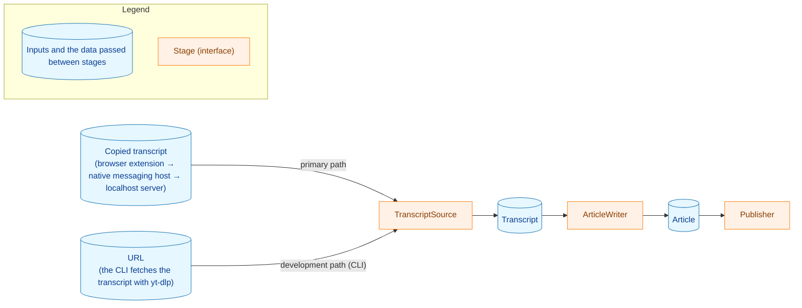

# CLAUDE.md

This file provides guidance to Claude Code (claude.ai/code) when working with code in this repository.

## Quick Links

**Project:**
- [Project Overview](docs/dev/project_overview.md) - Decided policies, pipeline, constraints, configuration (Japanese). **Read this before designing anything.**
- [Production Profile](docs/dev/production_profile.md) - The production profile (the template, provider, model, and effort of each stage), the quality target and the results behind it, and the product limitations of this profile (Japanese)
- [Security Considerations](docs/dev/security.md) - yt-dlp invocation, secrets, network, cache, untrusted text
- [Cache Consistency](docs/dev/cache_consistency.md) - What the transcript cache guarantees across failures and power loss, and why (Japanese). Check its checklist before changing cache code.

**Development Guides:**
- Requirements and Acceptance Criteria Process: [requirements_process.md](docs/dev/developer_guide/requirements_process.md) - Process for implementing new features
- Test Organization Guide: [test_organization.md](docs/dev/developer_guide/test_organization.md) - Test helper file organization
- [Package Reference](docs/dev/developer_guide/package_reference.md) - Detailed package structure
- [Updating the Pricing Table](docs/dev/developer_guide/pricing_update.md) - How to update the LLM rate table in `internal/pricing`
- [Claude Output Limit](docs/dev/developer_guide/claude_output_limit.md) - When and how to re-measure the basis of the Claude adapter's default output limit (`max_tokens`)
- [mergepr Guide](docs/dev/developer_guide/mergepr_guide.md) - Setup, usage, guarantees, and troubleshooting for the `/mergepr` tool
- [fixprguard Guide](docs/dev/developer_guide/fixprguard_guide.md) - Setup, subcommands, guarantees, scope rules, and recovery for the `fixprguard` guard tool for `/fixpr` and `/runpr`

## Documents

- Documents should be placed under docs
- Default language is Japanese (exceptions: README.md, CLAUDE.md, docs/dev/developer_guide/\*.md)
- Default format is markdown
- Use Mermaid for diagrams, following the conventions in
  [mermaid_reference.md](docs/dev/developer_guide/mermaid_reference.md) (node-label
  quoting, `<br>` line breaks, cylinder `[(...)]` data nodes, the standard classDef
  palette, and Legend blocks).
- Each task lives in `docs/tasks/NNNN_<name>/` (four-digit sequence number).
  `docs/tasks/0000_template/requirements.md` is the starting point for
  `01_requirements.md`.

### Translation Guidelines (Japanese to English)

Create and commit the Japanese version first, then write the English version from
it. The translation principles (accuracy over fluency, faithful translation,
structural consistency) and the glossary workflow live in
[mktrans.md](.claude/commands/mktrans.md), which automates this; the glossary is
[docs/translation_glossary.md](docs/translation_glossary.md).

## Language

- **Conversation in a Claude Code session: Japanese.** This includes the
  explanation of test results, tool output, and review findings.
- **What stays in the git repository: English** — source code, comments,
  identifiers, string literals, and commit messages. A squash commit's subject
  and body are English too: `/mergepr` writes the subject from the PR material
  (`.claude/commands/mergepr.md` step 2), not by copying the PR title.
  Documents under `docs/` follow "Documents" above.
- **Prompts to AI: English** — subagent prompts, review prompts, and the
  command definitions under `.claude/commands/`.
- **What lives on GitHub: Japanese** — PR titles, PR descriptions, issues,
  review replies, and PR comments. A PR title keeps its conventional-commit
  prefix in ASCII and writes the summary after it in Japanese; the forms are in
  `.claude/commands/_context.md`, "PR title and squash subject". The exception
  is a bot command, such as the PR review request (`_context.md`, "PR review
  request").

## Commands

### Build Commands
- `make build` - Build the three binaries (`yt2column`, `yt2column-server`, `yt2column-nmhost`) into `build/`; it installs nothing
- `./build/yt2column-nmhost install <browser>` / `./build/yt2column-nmhost uninstall <browser>` - Register or remove the Native Messaging host manifest (`<browser>` is `chrome` or `brave`)
- `make clean` - Clean build artifacts
- `make all` - Default build target
- `make install-mergepr` - Install the `/mergepr` developer tool (`go install ./cmd/mergepr`)
- `make install-fixprguard` - Install the `fixprguard` guard tool (`go install ./cmd/fixprguard`); rerun it after a merge that changes the tool

### Test Commands
- `make test` - Run all tests with race detection, then `make test-parse-norace`
- `make test-parse-norace` - Run `TestParseCopiedLargeInputs` alone without race detection; the parse-time deadline is checked only in builds without race detection, so this target and the plain `go test` commands below check it and `make test`'s race run does not
- `go test -tags test -v ./...` - Run all tests directly
- `go test -tags test -v ./internal/specific/package` - Run tests for specific package

### Code Quality
- `make lint` - Run golangci-lint (version pinned in `Makefile`; includes `govet`)
- `make fmt` - Format changed Go files with gofumpt (`make fmt-all` for every file)
- `make deadcode` - Report unreachable functions across the whole module and its
  tests (`test` and `integration` tags); any output or non-zero exit status fails

### Claude Commands (`.claude/commands/`)
Project-specific values these commands depend on are defined once in
[_context.md](.claude/commands/_context.md).
- `/mkreq <issue> [task]` - Create `01_requirements.md` from a GitHub issue and open its PR
- `/mkarch <task>` - Create `02_architecture.md` (requires approved requirements) and open its PR
- `/mkplan <task>` - Create `03_implementation_plan.md` with its PR boundaries (requires approved architecture) and open its PR
- `/mkplan2 <task>` - Embed PR boundaries into an approved plan that lacks them (plans written before `/mkplan` did it) and open its PR
- `/runplan <task>` - Implement the phase groups of an approved plan up to the next PR checkpoint, then open the PR
- `/runpr [PR | branch | task]` - Drive a PR through Codex's PR review and CI, record its bookkeeping (a document's approval, a plan checkpoint), merge it, and offer the next command, which it runs only when the user chooses; for a standalone change it also creates the PR
- `/weakreview [range]` - Second-pass review of work done by a lower-capability model
- `/fixpr [PR]` - Resolve unresolved PR review threads
- `/mergepr [PR]` - Squash-merge a PR with a generated commit message and clean up its branch
- `/japrose <file>` - Japanese prose-quality pass
- `/mktrans <file>` - Japanese ⇄ English translation

Each task PR is handled by two commands. The command that produces it —
`/mkreq`, `/mkarch`, `/mkplan`, `/mkplan2`, or `/runplan` — works on its own
feature branch, reviews its work (subagent review, `japrose` for documents,
local CodeRabbit), opens the PR, pings the reviewer, and stops. `/mkreq`,
`/mkarch`, and `/mkplan` first ask the human about the decisions their input
leaves open; `/runplan` asks when implementation meets a decision change. After reviewing, the reviewer runs `/runpr`, which drives
it: it waits for Codex's PR review and CI and resolves the threads with `/fixpr`. It
then asks one question that decides the bookkeeping (for a document, its
`approved` status) and the merge with `/mergepr`, and offers the next command
when there is one. When the user chooses to run it, it runs, opens the next PR,
and stops again.

Codex does the PR review. Its allowance is shared with the user's other
ChatGPT use and its size is not published, so a PR gets one PR review, when it
opens. Codex is set up outside the repository, by the user: it reviews
automatically only when a PR is created, never on a push, and its thorough
code review is off.
`.coderabbit.yaml` turns CodeRabbit's automatic review off, so the PR is not
reviewed twice. Later changes are reviewed with the local CodeRabbit CLI, and `/runpr` requests another PR review only when
the changes are of a kind the local review cannot stand in for
([pr-review-escalation.md](.claude/commands/_lib/pr-review-escalation.md)) or
when the user asks in its one question.

### Extension Commands

The Chrome/Brave extension lives in `extension/` (TypeScript). Its Node.js
version is pinned in `extension/.node-version`; every `ext-*` target below
refuses to run when `node --version` does not match.
- `make ext-install` - Install the pinned dev dependencies with `npm ci` (needs the network)
- `make ext-typecheck` - Type-check with `tsc`
- `make ext-lint` - Lint with ESLint
- `make ext-fmt-check` - Check formatting with Prettier
- `make ext-fmt` - Rewrite files with Prettier (CI runs `ext-fmt-check` instead)
- `make ext-test` - Run the extension unit tests (`node --test`)
- `make ext-build` - Build into `extension/dist/`
- `make ext-check` - Run the checks CI runs after `ext-install`: typecheck, lint, fmt-check, test, build

## Architecture Overview

yt2column turns a YouTube video into a magazine-column-style article with an
LLM. The primary path starts in the browser: the extension collects the transcript
copied from YouTube's transcript panel, the native messaging host relays it to
the localhost server, and the server generates the article and posts it to the
Webhook. The CLI is the development path: it takes a video URL and fetches the
transcript with `yt-dlp`.



- `TranscriptSource` (`internal/transcript`): `CopiedSource` implements it by
  parsing the copied transcript text a user takes from YouTube's transcript
  panel (the primary path). `YtDlpSource` fetches subtitles and info.json by
  invoking the external `yt-dlp` command, parses json3, and caches per video ID
  (the CLI uses it).
- `internal/strictjson`: strict JSON extraction shared by `internal/transcript`,
  `internal/llm/deepseek`, `internal/llm/claude`, `internal/publisher`, and
  `internal/writer`; rejects the byte sequences and structural shapes
  `encoding/json` would silently repair.
- `ArticleWriter` (`internal/writer`): provider-independent prompt assembly and
  output post-processing; calls an `LLMClient`. After generation it runs the two
  post-generation steps by default: shorten an over-long body with the
  generation client, then review the article against the source material with a
  separately configured provider and model, applying the returned list of
  corrections.
- `LLMClient` (`internal/llm`, implementations in `internal/llm/<provider>`):
  thin per-provider adapter — system + user prompt in, text out. `deepseek` and
  `claude` exist today; `internal/llm/llmhttp` holds the HTTP send path they
  share (redirect refusal, body cap, failure classification), and
  `internal/llm/claudeparam` holds the Claude effort and workspace-ID types that
  `internal/config` and `internal/llm/claude` share.
- `Publisher` (`internal/publisher`): Slack Incoming Webhook and local file.
- `internal/pipeline` orchestrates the stages; `internal/config` reads environment
  variables; `cmd/yt2column` wires everything together.

Two entry points share the pipeline: the CLI (`cmd/yt2column`, above) and a
localhost server (`cmd/yt2column-server` + `internal/server`) that takes a
copied transcript from the browser extension over HTTP on a Unix domain socket
and posts the article to the Webhook. The server's supporting packages are
`internal/serversock` (the socket directory, the start lock, and the socket
itself), `internal/failure` (the `Kind`/`Notice`/`Notifier` contract it reports
a failed request with), `internal/redact` (secret redaction for every output),
and `internal/signalrun` (signal handling both entry points share). The
extension does not connect to the socket itself: the browser starts the Native
Messaging host (`cmd/yt2column-nmhost` + `internal/nmhost`), which relays one
request to the socket per send and manages its own manifest with `install` and
`uninstall`.

See [Project Overview](docs/dev/project_overview.md) for the decided policies and
constraints, and [Package Reference](docs/dev/developer_guide/package_reference.md)
for the packages that exist today. The server's API and startup are documented in
the [README](README.md) and `docs/dev/security.md` §8.

### Key Design Patterns
- **Separation of Concerns**: Each package has a single responsibility. Core logic
  stays out of `cmd/`, so the CLI and the localhost server share it and a further
  entry point can be added without touching it.
- **Interface-based Design**: Every pipeline stage (`TranscriptSource`,
  `LLMClient`, `Publisher`) is an interface with a fake for tests.
- **Provider details stay in their adapter package**: request/response shapes of
  a provider API (e.g. DeepSeek's `thinking` parameter and `reasoning_content`)
  live only under `internal/llm/<provider>`. If a provider SDK is added later
  (for example `google.golang.org/genai` for `internal/llm/gemini`), it is
  imported only there; `depguard` in `.golangci.yml` already enforces that.
- **Delegate the fragile part**: subtitle retrieval is delegated to `yt-dlp`. Do
  not reimplement YouTube scraping in Go. Exception: the copied-transcript parser
  (`internal/transcript`) depends on the format of YouTube's transcript-panel
  output, an undocumented and fragile format. The dependency is confined to that
  parser — no Go code fetches or parses YouTube's page or panel — and the
  `yt-dlp` retrieval path stays as the fallback while the panel format is
  rejected.
- **YAGNI**: Use simple and clear approach to satisfy the requirement. Don't take complex approach for not-yet-planned features. No LangChain-style frameworks or multi-provider abstraction libraries.
- **DRY**: Don't repeat yourself. Before adding new code, check the codebase and prefer reusing existing implementations.
- **Declare, don't infer**: Do not choose behavior by inspecting the content of a
  string supplied by a caller (`strings.Contains`/`HasPrefix` over caller data to
  pick a code path). Put the choice in the type: an enum field whose zero value is
  the interpretation that assumes least about its input, dispatched by a `switch`
  whose `default` fails secure. Changing a struct's shape is cheap here — the
  project has no consumers outside the repository, so "it would change the exported
  API" is not on its own a reason to keep inferring.
  Exception: the copied-transcript parser (`internal/transcript`) chooses behavior
  by inspecting the content of the `Raw` string. Scope: it parses the copied
  transcript format — form A and form B, the timestamp grammar, and the
  arrangement of timestamp, screen-reader label, and text — to build segment
  boundaries and `Segments`; this parse is the only place the text's content
  selects behavior. Reason: that string is produced by YouTube's transcript panel
  and copied by the user, an external value the caller (the browser extension, the
  server) cannot express in a type, and the format is YouTube's UI contract, so
  changing our type would not change the input. Boundary: the exception covers only
  the copied-transcript parser in `internal/transcript` and the `Raw` parse in
  `CopiedSource`; an input that matches neither form is rejected, not accepted by
  widening the interpretation.
  The parse also skips four kinds of panel line that are not segments: the
  prefix before the first segment line, form A chapter heading lines
  (`Chapter N: ` or its Japanese equivalent, followed by a title), form B
  headings at a timestamp-expected position, and the trailing region of blank
  lines and operation labels such as `Sync to video time`. These skips keep the
  boundary: the prefix ends where the timestamp grammar finds the first segment
  line; a form B heading is identified by its position, not its content; and
  after the first segment line only the explicitly defined lines are skipped. A
  prefix or form B heading-position line that could be a damaged timestamp (a
  digit-colon-digit run, a control character, or in form B a whitespace-only
  line) is rejected, not skipped.
  Exception: the browser extension's locale resolution (`resolveLocale` in
  `extension/src/core/i18n/locale.ts`) chooses the display language by
  inspecting the content of the browser's UI-language string. Scope: it compares
  the part of that string before the first `-`, lowercased, with the keys of
  `locales`; this is the only place the UI-language string's content selects
  behavior, and everything after it passes only a `Locale` value and chooses
  behavior by `switch` or `Record` key. Reason: the UI language is an external
  value returned by the browser (`chrome.i18n.getUILanguage()`), which the
  extension cannot express in a type. Boundary: the exception covers only
  `resolveLocale`; a value that matches no locale is not interpreted more
  widely but resolves to English. "Reject, don't normalize" does not apply: a
  UI language other than Japanese is not malformed input but a valid one that
  the extension shows in English.
- **Enforce invariants with the type, not with convention**: if a value must pass
  validation before use (e.g. a video ID), make the compiler the thing that
  guarantees it — unexported fields plus a mandatory constructor — rather than
  relying on every caller remembering to validate. Before preserving an exported
  field as an extension point, count its real uses; an extension point nobody uses
  costs the guarantee and buys nothing.
- **Reject, don't normalize**: when code can either quietly repair a caller's
  malformed input or reject it, reject it. Silent repair makes a wrong definition
  indistinguishable from a right one, so the mistake never surfaces and propagates
  into whatever someone copies next. Prefer a `validate` method returning a
  sentinel error, rejection at the construction boundary, and a test over the real
  defaults that fails the build when they are edited into an invalid shape.
- **Empty is an error**: an empty LLM response, a missing subtitle file after a
  successful `yt-dlp` exit, or a truncated generation is reported as an error,
  never published.

### Accessibility

User-facing UI — the browser extension's popup and any page it opens
(such as the Viewer) — meets WCAG 2.2 Level AA. A requirements document
for such UI states acceptance criteria for the points below, or says why
one does not apply:

- **Keyboard:** every operation works without a pointing device (Tab,
  Shift+Tab, Enter, Space); the focus order follows the visual order and
  never traps focus (2.1.1, 2.1.2, 2.4.3).
- **Visible focus:** the focused element is visibly marked, with a 3:1
  contrast against adjacent colors (2.4.7, 1.4.11). Do not remove the
  browser's focus outline without a replacement that meets this.
- **Names, roles, and states:** every control has an accessible name that
  matches its visible label, and its state (disabled, expanded) is
  exposed (1.3.1, 2.5.3, 4.1.2). Prefer native HTML elements (`<button>`,
  `<details>`, headings) to ARIA attributes.
- **Status messages:** progress and results are announced without moving
  focus (4.1.3).
- **Contrast:** text 4.5:1 and meaningful graphics 3:1 against their
  background, in both light and dark themes (1.4.3, 1.4.11).
- **Not by color alone:** state is also conveyed by shape and text, and
  never depends on telling red from green (1.4.1).
- **Language:** the page's `lang` matches the display language (3.1.1).
- **Target size:** interactive targets are at least 44×44 CSS pixels. This
  is stricter than Level AA (24×24, 2.5.8): the project adopts the AAA
  value (2.5.5).
- **Motion:** animation stops under `prefers-reduced-motion`. This goes
  beyond Level AA: the project adopts the AAA criterion (2.3.3).

Exception: a prototype, or a minimal UI built only to verify a function,
may defer these criteria. When it does, before its PR is merged:

1. File an accessibility issue that names the unmet criteria and the
   screen, from the template `.github/ISSUE_TEMPLATE/accessibility.md`,
   with the `accessibility` label, and link it to the issue under
   development (as a sub-issue where possible,
   otherwise by reference in both bodies).
2. List the deferred criteria and the issue in the requirements
   document's out-of-scope section, and in the PR description.

A deferral without a linked issue is not allowed; the review treats
missing criteria without one as a defect.

### Performance

- **A benchmark regression is not by itself a defect.** Justify an optimization
  against an *absolute* budget — wall time of a real run — never against a relative
  delta versus the previous commit. A run is dominated by `yt-dlp` and the LLM API
  call (seconds to tens of seconds); local processing that costs milliseconds is
  not worth a mechanism.
- **Profile before optimizing** to confirm the cost is where you assume. If the
  stage you are about to optimize is a small fraction of its path's total cost,
  stop.
- **An optimization that adds a correctness obligation** — encoding assumptions,
  cache invalidation, a fast path that must agree with the slow path — must clear a
  much higher bar. State the obligation in the commit message and pin it with a
  test that fails if the optimization is later changed unsafely.
- **Optimizations go in their own commit**, separable by revert, and never in the
  same commit as the behavior change that motivated them.
- **Do not close a review finding by adding a mechanism until the finding's premise
  is verified.** Measure whether the reported cost is real harm in absolute terms
  first.

### Testing Strategy

Unit tests never invoke `yt-dlp`, an LLM API, or a Webhook. Each pipeline
interface has a fake (see the Test Organization Guide); `ArticleWriter` is tested
with a fake `LLMClient`, HTTP code with `net/http/httptest`, and the json3 /
info.json parsers with real samples under `testdata/`.

- **Error Testing**: Use `errors.Is` / `errors.AsType[T]` to validate error types,
  never string matching on error messages.
- **Every test must be able to fail for its stated reason.** Before committing a
  test, disable the thing it claims to cover — nil the collaborator, revert the
  branch, break the default — and confirm it fails. Say in the commit message that
  you did. This is checked by breaking the code, never by arguing it in prose: a
  design or planning document must not claim that a test "would fail if the
  implementation were X", because that is a statement about code nobody has written
  and no reviewer can check.
- **A layered path needs inputs only one layer can handle.** Where two mechanisms
  can produce the same output, an input both layers match proves nothing about
  either. Construct the input so only the layer under test can act, and assert
  first that the other layer alone leaves it untouched.
- **Do not assert that a constant equals its own literal**, or that a struct field
  holds what was just assigned to it. These pass unconditionally and reach nothing.
- **Check for duplication before adding a table test for a helper.** If the helper
  differs from its caller only by a loop, and the caller's table already covers the
  same rows with the same literals, one table is enough.
- **Deleting a test is a claim that must be checked**: confirm `go tool cover -func`
  is unchanged function by function afterwards, and say so.
- **Document tests check values, structure, and executable examples, never prose.**
  A test that reads a document may compare a value in it with the code or
  configuration that defines it (flags, exit codes, protocol numbers, extension
  IDs and permissions, `make` targets, rejection tables), check the heading
  structure, or parse or run a command example. It must not try to establish the
  meaning of a sentence by matching words, pin a literal copied into the test,
  assert that an old name is absent from a document, or check a task's own
  record. A change to a document's wording is checked by reading it in the PR
  review (`manual`), because a test cannot tell a reworded sentence from a
  reversed one. A change to a documented value or structure still needs the
  matching test. Two exceptions stay tested: the automated-reviewer list, and the
  commands the agents run at their trust boundary (the `fixprguard` call sites,
  the commands that would bypass it, the mention check, and the `--jq` filters
  that must not print a body). A mistake there disables a guard at run time, so
  a test is worth its brittleness. A property of the change itself, such as
  existing headings kept unchanged, is not a document test either: it is a
  `diff` verification, a script under the task's `_checks/` directory run once
  against the merge-base (`requirements_process.md` §4).

See [Test Organization Guide](docs/dev/developer_guide/test_organization.md) for test helper file structure.

## Development Notes

- Go version: see `go.mod`.
- After editing go files, make sure to run `make fmt` to format the files.
- After editing files, make sure to run `make test` and `make lint` and fix errors.
- After changing the browser extension under `extension/`, run `make ext-check`.
- A change that touches only documents (`README.md`, `CLAUDE.md`, `docs/`) does
  not need `make ext-test`, except `README.md`: the extension's node tests read
  its rejection-reason table (`serverReasons.test.ts`) and the expand prompt in
  its "Browser extension" section (`metadataDocs.test.ts`), so a change to it
  needs `make ext-test`. The other text-sync guards that read documents (the
  extension ID, the `ext-` targets in this file, the manifest permissions, the
  `project_overview.md` notes (the environment variable names, `costPrefix`, and
  `16,383`), the production profile's configuration block and stage table in
  `docs/dev/production_profile.md`, the README's configuration block and Quick
  start links, the `/fixpr` and `/runpr` command documents) are Go tests included
  in `make test` and need no node. `cmd/yt2column-nmhost`'s
  `TestReadmeHostExitCodes` reads the README too, but the `doc-guard` job does
  not run it: the local `make test`, and the CI `test` job when the change
  includes code, do. A README-only change is therefore checked by neither CI
  job for this test. The `doc-guard` CI job runs the other guards
  (`go test -tags test ./cmd/yt2column ./cmd/yt2column-server ./cmd/fixprguard ./internal/pipeline`)
  on every pull request, so a documentation-only change is checked in CI by
  those guards even though `check-changes` classifies it as non-code.
- A change that touches only `.gitignore` can still break the extension's
  ignore-rule check, which stays in its node tests. Run `make ext-test` locally
  before committing such a change.
- `yt-dlp` must be on `PATH` (or set `YT2COLUMN_YTDLP_PATH`) to run the CLI; it is
  not needed for `make test`.
- `make test` needs `jq` on `PATH`: `TestRunprDocContract` and
  `TestHandoffListingPrintsNoBody` run the `--jq` filters of `runpr.md` step 3
  and `_lib/task-pr-handoff.md` Part B step 5 with it, and fail instead of
  skipping when it is missing. The `doc-guard` CI job runs these tests too.
- Secrets (`DEEPSEEK_API_KEY`, `ANTHROPIC_API_KEY`, `SLACK_WEBHOOK_URL`, ...) go in `.envrc` / `.env`,
  which are git-ignored. Never commit them and never print them.
- Real captured data committed under `testdata/` must come from a video licensed
  for redistribution and must not identify whoever captured it; full-page browser
  snapshots are never committed and live outside the repository. See
  [Security Considerations §7](docs/dev/security.md) before adding any.

### Dependencies

Keep external libraries to a minimum. HTTP, JSON, CLI flags, and configuration use
the standard library. The allowed modules are listed in the `depguard` `deps` rule
in `.golangci.yml`; adding one means adding it there, and the commit message (and
the task's architecture document, when there is one) must state why the standard
library is not enough. Currently no module outside the standard library is
allowed: the initial LLM provider (DeepSeek) exposes an OpenAI-compatible HTTP API
that is called with `net/http` and `encoding/json`.

The browser extension's npm packages are development-only (build, type-check,
lint, test); the code that ships is only what this repository writes. They are
pinned by `extension/package-lock.json` and installed with
`npm ci --ignore-scripts`, so an install script never runs. To add or update one,
run `npm install --ignore-scripts <pkg>` by hand and commit the updated lockfile;
the Makefile and CI never call `npm install`. Each package's purpose is recorded
in the extension task's architecture document.

## Go Idioms

Modern-idiom drift (`any` over `interface{}`, `for range n`, `min`/`max`, the
`slices`/`maps` packages, `strings.Cut`, `slices.SortFunc` over `sort.Slice`, …) is
enforced mechanically by the `modernize`, `intrange`, `copyloopvar`, and
`usestdlibvars` linters in `.golangci.yml`, most of them auto-fixable with
`golangci-lint run --fix`. Run `make lint` rather than working from a list here.

Only the conventions a linter does not check are worth stating:

- Prefer `errors.AsType[T]` over `errors.As` — it eliminates the `var target T`
  declaration. This is a Go 1.26 API, so it is not what habit produces:
  ```go
  // Before
  var pathErr *fs.PathError
  if errors.As(err, &pathErr) { ... }

  // After
  if pathErr, ok := errors.AsType[*fs.PathError](err); ok { ... }
  ```
- Use `map[T]struct{}` rather than `map[T]bool` for set semantics.
- In tests, prefer `t.Cleanup` over manual `defer` chains and `t.TempDir` over
  `os.MkdirTemp` + `defer os.RemoveAll`.
- Go comments, identifiers, and string literals are English.
- The same rule applies to the browser extension: its comments, identifiers,
  and string literals are English. There are three exceptions: the messages in
  a catalog file for a language other than English under
  `extension/src/core/i18n/` or `extension/static/_locales/` (today `ja.ts`
  and `ja/messages.json`); a string literal in a test that checks the
  properties of such a catalog's messages (a per-language word table); and a
  guard test's literal that must match a Japanese document heading or table
  cell. Every string shown to the user lives in the message catalogs, and both
  the English and the Japanese catalog must have it. Logs written for
  developers stay in English.

## Requirements and Acceptance Criteria

When implementing new features, follow the process documented in [Requirements Process Guide](docs/dev/developer_guide/requirements_process.md).

**Quick summary:**
1. Create an issue, then run `/mkreq <issue>` to create `01_requirements.md` with explicit acceptance criteria
2. Create `02_architecture.md` with high-level design (Mermaid diagrams)
3. Create `03_implementation_plan.md` with progress tracking (checkboxes) and AC traceability
4. Verify each acceptance criterion with a test, a static check, a diff check for an AC that states a before/after relation, or a manual reading for an AC that specifies prose alone
5. Link each verification to its acceptance criterion in the implementation plan

Each document is created as `draft`; the next one is not started until a human
reviewer sets the previous one to `approved`.

## Tool Execution Safety

**CRITICAL**
- Don't run following commands without user's explicit approval
  - commands interacting with network, e.g. git pull
  - merging pull requests on GitHub
  - running the CLI against real services (LLM API calls, Slack Webhook posts)
- `git commit` and `git push` may be executed without explicit approval
- `coderabbit review` (the local CodeRabbit CLI, a development tool used on every
  change) may be executed without explicit approval, although it sends the diff to
  CodeRabbit's service
