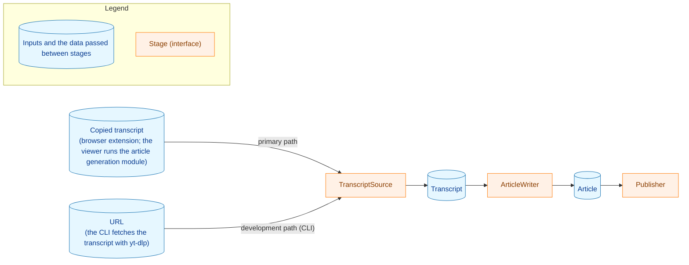

<!-- translated-from: README.md febf24ab0299d91c04b2715d158b301f03c499a5 -->
[日本語](README.md)

Developer documents: [Using the CLI](docs/dev/guides/cli.md) · [Development procedures](docs/dev/guides/development.md)

# yt2column

yt2column turns a YouTube video into a magazine-column-style article with an
LLM. The primary path is complete within the browser extension: the extension
collects the captions the user selected in YouTube's transcript panel, and
the article generation module in the extension (Go code built to WebAssembly)
calls the Anthropic API inside the viewer tab to generate the article. The API
key is set on the extension's options page and saved only in that browser. The
article is shown in the extension's viewer tab, and saving it as a `.md` file
and copying its Markdown to the clipboard are the user's choices in the
viewer. A CLI is also included as a development path. The CLI takes a video
URL and fetches the transcript with
[yt-dlp](https://github.com/yt-dlp/yt-dlp). LLM calls and article generation
are developed and verified with the CLI. The CLI writes the article to the
`--out` file.



- The primary path uses the transcript copied from the transcript panel; only
  the CLI uses yt-dlp.
- The extension generates articles with the production profile only:
  generation, shortening, and review all use `claude` with `claude-opus-5-5`
  at effort `high`. The extension has no setting to choose a profile. See
  [Recommended configuration](#recommended-configuration) and
  [production_profile.md](docs/dev/production_profile.md) (Japanese).
  With the CLI, DeepSeek and OpenAI are also available; providers are
  pluggable.
- The extension needs nothing installed besides the browser: no server and no
  host for generating articles.

> **Status:** early development; no release yet.

## Quick start

These steps generate a first article through the primary path and read it in
the viewer. Each step links to
the section that explains it in detail.

1. Run `make ext-install` once, then run `make ext-build`, and load
   `extension/dist` with **Load unpacked** on the extensions page. See
   [Building and loading the extension](docs/dev/guides/development.md#拡張のビルドと読み込み).
2. Open the extension's options page and save your Anthropic API key. The
   options page opens from **Settings** in the popup. See
   [Setting the API key](#setting-the-api-key).
3. Open the video's description ("...more") and its transcript panel, select
   the caption lines, open the popup from the extension's toolbar icon, and
   press **Generate article**. The article
   is shown in the viewer tab that opens in the background, from which you can
   save it as `.md` or copy its Markdown and paste it into a channel such as
   Mattermost. See [Browser extension](#browser-extension).

If you used the earlier version (the one with the localhost server and the
native messaging host), do the
[migration from the earlier version](#migrating-from-the-earlier-version)
before you update the extension.

## Requirements

**For the primary path (browser extension):**

- Chrome 142 or later, or Brave on Chromium 142 or later
- An Anthropic API key. An API key of an organization that has enabled zero
  data retention (ZDR) or the Compliance API cannot be used: such an
  organization does not accept API calls from a browser.

The CLI's requirements are in
[docs/dev/guides/cli.md](docs/dev/guides/cli.md#必要なもの). The CLI needs
an API key for the selected provider.

## Post-generation steps

After the article is generated, two steps run.

1. **Shorten.** If the body is longer than 4,000 characters, the generation
   model shortens the body toward a target of 3,600 characters. If it is still
   over 4,000 characters after shortening or after the review step, the
   generation fails with a length error and no article is made.
2. **Review.** The review model compares the article with the video title,
   channel name, description, and transcript, and returns a list of
   corrections. The corrections target claims with no basis in the material,
   meaning-changing paraphrases, wrong speaker attributions, speech-recognition
   errors carried over into the article, and sentences whose meaning cannot be made out.
   The process that writes the article (the writer) applies the list to the
   article. With the CLI, a provider and a model of its own can be set for the
   review step in `YT2COLUMN_REVIEW_LLM`. By default it uses the generation
   provider and model.

Both steps call the LLM (the shorten step only when the body is over the
limit), so the LLM is called up to two more times than with generation alone,
and the cost grows accordingly.

The CLI's flags that skip a step, record the review's changes, or save and
resume the steps' output are in
[docs/dev/guides/cli.md](docs/dev/guides/cli.md#生成の後の工程). The
extension skips no step.

## Output format

Each output arranges the article's information differently. In a file, the
reader's part (title, channel name, body, source
link) comes first, and the development part (models, estimated cost) goes into
the front matter. The viewer's display and the copied text are the part other than the front matter (the title heading, the channel name line, and the body).

The file the CLI writes is in
[docs/dev/guides/cli.md](docs/dev/guides/cli.md#--out-のファイル). The
content of the file the viewer's **Save as .md** saves has the same format as
the CLI's `--out` file.

## Estimated cost

The article's cost is in the CLI's `--out` file, in the front matter, with four decimals or `unknown`. The extension's viewer shows the estimated cost of a finished article.

```text
Estimated cost: 0.0023 USD
Estimated cost: unknown
```

The estimate is an estimate, not the billed amount. It can differ from the
provider's invoice.

- For a run that made no article (the API rejected the API key, the generation
  failed, or it stopped with the viewer tab), the extension shows the cost as
  unknown across the board and shows no amount. For a run that ended without
  ever calling the API (no API key, or the saved settings cannot be used), it
  does not mention the cost.
- DeepSeek's peak window is a weekly rule in UTC: the alternate rate applies on
  Monday through Friday during 01:00-04:00 and 06:00-10:00 UTC. The CLI
  judges the window from its own clock in UTC and does not know Chinese public
  holidays, so a call on a holiday is billed at the off-peak rate but estimated
  as peak: the estimate leans high.
- A call that crosses a window boundary can be judged at a different minute than
  the provider billed it, because the CLI's time is when the response was
  read and validated, and the provider's billing time is not documented.
- A CLI on a machine whose clock is wrong judges the window wrongly.
- OpenAI costs are estimated at the rates of the Standard processing tier and a
  30-minute prompt cache. When the response does not show these, the cost is
  `unknown` even when the token counts are known. A call whose input (cache
  reads and writes included) totals more than 272,000 tokens is estimated at
  the long-input rates.
- The rate table can be stale, for example when the provider changes a rate or
  when the `deepseek-flash` alias starts to point at a model with different
  rates. Each entry records its source and checked date, and the update
  procedure is in a developer document.

Check the actual charge in the provider's console.

The CLI's cost lines on standard error, which give the reason, are in
[docs/dev/guides/cli.md](docs/dev/guides/cli.md#推定の料金).

## Browser extension

The popup, the viewer, and the options page show their text in Japanese when
the browser's UI language is Japanese, and in English otherwise. The extension
has no language setting. The screen text this README quotes (such as the
message below for a collapsed description) is the English version.

#### Setting the API key

The extension calls the Anthropic API to generate articles, so save an API key
on the options page before using it. Open the options page from **Settings** at
the bottom of the popup, or from **Extension options** under the extension's
**Details** on `chrome://extensions/` (Brave: `brave://extensions/`). The
options page opens in a tab.

The options page has a field for the API key, a field for the workspace ID, and
the **Save** and **Delete** buttons, and shows whether an API key is set and the
information of the extension's build (the commit, the Go version, and the LLM).

- **API key**: the characters you type are masked. The saved API key is never
  shown on the screen again; the page shows only whether one is set. To change
  it, enter a new API key. A screen reader may read out the characters you
  type.
- **Workspace ID**: optional. Leaving it empty means no workspace is given (the
  workspace the API key belongs to is used). An API key that belongs to no
  workspace needs a workspace ID; without one, article generation fails with
  the API's rejection (400).

When you press **Save**, the extension checks the form of the values in the two
fields, calls Anthropic's Models API once to check the API key, and then saves.
This call uses no tokens, so it costs nothing. While it checks, the fields and
the buttons cannot be changed. The result is one of the following, shown below the
buttons.

- The API key was accepted: saved, and the fields are emptied.
- It could not be checked (a network failure, a timeout, a rejection other than
  401, and the like): saved, with a note that it could not be checked. If an
  article later fails because the API key was rejected, save a new API key.
- A field's value is not in an accepted form: nothing is saved, and that field
  is marked.
- Anthropic rejected the API key (401): nothing is saved. The key has expired,
  has been revoked, or is wrong, or the organization does not allow calls from a
  browser.
- It could not be checked inside the extension: nothing is saved. Save again.
- It may not have been saved: check whether the page shows an API key as set,
  and save again.

**Delete** deletes both the API key and the workspace ID. When it shows that the
settings may not have been deleted, check whether the page shows an API key as
set, and delete again.

The API key and the workspace ID are saved only in `chrome.storage.local` of
this browser profile. They survive a browser restart and are not synced to other
devices. The only place the extension sends the API key to is
`https://api.anthropic.com`; the popup and the service worker do not read the
API key's value. However, processes that run as the same OS user can read the
profile's files. We recommend creating the API key in a workspace used only
for this extension, with a monthly usage limit. With an API key made in that
workspace, no workspace ID needs to be entered.

#### Popup

To send, open the transcript panel on a video page, select the caption
lines, and click the extension's toolbar icon to open the popup. From top to
bottom, the popup has these parts:

- Video section: the video title as the heading, with the channel name below
  it when the page provides one. When the video title cannot be read, the
  heading falls back to the tab title.
- Checks section: a **Selected captions** row showing the selection's
  character and line counts and a preview of its first 100 characters (and of
  its last 100 when the selection is longer), and a **Description** row
  showing the state of the description. A ⚠ row flags something to note,
  and shows the steps when there is something to do.
- Action section: the **Generate article** button, which starts generating
  the article.
- **Details**: collapsed until opened; it shows the collected URL and the tab
  title.
- **Settings**: opens the options page. It is always shown.

Before it reads the selection and the video metadata, the popup makes the saved
settings unreadable from web pages. When it cannot, it does not read the tab,
and shows that and the steps.

The extension reads the video metadata without changing the page, so a
collapsed description can only be read as far as the page shows it. When the
description is collapsed, the popup says "Collapsed, so only the beginning will
be sent." and adds these steps:

1. Click "...more" below the video.
2. Reopen this popup.

The button stays enabled; pressing it generates the article from the beginning
the page shows.

A selection over 4 MiB does not generate an article: the **Selected captions**
row turns into a ⚠ with the reason and steps, and the button stays disabled.

Some values can be missing. When the video title, the channel name, or the
description is missing from the page or only whitespace, that value is left
out of the input of the article generation (a channel name that is not only
whitespace but contains control characters, or is longer than 200 code points,
is not left out: the article generation module does not accept that input, and
the start is refused). Without a video title the tab title becomes the heading;
without a description the **Description** row turns into a ⚠ saying the
description is not used; without a channel name the video section shows no
channel name. When the page cannot be read at all, or the tab moved to
another video after the selection was read, all three are left out. The
extension still generates the article from the selection and the URL.

When you press **Generate article**, the extension checks whether an API key is
saved. If not, it shows that an API key needs to be set and the
**Set API key** button, opens no viewer, and calls no API. If one is saved, the
extension opens the viewer tab next to the YouTube tab in the background. The
tab you are working in does not switch. The article is generated inside that
viewer tab. The extension never starts article generation again by itself.
Paid article generation starts only when you press this button (or **Try
again**, **Generate from current selection**, or **Generate article** after the
choice has ended, below); opening an extension page, reloading the viewer, or
restoring a closed tab does not start it.

After you press it, the popup keeps the video section and **Details** as they
are and shows the state where the checks section was. The button in the action
section turns into the action that fits the state.

- **Starting**: the button cannot be pressed. You can close the popup: the
  result appears in the viewer tab.
- **Loading**: article generation has started, and its record is being read.
  The button becomes **Open viewer**.
- **Generating**: a checklist of the three steps ("Draft", "Shorten",
  "Review") and the time elapsed since the press. The button becomes **Open
  viewer**.
- **Done**: that the article is ready, with its estimated cost and time taken.
  The button becomes **Open viewer**.
- **Failed**, **Stopped with its page**, **API key rejected**: the reason, the
  steps, and that the cost is unknown. The button becomes **Try again**, which
  starts generating the article for the same input once more (one time only). **API key
  rejected** also shows the **Set API key** button. When you save a new API key
  and then press **Try again**, or press the popup's button on the YouTube tab
  with the same selection, the article is generated again under the same job.
- **A setting is needed** (during generation, the API key was gone or the saved
  settings could not be used): that, and the **Set API key** button. The API
  was not called, so the cost is not mentioned. The button becomes **Try
  again**.
- **Article lost**: the record is gone (see "Records" below). The button becomes
  **Try again**.
- **Start refused**, **Result unknown**: the reason and the steps. The button
  stays disabled. To start again, reopen the popup.

A start is refused when the selection is not accepted as captions, when two
articles are being generated already (at most two articles are generated at the
same time), or when the extension fails internally. Result unknown is shown
when the result has not arrived 60 seconds after the start. Pressing again with
the same selection does not generate twice while that article is being
generated or is done; in any other case it starts generating a new article.

When the article of the same input (the same selection, URL, and video
metadata) is being generated or is done, any press shows that article instead
of generating a new one. When the article of the same input failed or stopped,
it is generated again under the same job.

**Generate article** starts with the same-video inquiry. When the extension
holds the record of another article of the same video (the same video ID,
whatever form the URL takes) that is being generated or is done, the extension
does not start generating and shows that article instead. The popup then keeps
the video section and **Details** and shows, where the checks section was, that
the extension has an article of the same video and that article's state
(generating or done); this is the choice. The action section shows two buttons:

- **Open existing article**: brings that article's viewer tab to the front, in
  the same order as **Open viewer**. It starts no generation. After it is
  pressed, the popup stays in the choice.
- **Generate from current selection**: starts generating the same input once,
  without the inquiry, and opens a new viewer tab in the background. The popup
  moves to the starting state and then shows the states above. The existing
  article's tab is not closed.

As long as neither button is pressed, the extension starts nothing. When the
existing article fails, stops, or is lost while the choice is shown, the popup
shows that the article of the same video can no longer be used, and the
buttons become the single **Generate article**; pressing it starts with the
inquiry again. **Try again** starts the same way as the start it repeats (a
retry after **Generate from current selection** has no inquiry).

The same-video inquiry is best effort. It finds only the articles whose records
the extension holds, so an article whose record is gone is not found, and then
the article is generated without showing the choice. The choice does not mean
that no other article of the same video exists, or that this one will stay.

**Open viewer** brings to the front the viewer tab that shows that article.
Without one, it opens a new viewer tab of the same article and brings it to the
front. A tab the browser discarded while it was inactive cannot be found, so the
same article then has two tabs. Closing the popup also stops its state display,
and reopening it starts again from the screen before generating.

#### Viewer

In every state except an invalid link, the viewer shows a link to the original
video, and before the article is finished it shows the same heading and channel
name as the popup (when the video title could not be read, the heading is the
video URL instead of the tab title). Once the article is finished, it shows the video title and
channel name the article generation module neutralized (without a video title,
the heading stays as it was). The page title is "`<video title> - yt2column`",
and it appears in the browser's history and on the tab. Without a video title,
the heading is used.

- **Preparing**, **Loading**: an animated mark and a sentence saying which one
  it waits for.
- **Generating**: a checklist of the three steps and the time elapsed since the
  article generation started.
- **Done**: the article, laid out with its title and section headings,
  paragraphs, lists, emphasis, and so on, with the autolinks of the form
  `<https://…>` that meet the conditions opening in a new tab, together with the
  estimated cost and the time taken. There are two operations:
  - **Save as .md**: saves the article's file content (the same as what `--out`
    writes) through the browser's download. The file name is built from the
    video title, with characters not allowed in file names replaced by `_` and a
    name that is too long cut short. When there is no video title, or it is only
    whitespace, the name is `<video ID>.md`.
  - **Copy Markdown**: copies the shown article's Markdown to the clipboard.
    The `@` characters in the article have been neutralized by the article generation
    module, which inserts U+200B (zero-width space) right after the `@` so that
    it does not become a mention where it is pasted. U+200B is invisible, but it
    is copied along with the text. When at least one `@` was neutralized, the
    copy notice says so (without a count). Selecting the shown article and
    copying it with the browser copies the same neutralized characters, but the
    Markdown symbols such as `#` and `**` are removed by the rendering and are
    not included, and no notice is shown. Use this button to paste the Markdown
    as it is.
- **Done, but not kept**: the article is done, but the extension could not
  write it into its record. Only that viewer page holds the article; it can be
  saved and copied, but reloading or closing the page loses it.
- **Failed**, **Stopped with its page**, **API key rejected**: the reason, the
  steps, and that the cost is unknown. **API key rejected** also shows the **Set
  API key** button.
- **A setting is needed**: that there is no API key or the saved settings cannot
  be used, and the **Set API key** button. The cost is not mentioned.
- **Article lost**: the record is gone. Open the video from the video link and
  generate the article again.
- **Start refused**, **Result unknown**, **Input not received**: the reason and
  the steps. When the input was not received, no article generation started and
  nothing was charged.
- **Invalid link**: the viewer URL is not in an accepted form. No article is
  shown, and nothing is started.

A viewer that shows an article of the same video (an existing-article viewer)
shows, below the heading, that it shows an existing article of the same video,
not one generated from the current selection, and the steps to generate from
the current selection. The existing article started before this start, so it
shows no elapsed time even while it is being generated (it shows the time taken
once it is done). When the popup has already opened a viewer that shows the same article, the
newly opened viewer tab closes itself, and the earlier viewer stays.

**The article is generated inside the viewer tab.** While it is generated, the
tab can stay in the background. Closing or reloading that tab stops the
generation, and it does not continue anywhere else. After you have interacted
with the viewer page even once, the browser asks before a reload or closing the
tab. A viewer you have never interacted with stops without asking. A stopped
article becomes **Stopped with its page**, and its cost is shown as unknown.
The whole article generation has a deadline of 50 minutes; past it, it fails.

**Records.** The extension keeps a record of each article generation (its state,
steps, and the finished article) in the browser's memory
(`chrome.storage.session`) and does not write it to disk. A finished article can
be shown until the browser is closed, after reloading the viewer, restoring a
closed tab, or opening it from the browser's history. Closing the browser,
and reloading or updating the extension, removes every record. There are at most
50 records with at most 8 MiB in total; beyond that, the oldest of the failed
and stopped records go first, then the oldest of the finished articles. An
article over 256 KiB cannot be kept and fails. A record holds neither the copied
transcript nor the description.

The viewer URL holds the start ID before the article generation starts, or the
job ID after it started, the collected URL, and the page title (the video title
cut to 64 characters), and an existing-article viewer also holds a value saying
so (`e=1`). It holds neither the copied transcript nor the description. The URL
stays in the browser's history. The job ID is an opaque value that does not
represent the article's content. A viewer whose URL values were crafted can show
any heading and title, so the heading does not vouch for the article's content.

The selection is used exactly as copied from the transcript panel; the
extension does not trim surrounding whitespace. Selecting the whole panel is
fine: the article generation module skips the lines the panel adds around the
captions, which are the lines before the first timestamp (such as the panel's
title), chapter heading lines, and the trailing blank lines and the label of
the `Sync to video time` (`動画の時間と同期`) button. When the timestamp and the
text are on separate lines, a heading right after a timestamp without text is
taken as that timestamp's text. Any other line is rejected: an unknown line
inside a transcript that places the timestamp and the text on one line, a
blank or whitespace-only line inside the transcript, a control character such
as a tab on any line, and a line that holds a run of ASCII digit, colon, digit
(such as a malformed timestamp) before the first timestamp or where a timestamp
line is expected.

## Migrating from the earlier version

The earlier version generated articles with the localhost server
(`yt2column-server`) and the native messaging host (`yt2column-nmhost`). The
current extension uses neither. Before you update the extension, migrate with
these steps.

1. Stop the running `yt2column-server`.
2. With the earlier version's host binary, remove the host's manifest from each
   browser you used (the commands below). When you cannot run it, for example
   because the binary is gone, remove the manifest files below by hand.
3. Rebuild and reload the extension (see
   [Building and loading the extension](docs/dev/guides/development.md#拡張のビルドと読み込み)),
   and save the API key on the options page (see
   [Setting the API key](#setting-the-api-key)).
4. Once you have made one article with the extension alone, delete the server's
   configuration file `~/.config/yt2column/config.env`. This file holds a
   plaintext copy of the API key. Until you delete it, you can go back to the
   earlier version's server and host. If the same directory has files whose
   names start with `.config.env.tmp-`, delete them too: they are temporary
   files left when `config init` was stopped partway, and one can point to the
   same content as the configuration file.

```sh
./build/yt2column-nmhost uninstall chrome
./build/yt2column-nmhost uninstall brave
```

The manifest files to remove by hand:

- Chrome and Brave on macOS: `$HOME/Library/Application Support/Google/Chrome/NativeMessagingHosts/io.github.isseis.yt2column.json`
- Chrome on other Unix: `$HOME/.config/google-chrome/NativeMessagingHosts/io.github.isseis.yt2column.json`
- Brave on other Unix: `$HOME/.config/BraveSoftware/Brave-Browser/NativeMessagingHosts/io.github.isseis.yt2column.json`

Even if the shared token and port (`sharedToken`, `serverPort`) an earlier
version saved in the browser are left, the current extension neither reads nor
deletes them. To delete them, remove the extension once on
`chrome://extensions/` (Brave: `brave://extensions/`), then load
`extension/dist` again. Removing the extension also deletes the saved API key,
so save it again.

## Configuration

| Variable | Description | When unset |
|---|---|---|
| `YT2COLUMN_LLM` | Provider, model, and effort of generation and shortening, written as `<provider>/<model ID>`, optionally followed by `+<effort>`; the provider is `deepseek`, `claude`, or `openai` (e.g. `deepseek/deepseek-flash`, `claude/claude-sonnet-5-5+low`, `openai/gpt-6-astra+medium`) | `claude/claude-opus-5-5` |
| `YT2COLUMN_REVIEW_LLM` | Provider, model, and effort of the review step, in the same form as `YT2COLUMN_LLM` | The same as generation (`YT2COLUMN_LLM`, or its default, including the effort) |
| `DEEPSEEK_API_KEY` | DeepSeek API key | Required when the generation or review provider is `deepseek` (an error) |
| `ANTHROPIC_API_KEY` | Anthropic API key | Required when the generation or review provider is `claude` (an error) |
| `OPENAI_API_KEY` | OpenAI API key (the API is billed separately from a ChatGPT subscription) | Required when the generation or review provider is `openai` (an error) |
| `ANTHROPIC_WORKSPACE_ID` | Anthropic workspace ID, for an API key not bound to a workspace | No workspace ID is sent |

The CLI reads these variables from environment variables. The extension does
not read them. The extension's settings are only the Anthropic API key and the
workspace ID saved on the options page, and it always generates articles with
the production profile of
[Recommended configuration](#recommended-configuration) (see
[Setting the API key](#setting-the-api-key)).

The variables only the CLI reads, and how the CLI reads the ones above, are in
[docs/dev/guides/cli.md](docs/dev/guides/cli.md#設定).

A value is never trimmed or otherwise corrected; an empty value is treated as
set and rejected, not as unset.

`YT2COLUMN_LLM` and `YT2COLUMN_REVIEW_LLM` are split at the first `/`. The part
before it is the provider, which must be exactly `deepseek`, `claude`, or `openai`.
Everything after it is the model ID, sent to the provider's API as it is,
including any further `/` (`claude/vendor/model-x` sends the model
`vendor/model-x`). The model ID must not be empty, so `claude` and `claude/`
are rejected; so are `/claude-opus-5-5`, `Claude/claude-opus-5-5`, and
` claude/claude-opus-5-5`. A model ID with surrounding whitespace is accepted
here, but rejected, before any request is sent, when a run that includes the
step builds that step's client.

When there is a `+` after the first `/`, the part before the `+` is the model
ID and the part after it is the effort. The `+` is looked for only after the
first `/`, and at most one `+` may be written there
(`claude/claude-opus-5-5+high+low` is rejected). The effort must exactly match
one of the provider's values in the table below. An empty effort
(`claude/claude-opus-5-5+`), an effort with uppercase letters or surrounding
whitespace (`claude/claude-opus-5-5+High`), and a value the provider does not
accept (`deepseek/deepseek-flash+medium`) are rejected, and never treated as
part of the model ID and sent to the provider. A value whose model ID before the `+` is
empty (`claude/+high`) is rejected too. The model ID is the part before the
`+`, so the model ID of `claude/claude-opus-5-5 +high` contains a trailing
space and is rejected when the client is built, as above.

| Provider | Accepted efforts | Without an effort |
|---|---|---|
| `claude` | `low`, `medium`, `high`, `xhigh`, `max` | Sends `high` |
| `openai` | `none`, `minimal`, `low`, `medium`, `high`, `xhigh`, `max` | Sends `medium` |
| `deepseek` | `none`, `low`, `high`, `max` | Sends nothing (thinking stays at the API's default) |

With `claude`, the effort is sent as the request's effort. With `openai`, it is
sent as the request's `reasoning.effort`, and `none` turns reasoning off. With
`deepseek`, it is sent as the request's `reasoning_effort`. `none` turns thinking
off, and the other values turn it on.

**Using OpenAI.** `openai` calls OpenAI's Responses API. It needs API billing;
a ChatGPT subscription cannot be used. Set the API key in `OPENAI_API_KEY`. For
example, to run generation and shortening on `gpt-6-astra` at effort `medium`
and review on `gpt-6.1-sol` at its default effort, set these environment
variables:

```sh
export YT2COLUMN_LLM=openai/gpt-6-astra+medium
export YT2COLUMN_REVIEW_LLM=openai/gpt-6.1-sol
export OPENAI_API_KEY=<OpenAI API key>
```

All seven effort values in the table above are accepted; they are not narrowed
by a per-model list. An effort or parameter combination a model does not support is
returned by OpenAI's API as an error (an HTTP status), and the step fails with
no article generated. The request is never switched to another model or effort
automatically. Costs can be estimated only for `gpt-6-astra` and
`gpt-6.1-sol`; the cost of any other model is `unknown` (see
[Estimated cost](#estimated-cost)).

The request is fixed to the Standard processing tier (`service_tier` set to
`default`), a minimum prompt cache retention of 30 minutes, and
`store: false`, and no setting changes them. The data sent and what OpenAI
retains (what `store: false` covers, the monitoring logs, and the prompt
cache) are in
[docs/dev/security.md](docs/dev/security.md#4-llm-プロバイダへ送るデータ) (Japanese).

When the request does not specify an output limit, the OpenAI adapter sends a
limit of 6,080 tokens for reasoning and the answer together. All three steps
use this value. The basis of the value and how to re-measure it are in
[docs/dev/guides/openai_output_limit.md](docs/dev/guides/openai_output_limit.md)
(Japanese).

With `YT2COLUMN_LLM` unset, generation and shortening use
`claude/claude-opus-5-5` at effort `high`. With `YT2COLUMN_REVIEW_LLM` unset,
the review step uses the same provider, model, and effort as generation, the
default included. When `YT2COLUMN_REVIEW_LLM` is set without an effort, the
generation effort is not inherited, and the "Without an effort" column of the
table above applies. An empty
value of either variable is rejected and never replaced by the default or by
the generation setting.

Only the variables of the selected providers are read and checked: a provider's
variables are read when the generation or the review provider is that provider.
The other provider's variables are ignored whatever their value, so exporting
`ANTHROPIC_API_KEY=` for another tool does not stop a run that uses only
`deepseek`. When the provider part of `YT2COLUMN_LLM` is rejected (an empty
value, no `/`, or a provider that is not accepted) and `YT2COLUMN_REVIEW_LLM`
is unset, no provider-specific variable is checked, but errors for common
variables are still reported. A value whose provider is accepted but whose
model ID is empty, such as `claude/`, and a value whose effort part is
rejected, such as `claude/claude-opus-5-5+ultra`, still have that provider's
variables checked.

With `claude`, the effort `max` is accepted, but in this use case the model is expected to
spend the whole default output limit on reasoning alone and return no article
text, so the run fails as truncated. Use `low` through `xhigh` for column
generation.

The default effort `high` was chosen for `claude-opus-5-5`. With another model,
such as `claude-sonnet-5-5`, even `high` can reach the output limit, and the run
fails as truncated. In that case, append a lower effort to the value of
`YT2COLUMN_LLM` (for example, `claude/claude-sonnet-5-5+medium`).

### Recommended configuration

The value of the CLI's environment variable:

```text
YT2COLUMN_LLM=claude/claude-opus-5-5+high
```

This value is the production profile: generation, shortening, and review all
use `claude` with `claude-opus-5-5` at effort `high`. The extension always
generates articles with this profile. It is also the CLI's default (see
[#490](https://github.com/isseis/yt2column/issues/490)
and [#171](https://github.com/isseis/yt2column/issues/171)), so it need not be
set: with `ANTHROPIC_API_KEY` as the only LLM setting, generation,
shortening, and review all use this profile. Setting it pins the profile even
if a default changes later.

For the CLI, `ANTHROPIC_API_KEY` is required. To review with the generation
profile, leave `YT2COLUMN_REVIEW_LLM` unset. To use another profile, set the
values in environment variables instead of relying on the defaults.

The quality target, the results, and the product limitations of this profile
are in [production_profile.md](docs/dev/production_profile.md) (Japanese).
