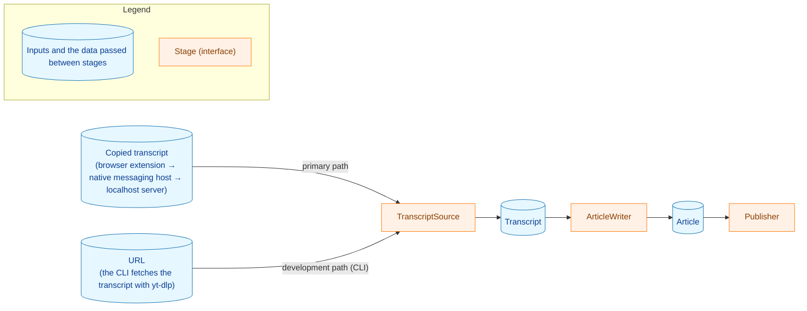

<!-- translated-from: README.md 994c09546f2af72503f65d50419f9b120c967de1 -->
[日本語](README.md)

Developer documents: [Using the CLI](docs/dev/guides/cli.md) · [Development procedures](docs/dev/guides/development.md)

# yt2column

yt2column turns a YouTube video into a magazine-column-style article with an
LLM. The primary path starts in the browser: the extension collects the
transcript the user copied from YouTube's transcript panel, the native
messaging host relays it to the localhost server, and the server generates the
article and posts it to the configured Webhook. A CLI is also included as a
development path: it takes a video URL and fetches the transcript with
[yt-dlp](https://github.com/yt-dlp/yt-dlp). The LLM call and the posting are
developed and checked with the CLI.



- The primary path uses the transcript copied from the transcript panel; only
  the CLI uses yt-dlp.
- The default is the production profile: generation, shortening, and review
  all use `claude` with `claude-opus-5-5` at effort `high`. See
  [Recommended configuration](#recommended-configuration) and
  [production_profile.md](docs/dev/production_profile.md) (Japanese).
  DeepSeek is also available; providers are pluggable.
- Designed for local execution.

> **Status:** early development; no release yet.

## Quick start

These steps post a first article through the primary path. Each step links to
the section that explains it in detail.

1. Build the binaries with `make build`. They are placed in `build/`, and
   nothing is installed. See [Localhost server](#localhost-server).
2. In the shell that starts the server, set `ANTHROPIC_API_KEY` and, because
   these steps post the article, `SLACK_WEBHOOK_URL`. No other LLM variable is
   needed: the default is the production profile (see
   [Recommended configuration](#recommended-configuration)). Unset the
   `YT2COLUMN_*` variables left from an earlier setup: when a model variable is
   set without its provider variable, the server stops with a configuration
   error. See [Configuration](#configuration).
3. Start the server with `./build/yt2column-server 2>>server.log`. The server
   keeps running in the foreground (stop it with a signal), so run the next
   steps in another terminal. See [Running the server](#running-the-server).
4. After starting the browser you use once, register the host with
   `./build/yt2column-nmhost install chrome` (or `install brave`). On macOS,
   keep the built binary outside `~/Desktop`, `~/Documents`, and
   `~/Downloads`. See
   [Installing the native messaging host](#installing-the-native-messaging-host).
5. Run `make ext-install` once, then run `make ext-build`, and load
   `extension/dist` with **Load unpacked** on the extensions page. See
   [Browser extension](#browser-extension).
6. Open the video's description ("...more") and its transcript panel, select
   the caption lines, and send from the extension's toolbar icon. The article
   arrives in the Webhook's channel. See [Browser extension](#browser-extension).

## Requirements

**For the primary path (browser extension and localhost server):**

- Go (see `go.mod`)
- Node.js, with the version pinned in `extension/.node-version` (used to build
  the extension)
- Chrome or Brave
- `ANTHROPIC_API_KEY` for the default provider
- `SLACK_WEBHOOK_URL` (needed to post; the server starts without it)

An API key for the selected provider is required: `DEEPSEEK_API_KEY` for
`deepseek`, `ANTHROPIC_API_KEY` for `claude`. When the review step uses a
different provider, that provider's key is required too.

The CLI's requirements are in
[docs/dev/guides/cli.md](docs/dev/guides/cli.md#必要なもの).

## Post-generation steps

After the article is generated, two steps run by default.

1. **Shorten.** If the body is longer than 4,000 characters, the generation
   model shortens the body toward a target of 3,600 characters. If it is still
   over 4,000 characters after shortening or after the review step, the run
   fails with a length error and the article is neither written nor posted.
2. **Review.** The review model compares the article with the video title,
   channel name, description, and transcript, and returns a list of
   corrections. The corrections target claims with no basis in the material,
   meaning-changing paraphrases, wrong speaker attributions, speech-recognition
   errors carried over into the article, and sentences whose meaning cannot be made out.
   The process that writes the article (the writer) applies the list to the
   article. For the review step, a provider and a model of its own can be set
   in `YT2COLUMN_REVIEW_LLM`. By default it uses the generation provider and
   model.

Both steps call the LLM (the shorten step only when the body is over the
limit), so by default the LLM is called up to two more times than with
generation alone, and the cost grows accordingly.

The CLI's flags that skip a step, record the review's changes, or save and
resume the steps' output are in
[docs/dev/guides/cli.md](docs/dev/guides/cli.md#生成の後の工程).

## Output format

The article is the same text in both outputs, but each output arranges the
information differently: the reader's part (title, channel name, body, source
link) comes first, and the development part (models, estimated cost) goes last
in a Slack post and into the front matter in a file.

The file the CLI writes is in
[docs/dev/guides/cli.md](docs/dev/guides/cli.md#--out-のファイル).

### The Slack post

The post starts with the title and the channel name, then the body, and ends
with a one-line footnote.

```text
# Caching transcripts by video ID（Example Channel）

The cache key comes from the video ID alone.

## One key per video

Two URLs for one video share one entry.

出典: <https://www.youtube.com/watch?v=abcdefghijk>

Models: deepseek-flash (generation, shorten) · claude-haiku-5-5 (review) · Estimated cost: 0.0094 USD
```

- Without a channel name, the first line is `# <title>` alone.
- The footnote names each model once, with the steps that used it, in the order
  generation, shorten, review. A step the article did not go through (for
  example the shorten step on a short body, or a disabled review) is not
  listed. The footnote never shows the model version. The cost is shown with
  four decimals and `USD`, or as `Estimated cost: unknown`.
- When the post is longer than one message (see
  [Webhook publishing](#webhook-publishing)), the first line is in the first
  message and the footnote is in the last. The last message always holds the
  last line of the body together with the footnote, so no message is the
  footnote alone.

## Estimated cost

Both outputs carry the article's cost, with four decimals, or `unknown`: the
CLI's `--out` file in its front matter, and the Slack post as the end of its
footnote.

```text
Estimated cost: 0.0023 USD
Estimated cost: unknown
```

See [Output format](#output-format) for both layouts.

The estimate is an estimate, not the billed amount. It can differ from the
provider's invoice.

- DeepSeek's peak window is a weekly rule in UTC: the alternate rate applies on
  Monday through Friday during 01:00-04:00 and 06:00-10:00 UTC. The server
  judges the window from its own clock in UTC and does not know Chinese public
  holidays, so a call on a holiday is billed at the off-peak rate but estimated
  as peak: the estimate leans high.
- A call that crosses a window boundary can be judged at a different minute than
  the provider billed it, because the server's time is when the response was
  read and validated, and the provider's billing time is not documented.
- A server on a machine whose clock is wrong judges the window wrongly.
- The rate table can be stale, for example when the provider changes a rate or
  when the `deepseek-flash` alias starts to point at a model with different
  rates. Each entry records its source and checked date, and the update
  procedure is in a developer document.

Check the actual charge in the provider's console.

A Slack post from the localhost server cannot show why an unknown cost is
unknown, because the server's logs and HTTP responses have not been changed.

The CLI's cost lines on standard error, which give the reason, are in
[docs/dev/guides/cli.md](docs/dev/guides/cli.md#推定の料金).

## Webhook publishing

The article is posted to the Slack-compatible Incoming Webhook in
`SLACK_WEBHOOK_URL`. Mattermost is the verified target; a Slack Incoming
Webhook is accepted too, but is best effort. The URL must parse as an `https`
URL with a host. A value that does not, for example
`https://hooks.slack.com/services/%zz`, `https://hooks.slack.com/%`, or a value
ending in a control character, is rejected as a configuration error with exit
code `2`.

The article is posted as Markdown, laid out as in [Output format](#output-format).
A post longer than 16,383 code points (the limit Mattermost counts) is split
into several messages. Each message is at most 16,383 code points and begins
with a `(k/N)` marker. An article that cannot be split is rejected before
anything is sent: it cannot be split when a fragment would be only whitespace,
when it would need more than ten messages, or when the last line of the body
and the footnote together do not fit in one message. Each message is sent with
`silent` set, so Mattermost shows it without a notification, an unread marker,
or a `New Messages` line. On a Mattermost version that predates `silent`,
notifications can appear.

Before anything is sent, the post is checked for syntax the receiving server
would turn into a mention or rewrite. A *target `@`* is an `@` (or a look-alike
such as the full-width `＠`) followed by a name character (a letter, a digit,
`_`, `.`, or `-`) when the character before it is not a letter or a digit, so
`@everyone`, `(@here)`, and `_@name` are targets but `Tech@Work` and
`user@example.com` are not. What happens depends on where it is.

- A target `@` in the first line (the title and the channel name), in the
  footnote (the model names), or in the body outside code is posted with
  U+200B (zero width space) inserted right after the `@`. This keeps the
  receiving server from reading it as a mention. The article itself is not
  changed. The U+200B is invisible but is copied with the text.
- A target `@` inside a code span or a fenced code block of the body, or
  directly after a `/` (it may be part of a URL such as `youtube.com/@name`),
  is not changed: the article is rejected. A body whose code blocks cannot be
  told apart reliably (for example an unclosed fence) is rejected too if it
  has a target `@`.
- A `<!` or `<@` sequence, an HTML character reference such as `&#64;`, and a
  `<a|b>` link are rejected wherever they are.
- A split never starts a message with the part after an `@` that was in the
  middle of a word (`x@here` is not cut into `x` and `@here`). When no such cut
  exists, the post is rejected.

A rejected article is not posted at all. The error gives the line and column
in the post. Running again generates a different article, which may not have
the problem. The localhost server reports this rejection in its failure notice
as its own reason, separate from other posting failures.

If a post fails partway through a split article, the messages already sent stay
in the channel. There is no retry or resume: running again generates a new
article and posts it from the first message, so the channel can end up with part
of the old article and all of the new one.

How the CLI posts with `--slack`, and how to inspect a rejected article with
`--out`, are in
[docs/dev/guides/cli.md](docs/dev/guides/cli.md#webhook-への投稿).

## Localhost server

`yt2column-server` accepts the transcript the browser extension collects,
generates the article, returns it, and keeps it in memory. Posting it to the
Slack-compatible Webhook is an operation of its own: the extension's current
`/articles` request generates and posts in one go as before. The server's HTTP
API, including the job API that generates, returns, and posts on request, is in
[docs/dev/guides/development.md](docs/dev/guides/development.md#localhost-サーバの-api).
The extension does not connect to the server directly: the browser starts the
native messaging host, `yt2column-nmhost`, which relays the request to the
server's socket (see
[Installing the native messaging host](#installing-the-native-messaging-host)).
`make build` builds `build/yt2column`, `build/yt2column-server`, and
`build/yt2column-nmhost`; it installs nothing.

The server reads the LLM variables. `SLACK_WEBHOOK_URL` is optional for the
server: without it the server still starts and generates articles, but posting
is refused with `webhook_not_configured`, and the current extension shows that
refusal as an unexpected reply. The server never calls `yt-dlp` and reads
neither `YT2COLUMN_CACHE_DIR` nor `YT2COLUMN_YTDLP_PATH`. It listens on a Unix
domain socket (UDS) only, never on a TCP port. The socket path is derived from
`HOME` alone:

- macOS: `$HOME/Library/Application Support/yt2column/run/server.sock`
- other Unix: `$HOME/.local/state/yt2column/run/server.sock`

No other variable (such as `XDG_STATE_HOME` or `TMPDIR`) changes the path. The
server needs no shared token: the socket directory has mode `0700` and the
socket mode `0600`, so only processes running as your user can connect, and the
server trusts them. The server checks only the request path and method, not the
`Host`, `Origin`, `Content-Type`, or `Authorization` headers.

### Running the server

Start it with the provider variables set, and `SLACK_WEBHOOK_URL` if you want to
post.

```sh
./build/yt2column-server 2>>server.log
```

The server writes nothing to standard output. The logs go to standard error, so
`2>>server.log` keeps a record. The first log line names the socket. Every
request line carries the `requestId` the response returns, as do the
`/articles` job lines, so `grep "$requestId" server.log` finds them.

On start the server creates the socket directory (`run`) with mode `0700` when
it is missing, takes the start lock (the file `.yt2column.lock` in the socket
directory, which stays), removes a stale socket left by a server that was
killed, and creates the socket with mode `0600`. Only one server per `HOME`
(normally one per user) can run. The server holds the start lock until it has
stopped and its in-flight jobs have finished. The server repairs nothing: when
the socket directory is not yours, is a symbolic link, or does not have exactly
mode `0700`, or when a name at the socket path is not a socket, the server
refuses to start until you fix it by hand.

The socket path must fit the operating system's limit (107 bytes on Linux, 103
bytes on macOS and other Unix). On macOS the part after `HOME` is 54 bytes, so
`HOME` can be at most 49 bytes. If it is longer, the server refuses to start with exit code `2`.

Exit codes:

| Code | Meaning |
|---|---|
| `0` | The server stopped after a signal. |
| `1` | Preparing the socket directory, taking the start lock, creating the socket, or serving requests failed (for example, another server is already running). |
| `2` | The server was given arguments, or the configuration (including `HOME` and the socket path derived from it) or building the components failed before listening. |

### Stopping the server

The server logs to standard error. The first `SIGINT`, `SIGTERM`, or `SIGHUP`
(a signal that was ignored at startup is not subscribed to) stops accepting connections,
removes the socket, and waits for the other in-flight jobs to finish. These are
the `/articles` jobs, which can take up to about 45 minutes (three LLM calls of
15 minutes each). A second signal makes the server exit at once. Until the jobs have finished, a
new server refuses to start.

### Installing the native messaging host

The browser starts `yt2column-nmhost` for each send from the extension. The
host reads one request from the browser, sends it to the server's socket,
writes the server's response back to the browser, and exits; it starts nothing
and keeps nothing. The host reads `HOME` as the browser passes it and no other
variable, so it derives the same socket path as a server started with the same
`HOME`, and it reads neither the API keys nor the Webhook URL. The host's
standard output is the channel to the browser; its log goes to standard error.

The host exits with `0` once it has written its reply (a host error included),
and with `1` when it could not write one.

Register the host with each browser you use by running the built binary.

```sh
./build/yt2column-nmhost install chrome
./build/yt2column-nmhost install brave
```

`install` writes the host manifest `io.github.isseis.yt2column.json`. The
manifest names the binary's absolute path (symbolic links resolved) and allows
only the yt2column extension to start the host. `install` writes the manifest
path to standard error. The manifest goes to:

- macOS, Chrome and Brave: `$HOME/Library/Application Support/Google/Chrome/NativeMessagingHosts/io.github.isseis.yt2column.json`
- other Unix, Chrome: `$HOME/.config/google-chrome/NativeMessagingHosts/io.github.isseis.yt2column.json`
- other Unix, Brave: `$HOME/.config/BraveSoftware/Brave-Browser/NativeMessagingHosts/io.github.isseis.yt2column.json`

On macOS, Brave reads Chrome's manifest directory, so Chrome and Brave share
one manifest file: `install chrome` and `install brave` write the same file,
and `uninstall` for either browser removes the host from both. If you keep
using the other browser, run `install` for it again. On macOS, the host says
this on standard error too.

`install` refuses, changing nothing, when:

- the browser's user data directory does not exist (macOS:
  `$HOME/Library/Application Support/Google/Chrome` or
  `$HOME/Library/Application Support/BraveSoftware/Brave-Browser`; other Unix:
  `$HOME/.config/google-chrome` or `$HOME/.config/BraveSoftware/Brave-Browser`).
  Start the browser once, then install again;
- the binary is under the temporary directory, as with `go run`. Install from
  the binary `make build` built;
- a file at the manifest path was not written by this host. Check that file by
  hand.

Running `install` again replaces the manifest this host wrote. The manifest
points at the binary where it was when you installed it: after moving or
renaming the binary, run `install` again. On macOS, keep the binary outside the
folders the system protects (TCC), such as `~/Desktop`, `~/Documents`, and
`~/Downloads`: a host started from there can be refused access.

To remove the host from a browser:

```sh
./build/yt2column-nmhost uninstall chrome
./build/yt2column-nmhost uninstall brave
```

`uninstall` removes only a manifest this host wrote, and leaves the
`NativeMessagingHosts` directory, which other hosts' manifests may share. With
no manifest it does nothing and succeeds. Neither command touches the server,
its socket, or its configuration.

Host exit codes for `install` and `uninstall`:

| Code | Meaning |
|---|---|
| `0` | The manifest was written or removed (or there was none to remove). |
| `1` | `install` or `uninstall` refused, or writing or removing the file failed. |
| `2` | The arguments are wrong (the browser is not exactly `chrome` or `brave`), or `HOME` is unset, empty, or relative. |

### Reject reasons

What the extension shows when the server rejects a request with each reason:

| reason | extension shows |
|---|---|
| `not_found` | unexpected reply |
| `method_not_allowed` | unexpected reply |
| `too_many_requests` | fixed message |
| `body_too_large` | fixed message |
| `invalid_body` | fixed message |
| `invalid_video_url` | fixed message |
| `invalid_transcript` | fixed message |
| `webhook_not_configured` | unexpected reply |
| `invalid_key` | unexpected reply |
| `article_not_ready` | unexpected reply |
| `article_not_found` | unexpected reply |
| `article_not_postable` | unexpected reply |
| `internal_error` | fixed message (unexpected reply when `requestId` is empty) |

The status code of each reason, and how to check the server with `curl`, are in
[docs/dev/guides/development.md](docs/dev/guides/development.md#curl-でサーバを確かめる).

### Troubleshooting

- **`another server holds the socket directory lock`.** Another server is
  running, or a stopped one is still waiting for its in-flight jobs. The
  message names the lock file; `lsof` on it shows which process holds the lock.
- **`another process accepts connections on the socket path`.** A process other
  than a server listens on the socket path. Stop it, or check the file at that
  path.
- **`... nothing was repaired or removed, so fix it by hand`.** The socket
  directory, its parent, or the name at the socket path is not in the accepted
  form (the message names the path and the reason). Fix it by hand, for
  example by restoring mode `0700` on the socket directory, and start again.
- **`HOME: the socket path derived from HOME exceeds the operating system's
  limit`.** `HOME` is too long for the socket path; see the limit above.
- **`configuration: YT2COLUMN_LLM_PROVIDER: is no longer supported` (or
  `YT2COLUMN_MODEL`, `YT2COLUMN_REVIEW_PROVIDER`, `YT2COLUMN_REVIEW_MODEL`,
  `YT2COLUMN_CLAUDE_EFFORT`) after an update.** The provider, model, and effort
  are now set in one variable per step, and the five old variables are rejected
  whenever they are set, even empty. The server exits with `2` before it listens, and the extension can
  only report that the server is not running. Unset each old variable and set
  `YT2COLUMN_LLM`. If you unset only the old variables without setting
  `YT2COLUMN_LLM`, the default `claude/claude-opus-5-5` is used and the
  transcript goes to Anthropic. If any `YT2COLUMN_REVIEW_*` variable was set,
  also set `YT2COLUMN_REVIEW_LLM` to the provider and model the review step
  actually used. When you unset `YT2COLUMN_CLAUDE_EFFORT`, append the effort you
  used as `+<effort>` to the values of `YT2COLUMN_LLM` and `YT2COLUMN_REVIEW_LLM`
  whose provider is `claude` (if `YT2COLUMN_LLM` is not set, set it to
  `claude/claude-opus-5-5+<effort>`). If you do not append it, that step uses
  the default effort `high`. The old variable did not apply to `deepseek` steps,
  so do not append it to a `deepseek` value. See
  [Migrating from the retired LLM variables](#migrating-from-the-retired-llm-variables),
  then start the server again.
- **`build the LLM client` or `build the review LLM client` with a model
  error.** The provider's client rejects a model ID with surrounding whitespace
  or invalid UTF-8 when it is built, without naming the variable. The server
  builds both clients at startup, so it exits with `2` before it listens, and
  the extension can only report that the server is not running. For the first,
  fix the model ID in `YT2COLUMN_LLM`. For the second, fix the model ID in
  `YT2COLUMN_REVIEW_LLM`; when `YT2COLUMN_REVIEW_LLM` is unset, fix the model ID
  in `YT2COLUMN_LLM`.
- **The native messaging host is not found.** When there is no manifest for
  that browser, or the manifest's binary is gone, the browser gives the
  extension `Specified native messaging host not found.` (shown in the
  extension's developer log). Run `yt2column-nmhost install` for that browser
  from the binary you want it to start (see
  [Installing the native messaging host](#installing-the-native-messaging-host)).
  Run it again after moving the binary.
- **Access to the host is forbidden.** When the extension's ID is not the one
  the manifest allows, the browser gives the extension
  `Access to the specified native messaging host is forbidden.` Load the
  extension built from this repository's `extension/`. The `key` in the
  extension's manifest fixes its ID.
- **Reading the host's log.** The host logs to standard error, which goes to
  the browser's own standard error, out of sight when the browser was started
  from the Dock or a menu. Quit the browser completely, then start its
  executable from a terminal. The host's log lines then appear in that
  terminal.
  - macOS, Chrome: `"/Applications/Google Chrome.app/Contents/MacOS/Google Chrome"`
  - macOS, Brave: `"/Applications/Brave Browser.app/Contents/MacOS/Brave Browser"`
  - other Unix: `google-chrome` or `brave-browser`

  The host logs the socket path it derived, how far the relay got, and the
  host error or the server's status code, never the request or the response.
  If the host's socket path differs from the one in the server's first log
  line, the browser and the server see different values of `HOME`.

### Upgrading from the shared-token version

- Stop the old server before starting this one. The old server listened on a
  TCP port and did not take the start lock, so the new one cannot detect it.
- The server no longer reads the shared token file. It can be deleted:
  - macOS: `$HOME/Library/Application Support/yt2column/server-token`
  - other Unix: `${XDG_CONFIG_HOME:-$HOME/.config}/yt2column/server-token`
- The server no longer reads the variable that chose its port; it can be
  removed from your environment.
- The extension no longer has a settings page or the storage permission, so it
  can neither read nor delete the token and port an earlier version saved in
  the browser. The server no longer accepts them. To remove them anyway, remove
  the extension on `chrome://extensions/` (Brave: `brave://extensions/`) and
  load `extension/dist` again. The extension's ID stays the same, so you do not
  need to run the host's `install` again.

## Configuration

| Variable | Description | When unset |
|---|---|---|
| `YT2COLUMN_LLM` | Provider, model, and effort of generation and shortening, written as `<provider>/<model ID>`, optionally followed by `+<effort>`; the provider is `deepseek` or `claude` (e.g. `deepseek/deepseek-flash`, `claude/claude-sonnet-5-5+low`) | `claude/claude-opus-5-5` |
| `YT2COLUMN_REVIEW_LLM` | Provider, model, and effort of the review step, in the same form as `YT2COLUMN_LLM` | The same as generation (`YT2COLUMN_LLM`, or its default, including the effort) |
| `DEEPSEEK_API_KEY` | DeepSeek API key | Required when the generation or review provider is `deepseek` (an error) |
| `ANTHROPIC_API_KEY` | Anthropic API key | Required when the generation or review provider is `claude` (an error) |
| `ANTHROPIC_WORKSPACE_ID` | Anthropic workspace ID, for an API key not bound to a workspace | No workspace ID is sent |
| `SLACK_WEBHOOK_URL` | Slack-compatible Incoming Webhook URL (Mattermost is the verified target) | The server starts, but cannot post |

`yt2column-server` reads the LLM variables. It needs `SLACK_WEBHOOK_URL` only
to post, and starts without it (see [Localhost server](#localhost-server)). It
derives its socket path from `HOME` alone (see
[Localhost server](#localhost-server)).

The variables only the CLI reads, and how the CLI reads the ones above, are in
[docs/dev/guides/cli.md](docs/dev/guides/cli.md#設定).

The value of an environment variable is never trimmed or otherwise corrected;
an empty value is treated as set and rejected, not as unset.

`YT2COLUMN_LLM` and `YT2COLUMN_REVIEW_LLM` are split at the first `/`. The part
before it is the provider, which must be exactly `deepseek` or `claude`.
Everything after it is the model ID, sent to the provider's API as it is,
including any further `/` (`claude/vendor/model-x` sends the model
`vendor/model-x`). The model ID must not be empty, so `claude` and `claude/`
are rejected; so are `/claude-opus-5-5`, `Claude/claude-opus-5-5`, and
` claude/claude-opus-5-5`. A model ID with surrounding whitespace is accepted
here, but rejected, before any request is sent, when a run that includes the
step builds that step's client. The server builds both at startup, before it
listens.

When there is a `+` after the first `/`, the part before the `+` is the model
ID and the part after it is the effort. The `+` is looked for only after the
first `/`, and at most one `+` may be written there
(`claude/claude-opus-5-5+high+low` is rejected). The effort must exactly match
one of the provider's values in the table below. An empty effort
(`claude/claude-opus-5-5+`), an effort with uppercase letters or surrounding
whitespace (`claude/claude-opus-5-5+High`), and a value the provider does not
accept (`deepseek/deepseek-flash+medium`) are rejected, and never treated as
part of the model ID and sent to the provider. A value whose model ID before the `+` is
empty (`claude/+high`) is rejected too. The model ID is the part before the
`+`, so the model ID of `claude/claude-opus-5-5 +high` contains a trailing
space and is rejected when the client is built, as above.

| Provider | Accepted efforts | Without an effort |
|---|---|---|
| `claude` | `low`, `medium`, `high`, `xhigh`, `max` | Sends `high` |
| `deepseek` | `none`, `low`, `high`, `max` | Sends nothing (thinking stays at the API's default) |

With `claude`, the effort is sent as the request's effort. With `deepseek`, it
is sent as the request's `reasoning_effort`. `none` turns thinking off, and the
other values turn it on.

With `YT2COLUMN_LLM` unset, generation and shortening use
`claude/claude-opus-5-5` at effort `high`. With `YT2COLUMN_REVIEW_LLM` unset,
the review step uses the same provider, model, and effort as generation, the
default included. When `YT2COLUMN_REVIEW_LLM` is set without an effort, the
generation effort is not inherited, and the "Without an effort" column of the
table above applies. An empty
value of either variable is rejected and never replaced by the default or by
the generation setting.

The variables `YT2COLUMN_LLM_PROVIDER`, `YT2COLUMN_MODEL`,
`YT2COLUMN_REVIEW_PROVIDER`, `YT2COLUMN_REVIEW_MODEL`, and
`YT2COLUMN_CLAUDE_EFFORT` are retired. When any
of them is set, even to an empty value, the CLI and the server stop with a
configuration error naming it, on every run. Their values are never used. Each
error is reported together with the other configuration errors of the run. See
[Migrating from the retired LLM variables](#migrating-from-the-retired-llm-variables).

Only the variables of the selected providers are read and checked: a provider's
variables are read when the generation or the review provider is that provider.
The other provider's variables are ignored whatever their value, so exporting
`ANTHROPIC_API_KEY=` for another tool does not stop a run that uses only
`deepseek`. When the provider part of `YT2COLUMN_LLM` is rejected (an empty
value, no `/`, or a provider that is not accepted) and `YT2COLUMN_REVIEW_LLM`
is unset, no provider-specific variable is checked, but errors for common
variables are still reported. A value whose provider is accepted but whose
model ID is empty, such as `claude/`, and a value whose effort part is
rejected, such as `claude/claude-opus-5-5+ultra`, still have that provider's
variables checked.

With `claude`, the effort `max` is accepted, but in this use case the model is expected to
spend the whole default output limit on reasoning alone and return no article
text, so the run fails as truncated. Use `low` through `xhigh` for column
generation.

The default effort `high` was chosen for `claude-opus-5-5`. With another model,
such as `claude-sonnet-5-5`, even `high` can reach the output limit, and the run
fails as truncated. In that case, append a lower effort to the value of
`YT2COLUMN_LLM` (for example, `claude/claude-sonnet-5-5+medium`).

### Recommended configuration

```sh
export YT2COLUMN_LLM=claude/claude-opus-5-5+high
```

This value is the production profile: generation, shortening, and review all
use `claude` with `claude-opus-5-5` at effort `high`. It is also the code's
default (see [#490](https://github.com/isseis/yt2column/issues/490)
and [#171](https://github.com/isseis/yt2column/issues/171)), so it can be left
unset: with `ANTHROPIC_API_KEY` as the only LLM variable, generation,
shortening, and review all use this profile. Exporting it pins the profile in
the shell even if a default changes later.

`ANTHROPIC_API_KEY` is required. To review with the generation profile, leave
`YT2COLUMN_REVIEW_LLM` unset. To use another profile, set the environment
variables instead of relying on the defaults.

The quality target, the results, and the product limitations of this profile
are in [production_profile.md](docs/dev/production_profile.md) (Japanese).

### Migrating from the retired LLM variables

The provider and model of each step used to be set in two variables:
`YT2COLUMN_LLM_PROVIDER` and `YT2COLUMN_MODEL` for generation and shortening,
and `YT2COLUMN_REVIEW_PROVIDER` and `YT2COLUMN_REVIEW_MODEL` for the review
step. They are now set in one variable per step, `YT2COLUMN_LLM` and
`YT2COLUMN_REVIEW_LLM`, and the old variables are rejected. For example, a
DeepSeek setting that was

```text
YT2COLUMN_LLM_PROVIDER=deepseek
YT2COLUMN_MODEL=deepseek-flash
```

becomes:

```sh
export YT2COLUMN_LLM=deepseek/deepseek-flash
```

If any `YT2COLUMN_REVIEW_*` variable was set, set `YT2COLUMN_REVIEW_LLM` to the
provider and model the review step actually used; otherwise leave it unset, and
the review step uses generation's. The two old settings below implicitly
carried a part that is now written out. Write that part out even when the
provider looks the same as generation's.

| Old setting | New setting |
|---|---|
| `YT2COLUMN_REVIEW_PROVIDER` alone (the review step used that provider's default model) | `YT2COLUMN_REVIEW_LLM=<provider>/<model ID>`, with the model ID written out, for example `claude/claude-opus-5-5` |
| `YT2COLUMN_REVIEW_MODEL` alone (the review step used the generation provider) | `YT2COLUMN_REVIEW_LLM=<generation provider>/<model ID>`, with the generation provider written out, for example `deepseek/deepseek-chat` |

The Claude effort used to be set in `YT2COLUMN_CLAUDE_EFFORT`, which applied to
whichever of the generation and review steps used `claude`. It is now set per step by appending `+<effort>` to
the values of `YT2COLUMN_LLM` and `YT2COLUMN_REVIEW_LLM`, and
`YT2COLUMN_CLAUDE_EFFORT` is rejected. For example, a setting that was

```text
YT2COLUMN_CLAUDE_EFFORT=low
YT2COLUMN_LLM=claude/claude-sonnet-5-5
```

becomes:

```sh
export YT2COLUMN_LLM=claude/claude-sonnet-5-5+low
```

If `YT2COLUMN_LLM` was not set, set the default with the effort appended,
`YT2COLUMN_LLM=claude/claude-opus-5-5+<effort>`. If `YT2COLUMN_REVIEW_LLM` was
set to a `claude` value, append the same effort to its value too. If you do not
append it, the review step uses the default `high`. Do not append it to a value
whose provider is `deepseek`. The old variable did not apply to `deepseek`
steps, and appending it sends a `reasoning_effort` that was not sent before.
Versions before this one send `+<effort>` to the provider
as part of the model ID, so when going back to such a version, remove
`+<effort>`. Otherwise, the first LLM call fails.

Unset the old variables rather than only deleting them from a file: a shell
that already exported them keeps them, and an empty value is rejected too.
Check every place that may set them: `.envrc`, `.env`, the shell's startup
files, and the script that starts the server.

Removing the old variables without setting `YT2COLUMN_LLM` selects the default
`claude`, and the transcript is then sent to Anthropic. The error lines for
`YT2COLUMN_LLM_PROVIDER` and `YT2COLUMN_MODEL` say so, and when
`ANTHROPIC_API_KEY` is unset an `ANTHROPIC_API_KEY` error appears next to them
for the same reason. To keep using DeepSeek, set `YT2COLUMN_LLM` as above;
setting an Anthropic key alone does not keep DeepSeek.

A running server keeps the configuration it started with. After changing the
variables, stop the server and start it again. The server then checks them
before it listens.

## Browser extension

A Chrome/Brave extension (Manifest V3) lives in `extension/`; it is written in
TypeScript and built with Node.js. It is not published to a store: you build it
and load the build as an unpacked extension. The extension collects a
selection, the tab URL, and the tab title, and reads the video metadata (the
video title, the channel name, and the description) from the video page. It
sends the selection, the URL, and the video metadata to the localhost server,
and shows the response. The tab title is shown for checking (and must not be
empty); it is not sent.

Node.js 24 is required, and every `ext-*` target refuses to run when
`node --version` does not match `extension/.node-version`. The version file sits
inside `extension/`, so a Node.js version manager that reads the current
directory (such as [fnm](https://github.com/Schniz/fnm)) must be activated
inside `extension/`. Run the targets from the repository root with that version
still active.

```sh
cd extension && fnm use && cd ..
make ext-install   # install the pinned dev dependencies (npm ci; needs network)
make ext-build     # build extension/dist/
```

The development targets, such as the checks CI runs, are in
[docs/dev/guides/development.md](docs/dev/guides/development.md).

Load the build in Chrome or Brave:

1. Open `chrome://extensions/` (Brave: `brave://extensions/`).
2. Turn on **Developer mode**.
3. Click **Load unpacked** and select the `extension/dist` directory.

To update from an earlier build, first run `make ext-build` to rebuild
`extension/dist/`, then click the extension's reload button on
`chrome://extensions/` (Brave: `brave://extensions/`). `extension/dist/` is
build output that pulling new source does not update, so reloading without
rebuilding keeps running the earlier build, which may send without asking for
confirmation.

The extension ID is fixed to `clfmbbcdpnjcefbdihdoahomaifbabkk` and is the
same on every machine and from every directory.

The extension sends through the native messaging host, so before the first
send, start the server and register the host for the browser you use from the
binary `make build` built (see
[Installing the native messaging host](#installing-the-native-messaging-host)):

```sh
./build/yt2column-nmhost install chrome   # or: install brave
```

There is nothing to set in the extension: it has no settings page and stores
nothing. If the popup says the native messaging host could not be started, the
host is most often not installed for that browser, or its binary was moved
since it was installed: run `yt2column-nmhost install` again from the built
binary (see [Troubleshooting](#troubleshooting)).

The popup is displayed in Japanese when the browser's UI language is Japanese,
and in English otherwise. There is no language setting in the extension. The
popup text quoted in this README, such as the collapsed-description message
below, is the English version.

To send, open the transcript panel on a video page, select the caption lines,
and click the extension's toolbar icon to open the popup. The popup has four
parts, top to bottom:

- The video section: the video title as the heading, with the channel name
  below it when it can be taken from the page. When the video title is not
  available, the heading is the tab title instead.
- The checks section: a **Selected captions** row with the selection's
  character and line counts and a preview of its first 100 characters (and,
  when the selection is longer, its last 100), and a **Description** row with
  the description's state. A ⚠ row says what needs attention and, when there
  is something to do, the steps to take.
- The action section: a **Generate article** button. It sends when you press
  it. While sending the button is disabled, and after a send (whatever the
  result) it stays disabled: reopen the popup to send again.
- **Details**, folded away until you open it: the collected URL and the tab
  title.

The extension reads the video metadata without changing the page, so a
collapsed description is read only up to what the page shows. When the
description is collapsed, the popup says "Collapsed, so only the beginning
will be sent." with these steps:

1. Click "...more" below the video.
2. Reopen this popup.

The button stays usable: pressing it sends the beginning that the page shows.

A selection whose request body would be over 4 MiB is not sent: the
**Selected captions** row becomes ⚠ with the reason and the steps, and the
button stays disabled.

Some values may not be available. When a video title, channel name, or
description is missing or blank on the page, that value is left out of the
request (a channel name that is not blank but has a control character or is
longer than 200 code points is not left out: the server rejects the request with
`invalid_body`). A missing video title makes the tab title the heading, a
missing description makes the **Description** row ⚠ and says the description
will not be sent, and a missing channel name is not shown in the video section.
When the page cannot be read at all, or the tab has moved to another video
since the selection was read, all three are left out. The extension still
sends the selection and the URL, and the article is generated from them.

How to read the result:

- **Accepted** (`202`): the server took the request. It shows a `requestId` and
  says the result of generating and posting the article will arrive in Slack.
- **Rejected**: it shows the reason and a `requestId`.
- **Not sent**: the server is not running, or the request is too large for the
  host. The request did not reach the server, so it says what to fix and does
  not ask you to check Slack.
- **Result unknown**: the server did not respond in time, the host could not be
  started or exited without replying, or the reply could not be interpreted.
  The request may have reached the server. It does not resend automatically,
  and it tells you to check Slack before sending again, because the server may
  already be processing the request.

The `requestId` links what the extension shows to the server log and to a
failure notice in Slack. A successfully generated article carries no
`requestId`, so match it by the video or the time; a failure with no `requestId`
is matched by the time. Do not close the popup while it is sending: if you
close it the result is not shown, and sending again could post the same article
twice.

The selection is sent exactly as copied from the transcript panel; the extension
does not trim it. You can select the whole panel: the server skips the lines the
panel adds around the captions, which are the lines before the first timestamp
(such as the panel's title), chapter heading lines, and, at the end, blank lines
and the `Sync to video time` (`動画の時間と同期`) button label. When the
timestamp and the text are on separate lines, a heading directly after a
timestamp with no text is taken as that timestamp's text. Other lines, however,
are rejected: an unknown line among captions that put the timestamp and the
text on one line, an empty or whitespace-only line among the captions, a tab or
other control character in any line, and, before the first timestamp or where a
timestamp line is expected, a line containing an ASCII digit, a colon, and a
digit in a row (such as a malformed timestamp).

To see what was collected and the send result, open the popup's console from
the moment the popup opens: right-click the toolbar icon and choose
**Inspect popup** (shown while Developer mode is on; pin the extension first if
its icon is in the Extensions menu). The send log names the host, and for a
host that could not be started it records the browser's error text, such as
`Specified native messaging host not found.`. The log is lost when the popup
closes, so after closing it, find the result of a send in Slack and in the
server log by the time.
