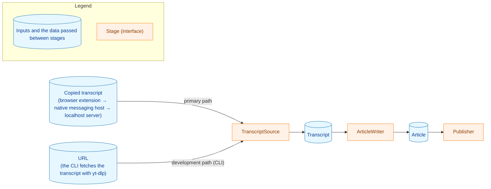

# yt2column

yt2column turns a YouTube video into a magazine-column-style article with an
LLM. The primary path starts in the browser: the extension collects the
transcript you copy from YouTube's transcript panel, the native messaging host
relays it to the localhost server, and the server generates the article and
posts it to the configured webhook. A CLI is included as a development path:
it takes a video URL and fetches the transcript with
[yt-dlp](https://github.com/yt-dlp/yt-dlp), which is how the LLM call and the
posting are developed and checked.



- The primary path uses the transcript copied from the transcript panel; only
  the CLI uses yt-dlp.
- The default is the production profile: `claude` with
  `claude-opus-5-5` at effort `high` for generation, shortening, and review.
  See [Recommended configuration](#recommended-configuration) and
  [production_profile.md](docs/dev/production_profile.md) (Japanese).
  DeepSeek is also available; providers are pluggable.
- Designed for local execution.

> **Status:** early development — no release yet.

## Quick start

These steps post a first article through the primary path. Each step links to
the section that has the details.

1. Build the binaries with `make build`; they go into `build/` and nothing is
   installed. See [Localhost server](#localhost-server).
2. Set `ANTHROPIC_API_KEY` and, because these steps post the article,
   `SLACK_WEBHOOK_URL` in the shell that starts the server. No other LLM
   variable is needed: the default is the production
   profile (see [Recommended configuration](#recommended-configuration)). Unset
   `YT2COLUMN_*` variables left from an earlier setup: a model variable without
   its provider variable stops the server with a configuration error. See
   [Configuration](#configuration).
3. Start the server with `./build/yt2column-server 2>>server.log`. It keeps
   running in the foreground (stop it with a signal), so run the next steps in
   another terminal. See [Running the server](#running-the-server).
4. Register the host with `./build/yt2column-nmhost install chrome` (or
   `install brave`) after starting that browser once. On macOS, keep the built
   binary outside `~/Desktop`, `~/Documents`, and `~/Downloads`. See
   [Installing the native messaging host](#installing-the-native-messaging-host).
5. Run `make ext-install` once, then `make ext-build`, and load
   `extension/dist` with **Load unpacked** on the extensions page. See
   [Browser extension](#browser-extension).
6. Open a video's description ("...more") and its transcript panel, select the
   caption lines, and send from the extension's toolbar icon. The article
   arrives in the webhook's channel. See [Browser extension](#browser-extension).

## Requirements

**For the primary path (browser extension and localhost server):**

- Go (see `go.mod`)
- Node.js, pinned in `extension/.node-version` (used to build the extension)
- Chrome or Brave
- `ANTHROPIC_API_KEY` for the default provider
- `SLACK_WEBHOOK_URL` (needed to post; the server starts without it)

**For the CLI only:**

- `yt-dlp` on `PATH` (or set `YT2COLUMN_YTDLP_PATH`); see
  [Setting up yt-dlp](#setting-up-yt-dlp)
- `SLACK_WEBHOOK_URL`, only when `--slack` is used

An API key for the selected provider is required: `DEEPSEEK_API_KEY` for
`deepseek`, `ANTHROPIC_API_KEY` for `claude`. When the review step uses a
different provider, that provider's key is required too.

## Usage

The CLI is the development path: use it to develop and check the LLM call and
the posting, while the primary path is the one in
[Quick start](#quick-start).

```
yt2column [flags] <video URL>
```

Flags must come before the video URL. Exactly one of `--out` (write the
article to a file outside the cache directory) and `--slack` (post it to the
configured webhook) is required.

| Flag | Meaning |
|---|---|
| `--out <path>` | File to write the article to. Use either this or `--slack`. It must not exist, its parent directory must exist, and it must be outside the cache directory. |
| `--slack` | Post the article to the Slack-compatible Incoming Webhook (e.g. Mattermost) set in `SLACK_WEBHOOK_URL`. Use either this or `--out`. |
| `--refresh` | Ignore the cached transcript, run `yt-dlp` again, and replace the cache. |
| `--keep-cache` | Keep this video's cache after a successful run. |
| `--system-prompt <path>` | Read the system prompt template from this file instead of the built-in one. |
| `--user-prompt <path>` | Read the user prompt template from this file instead of the built-in one. |
| `--no-shorten` | Do not shorten an over-long body, and do not check the final length. |
| `--no-review` | Do not review the article against the source material. |
| `--review-log <path>` | Write the review step's list of changes to this file. Requires the review step; with `--out`, the path must differ from it. |
| `--shorten-system-prompt <path>` | Read the shorten system prompt template from this file instead of the built-in one. |
| `--shorten-user-prompt <path>` | Read the shorten user prompt template from this file instead of the built-in one. |
| `--review-system-prompt <path>` | Read the review system prompt template from this file instead of the built-in one. |
| `--review-user-prompt <path>` | Read the review user prompt template from this file instead of the built-in one. |
| `--artifacts <path>` | Save each stage's output (the generated article, the shortened article, and the review list with the applied article) to this directory, and reuse it to resume. The directory must exist and be outside the cache directory. |
| `--after <stage>` | Run only the stages after `stage` (`generation`, `shorten`, or `review`), reusing that stage's saved output from `--artifacts`. Requires `--artifacts`; `--after review` does not accept `--review-log`. |
| `-h`, `--help` | Show this usage and exit. |

The article is written with file mode `0o644`. The output directory must allow
creating a hard link: publishing uses `link(2)`, so an output path on a
filesystem without hard-link support cannot be used, and a failed link leaves
the finished article in a temporary file next to the output path (the path is
printed to standard error).

### Exit codes

| Code | Meaning |
|---|---|
| `0` | The article was written to `--out` or posted to the configured webhook. Warnings about cache cleanup do not change this. `-h`/`--help` also exits `0`. |
| `1` | A run failure: fetching the transcript, generating the article, or publishing failed; another run held the cache directory; the run was interrupted; an `--artifacts` directory was unusable or a saved artifact was missing, broken, or from another run; or the article was published but writing the review log failed. |
| `2` | A usage or configuration error: bad arguments or video URL, a rejected environment variable, a forbidden `--artifacts`/`--after` combination, or a stage that could not be built. |

## Post-generation steps

After the article is generated, two steps run by default.

1. **Shorten.** If the body is longer than 4,000 characters, the generation
   model shortens it toward a target of 3,600. If it is still over 4,000
   characters after shortening — or after the review step — the run fails with
   a length error and the article is neither written nor posted.
2. **Review.** The review model compares the article with the video's title,
   channel name, description, and transcript, and returns a list of corrections
   to claims with no basis in the material, meaning-changing paraphrases, wrong
   speaker attributions, copied speech-recognition errors, and sentences whose
   meaning cannot be made out. The writer applies the list to the article. The
   review step can use a provider and a model of its own, set in
   `YT2COLUMN_REVIEW_LLM`; by default it uses the generation provider and
   model.

Both steps call the LLM (the shorten step only when the body is over the
limit), so the default uses up to two more calls, and more cost, than
generation alone. With `--no-shorten` the shorten step and the final length
check are skipped; with `--no-review` the review step is skipped.
`--no-shorten --no-review` restores the single-call behavior of earlier
versions, including the `--out` format.

An article's model entries start with the generation model and add one entry per
step that ran, in the order shorten, review (see [Output format](#output-format)).
For unattended runs, pass
`--review-log <path>` to record, in a separate file, what the review step
changed; the log is written after the article is published, and if it cannot be
written the run exits `1` with a message saying the article is already
published.

With `--artifacts <dir>`, a run also saves each stage's output — the generated
article, the shortened article, and the review list with the applied article —
to its own file (`<video ID>.generation.json`, `.shorten.json`, `.review.json`)
as the stage completes and before the article is published, so a later stage's
failure still leaves the earlier stages on disk. `--after <stage>` restarts from
a saved stage and runs only the stages after it, reusing the saved output
instead of calling the LLM for the skipped stages; `--after review` calls no LLM
and only checks the final length and publishes. A resumed run saves the stages
it does execute, so the `--artifacts` directory must be writable. The directory
lives outside the cache directory and is still there on the next run, which is
what makes the resume work; see [Cache and concurrency](#cache-and-concurrency).

The review step's configuration is validated even with `--no-review`, because
the configuration is independent of the flags: `YT2COLUMN_REVIEW_LLM` is still
checked, and if it selects a different provider, that provider's variables are
checked too. Its API key is required, and for `claude` a set effort must still
be valid (an unset one selects `high`). A resumed run validates only the
settings of the stages it executes, so `--after review` requires no LLM
settings at all. The one exception is the retired LLM variables
(`YT2COLUMN_LLM_PROVIDER`, `YT2COLUMN_MODEL`, `YT2COLUMN_REVIEW_PROVIDER`,
`YT2COLUMN_REVIEW_MODEL`): every run, `--after review` included, stops when
one of them is set (see [Configuration](#configuration)).

## Token usage

Every run reports the token usage the LLM API returned, one line per stage, on
standard error. A successful run writes the lines after its other summary lines;
a failed run writes them before the line that names the failure. A stage that
neither ran nor reused an artifact writes no line. The line is:

```text
yt2column: tokens: <stage> <origin> known input=<n> cache_read=<n> cache_write=<n> output=<n> <model-field>
yt2column: tokens: <stage> <origin> unknown reason=<reason> <model-field>
```

- `<stage>` is `generation`, `shorten`, or `review`.
- `<origin>` is `run` when this run called the stage's LLM, or `reused` when the
  stage came from a `--after` artifact.
- `known` means the four counts are known; they are, in order, `input=`
  (neither read from nor written to the prompt cache), `cache_read=` (read from
  the prompt cache), `cache_write=` (written to the prompt cache; always 0 for
  DeepSeek, which has no such category), and `output=` (the output, reasoning
  and thinking included). For a `reused` stage they are the counts the saved
  artifact recorded.
- `unknown` means the usage could not be read or did not meet the rules. No
  number is written, and `reason=` gives one space-free word: `not-read` (no
  usage could be read: a call that failed before its usage was read, or a client
  that reports none), `recorded-unknown` (a saved artifact stored the stage as
  unknown), `invalid-rule` (a rule outside the set of known rules), or, for the
  usage member or one of the consumed members that broke a rule, `usage:missing`,
  `usage:duplicate`, `usage:not-an-object`,
  `usage:not-a-non-negative-integer` and their `usage.<member>:missing`,
  `usage.<member>:duplicate`, `usage.<member>:not-a-non-negative-integer` forms.
- `<model-field>` is `model=<model>`, the model name, or the fixed word
  `nomodel` when the stage reported no model that passed the model-name rules.
  The model name is escaped the way `redact.Line` escapes every standard-error
  line, so a `"` or a `\` in it is escaped; to recover it, wrap everything after
  `model=` in double quotes and pass the result to `strconv.Unquote`. A model
  name that contains a configured secret (or its last eight characters) is
  replaced by the redaction marker and cannot be recovered.

For example:

```text
yt2column: tokens: generation reused known input=46 cache_read=0 cache_write=0 output=85 model=deepseek-flash
yt2column: tokens: shorten run known input=1800 cache_read=0 cache_write=0 output=2400 model=deepseek-flash
yt2column: tokens: review run unknown reason=usage.output_tokens:not-a-non-negative-integer model=claude-opus-5-5
yt2column: tokens: generation run unknown reason=not-read nomodel
```

An invalid `usage` alone does not fail the run: the call still succeeds, and
whether the article is published and the exit code is 0 depend on the rest of
the processing. A failed call fails the run (the exit code is non-zero), but its
line is not always `unknown`: a truncation, an unexpected finish reason, or an
empty response still carries the rejected response's model and usage, so the
line can be `known`. `reason=not-read` is written only when no usage could be
read.

A run that ends before it calls any LLM (a usage or configuration error, a
transcript-fetch failure, a rejected `--after` input, an unusable `--artifacts`
directory, or a stage that could not be built) writes no token line. A run that
is stopped without writing its summary (a second signal, `kill -9`, or a panic)
writes none either.

The counts are also stored, as the `usage` element, in a `--artifacts` file. A
stage's call time is stored next to it, as the `call_time` element: the moment
the stage's LLM call returned, in UTC and whole seconds. The artifact format is
version 3: a version 1 or version 2 file is rejected on resume, so after
updating, use a new `--artifacts` directory or move the old one away.

## Output format

The article is the same text in both outputs, but each output arranges the
information differently: the reader's part (title, channel name, body, source
link) comes first, and the development part (models, estimated cost) comes last
in a Slack post and in the front matter of a file.

### The `--out` file

The file starts with a YAML front matter, then the title, the channel name (when
there is one), and the body:

```text
---
channel: "Example Channel"
source: "https://www.youtube.com/watch?v=abcdefghijk"
model: "deepseek-flash"
model_version: "v4"
shorten_model: "deepseek-flash"
shorten_model_version: "v4"
review_model: "claude-haiku-5-5"
review_model_version: "2026-01-01"
estimated_cost_usd: "0.0094"
---

# Caching transcripts by video ID

Example Channel

The cache key comes from the video ID alone.

## One key per video

Two URLs for one video share one entry.

出典: <https://www.youtube.com/watch?v=abcdefghijk>
```

- The keys appear in this order. `channel` appears only when the video has a
  channel name; `shorten_*` only when the article went through the shorten step (run now or
  reused with `--after`); `review_*` only when it went through the review step.
- Every value is a double-quoted string, quoted with Go's `strconv.Quote`, so a
  value that contains a quote, a backslash, `:`, `#`, or `---` cannot change the
  structure. `estimated_cost_usd` is a string too: four decimals, or `unknown`
  (see [Estimated cost](#estimated-cost)). An empty model version is written as
  `(none)`.
- The channel name appears again under the title, so a Markdown viewer that
  hides the front matter still shows it. A name that starts like a Markdown block
  (`# `, `- `, `> `, and so on) gets a backslash at the start (after the digits
  for a numbered-list marker) so that the rendered line is the name; leading
  whitespace is dropped.
- This format replaces the earlier one, which listed the models and the cost
  under the title (`- Model: …`).

### The Slack post

The post starts with the title and the channel name, then the body, and ends
with a one-line footnote:

```text
# Caching transcripts by video ID（Example Channel）

The cache key comes from the video ID alone.

## One key per video

Two URLs for one video share one entry.

出典: <https://www.youtube.com/watch?v=abcdefghijk>

Models: deepseek-flash (generation, shorten) · claude-haiku-5-5 (review) · Estimated cost: 0.0094 USD
```

- Without a channel name, the first line is `# <title>` alone.
- The footnote names each model once with the stages that used it, in the order
  generation, shorten, review; a step the article did not go through (for example the
  shorten step on a short body, or a disabled review) is not listed. It never shows the
  model version. The cost is four decimals and `USD`, or
  `Estimated cost: unknown`.
- When the post is longer than one message (see
  [Webhook publishing](#webhook-publishing)), the first line is in the first
  message and the footnote is in the last. The last message always holds the
  last line of the body together with the footnote, so no message is the footnote
  alone.

## Estimated cost

Every run that calls or reuses at least one LLM stage also reports an estimated
cost on standard error: one line per stage, then two total lines. A successful
run writes them after the other summary lines; a failed run writes them before
the line that names the failure. A stage that neither ran nor reused an artifact
writes no cost line, and a run that writes no token line writes no cost line
either. The lines are:

```text
yt2column: cost: <stage> <origin> known usd=<amount> <basis> at=<time>
yt2column: cost: <stage> <origin> unknown reason=<reason> at=<time>
yt2column: cost-total: <total> known usd=<amount>
yt2column: cost-total: <total> unknown
```

- `<stage>` and `<origin>` are the same words as the token-usage line:
  `generation`, `shorten`, or `review`, and `run` or `reused`.
- `known` is followed by the amount as `usd=` and six decimals, then `basis`,
  the rate basis the estimate applied: `flat` (the model has one rate),
  `off-peak` or `peak` (the two windows of DeepSeek's time-of-day rate), or
  `short-prompt` or `long-prompt` (Claude Haiku's two prompt-length tiers).
  `invalid` in this position, like the one under `unknown`, marks a broken
  invariant and does not occur in a correct build.
- `unknown` means the cost could not be estimated. No number is written, and
  `reason` gives one word: `usage-unknown` (the stage's token counts are
  unknown), `no-model` (the stage reported no model name), or `unpriced-model`
  (the model name is not in the rate table). `invalid` means the CLI broke an
  invariant of the pricing package; it does not occur in a correct build.
- `at` is the call time the estimate used, in UTC as `YYYY-MM-DDTHH:MM:SSZ`. A
  reused stage shows the time its artifact recorded; `none` marks a broken
  invariant and does not occur in a correct build.
- The `cost-total` lines are two totals: `run` is this run's cost, from the
  stages this run called, and `article` is the whole article's cost, from those
  stages plus the ones reused from `--after`. A total is `unknown` when any
  stage in its set is unknown, and the `article` total is also `unknown` when
  the generation stage is neither run nor reused (an article always has a
  generation stage). Without `--after` the two totals are equal. The totals
  round the exact sum of the stages, not the already-rounded stage amounts, so a
  total can differ from the sum of the printed stage lines in the last digit.

For example:

```text
yt2column: cost: generation reused known usd=0.000158 peak at=2026-10-16T01:12:09Z
yt2column: cost: shorten run known usd=0.001710 off-peak at=2026-10-16T04:02:41Z
yt2column: cost: review run unknown reason=unpriced-model at=2026-10-16T04:03:15Z
yt2column: cost-total: run unknown
yt2column: cost-total: article unknown
```

Both outputs carry the article's cost, with four decimals, or `unknown`: the
`--out` file as the front matter key `estimated_cost_usd` (`"0.0023"` or
`"unknown"`), and the Slack post as the end of its footnote:

```text
Estimated cost: 0.0023 USD
Estimated cost: unknown
```

See [Output format](#output-format) for both layouts.

The estimate is an estimate, not the billed amount. It can differ from the
provider's invoice:

- DeepSeek's peak window is a weekly rule in UTC: the alternate rate applies on
  Monday through Friday during 01:00-04:00 and 06:00-10:00 UTC. The CLI judges
  the window from its own clock in UTC and does not know Chinese public
  holidays, so a call on a holiday is billed at the off-peak rate but estimated
  as peak: the estimate leans high.
- A call that crosses a window boundary can be judged at a different minute than
  the provider billed it, because the CLI's time is when the response was read
  and validated, and the provider's billing time is not documented.
- A CLI on a machine whose clock is wrong judges the window wrongly.
- The rate table can be stale, for example when the provider changes a rate or
  when the `deepseek-flash` alias starts to point at a model with different
  rates. Each entry records its source and checked date, and the update
  procedure is a developer document.

Check the actual charge in the provider's console. A reused stage is priced with
the rate table of the CLI that resumes, not the one that saved the artifact, so
a run that resumes after a rate change reports a different article cost for the
same saved text: the artifact records the call time, not the rate.

A Slack post from the localhost server cannot show why an unknown cost is
unknown, because the server's logs and HTTP responses do not change. To find the
reason, run the CLI with the same model setting and read the `reason` word on
its cost line.

## Cache and concurrency

Every run takes an exclusive lock on the cache directory, so runs that share a
cache directory are serialized: a second run fails immediately, without waiting,
while the first holds the lock. Different cache directories do not affect each
other.

The artifacts saved with `--artifacts` live outside the cache directory, so
removing the cache does not remove them and they are still there for a resume.
The CLI neither prunes nor deletes them; delete the directory yourself when it
is no longer needed.

If the CLI is killed with SIGKILL, `yt-dlp` may keep running. The lock stays held
until that `yt-dlp` exits, so until then the next run fails as a concurrent run
(the message names the lock file and suggests `lsof` on it); it succeeds once
the leftover `yt-dlp` has exited.

If the cache is corrupt (for example a truncated transcript or `info.json`), the
run fails with a message saying so. Run again with `--refresh` to fetch the
transcript again and replace the cache.

The channel name in a saved `info.json` is checked before the LLM is called: a
name that is only whitespace, contains a control character (or a bidirectional
control character such as U+202E), or is longer than 200 code points makes the
run fail, where earlier versions accepted it. Run with
`--refresh` to fetch the video again and replace the cache. The localhost
server rejects such a `channelName` with `invalid_body`.

## Webhook publishing

With `--slack`, the article is posted to the Slack-compatible Incoming Webhook
in `SLACK_WEBHOOK_URL` instead of a file. Mattermost is the verified target; a
Slack Incoming Webhook is accepted but is best effort. The URL must parse as an
`https` URL with a host. A value that does not — for example
`https://hooks.slack.com/services/%zz`, `https://hooks.slack.com/%`, or a value
ending in a control character — is rejected as a configuration error with exit
code `2`, and because the variable is validated whenever it is set, this also
stops an `--out` run.

The article is posted as Markdown, laid out as in [Output format](#output-format). A post longer than 16,383 code points — the
limit Mattermost counts — is split into several messages, each at most 16,383
code points and beginning with a `(k/N)` marker. An article that cannot be
split — because a fragment would be only whitespace, because it would need
more than ten messages, or because the last line of the body and the footnote
together do not fit in one message — is rejected before anything is sent. Each message is
sent with
`silent` set, so Mattermost shows it without a notification, an unread marker,
or a `New Messages` line; on a Mattermost version that predates `silent`,
notifications can still appear.

Before anything is sent, the post is checked for syntax a server would turn
into a mention or rewrite. A *target `@`* is an `@` (or a look-alike such as the
full-width `＠`) followed by a name character (a letter, a digit, `_`, `.`, or
`-`) when the character before it is not a letter or a digit, so `@everyone`,
`(@here)`, and `_@name` are targets but `Tech@Work` and `user@example.com` are
not. What happens depends on where it is:

- A target `@` in the first line (the title and the channel name), in the
  footnote (the model names), or in the body outside code is posted with
  U+200B (zero width space) inserted right after the `@`, which keeps the server
  from reading it as a mention. The file written by `--out` and the article
  itself are not changed. The U+200B is invisible but is copied with the text.
- A target `@` inside a code span or a fenced code block of the body, or
  directly after a `/` (it may belong to a URL such as `youtube.com/@name`), is
  not changed: the article is rejected. So is a body whose code blocks cannot be
  told apart reliably (for example an unclosed fence) if it has a target `@`.
- A `<!` or `<@` sequence, an HTML character reference such as `&#64;`, and a
  `<a|b>` link are rejected wherever they are.
- A split never starts a message with the part of a word after an `@` that was
  in the middle of a word (`x@here` is not cut into `x` and `@here`); when no
  such cut exists, the post is rejected.

A rejected article is not posted at all, and the error gives the line and column
in the post (the lines differ from a file written by `--out`, which starts with front
matter). Running again generates a different article, which
may not have the problem; run with `--out` to inspect what the model generated.
The localhost server reports this rejection in its failure notice as its own
reason, separate from other publishing failures.

If a post fails partway through a split article, the messages already sent stay
in the channel. There is no retry or resume: running again generates a new
article and posts it from the first message, so the channel can end up with part
of the old article and all of the new one.

## Localhost server

`yt2column-server` accepts the transcript the browser extension collects,
generates the article, and returns it, keeping it in memory. Posting it to the
Slack-compatible Webhook is an operation of its own: the extension's current
`/articles` request generates and posts in one go as before, and the job API
below generates, returns, and posts on request. The extension does not connect
to the server itself: the browser starts the native messaging host,
`yt2column-nmhost`, which relays the request to the server's socket (see
[Installing the native messaging host](#installing-the-native-messaging-host)).
`make build` builds `build/yt2column`, `build/yt2column-server`, and
`build/yt2column-nmhost`; it installs nothing.

It reads the same LLM variables as the CLI. `SLACK_WEBHOOK_URL` is optional for
the server: without it the server still starts and generates articles, but
posting (the job API's publish operation and `/articles`) is refused with
`webhook_not_configured`, and the current extension shows that refusal as an
unexpected reply. It never calls `yt-dlp` and reads neither `YT2COLUMN_CACHE_DIR`
nor `YT2COLUMN_YTDLP_PATH`. It listens on a Unix domain socket only, never on a
TCP port, at a path derived from `HOME` alone:

- macOS: `$HOME/Library/Application Support/yt2column/run/server.sock`
- other Unix: `$HOME/.local/state/yt2column/run/server.sock`

No other variable (such as `XDG_STATE_HOME` or `TMPDIR`) changes the path. The
server needs no shared token: the socket directory has mode `0700` and the
socket mode `0600`, so only processes running as your user can connect, and the
server trusts them. It checks only the request path and method, not the
`Host`, `Origin`, `Content-Type`, or `Authorization` headers.

### Running the server

Start it with the provider variables set, and `SLACK_WEBHOOK_URL` if you want to
post:

```sh
./build/yt2column-server 2>>server.log
```

The server writes nothing to standard output; the logs go to standard error,
so `2>>server.log` keeps a record. The first log line names the socket. Every
request line carries the `requestId` the response returns, as do the `/articles`
job lines, so `grep "$requestId" server.log` finds them. The job API's generation
and post jobs log the article key instead, so follow one with
`grep "$key" server.log`.

On start the server creates the socket directory (`run`) with mode `0700` when
it is missing, takes the start lock (the file `.yt2column.lock` in the socket
directory, which stays), removes a stale socket left by a server that was
killed, and creates the socket with mode `0600`. Only one server per `HOME`
(normally one per user) can run: the start lock is held until the server has stopped and its in-flight jobs
have finished. The server repairs nothing: a socket directory that is not
yours, is a symbolic link, or does not have exactly mode `0700`, and a name at
the socket path that is not a socket, stop the start until you fix them by
hand.

The socket path must fit the operating system's limit (107 bytes on Linux, 103
on macOS and other Unix). On macOS the part after `HOME` is 54 bytes, so `HOME` can be at
most 49 bytes; a longer one stops the start with exit code `2`.

Exit codes:

| Code | Meaning |
|---|---|
| `0` | The server stopped after a signal. |
| `1` | Preparing the socket directory, taking the start lock, creating the socket, or serving failed (for example, another server is already running). |
| `2` | The server was given arguments, or the configuration (including `HOME` and the socket path derived from it) or building the components failed before listening. |

### Stopping the server

The server logs to standard error. The first `SIGINT`, `SIGTERM`, or `SIGHUP`
(one ignored at startup is not subscribed) stops accepting connections, removes
the socket, cancels the job API's in-flight generations (their LLM calls stop
and their articles are lost, because the cache goes away with the server), and
lets the other in-flight jobs finish: the `/articles` jobs, which can take up to
about 45 minutes (three LLM calls of 15 minutes each), and the publish jobs. A
second signal exits at once. Until the jobs have finished, a new server refuses
to start.

### Installing the native messaging host

The browser starts `yt2column-nmhost` for each send from the extension. The
host reads one request from the browser, sends it to the server's socket,
writes the server's response back to the browser, and exits; it starts nothing
and keeps nothing. It reads `HOME` as the browser passes it and no other
variable, so it derives the same socket path as a server started with the same
`HOME`, and it never reads the API keys or the Webhook URL. Its standard output
is the channel to the browser; its log goes to standard error.

The host exits with `0` once it has written its reply, a host error
included, and with `1` when it could not write one.

Register the host with each browser you use by running the built binary:

```sh
./build/yt2column-nmhost install chrome
./build/yt2column-nmhost install brave
```

`install` writes the host manifest `io.github.isseis.yt2column.json`, which
names the binary's absolute path (symbolic links resolved) and allows only the
yt2column extension to start the host. It writes the manifest path to standard
error. The manifest goes to:

- macOS, Chrome and Brave: `$HOME/Library/Application Support/Google/Chrome/NativeMessagingHosts/io.github.isseis.yt2column.json`
- other Unix, Chrome: `$HOME/.config/google-chrome/NativeMessagingHosts/io.github.isseis.yt2column.json`
- other Unix, Brave: `$HOME/.config/BraveSoftware/Brave-Browser/NativeMessagingHosts/io.github.isseis.yt2column.json`

On macOS, Brave reads Chrome's manifest directory, so Chrome and Brave share
one manifest file: `install chrome` and `install brave` write the same file,
and `uninstall` for either browser removes the host from both. If you keep
using the other browser, run `install` for it again. The host says this on
standard error on macOS too.

`install` refuses, changing nothing, when:

- the browser's user data directory does not exist (macOS:
  `$HOME/Library/Application Support/Google/Chrome` or
  `$HOME/Library/Application Support/BraveSoftware/Brave-Browser`; other Unix:
  `$HOME/.config/google-chrome` or `$HOME/.config/BraveSoftware/Brave-Browser`).
  Start the browser once, then install again;
- the binary is under the temporary directory, as with `go run`. Install from
  the binary `make build` built;
- a file at the manifest path was not written by this host. Check that file by
  hand.

Running `install` again replaces the manifest this host wrote. The manifest
points at the binary where it was when you installed it: after moving or
renaming the binary, run `install` again. On macOS, keep the binary outside the
folders the system protects (TCC), such as `~/Desktop`, `~/Documents`, and
`~/Downloads`: a host started from there can be refused access.

To remove the host from a browser:

```sh
./build/yt2column-nmhost uninstall chrome
./build/yt2column-nmhost uninstall brave
```

`uninstall` removes only a manifest this host wrote, and leaves the
`NativeMessagingHosts` directory, which other hosts' manifests may share. With
no manifest it does nothing and succeeds. Neither command touches the server,
its socket, or its configuration.

Host exit codes for `install` and `uninstall`:

| Code | Meaning |
|---|---|
| `0` | The manifest was written or removed (or there was none to remove). |
| `1` | `install` or `uninstall` refused, or writing or removing the file failed. |
| `2` | The arguments are wrong (the browser is not exactly `chrome` or `brave`), or `HOME` is unset, empty, or relative. |

### Checking the server with curl

Write a request body to `request.json` (a video URL and the copied transcript):

```json
{"videoUrl":"https://www.youtube.com/watch?v=dQw4w9WgXcQ","transcript":"0:00\nHello\n"}
```

Send it to the socket. The path contains a space on macOS, so keep it in
double quotes:

```sh
socket="$HOME/.local/state/yt2column/run/server.sock"
if [ "$(uname -s)" = Darwin ]; then socket="$HOME/Library/Application Support/yt2column/run/server.sock"; fi
curl -sS --unix-socket "$socket" -X POST http://localhost/articles \
  -H 'Content-Type: application/json' \
  --data-binary @request.json
```

An accepted request answers `202` with `{"status":"accepted","requestId":"…"}`.
A rejected request answers a `4xx` or `5xx` with
`{"status":"rejected","reason":"…","requestId":"…"}`, where `reason` is one of:

| reason | status code | extension shows |
|---|---|---|
| `not_found` | 404 | unexpected reply |
| `method_not_allowed` | 405 | unexpected reply |
| `too_many_requests` | 429 | fixed message |
| `body_too_large` | 413 | fixed message |
| `invalid_body` | 400 | fixed message |
| `invalid_video_url` | 400 | fixed message |
| `invalid_transcript` | 400 | fixed message |
| `webhook_not_configured` | 503 | unexpected reply |
| `invalid_key` | 400 | unexpected reply |
| `article_not_ready` | 409 | unexpected reply |
| `article_not_found` | 404 | unexpected reply |
| `article_not_postable` | 409 | unexpected reply |
| `internal_error` | 500 | fixed message (unexpected reply when `requestId` is empty) |

`not_found` and `method_not_allowed` answer a wrong path or method; they start
no job and post no failure notice. The current extension's message declares no
`v` member, so the host relays it to `POST /articles` unchanged and the
extension shows either rejection as an unexpected reply.

### The job API

Besides `/articles`, the server accepts three operations that keep generation
and posting apart, so that a viewer can show the article and post it only when
the user asks. The current extension does not use them yet (#503 moves it);
`/articles` keeps working until then and is removed afterwards.

| operation | request | success response |
|---|---|---|
| generation start | `POST /jobs`, the same JSON object as `/articles` | `202`, `{"status":"accepted","key":"…","requestId":"…"}` |
| status | `GET /jobs/<key>`, no body | `200`, `{"status":"ok","requestId":"…","webhookConfigured":true,"job":{…}}` |
| publish | `POST /jobs/<key>/publish`, no body | `202`, `{"status":"accepted","requestId":"…"}` |

`<key>` is the article key. It is an opaque value: send back the one a
generation start returned, and do not depend on its shape or on how it is
computed. It is also specific to the server process: after a restart, the same
input gets a new key, so use the key a new generation start returns. A status or
publish target whose key is not the accepted shape is rejected with
`invalid_key`; neither operation takes a body, and any job API target with a
query answers `not_found`.

The status response reports the job as one of the codes below. A `running` job
carries `steps`; a `done` job carries `steps` (only `done` or `skipped`),
`article`, and `publish`; a `failed` job carries `steps` and `failure`, the
failure code. A step is `failed` only when the generation failed in that step; a
completion-check failure (`article_invalid`, `article_too_large`) or a failure
before the steps marks none. An unknown key carries no member besides `state`.
The `article` member holds `markdown` (the display Markdown),
`file` (byte for byte what `--out` writes), `cost`, and `durationMs` (from the
accepted start that generated the article, or from the accepted retry after a
failure). `cost` is `{"state":"known","usd":"…"}` or `{"state":"unknown"}`.
`publish` is `{"state":"…"}`, with a `reason` for `failed` and `unpostable`.
`webhookConfigured` says whether this server can post.

```json
{
  "status": "ok",
  "requestId": "0123456789abcdef",
  "webhookConfigured": true,
  "job": {
    "state": "done",
    "steps": { "draft": "done", "shorten": "skipped", "review": "done" },
    "article": {
      "markdown": "# …",
      "file": "---\n…",
      "cost": { "state": "known", "usd": "0.1234" },
      "durationMs": 81234
    },
    "publish": { "state": "not_posted" }
  }
}
```

Sending the same input again returns the same key without calling the LLM
while that article is being generated or is done; a failed key is generated
again. At most two generations run at once, counting the `/articles` jobs. A
generation start reads its body under two reading slots, and the `/articles`
endpoint reads a body only while it holds one of its generation slots, so at
most four bodies are read at once. A start refused for a full reading slot, a
full set of generations, or a full cache with no record to drop answers
`too_many_requests`, and no job starts.

The articles live in the server's memory only. The cache holds at most 100
records; when it is full it drops the oldest completed article or failure, and
never a record that is being generated or posted. A restart loses every article
and every publish state, so a status request then answers `unknown`. An article
whose pre-send checks refuse it has the publish state `unpostable` and cannot be
posted: it still comes back as `done` (it can be displayed and saved), and only
generating it again after a restart or after its record was dropped makes a
postable article.

The publish operation answers `202` without waiting for the Webhook's reply and
does not post an article twice: publishing a `posting` or `posted` article again
sends nothing, and a `failed` post resumes from the first message not delivered
(that one message may arrive twice). Posting needs `SLACK_WEBHOOK_URL`; without
it the operation answers `webhook_not_configured`, the status response carries
`"webhookConfigured": false`, and `/articles` is refused the same way.

A status request that answers is not logged, because a viewer polls it every few
seconds, so its `requestId` has no line in the log; a rejected status request
logs the rejection. Every other operation logs a line with its `requestId`, and
the job API's jobs log the key.

With the socket from the previous section and the body in `request.json`, the
three operations are:

```sh
curl -sS --unix-socket "$socket" -X POST http://localhost/jobs --data-binary @request.json
curl -sS --unix-socket "$socket" -X GET "http://localhost/jobs/$key"
curl -sS --unix-socket "$socket" -X POST "http://localhost/jobs/$key/publish"
```

`$key` is the key the generation start returned.

### Job API codes

The job API's status response reports each value as one of these codes.

| job state | meaning |
|---|---|
| `unknown` | the server holds no record for the key |
| `running` | the article is being generated |
| `done` | the article is generated and returned |
| `failed` | the generation failed |

| step | step of the generation |
|---|---|
| `draft` | the generation of the draft |
| `shorten` | the shortening of a long body |
| `review` | the review against the source material |

| step state | meaning |
|---|---|
| `pending` | not started |
| `running` | started and not finished |
| `done` | finished |
| `skipped` | not needed for this article |
| `failed` | the step the generation failed in |

| failure | meaning |
|---|---|
| `internal` | an internal failure |
| `transcript_too_long` | the transcript is too long for the prompt |
| `llm_timeout` | an LLM call timed out |
| `llm_empty` | an LLM returned an empty response |
| `llm_truncated` | an LLM response was cut off |
| `llm_failed` | any other LLM failure |
| `article_invalid` | the generated article cannot be published |
| `article_too_large` | the generated article does not fit the status response |

| publish state | meaning |
|---|---|
| `unpostable` | the Slack pre-send checks refuse the article |
| `not_posted` | postable and never posted |
| `posting` | being posted |
| `posted` | every message was delivered |
| `failed` | the last post stopped before the end |

| publish reason | with publish state | meaning |
|---|---|---|
| `other` | `unpostable` | any pre-send refusal but a mention |
| `mention` | `unpostable` | the article contains a mention |
| `internal` | `failed` | the post job ended abnormally |
| `webhook` | `failed` | the Webhook did not acknowledge a message |

### Troubleshooting

- **The server is not running.** `curl` reports `Couldn't connect to server`
  (its message names `localhost port 80`, the URL's host and default port; the
  connection itself goes to the socket). Start the server as above; the first
  log line names the socket it listens on.
- **`another server holds the socket directory lock`.** Another server is
  running, or a stopped one is still waiting for its in-flight jobs. The
  message names the lock file; `lsof` on it shows which process holds it.
- **`another process accepts connections on the socket path`.** A process other
  than a server listens on the socket path. Stop it, or check the file at that
  path.
- **`... nothing was repaired or removed, so fix it by hand`.** The socket
  directory, its parent, or the name at the socket path is not in the accepted
  form (the message names the path and the reason). Fix it by hand, for
  example by restoring mode `0700` on the socket directory, and start again.
- **`HOME: the socket path derived from HOME exceeds the operating system's
  limit`.** `HOME` is too long for the socket path; see the limit above.
- **`configuration: YT2COLUMN_LLM_PROVIDER: is no longer supported` (or
  `YT2COLUMN_MODEL`, `YT2COLUMN_REVIEW_PROVIDER`, `YT2COLUMN_REVIEW_MODEL`)
  after an update.** The provider and model are now set in one variable per
  step, and the four old variables are rejected whenever they are set, even
  empty. A CLI run exits with `2` before it starts; a server exits with `2`
  before it listens, and the extension can only report that the server is not
  running. Unset each old variable and set `YT2COLUMN_LLM`; if you unset them
  without setting it, the default `claude/claude-opus-5-5` is used and the
  transcript goes to Anthropic. If any `YT2COLUMN_REVIEW_*` variable was set,
  also set `YT2COLUMN_REVIEW_LLM` to the provider and model the review step
  actually used. See
  [Migrating from the retired LLM variables](#migrating-from-the-retired-llm-variables),
  then start the server again.
- **`build the LLM client` or `build the review LLM client` with a model
  error.** The provider's client rejects a model ID with surrounding white space
  or invalid UTF-8 when it is built, without naming the variable. The server
  builds both clients at startup, so it exits with `2` before it listens, and
  the extension can only report that the server is not running. Fix the model
  ID in `YT2COLUMN_LLM` for the first; for the second, fix it in
  `YT2COLUMN_REVIEW_LLM`, or in `YT2COLUMN_LLM` when `YT2COLUMN_REVIEW_LLM` is
  unset.
- **The native messaging host is not found.** The browser gives the extension
  `Specified native messaging host not found.` (shown in the extension's
  developer log) when there is no manifest for it, or the manifest's binary is
  gone. Run `yt2column-nmhost install` for that browser from the binary you
  want it to start (see
  [Installing the native messaging host](#installing-the-native-messaging-host)),
  again after moving the binary.
- **Access to the host is forbidden.** The browser gives the extension
  `Access to the specified native messaging host is forbidden.` when the
  extension's ID is not the one the manifest allows. Load the extension built
  from this repository's `extension/`, whose manifest key fixes its ID.
- **Reading the host's log.** The host logs to standard error, which goes to
  the browser's own standard error, out of sight when the browser was started
  from the Dock or a menu. Quit the browser completely, then start its
  executable from a terminal; the host's log lines then appear in that
  terminal:
  - macOS Chrome: `"/Applications/Google Chrome.app/Contents/MacOS/Google Chrome"`
  - macOS Brave: `"/Applications/Brave Browser.app/Contents/MacOS/Brave Browser"`
  - other Unix: `google-chrome` or `brave-browser`

  The host logs the socket path it derived, how far the relay got, and the
  host error or the server's status code, never the request or the response.
  If its socket path differs from the one in the server's first log line, the
  browser and the server see different values of `HOME`.

### Upgrading from the shared-token version

- Stop the old server before starting this one. The old server listened on a
  TCP port and does not take the start lock, so the new one cannot detect it.
- The server no longer reads the shared token file. It can be deleted:
  - macOS: `$HOME/Library/Application Support/yt2column/server-token`
  - other Unix: `${XDG_CONFIG_HOME:-$HOME/.config}/yt2column/server-token`
- The server no longer reads the variable that chose its port; it can be
  removed from your environment.
- The extension no longer has an options page or the storage permission, so it
  cannot read or delete the token and port an earlier version saved in the
  browser; nothing accepts them anymore. To remove them anyway, remove the
  extension on `chrome://extensions/` (Brave: `brave://extensions/`) and load
  `extension/dist` again. Its ID stays the same, so the host needs no new
  `install`.

## Setting up yt-dlp

yt2column fetches subtitles by running `yt-dlp`, which needs to reach YouTube
reliably. Beyond `yt-dlp` itself that means two optional pieces; without them
`yt-dlp` warns about them, and YouTube is more likely to answer with HTTP 429
(Too Many Requests):

- a JavaScript runtime ([deno](https://deno.com/) is the one `yt-dlp` enables
  by default), and
- [curl_cffi](https://github.com/lexiforest/curl_cffi) for browser
  impersonation.

On macOS the Homebrew formula brings both (it depends on `deno` and bundles
`curl_cffi`):

```sh
brew install yt-dlp
command -v yt-dlp                   # must be the Homebrew one, not an older copy earlier on PATH
yt-dlp --list-impersonate-targets   # lists targets whose Source is curl_cffi
```

If another `yt-dlp` comes first on `PATH`, remove it or point
`YT2COLUMN_YTDLP_PATH` at the one to use.

On other platforms, see the yt-dlp
[installation](https://github.com/yt-dlp/yt-dlp/wiki/Installation),
[EJS (JavaScript runtime)](https://github.com/yt-dlp/yt-dlp/wiki/EJS) and
[impersonation](https://github.com/yt-dlp/yt-dlp#impersonation) documentation.

## Configuration

| Variable | Description | When unset |
|---|---|---|
| `YT2COLUMN_LLM` | Provider and model of generation and shortening, as `<provider>/<model ID>`; the provider is `deepseek` or `claude` (e.g. `deepseek/deepseek-flash`, `claude/claude-sonnet-5-5`) | `claude/claude-opus-5-5` |
| `YT2COLUMN_REVIEW_LLM` | Provider and model of the review step, in the same form as `YT2COLUMN_LLM` | The same as generation (`YT2COLUMN_LLM`, or its default) |
| `DEEPSEEK_API_KEY` | DeepSeek API key | Required when the generation or review provider is `deepseek` (an error) |
| `ANTHROPIC_API_KEY` | Anthropic API key | Required when the generation or review provider is `claude` (an error) |
| `YT2COLUMN_CLAUDE_EFFORT` | Claude effort; `low`, `medium`, `high`, `xhigh`, or `max` | `high` when the generation or review provider is `claude` |
| `ANTHROPIC_WORKSPACE_ID` | Anthropic workspace ID, for an API key not bound to a workspace | No workspace ID is sent |
| `SLACK_WEBHOOK_URL` | Slack-compatible Incoming Webhook URL (Mattermost is the verified target) | Required with `--slack`; optional with `--out` (no value); the server starts without it, but then cannot post |
| `YT2COLUMN_CACHE_DIR` | Cache directory for subtitles and video metadata | `$HOME/Library/Caches/yt2column` on macOS; `$XDG_CACHE_HOME/yt2column` or `$HOME/.cache/yt2column` on other Unix |
| `YT2COLUMN_YTDLP_PATH` | Path to `yt-dlp` | `yt-dlp` on `PATH` |

`yt2column-server` reads the LLM variables; it needs `SLACK_WEBHOOK_URL` only to
post, and starts without it (see [Localhost server](#localhost-server)). It
reads neither `YT2COLUMN_CACHE_DIR` nor `YT2COLUMN_YTDLP_PATH`, because it never
calls `yt-dlp`. It derives its socket path from `HOME` alone (see
[Localhost server](#localhost-server)).

The value of an environment variable is never trimmed or otherwise corrected;
an empty value is treated as set and rejected, not as unset.

`YT2COLUMN_LLM` and `YT2COLUMN_REVIEW_LLM` are split at the first `/`: the
part before it is the provider, which must be exactly `deepseek` or `claude`,
and everything after it is the model ID, sent to the provider's API as it is,
including any further `/` (`claude/vendor/model-x` sends the model
`vendor/model-x`). The model ID must not be empty, so `claude` and `claude/`
are rejected, as are `/claude-opus-5-5`, `Claude/claude-opus-5-5`, and
` claude/claude-opus-5-5`. A model ID with surrounding white space is accepted
here but rejected, before any request, when a run that executes the step
builds that step's client: the CLI builds its clients before the run starts,
and the server builds both at startup, before it listens.

With `YT2COLUMN_LLM` unset, generation and shortening use
`claude/claude-opus-5-5`. With `YT2COLUMN_REVIEW_LLM` unset, the review step
uses the same provider and model as generation, the default included, also in
a resumed run that only reviews; a resumed run that only reviews and has
`YT2COLUMN_REVIEW_LLM` set does not read `YT2COLUMN_LLM`. An empty value of
either variable is rejected and never replaced by the default or by the
generation setting.

The variables `YT2COLUMN_LLM_PROVIDER`, `YT2COLUMN_MODEL`,
`YT2COLUMN_REVIEW_PROVIDER`, and `YT2COLUMN_REVIEW_MODEL` are retired. When any
of them is set, even to an empty value, the CLI and the server stop with a
configuration error naming it, on every run, including runs that read no LLM
setting such as `--after review`; their values are never used. Each error is
reported together with the other configuration errors of the run. See
[Migrating from the retired LLM variables](#migrating-from-the-retired-llm-variables).

Only the variables of the selected providers are read and checked: a provider's
variables are read when the generation or the review provider is that provider.
The other provider's variables are ignored whatever their value, so exporting
`ANTHROPIC_API_KEY=` for another tool does not stop a run that uses only
`deepseek`. When the provider part of `YT2COLUMN_LLM` is rejected (an empty
value, no `/`, or a provider that is not accepted) and `YT2COLUMN_REVIEW_LLM`
is unset, no provider-specific variable is checked, but errors for common
variables are still reported. A value whose provider is accepted but whose
model ID is empty, such as `claude/`, still has that provider's variables
checked.

With `claude`, `max` is accepted, but in this use case it is expected to spend
even the default output limit on reasoning alone and return no article text, so
the run fails as truncated. Use `low` through `xhigh` for column generation.

The default effort `high` was chosen for `claude-opus-5-5`. With another model,
such as `claude-sonnet-5-5`, `high` can also reach the output limit, and the run
fails as truncated; in that case set `YT2COLUMN_CLAUDE_EFFORT` to a lower
effort.

### Recommended configuration

```sh
export YT2COLUMN_LLM=claude/claude-opus-5-5
export YT2COLUMN_CLAUDE_EFFORT=high
```

These two values are the production profile: generation, shortening, and
review all use `claude` with `claude-opus-5-5` and the effort `high`. They are
also the code's defaults (see
[#490](https://github.com/isseis/yt2column/issues/490) and
[#171](https://github.com/isseis/yt2column/issues/171)), so they can be left
unset: with `ANTHROPIC_API_KEY` as the only LLM variable, generation,
shortening, and review all use this profile. Exporting them pins the profile in
the shell even if a default changes later.

`ANTHROPIC_API_KEY` is required. Leave `YT2COLUMN_REVIEW_LLM` unset to review
with the generation profile; to use another profile, set the environment
variables instead of relying on the defaults.

The quality target, the results, and the product limitations of this profile
are in [production_profile.md](docs/dev/production_profile.md) (Japanese).

### Migrating from the retired LLM variables

The provider and model of each step used to be set in two variables:
`YT2COLUMN_LLM_PROVIDER` and `YT2COLUMN_MODEL` for generation and shortening,
and `YT2COLUMN_REVIEW_PROVIDER` and `YT2COLUMN_REVIEW_MODEL` for the review
step. They are now one variable per step, `YT2COLUMN_LLM` and
`YT2COLUMN_REVIEW_LLM`, and the old variables are rejected. For example, a
DeepSeek setting that was

```text
YT2COLUMN_LLM_PROVIDER=deepseek
YT2COLUMN_MODEL=deepseek-flash
```

becomes

```sh
export YT2COLUMN_LLM=deepseek/deepseek-flash
```

If any `YT2COLUMN_REVIEW_*` variable was set, set `YT2COLUMN_REVIEW_LLM` to the
provider and model the review step actually used; otherwise leave it unset, and
the review step uses generation's. Two old settings carried a part that is now
written out, even when the provider looks the same as generation's:

| Old setting | New setting |
|---|---|
| `YT2COLUMN_REVIEW_PROVIDER` alone (the review step used that provider's default model) | `YT2COLUMN_REVIEW_LLM=<provider>/<model ID>`, with the model ID written out, for example `claude/claude-opus-5-5` |
| `YT2COLUMN_REVIEW_MODEL` alone (the review step used the generation provider) | `YT2COLUMN_REVIEW_LLM=<generation provider>/<model ID>`, with the generation provider written out, for example `deepseek/deepseek-chat` |

Unset the old variables rather than only deleting them from a file: a shell
that already exported them keeps them, and an empty value is rejected too.
Check every place that may set them: `.envrc`, `.env`, the shell's startup
files, and the script that starts the server.

Removing the old variables without setting `YT2COLUMN_LLM` selects the default
`claude`, and the transcript is then sent to Anthropic. The error lines for
`YT2COLUMN_LLM_PROVIDER` and `YT2COLUMN_MODEL` say so, and when `ANTHROPIC_API_KEY` is unset an
`ANTHROPIC_API_KEY` error appears next to them for the same reason. To keep
using DeepSeek, set `YT2COLUMN_LLM` as above; setting an Anthropic key does not
keep DeepSeek.

A running server keeps the configuration it started with. After changing the
variables, stop the server and start it again; it then checks them before it
listens.

## Development

```sh
make build   # build the three binaries into build/
make test    # unit tests (no network, no yt-dlp)
make lint    # golangci-lint (pinned version)
make fmt     # gofumpt on changed files
make test-integration  # real yt-dlp + network; see below
make test-integration-deepseek  # real DeepSeek API; see below
make test-integration-claude  # real Anthropic API; see below
make test-integration-cli  # the CLI with the real DeepSeek API; see below
make test-integration-slack  # posts fixed articles to a real Mattermost test Webhook; see below
make test-integration-cli-slack  # the CLI with the real DeepSeek API and a real Webhook; see below
```

Development follows a requirements → architecture → implementation-plan process
with explicit acceptance criteria. See [CLAUDE.md](CLAUDE.md) and
[docs/dev/developer_guide/requirements_process.md](docs/dev/developer_guide/requirements_process.md).
Design documents are written in Japanese; start with
[docs/dev/project_overview.md](docs/dev/project_overview.md).

### Running a separate server for development

The socket path depends only on `HOME`, and one server per `HOME` can run. To
run a server built from a worktree beside your own, give it its own `HOME` in a
short directory under `/tmp` (on macOS, the default directory of `mktemp -d`
makes the socket path too long), and send to its socket:

```sh
dev_home="$(mktemp -d /tmp/y2c.XXXXXX)"
HOME="$dev_home" ./build/yt2column-server 2>>"$dev_home/server.log" &
server_pid=$!
socket="$dev_home/.local/state/yt2column/run/server.sock"
if [ "$(uname -s)" = Darwin ]; then socket="$dev_home/Library/Application Support/yt2column/run/server.sock"; fi
until [ -S "$socket" ] || ! kill -0 "$server_pid" 2>/dev/null; do sleep 0.1; done
if [ -S "$socket" ]; then
  curl -sS --unix-socket "$socket" -X GET http://localhost/articles
else
  echo "server exited at startup; $dev_home/server.log:" >&2; cat "$dev_home/server.log" >&2
fi
kill "$server_pid" 2>/dev/null; wait "$server_pid"; rm -rf "$dev_home"
```

The loop stops waiting when the server exits at startup (a configuration error,
or another server holding the start lock for that `HOME`); its log is then
printed instead of sending the request, because the last line removes it. The
last line works whether or not the server is still running.

Each worktree's server with a different `HOME` runs at the same time as the
others. The server still reads the LLM and Webhook variables from your
environment: with the real ones, an accepted request generates an article and
posts it. With fake values (any API key, and an `https` Webhook URL such as
`https://example.invalid/hook`), send only requests that are rejected before a
job starts, such as the wrong method above (`method_not_allowed`) or a wrong
path (`not_found`); an accepted request would try to call the LLM API and post
a failure notice.

The extension cannot reach such a server. The browser starts the native
messaging host with your real `HOME`, so the host connects only to the socket
of a server started with your real `HOME`. The host manifest is one file per
browser (on macOS, one file shared by Chrome and Brave), so installing the host
from one worktree's build replaces the manifest another worktree installed;
check a build from the extension one worktree at a time.

### Browser extension

A Chrome/Brave extension (Manifest V3) lives in `extension/`; it is written in
TypeScript and built with Node.js. It is not published to a store — you build it
and load the build as an unpacked extension. It collects a selection, the tab
URL, and the tab title, and reads the video metadata — the video title, the
channel name, and the description — from the video page. It sends the selection,
the URL, and the video metadata to the localhost server, and shows the response.
The tab title is shown for checking (and must not be empty); it is not sent.

Node.js 24 is required, and every `ext-*` target refuses to run when
`node --version` does not match `extension/.node-version`. The version file sits
inside `extension/`, so a version manager that reads the current directory (such
as [fnm](https://github.com/Schniz/fnm)) must be activated from there; run the
targets from the repository root with that version still active:

```sh
cd extension && fnm use && cd ..
make ext-install   # install the pinned dev dependencies (npm ci; needs network)
make ext-build     # build extension/dist/
make ext-check     # typecheck, lint, format check, tests, then build
```

Load the build in Chrome or Brave:

1. Open `chrome://extensions/` (Brave: `brave://extensions/`).
2. Turn on **Developer mode**.
3. Click **Load unpacked** and select the `extension/dist` directory.

To update from an earlier build, run `make ext-build` to rebuild
`extension/dist/` first, then click the extension's reload button on
`chrome://extensions/` (Brave: `brave://extensions/`). `extension/dist/` is
build output that pulling new source does not update, so reloading without
rebuilding keeps running the earlier build, which may send without asking for
confirmation.

The extension ID is fixed to `clfmbbcdpnjcefbdihdoahomaifbabkk`, so it is the
same on every machine and from every directory.

The extension sends through the native messaging host, so before the first
send start the server and register the host for your browser from the binary
`make build` built (see
[Installing the native messaging host](#installing-the-native-messaging-host)):

```sh
./build/yt2column-nmhost install chrome   # or: install brave
```

There is nothing to set in the extension: it has no settings page and stores
nothing. If the popup says the native messaging host could not be started, the
host is most often not installed for that browser, or its binary was moved
since it was installed: run `yt2column-nmhost install` again from the built
binary (see [Troubleshooting](#troubleshooting)).

The popup is displayed in Japanese when the browser's UI language is Japanese,
and in English otherwise. There is no language setting in the extension. The
popup text quoted in this README, such as the collapsed-description message
below, is the English version.

To send, open the transcript panel on a video page, select the caption lines,
and click the extension's toolbar icon to open the popup. The popup shows what
was collected, the video metadata, and a **Send to yt2column** button. It sends
when you press the button. While sending the button is disabled, and after a
send (whatever the result) it stays disabled: reopen the popup to send again.

The extension reads the video metadata from the page without changing it, so a
collapsed description is read only up to what the page shows. When the
description is collapsed, the popup says "The video description is collapsed,
so only its beginning will be sent." with these steps:

1. Click "...more" below the video to show the full description.
2. Reopen this popup, then send.

The button stays usable: pressing it sends the beginning that the page shows.

Some values may not be available: when a video title, channel name, or
description is missing or blank on the page, that value is left out of the
request (a channel name that is not blank but has a control character or is
longer than 200 code points is not left out: the server rejects the request with
`invalid_body`), and when the page cannot be read at all — or the tab has moved to
another video since the selection was read — all three are left out. The
extension still sends the selection and the URL, and the article is generated
from them.

How to read the result:

- **Accepted** (`202`): the server took the request. It shows a `requestId` and
  says the result of generating and posting the article will arrive in Slack.
- **Rejected**: it shows the reason and a `requestId`.
- **Not sent**: the server is not running, or the request is too large for the
  host. The request did not reach the server, so it says what to fix and does
  not ask you to check Slack.
- **Result unknown**: the server did not respond in time, the host could not be
  started or exited without replying, or the reply could not be interpreted.
  The request may have reached the server. It does not resend automatically,
  and it tells you to check Slack before sending again, because the server may
  already be processing the request.

The `requestId` matches the extension's display with the server log and with a
failure notice in Slack. A successfully generated article carries no
`requestId`, so match it by the video or the time; a failure with no `requestId`
is matched by the time. Do not close the popup while it is sending: if you
close it the result is not shown, and sending again could post the same article
twice.

The selection is sent exactly as copied from the transcript panel; the extension
does not trim it. You can select the whole panel: the server skips the lines the
panel adds around the captions — the lines before the first timestamp (such as
the panel's title), chapter heading lines, and, at the end, blank lines and the
`Sync to video time` (`動画の時間と同期`) button label. When the timestamp and
the text are on separate lines, a heading directly after a timestamp with no
text is taken as that timestamp's text. Other lines are still rejected: an
unknown line among captions that put the timestamp and the text on one line, an
empty or whitespace-only line among the captions, a tab or other control
character in any line, and, before the first timestamp or where a timestamp line
is expected, a line containing an ASCII digit, a colon, and a digit in a row
(such as a malformed timestamp).

To see what was collected and the send result, open the popup's console from
the moment the popup opens: right-click the toolbar icon and choose
**Inspect popup** (shown while Developer mode is on; pin the extension first if
its icon is in the Extensions menu). The send log names the host, and for a
host that could not be started it records the browser's error text, such as
`Specified native messaging host not found.`. The log is lost when the popup
closes, so after closing it, find the result of a send in Slack and in the
server log by the time.

### Integration test

`make test-integration` runs the real `yt-dlp` against the network, so it needs
`yt-dlp` set up as in [Setting up yt-dlp](#setting-up-yt-dlp) and on `PATH`.
It fetches a real video (by default
`https://www.youtube.com/watch?v=EQCUZyB4DqE`) and sends YouTube two requests
two minutes apart, so a run takes a few minutes. Override the video with
`make test-integration YT2COLUMN_TEST_VIDEO_URL=... YT2COLUMN_TEST_VIDEO_ID=...`
(an empty `YT2COLUMN_TEST_VIDEO_ID` skips the video ID check). Leave some
time between runs to stay clear of YouTube's rate limit.

### DeepSeek integration test

`make test-integration-deepseek` calls the real DeepSeek API, so it incurs
charges. It needs `YT2COLUMN_TEST_DEEPSEEK_API_KEY` set to a DeepSeek API key
for testing; this is separate from the production `DEEPSEEK_API_KEY`, which the
test never reads. A missing or empty `YT2COLUMN_TEST_DEEPSEEK_API_KEY` skips
the test with a message naming the variable, so setting only `DEEPSEEK_API_KEY`
does not run it. The model comes from `YT2COLUMN_TEST_DEEPSEEK_MODEL`,
defaulting to `deepseek-flash` when that variable is undefined (an empty value
is passed through and fails the test). The target exports the opt-in variable
`YT2COLUMN_DEEPSEEK_INTEGRATION=1` for the integration test alone; without it
the test skips with a message naming the variable, so a plain
`go test -tags integration` or an IDE run does not call the API. A run makes two
generations — an ordinary one and one truncated by `MaxOutputTokens` — each
bounded by a 15-minute timeout, so it can take a few minutes under API load.

### Claude integration test

`make test-integration-claude` calls the real Anthropic Messages API, so it
incurs charges. It needs `YT2COLUMN_TEST_ANTHROPIC_API_KEY` set to an Anthropic
API key for testing; this is separate from the production `ANTHROPIC_API_KEY`,
which the test never reads. A missing or empty `YT2COLUMN_TEST_ANTHROPIC_API_KEY`
skips the test with a message naming the variable, so setting only
`ANTHROPIC_API_KEY` does not run it. The model and effort come from
`YT2COLUMN_TEST_CLAUDE_MODEL` and `YT2COLUMN_TEST_CLAUDE_EFFORT`, defaulting to
`claude-haiku-5-5` and `low` when undefined (an empty value is passed through
and fails the test). A workspace ID is read from
`YT2COLUMN_TEST_ANTHROPIC_WORKSPACE_ID` when set, never from the production
`ANTHROPIC_WORKSPACE_ID`; unset means no workspace ID is sent, while an empty or
malformed value fails the test. The target exports the opt-in variable
`YT2COLUMN_CLAUDE_INTEGRATION=1` for the integration test alone; without it the
test skips with a message naming the variable, so a plain
`go test -tags integration` or an IDE run does not call the API. A run makes two
generations — an ordinary one and one truncated by `MaxOutputTokens` — each
bounded by a 5-minute timeout, so the target's `-timeout` is 15 minutes.

### CLI integration test

`make test-integration-cli` runs the CLI's own assembly from a seeded transcript
cache to the `--out` file, calling the real DeepSeek API (so it incurs charges)
and never starting `yt-dlp`. Like the DeepSeek integration test it reads
`YT2COLUMN_TEST_DEEPSEEK_API_KEY`, defaults `YT2COLUMN_TEST_DEEPSEEK_MODEL` to
`deepseek-flash` when undefined, and exports its opt-in variable
`YT2COLUMN_CLI_INTEGRATION=1` for its target alone; unlike it, a missing test
API key fails the test rather than skipping it, so an opted-in run cannot pass
without calling the API.

### Webhook integration test

`make test-integration-slack` posts two fixed articles (no LLM call) to the real
Incoming Webhook of a Mattermost test channel, so it needs
`YT2COLUMN_TEST_SLACK_WEBHOOK_URL` set to that channel's Webhook URL. This is
separate from the production `SLACK_WEBHOOK_URL`, which the test never reads.
The target exports the opt-in variable `YT2COLUMN_SLACK_INTEGRATION=1` for the
integration test alone; without it the test skips with a message naming the
variable, so a plain `go test -tags integration` or an IDE run does not post. A
missing or invalid test Webhook URL, or a `GODEBUG` that enables `http2debug`,
fails the test rather than skipping it and posts nothing. Message text never
includes the URL, and failure messages redact the URL, its path, query, and
userinfo, and the last eight characters of the URL; a transport failure can
still name the destination host and port, which are not treated as secret.

### CLI webhook integration test

`make test-integration-cli-slack` runs the CLI's own assembly with `--slack`,
generating the article with the real DeepSeek API (so it incurs charges) and
posting it to the real test Webhook; it never starts `yt-dlp`. It needs both
`YT2COLUMN_TEST_DEEPSEEK_API_KEY` and `YT2COLUMN_TEST_SLACK_WEBHOOK_URL` and
fails when either is missing. Like the other CLI targets it defaults
`YT2COLUMN_TEST_DEEPSEEK_MODEL` to `deepseek-flash` when undefined, and it
exports `YT2COLUMN_CLI_SLACK_INTEGRATION=1` for its target alone.
