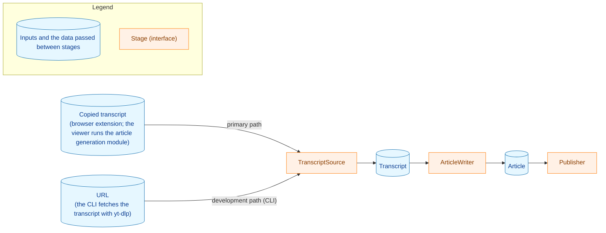

[English](README.en.md)

開発者向けの文書: [CLI の使い方](docs/dev/guides/cli.md)・[開発の手順](docs/dev/guides/development.md)

# yt2column

yt2column は、YouTube の動画を、LLM で雑誌のコラム風の記事にする。主経路はブラウザ拡張だけで完結する。利用者が
YouTube の文字起こしパネルから選択した字幕を拡張が集め、拡張に入れた記事生成モジュール（Go のコードを WebAssembly にビルドしたもの）が、ビューアのタブの中で Anthropic の API を呼んで記事を生成する。API キーは拡張のオプションページで設定し、そのブラウザの中にだけ保存する。記事は拡張のビューアのタブに表示され、`.md` ファイルへの保存と Markdown のクリップボードへのコピーは、利用者がビューアで選ぶ。補助の経路として CLI も含む。CLI は動画の URL を受け取り、
[yt-dlp](https://github.com/yt-dlp/yt-dlp) で文字起こしを取得する。LLM の呼び出しと記事の生成は、CLI で開発し確かめる。CLI は記事を `--out` のファイルに書く。



- 主経路は、文字起こしパネルからコピーした字幕を使う。yt-dlp を使うのは CLI だけである。
- 拡張の記事の生成は、本番の構成だけを使う。生成・字数の調整・検証・推敲のどれも、`claude` の
  `claude-opus-5-5` を effort `high` で使う。拡張には構成を選ぶ設定がない。
  [推奨構成](#推奨構成)と
  [production_profile.md](docs/dev/production_profile.md)（日本語）を参照。
  CLI では、DeepSeek と OpenAI も使える。プロバイダは差し替えられる。
- 拡張は、ブラウザのほかに何も導入しない。記事の生成のためのサーバもホストも要らない。

> **状態:** 開発の初期段階。まだリリースしていない。

## クイックスタート

次の手順で、主経路で最初の記事を生成し、ビューアで読む。各手順は、詳しく説明する節にリンクしている。

1. `make ext-install` を一度実行し、続けて `make ext-build` を実行して、拡張機能のページの
   **パッケージ化されていない拡張機能を読み込む**（**Load unpacked**）で `extension/dist` を読み込む。
   [ブラウザ拡張](#ブラウザ拡張)を参照。
2. 拡張のオプションページを開き、Anthropic の API キーを保存する。オプションページは、ポップアップの **設定** から開ける。
   [API キーの設定](#api-キーの設定)を参照。
3. 動画の概要欄（「もっと見る」）と文字起こしパネルを開き、字幕の行を選択して、拡張のツールバーのアイコンからポップアップを開き、**記事を生成する** を押す。記事は
   背面に開くビューアのタブに表示され、そこから `.md` で保存するか、Markdown をコピーして Mattermost などのチャンネルに貼り付けられる。[ブラウザ拡張](#ブラウザ拡張)を参照。

以前の版（localhost サーバと Native Messaging のホストを使う版）を使っていたときは、拡張を更新する前に[以前の版からの移行](#以前の版からの移行)を行う。

## 必要なもの

**主経路（ブラウザ拡張）に必要なもの:**

- Go（`go.mod` を参照）。拡張のビルドが、拡張に入れる記事生成モジュールをビルドするのに使う
- Node.js。版は `extension/.node-version` で固定している（拡張のビルドに使う）
- Chrome 142 以降、または Chromium 142 以降の Brave
- Anthropic の API キー。ゼロデータ保持（ZDR）か Compliance API を有効にした組織の API キーでは使えない。そのような組織は、ブラウザからの API の呼び出しを受け付けない。

CLI に必要なものは
[docs/dev/guides/cli.md](docs/dev/guides/cli.md#必要なもの)にある。CLI では、選んだプロバイダの API キーが必要である。

## 生成の後の工程

記事を生成した後、2 つの工程が走る。

1. **字数の調整。** 本文が 4,000 文字より長いとき、生成のモデルが目標の 3,600 文字に向けて本文を短くする。短くした後でも、検証・推敲の工程の後でも
   4,000 文字を超えるときは、生成は長さのエラーで失敗し、記事はできない。
2. **検証・推敲。** 検証・推敲のモデルが、記事を動画タイトル・チャンネル名・概要欄・文字起こしと照らし、修正の一覧を返す。修正の対象は、資料に根拠のない主張、意味を変える言い換え、話者の取り違え、音声認識の誤りの写し、意味の取れない文である。記事を書く処理（writer）がその一覧を記事に適用する。CLI では、`YT2COLUMN_REVIEW_LLM` で、この工程だけのプロバイダとモデルを設定できる。既定では、生成のプロバイダとモデルを使う。

どちらの工程も LLM を呼ぶ（字数の調整は、本文が上限を超えるときだけ）ので、生成だけのときより最大 2 回多く呼び、そのぶん費用も増える。

工程を飛ばす、検証・推敲の変更を記録する、工程の出力を保存して再開する、といった CLI のフラグは
[docs/dev/guides/cli.md](docs/dev/guides/cli.md#生成の後の工程)にある。拡張は、どの工程も飛ばさない。

## 出力の書式

記事の情報の並べ方は、出力ごとに異なる。ファイルでは、読み手のための部分（タイトル、チャンネル名、本文、出典リンク）を先に置き、開発のための部分（モデル、推定の料金）をフロントマターに置く。ビューアの表示とコピーは、フロントマターを除いた部分（タイトルの見出し、チャンネル名の行、本文）である。

CLI が書くファイルは
[docs/dev/guides/cli.md](docs/dev/guides/cli.md#--out-のファイル)にある。ビューアの **.md で保存する** が保存するファイルの中身は、CLI の `--out` のファイルと同じ書式である。

## 推定の料金

記事の料金は、CLI の `--out` のファイルでは、フロントマターに小数 4 桁か `unknown` で持つ。拡張のビューアは、完成した記事の推定の料金を示す。

```text
Estimated cost: 0.0023 USD
Estimated cost: unknown
```

推定は推定であり、請求額ではない。プロバイダの請求書とは異なりうる。

- 記事が完成しなかった実行（API が API キーを拒んだ、生成が失敗した、ビューアのタブとともに止まった）では、拡張は料金を一律に不明と示し、金額を示さない。API を一度も呼ばずに終わった実行（API キーがない、保存した設定が使えない）では、料金に触れない。
- DeepSeek のピークの時間帯は、UTC の週ごとの規則である。月曜から金曜の UTC の 01:00-04:00 と
  06:00-10:00 に、別の料金が適用される。CLI は自分の時計の UTC で時間帯を判定し、中国の祝日を知らない。そのため、祝日の呼び出しはオフピークの料金で請求されるが、ピークとして推定され、推定は高めに寄る。
- 時間帯の境界をまたぐ呼び出しは、プロバイダが請求した時刻とは別の分で判定されることがある。CLI の時刻は応答を読み取って検査した時刻であり、プロバイダの請求の時刻は文書化されていないためである。
- 時計がずれたマシンの CLI は、時間帯を誤って判定する。
- OpenAI の料金は、Standard の処理方式と 30 分のプロンプトキャッシュの単価で推定する。応答がそれを示さないときは、トークン数が分かっていても料金は `unknown` になる。入力（キャッシュの読み取りと書き込みを含む）の合計が 272,000 トークンを超える呼び出しには、長い入力の単価を適用する。
- 料金表が古くなることがある。例えば、プロバイダが料金を変えたときや、`deepseek-flash`
  のエイリアスが料金の異なるモデルを指すようになったときである。各項目は出典と確かめた日付を記録しており、更新の手順は開発者向けの文書にある。

実際の請求額はプロバイダのコンソールで確かめる。

理由を示す、CLI が標準エラーに書く料金の行は
[docs/dev/guides/cli.md](docs/dev/guides/cli.md#推定の料金)にある。

## ブラウザ拡張

Chrome/Brave の拡張（Manifest V3）は `extension/` にある。TypeScript で書き、Node.js
でビルドする。ストアでは公開しておらず、自分でビルドし、ビルドしたものをパッケージ化されていない拡張機能として読み込む。Chrome 142 以降で動く。拡張は、選択範囲、タブの
URL、タブのタイトルを集め、動画メタデータ（動画タイトル、チャンネル名、概要欄）を動画ページから読む。選択範囲、URL、動画メタデータから、拡張に入れた記事生成モジュールが記事を生成し、拡張のページ（ビューア）のタブに表示する。タブのタイトルは確認のために表示する（空であってはならない）が、記事の生成には使わない。

Node.js 24 が必要で、`node --version` が `extension/.node-version`
と一致しないときは、どの `ext-*` のターゲットも実行を断る。版のファイルは `extension/`
の中にあるので、カレントディレクトリを読む Node.js の版の管理ツール（[fnm](https://github.com/Schniz/fnm)
など）は、`extension/` の中で有効にしなければならない。その版を有効にしたまま、リポジトリのルートからターゲットを実行する。

ビルドは Go も呼び、拡張に入れる記事生成モジュールを、`go.mod` の `go` の行の版の Go でビルドする。手元の Go がその版でないときは、初めのビルドがその版の Go をダウンロードする（ネットワークを使う）。

```sh
cd extension && fnm use && cd ..
make ext-install   # install the pinned dev dependencies (npm ci; needs network)
make ext-build     # build extension/dist/
```

CI が実行する検査や、LLM の API を呼ばない開発用のビルドなど、開発のためのターゲットは
[docs/dev/guides/development.md](docs/dev/guides/development.md)にある。

ビルドしたものを Chrome か Brave で読み込む。

1. `chrome://extensions/`（Brave: `brave://extensions/`）を開く。
2. **デベロッパー モード**（**Developer mode**）をオンにする。
3. **パッケージ化されていない拡張機能を読み込む**（**Load unpacked**）をクリックし、`extension/dist` のディレクトリを選ぶ。

以前のビルドから更新するには、まず `make ext-build` を実行して
`extension/dist/` をビルドし直し、それから
`chrome://extensions/`（Brave: `brave://extensions/`）で拡張の再読み込みのボタンをクリックする。`extension/dist/`
はビルドの出力で、新しいソースを取り込んでも更新されない。そのため、ビルドし直さずに再読み込みすると以前のビルドが動き続ける。拡張を再読み込みすると、開いている拡張のページ（ビューアを含む）は閉じられ、生成中の記事も完成した記事も失われる。

拡張の ID は `clfmbbcdpnjcefbdihdoahomaifbabkk` に固定してあり、どのマシンでも、どのディレクトリからでも同じである。保存した API キーは拡張の ID ごとに分かれるので、ID が変わらない限り、ビルドし直しても再読み込みしても残る。

拡張はシークレットモードでは有効にできない。

ポップアップ、ビューア、オプションページの文言は、ブラウザの UI の言語が日本語のときは日本語で、それ以外のときは英語で表示する。拡張に言語の設定はない。この
README が引用する画面の文言（下の、概要欄が折りたたまれているときのメッセージなど）は日本語の版である。

#### API キーの設定

拡張は、記事の生成で Anthropic の API を呼ぶので、使う前にオプションページで API キーを保存する。オプションページは、ポップアップの下の **設定** か、`chrome://extensions/`（Brave: `brave://extensions/`）の拡張の **詳細** にある **拡張機能のオプション** から開く。オプションページはタブで開く。

オプションページには、API キーの欄、ワークスペース ID の欄、**保存する** と **削除する** のボタンがあり、API キーが設定されているかどうかと、拡張のビルドの情報（コミット、Go の版、LLM）を示す。

- **API キー**: 入力した文字は伏せて表示する。保存した API キーを画面に再び示すことはなく、設定されているかどうかだけを示す。変えるときは、新しい API キーを入力し直す。スクリーンリーダーは、入力した文字を読み上げることがある。
- **ワークスペース ID**: 任意である。空のままにすると、指定なし（API キーが属するワークスペースを使う）になる。ワークスペースに属さない API キーでは、ワークスペース ID が要る。省くと、記事の生成は API の拒否（400）で失敗する。

**保存する** を押すと、拡張は、2 つの欄の値の形を確かめ、Anthropic の Models API を 1 回呼んで API キーを確かめてから保存する。この呼び出しはトークンを使わないので、料金はかからない。確かめている間は、欄とボタンを変えられない。結果は次のとおりで、画面の上部に示す。

- API キーが受け付けられた: 保存し、欄を空にする。
- 確かめられなかった（通信の失敗、時間切れ、401 のほかの拒否など）: 保存し、確かめられなかったことを示す。後で記事の生成が API キーの拒否で失敗したときは、新しい API キーを保存する。
- 欄の値が受け付けられる形でない: 何も保存せず、その欄に印を付ける。
- Anthropic が API キーを拒んだ（401）: 何も保存しない。キーの期限切れ、失効、誤りか、組織がブラウザからの呼び出しを許していない。
- 拡張の中で確かめられなかった: 何も保存しない。もう一度保存する。
- 保存できなかったかもしれない: API キーが設定されていると示されているかを確かめ、もう一度保存する。

**削除する** は、API キーとワークスペース ID の両方を消す。

API キーとワークスペース ID は、このブラウザのプロファイルの `chrome.storage.local` にだけ保存する。ブラウザを再起動しても残り、ほかの端末へは同期しない。拡張が API キーを送る先は `https://api.anthropic.com` だけで、ポップアップや Service Worker は API キーの値を読まない。ただし、同じ OS のユーザーとして動くプロセスは、プロファイルのファイルを読める。API キーは、月ごとの利用の上限を設けた、この拡張のためだけのワークスペースで作ることを勧める。そのワークスペースで作った API キーなら、ワークスペース ID の入力は要らない。

#### ポップアップ

送るには、動画ページで文字起こしパネルを開き、字幕の行を選択し、拡張のツールバーのアイコンをクリックしてポップアップを開く。ポップアップは、上から順に次の部分からなる。

- 動画のセクション: 動画タイトルを見出しとし、ページから取れるときはその下にチャンネル名を表示する。動画タイトルが取れないときは、見出しはタブのタイトルになる。
- 確認のセクション: 選択範囲の文字数と行数、最初の 100 文字のプレビュー（選択範囲がそれより長いときは最後の 100 文字のプレビューも）を表示する
  **選択した字幕** の行と、概要欄の状態を表示する **概要欄** の行がある。⚠
  の行は、注意が必要な点を示し、対処することがあるときはその手順も示す。
- 操作のセクション: **記事を生成する** のボタンがある。押すと記事の生成を始める。
- **詳細**: 開くまで折りたたまれている。集めた URL とタブのタイトルを表示する。
- **設定**: オプションページを開く。いつも表示する。

ポップアップは、選択範囲と動画メタデータを読む前に、保存した設定をウェブページから読めないようにする。それができなかったときは、タブを読まずに、そのことと手順を示す。

拡張は、ページを変更せずに動画メタデータを読むので、折りたたまれた概要欄は、ページが表示している部分までしか読めない。概要欄が折りたたまれているとき、ポップアップは「折りたたまれているため、冒頭だけが送られます。」と示し、次の手順を添える。

1. 動画の下の「もっと見る」をクリックしてください。
2. このポップアップを開き直してください。

ボタンは使えるままである。押すと、ページが表示している冒頭で記事を生成する。

4 MiB を超える選択範囲では記事を生成しない。**選択した字幕**
の行が理由と手順を伴う ⚠ になり、ボタンは無効のままである。

取得できない値があることもある。動画タイトル、チャンネル名、概要欄がページにない、または空白だけのときは、その値を記事の生成の入力から外す（空白だけではないが、制御文字を含む、または
200 コードポイントより長いチャンネル名は外さない。記事生成モジュールがその入力を受け付けず、開始は拒否される）。動画タイトルがないときはタブのタイトルが見出しになり、概要欄がないときは
**概要欄** の行が ⚠ になって概要欄を使わないことを示し、チャンネル名がないときは動画のセクションにチャンネル名を表示しない。ページをまったく読めないとき、または選択範囲を読んだ後にタブが別の動画に移ったときは、3 つすべてを外す。それでも拡張は選択範囲と URL から記事を生成する。

**記事を生成する** を押すと、拡張は、API キーが保存されているかを確かめる。保存されていなければ、API キーの設定が要ることと **API キーを設定する** のボタンを示し、ビューアを開かず、API を呼ばない。保存されていれば、拡張はビューアのタブを YouTube のタブの隣に背面で開く。作業中のタブは切り替わらない。記事の生成は、そのビューアのタブの中で行う。拡張は、記事の生成を自動では始め直さない。料金のかかる記事の生成が始まるのは、このボタン（と、下の **やり直す**・**現在の選択範囲で生成する**・選択の状態を終えた後の **記事を生成する**）を押したときだけで、拡張のページを開いても、ビューアを読み込み直しても、閉じたタブを復元しても始まらない。

押した後、ポップアップは動画のセクションと **詳細** をそのまま残し、確認のセクションの位置に状態を表示する。操作のセクションのボタンは、状態に応じた操作になる。

- **開始中**: ボタンは押せない。ポップアップは閉じてかまわない。結果はビューアのタブに表示される。
- **読み込み中**: 記事の生成が始まり、その記録を読んでいる。ボタンは **ビューアを開く** になる。
- **生成中**: 3 つの工程（「下書きの生成」「字数の調整」「検証・推敲」）のチェックリストと、押してからの経過時間を表示する。ボタンは **ビューアを開く** になる。
- **生成済み**: 記事ができたことと、推定の料金と所要時間を表示する。ボタンは **ビューアを開く** になる。
- **失敗**・**ページとともに止まった**・**API キーが拒まれた**: 理由と手順と、料金が不明であることを表示する。ボタンは **やり直す** になり、押すと同じ入力の記事の生成をもう一度 1 回だけ始める。**API キーが拒まれた** では、**API キーを設定する** のボタンも示す。新しい API キーを保存してから **やり直す** を押すか、YouTube のタブで同じ選択範囲のままポップアップのボタンを押すと、同じジョブのまま記事を生成し直す。
- **設定が要る**（記事の生成の途中で、API キーがなくなっていたか、保存した設定が使えなかった）: そのことと **API キーを設定する** のボタンを表示する。API を呼んでいないので、料金には触れない。ボタンは **やり直す** になる。
- **記事が失われた**: 記録がなくなった（下の「記録」を参照）。ボタンは **やり直す** になる。
- **開始が拒否された**・**結果不明**: 理由と手順を表示する。ボタンは押せないままである。始め直すには、ポップアップを開き直す。

開始が拒否されるのは、選択範囲が字幕として受け付けられないとき、すでに 2 つの記事を生成しているとき（同時に生成する記事は 2 つまで）、拡張の内部で失敗したときである。結果不明は、開始から 60 秒たっても結果が届かなかったときに示す。同じ選択範囲でもう一度押しても、その記事が生成中か生成済みであれば二重には生成しない。それ以外のときは、新しく記事の生成を始める。

同じ入力（同じ選択範囲・URL・動画メタデータ）の記事が生成中か生成済みのときは、どの押し方でも、新しく生成せずにその記事を示す。同じ入力の記事が失敗したか止まったときは、同じジョブのまま記事を生成し直す。

**記事を生成する** は、同じ動画の照会を付けて始める。拡張が記録を持つ同じ動画（URL の書き方によらず、動画 ID が同じ）の別の記事が生成中か生成済みであれば、拡張は生成を始めずに、その記事を示す。そのときポップアップは、動画のセクションと **詳細** を残したまま、確認のセクションの位置に、拡張に同じ動画の記事があることと、その記事の状態（生成中・生成済み）を表示する（選択の状態）。操作のセクションには 2 つのボタンが並ぶ。

- **既存の記事を表示する**: その記事のビューアのタブを、**ビューアを開く** と同じ順で前面に出す。記事の生成は始めない。押した後も、ポップアップは選択の状態のままである。
- **現在の選択範囲で生成する**: 同じ入力の記事の生成を、照会なしで 1 回だけ始め、新しいビューアのタブを背面に開く。ポップアップは開始中の状態に移り、その後は上の状態を表示する。既存の記事のタブは閉じない。

どちらのボタンも押さなければ、拡張は何も始めない。選択の状態で既存の記事が失敗するか、止まるか、失われると、ポップアップは同じ動画の記事が使えなくなったことを示し、ボタンは **記事を生成する** の 1 つになる。押すと、もう一度照会付きで始める。**やり直す** は、やり直す開始と同じ始め方で始める（**現在の選択範囲で生成する** の後のやり直しは照会なし）。

同じ動画の照会はベストエフォートである。拡張が記録を持つ記事だけを探すので、記録が消えた記事は照会に見つからず、そのときは選択を示さずに生成する。選択の状態の表示は、ほかに同じ動画の記事がないことも、この記事が今後も残ることも意味しない。

**ビューアを開く** は、その記事を表示しているビューアのタブを前面に出す。それがなければ、同じ記事の新しいビューアのタブを開いて前面に出す。ブラウザが休止のために破棄したタブは見つけられないので、そのときは同じ記事のタブが 2 つになる。ポップアップを閉じると状態の表示も止まり、開き直すと記事を生成する前の画面から始まる。

#### ビューア

ビューアは、リンクが正しくない場合を除くどの状態でも、元の動画へのリンクを表示し、記事が完成する前はポップアップと同じ見出しとチャンネル名を表示する。記事が完成した後は、記事生成モジュールが無効化した動画のタイトルとチャンネル名を表示する（動画のタイトルがないときは、それまでの見出しのまま）。ページのタイトルは「`<動画のタイトル> - yt2column`」で、ブラウザの履歴とタブに出る。動画のタイトルがないときは、見出しを使う。

- **準備中**・**読み込み中**: 動く印と、どちらを待っているかを示す文言を表示する。
- **生成中**: 3 つの工程のチェックリストと、記事の生成を始めてからの経過時間を表示する。
- **生成済み**: 記事を、タイトルと節の見出し・段落・リスト・強調などに整えて表示し、条件を満たす `<https://…>` の形の自動リンクを新しいタブで開けるようにして、推定の料金と所要時間を示す。次の 2 つの操作がある。
  - **.md で保存する**: 記事のファイルの中身（`--out` が書くものと同じ）を、ブラウザのダウンロードで保存する。ファイル名は動画タイトルから作り、ファイル名に使えない文字を `_` に置き換え、長すぎる名前は切り詰める。動画タイトルがないとき、または空白だけのときは、`<動画 ID>.md` になる。
  - **Markdown をコピーする**: 表示している記事の Markdown をクリップボードにコピーする。記事の `@` は、貼り付けた先でメンションにならないよう、記事生成モジュールが `@` の直後に U+200B（ゼロ幅スペース）を入れて無効化したものである。U+200B は目に見えないが、文章と一緒にコピーされる。無効化した `@` が 1 つ以上あったときは、コピーの通知でそのことを知らせる（数を示さない）。表示した記事を選択してブラウザでコピーすると、同じ無効化をした文字がコピーされるが、`#` や `**` などの Markdown の記号は描画で除かれるので含まれず、通知も出ない。Markdown のまま貼り付けたいときは、このボタンを使う。
- **完成したが保持できなかった**: 記事は完成したが、拡張が記録に書けなかった。記事を持っているのはそのビューアのページだけで、保存とコピーはできるが、読み込み直すか閉じると失われる。
- **失敗**・**ページとともに止まった**・**API キーが拒まれた**: 理由と手順と、料金が不明であることを表示する。**API キーが拒まれた** は **API キーを設定する** のボタンも示す。
- **設定が要る**: API キーがない、または保存した設定が使えないことと、**API キーを設定する** のボタンを表示する。料金には触れない。
- **記事が失われた**: 記録がなくなった。動画へのリンクから動画を開き、記事を生成し直す。
- **開始が拒否された**・**結果不明**・**入力を受け取れなかった**: 理由と手順を表示する。入力を受け取れなかったときは、記事の生成を始めておらず、料金はかかっていない。
- **リンクが正しくない**: ビューアの URL が受け付ける形でない。記事を表示せず、何も始めない。

同じ動画の記事を表示しているビューア（既存の記事のビューア）は、見出しの下に、同じ動画の既存の記事を表示していて、現在の選択範囲からは生成していないことと、現在の選択範囲で生成する手順を示す。既存の記事は、この開始より前に生成を始めたものなので、生成中でも経過時間を示さない（生成済みになると所要時間を示す）。ポップアップが同じ記事を表示しているビューアをすでに開いているときは、新しく開いたビューアのタブは自分を閉じ、前からあるビューアが残る。

**記事の生成はビューアのタブの中で行う。** 生成中は、そのタブを背面に置いたままでよい。タブを閉じるか読み込み直すと、記事の生成は止まり、ほかの場所では続かない。ビューアのページを一度でも操作した後は、ブラウザが、読み込み直しやタブを閉じる操作の前に確かめる。一度も操作していないビューアでは、確かめずに止まる。止まった記事は **ページとともに止まった** になり、料金は不明と示す。記事の生成の全体には 50 分の期限があり、過ぎると失敗にする。

**記録。** 拡張は、記事の生成ごとの記録（状態、工程、完成した記事）をブラウザのメモリ（`chrome.storage.session`）に置き、ディスクには書かない。完成した記事は、ブラウザを終了するまで、ビューアを読み込み直しても、閉じたタブを復元しても、ブラウザの履歴から開いても表示できる。ブラウザを終了したとき、拡張を再読み込みか更新したときは、すべての記録が消える。記録は 50 件まで、合計 8 MiB までで、超えるときは、失敗と止まった記録のうち古いものから、次に完成した記事のうち古いものから捨てる。256 KiB を超える記事は保持できず、失敗にする。記録はコピーした字幕と概要欄を持たない。

ビューアの URL は、記事の生成を始める前の開始の ID か、始めた後のジョブ ID、集めた URL、ページのタイトル（動画のタイトルを 64 文字までに切ったもの）を持ち、既存の記事のビューアでは、そのことを示す値（`e=1`）も持つ。コピーした字幕と概要欄は持たない。URL はブラウザの履歴に残る。ジョブ ID は不透明な値で、記事の内容を表さない。URL の値を細工したビューアは、どんな見出しやタイトルでも表示しうるので、見出しは記事の内容を保証しない。

選択範囲は、文字起こしパネルからコピーしたとおりに使う。拡張は前後の空白を除かない。パネル全体を選択してもよい。記事生成モジュールは、パネルが字幕の周りに加える行を飛ばす。それは、最初の時刻より前の行（パネルのタイトルなど）、チャプターの見出しの行、末尾の空行と
`Sync to video time`（`動画の時間と同期`）のボタンのラベルである。時刻と本文が別の行にあるときは、本文のない時刻の直後の見出しを、その時刻の本文とみなす。ただし、それ以外の行は拒否する。拒否するのは、時刻と本文を 1 行に置く字幕の中の未知の行、字幕の中の空行または空白だけの行、いずれかの行にあるタブなどの制御文字、そして、最初の時刻より前または時刻の行があるはずの位置にある、ASCII
の数字・コロン・数字が続けて並ぶ部分を含む行（不正な形の時刻など）である。

集めたものと結果を見るには、ポップアップが開いた時点から、ポップアップのコンソールを開く。ツールバーのアイコンを右クリックし、
**ポップアップを検証**（**Inspect popup**）を選ぶ（デベロッパー モードがオンのときに表示される。アイコンが拡張機能のメニューの中にあるときは、先に拡張を固定する）。ビューアのログはビューアのタブの DevTools に、記事の生成の調停のログは
`chrome://extensions/`（Brave: `brave://extensions/`）の拡張の **Service Worker** のリンクから開くコンソールに出る。ログには、字幕・記事・動画メタデータの値・API キー・ジョブ ID を書かない。

## 以前の版からの移行

以前の版は、localhost サーバ（`yt2column-server`）と Native Messaging のホスト（`yt2column-nmhost`）で記事を生成していた。今の拡張は、どちらも使わない。拡張を更新する前に、次の手順で移る。

1. 動いている `yt2column-server` を止める。
2. 以前の版のホストのバイナリで、使っていた各ブラウザからホストの manifest を消す（下のコマンド）。バイナリがもうないなどで実行できないときは、下の manifest のファイルを手で消す。
3. 拡張をビルドし直して再読み込みし（[ブラウザ拡張](#ブラウザ拡張)を参照）、オプションページで API キーを保存する（[API キーの設定](#api-キーの設定)を参照）。
4. 拡張だけで記事を 1 本作れたら、サーバの設定ファイル `~/.config/yt2column/config.env` を消す。このファイルは API キーの平文の写しを持つ。消すまでは、以前の版のサーバとホストに戻せる。

```sh
./build/yt2column-nmhost uninstall chrome
./build/yt2column-nmhost uninstall brave
```

手で消すときの manifest のファイル:

- macOS の Chrome と Brave: `$HOME/Library/Application Support/Google/Chrome/NativeMessagingHosts/io.github.isseis.yt2column.json`
- ほかの Unix の Chrome: `$HOME/.config/google-chrome/NativeMessagingHosts/io.github.isseis.yt2column.json`
- ほかの Unix の Brave: `$HOME/.config/BraveSoftware/Brave-Browser/NativeMessagingHosts/io.github.isseis.yt2column.json`

以前の版がブラウザに保存した共有トークンとポート（`sharedToken`・`serverPort`）が残っていても、今の拡張はそれを読まず、消しもしない。消したいときは、`chrome://extensions/`（Brave: `brave://extensions/`）で拡張を一度削除してから、`extension/dist` をもう一度読み込む。拡張を削除すると、保存した API キーも消えるので、もう一度保存する。

## 設定

| 変数 | 説明 | 未設定のとき |
|---|---|---|
| `YT2COLUMN_LLM` | 生成と字数の調整のプロバイダ・モデル・effort。`<provider>/<model ID>` の形で書き、後ろに `+<effort>` を付けられる。プロバイダは `deepseek`、`claude`、`openai`（例: `deepseek/deepseek-flash`、`claude/claude-sonnet-5-5+low`、`openai/gpt-6-astra+medium`） | `claude/claude-opus-5-5` |
| `YT2COLUMN_REVIEW_LLM` | 検証・推敲の工程のプロバイダ・モデル・effort。形は `YT2COLUMN_LLM` と同じ | 生成と同じ（`YT2COLUMN_LLM`、またはその既定。effort も含む） |
| `DEEPSEEK_API_KEY` | DeepSeek の API キー | 生成か検証・推敲のプロバイダが `deepseek` のときは必須（エラー） |
| `ANTHROPIC_API_KEY` | Anthropic の API キー | 生成か検証・推敲のプロバイダが `claude` のときは必須（エラー） |
| `OPENAI_API_KEY` | OpenAI API の API キー（ChatGPT の契約とは別に、API の課金が必要） | 生成か検証・推敲のプロバイダが `openai` のときは必須（エラー） |
| `ANTHROPIC_WORKSPACE_ID` | Anthropic のワークスペースの ID。ワークスペースに結び付いていない API キーのためのもの | ワークスペースの ID を送らない |

これらの変数は CLI が環境変数から読む。拡張はこれらを読まない。拡張の設定は、オプションページで保存する Anthropic の API キーとワークスペース ID だけで、記事の生成はいつも[推奨構成](#推奨構成)の本番の構成を使う（[API キーの設定](#api-キーの設定)を参照）。

CLI だけが読む変数と、CLI が上の変数をどう読むかは
[docs/dev/guides/cli.md](docs/dev/guides/cli.md#設定)にある。

値は、前後の空白を除くことも、ほかの方法で直すこともしない。空の値は未設定ではなく設定として扱い、拒否する。

`YT2COLUMN_LLM` と `YT2COLUMN_REVIEW_LLM` は、最初の `/` で分ける。その前の部分はプロバイダで、ちょうど
`deepseek`、`claude`、`openai` のどれかでなければならない。その後のすべてはモデルの ID で、さらに `/`
があってもそのまま、プロバイダの API に送る（`claude/vendor/model-x` はモデル
`vendor/model-x` を送る）。モデルの ID は空であってはならないので、`claude` と `claude/`
は拒否する。`/claude-opus-5-5`、`Claude/claude-opus-5-5`、
` claude/claude-opus-5-5` も拒否する。前後に空白のあるモデルの ID は、ここでは受け付けるが、その工程を含む実行がその工程のクライアントを組み立てるときに、リクエストを送る前に拒否する。

最初の `/` より後ろに `+` があれば、`+` より前がモデルの ID、後ろが effort である。`+` を探すのは最初の `/`
より後ろだけで、そこには `+` を 1 つまでしか書けない（`claude/claude-opus-5-5+high+low`
は拒否する）。effort は、プロバイダごとに次の表の値のどれかと完全に一致しなければならない。空の effort（`claude/claude-opus-5-5+`）、大文字や前後の空白を含む
effort（`claude/claude-opus-5-5+High`）、そのプロバイダが受け付けない値（`deepseek/deepseek-flash+medium`）は拒否し、モデルの
ID の一部とみなしてプロバイダに送ることはない。`+` より前のモデルの ID が空の値（`claude/+high`）も拒否する。モデルの ID
は `+` より前の部分なので、`claude/claude-opus-5-5 +high` のモデルの ID は後ろに空白を含み、上のとおりクライアントを組み立てるときに拒否する。

| プロバイダ | 受理する effort | effort を省いたとき |
|---|---|---|
| `claude` | `low`、`medium`、`high`、`xhigh`、`max` | `high` を送る |
| `openai` | `none`、`minimal`、`low`、`medium`、`high`、`xhigh`、`max` | `medium` を送る |
| `deepseek` | `none`、`low`、`high`、`max` | 何も送らない（thinking は API の既定のまま） |

`claude` では、effort を要求の effort として送る。`openai` では、要求の `reasoning.effort` として送り、`none` は推論を無効にする。`deepseek` では、要求の `reasoning_effort` として送る。`none`
は thinking を無効にし、ほかの値は有効にする。

**OpenAI を使う。** `openai` は OpenAI の Responses API を呼ぶ。API の課金が必要で、ChatGPT の契約では使えない。API キーは `OPENAI_API_KEY` に設定する。例えば、生成と字数の調整を
`gpt-6-astra` の effort `medium` で、検証・推敲を `gpt-6.1-sol` の既定の effort で行うには、次の環境変数を設定する。

```sh
export YT2COLUMN_LLM=openai/gpt-6-astra+medium
export YT2COLUMN_REVIEW_LLM=openai/gpt-6.1-sol
export OPENAI_API_KEY=<OpenAI の API キー>
```

effort は上の表の 7 つの値をすべて受け付け、モデルの一覧で絞らない。モデルが対応しない effort やパラメータの組み合わせは、OpenAI の API がエラー（HTTP の状態）として返し、その工程は失敗して記事は生成されない。別のモデルや effort に自動で切り替えることはない。料金を推定できるのは `gpt-6-astra` と `gpt-6.1-sol` だけで、ほかのモデルの料金は `unknown` になる（[推定の料金](#推定の料金)）。

要求は Standard の処理方式（`service_tier` が `default`）、プロンプトキャッシュの最低保持期間 30 分、`store: false` に固定しており、変える設定はない。送るデータと OpenAI の側の保持（`store: false` の効く範囲、監視ログ、プロンプトキャッシュ）は
[docs/dev/security.md](docs/dev/security.md#4-llm-プロバイダへ送るデータ)（日本語）にある。

出力の上限を要求が指定しないとき、OpenAI のアダプタは推論と回答を合わせて 6,080 トークンを上限として送る。3 つの工程はどれもこの値を使う。値の根拠と測り直し方は
[docs/dev/guides/openai_output_limit.md](docs/dev/guides/openai_output_limit.md)（日本語）にある。

`YT2COLUMN_LLM` を設定しなければ、生成と字数の調整は
`claude/claude-opus-5-5` を effort `high` で使う。`YT2COLUMN_REVIEW_LLM` を設定しなければ、検証・推敲の工程は、既定を含めて、生成と同じプロバイダ・モデル・effort を使う。`YT2COLUMN_REVIEW_LLM`
を設定して effort を省けば、生成の effort は受け継がず、上の表の「effort を省いたとき」に従う。どちらの変数も、空の値は拒否し、既定や生成の設定で置き換えることはない。

読んで検査するのは、選んだプロバイダの変数だけである。あるプロバイダの変数は、生成か検証・推敲のプロバイダがそのプロバイダであるときに読む。もう一方のプロバイダの変数は、値が何であれ無視する。そのため、別のツールのために
`ANTHROPIC_API_KEY=` を export していても、`deepseek` だけを使う実行は止まらない。`YT2COLUMN_LLM`
のプロバイダの部分が拒否され（空の値、`/` がない、または受け付けないプロバイダ）、`YT2COLUMN_REVIEW_LLM`
が未設定のときは、プロバイダ固有の変数は検査しないが、共通の変数のエラーは報告する。`claude/`
のように、プロバイダは受け付けるがモデルの ID が空の値でも、`claude/claude-opus-5-5+ultra`
のように effort の部分を拒否した値でも、そのプロバイダの変数は検査する。

`claude` の effort では `max` を受け付けるが、この用途では、モデルが既定の出力の上限まで推論だけに使い、記事の文章を返さないと見込まれるので、実行は打ち切りとして失敗する。コラムの生成には
`low` から `xhigh` までを使う。

既定の effort の `high` は、`claude-opus-5-5` のために選んだ。`claude-sonnet-5-5`
のような別のモデルでは、`high` でも出力の上限に達して、実行が打ち切りとして失敗することがある。その場合は
`YT2COLUMN_LLM` の値に低い effort を付ける（例: `claude/claude-sonnet-5-5+medium`）。

### 推奨構成

CLI の環境変数の値:

```text
YT2COLUMN_LLM=claude/claude-opus-5-5+high
```

この値が本番の構成である。生成・字数の調整・検証・推敲のどれも、`claude` の `claude-opus-5-5` を effort
`high` で使う。拡張は、いつもこの構成で記事を生成する。これは CLI の既定でもある（[#490](https://github.com/isseis/yt2column/issues/490) と
[#171](https://github.com/isseis/yt2column/issues/171) を参照）ので、設定しなくてよい。LLM
の設定が `ANTHROPIC_API_KEY` だけなら、生成・字数の調整・検証・推敲のどれもこの構成を使う。設定しておけば、後で既定が変わっても構成を固定できる。

CLI では `ANTHROPIC_API_KEY` が必須である。生成の構成で検証・推敲するには、`YT2COLUMN_REVIEW_LLM`
を設定しない。別の構成を使うには、既定に頼らず、環境変数に設定する。

この構成の品質の目標、結果、製品の制約は
[production_profile.md](docs/dev/production_profile.md)（日本語）にある。
