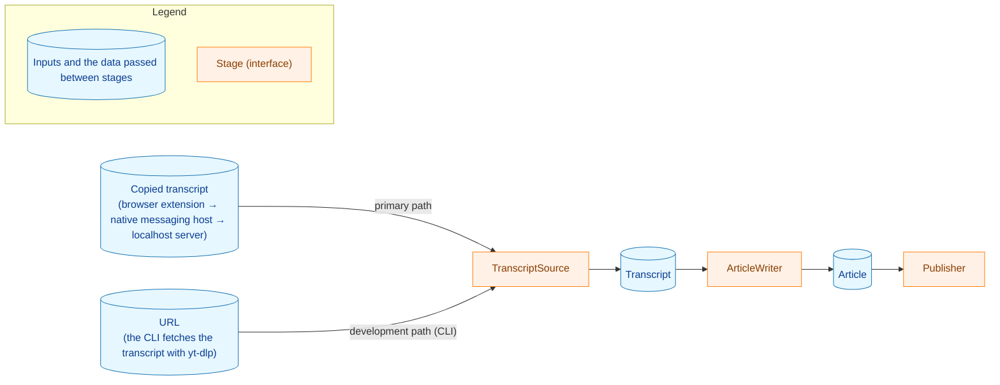

[English](README.en.md)

開発者向けの文書: [CLI の使い方](docs/dev/guides/cli.md)・[開発の手順](docs/dev/guides/development.md)

# yt2column

yt2column は、YouTube の動画を、LLM で雑誌のコラム風の記事にする。主経路はブラウザから始まる。利用者が
YouTube の文字起こしパネルからコピーした字幕を拡張が集め、Native Messaging のホストがそれを localhost サーバに中継し、サーバが記事を生成して、設定した
Webhook に投稿する。補助の経路として CLI も含む。CLI は動画の URL を受け取り、
[yt-dlp](https://github.com/yt-dlp/yt-dlp) で文字起こしを取得する。LLM の呼び出しと投稿は、CLI で開発し確かめる。



- 主経路は、文字起こしパネルからコピーした字幕を使う。yt-dlp を使うのは CLI だけである。
- 既定は本番の構成である。生成・字数の調整・検証・推敲のどれも、`claude` の
  `claude-opus-5-5` を effort `high` で使う。
  [推奨構成](#推奨構成)と
  [production_profile.md](docs/dev/production_profile.md)（日本語）を参照。
  DeepSeek も使える。プロバイダは差し替えられる。
- ローカルでの実行を想定している。

> **状態:** 開発の初期段階。まだリリースしていない。

## クイックスタート

次の手順で、主経路で最初の記事を投稿する。各手順は、詳しく説明する節にリンクしている。

1. `make build` でバイナリをビルドする。バイナリは `build/` に置かれ、何もインストールされない。
   [localhost サーバ](#localhost-サーバ)を参照。
2. サーバを起動するシェルで、`ANTHROPIC_API_KEY` と、これらの手順では記事を投稿するので
   `SLACK_WEBHOOK_URL` を設定する。ほかの LLM の変数は要らない。既定は本番の構成である（[推奨構成](#推奨構成)を参照）。以前の設定から残った
   `YT2COLUMN_*` の変数は外す（unset）。プロバイダの変数がなく、モデルの変数だけが設定されていると、設定エラーでサーバが止まる。
   [設定](#設定)を参照。
3. `./build/yt2column-server 2>>server.log` でサーバを起動する。サーバはフォアグラウンドで動き続ける（シグナルで止める）ので、次の手順は別の端末で実行する。
   [サーバの起動](#サーバの起動)を参照。
4. 使うブラウザを一度起動した後で、`./build/yt2column-nmhost install chrome`（または
   `install brave`）でホストを登録する。macOS では、ビルドしたバイナリを `~/Desktop`・`~/Documents`・`~/Downloads`
   の外に置く。
   [Native Messaging のホストのインストール](#native-messaging-のホストのインストール)を参照。
5. `make ext-install` を一度実行し、続けて `make ext-build` を実行して、拡張機能のページの
   **パッケージ化されていない拡張機能を読み込む**（**Load unpacked**）で `extension/dist` を読み込む。
   [ブラウザ拡張](#ブラウザ拡張)を参照。
6. 動画の概要欄（「もっと見る」）と文字起こしパネルを開き、字幕の行を選択して、拡張のツールバーのアイコンから送る。記事は
   Webhook のチャンネルに届く。[ブラウザ拡張](#ブラウザ拡張)を参照。

## 必要なもの

**主経路（ブラウザ拡張と localhost サーバ）に必要なもの:**

- Go（`go.mod` を参照）
- Node.js。版は `extension/.node-version` で固定している（拡張のビルドに使う）
- Chrome または Brave
- 既定のプロバイダのための `ANTHROPIC_API_KEY`
- `SLACK_WEBHOOK_URL`（投稿に必要。なくてもサーバは起動する）

選んだプロバイダの API キーが必要である。`deepseek` では `DEEPSEEK_API_KEY`、`claude` では
`ANTHROPIC_API_KEY` である。検証・推敲の工程が別のプロバイダを使うときは、そのプロバイダのキーも必要である。

CLI に必要なものは
[docs/dev/guides/cli.md](docs/dev/guides/cli.md#必要なもの)にある。

## 生成の後の工程

記事を生成した後、既定で 2 つの工程が走る。

1. **字数の調整。** 本文が 4,000 文字より長いとき、生成のモデルが目標の 3,600 文字に向けて本文を短くする。短くした後でも、検証・推敲の工程の後でも
   4,000 文字を超えるときは、実行は長さのエラーで失敗し、記事は書き出しも投稿もされない。
2. **検証・推敲。** 検証・推敲のモデルが、記事を動画タイトル・チャンネル名・概要欄・文字起こしと照らし、修正の一覧を返す。修正の対象は、資料に根拠のない主張、意味を変える言い換え、話者の取り違え、音声認識の誤りの写し、意味の取れない文である。記事を書く処理（writer）がその一覧を記事に適用する。検証・推敲の工程には、`YT2COLUMN_REVIEW_LLM` で、この工程だけのプロバイダとモデルを設定できる。既定では、生成のプロバイダとモデルを使う。

どちらの工程も LLM を呼ぶ（字数の調整は、本文が上限を超えるときだけ）ので、既定では生成だけのときより最大 2 回多く呼び、そのぶん費用も増える。

工程を飛ばす、検証・推敲の変更を記録する、工程の出力を保存して再開する、といった CLI のフラグは
[docs/dev/guides/cli.md](docs/dev/guides/cli.md#生成の後の工程)にある。

## 出力の書式

記事はどちらの出力でも同じ文章だが、情報の並べ方は出力ごとに異なる。読み手のための部分（タイトル、チャンネル名、本文、出典リンク）を先に置き、開発のための部分（モデル、推定の料金）は、Slack への投稿では最後に、ファイルではフロントマターに置く。

CLI が書くファイルは
[docs/dev/guides/cli.md](docs/dev/guides/cli.md#--out-のファイル)にある。

### Slack への投稿

投稿はタイトルとチャンネル名で始まり、本文が続き、1 行の脚注で終わる。

```text
# Caching transcripts by video ID（Example Channel）

The cache key comes from the video ID alone.

## One key per video

Two URLs for one video share one entry.

出典: <https://www.youtube.com/watch?v=abcdefghijk>

Models: deepseek-flash (generation, shorten) · claude-haiku-5-5 (review) · Estimated cost: 0.0094 USD
```

- チャンネル名がないときは、最初の行は `# <title>` だけになる。
- 脚注は、各モデルを、それを使った工程とともに 1 度ずつ、生成・字数の調整・検証・推敲の順に挙げる。記事が通らなかった工程（例えば、短い本文での字数の調整や、無効にした検証・推敲）は挙げない。モデルの版は示さない。料金は小数
  4 桁と `USD`、または `Estimated cost: unknown` である。
- 投稿が 1 つのメッセージより長いとき（[Webhook への投稿](#webhook-への投稿)を参照）は、最初の行は最初のメッセージに、脚注は最後のメッセージに入る。最後のメッセージは、本文の最後の行を必ず脚注と一緒に持つので、脚注だけのメッセージはない。

## 推定の料金

どちらの出力も記事の料金を、小数 4 桁か `unknown` で持つ。CLI の `--out`
のファイルはフロントマターに、Slack への投稿は脚注の末尾として持つ。

```text
Estimated cost: 0.0023 USD
Estimated cost: unknown
```

2 つの出力の並びは[出力の書式](#出力の書式)を参照。

推定は推定であり、請求額ではない。プロバイダの請求書とは異なりうる。

- DeepSeek のピークの時間帯は、UTC の週ごとの規則である。月曜から金曜の UTC の 01:00-04:00 と
  06:00-10:00 に、別の料金が適用される。サーバは自分の時計の UTC で時間帯を判定し、中国の祝日を知らない。そのため、祝日の呼び出しはオフピークの料金で請求されるが、ピークとして推定され、推定は高めに寄る。
- 時間帯の境界をまたぐ呼び出しは、プロバイダが請求した時刻とは別の分で判定されることがある。サーバの時刻は応答を読み取って検査した時刻であり、プロバイダの請求の時刻は文書化されていないためである。
- 時計がずれたマシンのサーバは、時間帯を誤って判定する。
- 料金表が古くなることがある。例えば、プロバイダが料金を変えたときや、`deepseek-flash`
  のエイリアスが料金の異なるモデルを指すようになったときである。各項目は出典と確かめた日付を記録しており、更新の手順は開発者向けの文書にある。

実際の請求額はプロバイダのコンソールで確かめる。

localhost サーバからの Slack への投稿は、不明な料金がなぜ不明かを示せない。サーバのログと HTTP の応答を変えていないためである。

理由を示す、CLI が標準エラーに書く料金の行は
[docs/dev/guides/cli.md](docs/dev/guides/cli.md#推定の料金)にある。

## Webhook への投稿

記事は、`SLACK_WEBHOOK_URL` の Slack 互換の Incoming Webhook
に投稿する。動作を確かめた送り先は Mattermost である。Slack の Incoming Webhook
も受け付けるが、ベストエフォートである。URL は、ホストを持つ `https` の URL として解析できなければならない。解析できない値、例えば
`https://hooks.slack.com/services/%zz`、`https://hooks.slack.com/%`、制御文字で終わる値は、終了コード
`2` の設定エラーとして拒否する。

記事は Markdown として、[出力の書式](#出力の書式)のとおりに並べて投稿する。16,383 コードポイント（Mattermost が数える上限）より長い投稿は、複数のメッセージに分割する。各メッセージは
16,383 コードポイント以下で、`(k/N)` の印で始まる。分割できない記事は、何かを送る前に拒否する。分割できないのは、断片が空白だけになる場合、10 を超えるメッセージが必要になる場合、本文の最後の行と脚注が合わせて 1 つのメッセージに収まらない場合である。各メッセージは
`silent` を設定して送るので、Mattermost は通知、未読の印、`New Messages`
の行なしにメッセージを表示する。`silent` より前の版の Mattermost では、通知が出ることがある。

何かを送る前に、受け取ったサーバがメンションに変えたり書き換えたりする書式がないかを、投稿について検査する。*対象の `@`* とは、`@`（または全角の
`＠` のような似た文字）のうち、名前の文字（文字、数字、`_`、`.`、`-`）が続き、直前の文字が文字でも数字でもないものである。そのため、`@everyone`、`(@here)`、`_@name`
は対象だが、`Tech@Work` と `user@example.com` は対象ではない。どう扱うかは、その位置で決まる。

- 最初の行（タイトルとチャンネル名）、脚注（モデルの名前）、本文のコードの外にある対象の `@` は、`@` の直後に
  U+200B（ゼロ幅スペース）を入れて投稿する。これで、受け取ったサーバがメンションとして読まなくなる。記事そのものは変えない。U+200B
  は目に見えないが、文章と一緒にコピーされる。
- 本文のコードスパンかフェンスで囲んだコードブロックの中にある対象の `@`、または `/` の直後にある対象の `@`（`youtube.com/@name`
  のような URL の一部かもしれない）は、変えずに記事を拒否する。コードブロックを確実に見分けられない本文（例えば閉じていないフェンス）も、対象の
  `@` を持てば同じく拒否する。
- `<!` や `<@` の並び、`&#64;` のような HTML の文字参照、`<a|b>` の形のリンクは、どこにあっても拒否する。
- 分割は、語の途中にあった `@` の後の部分でメッセージを始めない（`x@here` を `x` と `@here`
  に切らない）。そのような切れ目がないときは、投稿を拒否する。

拒否した記事は一切投稿しない。エラーは、投稿の中の行と桁を示す。実行し直すと別の記事を生成するので、問題がなくなることがある。
localhost サーバは、この拒否を、ほかの投稿の失敗と区別した独自の理由として失敗の通知で報告する。

分割した記事の投稿が途中で失敗したときは、送り終えたメッセージはチャンネルに残る。再送も再開もない。実行し直すと新しい記事を生成して最初のメッセージから投稿するので、チャンネルには古い記事の一部と新しい記事の全体が残りうる。

CLI が `--slack` で投稿する方法と、拒否された記事を `--out` で確かめる方法は
[docs/dev/guides/cli.md](docs/dev/guides/cli.md#webhook-への投稿)にある。

## localhost サーバ

`yt2column-server` は、ブラウザ拡張が集めた字幕を受け取り、記事を生成して返し、記事をメモリに持つ。Slack 互換の
Webhook への投稿は、それとは別の操作である。拡張の今の
`/articles` のリクエストは、これまでどおり 1 度で生成と投稿を行う。サーバの HTTP
の API は、求めに応じて生成・返却・投稿を行うジョブの API を含めて、
[docs/dev/guides/development.md](docs/dev/guides/development.md#localhost-サーバの-api)にある。拡張はサーバに直接はつながらない。ブラウザが Native Messaging のホスト
`yt2column-nmhost` を起動し、ホストがリクエストをサーバのソケットに中継する（[Native Messaging のホストのインストール](#native-messaging-のホストのインストール)を参照）。
`make build` は `build/yt2column`、`build/yt2column-server`、
`build/yt2column-nmhost` をビルドし、何もインストールしない。

サーバは LLM の変数を読む。サーバにとって `SLACK_WEBHOOK_URL` は任意である。設定しなくてもサーバは起動して記事を生成するが、投稿は
`webhook_not_configured` で断られ、今の拡張はその拒否を想定外の応答として表示する。サーバは `yt-dlp` を呼ばず、`YT2COLUMN_CACHE_DIR`
も `YT2COLUMN_YTDLP_PATH` も読まない。待ち受けるのは Unix ドメインソケット（UDS）だけで、TCP
のポートでは待ち受けない。ソケットのパスは `HOME` だけから決まる。

- macOS: `$HOME/Library/Application Support/yt2column/run/server.sock`
- ほかの Unix: `$HOME/.local/state/yt2column/run/server.sock`

ほかの変数（`XDG_STATE_HOME` や `TMPDIR` など）はパスを変えない。サーバは共有のトークンを必要としない。ソケットのディレクトリのモードは
`0700`、ソケットのモードは `0600` なので、自分のユーザーとして動くプロセスだけが接続でき、サーバはそれらを信頼する。サーバが検査するのはリクエストのパスとメソッドだけで、
`Host`、`Origin`、`Content-Type`、`Authorization` のヘッダは検査しない。

### サーバの起動

プロバイダの変数と、投稿したいなら `SLACK_WEBHOOK_URL` を設定して起動する。

```sh
./build/yt2column-server 2>>server.log
```

サーバは標準出力に何も書かない。ログは標準エラーに出るので、`2>>server.log`
で記録が残る。ログの最初の行がソケットを示す。リクエストの各行は応答が返す `requestId` を持ち、`/articles`
のジョブの行も同じなので、`grep "$requestId" server.log` で見つかる。

起動するとき、サーバは、ソケットのディレクトリ（`run`）がなければモード `0700`
で作り、起動のロック（ソケットのディレクトリのファイル `.yt2column.lock`。このファイルは残る）を取り、強制終了したサーバが残した古いソケットを消し、モード
`0600` でソケットを作る。1 つの `HOME`
につき（ふつうはユーザーごとに）1 つのサーバだけが動ける。サーバは、止まって処理中のジョブが終わるまで、起動のロックを持ち続ける。サーバは何も直さない。ソケットのディレクトリが自分のものでない、シンボリックリンクである、またはモードがちょうど
`0700` でない場合や、ソケットのパスにソケットでない名前がある場合は、手で直すまで起動を止める。

ソケットのパスは、オペレーティングシステムの上限（Linux では 107 バイト、macOS とほかの Unix では
103 バイト）に収まらなければならない。macOS では `HOME` の後の部分が 54 バイトなので、`HOME`
は最大 49 バイトである。それより長いと、終了コード `2` で起動を止める。

終了コード:

| コード | 意味 |
|---|---|
| `0` | シグナルを受けてサーバが止まった。 |
| `1` | ソケットのディレクトリの準備、起動のロックの取得、ソケットの作成、またはリクエストの処理（serving）が失敗した（例えば、別のサーバがすでに動いている）。 |
| `2` | サーバに引数を渡した、または待ち受ける前に、設定（`HOME` と、それから決まるソケットのパスを含む）か構成要素の組み立てが失敗した。 |

### サーバの停止

サーバは標準エラーにログを書く。最初の `SIGINT`、`SIGTERM`、`SIGHUP`
（起動時に無視されていたシグナルは購読しない）で、接続の受け付けをやめ、ソケットを消し、ほかの処理中のジョブが最後まで終わるのを待つ。対象は `/articles` のジョブで、最大でおよそ 45 分（15 分ずつの LLM の呼び出し 3 回）かかることがある。
2 つ目のシグナルですぐに終わる。ジョブが終わるまで、新しいサーバは起動を断る。

### Native Messaging のホストのインストール

ブラウザは、拡張からの送信ごとに `yt2column-nmhost` を起動する。ホストはブラウザから 1 つのリクエストを読み、サーバのソケットに送り、サーバの応答をブラウザに書き戻して終わる。何も起動せず、何も持ち続けない。ホストはブラウザが渡す
`HOME` を読み、ほかの変数は読まない。そのため、同じ `HOME`
で起動したサーバと同じソケットのパスを求め、API キーも Webhook の URL も読まない。ホストの標準出力はブラウザへの通信路で、ログは標準エラーに出る。

ホストは、応答を書き終えたら（ホストのエラーを含む）`0` で、書けなかったときは `1`
で終わる。

使う各ブラウザに、ビルドしたバイナリを実行してホストを登録する。

```sh
./build/yt2column-nmhost install chrome
./build/yt2column-nmhost install brave
```

`install` は、ホストの manifest `io.github.isseis.yt2column.json` を書く。manifest
は、バイナリの絶対パス（シンボリックリンクを解決したもの）を示し、yt2column の拡張だけにホストの起動を許す。`install`
は manifest のパスを標準エラーに書く。manifest の置き場所は次のとおり。

- macOS の Chrome と Brave: `$HOME/Library/Application Support/Google/Chrome/NativeMessagingHosts/io.github.isseis.yt2column.json`
- ほかの Unix の Chrome: `$HOME/.config/google-chrome/NativeMessagingHosts/io.github.isseis.yt2column.json`
- ほかの Unix の Brave: `$HOME/.config/BraveSoftware/Brave-Browser/NativeMessagingHosts/io.github.isseis.yt2column.json`

macOS の Brave は Chrome の manifest のディレクトリを読むので、Chrome と Brave は 1 つの manifest
のファイルを共有する。`install chrome` と `install brave` は同じファイルを書き、どちらのブラウザの
`uninstall` も、両方からホストを外す。もう一方のブラウザを使い続けるなら、そのブラウザの `install`
をもう一度実行する。macOS では、ホストもこのことを標準エラーで伝える。

次のとき、`install` は何も変えずに断る。

- ブラウザのユーザーデータのディレクトリがない（macOS:
  `$HOME/Library/Application Support/Google/Chrome` または
  `$HOME/Library/Application Support/BraveSoftware/Brave-Browser`。ほかの Unix:
  `$HOME/.config/google-chrome` または `$HOME/.config/BraveSoftware/Brave-Browser`）。ブラウザを一度起動してから、もう一度インストールする。
- `go run` のときのように、バイナリが一時ディレクトリの下にある。`make build`
  がビルドしたバイナリからインストールする。
- manifest のパスにあるファイルを、このホストが書いていない。そのファイルを手で確かめる。

`install` をもう一度実行すると、このホストが書いた manifest を置き換える。manifest
は、インストールしたときのバイナリの場所を指す。バイナリを移動したり名前を変えたりした後は、`install` をもう一度実行する。macOS
では、システムが保護するフォルダ（TCC）、例えば `~/Desktop`、`~/Documents`、`~/Downloads`
の外にバイナリを置く。そこから起動したホストは、アクセスを断られることがある。

ブラウザからホストを外すには:

```sh
./build/yt2column-nmhost uninstall chrome
./build/yt2column-nmhost uninstall brave
```

`uninstall` は、このホストが書いた manifest だけを消し、ほかのホストの manifest も置かれうる
`NativeMessagingHosts` のディレクトリは残す。manifest がなければ何もせずに成功する。どちらのコマンドも、サーバ、そのソケット、その設定には触れない。

`install` と `uninstall` のホストの終了コード:

| コード | 意味 |
|---|---|
| `0` | manifest を書いた、または消した（消すものがなかった場合を含む）。 |
| `1` | `install` か `uninstall` が断った、またはファイルの書き込みか削除が失敗した。 |
| `2` | 引数が正しくない（ブラウザがちょうど `chrome` か `brave` でない）、または `HOME` が未設定・空・相対パスである。 |

### 拒否の理由

サーバがリクエストを各理由で拒否したときに、拡張が表示するもの:

| reason | 拡張の表示 |
|---|---|
| `not_found` | 想定外の応答 |
| `method_not_allowed` | 想定外の応答 |
| `too_many_requests` | 固定のメッセージ |
| `body_too_large` | 固定のメッセージ |
| `invalid_body` | 固定のメッセージ |
| `invalid_video_url` | 固定のメッセージ |
| `invalid_transcript` | 固定のメッセージ |
| `webhook_not_configured` | 想定外の応答 |
| `invalid_key` | 想定外の応答 |
| `article_not_ready` | 想定外の応答 |
| `article_not_found` | 想定外の応答 |
| `article_not_postable` | 想定外の応答 |
| `internal_error` | 固定のメッセージ（`requestId` が空のときは想定外の応答） |

各理由のステータスコードと、`curl` でサーバを確かめる方法は
[docs/dev/guides/development.md](docs/dev/guides/development.md#curl-でサーバを確かめる)にある。

### トラブルシューティング

- **`another server holds the socket directory lock`。** 別のサーバが動いている、または止めたサーバが処理中のジョブをまだ待っている。メッセージはロックのファイルを示す。そのファイルに
  `lsof` を使うと、どのプロセスがロックを持っているかがわかる。
- **`another process accepts connections on the socket path`。** サーバでないプロセスが、ソケットのパスで待ち受けている。そのプロセスを止めるか、そのパスのファイルを確かめる。
- **`... nothing was repaired or removed, so fix it by hand`。** ソケットのディレクトリ、その親、またはソケットのパスにある名前が、受け付ける形でない（メッセージがパスと理由を示す）。手で直し、例えばソケットのディレクトリのモードを
  `0700` に戻して、もう一度起動する。
- **`HOME: the socket path derived from HOME exceeds the operating system's
  limit`。** `HOME` がソケットのパスには長すぎる。上の上限を参照。
- **更新の後の `configuration: YT2COLUMN_LLM_PROVIDER: is no longer supported`（または
  `YT2COLUMN_MODEL`、`YT2COLUMN_REVIEW_PROVIDER`、`YT2COLUMN_REVIEW_MODEL`、`YT2COLUMN_CLAUDE_EFFORT`）。** プロバイダ・モデル・effort は工程ごとに 1 つの変数で設定するようになり、5 つの古い変数は、設定されていれば空でも必ず拒否する。サーバは待ち受ける前に
  `2` で終わり、拡張はサーバが動いていないとしか報告できない。古い変数をそれぞれ外し（unset）、`YT2COLUMN_LLM`
  を設定する。`YT2COLUMN_LLM` を設定せずに古い変数だけを外すと、既定の `claude/claude-opus-5-5` を使い、文字起こしは Anthropic
  に送られる。`YT2COLUMN_REVIEW_*` の変数をどれか設定していたなら、`YT2COLUMN_REVIEW_LLM`
  も、検証・推敲の工程が実際に使っていたプロバイダとモデルに設定する。`YT2COLUMN_CLAUDE_EFFORT`
  を外すときは、使っていた effort を、`YT2COLUMN_LLM` と `YT2COLUMN_REVIEW_LLM` のうちプロバイダが
  `claude` の値の後ろに `+<effort>` で付ける（`YT2COLUMN_LLM` を設定していなければ
  `claude/claude-opus-5-5+<effort>` を設定する）。付けなければ、その工程は既定の effort の `high`
  を使う。古い変数は `deepseek` の工程には効いていなかったので、`deepseek` の値には付けない。
  [廃止した LLM の変数からの移行](#廃止した-llm-の変数からの移行)を参照し、それからサーバをもう一度起動する。
- **モデルのエラーを伴う `build the LLM client` または `build the review LLM client`。** プロバイダのクライアントは、前後に空白のあるモデルの
  ID や不正な UTF-8 のモデルの ID を、組み立てるときに、変数を名指しせずに拒否する。サーバは起動時に両方のクライアントを組み立てるので、待ち受ける前に
  `2` で終わり、拡張はサーバが動いていないとしか報告できない。前者は `YT2COLUMN_LLM`
  のモデルの ID を直す。後者は `YT2COLUMN_REVIEW_LLM` のモデルの ID を直す。`YT2COLUMN_REVIEW_LLM`
  が未設定なら `YT2COLUMN_LLM` のモデルの ID を直す。
- **Native Messaging のホストが見つからない。** そのブラウザの manifest がないとき、または manifest のバイナリがなくなったとき、ブラウザは拡張に
  `Specified native messaging host not found.` を返す（拡張の開発者向けのログに出る）。起動させたいバイナリから、そのブラウザについて
  `yt2column-nmhost install` を実行する（[Native Messaging のホストのインストール](#native-messaging-のホストのインストール)を参照）。バイナリを移動した後も、もう一度実行する。
- **ホストへのアクセスが禁じられている。** 拡張の ID が manifest の許す ID でないとき、ブラウザは拡張に
  `Access to the specified native messaging host is forbidden.` を返す。このリポジトリの
  `extension/` からビルドした拡張を読み込む。拡張の manifest の `key` が ID を固定している。
- **ホストのログを読む。** ホストは標準エラーにログを書く。標準エラーはブラウザ自身の標準エラーに出るので、ブラウザを
  Dock やメニューから起動したときは見えない。ブラウザを完全に終了し、端末からその実行ファイルを起動する。すると、ホストのログの行がその端末に出る。
  - macOS の Chrome: `"/Applications/Google Chrome.app/Contents/MacOS/Google Chrome"`
  - macOS の Brave: `"/Applications/Brave Browser.app/Contents/MacOS/Brave Browser"`
  - ほかの Unix: `google-chrome` または `brave-browser`

  ホストは、求めたソケットのパス、中継がどこまで進んだか、ホストのエラーかサーバのステータスコードをログに書く。リクエストや応答は書かない。ホストのソケットのパスがサーバのログの最初の行のパスと異なるときは、ブラウザとサーバが異なる
  `HOME` の値を見ている。

### 共有トークンの版からの更新

- この版を起動する前に、古いサーバを止める。古いサーバは TCP
  のポートで待ち受け、起動のロックを取らないので、新しいサーバはそれを検出できない。
- サーバは、共有トークンのファイルをもう読まない。消してよい。
  - macOS: `$HOME/Library/Application Support/yt2column/server-token`
  - ほかの Unix: `${XDG_CONFIG_HOME:-$HOME/.config}/yt2column/server-token`
- サーバは、ポートを選んでいた変数をもう読まない。環境から外してよい。
- 拡張には設定のページも storage の権限もなくなったので、以前の版がブラウザに保存したトークンとポートを、拡張は読むことも消すこともできない。サーバがそれらを受け付けることはもうない。それでも消すには、
  `chrome://extensions/`（Brave: `brave://extensions/`）で拡張を削除し、
  `extension/dist` をもう一度読み込む。拡張の ID は変わらないので、ホストの
  `install` をし直す必要はない。

## 設定

| 変数 | 説明 | 未設定のとき |
|---|---|---|
| `YT2COLUMN_LLM` | 生成と字数の調整のプロバイダ・モデル・effort。`<provider>/<model ID>` の形で書き、後ろに `+<effort>` を付けられる。プロバイダは `deepseek` か `claude`（例: `deepseek/deepseek-flash`、`claude/claude-sonnet-5-5+low`） | `claude/claude-opus-5-5` |
| `YT2COLUMN_REVIEW_LLM` | 検証・推敲の工程のプロバイダ・モデル・effort。形は `YT2COLUMN_LLM` と同じ | 生成と同じ（`YT2COLUMN_LLM`、またはその既定。effort も含む） |
| `DEEPSEEK_API_KEY` | DeepSeek の API キー | 生成か検証・推敲のプロバイダが `deepseek` のときは必須（エラー） |
| `ANTHROPIC_API_KEY` | Anthropic の API キー | 生成か検証・推敲のプロバイダが `claude` のときは必須（エラー） |
| `ANTHROPIC_WORKSPACE_ID` | Anthropic のワークスペースの ID。ワークスペースに結び付いていない API キーのためのもの | ワークスペースの ID を送らない |
| `SLACK_WEBHOOK_URL` | Slack 互換の Incoming Webhook の URL（動作を確かめた送り先は Mattermost） | サーバは起動するが、投稿はできない |

`yt2column-server` は LLM の変数を読む。`SLACK_WEBHOOK_URL` は投稿にだけ必要で、なくても起動する（[localhost サーバ](#localhost-サーバ)を参照）。ソケットのパスは
`HOME` だけから求める（[localhost サーバ](#localhost-サーバ)を参照）。

CLI だけが読む変数と、CLI が上の変数をどう読むかは
[docs/dev/guides/cli.md](docs/dev/guides/cli.md#設定)にある。

環境変数の値は、前後の空白を除くことも、ほかの方法で直すこともしない。空の値は未設定ではなく設定として扱い、拒否する。

`YT2COLUMN_LLM` と `YT2COLUMN_REVIEW_LLM` は、最初の `/` で分ける。その前の部分はプロバイダで、ちょうど
`deepseek` か `claude` でなければならない。その後のすべてはモデルの ID で、さらに `/`
があってもそのまま、プロバイダの API に送る（`claude/vendor/model-x` はモデル
`vendor/model-x` を送る）。モデルの ID は空であってはならないので、`claude` と `claude/`
は拒否する。`/claude-opus-5-5`、`Claude/claude-opus-5-5`、
` claude/claude-opus-5-5` も拒否する。前後に空白のあるモデルの ID は、ここでは受け付けるが、その工程を含む実行がその工程のクライアントを組み立てるときに、リクエストを送る前に拒否する。サーバは待ち受ける前の起動時に両方を組み立てる。

最初の `/` より後ろに `+` があれば、`+` より前がモデルの ID、後ろが effort である。`+` を探すのは最初の `/`
より後ろだけで、そこには `+` を 1 つまでしか書けない（`claude/claude-opus-5-5+high+low`
は拒否する）。effort は、プロバイダごとに次の表の値のどれかと完全に一致しなければならない。空の effort（`claude/claude-opus-5-5+`）、大文字や前後の空白を含む
effort（`claude/claude-opus-5-5+High`）、そのプロバイダが受け付けない値（`deepseek/deepseek-flash+medium`）は拒否し、モデルの
ID の一部とみなしてプロバイダに送ることはない。`+` より前のモデルの ID が空の値（`claude/+high`）も拒否する。モデルの ID
は `+` より前の部分なので、`claude/claude-opus-5-5 +high` のモデルの ID は後ろに空白を含み、上のとおりクライアントを組み立てるときに拒否する。

| プロバイダ | 受理する effort | effort を省いたとき |
|---|---|---|
| `claude` | `low`、`medium`、`high`、`xhigh`、`max` | `high` を送る |
| `deepseek` | `none`、`low`、`high`、`max` | 何も送らない（thinking は API の既定のまま） |

`claude` では、effort を要求の effort として送る。`deepseek` では、要求の `reasoning_effort` として送る。`none`
は thinking を無効にし、ほかの値は有効にする。

`YT2COLUMN_LLM` を設定しなければ、生成と字数の調整は
`claude/claude-opus-5-5` を effort `high` で使う。`YT2COLUMN_REVIEW_LLM` を設定しなければ、検証・推敲の工程は、既定を含めて、生成と同じプロバイダ・モデル・effort を使う。`YT2COLUMN_REVIEW_LLM`
を設定して effort を省けば、生成の effort は受け継がず、上の表の「effort を省いたとき」に従う。どちらの変数も、空の値は拒否し、既定や生成の設定で置き換えることはない。

`YT2COLUMN_LLM_PROVIDER`、`YT2COLUMN_MODEL`、
`YT2COLUMN_REVIEW_PROVIDER`、`YT2COLUMN_REVIEW_MODEL`、`YT2COLUMN_CLAUDE_EFFORT` の変数は廃止した。どれかが設定されていれば、空の値でも、CLI もサーバも、すべての実行で、その変数を名指しする設定エラーで止まる。その値は使わない。各エラーは、その実行のほかの設定エラーと合わせて報告する。
[廃止した LLM の変数からの移行](#廃止した-llm-の変数からの移行)を参照。

読んで検査するのは、選んだプロバイダの変数だけである。あるプロバイダの変数は、生成か検証・推敲のプロバイダがそのプロバイダであるときに読む。もう一方のプロバイダの変数は、値が何であれ無視する。そのため、別のツールのために
`ANTHROPIC_API_KEY=` を export していても、`deepseek` だけを使う実行は止まらない。`YT2COLUMN_LLM`
のプロバイダの部分が拒否され（空の値、`/` がない、または受け付けないプロバイダ）、`YT2COLUMN_REVIEW_LLM`
が未設定のときは、プロバイダ固有の変数は検査しないが、共通の変数のエラーは報告する。`claude/`
のように、プロバイダは受け付けるがモデルの ID が空の値でも、`claude/claude-opus-5-5+ultra`
のように effort の部分を拒否した値でも、そのプロバイダの変数は検査する。

`claude` の effort では `max` を受け付けるが、この用途では、モデルが既定の出力の上限まで推論だけに使い、記事の文章を返さないと見込まれるので、実行は打ち切りとして失敗する。コラムの生成には
`low` から `xhigh` までを使う。

既定の effort の `high` は、`claude-opus-5-5` のために選んだ。`claude-sonnet-5-5`
のような別のモデルでは、`high` でも出力の上限に達して、実行が打ち切りとして失敗することがある。その場合は
`YT2COLUMN_LLM` の値に低い effort を付ける（例: `claude/claude-sonnet-5-5+medium`）。

### 推奨構成

```sh
export YT2COLUMN_LLM=claude/claude-opus-5-5+high
```

この値が本番の構成である。生成・字数の調整・検証・推敲のどれも、`claude` の `claude-opus-5-5` を effort
`high` で使う。これはコードの既定でもある（[#490](https://github.com/isseis/yt2column/issues/490) と
[#171](https://github.com/isseis/yt2column/issues/171) を参照）ので、設定しなくてよい。LLM
の変数が `ANTHROPIC_API_KEY` だけなら、生成・字数の調整・検証・推敲のどれもこの構成を使う。export
しておけば、後で既定が変わっても、シェルの中で構成を固定できる。

`ANTHROPIC_API_KEY` は必須である。生成の構成で検証・推敲するには、`YT2COLUMN_REVIEW_LLM`
を設定しない。別の構成を使うには、既定に頼らず環境変数を設定する。

この構成の品質の目標、結果、製品の制約は
[production_profile.md](docs/dev/production_profile.md)（日本語）にある。

### 廃止した LLM の変数からの移行

各工程のプロバイダとモデルは、以前は 2 つの変数で設定していた。生成と字数の調整は
`YT2COLUMN_LLM_PROVIDER` と `YT2COLUMN_MODEL`、検証・推敲の工程は
`YT2COLUMN_REVIEW_PROVIDER` と `YT2COLUMN_REVIEW_MODEL` である。今は工程ごとに 1 つの変数、
`YT2COLUMN_LLM` と `YT2COLUMN_REVIEW_LLM` で設定し、古い変数は拒否する。例えば、以前の
DeepSeek の設定

```text
YT2COLUMN_LLM_PROVIDER=deepseek
YT2COLUMN_MODEL=deepseek-flash
```

は、次のようになる。

```sh
export YT2COLUMN_LLM=deepseek/deepseek-flash
```

`YT2COLUMN_REVIEW_*` の変数をどれか設定していたなら、`YT2COLUMN_REVIEW_LLM`
を、検証・推敲の工程が実際に使っていたプロバイダとモデルに設定する。そうでなければ設定せず、検証・推敲の工程は生成のものを使う。次の 2 つの古い設定は、今は書き出す部分を暗に含んでいた。プロバイダが生成と同じに見えるときも、その部分を書き出す。

| 古い設定 | 新しい設定 |
|---|---|
| `YT2COLUMN_REVIEW_PROVIDER` だけ（検証・推敲の工程は、そのプロバイダの既定のモデルを使っていた） | `YT2COLUMN_REVIEW_LLM=<provider>/<model ID>`。モデルの ID を書き出す。例えば `claude/claude-opus-5-5` |
| `YT2COLUMN_REVIEW_MODEL` だけ（検証・推敲の工程は、生成のプロバイダを使っていた） | `YT2COLUMN_REVIEW_LLM=<generation provider>/<model ID>`。生成のプロバイダを書き出す。例えば `deepseek/deepseek-chat` |

Claude の effort は、以前は `YT2COLUMN_CLAUDE_EFFORT` で設定し、生成と検証・推敲のうち `claude` を使う工程に効いていた。今は
`YT2COLUMN_LLM` と `YT2COLUMN_REVIEW_LLM` の値の後ろに `+<effort>` を付けて工程ごとに設定し、`YT2COLUMN_CLAUDE_EFFORT`
は拒否する。例えば、以前の設定

```text
YT2COLUMN_CLAUDE_EFFORT=low
YT2COLUMN_LLM=claude/claude-sonnet-5-5
```

は、次のようになる。

```sh
export YT2COLUMN_LLM=claude/claude-sonnet-5-5+low
```

`YT2COLUMN_LLM` を設定していなかったなら、既定に effort を付けた
`YT2COLUMN_LLM=claude/claude-opus-5-5+<effort>` を設定する。`YT2COLUMN_REVIEW_LLM`
に `claude` の値を設定していたなら、その値にも同じ effort を付ける。付けなければ、検証・推敲の工程は既定の `high`
を使う。プロバイダが `deepseek` の値には付けない。古い変数は `deepseek` の工程に効いておらず、付けると、それまで送っていなかった
`reasoning_effort` を送る。この版より前の版は `+<effort>` をモデルの ID の一部とみなしてプロバイダに送るので、そうした版に戻すときは
`+<effort>` を外す。外さなければ、最初の LLM の呼び出しが失敗する。

古い変数は、ファイルから消すだけでなく外す（unset）。すでに export したシェルは古い変数を持ち続け、空の値も拒否するためである。古い変数を設定しうるすべての場所、すなわち `.envrc`、`.env`、シェルの起動ファイル、サーバを起動するスクリプトを確かめる。

`YT2COLUMN_LLM` を設定せずに古い変数を消すと、既定の
`claude` を選び、文字起こしは Anthropic に送られる。`YT2COLUMN_LLM_PROVIDER` と `YT2COLUMN_MODEL`
のエラーの行はそのことを伝え、`ANTHROPIC_API_KEY` が未設定のときは、同じ理由で
`ANTHROPIC_API_KEY` のエラーがその隣に出る。DeepSeek を使い続けるには、上のとおり `YT2COLUMN_LLM`
を設定する。Anthropic のキーを設定するだけでは、DeepSeek を使い続けることにならない。

動いているサーバは、起動したときの設定を持ち続ける。変数を変えた後は、サーバを止めてもう一度起動する。サーバは、そのとき待ち受ける前に変数を検査する。

## ブラウザ拡張

Chrome/Brave の拡張（Manifest V3）は `extension/` にある。TypeScript で書き、Node.js
でビルドする。ストアでは公開しておらず、自分でビルドし、ビルドしたものをパッケージ化されていない拡張機能として読み込む。拡張は、選択範囲、タブの
URL、タブのタイトルを集め、動画メタデータ（動画タイトル、チャンネル名、概要欄）を動画ページから読む。選択範囲、URL、動画メタデータを
localhost サーバに送り、応答を表示する。タブのタイトルは確認のために表示する（空であってはならない）が、送らない。

Node.js 24 が必要で、`node --version` が `extension/.node-version`
と一致しないときは、どの `ext-*` のターゲットも実行を断る。版のファイルは `extension/`
の中にあるので、カレントディレクトリを読む Node.js の版の管理ツール（[fnm](https://github.com/Schniz/fnm)
など）は、`extension/` の中で有効にしなければならない。その版を有効にしたまま、リポジトリのルートからターゲットを実行する。

```sh
cd extension && fnm use && cd ..
make ext-install   # install the pinned dev dependencies (npm ci; needs network)
make ext-build     # build extension/dist/
```

CI が実行する検査など、開発のためのターゲットは
[docs/dev/guides/development.md](docs/dev/guides/development.md)にある。

ビルドしたものを Chrome か Brave で読み込む。

1. `chrome://extensions/`（Brave: `brave://extensions/`）を開く。
2. **デベロッパー モード**（**Developer mode**）をオンにする。
3. **パッケージ化されていない拡張機能を読み込む**（**Load unpacked**）をクリックし、`extension/dist` のディレクトリを選ぶ。

以前のビルドから更新するには、まず `make ext-build` を実行して
`extension/dist/` をビルドし直し、それから
`chrome://extensions/`（Brave: `brave://extensions/`）で拡張の再読み込みのボタンをクリックする。`extension/dist/`
はビルドの出力で、新しいソースを取り込んでも更新されない。そのため、ビルドし直さずに再読み込みすると以前のビルドが動き続け、確認を求めずに送ることがある。

拡張の ID は `clfmbbcdpnjcefbdihdoahomaifbabkk` に固定してあり、どのマシンでも、どのディレクトリからでも同じである。

拡張は Native Messaging のホストを通して送るので、最初の送信の前に、サーバを起動し、`make build`
がビルドしたバイナリから、使うブラウザにホストを登録する（[Native Messaging のホストのインストール](#native-messaging-のホストのインストール)を参照）。

```sh
./build/yt2column-nmhost install chrome   # or: install brave
```

拡張で設定するものはない。拡張には設定のページがなく、何も保存しない。Native Messaging
のホストを起動できなかったとポップアップが示すときは、多くの場合、そのブラウザにホストがインストールされていないか、インストールした後にバイナリが移動されている。ビルドしたバイナリから
`yt2column-nmhost install` をもう一度実行する（[トラブルシューティング](#トラブルシューティング)を参照）。

ポップアップは、ブラウザの UI の言語が日本語のときは日本語で、それ以外のときは英語で表示する。拡張に言語の設定はない。この
README が引用するポップアップの文言（下の、概要欄が折りたたまれているときのメッセージなど）は日本語の版である。

送るには、動画ページで文字起こしパネルを開き、字幕の行を選択し、拡張のツールバーのアイコンをクリックしてポップアップを開く。ポップアップは、上から順に 4 つの部分からなる。

- 動画のセクション: 動画タイトルを見出しとし、ページから取れるときはその下にチャンネル名を表示する。動画タイトルが取れないときは、見出しはタブのタイトルになる。
- 確認のセクション: 選択範囲の文字数と行数、最初の 100 文字のプレビュー（選択範囲がそれより長いときは最後の 100 文字のプレビューも）を表示する
  **選択した字幕** の行と、概要欄の状態を表示する **概要欄** の行がある。⚠
  の行は、注意が必要な点を示し、対処することがあるときはその手順も示す。
- 操作のセクション: **記事を生成する** のボタンがある。押すと送る。送信中はボタンが無効になり、送った後は（結果がどうであれ）無効のままである。もう一度送るには、ポップアップを開き直す。
- **詳細**: 開くまで折りたたまれている。集めた URL とタブのタイトルを表示する。

拡張は、ページを変更せずに動画メタデータを読むので、折りたたまれた概要欄は、ページが表示している部分までしか読めない。概要欄が折りたたまれているとき、ポップアップは「折りたたまれているため、冒頭だけが送られます。」と示し、次の手順を添える。

1. 動画の下の「もっと見る」をクリックしてください。
2. このポップアップを開き直してください。

ボタンは使えるままである。押すと、ページが表示している冒頭を送る。

リクエストの本文が 4 MiB を超える選択範囲は送らない。**選択した字幕**
の行が理由と手順を伴う ⚠ になり、ボタンは無効のままである。

取得できない値があることもある。動画タイトル、チャンネル名、概要欄がページにない、または空白だけのときは、その値をリクエストから外す（空白だけではないが、制御文字を含む、または
200 コードポイントより長いチャンネル名は外さない。サーバがリクエストを
`invalid_body` で拒否する）。動画タイトルがないときはタブのタイトルが見出しになり、概要欄がないときは
**概要欄** の行が ⚠ になって概要欄が送られないことを示し、チャンネル名がないときは動画のセクションにチャンネル名を表示しない。ページをまったく読めないとき、または選択範囲を読んだ後にタブが別の動画に移ったときは、3 つすべてを外す。それでも拡張は選択範囲と URL を送り、記事はそれらから生成される。

結果の読み方:

- **受け付けた**（`202`）: サーバがリクエストを受け取った。`requestId` を示し、記事の生成と投稿の結果が
  Slack に届くと伝える。
- **拒否された**: 理由と `requestId` を示す。
- **未送信**: サーバが動いていない、またはリクエストがホストには大きすぎる。リクエストはサーバに届いていないので、何を直すかを示し、Slack
  を確かめるようには求めない。
- **結果不明**: サーバが時間内に応答しなかった、ホストを起動できなかったか応答せずに終わった、または応答を解釈できなかった。リクエストはサーバに届いた可能性がある。自動では送り直さず、サーバがすでにリクエストを処理しているかもしれないので、送り直す前に
  Slack を確かめるよう伝える。

`requestId` は、拡張の表示を、サーバのログと Slack の失敗の通知に結び付ける。生成に成功した記事は
`requestId` を持たないので、動画か時刻で結び付ける。`requestId` のない失敗は時刻で結び付ける。送信中はポップアップを閉じない。閉じると結果は表示されず、送り直すと同じ記事を
2 回投稿することがある。

選択範囲は、文字起こしパネルからコピーしたとおりに送る。拡張は前後の空白を除かない。パネル全体を選択してもよい。サーバは、パネルが字幕の周りに加える行を飛ばす。それは、最初の時刻より前の行（パネルのタイトルなど）、チャプターの見出しの行、末尾の空行と
`Sync to video time`（`動画の時間と同期`）のボタンのラベルである。時刻と本文が別の行にあるときは、本文のない時刻の直後の見出しを、その時刻の本文とみなす。ただし、それ以外の行は拒否する。拒否するのは、時刻と本文を 1 行に置く字幕の中の未知の行、字幕の中の空行または空白だけの行、いずれかの行にあるタブなどの制御文字、そして、最初の時刻より前または時刻の行があるはずの位置にある、ASCII
の数字・コロン・数字が続けて並ぶ部分を含む行（不正な形の時刻など）である。

集めたものと送信の結果を見るには、ポップアップが開いた時点から、ポップアップのコンソールを開く。ツールバーのアイコンを右クリックし、
**ポップアップを検証**（**Inspect popup**）を選ぶ（デベロッパー モードがオンのときに表示される。アイコンが拡張機能のメニューの中にあるときは、先に拡張を固定する）。送信のログはホストを示し、起動できなかったホストについては、`Specified native messaging host not found.`
のような、ブラウザのエラーの文言を記録する。ログはポップアップを閉じると失われるので、閉じた後は、送信の結果を時刻で
Slack とサーバのログから探す。
