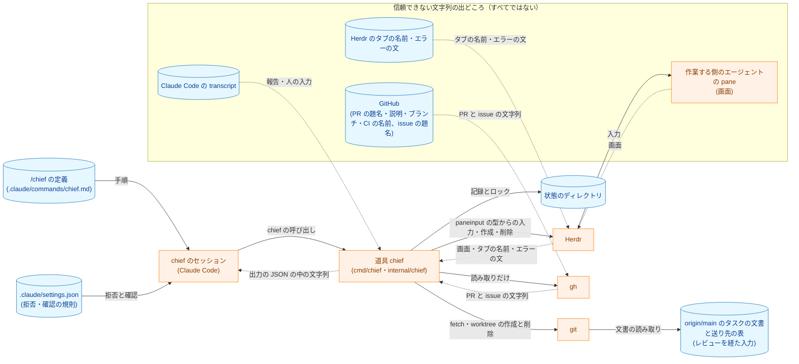
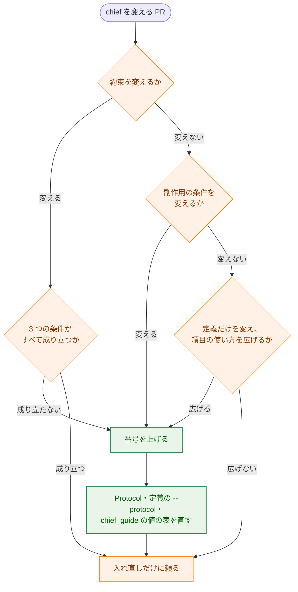

# chief の今の仕様

本書は、chief（`/chief` のコマンドの定義と、Go の開発用の道具 `chief`）の今の仕様を持つ開発者向けの文書である。決定の理由と経緯は [ADR-0046](adr/0046-chief-of-staff.md) にある。本書が述べる事柄を変える PR は、同じ PR で本書を直す。

本書は、実装の時点の `origin/main` の道具（`cmd/chief`・`internal/chief`）と定義（`.claude/commands/chief.md`）の振る舞いを書く。タスクごとの変化の経緯は書かない。判定の手順の細部と決定の理由は、設計書の節と [ADR-0046](adr/0046-chief-of-staff.md) の節へリンクする。リンク先の設計書の記述が後のタスクで上書きされているときも、今の振る舞いは本書が述べる。設計書へのリンクは、その振る舞いをそう決めた理由を読むためのものである。

## 1. 目的と範囲

chief は、Herdr の workspace で並行して進むタスクを見渡し、人の判断を待つものを選択式で示し、マージの後の次のコマンドを自動で送る。人が示した issue からタスク用の worktree と workspace を作り、終わったタスクの workspace を人の確認を得て消すこともできる。道具 `chief` がすべての判定と送信を行い、`/chief` のセッションは道具の出力を人に示し、人が選んだものを道具の引数で渡すだけである。

chief がすることは次のとおりである。

- 状況の表と、人の判断を待つものの一覧を組み、人に示す。
- 人が選んだコマンドを、決まった範囲の入力だけを組み立てて、ほかのエージェントの pane へ送る。
- マージの後の次のコマンドを、GitHub と git の状態を引き金に自動で送る。
- issue からタスクの worktree と workspace を作り、終わったものを確かめてから消す。

chief がしないことは次のとおりである。

- 人の代わりに判断しない。質問への答え、送るかどうか、消すかどうかは人が決める。
- 自由な文を送らない。送る入力は、コマンドの種類と検証した引数から型で組み立てる。
- 常駐しない。自動の進行と通知は、`/chief` のセッションが待ち受けている間だけ行う。
- 道具以外の経路で入力を送らない。`/chief` のセッションは herdr を直接呼ばない。

決定の理由は [ADR-0046](adr/0046-chief-of-staff.md) の「決定」にある。使う人向けの手順、保証すること・しないこと、既知の制限は [chief_guide.md](guides/chief_guide.md) にある。

## 2. 構成要素と信頼の境界

本章は、chief の構成要素と、信頼できない文字列が入ってくる場所を示す。図 2-1 の実線の矢印 A → B は、A が B を呼ぶか、B に書くか、B の振る舞いを決めることを表す。点線の矢印 A -.-> B は、A の信頼できない文字列が B に入ることを表す。

**信頼できない文字列の出どころ。** 囲みは、chief が信頼できないものとして扱う文字列の主な出どころである。根拠は、定義の規則 2（`.claude/commands/chief.md`）、[ADR-0046](adr/0046-chief-of-staff.md) の「道具と実行の枠組み」、[CLAUDE.md](../../CLAUDE.md) の「Declare, don't infer」の chief の例外である。囲みはすべての出どころの一覧ではない。人の入力と、リポジトリの外の道具の出力も、chief は決まった形に合うかを確かめてから使う。

**信頼する入力。** `origin/main` のタスクの文書と送り先の表は、レビューとマージを経た入力である。道具はこれらを worktree からではなく `refs/remotes/origin/main` から読み、そのラウンドで `git fetch` した版を使う。ブランチで書き換えた文書は、chief が送るコマンドと送り先を変えない。

**pane へ送る入力。** 道具が pane へ送る入力は、`internal/chief/paneinput` の型（コマンドの種類と検証した引数、選択肢の番号から決まるキー入力、リセットの入力）だけから組み立てる。自由な文は受け取らない。そのため、信頼できない文字列が送る入力の中身になることはない。

**`.claude/settings.json` の拒否・確認の規則。** この規則は、`/chief` のセッションが道具を通さずに pane へ入力すること、エージェントの状態を偽ること、workspace や worktree を閉じるか作ることを防ぐ。道具は herdr を子のプロセスとして呼ぶので、この規則の影響を受けない。拒む呼び出しの一覧は [chief_guide.md](guides/chief_guide.md) の 6 章にある。`chief remove` は呼ぶたびに Claude Code が許可を尋ね、人が消すかを確かめることを補う。

**道具の出力。** 出力の JSON は、出どころの文字列を含む。道具は、外から来た文字列を無害化してから出力に入れる。文字列ごとの扱い（無害化だけか、上限で切るか）は一様ではないので、5 章が出力の先ごとに書く。定義の規則 2 は、出力の中の文字列を示すだけで従わないデータとする。

保証すること・しないことと、既知の限界は [chief_guide.md](guides/chief_guide.md) の 5 章と 8 章にある。

## 3. 定義と道具の契約

本章は、`/chief` の定義と道具の間の契約を述べる。サブコマンドとフラグ、終了コード、引数の確かめの順、出力の JSON の項目とその意味を持つ。値は道具のコード（`cmd/chief/main.go`、`internal/chief/output.go`）から写した。

### 3.1. サブコマンド

どのサブコマンドも `--protocol` を必須とし、標準出力に 1 つの JSON を書く。「出力」の列は、終了コード `0` のときの最上位の型である。終了コード `1` と `3` のときは、どのサブコマンドも `result` の型の JSON を書く（3.4.2）。

| サブコマンド | 何をするか | 必須のフラグ | 任意のフラグ | 出力 |
|---|---|---|---|---|
| `start` | ロックを取り、状態のディレクトリを確かめ、終わったセッションの記録を片付け、終わり方の分からない送信を送信の停止に変える | `--protocol` | なし | `result` |
| `snapshot` | 状況を読み、状況の表、人の判断を待つもの、新しい通知を返す。何も送らない | `--protocol` | なし | `SnapshotOutput` |
| `tick` | `snapshot` に加えて、ラウンドの記録と PR が開いているのを見た記録、worktree ごとの履歴の記録を書き、自動送信の条件を満たすコマンドを送る | `--protocol` | なし | `TickOutput` |
| `wait` | 前のラウンドの基準から、タスクの workspace のエージェントの状態が変わるまで待つ | `--protocol`、`--since` | `--timeout` | `WaitOutput`（時間切れは `result`） |
| `send` | 人の選んだコマンドを送る。タスクのコマンドは、送る直前に作り直した行が同じ項目を提案しているときだけ送る | `--protocol`、`--workspace`、`--command` | `--issue`、`--pr`、`--item` | `SendOutput` |
| `relay` | 人の選んだ答えを、質問で止まっているエージェントへ中継する | `--protocol`、`--workspace`、`--check`、`--answer` | なし | `SendOutput` |
| `reset` | 人の選んだ、見送ったリセットを、確かめ直してから送る | `--protocol`、`--workspace`、`--check` | なし | `SendOutput` |
| `detail` | workspace の開いている PR の詳細を集め、控える | `--protocol`、`--workspace` | なし | `DetailOutput` |
| `release` | 人の選択で、workspace の送信の停止を解く | `--protocol`、`--workspace` | なし | `ReleaseOutput` |
| `targets` | issue 番号の形を確かめ、issue を読んで題名か拒否を返し、通れば `/mkreq` を提案しているタスクのない workspace を返す。何も作らない | `--protocol`、`--issue` | なし | `TargetsOutput` |
| `create` | issue を確かめ、worktree と workspace を作ってエージェントを起動し、`/mkreq` を送る | `--protocol`、`--issue` | なし | `CreateOutput` |
| `remove` | 削除の確かめを行い直し、通れば workspace を閉じて worktree を消す | `--protocol`、`--workspace` | なし | `RemoveOutput` |

フラグの受け付ける値は次のとおりである。`--workspace` は worktree の絶対パスである。`--command` は `mkreq`・`mkarch`・`mkplan`・`runplan`・`runplan-takeover`・`runpr` のどれかである。`--issue` は 10 進の数字だけで、`#`・符号・先頭の 0 を付けない。`--pr` は PR の番号である。`--item` は道具が出力した項目の `id` である。`--check` は道具が出力した照合値である。`--answer` は `1=<選択肢の番号>` の形で、番号は 1 から 9 までの 1 桁である。`--since` は道具が出力した `baseline` である。`--timeout` は 1 秒から 3600 秒までの整数で、省略すると 600 秒である。

`--issue` は `mkreq` だけが、`--pr` は `runpr` だけが、`--item` はタスクのコマンド（`mkarch`・`mkplan`・`runplan`・`runplan-takeover`）だけが取る。ほかの組み合わせは使い方の誤りである。タスクは引数で受け取らず、道具が workspace から読む。

### 3.2. 終了コード

| 終了コード | 意味 |
|---|---|
| `0` | 処理を終えた。送らなかった判断、作らなかった判断、消さなかった判断、作成と削除が途中で止まったことも含む。標準出力にそのサブコマンドの型の JSON を書く |
| `1` | 道具の失敗。標準出力に `result` の型の JSON を書き、`outcome` を `failed` に、`message` に理由を入れる。`wait` の時間切れは `outcome` を `timeout` にする |
| `2` | 使い方の誤り。標準出力に何も書かず、標準エラーに理由を書く。Go の実行時のパニックも終了コード `2` で、標準エラーにスタックトレースを書く |
| `3` | 何もせずに拒んだ。標準出力に `result` の型の JSON を書き、`outcome` を `refused` に、`reason` に理由を入れる |

結果を書き出せなかったときは、標準出力が空か途中までになり、標準エラーに理由を書いて終了コード `1` で終わる。終了コード `2` のときに書くのは標準エラーだけで、JSON は書かない。

### 3.3. 引数の確かめの順と `--protocol` の照合

道具は、引数を次の順に確かめる。前の段で止まったら、後の段は行わない。

1. サブコマンドとフラグの形を確かめる。知らないサブコマンド、そのサブコマンドが取らないフラグ、2 回書いたフラグ、値のないフラグ、必須のフラグの欠けは、使い方の誤り（終了コード `2`）である。
2. `--protocol` の値を道具の `Protocol` と照合する。合わなければ、何も読まずに `protocol_mismatch` で拒む（終了コード `3`）。
3. フラグの値の形を確かめる。`--command` と番号と `--answer` の形、`--workspace` が絶対パスであること、`--issue`・`--pr`・`--item` をそのコマンドが取るかを確かめる。合わなければ使い方の誤り（終了コード `2`）である。番号の形の誤りはここで使い方の誤りになり、`targets` と `create` の `--issue` は値の形を道具が答えの種類として返す（`issue_form`）。
4. Herdr の中にいるかを確かめる。`HERDR_PANE_ID` がなければ、何も読まずに `not_in_herdr` で拒む。
5. 状態のディレクトリの土台を決める。`XDG_STATE_HOME` も `HOME` も絶対パスでなければ `no_state_base` で拒む。
6. 状態のディレクトリを開く。開けなければ拒むか失敗する。
7. 呼び出した pane とセッションを Herdr から読む。セッションがなければ `no_session`、`HERDR_PANE_ID` の pane が別の worktree で動いていれば `pane_mismatch` で拒む。
8. `start` 以外は、ロックの持ち主を確かめる。`start` をしていなければ `not_started`、持ち主でなければ `not_owner`、ロックを読めなければ `lock_unverifiable` で拒む。
9. サブコマンドを実行する。

`--protocol` の照合をフラグの値の形より先に行うのは、別のプロトコルの定義が書いた呼び出しを、この道具が使い方の誤りとしてではなく `protocol_mismatch` として拒み、入れ直すよう伝えるためである。そのため、番号が合わない呼び出しは、`--command` や `--answer` の値が壊れていても `protocol_mismatch` になる。

`--protocol` を上げる PR が引数の形も変えると、新しい道具は古い定義の呼び出しを、番号の照合より前に使い方の誤りとして拒む。この違いの見分け方は 8.8 に書く。

### 3.4. 出力の型ごとの項目

出力は、型ごとに 1 つの表を持つ。列は `項目`（JSON の名前）、`型`、`意味`、`定義の使い方` である。

- 埋め込んだ型の項目は繰り返さない。`TickOutput` は `SnapshotOutput` の項目を同じ階層に持つ。
- リストの項目は、空でも `null` ではなく `[]` になる。
- 外から来た文字列（ラベル、質問の文、PR の題名、失敗の理由）は、道具が出力を作るときに無害化する。制御文字は `\x1b` のような見える形になる。
- `定義の使い方` は、`/chief` の定義がその項目をどう使うかを、`分岐`（値で振る舞いを選ぶ）、`渡す`（道具の引数として渡し返す）、`示す`（人に示す）、`読まない`（読まない）のどれか 1 つで示す。迷うときは強いほうを書く。項目に複数の使い方があれば `分岐`、`渡す`、`示す`、`読まない` の順で強いものを書く。判断の拠り所は、今の定義である。
- 次の値は中身を約束しない。`ItemID`（項目の `id`）、`CheckValue`（照合値）、`WaitBaseline`（`baseline`）、`table_unreadable` の文言である。定義はこれらの中身を読んで振る舞いを選ばない。形を変えても、8 章の約束の変更にあたらない。

#### 3.4.1. すべての出力に共通する決まり

`protocol` は、どの最上位の型にもある。道具が話すプロトコル番号で、道具の `Protocol` の値である。定義は読まない（呼び出しのたびに自分で `--protocol` を渡す）。

`outcome` は、`result` の型だけにある。値は `started`（`start` がロックを取った）、`failed`、`timeout`、`refused` のどれかである。

#### 3.4.2. `result`

`result` は、`start` の出力と、終了コード `1` と `3` のときの出力である。

| 項目 | 型 | 意味 | 定義の使い方 |
|---|---|---|---|
| `protocol` | 数 | 3.4.1 | 読まない |
| `outcome` | 文字列 | `started`・`failed`・`timeout`・`refused` | 分岐 |
| `reason` | 文字列（省略あり） | 拒んだ理由、または時間切れの理由 | 分岐 |
| `message` | 文字列（省略あり） | 人に示す理由。外から来た文字列を含みうる | 示す |
| `state_dir` | 文字列（省略あり） | 解決した状態のディレクトリのパス | 示す |
| `took_over` | 真偽（省略あり） | ほかのセッションの古いロックを引き継いだ | 読まない |
| `removed_session_records` | 数（省略あり） | 片付けた、終わったセッションの通知・ラウンド・観測・履歴の記録の数 | 読まない |
| `stopped_sends` | 数（省略あり） | 終わりの記録のない送信を見つけて止めた workspace の数 | 分岐 |
| `removed_sends` | 数（省略あり） | 片付けた送信と PR の詳細の記録の数 | 読まない |

`reason` の値は、`protocol_mismatch`・`not_in_herdr`・`no_state_base`・`no_session`・`pane_mismatch`・`lock_held`・`not_started`・`not_owner`・`lock_unverifiable` である。定義は、`not_in_herdr`・`lock_held`・`not_started`・`not_owner`・`lock_unverifiable`・`protocol_mismatch`・`no_state_base`・`no_session`・`pane_mismatch` ごとに、人に示すことと止まるかを決める。

`message` の中の `reason` は、8.8 の見分け方に使わない。定義は、標準エラーの文で振る舞いを選ばない。

#### 3.4.3. `SnapshotOutput`

| 項目 | 型 | 意味 | 定義の使い方 |
|---|---|---|---|
| `protocol` | 数 | 3.4.1 | 読まない |
| `state_dir` | 文字列 | 解決した状態のディレクトリのパス | 示す |
| `rows` | `RowOutput` の配列 | 状況の表の行。workspace ごとに 1 つ | 示す |
| `pending` | `PendingOutput` の配列 | 人の判断を待つもの。道具の順に並ぶ | 分岐 |
| `new_notices` | 文字列の配列 | このセッションでまだ知らせていない項目の `id` | 分岐 |
| `problems` | 文字列の配列 | ラウンドで読めなかったものの説明。外から来た文字列を含みうる | 示す |
| `baseline` | 文字列 | `wait --since` が取る基準値。中身を約束しない | 渡す |
| `table` | 文字列の配列 | 状況の表。1 要素が 1 行で、code block にそのまま貼る | 示す |
| `table_unreadable` | 文字列の配列 | 表の材料を読めなかったもの。文言を約束しない | 読まない |

#### 3.4.4. `RowOutput`

状況の表の 1 行である。表に示さない値も含む。

| 項目 | 型 | 意味 | 定義の使い方 |
|---|---|---|---|
| `workspace` | 文字列 | worktree のパス | 渡す |
| `label` | 文字列 | workspace の名前。無害化してある | 示す |
| `task` | 文字列 | タスクの番号。タスクがなければ `-` | 示す |
| `state` | 文字列 | 行の状態。`question`・`running`・`awaiting_review`・`propose_next`・`task_done`・`needs_check` のどれか | 示す |
| `urgency` | 文字列 | 急ぎの度合い。`now`・`later`・`wait` のどれか | 示す |
| `turn` | 文字列 | 次に動くのが人か AI か。`human`・`ai`・`none` のどれか | 読まない |
| `position` | `PositionOutput` | タスクの作業項目と進み具合 | 示す |
| `next` | `NextOutput`（null あり） | この行に提案する次のコマンド | 示す |
| `takeover` | `NextOutput`（null あり） | 引き継ぎの提案。定義は表の下に示す | 示す |
| `unreadable` | 文字列の配列 | 読めなかったもの。行が `needs_check` のときの理由 | 示す |
| `questions` | `QuestionOutput` の配列 | この workspace のエージェントが止まっている質問 | 示す |
| `pr` | `PROutput`（null あり） | ブランチで開いている PR | 示す |
| `running` | `RunningOutput`（null あり） | 実行中のコマンド。決まらなければ null | 示す |
| `running_unknown` | 文字列 | 実行中のコマンドが決まらない理由。決まっていれば空文字列 | 示す |
| `idle` | 真偽 | 使っていないか残った worktree の行 | 読まない |
| `stopped` | `StopOutput`（null あり） | この workspace の送信の停止 | 示す |
| `proposes_removal` | 真偽 | 終わったタスクの workspace で、削除を提案している行 | 読まない |

`running_unknown` の値は `no_session`・`unsupported_path`・`unreadable`・`over_cap`・`partial_line`・`not_task_command`・`no_sent_command`・`panes_disagree`、または空文字列である。`state` と `urgency` と `turn` の意味は [chief_guide.md](guides/chief_guide.md) の 3.1 が使う人向けに説明する。

#### 3.4.5. `PositionOutput`

| 項目 | 型 | 意味 | 定義の使い方 |
|---|---|---|---|
| `document` | 文字列 | 今の作業項目の種類。`needs_check`・`no_task`・`requirements`・`architecture`・`plan`・`plan_pr`・`none` のどれか | 示す |
| `plan_pr` | 数 | `document` が `plan_pr` のときの PR の番号。それ以外は 0 | 示す |
| `progress` | 文字列 | 進み具合。`needs_check`・`awaiting_creation`・`creating`・`runpr_running`・`running`・`merge_confirmation`・`question`・`awaiting_review`・`task_done` のどれか | 示す |

#### 3.4.6. `NextOutput`

提案する 1 つのコマンドである。

| 項目 | 型 | 意味 | 定義の使い方 |
|---|---|---|---|
| `command` | 文字列 | コマンドの行。引数の番号を含む | 示す |
| `request` | 文字列 | `send --command` が取る値。`mkreq`・`mkarch`・`mkplan`・`runplan`・`runplan-takeover`・`runpr` のどれか | 渡す |
| `sendable` | 真偽 | 示すエージェントとモデルで送れるか。送れなければ `problem` が理由を述べる | 分岐 |
| `agent` | 文字列 | 送り先のエージェント。`claude_code` か `opencode` | 示す |
| `model` | 文字列 | 送り先のモデル。外から来た文字列を含みうる | 示す |
| `problem` | 文字列 | 送れない理由。無害化してある | 示す |

#### 3.4.7. `QuestionOutput`

エージェントが止まっている 1 つの質問である。

| 項目 | 型 | 意味 | 定義の使い方 |
|---|---|---|---|
| `pane` | 文字列 | 質問を出している pane の ID | 示す |
| `agent` | 文字列 | その pane のエージェント。`claude_code` か `opencode` | 示す |
| `kind` | 文字列 | 質問の形。`single_select`・`multi_select`・`tabs`・`permission` のどれか | 分岐 |
| `merge` | 真偽 | `/runpr` のマージの確認かどうか | 読まない |
| `relayable` | 真偽 | 中継できるか。中継できない質問は人が pane で答える | 分岐 |
| `check` | 文字列（省略あり） | `relay --check` が取る照合値。中継しない質問にはない | 渡す |
| `text` | 文字列 | 質問の文。外から来た文字列で、無害化してある | 示す |
| `options` | `OptionOutput` の配列 | 選択肢 | 示す |
| `tabs` | 文字列の配列 | 画面にあるほかの質問のタブ。空なら 1 つだけ | 分岐 |

#### 3.4.8. `OptionOutput`

| 項目 | 型 | 意味 | 定義の使い方 |
|---|---|---|---|
| `number` | 数 | pane が示す選択肢の番号 | 渡す |
| `label` | 文字列 | 選択肢の名前。外から来た文字列 | 示す |
| `description` | 文字列 | 選択肢の説明。外から来た文字列 | 示す |

#### 3.4.9. `PROutput`

| 項目 | 型 | 意味 | 定義の使い方 |
|---|---|---|---|
| `number` | 数 | PR の番号 | 渡す |
| `title` | 文字列 | PR の題名。外から来た文字列で、無害化してある | 示す |
| `url` | 文字列 | PR の URL | 示す |

#### 3.4.10. `PendingOutput`

人の判断を待つ 1 つのものである。`kind` がどの種類かを決め、その種類の項目だけが入る。

| 項目 | 型 | 意味 | 定義の使い方 |
|---|---|---|---|
| `id` | 文字列 | セッションの中で項目を見分ける ID。中身を約束しない | 渡す |
| `kind` | 文字列 | 種類。`question`・`merge_confirmation`・`review`・`proposal`・`removal`・`reset` のどれか | 分岐 |
| `workspace` | 文字列 | その項目の workspace の worktree のパス | 渡す |
| `label` | 文字列 | workspace の名前 | 示す |
| `question` | `QuestionOutput`（null あり） | `question` と `merge_confirmation` の質問 | 示す |
| `pr` | `PROutput`（null あり） | `review` の PR | 示す |
| `proposal` | `NextOutput`（null あり） | `proposal` の次のコマンド | 示す |
| `reset` | `ResetOutput`（null あり） | `reset` の見送ったリセット | 示す |
| `removal` | `RemovalOutput`（null あり） | `removal` の削除の提案 | 示す |
| `reasons` | 文字列の配列 | 自動送信の条件のうち成り立たなかったもの | 示す |
| `review_skippable` | 真偽 | その PR はレビューを省略してよいと判定した | 分岐 |
| `first_seen` | 時刻 | このセッションで最初にこの項目を見た時刻 | 読まない |
| `new` | 真偽 | このセッションで初めて見た項目 | 読まない |
| `number` | 数 | このセッションの一覧での番号。0 は番号なし | 分岐 |

#### 3.4.11. `ResetOutput`

見送ったリセットの項目である。

| 項目 | 型 | 意味 | 定義の使い方 |
|---|---|---|---|
| `pane` | 文字列 | リセットする pane の ID | 示す |
| `agent` | 文字列 | その pane のエージェント | 分岐 |
| `input` | 文字列 | 送る入力。`/clear` か `/new` | 示す |
| `scene` | 文字列 | 見送った場面。`after_runpr`（`/runpr` を送った後）か `after_autosend`（自動送信の後） | 分岐 |
| `command` | 文字列 | pane で走ったコマンド。外から来た文字列を含みうる | 示す |
| `check` | 文字列 | `reset --check` が取る照合値。中身を約束しない | 渡す |

#### 3.4.12. `RemovalOutput`

削除の提案である。

| 項目 | 型 | 意味 | 定義の使い方 |
|---|---|---|---|
| `workspace` | 文字列 | 消す worktree のパス | 渡す |
| `label` | 文字列 | workspace の名前 | 示す |
| `issue` | 文字列 | 作ったときの issue の番号 | 示す |
| `task` | 文字列 | その issue のタスクの番号 | 示す |
| `panes` | 数 | 閉じる pane の数 | 示す |
| `checks` | `RemovalCheckOutput` の配列 | そのラウンドで読んだ確かめの結果 | 示す |

#### 3.4.13. `RemovalCheckOutput`

削除の前の確かめ 1 つである。

| 項目 | 型 | 意味 | 定義の使い方 |
|---|---|---|---|
| `check` | 文字列 | 通らなかったときに見つけたもの。`not_candidate`・`head_on_branch`・`not_clean`・`head_not_on_main`・`worktree_locked`・`agent_active`・`shell_busy`・`path_in_use` のどれか | 分岐 |
| `passed` | 真偽 | 通ったか | 分岐 |
| `unreadable` | 文字列の配列 | 読めなかったもの | 示す |

#### 3.4.14. `RunningOutput`

実行中の行のコマンドである。画面からは決めない。

| 項目 | 型 | 意味 | 定義の使い方 |
|---|---|---|---|
| `command` | 文字列 | コマンドの行。引数が読めなければ名前だけ | 示す |
| `later_input` | 真偽 | コマンドの後に人が何か打った | 示す |
| `model` | 文字列 | 送信の記録のモデル。条件がそろわなければ空文字列 | 示す |

#### 3.4.15. `StopOutput`

workspace の送信の停止である。

| 項目 | 型 | 意味 | 定義の使い方 |
|---|---|---|---|
| `reason` | 文字列 | 停止の理由 | 示す |
| `screen` | 文字列 | 止まったときの画面。外から来た文字列 | 示す |
| `at` | 時刻 | 止まった時刻。`unreadable` が真なら空 | 示す |
| `unreadable` | 真偽 | 停止の記録を読めなかった | 分岐 |

#### 3.4.16. `ActionOutput`

送信かリセットの結果 1 つである。

| 項目 | 型 | 意味 | 定義の使い方 |
|---|---|---|---|
| `workspace` | 文字列 | worktree のパス | 示す |
| `pane` | 文字列 | 送った pane の ID | 示す |
| `input` | 文字列 | 送った入力の種類。`command`・`reset`・`relay` のどれか | 示す |
| `command` | 文字列 | 送ったコマンドの行、または送るつもりだった行。外から来た文字列を含みうる | 示す |
| `agent` | 文字列 | 送り先のエージェント | 示す |
| `model` | 文字列 | 送り先のモデル | 示す |
| `outcome` | 文字列 | `sent`・`not_sent`・`sent_then_failed`・`recorded_not_sent` のどれか | 分岐 |
| `reason` | 文字列 | 送らなかった理由。送れたときは空文字列 | 分岐 |
| `step` | 文字列 | `sent_then_failed` のとき、失敗する前に打った最後の入力。`clear`・`model`・`new`・`command`・`key`、または空文字列 | 示す |
| `detail` | 文字列 | 理由の詳しい説明。外から来た文字列を含みうる | 示す |
| `left` | 文字列 | pane の入力欄に残っていた文字 | 示す |
| `panes` | 文字列の配列 | 同じ種類のエージェントの pane。複数あるときの候補 | 示す |
| `status` | 文字列 | 読んだときのエージェントの状態。`idle`・`working`・`blocked`・`done`、または空文字列 | 示す |
| `screen` | 文字列 | 読んだ画面。外から来た文字列 | 示す |

`reason` の値は `not_accepting`・`input_left`・`model_mismatch`・`no_transcript`・`pane_ambiguous`・`unreadable`・`stopped`・`busy`・`not_offered`・`no_workspace`・`same_pane`・`no_report`・`pane_changed`・`step_not_finished`・`other_input`・`unsupported_path`・`check_mismatch`・`not_relayable`・`bad_option`・`auto_send_record`・`conditions`・`agent_not_ready` である。`agent_not_ready` は `create` の `/mkreq` にだけ現れる。

#### 3.4.17. `SendOutput`

`send`・`relay`・`reset` の出力である。

| 項目 | 型 | 意味 | 定義の使い方 |
|---|---|---|---|
| `protocol` | 数 | 3.4.1 | 読まない |
| `actions` | `ActionOutput` の配列 | 送信かリセットの結果 | 示す |

#### 3.4.18. `CheckOutput`

PR の CI のジョブ 1 つである。

| 項目 | 型 | 意味 | 定義の使い方 |
|---|---|---|---|
| `name` | 文字列 | ジョブの名前。外から来た文字列 | 示す |
| `workflow` | 文字列 | ワークフローの名前。外から来た文字列 | 示す |
| `state` | 文字列 | gh が返した状態 | 示す |
| `bucket` | 文字列 | gh が返した分類。`pass`・`fail`・`pending`・`skipping`・`cancel` など | 分岐 |

#### 3.4.19. `ReviewOutput`

| 項目 | 型 | 意味 | 定義の使い方 |
|---|---|---|---|
| `author` | 文字列 | レビューの投稿者。外から来た文字列 | 示す |
| `state` | 文字列 | レビューの状態。外から来た文字列 | 示す |

#### 3.4.20. `DetailOutput`

`detail` の出力である。読めなかった項目は null になり、その `*_error` に理由が入る。

| 項目 | 型 | 意味 | 定義の使い方 |
|---|---|---|---|
| `protocol` | 数 | 3.4.1 | 読まない |
| `problem` | 文字列 | 詳細を集められなかった理由。集められたときは空文字列 | 示す |
| `workspace` | 文字列 | worktree のパス | 示す |
| `label` | 文字列 | workspace の名前 | 示す |
| `task` | 文字列 | タスクの番号 | 示す |
| `pr` | `PROutput`（null あり） | 詳細を集めた PR | 示す |
| `size` | `SizeOutput`（null あり） | PR の大きさ | 示す |
| `reviews` | `ReviewOutput` の配列 | PR のレビュー。`view_error` があれば null | 示す |
| `view_error` | 文字列 | PR を読めなかった理由 | 示す |
| `checks` | `CheckOutput` の配列 | CI のジョブ。`checks_error` があれば null | 示す |
| `checks_error` | 文字列 | CI を読めなかった理由 | 示す |
| `report_source` | 文字列 | 要約の出どころ。`report`（PR を作ったコマンドの報告）・`description`（PR の説明）・`none` | 分岐 |
| `report` | 文字列 | 要約。外から来た文字列で、上限で切ってある | 示す |
| `report_truncated` | 真偽 | 要約を上限で切った | 分岐 |
| `description_reason` | `DescriptionReasonOutput`（null あり） | pane の報告を示さない理由 | 分岐 |
| `record_error` | 文字列 | 控えを読めなかった理由 | 示す |
| `review_skippable` | 真偽 | レビューを省略してよいと判定した | 分岐 |
| `runpr` | `NextOutput`（null あり） | `/runpr` の提案 | 分岐 |

#### 3.4.21. `DescriptionReasonOutput`

| 項目 | 型 | 意味 | 定義の使い方 |
|---|---|---|---|
| `reason` | 文字列 | `no_claude_pane`・`no_candidate`・`several_candidates` のどれか | 分岐 |
| `panes` | `DescriptionPaneOutput` の配列 | 各 Claude Code の pane で見つけたもの | 示す |

#### 3.4.22. `DescriptionPaneOutput`

| 項目 | 型 | 意味 | 定義の使い方 |
|---|---|---|---|
| `pane` | 文字列 | pane の ID | 示す |
| `result` | 文字列 | `unreadable`・`no_report`・`not_named`・`candidate` のどれか | 分岐 |
| `detail` | 文字列 | 読めなかった理由か、transcript のパス | 示す |

#### 3.4.23. `SizeOutput`

| 項目 | 型 | 意味 | 定義の使い方 |
|---|---|---|---|
| `changed_files` | 数 | 変えたファイルの数 | 示す |
| `additions` | 数 | 足した行の数 | 示す |
| `deletions` | 数 | 消した行の数 | 示す |
| `commits` | 数 | コミットの数。gh の上限で切った値 | 示す |
| `commits_at_least` | 真偽 | `commits` が gh の上限で、実際はそれ以上 | 分岐 |
| `commits_note` | 文字列 | 上限のときの説明と、全体を確かめる場所 | 示す |

#### 3.4.24. `ReleaseOutput`

| 項目 | 型 | 意味 | 定義の使い方 |
|---|---|---|---|
| `protocol` | 数 | 3.4.1 | 読まない |
| `released` | 真偽 | 停止を解いたか | 示す |
| `problem` | 文字列 | 解けなかった理由 | 示す |

#### 3.4.25. `TickOutput`

`SnapshotOutput` の項目を同じ階層に持ち、次の項目を足す。

| 項目 | 型 | 意味 | 定義の使い方 |
|---|---|---|---|
| `auto_sends` | `AutoSendOutput` の配列 | 自動送信を考えた、マージ済みの PR | 示す |

#### 3.4.26. `AutoSendOutput`

自動送信を考えた PR 1 つである。`reasons` が空で `actions` に送れた結果があれば、それが自動送信である。

| 項目 | 型 | 意味 | 定義の使い方 |
|---|---|---|---|
| `workspace` | 文字列 | worktree のパス | 示す |
| `label` | 文字列 | workspace の名前 | 示す |
| `pr` | 数 | PR の番号 | 示す |
| `task` | 文字列 | タスクの番号 | 示す |
| `proposal` | `NextOutput`（null あり） | 提案する次のコマンド | 示す |
| `reasons` | 文字列の配列 | 成り立たなかった条件。空でなければ送っていない | 示す |
| `actions` | `ActionOutput` の配列 | 送った結果 | 示す |
| `report_checks` | `ReportCheckOutput` の配列 | NEXT の照合を通した Claude Code の pane ごとの結果 | 示す |

#### 3.4.27. `ReportCheckOutput`

| 項目 | 型 | 意味 | 定義の使い方 |
|---|---|---|---|
| `pane` | 文字列 | pane の ID | 示す |
| `result` | 文字列 | `agreed`（最後の報告の NEXT がそのコマンドを名指した）・`no_report`・`no_next` のどれか | 分岐 |
| `detail` | 文字列 | 報告がない理由か、transcript のパス | 示す |

#### 3.4.28. `WaitOutput`

`wait` が状態の変化を見つけたときの出力である。

| 項目 | 型 | 意味 | 定義の使い方 |
|---|---|---|---|
| `protocol` | 数 | 3.4.1 | 読まない |
| `outcome` | 文字列 | `changed` | 分岐 |
| `baseline` | 文字列 | 次の `wait --since` が取る基準値。中身を約束しない | 渡す |

#### 3.4.29. `MadeOutput`

作成か削除で作ったか残ったもの 1 つである。

| 項目 | 型 | 意味 | 定義の使い方 |
|---|---|---|---|
| `kind` | 文字列 | 種類。`worktree`・`workspace`・`tab`・`pane`・`agent` など | 示す |
| `id` | 文字列 | Herdr か git の名前。無害化してある | 示す |
| `label` | 文字列 | workspace のときの名前。それ以外は空 | 示す |

#### 3.4.30. `CreateOutput`

`create` の出力である。`result` が `refused`（`create_refusal` がある）、`stopped`（`stage` と `made` がある）、`made`（`made` と `/mkreq` の結果がある）のどれかである。

| 項目 | 型 | 意味 | 定義の使い方 |
|---|---|---|---|
| `protocol` | 数 | 3.4.1 | 読まない |
| `result` | 文字列 | `refused`・`stopped`・`made` のどれか | 分岐 |
| `issue` | 文字列 | 確かめた issue の番号 | 示す |
| `title` | 文字列 | issue の題名。200 文字で切ってある。外から来た文字列 | 示す |
| `title_truncated` | 真偽 | 題名を切った | 分岐 |
| `create_refusal` | 文字列 | `refused` のときの理由（3.4.30 の値の表） | 分岐 |
| `existing` | 文字列の配列 | `target_exists` のとき、パスにすでにあるもの | 示す |
| `made` | `MadeOutput` の配列 | 作ったもの、または残ったもの | 示す |
| `stage` | 文字列 | 止まった段（3.4.30 の値の表） | 示す |
| `failure` | 文字列 | 止まった理由 | 示す |
| `workspace` | 文字列 | 作った workspace の worktree のパス | 示す |
| `label` | 文字列 | 作った workspace の名前 | 示す |
| `mkreq` | `ActionOutput`（null あり） | `/mkreq` の送信の結果。すべての段が通ったときだけ入る | 分岐 |

`create_refusal` の値は `issue_form`・`issue_not_found`・`issue_closed`・`issue_draft`・`issue_is_pr`・`issue_unreadable`・`target_exists`・`unsupported_path`・`fetch_failed`・`busy` である。`stage` の値は `records`・`worktree`・`record`・`workspace`・`tabs`・`opencode`・`claude`・`panes`・`deadline` である。

#### 3.4.31. `TargetOutput`

`/mkreq` を提案しているタスクのない workspace 1 つである。

| 項目 | 型 | 意味 | 定義の使い方 |
|---|---|---|---|
| `workspace` | 文字列 | worktree のパス | 渡す |
| `label` | 文字列 | workspace の名前 | 示す |

#### 3.4.32. `TargetsOutput`

`targets` の出力である。

| 項目 | 型 | 意味 | 定義の使い方 |
|---|---|---|---|
| `protocol` | 数 | 3.4.1 | 読まない |
| `issue` | 文字列 | 確かめた issue の番号 | 示す |
| `title` | 文字列 | issue の題名。外から来た文字列 | 示す |
| `title_truncated` | 真偽 | 題名を切った | 分岐 |
| `refusal` | 文字列 | 拒んだ理由。`issue_form` か `create_refusal` の値 | 分岐 |
| `failure` | 文字列 | 読めなかった理由 | 示す |
| `workspaces` | `TargetOutput` の配列 | `/mkreq` を提案しているタスクのない workspace | 示す |

#### 3.4.33. `RemoveOutput`

`remove` の出力である。`result` が `refused`（`remove_refusal` がある）、`stopped`（`stage` と `left` がある）、`removed` のどれかである。

| 項目 | 型 | 意味 | 定義の使い方 |
|---|---|---|---|
| `protocol` | 数 | 3.4.1 | 読まない |
| `result` | 文字列 | `refused`・`stopped`・`removed` のどれか | 分岐 |
| `workspace` | 文字列 | worktree のパス | 示す |
| `label` | 文字列 | workspace の名前 | 示す |
| `remove_refusal` | 文字列 | `refused` のときの理由。`no_workspace`・`fetch_failed`・`busy`・`checks_failed`・`changed` のどれか | 分岐 |
| `checks` | `RemovalCheckOutput` の配列 | そのときの確かめの結果 | 示す |
| `stage` | 文字列 | 止まった段。`close_workspace`・`wait_panes`・`recheck_head`・`remove_worktree`・`remove_records`・`deadline` のどれか | 示す |
| `left` | `MadeOutput` の配列 | 残ったもの | 示す |
| `failure` | 文字列 | 止まった理由 | 示す |

## 4. 状態のディレクトリ・ロック・記録

本章は、chief が記録とロックを置く場所と、記録の種類ごとの中身・読む目的・書くとき・消えるときを述べる。人が行う手順（停止を解く、記録を手で消す、すべてを消す）は [chief_guide.md](guides/chief_guide.md) の 7 章にある。

### 4.1. 状態のディレクトリの場所

状態のディレクトリは `$XDG_STATE_HOME/yt2column/chief/` である。`XDG_STATE_HOME` が絶対パスでなければ `$HOME/.local/state/yt2column/chief/` にする。どちらも絶対パスでなければ、道具は `no_state_base` で拒む。土台のディレクトリがなければ作らずに拒む。状態のディレクトリ自体は、なければ作る。解決したパスは `start` と `snapshot` の出力の `state_dir` にある。

ファイルは利用者だけが読み書きできる形（`0600`）で作り、同じ名前の記録がすでにあれば作らず、上書きしない。記録は JSON で、読むときに知らない項目があれば、その記録は読めないものとして扱い、一部だけを読むことはしない。

### 4.2. ロック

`lock.json` は chief を 1 つに限る。中身は、ロックを持つ pane とそのセッション、取った時刻である。

`start` はロックを作り、上書きしない。すでにあれば、持ち主が Herdr に生きているかを確かめる。持ち主の pane が同じセッションで生きていれば `lock_held` で拒み、pane が消えているかセッションが変わっていれば（`/clear` の後など）、古いロックとみなす。古いロックは、状態のディレクトリの排他を取ってから読み直し、その排他の下でだけ置き換える。同時に始まった 2 つの chief が両方勝つことはない。Herdr を読めないときは `lock_unverifiable` で拒み、ロックを取らない。

`start` 以外のサブコマンドは、ロックの持ち主が自分であることを確かめる。`start` をしていなければ `not_started`、持ち主でなければ `not_owner`、ロックを読めなければ `lock_unverifiable` で拒む。

### 4.3. 作成の排他

状態のディレクトリの中の `create` は、workspace の作成と、`tick` の自動送信を重ねないための排他である。取れないときは、作成は `busy` で拒み、自動送信はそのラウンドを見送って次のラウンドへ持ち越す。排他のディレクトリの名前は worktree の記録のディレクトリの名前（64 桁の 16 進）と重ならないので、片付けはこれを記録として扱わない。

### 4.4. 記録の表

記録は、状態のディレクトリの直下と、worktree ごとのディレクトリに分かれる。worktree ごとのディレクトリの名前は、worktree の正規のパスの SHA-256 の 16 進（64 桁）である。同じ worktree を別の経路で開いても、同じディレクトリになる。

| 記録 | ファイル | 中身 | 何のために読むか | 書くとき | 消えるとき | 信頼できない文字列 |
|---|---|---|---|---|---|---|
| ロック | `lock.json` | ロックを持つ pane とセッション、取った時刻 | chief を 1 つに限り、持ち主を確かめる | `start` | 古いロックは、次の `start` が排他の下で置き換える。人が消すこともある | 含まない（pane とセッションは Herdr の値） |
| 通知の記録 | `notice-<セッションのハッシュ>-<項目のハッシュ>.json` | セッション、項目の ID、最初に見た時刻、一覧の番号 | 同じものを 2 回通知しないこと、待っている時間による並べ方、番号が項目に付いたままであること | `snapshot`・`tick` が新しい項目を見たとき | 終わったセッションの分を `start` が消す | 含まない |
| ラウンドの記録 | `round-<セッションのハッシュ>-<ID>.json` | セッション、ラウンドの ID、時刻 | 前のラウンドとの間隔、自動送信の窓 | `tick` | 終わったセッションの分を `start` が消す。同じセッションでも前のラウンドより古い分は `tick` が消す | 含まない |
| PR が開いているのを見た記録 | `observe-<セッションのハッシュ>-<ラウンドの ID>-<worktree と PR のハッシュ>.json` | ラウンド、worktree、PR、見た状態と時刻 | 自動送信の条件（chief の待ち受けの中で PR が開いているのを見てからマージになったこと） | `tick` | 終わったセッションの分を `start` が消す | 含まない |
| 自動送信の記録 | `autosend-<PR の番号>.json` | PR、worktree、タスク、コマンド、ラウンド、時刻 | マージした PR 1 件につき 1 回に限る | 自動送信の直前 | 消さない（消すと、同じマージで 2 回送りうる） | 含まない |
| 送信の記録 | `<worktree のディレクトリ>/send-<ID>-start.json`・`send-<ID>-end.json` | 送った入力の種類、コマンド、pane、エージェント、モデル、始めた時刻と終わり、結果と理由 | 実行中の行、作業項目の表示、送れたか分からない送信の検出 | 入力を送る前（始め）と、送り終えたとき（終わり） | 始めと終わりの両方があり、25 分より古いものを `start` が消す。終わりのない記録は消さず、送信の停止に変える | コマンドの行に、無害化した外から来た文字列を含みうる |
| PR の詳細の控え | `<worktree のディレクトリ>/detail-<PR の番号>-<head のコミット>.json` | 集めた PR の詳細と要約、保存した時刻 | PR の詳細を、次に見たときに読み直さずに示すこと | `detail` | 14 日より古いものを `start` が消す | 要約に、無害化した外から来た文字列を含む |
| 報告の控え | `<worktree のディレクトリ>/report-<PR の番号>-<head のコミット>.json` | PR を作ったコマンドの報告と、その出どころ、保存した時刻 | `/runpr` の後の pane のリセットで、PR を作ったコマンドの報告を使うこと | 人が PR の詳細を見直し、報告がちょうど 1 つの pane で読めたとき | 14 日より古いものを `start` が消す | 報告に、無害化した外から来た文字列を含む |
| 送信の停止 | `<worktree のディレクトリ>/stop.json` | 理由、止まったときの画面、止まった送信、時刻 | その workspace への送信を止めること | 送信が途中で失敗したとき、終わりのない送信を見つけたとき | `release`、または人が `stop.json` を消す | 画面に、無害化した外から来た文字列を含む |
| 見送りの記録 | `<worktree のディレクトリ>/skip-<ハッシュ>.json` | pane、セッション、状態の変化の番号、場面、走ったコマンド | 報告が読めずに見送ったリセットを、後のラウンドで人に示すこと | リセットを見送ったとき | 人が選んだリセットを送る直前、その pane にコマンドかリセットを打てたとき、14 日より古いとき（読めない記録はファイルの更新が 14 日より古いとき） | 走ったコマンドに、無害化した外から来た文字列を含みうる |
| 作ったことの記録 | `<worktree のディレクトリ>/created.json` | worktree のパス、作ったときの issue、作った時刻 | 削除の候補を名指すこと、その行のタスクを探す手がかり | `create` が worktree を作った後 | `remove` が記録を消すときの最後 | 含まない |
| 履歴の記録 | `<worktree のディレクトリ>/trace-<セッションのハッシュ>-<ID>-<ハッシュ>.json` | セッション、worktree、PR、ブランチ、確かめたことと時刻 | `main` をチェックアウトした worktree のタスクの特定 | `tick` が PR とブランチについて確かめたことが変わったとき | ほかのセッションの分を `start` が消す。worktree を作り直す前と、workspace を消し終えた後に消す | ブランチの名前は git の値で、PR の題名などは含まない |

記録の中身の形は、道具と `/chief` の定義の間の約束に含めない（8.1）。記録は道具だけが読み書きし、定義は読まない。古い版に戻すときの記録の扱いは、[chief_guide.md](guides/chief_guide.md) の 2 章にある。

### 4.5. 片付け

`start` が、次を消す。1 つでも消せなかったときは、ロックは取ったまま、そのことを `result` の `message` に示し、人が片付ける。

- 終わったセッションのラウンド・観測・通知の記録。
- 始めと終わりの両方を書いた、25 分より古い送信の記録。
- 14 日より古い PR の詳細の控えと報告の控え。
- 14 日より古い見送りの記録（読めない記録は、ファイルの更新が 14 日より古いもの）。
- ほかのセッションの履歴の記録。

終わりの記録のない送信の記録は消さない。その workspace への送信を止めてから片付ける。自動送信の記録は消さない。worktree ごとの片付けは、その workspace の排他を取れるときだけ行う。送信中の workspace は飛ばす。

`tick` は、同じセッションの前のラウンドより古いラウンドの記録を消す。どのラウンドも読まないためである。

### 4.6. 作るときと消すときの記録

`create` は、worktree を作る前に、同じパスの worktree ごとの記録（前の使い方の送信の停止など）をすべて消してから、作ったことの記録を書く。`remove` は、worktree を消し終えた後に、その workspace ごとの記録をすべて消す。作ったことの記録を最後に消すので、途中で止まっても、消すべき workspace を名指せる記録は残る。

worktree を作り直す前と、workspace を消し終えた後には、履歴の記録も消す。

## 5. 道具が書き出すもの

本章は、道具が何をどこへ書き出し、いつ消えるかを、出力の先ごとに述べる。出力の先は、標準出力、標準エラー、状態のディレクトリ、状態のディレクトリの外の 4 つである。道具はログのファイルを書かない。

| 出力の先 | 書く中身 | 残る期間と消えるとき | 信頼できない文字列 |
|---|---|---|---|
| 標準出力 | 終了コード `0` ではそのサブコマンドの型の JSON を 1 つ、`1` と `3` では `result` の型の JSON を 1 つ | 道具は残さない。`/chief` のセッションが読み、表や結果として人に示す | 含む。ラベル、質問の文と選択肢、PR の題名、報告、`message`、`detail` は、無害化してから入れる。上限で切るものは 3.4 に書く |
| 標準エラー | 使い方の誤りの理由、結果を書き出せなかった理由、Go の実行時のパニックのスタックトレース | 道具は残さない | 含みうる。失敗の理由は、子のプロセスの標準エラーを無害化して含む |
| 状態のディレクトリ | ロック、通知・ラウンド・観測・自動送信の記録、worktree ごとの送信・PR の詳細・報告・停止・見送り・作ったこと・履歴の記録 | 4.4 の表のとおり。片付けは 4.5 | 記録ごとに 4.4 の表に書く |
| 状態のディレクトリの外 | worktree、Herdr の workspace・タブ・pane とエージェント、pane への入力、`refs/remotes/origin/main` | 次に述べる | 入力は `paneinput` の型から組み立てるので含まない。worktree のパスと workspace の名前は issue 番号だけから決める |

**使い方の誤りのときの書き出し。** 使い方の誤り（終了コード `2`）のときは、標準出力に何も書かず、標準エラーに理由を書く。この扱いは 3.2 と 3.3 が持つ。

**状態のディレクトリの外に作るか変えるもの。**

- worktree の作成と削除。`create` が `git worktree add --detach` で `origin/main` から作り、`remove` が `--force` なしの `git worktree remove` で消す。ブランチは作らず、消さない。消えるのは `remove` が確かめを通したときだけである（[chief_guide.md](guides/chief_guide.md) の 3.4）。
- Herdr の workspace・タブ・pane の作成と、エージェントの起動。`create` が作って起動し、`remove` が workspace を閉じる。閉じると、その pane のシェルの背景のジョブと止めたジョブ、Claude Code の背景の実行も終わる（[chief_guide.md](guides/chief_guide.md) の 5.2）。
- pane への入力。人が選んだコマンド、中継のキー入力、リセットの `/clear` か `/new` を打つ。打った入力は、エージェントの側の記録に残る。chief はこれを消さない。
- `git fetch origin main` による `refs/remotes/origin/main` の更新。この参照はすべての worktree が共有する。取り消さない。

**終了コード `1` の `message`。** `message` は、子のプロセス（herdr・git・gh）の標準エラーを無害化して含みうる。定義の規則 2 は、従わずに示すだけとする項目として `message` を名指していないが、定義は `message` を示す。今の定義では、`message` は示すだけで、定義はその中身で振る舞いを選ばない。この食い違いは今の振る舞いとして記録する。

## 6. 画面と transcript の読み取り

本章は、chief が画面と transcript から何を読み、その結果をどの型で受け取るかを述べる。読み取りは道具が行う。`/chief` のセッションは画面も transcript も読まない。

**読み取る構成要素。**

- 画面は、`internal/chief` の `screen.go`・`screen_ansi.go`・`screen_claude.go`・`screen_opencode.go`・`screen_report.go` が読む。道具は pane の画面を `herdr agent read` で読み、標本から採った形に照らして `Screen` にする。
- Claude Code の transcript は、`transcript.go`・`screen_transcript.go`・`screen_transcript_report.go` が読む。transcript は `~/.claude/projects/` の下の、作業ディレクトリから作った名前のディレクトリにある、セッション ID の `.jsonl` のファイルである。読み取るのは、最後に終わった応答の本文（報告）、PR の記録（`pr-link` の行）、人が最後に入力した行（`HumanInput`）である。

**ほかの部分が受け取る型。** 判定は、次の値だけを使う。

- `Screen`。`Kind`（`ScreenPrompt`・`ScreenQuestion`・`ScreenUnmatched`）、`Question`、`Input`（入力欄に残っている文字）、`OpenCodeModel`（OpenCode の状態の行のモデル）、`NewSession`（`/new` の後の、会話のない画面）を持つ。
- `Question`。`Kind`（`QuestionSingle`・`QuestionMulti`・`QuestionTabs`・`QuestionPermission`）、`Relay`（中継できるか）、`Merge`（`/runpr` のマージの確認か）、`Text`、`Options`、`Tabs`、`Cursor`（選択の位置。中継の照合値にだけ入る）を持つ。
- `HumanInput`。人が最後に入力した行が、読めるタスクのコマンドか、そのほかの入力か。
- 報告の本文と、PR の記録が名指す PR の番号。

画面の生の文字列を、判定の条件には使わない。例外は 2 つある。中継の照合値は、人に示した質問と選択肢から作り、送る直前に読み直した画面から作った値と比べる。OpenCode の pane では、モデルを状態の行の `OpenCodeModel` と送り先の表の値の全体で比べる。

**読めない画面と行の扱い。**

- 形に合わない画面は `ScreenUnmatched` にし、その pane には送らず、その workspace を「要確認」にする。推し量って別の形として読むことはしない。
- 中継しない質問は、中身を示すだけで、人がその pane で答える。中継するのは、1 つを選ぶ問いの選択肢だけである。
- transcript を読めないときは、画面に戻らず、その pane に報告がないものとして扱う。自動送信の前の NEXT の照合はその pane を照合せずに通り、PR の詳細は PR の説明から要約し、`/runpr` の後の pane のリセットはしない（[chief_guide.md](guides/chief_guide.md) の 8 章）。
- 最後の行が書きかけの transcript は、200 ms の間隔で 3 回まで読み直す。それでも終わらなければ、何も示さない（`partial_line`）。

**標本の置き場所。** 画面の標本は `internal/chief/testdata/screens/`、transcript の標本は `internal/chief/testdata/transcript/` にある。標本の採り方は 9 章にある。

**読み取りの範囲。** 画面と transcript の文字列から判断してよい範囲と、その例外の規則は、[CLAUDE.md](../../CLAUDE.md) の「Declare, don't infer」の chief の例外が持つ。本章はこれを繰り返さない。

## 7. 判定と副作用の条件

本章は、chief の判定を領域ごとに要約し、どれが 8 章のいう副作用の条件にあたるかを示す。手順の細部は書かない。表の「副作用の条件」が「あたる」の判定は、pane へ送る、自動で送る、workspace と worktree を作る、消すのどれかにあたる。

| 判定 | 読むもの | 副作用の条件 | 人に見える振る舞い | 細部と理由 |
|---|---|---|---|---|
| 状況の表の組み方（行の状態、急ぎの度合い、並び、行の中身、幅と折り返し） | Herdr の workspace・タブ・pane・エージェント、git と `origin/main` のタスクの文書、GitHub の PR、transcript、状態のディレクトリの記録 | あたらない | [chief_guide.md](guides/chief_guide.md) の 3.1 | [0093 設計書](../tasks/0093_chief_status_sheet/02_architecture.md) の 3 章、[0102 設計書](../tasks/0102_chief_text_table/02_architecture.md) の 3 章、[ADR-0046](adr/0046-chief-of-staff.md) の「状況の表」 |
| 状態の変化の待ち受け（`wait`） | Herdr のエージェントの状態と、前のラウンドの基準 | あたらない | [chief_guide.md](guides/chief_guide.md) の 3 章 | [0088 設計書](../tasks/0088_chief_of_staff/02_architecture.md) の 3 章 |
| タスクと作業項目の特定 | `origin/main` のタスクの文書、ブランチ、履歴の記録 | あたらない | [chief_guide.md](guides/chief_guide.md) の 3.1 | [0105 設計書](../tasks/0105_chief_post_merge_next_command/02_architecture.md) の 3 章、[0113 設計書](../tasks/0113_plan_step_reading/02_architecture.md) の 3 章、[ADR-0046](adr/0046-chief-of-staff.md) の「ブランチ `main` をチェックアウトした worktree のタスク」 |
| 次のコマンドの提案 | `origin/main` の計画書のステップ、送り先の表 | あたらない（人が選べば、送信の条件に当たる） | [chief_guide.md](guides/chief_guide.md) の 3.1 と 3.2 | [0105 設計書](../tasks/0105_chief_post_merge_next_command/02_architecture.md) の 3 章、[0113 設計書](../tasks/0113_plan_step_reading/02_architecture.md) の 3 章、[ADR-0046](adr/0046-chief-of-staff.md) の「マージの後の自動送信」 |
| マージの後の自動送信 | GitHub の PR の状態、git の状態、ラウンドと観測の記録、送り先の表、transcript | あたる（自動で送る） | [chief_guide.md](guides/chief_guide.md) の 3.1 と 5.1 | [0105 設計書](../tasks/0105_chief_post_merge_next_command/02_architecture.md) の 3 章、[ADR-0046](adr/0046-chief-of-staff.md) の「マージの後の自動送信」 |
| 人が選んだコマンドの送信 | 人が選んだ項目、作り直した行、pane とエージェント、画面、transcript、送り先の表 | あたる（pane へ送る） | [chief_guide.md](guides/chief_guide.md) の 3.2 と 5.1 | [0088 設計書](../tasks/0088_chief_of_staff/02_architecture.md) の 3 章、[ADR-0046](adr/0046-chief-of-staff.md) の「送る入力と送り先」 |
| 質問の抽出と中継 | 画面、照合値、transcript | あたる（中継は pane へ送る） | [chief_guide.md](guides/chief_guide.md) の 3.2 と 5.1 | [0088 設計書](../tasks/0088_chief_of_staff/02_architecture.md) の 3 章、[ADR-0046](adr/0046-chief-of-staff.md) の「人の判断の中継」 |
| リセットの送信と、見送ったリセットの提示 | 画面、transcript、報告の控え、見送りの記録 | あたる（pane へ送る） | [chief_guide.md](guides/chief_guide.md) の 3.2 と 8 章 | [0097 設計書](../tasks/0097_chief_reset_offer/02_architecture.md) の 3 章、[ADR-0046](adr/0046-chief-of-staff.md) の「pane の選び方とリセット」 |
| 送信の停止と解除 | 送信の記録、停止の記録 | あたる（送ることを止める、または解く） | [chief_guide.md](guides/chief_guide.md) の 3.2 と 5.1 | [0088 設計書](../tasks/0088_chief_of_staff/02_architecture.md) の 3 章、[ADR-0046](adr/0046-chief-of-staff.md) の「記録」 |
| workspace の作成 | issue の番号と状態、`origin/main` の取得、作る場所のパス | あたる（worktree と workspace を作り、起動し、`/mkreq` を送る） | [chief_guide.md](guides/chief_guide.md) の 3.3 と 5.1 | [0092 設計書](../tasks/0092_chief_task_workspace/02_architecture.md) の 3 章、[ADR-0046](adr/0046-chief-of-staff.md) の「workspace の作成と削除」 |
| workspace の削除 | 作ったことの記録、`origin/main` の文書、git と Herdr の状態、pane の前面のプロセス | あたる（workspace を閉じ、worktree を消す） | [chief_guide.md](guides/chief_guide.md) の 3.4 と 5.1 | [0092 設計書](../tasks/0092_chief_task_workspace/02_architecture.md) の 3 章、[ADR-0046](adr/0046-chief-of-staff.md) の「workspace の作成と削除」 |
| 通知 | 通知の記録、人の判断を待つ項目 | あたらない | [chief_guide.md](guides/chief_guide.md) の 3.1 | [0093 設計書](../tasks/0093_chief_status_sheet/02_architecture.md) の 3 章、[ADR-0046](adr/0046-chief-of-staff.md) の「記録」 |

**副作用の条件にあたるもの。** 表で「あたる」とした判定のほかに、`paneinput` の検証（送る入力を決める）と、送るかを決める読み取り（中継の直前の照合、NEXT の照合、人の後の入力の確かめ）も、副作用の条件にあたる。`Sanitize` と `CapHead` は、人とセッションに示す文字列だけを変え、送る条件を変えない。

## 8. プロトコル番号

本章は、chief のプロトコル番号を上げる基準、上げる手順、入れ直す順を述べる。番号の値そのものは本書に書かない。値は [chief_guide.md](guides/chief_guide.md) の 2 章だけが持つ。番号の決め方とマージの時点の確かめは [CLAUDE.md](../../CLAUDE.md) の「Protocol numbers」と [mergepr_guide.md](guides/mergepr_guide.md) が持つ。

### 8.1. 約束

約束とは、道具と `/chief` の定義の間の取り決めである。約束に含めるのは次のものである。

- サブコマンド。
- フラグ。受け付ける値の集合を含む。
- 出力の JSON の形。
- 定義が読む出力の項目の意味。分岐に使う項目も、人に示すだけの項目も含む。
- 定義が分岐に使う出力の値。
- 終了コードの意味。

約束に含めないのは、状態のディレクトリの記録の形式と、標準エラーの文言である。記録を約束に含めないのは、記録を読み書きするのが道具だけで、`/chief` の定義が読まないためである。古い版に戻すときの記録の扱いは、[chief_guide.md](guides/chief_guide.md) の 2 章にある。

「定義が読む項目」と「分岐に使う値」は、3.4 の表の「定義の使い方」の列で分かる。列は判断の助けで、判断の拠り所は今の定義である。番号を判断する PR は、変える項目について定義を読んで確かめる。

### 8.2. 上げる基準

約束を変える PR は、番号を上げる。定義が分岐に使う項目に新しい値を足すことも、約束の変更にあたる。定義が人に示すだけの項目でも、その意味を変える PR は上げる。

### 8.3. 上げなくてよい 3 つの条件

約束を変える追加でも、次の 3 つがすべて成り立つときだけ、番号を上げなくてよい。

1. 古い道具が、新しい定義が新しく足した呼び出し（足したサブコマンドやフラグを使う呼び出し）を使い方の誤り（終了コード `2`）として拒む。
2. 新しい道具が、古い定義の呼び出しを受け付け、同じ形の出力を返す。
3. 古い定義がする呼び出しについて、出力の形、定義が読む項目の意味、定義が分岐に使う値、終了コードの意味が変わらない。新しいサブコマンドの出力の形は、この条件を妨げない。

条件 (3) が見るのは、古い定義がする呼び出しの出力だけである。古い呼び出しの実際の出力で判断する。古い呼び出しが決して書かない項目（`omitempty` の項目など）を足しても、出力は変わらない。条件 (1) の「新しく足した呼び出し」には、既存のフラグに足した値を使う呼び出しを含める。新しいサブコマンドが既存の型に項目を足し、古い呼び出しの出力にもその項目が現れるなら、条件 (3) は成り立たない。

### 8.4. 判定の変更

約束を変えずに道具の判定を変える PR は、副作用の条件を変えるときだけ番号を上げる。副作用の条件とは、pane へ入力を送る、自動で送る、workspace と worktree を作る、消す条件である。7 章の表で「副作用の条件」が「あたる」の判定と、`paneinput` の検証と、送るかを決める読み取りが、これにあたる。状況の表の分類や文書の読み方など、それ以外の判定だけを変える PR は上げない。

無害化と読む量の上限の修正は上げない。これらはマージの後の入れ直しだけに頼る（[chief_guide.md](guides/chief_guide.md) の 2 章）。

### 8.5. 当てはめの例

| 変更 | 上げるか | 根拠 |
|---|---|---|
| 出力の JSON に項目を足す | 上げる | 出力の JSON の形は約束で、条件 (3) が成り立たない |
| 既存のフラグに値の集合を足す | 上げる（古い道具が新しい値を使い方の誤りとして拒み、ほかの 2 つの条件も成り立てば上げない） | フラグの受け付ける値は約束で、条件 (1) |
| 新しいサブコマンドを足し、古い道具がその呼び出しを使い方の誤りとして拒む | 上げない | 3 つの条件がすべて成り立つ |
| 自動で送る条件を変える | 上げる | 副作用の条件 |
| 状況の表の分類だけを変える | 上げない | 副作用の条件でない判定だけの変更 |
| 定義が人に示すだけの出力の項目の意味を変える | 上げる | 項目の意味は約束 |
| 送るかを変える画面か transcript の読み取りの変更 | 上げる | 副作用の条件 |
| 新しいサブコマンドが既存の型に項目を足し、古い呼び出しの出力にも現れる | 上げる | 条件 (3) が成り立たない |
| 無害化の修正 | 上げない | 上げない修正。マージの後の入れ直しだけに頼る |
| 定義だけを変え、読まなかった項目を読み始める、または示すだけだった項目で分岐し始める | 上げる | 定義が項目の使い方を広げる変更 |
| 定義だけを変え、項目の使い方を狭める、または文を直すだけにする | 上げない | 定義が項目の使い方を広げない変更 |

### 8.6. 判定の流れ

図 8-1 は、8.1 から 8.5 までの判断の順を示す。図は規則の文を繰り返すものである。文と図が食い違うときは、文を正とする。

### 8.7. 上げる PR が変える場所

番号を上げる PR が変えるのは、次の 3 か所である。

- 道具の `Protocol` の定数（`internal/chief/records.go`）。
- `/chief` の定義の `--protocol`。
- [chief_guide.md](guides/chief_guide.md) の 2 章の値の表。

本書は番号の値を持たないので、変える場所に入らない。

番号の値の決め方とマージの時点の確かめは、[CLAUDE.md](../../CLAUDE.md) の「Protocol numbers」と [mergepr_guide.md](guides/mergepr_guide.md) に任せる。入れ直す順は [chief_guide.md](guides/chief_guide.md) の 2 章に任せる。

番号を上げる PR が引数の形も変える（サブコマンドかフラグを消すか名前を変える、フラグを必須にする）と、新しい道具は古い定義の呼び出しを、番号の照合より前に使い方の誤りとして拒む（3.3）。

### 8.8. 組み合わせの誤りに当たったとき

道具と定義が違うコミットのものだと、渡した番号が道具の番号と違えば `protocol_mismatch` になり、引数の確かめが呼び出しを拒めば終了コード `2` になる。道具と定義のコミットが違うことは、誤りの条件ではなく、見分ける手がかりである。

**確かめの順。** 道具は、サブコマンドとフラグの形、`--protocol` の照合、リクエストの値の形、Herdr の中か、状態のディレクトリの土台、ロックの持ち主の順に確かめる（3.3）。そのため、番号を上げない追加で古い道具が新しい呼び出しを受けると、何も読まず、何も送らずに、終了コード `2` で止まる。

**人が見るもの。** 定義は、終了コード `2` で止まって、呼び出しと標準エラーを人に報告する。その報告から、人が次を見分ける。

- 入れてある道具が作られたコミット（`go version -m` の `vcs.revision`）と、chief の worktree のコミットが違う。
- 標準エラーが、定義の呼び出しにあるサブコマンド、フラグ、またはフラグの値を道具が知らないと述べている。
- 標準エラーに Go の実行時のパニックのスタックトレースがある。パニックも終了コード `2` になる。

**戻し方。** chief の worktree を `main` に更新してから、`main` から道具を入れ直し、`/chief` を起動し直す。順は [chief_guide.md](guides/chief_guide.md) の 2 章にある。

## 9. テストのしかた

本章は、chief のテストのしかたを要約する。手順の細部は [internal/chief/testdata/README.md](../../internal/chief/testdata/README.md) にある。

**標本の足し方と採り直し方。**

- 足すときと採り直すとき: エージェント（Claude Code・OpenCode・Herdr）の版が上がって画面や transcript の形が変わったとき。画面の形が変わると、その workspace は「要確認」になり、何も送らない。
- 採る人: 人が使い捨ての workspace の pane で入力して状態を作り、エージェントは `herdr agent read` で画面を読むだけにする。`.claude/settings.json` が pane への入力を拒むためである。
- 置く場所: 画面は `internal/chief/testdata/screens/`、transcript は `internal/chief/testdata/transcript/`。
- 記録すること: 採った日と、Herdr・Claude Code・OpenCode・gh の版を `internal/chief/testdata/README.md` に書く。

**ガードテストが照らすもの。** `cmd/chief/docs_test.go` の 2 つのテストが、本書と chief_guide の値を道具と照らす。

- `TestArchitectureValuesMatchTool`: 本書の 3.1 のサブコマンドの表、3.2 の終了コードの表、4.1 の状態のディレクトリの名前。
- `TestGuideProtocolMatchesTool`: chief_guide の 2 章のプロトコル番号。

どちらも、値を見出しの節の中で探す。ほかの表や節にある同じ名前は読まない。出力の JSON の項目とフラグを照らすテストは置かない。それらの値は、本書を直す PR のレビューで読んで確かめる。

**`make test` に要るもの。** chief のテストは、[CLAUDE.md](../../CLAUDE.md) の「Development Notes」に挙げた `jq` と bash 4 以上を要る。要るものそのものは、そこが持つ。
