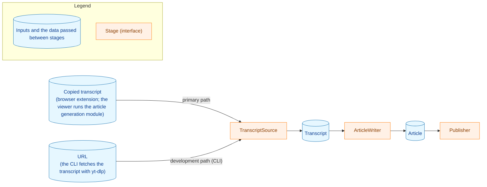

# 記事の生成の詳細

本書は yt2column の開発者のための文書である。記事の生成の仕組みと LLM の構成を説明する。どの入口（CLI か拡張か）にもよらない内容を持つ。拡張の使い方は [README](../../../README.md) に、CLI の実行の仕方は [cli.md](cli.md) にある。

## 構成

主経路はブラウザ拡張で、[README](../../../README.md) が説明する。

補助の経路として CLI も含む。CLI は動画の URL を受け取り、
[yt-dlp](https://github.com/yt-dlp/yt-dlp) で文字起こしを取得する。



- 主経路は、文字起こしパネルからコピーした字幕を使う。yt-dlp を使うのは CLI だけである。
- 拡張の記事の生成は、本番の構成だけを使う。生成・字数の調整・検証・推敲のどれも、`claude` の
  `claude-opus-5-5` を effort `high` で使う。拡張には構成を選ぶ設定がない。
  [推奨構成](#推奨構成)と
  [production_profile.md](../production_profile.md)（日本語）を参照。
  CLI では、DeepSeek と OpenAI も使える。プロバイダは差し替えられる。

## 生成の後の工程

記事を生成した後、2 つの工程が走る。

1. **字数の調整。** 本文が 4,000 文字より長いとき、生成のモデルが目標の 3,600 文字に向けて本文を短くする。短くした後でも、検証・推敲の工程の後でも
   4,000 文字を超えるときは、生成は長さのエラーで失敗し、記事はできない。
2. **検証・推敲。** 検証・推敲のモデルが、記事を動画タイトル・チャンネル名・概要欄・文字起こしと照らし、修正の一覧を返す。修正の対象は、資料に根拠のない主張、意味を変える言い換え、話者の取り違え、音声認識の誤りの写し、意味の取れない文である。記事を書く処理（writer）がその一覧を記事に適用する。CLI では、`YT2COLUMN_REVIEW_LLM` で、この工程だけのプロバイダとモデルを設定できる。既定では、生成のプロバイダとモデルを使う。

どちらの工程も LLM を呼ぶ（字数の調整は、本文が上限を超えるときだけ）ので、生成だけのときより最大 2 回多く呼び、そのぶん費用も増える。

工程を飛ばす、検証・推敲の変更を記録する、工程の出力を保存して再開する、といった CLI のフラグは
[docs/dev/guides/cli.md](cli.md#生成の後の工程)にある。拡張は、どの工程も飛ばさない。

## 出力の書式

記事の情報の並べ方は、出力ごとに異なる。ファイルでは、読み手のための部分（タイトル、チャンネル名、本文、出典リンク）を先に置き、開発のための部分（モデル、推定の料金）をフロントマターに置く。ビューアの表示とコピーは、フロントマターを除いた部分（タイトルの見出し、チャンネル名の行、本文）である。

CLI が書くファイルは
[docs/dev/guides/cli.md](cli.md#--out-のファイル)にある。ビューアの **.md で保存する** が保存するファイルの中身は、CLI の `--out` のファイルと同じ書式である。

## 推定の料金

記事の料金は、CLI の `--out` のファイルでは、フロントマターに小数 4 桁か `unknown` で持つ。拡張のビューアは、完成した記事の推定の料金を示す。

```text
Estimated cost: 0.0023 USD
Estimated cost: unknown
```

推定は推定であり、請求額ではない。プロバイダの請求書とは異なりうる。

- 記事が完成しなかった実行（API が API キーを拒んだ、生成が失敗した、ビューアのタブとともに止まった）では、拡張は料金を一律に不明と示し、金額を示さない。API を一度も呼ばずに終わった実行（API キーがない、保存した設定が使えない）では、料金に触れない。
- DeepSeek のピークの時間帯は、UTC の週ごとの規則である。月曜から金曜の UTC の 01:00-04:00 と
  06:00-10:00 に、別の料金が適用される。CLI は自分の時計の UTC で時間帯を判定し、中国の祝日を知らない。そのため、祝日の呼び出しはオフピークの料金で請求されるが、ピークとして推定され、推定は高めに寄る。
- 時間帯の境界をまたぐ呼び出しは、プロバイダが請求した時刻とは別の分で判定されることがある。CLI の時刻は応答を読み取って検査した時刻であり、プロバイダの請求の時刻は文書化されていないためである。
- 時計がずれたマシンの CLI は、時間帯を誤って判定する。
- OpenAI の料金は、Standard の処理方式と 30 分のプロンプトキャッシュの単価で推定する。応答がそれを示さないときは、トークン数が分かっていても料金は `unknown` になる。入力（キャッシュの読み取りと書き込みを含む）の合計が 272,000 トークンを超える呼び出しには、長い入力の単価を適用する。
- 料金表が古くなることがある。例えば、プロバイダが料金を変えたときや、`deepseek-flash`
  のエイリアスが料金の異なるモデルを指すようになったときである。各項目は出典と確かめた日付を記録しており、更新の手順は開発者向けの文書にある。

実際の請求額はプロバイダのコンソールで確かめる。

理由を示す、CLI が標準エラーに書く料金の行は
[docs/dev/guides/cli.md](cli.md#推定の料金)にある。

## 設定

| 変数 | 説明 | 未設定のとき |
|---|---|---|
| `YT2COLUMN_LLM` | 生成と字数の調整のプロバイダ・モデル・effort。`<provider>/<model ID>` の形で書き、後ろに `+<effort>` を付けられる。プロバイダは `deepseek`、`claude`、`openai`（例: `deepseek/deepseek-flash`、`claude/claude-sonnet-5-5+low`、`openai/gpt-6-astra+medium`） | `claude/claude-opus-5-5` |
| `YT2COLUMN_REVIEW_LLM` | 検証・推敲の工程のプロバイダ・モデル・effort。形は `YT2COLUMN_LLM` と同じ | 生成と同じ（`YT2COLUMN_LLM`、またはその既定。effort も含む） |
| `DEEPSEEK_API_KEY` | DeepSeek の API キー | 生成か検証・推敲のプロバイダが `deepseek` のときは必須（エラー） |
| `ANTHROPIC_API_KEY` | Anthropic の API キー | 生成か検証・推敲のプロバイダが `claude` のときは必須（エラー） |
| `OPENAI_API_KEY` | OpenAI API の API キー（ChatGPT の契約とは別に、API の課金が必要） | 生成か検証・推敲のプロバイダが `openai` のときは必須（エラー） |
| `ANTHROPIC_WORKSPACE_ID` | Anthropic のワークスペースの ID。ワークスペースに結び付いていない API キーのためのもの | ワークスペースの ID を送らない |

これらの変数は CLI が環境変数から読む。拡張はこれらを読まない。拡張の設定は、オプションページで保存する Anthropic の API キーとワークスペース ID だけで、記事の生成はいつも[推奨構成](#推奨構成)の本番の構成を使う（[API キーの設定](../../../README.md#api-キーの設定)を参照）。

CLI だけが読む変数と、CLI が上の変数をどう読むかは
[docs/dev/guides/cli.md](cli.md#設定)にある。

値は、前後の空白を除くことも、ほかの方法で直すこともしない。空の値は未設定ではなく設定として扱い、拒否する。

`YT2COLUMN_LLM` と `YT2COLUMN_REVIEW_LLM` は、最初の `/` で分ける。その前の部分はプロバイダで、ちょうど
`deepseek`、`claude`、`openai` のどれかでなければならない。その後のすべてはモデルの ID で、さらに `/`
があってもそのまま、プロバイダの API に送る（`claude/vendor/model-x` はモデル
`vendor/model-x` を送る）。モデルの ID は空であってはならないので、`claude` と `claude/`
は拒否する。`/claude-opus-5-5`、`Claude/claude-opus-5-5`、
` claude/claude-opus-5-5` も拒否する。前後に空白のあるモデルの ID は、ここでは受け付けるが、その工程を含む実行がその工程のクライアントを組み立てるときに、リクエストを送る前に拒否する。

最初の `/` より後ろに `+` があれば、`+` より前がモデルの ID、後ろが effort である。`+` を探すのは最初の `/`
より後ろだけで、そこには `+` を 1 つまでしか書けない（`claude/claude-opus-5-5+high+low`
は拒否する）。effort は、プロバイダごとに次の表の値のどれかと完全に一致しなければならない。空の effort（`claude/claude-opus-5-5+`）、大文字や前後の空白を含む
effort（`claude/claude-opus-5-5+High`）、そのプロバイダが受け付けない値（`deepseek/deepseek-flash+medium`）は拒否し、モデルの
ID の一部とみなしてプロバイダに送ることはない。`+` より前のモデルの ID が空の値（`claude/+high`）も拒否する。モデルの ID
は `+` より前の部分なので、`claude/claude-opus-5-5 +high` のモデルの ID は後ろに空白を含み、上のとおりクライアントを組み立てるときに拒否する。

| プロバイダ | 受理する effort | effort を省いたとき |
|---|---|---|
| `claude` | `low`、`medium`、`high`、`xhigh`、`max` | `high` を送る |
| `openai` | `none`、`minimal`、`low`、`medium`、`high`、`xhigh`、`max` | `medium` を送る |
| `deepseek` | `none`、`low`、`high`、`max` | 何も送らない（thinking は API の既定のまま） |

`claude` では、effort を要求の effort として送る。`openai` では、要求の `reasoning.effort` として送り、`none` は推論を無効にする。`deepseek` では、要求の `reasoning_effort` として送る。`none`
は thinking を無効にし、ほかの値は有効にする。

**OpenAI を使う。** `openai` は OpenAI の Responses API を呼ぶ。API の課金が必要で、ChatGPT の契約では使えない。API キーは `OPENAI_API_KEY` に設定する。例えば、生成と字数の調整を
`gpt-6-astra` の effort `medium` で、検証・推敲を `gpt-6.1-sol` の既定の effort で行うには、次の環境変数を設定する。

```sh
export YT2COLUMN_LLM=openai/gpt-6-astra+medium
export YT2COLUMN_REVIEW_LLM=openai/gpt-6.1-sol
export OPENAI_API_KEY=<OpenAI の API キー>
```

effort は上の表の 7 つの値をすべて受け付け、モデルの一覧で絞らない。モデルが対応しない effort やパラメータの組み合わせは、OpenAI の API がエラー（HTTP の状態）として返し、その工程は失敗して記事は生成されない。別のモデルや effort に自動で切り替えることはない。料金を推定できるのは `gpt-6-astra` と `gpt-6.1-sol` だけで、ほかのモデルの料金は `unknown` になる（[推定の料金](#推定の料金)）。

要求は Standard の処理方式（`service_tier` が `default`）、プロンプトキャッシュの最低保持期間 30 分、`store: false` に固定しており、変える設定はない。送るデータと OpenAI の側の保持（`store: false` の効く範囲、監視ログ、プロンプトキャッシュ）は
[docs/dev/security.md](../security.md#4-llm-プロバイダへ送るデータ)（日本語）にある。

出力の上限を要求が指定しないとき、OpenAI のアダプタは推論と回答を合わせて 6,080 トークンを上限として送る。3 つの工程はどれもこの値を使う。値の根拠と測り直し方は
[docs/dev/guides/openai_output_limit.md](openai_output_limit.md)（日本語）にある。

`YT2COLUMN_LLM` を設定しなければ、生成と字数の調整は
`claude/claude-opus-5-5` を effort `high` で使う。`YT2COLUMN_REVIEW_LLM` を設定しなければ、検証・推敲の工程は、既定を含めて、生成と同じプロバイダ・モデル・effort を使う。`YT2COLUMN_REVIEW_LLM`
を設定して effort を省けば、生成の effort は受け継がず、上の表の「effort を省いたとき」に従う。どちらの変数も、空の値は拒否し、既定や生成の設定で置き換えることはない。

読んで検査するのは、選んだプロバイダの変数だけである。あるプロバイダの変数は、生成か検証・推敲のプロバイダがそのプロバイダであるときに読む。もう一方のプロバイダの変数は、値が何であれ無視する。そのため、別のツールのために
`ANTHROPIC_API_KEY=` を export していても、`deepseek` だけを使う実行は止まらない。`YT2COLUMN_LLM`
のプロバイダの部分が拒否され（空の値、`/` がない、または受け付けないプロバイダ）、`YT2COLUMN_REVIEW_LLM`
が未設定のときは、プロバイダ固有の変数は検査しないが、共通の変数のエラーは報告する。`claude/`
のように、プロバイダは受け付けるがモデルの ID が空の値でも、`claude/claude-opus-5-5+ultra`
のように effort の部分を拒否した値でも、そのプロバイダの変数は検査する。

`claude` の effort では `max` を受け付けるが、この用途では、モデルが既定の出力の上限まで推論だけに使い、記事の文章を返さないと見込まれるので、実行は打ち切りとして失敗する。コラムの生成には
`low` から `xhigh` までを使う。

既定の effort の `high` は、`claude-opus-5-5` のために選んだ。`claude-sonnet-5-5`
のような別のモデルでは、`high` でも出力の上限に達して、実行が打ち切りとして失敗することがある。その場合は
`YT2COLUMN_LLM` の値に低い effort を付ける（例: `claude/claude-sonnet-5-5+medium`）。

### 推奨構成

CLI の環境変数の値:

```text
YT2COLUMN_LLM=claude/claude-opus-5-5+high
```

この値が本番の構成である。生成・字数の調整・検証・推敲のどれも、`claude` の `claude-opus-5-5` を effort
`high` で使う。拡張は、いつもこの構成で記事を生成する。これは CLI の既定でもある（[#490](https://github.com/isseis/yt2column/issues/490) と
[#171](https://github.com/isseis/yt2column/issues/171) を参照）ので、設定しなくてよい。LLM
の設定が `ANTHROPIC_API_KEY` だけなら、生成・字数の調整・検証・推敲のどれもこの構成を使う。設定しておけば、後で既定が変わっても構成を固定できる。

CLI では `ANTHROPIC_API_KEY` が必須である。生成の構成で検証・推敲するには、`YT2COLUMN_REVIEW_LLM`
を設定しない。別の構成を使うには、既定に頼らず、環境変数に設定する。

この構成の品質の目標、結果、製品の制約は
[production_profile.md](../production_profile.md)（日本語）にある。
