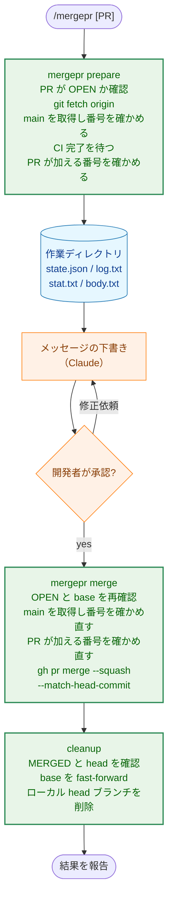

# mergepr 利用ガイド

`mergepr` は、PR を squash merge し、マージ後のローカルブランチを片付けるための開発者向けツールである。Claude Code の `/mergepr` コマンドから使うことを想定している。本書では、前提となる環境、使い方、ツールが保証すること・しないこと、止まったときの対処を説明する。

本リポジトリでは、すべての PR を squash merge する（`.claude/commands/_context.md` の「PR merge method」）。`main` に残るのは squash commit だけなので、そのコミットメッセージには、CLAUDE.md がコミットメッセージに記録するよう求める内容（実装を壊してテストが失敗することを確認した記録など）を引き継ぐ必要がある。`/mergepr` は、そのメッセージを PR の材料から下書きし、承認を得てからマージする。

本文は、PR の最終的な状態を簡潔にまとめたものとする。コミット済みの文書（タスクの `03_implementation_plan.md` など）に既に記録されている詳細は、その文書を参照し、そこに定められた手順（実装を壊してテストが失敗することを確認する手順など）を実施したこと、および名前の挙がった各テストが失敗することを確認したことを書く。リポジトリのどこにも記録されていない検証の記録、正当化の理由、義務、カバレッジの確認は、本文に 1 行程度の記録として残す。squash merge の後は、PR のコミットも `log.txt` も `main` から辿れなくなるためである。下書きの詳しい規則は `.claude/commands/mergepr.md` の手順 2 にある。

## 1. 位置付け

`mergepr` は、PR を作成した本人が自分の PR をマージするための内部ツールである。悪意のある利用者・設定・PR 内容に対する防御は行わない。標準的な環境で使うことを前提とし、その前提を 2 章に示す。

役割分担は次のとおり。

| 担当 | 内容 |
|---|---|
| `mergepr` バイナリ（`cmd/mergepr`、`internal/mergepr`） | PR 情報と材料の取得、プロトコル番号の確かめ（6.3 節）、CI 待ち、マージ、マージ後の片付け |
| `/mergepr` コマンド（`.claude/commands/mergepr.md`） | 上記の呼び出し順の制御、コミットメッセージの下書き、ユーザーへの承認依頼 |
| 開発者 | メッセージの確認と承認、ツールが止まったときの対処 |

## 2. 前提条件

| 項目 | 内容 |
|---|---|
| `git`、`gh` | `PATH` 上にあり、`gh auth login` 済みであること |
| `origin` | GitHub 上の本リポジトリを指していること |
| gh のデフォルトリポジトリ | `gh` がプロンプトなしで `origin` を選ぶこと。リモートが複数あるときは `gh repo set-default` で設定する |
| リモートブランチの自動削除 | GitHub のリポジトリ設定「Automatically delete head branches」が有効であること。`mergepr` はリモートの head ブランチを削除しない |
| merge queue | 使用しないこと |
| CI | PR に CI のチェックが 1 つ以上あること。チェックが無い PR では `gh pr checks` が失敗するため、`prepare` が止まる |

リモートブランチの自動削除が有効かどうかは、次のコマンドで確認できる（`true` なら有効）。

```sh
gh api repos/isseis/yt2column --jq .delete_branch_on_merge
```

## 3. インストール

最新の `main` をチェックアウトした状態で、次を実行する。

```sh
make install-mergepr
```

`$(go env GOPATH)/bin` に `PATH` が通っていることを確認する。ツール自体を変更した PR がマージされたら、`main` を更新してから再インストールする。

`mergepr` は、すべてのサブコマンドで `--protocol` を必須とし、自分のプロトコル番号（`internal/mergepr` の `Protocol`。現在の番号は `3`）と文字列として照合する。`/mergepr`・`/runpr` の定義は、`mergepr` を呼ぶたびに `--protocol 3` を渡す。番号が違うか渡されないとき、`mergepr` は何も読まず、何も書かずに止まる（7 章）。`mergepr` の `Protocol` を上げる PR では、その PR の `/runpr` が最初に `mergepr` を呼ぶ前に、その PR のブランチで再インストールし、マージの直後に `main` から再インストールする。その間、`main` を取り込んでいないほかの worktree の `/mergepr`・`/runpr` は番号の不一致で止まる。途中でほかの PR をマージする必要が生じたら、`main` から再インストールすれば、ほかの worktree は元どおり進める。入れ替える前に、どの worktree にも準備したままの作業ディレクトリ（`mergepr-*`）と終わっていない `cleanup` がないことを確かめる。新しい `mergepr` は、古い定義が書いた `--protocol` のない `discard`・`cleanup` を拒むので、残っていたら新しい `mergepr` で `mergepr discard --protocol 3 --state <state-file>`（片付けなら `mergepr cleanup --protocol 3 --state <state-file>`）を手で実行する。

`mergepr` を導入する PR そのものは、まだ `main` にツールが無いため `/mergepr` ではマージできない。`gh pr merge --squash` など、別の手段でマージする。

## 4. 処理の流れ



| 段階 | 実行者 | ネットワーク操作 | 取り消し |
|---|---|---|---|
| `prepare` | ツール | `gh pr view`、`git fetch origin`、`main` の取得（`git fetch origin +refs/heads/main:refs/remotes/origin/main`）、`gh pr checks`、PR が加える番号の確かめ（`git ls-remote origin` と、SHA を指定した `git fetch --no-tags --no-write-fetch-head origin <SHA>...`） | 不要（読み取りのみ） |
| 下書き・承認 | Claude と開発者 | なし | 何度でもやり直せる |
| `merge` | ツール | `gh pr view`、`main` の取得（`prepare` と同じ）、PR が加える番号の確かめ（`prepare` と同じ）、`gh pr merge` | **不可** |
| `cleanup` | ツール | `git fetch --prune` | ローカル操作のみ |

`/mergepr` を実行すると、`prepare` と `cleanup` のネットワーク操作は許可したものとして扱われる。マージは許可に含まれず、必ず承認の段階で開発者の明示的な yes を必要とする（CLAUDE.md の「Tool Execution Safety」）。

## 5. 使い方

### 5.1 `/mergepr` から使う（推奨）

Claude Code で次のように実行する。

```text
/mergepr          # 現在のブランチの PR
/mergepr 42       # PR 番号で指定
/mergepr https://github.com/isseis/yt2column/pull/42
```

Claude は `prepare` を実行してメッセージを下書きし、PR の URL、base ブランチ、CI の結果、件名と本文、接頭辞を決めた規則の記録を示して承認を求める。修正したい点があれば指示する。yes と答えるとマージと片付けが行われ、マージコミットと片付けの結果が報告される。

### 5.2 手動で使う

各サブコマンドは単独でも実行できる。どのサブコマンドも `--protocol 3` を位置引数より前に必要とする（3 章）。`merge`、`cleanup`、`discard` は `state.json` を入力に取るため、位置引数を渡すと usage エラーで止まる。

```sh
mergepr prepare --protocol 3 [PR]
mergepr merge --protocol 3 --state FILE --subject-file FILE --body-file FILE
mergepr cleanup --protocol 3 --state FILE
mergepr discard --protocol 3 --state FILE
```

#### `prepare [PR]`

PR を引数なし（現在のブランチ）、番号、URL のいずれかで指定する。引数はそのまま `gh pr view` に渡す。処理内容は次のとおり。

1. PR が OPEN であることを確認する。
2. `git fetch origin` を実行する。
3. `main` を、`refs/remotes/origin/main` へ取り込む refspec を明示して取得し、PR の head と base でプロトコル番号を確かめる（6.3 節）。止まれば作業ディレクトリを作らない。CI を待つ前に確かめるのは、番号の食い違いを早く示すためである。
4. `gh pr checks --watch --fail-fast` で CI の完了を待つ。失敗したチェックがあれば止まる。
5. PR の base が `main` なら、PR が加えるタスク番号と ADR 番号を確かめる（6.4 節）。見つけたものがあるか、確かめに要るものを読めなければ止まり、作業ディレクトリを作らない。CI を待った後に確かめるのは、CI を待つ数分の間に `main` に入った番号も見るためである。
6. 作業中のチェックアウト内に新しい作業ディレクトリを作成し、次のファイルを書き出す。本体のチェックアウトではリポジトリの git ディレクトリ配下（`.git/mergepr-*`）に、git ディレクトリが本体側にある worktree では worktree のルートに `mergepr-*` ディレクトリを作る。材料をチェックアウト内に保つことで、作業ツリーの外に触れずに済む。作業ディレクトリを作る場所のパスに改行（LF または CR）が含まれる場合、`dir:` と `state:` の行出力で曖昧さなく表せないため、`prepare` はディレクトリを作らずにエラーで止まる。
   ファイルの書き出しに失敗した場合、`prepare` は作業ディレクトリを削除し直すため、書きかけのディレクトリは残らない。
   `merge`、`cleanup`、`discard` が削除するのは、`state.json` 自身のあるディレクトリで、かつ `prepare` が生成した `mergepr-` 接頭辞の名前を持つものだけである。改ざんされた状態ファイルがチェックアウト本体を指していても何も削除しない。

| ファイル | 内容 |
|---|---|
| `state.json` | PR 番号、head ブランチ名と OID、base ブランチ名、タイトル、URL、準備した作業ディレクトリのパス。後続の `merge` と `cleanup` はこの値を使う |
| `log.txt` | `origin/<base>..<headOID>` の全コミットメッセージ |
| `stat.txt` | `origin/<base>...<headOID>` の diff stat |
| `body.txt` | PR の説明文 |

出力例:

```text
PR #42: feat(writer): add column heading
url:   https://github.com/isseis/yt2column/pull/42
head:  feature/foo at 2222222222222222222222222222222222222222
base:  main
protocol: passed; origin/main 4444444444444444444444444444444444444444, head 2222222222222222222222222222222222222222; origin/main tools: chief 1, codexreview 1, fixprguard 6, mergepr 1; changed: none
CI:    all checks passed
dir:   /repo/.git/mergepr-123456 (state.json, log.txt, stat.txt, body.txt)
state: /repo/.git/mergepr-123456/state.json
```

材料で足りないときは、リポジトリのルートで次を実行して個別ファイルの差分を見る。

```sh
git diff origin/<base>...<headOID> -- <path>
```

#### `merge --state FILE --subject-file FILE --body-file FILE`

件名ファイルは空でない 1 行でなければならない（末尾の改行は除去される）。本文ファイルは内容をそのまま使う。処理内容は次のとおり。

1. PR がまだ OPEN で、base が `state.json` と同じであることを確認する。
2. `main` を `prepare` と同じく取得し直し、`state.json` の head と base でプロトコル番号を確かめ直す（6.3 節）。`prepare` の後に `origin/main` が動いているかもしれないためである。止まればマージしない。
3. PR の base が `main` なら、`state.json` の head と head ブランチで、PR が加える番号を確かめ直す（6.4 節）。`prepare` の後にほかの PR が同じ番号を `main` に入れたかもしれないためである。止まればマージしない。
4. `gh pr merge --squash --match-head-commit <headOID>` でマージする。
5. 続けて `cleanup` と同じ片付けを行う。

#### `cleanup --state FILE`

マージ後の片付けだけを行う。`merge` が片付けの途中で止まったときや、マージ自体は済んだのに `merge` がエラーを返したときに使う。処理内容は次のとおり。

1. PR が MERGED であり、マージされた head の OID が `headOID` と同じであることを確認する。異なれば、ローカルのブランチには触れずに止まる。
2. `git fetch --prune origin` を実行する。
3. base ブランチの扱いを決める。
   - 現在のブランチが base なら、そのまま進む。
   - base が別の worktree でチェックアウトされているなら、ローカルのブランチには触れず、note を表示して正常終了する（5.3 節）。
   - それ以外なら、`git switch <base>` で切り替える。
4. `git merge --ff-only origin/<base>` で base を最新にする。
5. ローカルの head ブランチが `headOID` を指しているときだけ `git branch -D` で削除する。ブランチが無ければ何もしない。
6. 片付けが終わったら、準備した作業ディレクトリを削除する。エラーで止まった場合は、`cleanup` を再実行できるようディレクトリを残す。

結果の出力例:

```text
protocol:             passed; origin/main 4444444444444444444444444444444444444444, head 2222222222222222222222222222222222222222; origin/main tools: chief 1, codexreview 1, fixprguard 6, mergepr 1; changed: none
merge commit:         3333333333333333333333333333333333333333
base branch updated:  true
local branch deleted: true
```

#### `discard --state FILE`

PR のマージを必要とせず、PR やローカルのブランチにも触れずに、準備した作業ディレクトリを削除する。head がマージ前に動いた場合など、準備を使えなくなったときに使う。材料をチェックアウト内に残さないためのコマンドである。`merge` と `cleanup` と同様に、削除するのは `state.json` が記録しているディレクトリだけであり、それは state ファイルを収めているディレクトリでもある。state ファイルを別の場所へ移動・コピーしていると別のディレクトリを指すため、`discard` は何も削除せずエラーで止まる。片付けが未完了の準備の削除には使わない。PR がマージ済みで `cleanup` が途中で止まった場合、base と head の片付けに state ファイルが要るため、表示された `cleanup` を先に実行する。

### 5.3 worktree で使う場合

`main` を本体のチェックアウトで開いたまま、別の worktree で作業していることがある。この場合、作業中の worktree では `main` に切り替えられない。`mergepr` はマージを行ったうえで、ローカルのブランチには触れずに次の note を表示する。

```text
note: main is checked out in another worktree; update it there and remove this worktree (or delete feature/foo) yourself
```

その後の作業は次のとおり。

1. `main` をチェックアウトしている worktree で `git merge --ff-only origin/main` を実行する。
2. 不要になった worktree を削除する。worktree を残すなら、別のブランチに切り替えてから head ブランチを削除する。

`/runplan` の次の PR に進むときは、更新した `main` から新しいブランチを作る。マージ済みのブランチから分岐してはならない。squash merge 後のブランチのコミットは `main` の祖先にならないため、分岐すると前の PR のコミットが次の PR に混入する。

## 6. ツールが保証すること・しないこと

### 6.1 保証すること

| 保証 | 仕組み |
|---|---|
| CI が通った head だけをマージする | `prepare` で CI を待ち、`merge` は `--match-head-commit` でその head の OID を指定する。`prepare` の後に head へ push があると、GitHub がマージを拒否する |
| 承認したメッセージでマージする | 件名と本文はファイルから読み、そのまま `gh pr merge` に渡す |
| 準備した base にマージする | マージ直前に、base が `state.json` と同じことを確認する |
| ローカルの未マージコミットを消さない | ローカル head ブランチは、`headOID` を指しているときだけ削除する。マージされた head が `headOID` と異なるときは、ローカルのブランチに触れない |
| プロトコル番号を変えた PR は、`origin/main` の値 + 1 でしかマージしない | `prepare` は CI を待つ前に、`merge` は `gh pr merge` の直前に、`main` を取得し直してから 6.3 節の確かめを行い、食い違うか読めなければ止まる |
| 定義と版の合わない `mergepr` でマージしない | すべてのサブコマンドが `--protocol` を照合し、合わなければ何も読まず、何も書かずに止まる |
| `main` に入れる PR が、重なるタスク番号と ADR 番号を持ち込まない | `prepare` は CI を待った後に、`merge` は `gh pr merge` の直前に 6.4 節の確かめを行い、見つけたものがあるか読めなければ止まる |

### 6.2 保証しないこと

前提条件（2 章）を満たさない環境での動作は保証しない。特に次の点に注意する。

- 特殊な git 設定（hooks、`push.*` 設定など）や、`origin` 以外を向いた gh の設定には対応しない。
- リモートの head ブランチは削除しない。GitHub の自動削除設定に任せる。
- PR の作業ツリーの未コミット変更は確認しない。`git switch` が衝突すれば、git 自身のエラーで止まる。
- 大きすぎる PR の材料も切り詰めずにそのまま書き出す。
- プロトコル番号について、次の 4 つは受け入れた危険である（CLAUDE.md の「Protocol numbers」）。(1) マージの前は、同じ道具の番号を上げる並行するブランチが同じ番号を共有する。(2) `merge` の確かめ直しと GitHub のマージの間の数秒に、ほかの PR が同じ番号でマージされうる。(3) 番号を上げたブランチを、同じ番号の入った `main` の上へ rebase するか、その上で履歴をまとめ直すと、確かめが衝突を見落としうる。(4) 一度消した道具を同じ名前で足し直すと、番号が `1` に戻る。
- 確かめを変える PR は、その PR のブランチから入れた `mergepr` で確かめられる。確かめの実装を変える PR は、変えた後の実装で確かめることになる。
- 入れ直していない古い `mergepr` と、`main` を取り込んでいない古い定義の組み合わせ（どちらも `--protocol` を知らない）は、確かめずにマージする。
- タスク番号と ADR 番号について、次の 4 つは受け入れた危険である。(1) `merge` の確かめ直しと GitHub のマージの間の数秒に、ほかの PR が同じ番号でマージされうる。(2) `/mergepr` を通らないマージと、入れ直していない古い `mergepr` は、番号を確かめない。`docs/tasks/` の形は CI の文書のガード（`TestTaskDirectoryForms`）でも確かめるが、記録・重複・ほかのブランチの確かめは CI にない。(3) `origin` が `isseis/yt2column` 以外を向いていると、確かめは別のリポジトリを読む。(4) しきい値以下の番号は、記録の tag がなくても通す（6.4 節）。
- 番号に触れていない PR が、`main` を取り込むときの衝突を自分の側の値で解決すると、マージのコミットの値は PR の側の親と等しく、番号を変えたものにならない。その PR をマージすると `main` の番号が下がる（既知の限界。定義の見直しは [#947](https://github.com/isseis/yt2column/issues/947) で扱う）。

### 6.3 プロトコル番号の確かめ

確かめの仕様の正本は本節である（規則の決め方の正本は CLAUDE.md の「Protocol numbers」）。

- **道具.** `--protocol` で版を照合する開発用ツールで、`internal/<名前>/` の直下の `.go` ファイル（`_test.go` を除く。ビルドの制約のあるファイルは含む）に、`const Protocol = <整数>` の 1 行で番号を置く。確かめは、道具の一覧を持たず、この行のあるパッケージを道具として木から見つける。下の階層のパッケージ（`internal/llm/claude` など）は読まない。
- **読み取り.** 行頭の空白と `const` を除いた後に `Protocol` で始まり、その後に `=`（`==`・`!=`・`<=`・`>=`・`:=` の中のものを除く）がある行を宣言の行とする。そのうち、`const Protocol = ` に `1` から `9` で始まる 9 桁までの 10 進の数字だけが続く行だけを番号として読む。先頭の `0`、区切りの `_`、型の名前、行末のコメント、const ブロック、2 つ以上の宣言の行は、読めない値になる。宣言の行がなければ、その版にその道具は「ない」。
- **読む版.** `refs/remotes/origin/main`（同じ名前のローカルのブランチと取り違えないように完全な名前で指す）、PR の head、PR のコミット（`origin/main` から辿れず head から辿れるコミット。`main` を取り込んだマージのコミットを含む）と、そのすべての親である。git は `git grep` と `git rev-list` で読み、利用者の git の設定、`git replace`、`GIT_*` の環境変数に左右されない形で呼ぶ。
- **番号を変えた道具.** マージのコミットでないコミットは、親の値と違えば変えたものとする。マージのコミットは、その値がどの親の値とも違うときだけ変えたものとする。「ない」も 1 つの値として比べる。PR の途中のコミットと親の読めない値は、ほかのどの値とも違う値として扱う。
- **判定.** 変えた道具がなければ通す。変えた道具があり、PR の base が `main` でなければ止まる。PR のコミットが定数を消し、head にない道具は確かめない。変えた道具が head になく、PR のコミットも消していなければ止まる。それ以外の変えた道具は、head の値を期待する値（`origin/main` の値 + 1。`origin/main` にないときは `1`）と比べ、1 つでも違えば止まる。`origin/main` にあって head になく、PR のコミットの中で値が動かない道具（ブランチが道具より古い場合）は、変えたものにならないので確かめない。
- **読めないときは止める.** `main` の取得の失敗、コミットや親を読めないこと、shallow なリポジトリ、`origin/main` か head の読めない値、`origin/main` に道具が 1 つもないこと、変えた道具が head で受け付ける形になく PR のコミットも消していないことは、どれも「番号を変えていない」とはせずに止まる。
- **通ったとき.** 比べた `origin/main` と head のコミット ID、`origin/main` の道具と値、番号を変えた道具を、`protocol:` の 1 行で示す（5.2 節の出力例）。確かめの結果は `state.json` に書かず、`merge` も毎回 git の木から読み直す。

### 6.4 タスク番号と ADR 番号の確かめ

PR の base が `main` のときだけ確かめる。確かめの判定は `internal/numreserve`（`CheckAdded`）にあり、読み方と上限は番号を決める `numreserve` と同じである（[numreserve_guide.md](numreserve_guide.md)）。確かめは読むだけで、ref も記録の tag も書かない。

- **PR が加える番号.** PR の head と、最新の `origin/main`（`git ls-remote` で読み、SHA を指定して取得する）の merge-base を比べ、head の `docs/tasks/` にあって merge-base にないタスクのディレクトリと、head の `docs/dev/adr/` にあって merge-base にない ADR のファイルの番号である。最新の `origin/main` と比べないのは、PR が分かれた後に `main` で名前を変えたものが、古い head に残っているだけで「加えた」と数えられないようにするためである。番号を加えない PR では、記録の tag もほかのブランチも読まずに通す。
- **形.** PR が `docs/tasks/` の下に加えた項目が、タスクのディレクトリ名の形（`NNNN_<name>`）のディレクトリでなければ止まる（`malformed`）。
- **記録.** 加えた番号がしきい値より大きく、記録の tag（`refs/tags/task-number/NNNN` か `refs/tags/adr-number/NNNN`）がなければ止まる（`unreserved`）。しきい値はタスク番号が `0103`、ADR 番号が `0051` で、この確かめを入れたときに使われていた番号の最大値である（[0100 実装計画書](../../tasks/0100_number_reservation/03_implementation_plan.md) の §7「しきい値の記録」）。それより前に作った PR は記録の tag を持たないので、しきい値以下の番号は記録を求めない。
- **重複.** 加えた番号を、最新の `origin/main` の別の名前のディレクトリかファイルが使っていれば止まる（`in-use-on-main`）。同じ名前なら同じものとみなす。PR が消す項目（merge-base にあって head にない項目）は、マージの後に残らないので数えない。PR が同じ番号のまま名前を変えたときに止まらないためである。
- **ほかのブランチ.** 加えた番号を、PR の head ブランチと `main` でない `origin` のブランチが、`origin/main` にない別の名前で持っていれば止まる（`on-other-branch`）。同じ名前なら同じタスクか ADR とみなす。マージされずに残った古いブランチでも止まる。
- **読む空間.** 記録の tag とほかのブランチは、PR が番号を加える空間の分だけを読む。もう一方の空間の記録の tag が受け入れない形でも、止まらない。最新の `origin/main` の受け入れない形の項目は読み飛ばし、止まらない（その項目を消す PR を止めないため）。
- **読めないときは止める.** `git ls-remote` と取得の失敗、merge-base を求められないこと、読む記録の tag とブランチの受け入れない形、上限の超過は、どれもマージせずに止まる（`number check: cannot check the numbers the PR adds`）。止める理由の語は numreserve と同じである（numreserve_guide.md の 2 章）。
- **出力.** 見つけたものを 1 件 1 行で、`mergepr: number check: <種類> <空間> <番号> "<PR のパス>": <使っている所>` の形で標準エラーに出し、その後に誤りの行を出して、終了コード 1 で終わる。`malformed` の行は番号を持たず、`mergepr: number check: malformed task "<PR のパス>": not a task directory` の形である。パスとブランチ名は Go の引用の形で出す。

## 7. 止まったときの対処

`mergepr` は、問題を見つけると理由と対処を表示して止まる。止まった場合はシェルコマンドで回避せず、原因を取り除いてから再実行する。

| メッセージ（抜粋） | 段階 | 原因 | 対処 |
|---|---|---|---|
| `--protocol is missing or does not match this binary's N` | すべて | インストールした `mergepr` と、呼び出したコマンドの定義の版が違う | `mergepr` が古いなら `main` から `make install-mergepr` で入れ直す。定義が古い（ブランチが `main` を取り込んでいない）なら、`origin/main` を取り込む |
| `flag provided but not defined: -protocol` | すべて | `--protocol` を知らない古い `mergepr` に、新しい定義が `--protocol` を渡した | `main` から `make install-mergepr` で入れ直す |
| `protocol check: number is not origin/main's value plus one` | `prepare`、`merge` | 番号を変えた道具の head の値が、`origin/main` の値 + 1 でない | 下の「番号が食い違ったとき」 |
| `protocol check: cannot check protocol numbers` | `prepare`、`merge` | 確かめに要るものを読めない（表示された理由を見る） | 下の「番号を読めないとき」 |
| `number check: N finding(s) on the numbers the PR adds` | `prepare`、`merge` | PR が加える番号に、記録がない・ほかのものが使っている・形が合わないものがある（その前の `mergepr: number check:` の行を見る） | 下の「番号の確かめで止まったとき」 |
| `number check: cannot check the numbers the PR adds` | `prepare`、`merge` | 確かめに要るものを読めない（続く止める理由の語を見る） | numreserve_guide.md の 2 章の、その理由の語の対処をしてから実行し直す |
| `PR is not open` | `prepare` | PR がクローズまたはマージ済み | 対象の PR を確認する |
| `CI checks failed` | `prepare` | 失敗したチェックがある、またはチェックが無い | CI を直して push し、`prepare` からやり直す |
| `squash subject is not a non-empty single line` | `merge` | 件名ファイルが空、または複数行 | 件名ファイルを直して `merge` を再実行する |
| `PR is not open: state is MERGED` | `merge` | 前回の実行で既にマージされている | 表示された `mergepr cleanup --protocol 3 --state ...` を実行する |
| `PR base changed after prepare` | `merge` | PR の base が変更された | 表示された `mergepr prepare --protocol 3 <PR>` で、`prepare` からやり直す |
| `merge PR: ...` | `merge` | head が `prepare` 後に動いた、ブランチ保護に引っかかった、など | head が動いたなら、使えなくなった準備を `mergepr discard --protocol 3 --state ...` で破棄してから `prepare` からやり直す。PR がマージ済みなら表示された `cleanup` を実行する |
| `PR is not merged` | `cleanup` | まだマージされていない | マージを確認してから再実行する |
| `switch to <base>: ...` | `cleanup` | 未コミット変更が衝突した、など | 作業ツリーを整理して `cleanup` を再実行する |
| `fast-forward <base>: ...` | `cleanup` | ローカルの base に `origin` に無いコミットがある | base のコミットを整理して `cleanup` を再実行する |
| `local head branch moved after prepare; not deleted` | `cleanup` | `prepare` 後にローカル head ブランチへコミットした | そのコミットが必要か確認し、不要ならブランチを手動で削除する |
| `PR merged a different head than prepared` | `cleanup` | `prepare` 後に head が force-push され、その head がマージされた | ローカル head ブランチに PR に含まれなかったコミットが無いか確認し、base の更新とブランチの削除を手動で行う |
| `invalid state` | `merge`、`cleanup`、`discard` | `--state` に `prepare` が書いたファイル以外を指定した | `prepare` が表示したパスを指定する |
| `state file does not name a generated work directory it lives in` | `discard` | `--state` が、`prepare` が作ったディレクトリの外へ移動・コピーされた state ファイルを指している、またはそのディレクトリ名が `mergepr-` 接頭辞を持たない | `prepare` が表示したパスを指定する。安全と分かっているなら準備したディレクトリを自分で削除する |

`merge` の確かめ直しで止まったときは、マージしていない。`origin/main` の取得に失敗したとき（`could not fetch origin/main`）は、準備はそのまま使えるので、`origin` に届くようになってから同じ `merge` を実行し直す。それ以外で止まったときは、表示された `mergepr discard --protocol 3 --state ...` で準備を捨ててから直す。

**番号が食い違ったとき.** 誤りの文は、食い違った道具ごとに、`origin/main` の値、head の値、期待する値と、番号を変えたコミットを示す。そのコミットがこの PR 自身のものか、ほかのブランチから来たものかを見て、直し方を選ぶ。

1. PR のブランチに `origin/main` をマージで取り込む（rebase しない）。
2. その道具の `Protocol` を期待する値にする。
3. コマンドの定義と手引きに書いた番号（`--protocol` の値を含む）を同じ値にする。
4. commit して push する。
5. その PR のブランチで、その道具を `make install-<道具>` で入れ直す。
6. マージをやり直す。`/runpr` から使ったときは `/runpr` を、単独のときは `/mergepr` を実行し直す。

head の値が `origin/main` の値と同じ道具があるとき（上げた番号が `main` の取り込みで吸収された場合と、上げてから元に戻した場合）は、`origin/main` の上で PR の履歴をまとめ直し、番号を変えたコミットを残さないことも直し方になる。まとめ直してよいのは、この PR 自身の変更が道具の約束を変えないとき（番号を変えたコミットがほかのブランチから来たか、上げてから元に戻したとき）に限る。そうでなければ、まとめ直しは衝突を隠すので、上の手順だけが直し方である。

**番号を読めないとき.** 表示された理由に応じて直す。shallow なリポジトリなら `git fetch --unshallow` を実行する。`main` の取得に失敗したなら、ネットワークと `origin` を確かめてから、止まったサブコマンド（`prepare` か `merge`）を同じ引数で実行し直す。読めない宣言の行なら、表示されたファイルの行を `const Protocol = <整数>` の形に直す。PR の base が `main` でないなら、番号を変えるコミットは `main` を base にした PR でマージする。

**番号の確かめで止まったとき.** `merge` で止まったときは、マージしていない。確かめに要るものを読めず、止める理由が `network-or-github` のときは、準備はそのまま使えるので、`origin` に届くようになってから同じ `merge` を実行し直す。それ以外は、準備を `mergepr discard --protocol 3 --state ...` で捨ててから、見つけたものの種類ごとに直す。

- **ADR 番号（`unreserved`・`in-use-on-main`・`on-other-branch`）.** PR のブランチの作業ツリーで `numreserve adr` を実行して新しい番号を決め、[adr.md](../conventions/adr.md) の「Taking in `main`」の手順 2 と同じ形で付け替える。commit して push し、マージをやり直す。
- **タスク番号（`unreserved`・`in-use-on-main`・`on-other-branch`）.** 番号はブランチ名にも入り、`chief` はブランチ名とディレクトリ名が一致することを求める。開いている PR の head ブランチの名前は変えられないので、`numreserve task` で新しい番号を決め、新しいブランチと PR で作り直す。止まった PR は閉じる。`/runpr` がマージの直前に積んだ記録の commit（文書の `approved` など）は、マージされない PR に残り、作り直した PR には引き継がれない。作り直した PR で `/runpr` を実行し、承認を記録し直す。
- **仕組みより前に作った PR の `unreserved`.** 番号がしきい値より大きいが、この仕組みより前に作った PR で、ほかに使っている所がないと確かめられたときは、利用者の承認のもとで、その番号の記録の tag を手で作ってもよい（CLAUDE.md の「Tool Execution Safety」の、承認を要る操作）。
- **`on-other-branch` のブランチが古い.** マージされずに残った古いブランチが同じ番号を持つときは、そのブランチを消すかどうかを利用者が決める。消せば、マージをやり直せる。
- **`malformed`.** PR が `docs/tasks/` の下に加えた項目を、タスクのディレクトリ（`NNNN_<name>`）にするか取り除いて push し、マージをやり直す。

**`main` に読めない値が入ったとき.** `origin/main` の番号が読めないと、それを直す PR を含め、すべての PR の `mergepr` が止まる。この場合に限り、次の手順で直す PR をマージしてよい。直す PR は、読めない宣言の行を受け付ける形に直す変更だけを含むこと。`origin/main` の各道具の番号と、PR の head の番号を `git grep -n -F Protocol <commit> -- ':(glob)internal/*/*.go' ':(glob,exclude)internal/*/*_test.go'` で手で確かめ、番号を変えた道具が `origin/main` の値 + 1 であるか、番号を変えていないことを確かめる。そのうえで、`gh pr merge <PR> --squash --match-head-commit <headOID>` でマージし、マージの後に `/mergepr` が通ることを確かめる。

`merge` は取り消せない段階である。その後に止まっても、マージ自体は完了していることがある。GitHub で PR の状態を確認し、マージ済みなら `cleanup` で片付けを再開する。`state.json` はチェックアウト内の作業ディレクトリ（本体のチェックアウトでは `.git/mergepr-*`、worktree では `mergepr-*`）にあるため、片付けが終わるまで削除しない。片付けが成功すると、ツールがディレクトリを削除する。使えなくなった準備（head がマージ前に動いた場合など）は、チェックアウト内に残さず `discard` で削除する。

## 8. ツールを変更する場合

- 実装は `internal/mergepr`、CLI は `cmd/mergepr` にある。外部コマンドは `Runner` インターフェース（定義は `internal/cmdrunner`。`mergepr.Runner` はその別名）越しに呼び出す。テストでは、期待するコマンド列を順に再生する `fakeRunner`（`internal/mergepr/test_helpers.go`）を使い、`git` や `gh` を実行しない。`Prepare`・`Merge` のテストは、プロトコル番号の確かめとタスク番号・ADR 番号の確かめ（`mergepr.NumberChecker`）を差し替えて、呼ぶ位置と渡す値を確かめる。`cmd/mergepr` は、`main` だけが本番の確かめ（`numreserve.New`）を渡す。
- プロトコル番号の確かめ（6.3 節）は、一時ディレクトリに実際の git のリポジトリを作り、履歴を組んで試す（`internal/mergepr/protocolcheck_test.go`）。宣言の行を持つ Go のソースは `_test.go` の中だけで組み立てる。`internal/mergepr` の `_test.go` 以外のファイル（`test_helpers.go` など）に `const Protocol = …` の行をもう 1 つ書くと、確かめは `mergepr` の番号を読めない値として止まる。
- 引数・出力・終了コードの契約を変えたら、`internal/mergepr` の `Protocol` を上げ、コマンドの定義と本書の `--protocol` も合わせて更新する。番号の決め方は CLAUDE.md の「Protocol numbers」に従う。
- 6.1 節の保証を変更する場合は、対応する実装を壊してテストが失敗することを確認し、そのことをコミットメッセージに書く（CLAUDE.md の「Testing Strategy」）。
- 手順や前提を変更したら、本書と `.claude/commands/mergepr.md` を合わせて更新する。
