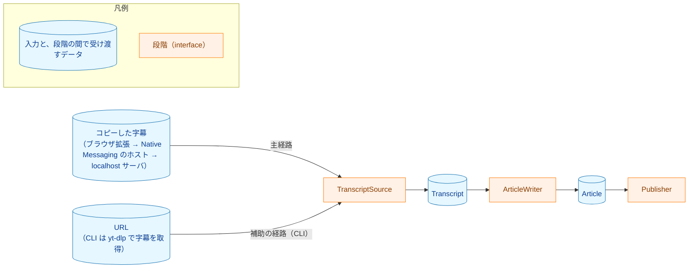

# yt2column プロジェクト概要

ブラウザ拡張が YouTube の文字起こしパネルからコピーした字幕を集め、Native Messaging のホストと localhost サーバを経て記事を生成し、Slack 互換の Incoming Webhook（Mattermost など）に投稿するツール。CLI（`yt2column`）は、動画の URL を受け取り、その動画の文字起こしを `yt-dlp` で取得して、それを元に LLM で「雑誌コラム記事風」の文章を生成し、`--out` で Markdown ファイルに書き出すか、`--slack` で投稿する。開発・検証用の補助の経路である。

本書はプロジェクト全体の決定済み方針をまとめたもの。個々の機能は `docs/tasks/` 以下のタスクで要件 → 設計 → 実装計画の順に具体化する（[requirements_process.md](conventions/requirements_process.md)）。本書の方針を変更する場合は、タスクの要件定義書でその旨を明記し、本書も更新する。

## 決定済みの方針

- **言語: Go**（ブラウザ拡張は TypeScript。詳細は §「想定ディレクトリ構成」と `docs/tasks/0007_browser_extension_skeleton/`）。依存関係を最小限にし、シングルバイナリで配布する。
- **実行形式: localhost サーバとブラウザ拡張、開発用の CLI**。主経路は、ブラウザ拡張が YouTube の文字起こしパネルからコピーした字幕を、ブラウザが起動する Native Messaging のホスト（`cmd/yt2column-nmhost`・`internal/nmhost`）がソケットへ中継し、localhost サーバ（`cmd/yt2column-server`・`internal/server`）が記事を生成してメモリに保持し、求めに応じて返すか Slack へ投稿する（タスク `0011_localhost_server`・`0044_article_job_api`）。`POST /articles` は、拡張が新しい API に移る #503 の後に削除するまで、生成と投稿を続けて行う今の振る舞いを残す。サーバは TCP を待ち受けず、`HOME` だけから導出したパスの Unix ドメインソケットの上で HTTP を受ける（タスク `0026_native_messaging_relay`）。ホストの manifest は、利用者が `yt2column-nmhost install <browser>` で登録し、`yt2column-nmhost uninstall <browser>` で削除する（`<browser>` は `chrome` か `brave`。`make build` は登録しない）。サーバの起動は手動とし、サーバは `yt-dlp` を呼ばない。コアロジックは `cmd/` から分離したパッケージとして実装し、両方の入口で共有する。CLI はローカルで実行する。
- **字幕取得: 主経路はコピーした字幕、CLI は外部コマンドの `yt-dlp` に委譲する**。主経路では、利用者が YouTube の文字起こしパネルからコピーした字幕の文字列を解析するパーサ（`internal/transcript` で `CopiedSource` が `Raw` を解析する箇所）を使う。これは、パネルが出力する書式に依存する例外である。依存はそのパーサに限り、Go から YouTube のページやパネルを取得・解析しない。CLI は字幕の取得を `yt-dlp` に委譲する。YouTube の非公式な仕様に依存する最も壊れやすい部分を、保守が活発なツールに任せるためであり、Go で字幕取得を自前実装しないこと。書式が変わって拒否が続く間は、`yt-dlp` の経路を代わりの手段として残す。
- **LLM: 既定は Claude（`claude-opus-5-5`）で、DeepSeek も選べる**。コード上の既定のプロバイダは Claude で、既定で本番の構成になる（[#490](https://github.com/isseis/yt2column/issues/490)・[#171](https://github.com/isseis/yt2column/issues/171)）。本番の構成は [production_profile.md](production_profile.md) にある。どちらも SDK を使わず、標準ライブラリ（`net/http`・`encoding/json`）で呼び出す。Claude は Anthropic Messages API を、DeepSeek は公式 API を直接契約して使う。DeepSeek の API は OpenAI 互換の Chat Completions 形式（`POST https://api.deepseek.com/chat/completions`）である。
  - OpenCode Go 経由の利用は採用しない。利用条件が「コーディングエージェントのトラフィック」を前提としており、本ツールの用途に合わないため。
- **LLM プロバイダは差し替え可能にする**。DeepSeek と Claude を実装済みで、Claude は公式 SDK を使わず標準ライブラリで Anthropic Messages API を呼ぶ（タスク `0009_claude_llm_client` の要件定義書 §2.3）。将来 Gemini（`google.golang.org/genai`）などを追加する前提。プロバイダとモデル名は設定で切り替える。Gemini を追加する場合、旧 SDK の `github.com/google/generative-ai-go` はレガシーなので使わないこと。
- **LangChain 相当のフレームワークや、複数プロバイダを束ねる抽象化ライブラリは使わない**。自前の薄い interface で十分。
- **外部ライブラリは必要最小限にする**。HTTP・JSON・CLI 引数・設定は標準ライブラリで書く。追加する場合は理由を明示すること。

## パイプライン



各段階は interface で抽象化し、実装を差し替えられるようにする。

- `TranscriptSource`: 主経路では、利用者が文字起こしパネルからコピーした字幕の文字列と動画のメタ情報を `CopiedSource` に渡して `Transcript` を作る。localhost サーバは拡張から受け取った生の字幕を `CopiedSource` に渡す（`yt-dlp` を呼ばない）。CLI は `yt-dlp` で字幕を取得する `YtDlpSource` を使う。
  - `YtDlpSource` の例: `yt-dlp --ignore-config --no-plugin-dirs --skip-download --write-subs --write-auto-subs --sub-langs ja --sub-format json3 --write-info-json -P "<cache>" -o "%(id)s" -- <URL>`
  - json3 の `events[].segs[].utf8` を連結して本文にする。`tStartMs` も保持する（将来、見出しごとに動画の該当時刻へのリンクを付けるため）。
  - info.json からタイトル・チャンネル名・概要欄を取り出し、メタ情報として `Transcript` に含める。
  - 手動字幕と自動字幕が両方ある場合の挙動（どちらが優先されるか、出力ファイル名）は `02_architecture.md` の作成時に実 `yt-dlp` の出力で確認し、同書に記録すること（承認前に確定させる）。
- `ArticleWriter`: プロバイダに依存しない。プロンプトテンプレートにタイムスタンプを除いた本文とメタ情報を埋め込み、`LLMClient` を呼び出して、結果を `Article`（タイトル・チャンネル名・Markdown 本文・出典 URL・生成モデル名・モデルの版の識別子。段階ごとのモデル名も持つ）に変換する。
  - プロンプトの組み立てと出力の後処理はここに集約し、全プロバイダで共有する。
  - 生成の後に 2 つの段階を既定で行う。字数の調整は本文が 4,000 字を超えるときだけ、生成と同じ `LLMClient` で上限以内（目標 3,600 字）に縮める。検証・推敲は、別に設定できるプロバイダとモデル（`YT2COLUMN_REVIEW_LLM`。既定は生成と同じ）で記事を素材と突き合わせ、直す箇所の一覧を返させ、`ArticleWriter` がその一覧を記事に当てはめる。いずれかの段階で失敗した記事は成功として返さない。
  - 各段階の出力（生成の出力・字数の調整の出力・検証・推敲の一覧と適用後の記事）は、`--artifacts <dir>` を指定したときだけキャッシュの外のディレクトリに保存し、`--after <stage>` でその段階から再開して後の段階だけを実行できる。段階が完了するたびに、公開の前に保存するので、後の段階が失敗しても前の段階の出力は残る。再開でも実行した段階は保存するので、ディレクトリは書き込み可能であること。中間生成物の形式は版 3 で、各段階の呼び出しの時刻（`call_time`。`Generate` が戻った時刻を UTC・秒で持つ）を持つ。版 1・版 2 のファイルは再開に使えず、拒否される。
  - LLM の応答が報告するトークン数を段階ごとに記録し、`Article` に実行の使用量（`RunUsage`）として持たせる。成功した実行では要約の最後に、失敗した実行では失敗の行の前に、段階ごとに 1 行のトークン数の行を標準エラーに出す。応答の `usage` の不正で記事の生成は失敗させず、その段階の使用量を不明として示す。失敗した実行では `*TokenUsageError` で使用量を運ぶ。
  - 同じ位置に、段階ごとの料金の行と、この実行の料金（`run`）・記事 1 本の料金（`article`）の 2 つの合計の行を出す（`yt2column: cost: <段階> <由来> known usd=<金額> <単価> at=<時刻>`、`yt2column: cost-total: run ...`）。料金は `internal/pricing` の単価の表から算出し、時間帯で単価が変わるモデルでは呼び出しの時刻で選んだ単価を使う。記事 1 本の料金は、`--out` のファイルでは先頭のフロントマターのキー `estimated_cost_usd`（`"<4 桁>"` または `"unknown"`）に、Slack の投稿（localhost サーバからの投稿を含む）では末尾の脚注（`Estimated cost: <4 桁> USD` または `Estimated cost: unknown`）に出す。ファイルはフロントマター（チャンネル名・出典・各段階のモデルと版・料金）、見出し、チャンネル名の行、本文の順で、Slack の投稿は見出し行（タイトルとチャンネル名）、本文、脚注（モデル名と料金。モデルの版は出さない）の順である。出力先ごとに別の関数で整形し、共有するのは料金などの値の書式だけである。例外として、ファイルの中身のうちフロントマターの後の部分（見出し・チャンネル名の行・本文）は、サーバの状態の取得が返す表示用の Markdown と同じ関数で作る（タスク `0044_article_job_api`）。Viewer が表示する記事と、Viewer から保存するファイルの記事を同じにするためで、フロントマターと Slack の投稿は今のまま別の関数で整形する。
- `LLMClient`: プロバイダごとの薄いアダプタ。責務は「system プロンプトと user プロンプトを受け取り、生成テキストとモデル名、モデルの版の識別子、応答が報告するトークン数（`Usage`）を返す」ことだけ。

  ```go
  type LLMClient interface {
      Generate(ctx context.Context, req GenerateRequest) (GenerateResponse, error)
  }
  // GenerateRequest: SystemPrompt, UserPrompt, MaxOutputTokens など、プロバイダ共通の最小限の項目のみ
  // GenerateResponse: Text, Model（生成テキストと、生成に使われたモデル名）, ModelVersion（生成に使ったモデルまたはバックエンドの版の識別子。返さないプロバイダでは空文字列）, Usage（応答が報告したトークン数、または不明の理由）
  ```

  - 既定は `internal/llm/claude`（本番の構成）。`internal/llm/deepseek` も選べる。Gemini は必要になったら `internal/llm/gemini` として追加する。
  - 打ち切り（`ErrTruncated`）・想定外の終了理由（`ErrUnexpectedFinishReason`）・空の応答（`ErrEmptyResponse`）では、拒否した応答の `Model` と `Usage` をレスポンスに入れて返す。ほかのエラーではゼロ値を返す。
  - プロバイダ SDK の import は各実装パッケージの中に閉じ込める。他のパッケージから SDK の型を参照しないこと。
  - プロバイダの選択は `internal/config` の値を見て、`main.go`（または小さなファクトリ関数）で行う。
- `Publisher`: 初期実装は `SlackWebhookPublisher` と `FilePublisher`（ローカル保存。デバッグ用）。
  - `SlackWebhookPublisher` は、Slack 互換の Incoming Webhook（Mattermost など）へ記事を Markdown の `text` として投稿する。検証済みの対象は Mattermost とし、Slack は best effort とする。通知を抑止するため全メッセージに `silent` を付け、1 メッセージ 16,383 コードポイントを超える記事は `(k/N)` の表示を付けて分割する。

## 前提・制約

- **文字起こしがない動画がある**（投稿者が字幕を無効化している、公開直後で自動字幕が未生成など）。yt-dlp が正常終了しても字幕ファイルが出力されないケースを検出し、分かりやすいエラーにする。Whisper 等による音声文字起こしへのフォールバックは**スコープ外**（将来拡張）。
- 日本語の自動字幕には句読点が付いており、品質は実用レベル。
- 動画の長さは 40 分前後を想定（1 万数千字）。**チャンク分割はせず一括で処理する**。数時間級の動画への対応は将来拡張。
- クラウドの IP からは YouTube にブロックされやすい。ローカル実行を前提とする。
- 投稿先の Markdown の扱い: Slack の従来の mrkdwn は標準 Markdown ではない。Mattermost の Incoming Webhook はメッセージの `text` を Markdown として表示する。検証済みの対象は Mattermost とし、Slack は best effort とする。1 つのメッセージの上限は 16,383 コードポイント（Mattermost の公式文書の 16,383 文字に対応。設計で Mattermost の `MaxPostSize()` とコードポイントの数え方を確認した。現在の `MaxPostSize()` はこれより大きい）とし、超える場合は `(k/N)` の表示を付けて分割して投稿する。
- 記事の末尾には必ず元動画へのリンク（出典）を付ける。
- 字幕と info.json は動画 ID ごとにキャッシュする。同じ動画の処理をやり直すとき（記事生成・投稿の失敗後の再実行、プロンプトの調整）に再取得しないようにするため。処理を終えた動画の文字起こしをローカルに残し続けないよう、投稿の成功後は既定でその動画のキャッシュを削除し、残すオプションを設ける。中断などで残った不要なエントリは、CLI の各実行で掃除する。中間生成物（`--artifacts`）はキャッシュの外の利用者が指定したディレクトリに保存し、利用者が削除するまで残す（キャッシュの削除で消えない）。これとは別に、localhost サーバは生成した記事をメモリに持つ（キーごとに、ジョブ・工程・投稿の状態と記事。件数の上限は 100 件で、超えるときは完了または失敗した時刻の古い記録から捨て、処理中と投稿中の記録は捨てない）。サーバはそれをディスクに書かず、再起動で失う。
- LLM はエラーを返さずに空の応答や途中で打ち切られた応答を返すことがある。`finish_reason` を確認し（`stop` 以外、特に `length` は打ち切り）、空の応答とともにエラーとして扱うこと。
- DeepSeek の現行モデルは thinking（推論）モードがデフォルトで有効で、レイテンシとコストに影響する。推論過程は `reasoning_content` として本文（`content`）とは別に返るので、記事には `content` だけを使う。thinking モードでは `temperature` が無視される。`YT2COLUMN_LLM`・`YT2COLUMN_REVIEW_LLM` の値に effort（`+none`・`+low`・`+high`・`+max`）を付けると、その値をリクエストの `reasoning_effort` として送る。`none` は thinking を無効にし、ほかの値は有効にする。effort を省けば `reasoning_effort` を送らず、API のデフォルト（thinking 有効）のままにする。`thinking` パラメータは送らない。
- DeepSeek は平日のピーク時間帯（UTC 01:00–04:00 と 06:00–10:00、日本時間では 10–13 時と 15–19 時）の料金が2倍になる。
- DeepSeek の API への入力は中国で処理・保存され、プライバシーポリシー上はデフォルトでモデルの学習に使われる（オプトアウトあり）。送るのは公開動画の字幕・メタ情報とプロンプトであり、機密情報を送らないこと（[security.md](security.md) を参照）。
- モデル名は頻繁に更新される。コードにハードコードせず設定で与える。ただし、既定のモデル名 `claude-opus-5-5`（`internal/config` の `defaultClaudeModel`）はこの方針の例外としてコードに持つ。範囲は、`YT2COLUMN_LLM` が未設定のとき（`YT2COLUMN_REVIEW_LLM` が受け継ぐ場合を含む）の既定値 `claude/claude-opus-5-5` に限り、設定したモデル名はそのまま使う。何も設定しなければ本番の構成で動くようにするためで、値はタスク 0008 の評価で本番の構成として決めたモデルである。本番の構成を見直したときは、この値と README・本書の表を変える。再現性のため、`-latest` 系のエイリアスより具体的なモデル名を推奨。ただし DeepSeek の `deepseek-flash`（2026-09 時点で DeepSeek-V4.1-Flash を指す）は提供元が指し示すモデルを切り替えるエイリアスで、バージョンを固定した ID は提供されていない。どのモデルで生成したかを追えるよう、応答に含まれる `model` の値と、モデルの版の識別子（`ModelVersion`。DeepSeek では `system_fingerprint`）を記録すること。ただし `internal/pricing` の単価の表はこの方針の対象外である。単価の表は、応答が報告したモデル名に対する単価を引くためのコード内の参照表であり、使うモデルを選ぶ設定ではない。表にないモデルを選んでも生成と公開は変わらず、料金が不明になるだけである。

## 未確定事項

- Slack 以外の投稿先（Discord 等）は必要になったら追加する。
- プロバイダごとにプロンプトの微調整が必要になった場合の扱い（共通テンプレート＋プロバイダ別の上書きなど）。

## 想定ディレクトリ構成

```
cmd/yt2column/main.go     # CLI エントリポイント
cmd/yt2column-server/     # localhost サーバのエントリポイント（main.go・run.go）
cmd/yt2column-nmhost/     # Native Messaging のホストのエントリポイント（中継・install・uninstall）
internal/pipeline/        # 3段階を束ねるオーケストレーション
internal/server/          # localhost サーバ（HTTP の受け口・検査・応答・ジョブ）
internal/articlecache/    # 記事のキャッシュ（キー・記録の状態遷移・件数の上限と破棄。HTTP も LLM も知らない）
internal/serversock/      # サーバの Unix ドメインソケット（ソケットのディレクトリの検査・起動のロック・stale の判定）
internal/nmhost/          # Native Messaging のホスト（フレーム・ソケットへの中継・manifest の install/uninstall）
internal/failure/         # 失敗の通知の型（Kind・Notice・Notifier）
internal/redact/          # 出力の伏せ字（CLI とサーバが共有）
internal/signalrun/       # シグナルの扱い（CLI とサーバが共有）
internal/transcript/      # TranscriptSource と yt-dlp 実装、json3 パーサ、コピーした字幕の CopiedSource
internal/strictjson/      # 検証を通った JSON 文書から値を取り出す厳格な部品（transcript・deepseek・claude・writer・publisher が共有）
internal/nilcheck/        # typed nil を含む nil の判定
internal/writer/          # ArticleWriter（プロバイダ非依存）
internal/llm/             # LLMClient interface と共通型
internal/llm/deepseek/    # DeepSeek 実装（標準ライブラリで OpenAI 互換 API を呼ぶ）
internal/llm/claude/      # Claude 実装（標準ライブラリで Anthropic Messages API を呼ぶ）
internal/llm/claudeparam/ # Claude の effort・ワークスペース ID の型（config と claude が共有）
internal/llm/deepseekparam/ # DeepSeek の reasoning_effort の型（config と deepseek が共有）
internal/llm/llmhttp/     # LLM アダプタ共通の HTTP 送信（リダイレクト防止・本文の上限・失敗の分類）
internal/llm/gemini/      # Gemini 実装（将来追加。google.golang.org/genai）
internal/secret/          # 秘密情報（API キー・Webhook URL）を保持する型
internal/publisher/       # Slack 互換 Incoming Webhook / File
internal/config/          # 環境変数からの設定読み込み
prompts/                  # プロンプトテンプレート
testdata/                 # json3・info.json のサンプル、文字起こしパネルの HTML の抜粋、DeepSeek・Claude API の実応答
extension/                # ブラウザ拡張（TypeScript。開発環境・Manifest V3・選択範囲・URL・動画メタデータの収集・表示と localhost のサーバへの送信）
```

## 設定（環境変数）

| 変数 | 説明 | 未設定のとき |
|---|---|---|
| `YT2COLUMN_LLM` | 生成と字数の調整のプロバイダ・モデル・effort を `<プロバイダ>/<モデル ID>` の形で指定し、後ろに省略できる `+<effort>` を付ける。プロバイダは `deepseek`／`claude` を受理。将来 `gemini` を追加（例: `deepseek/deepseek-flash`・`claude/claude-sonnet-5-5+low`） | `claude/claude-opus-5-5` |
| `YT2COLUMN_REVIEW_LLM` | 検証・推敲のプロバイダ・モデル・effort。形と受理するプロバイダは `YT2COLUMN_LLM` と同じ | 生成と同じ（`YT2COLUMN_LLM`、またはその既定値。effort を含む） |
| `DEEPSEEK_API_KEY` | DeepSeek 用 | 生成または検証・推敲のプロバイダが `deepseek` ならエラー |
| `ANTHROPIC_API_KEY` | Anthropic（Claude）用 | 生成または検証・推敲のプロバイダが `claude` ならエラー |
| `ANTHROPIC_WORKSPACE_ID` | ワークスペースに紐付かない Anthropic の API キー用のワークスペース ID（任意） | ワークスペース ID を送らない |
| `GEMINI_API_KEY` | Gemini 実装を追加したとき用 | （未実装） |
| `SLACK_WEBHOOK_URL` | 投稿先の Slack 互換 Incoming Webhook URL（Mattermost を検証済み）。`--out` の場合も、設定されていれば `https` の URL として検証する | `--slack` では必須。`--out` では値なし。サーバでは任意で、投稿するときだけ要る |
| `YT2COLUMN_CACHE_DIR` | 字幕・info.json のキャッシュディレクトリ | 利用者のキャッシュディレクトリの下の `yt2column`（macOS は `$HOME/Library/Caches/yt2column`） |
| `YT2COLUMN_YTDLP_PATH` | `PATH` 上の `yt-dlp` を使う | `PATH` 上の `yt-dlp` |

値は前後の空白を取り除くなどの補正をせず、空の値は「未設定」ではなくエラーとして扱う。

`internal/config` の `LoadServer` は、localhost サーバの設定を読む。LLM の設定は CLI と共有する。`SLACK_WEBHOOK_URL` は任意とし、未設定でもサーバは起動するが、投稿の操作と `/articles` を `webhook_not_configured` で拒否する。サーバは `yt-dlp` を呼ばないので、`YT2COLUMN_CACHE_DIR` と `YT2COLUMN_YTDLP_PATH` は読まない（不正な値でも起動を止めない）。ソケットのパスは `HOME` だけから導出し、`XDG_*`・`TMPDIR` は読まない。

`YT2COLUMN_LLM` と `YT2COLUMN_REVIEW_LLM` の値は、最初の `/` で区切る。前半がプロバイダで、`deepseek` か `claude` に完全に一致しなければならない。残りの全体がモデル ID で、その中の `/` も含めて、変換せずにそのまま API に送る（`claude/vendor/model-x` ならモデルは `vendor/model-x`）。モデル ID が空の値（`claude`・`claude/`）、プロバイダの部分が空か不正な値（`/claude-opus-5-5`・`Claude/claude-opus-5-5`・` claude/claude-opus-5-5`）は設定エラーにする。前後の空白は取り除かない。前後に空白があるモデル ID は、設定の読み込みでは拒否せず、その段階のクライアントを作るときに、通信の前にアダプタが拒否する。

最初の `/` より後ろ（後半）に `+` があれば、`+` より前がモデル ID、後ろが effort の部分である。`+` を探すのは後半だけで、後半の `+` は 1 つまでとする（2 つ以上は設定エラー）。effort の部分は、プロバイダごとに次の表の値に完全に一致しなければならない。空の effort の部分（`claude/claude-opus-5-5+`）と、一致しない値（`claude/claude-opus-5-5+High`・`deepseek/deepseek-flash+medium`）は、既定の effort で補わず、モデル ID の一部ともみなさずに設定エラーにする。`+` より前のモデル ID が空の値（`claude/+high`）も設定エラーにする。

| プロバイダ | 受理する effort | effort を省いたとき |
|---|---|---|
| `claude` | `low`・`medium`・`high`・`xhigh`・`max` | `high` を送る |
| `deepseek` | `none`・`low`・`high`・`max` | 何も送らない（thinking は API のデフォルト） |

`YT2COLUMN_LLM` が未設定なら、生成と字数の調整は `claude/claude-opus-5-5` を effort `high` で使う。`YT2COLUMN_REVIEW_LLM` が未設定なら、検証・推敲は生成と同じプロバイダ・モデル・effort（既定値を含む）を使う。`YT2COLUMN_REVIEW_LLM` を設定して effort を省けば、生成の effort は受け継がず、上の表の「effort を省いたとき」に従う。どちらも、空の値は既定値や生成の組で補わずに設定エラーにする。

プロバイダ固有の変数は、生成と検証・推敲のどちらかが選んだプロバイダのものを読んで検査する。他のプロバイダの変数は、未設定・空・不正な値のいずれでも拒否しない。`YT2COLUMN_LLM` のプロバイダの部分が決まらず（空の値、`/` を含まない値、プロバイダの部分が空か不正な値）、`YT2COLUMN_REVIEW_LLM` も未設定の場合は、どのプロバイダ固有の変数も検査しない。プロバイダの部分は正しく、モデル ID だけが空の値（`claude/`）や、effort の部分だけが不正な値（`claude/claude-opus-5-5+ultra`）なら、そのプロバイダの変数は検査する。LLM の変数が `ANTHROPIC_API_KEY` だけなら、生成・字数の調整・検証・推敲のすべてを `claude` の `claude-opus-5-5`（effort `high`）で行う。`--no-review` を指定しても検証・推敲の設定は検査する。

中断した実行の再開では、実行する段階の LLM の変数だけを読む。`YT2COLUMN_REVIEW_LLM` を設定して検証・推敲だけを実行する場合は、`YT2COLUMN_LLM` を読まない。ただし、次に述べる旧変数の検査だけは例外で、実行する段階によらず行う。

旧変数（`YT2COLUMN_LLM_PROVIDER`・`YT2COLUMN_MODEL`・`YT2COLUMN_REVIEW_PROVIDER`・`YT2COLUMN_REVIEW_MODEL`・`YT2COLUMN_CLAUDE_EFFORT`）は廃止した。いずれかが設定されていれば（空の値を含む）、CLI もサーバも、その変数を名指しする設定エラーで止まる。LLM の変数を読まない実行（`--after review` など）でも止まる。旧変数の値は使わず、ほかの設定エラーと合わせて報告する。旧変数の値は使わないので、旧変数だけで DeepSeek を指定していた設定では `YT2COLUMN_LLM` が未設定として扱われ、既定の `claude` が選ばれる。生成または検証・推敲の設定を検査する実行では、`ANTHROPIC_API_KEY` が未設定ならそのエラーも出る。旧変数の行も、代わりに設定する新しい変数と、それが未設定のときに使われるもの（`YT2COLUMN_LLM` なら `claude`）を示す。`YT2COLUMN_CLAUDE_EFFORT` は `claude` の工程にだけ効いていたので、その行は、代わりに `YT2COLUMN_LLM`・`YT2COLUMN_REVIEW_LLM` のうちプロバイダが `claude` の値に `+<effort>` を付けることと、付けなければ `claude` の既定の `high` を使うことを示す。`deepseek` の値に付けると、それまで送っていなかった `reasoning_effort` を送ることになる。DeepSeek を使い続けるには、旧変数を外し（unset）、`YT2COLUMN_LLM=deepseek/<モデル ID>` を設定する。移行の手順は README の「廃止した LLM の変数からの移行」にある。ホスト（`yt2column-nmhost`）は LLM の設定を読まないので、旧変数があっても止まらない。

## 開発ルール

- 各 interface にはテスト用の fake 実装を用意する。ユニットテストでは外部コマンド・API・Webhook を呼ばない。`ArticleWriter` のテストは fake の `LLMClient` で行う。
- json3 のパースは `testdata/` の実データでテストする。
- `go vet` とテストが通る状態でコミットする（`make test && make lint`。`make lint` は `go vet` 相当の `govet` を含む）。
