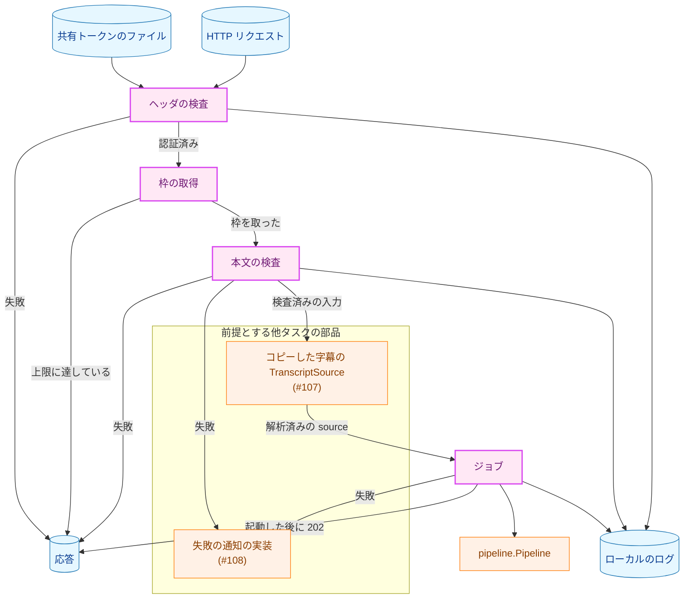
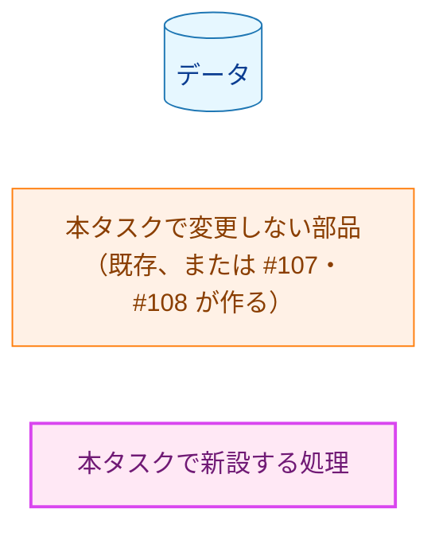
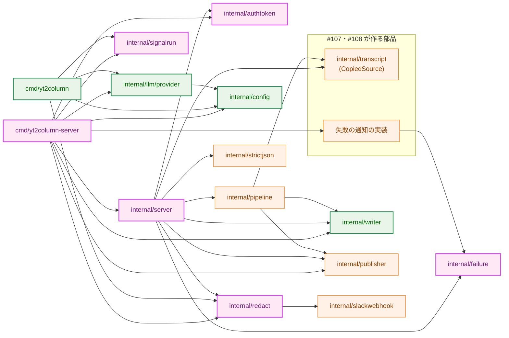
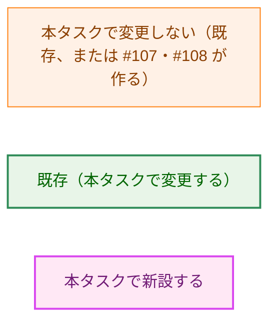
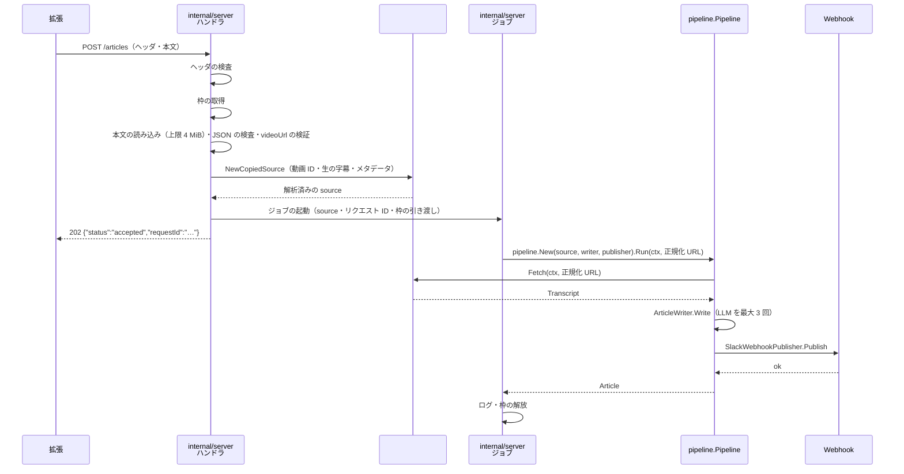
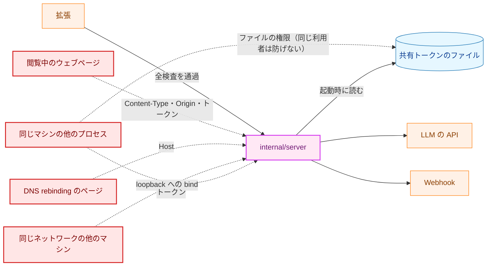
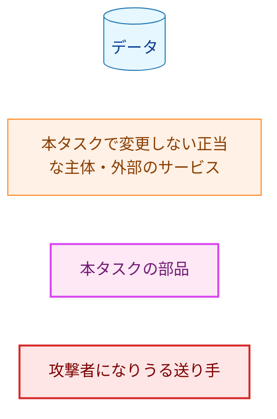
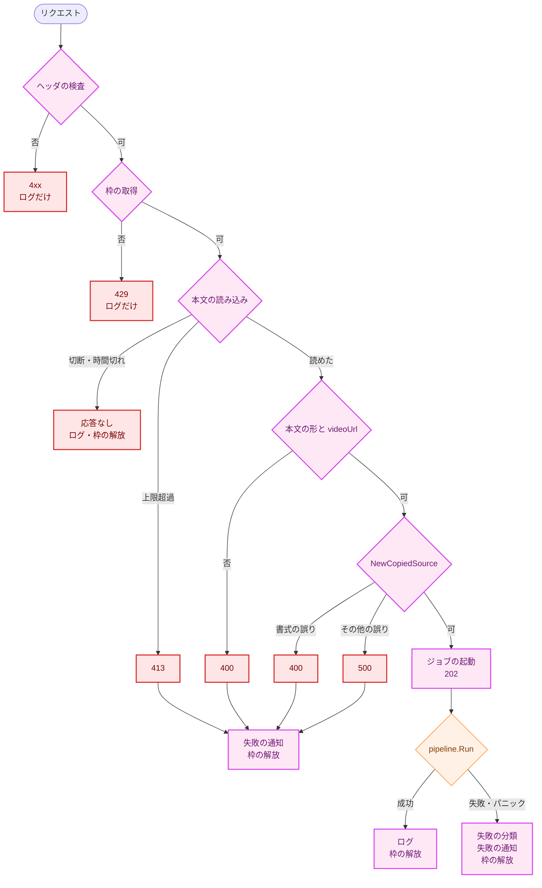
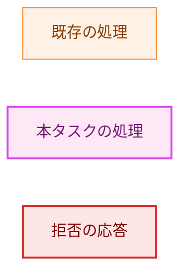
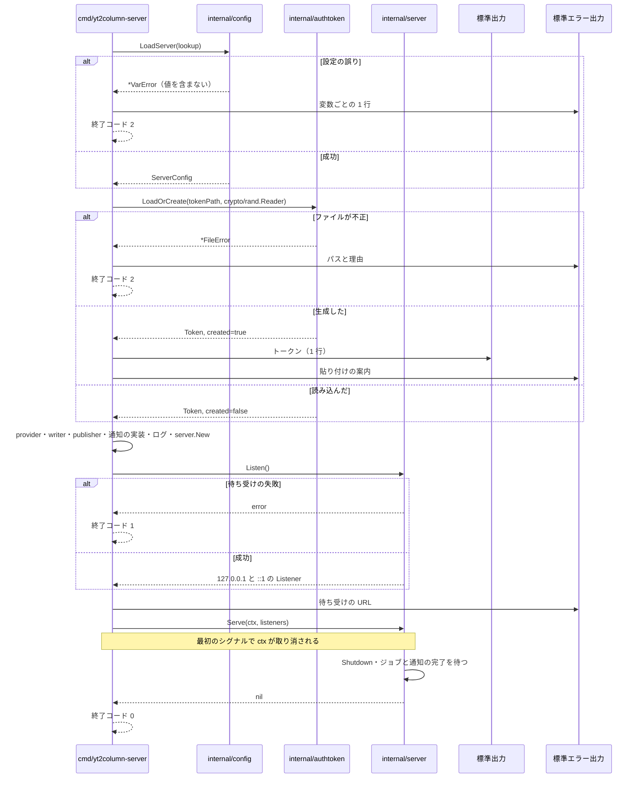

# アーキテクチャ設計書：localhost サーバ本体と拡張との HTTP API

## Document Status

| Item | Value |
|---|---|
| Status | `approved` |
| Created | 2026-10-13 |
| Review date | 2026-10-14 |
| Reviewer | isseis |
| Comments | 2026-10-14: §3.14 の「更新が必要な既存のテスト」で、`TestProjectOverviewDocumentsConfig` を現存するテストとして挙げていた記述を、削除済み（`4443ddf`）である事実に合わせた。決定は変えていない（editorial correction）。 |

本書の F-NNN・AC-NN は [01_requirements.md](01_requirements.md) の項番、H-NN は [design_handoff.md](design_handoff.md) の項目（対応は §3.13）を指す。既存のコードの行番号は、コミット `f768cdb`（要件の承認のコミット）で確かめたものである。

**用語。** 本書では、要件書の用語に加えて次の語を使う。

-   **サーバ:** 本タスクで作る実行ファイル `yt2column-server`（`cmd/yt2column-server`）と、その中心の `internal/server` を指す。CLI は `cmd/yt2column` を指す。
-   **ヘッダの検査:** 本文を読まずに行う検査（`Host`・パス・メソッド・`Content-Type`・`Origin`・共有トークン）の総称。順序は §3.5.2 の手順 1〜6 である。
-   **トークンの検査:** ヘッダの検査のうち、共有トークンを確かめる手順（§3.5.2 の手順 6）。
-   **認証済み:** ヘッダの検査をすべて通過したことを指す。
-   **枠:** 同時に処理するリクエストの数を数える単位（§3.8.2）。認証済みのリクエストは、本文を読む前に枠を 1 つ取り、そのリクエストの処理（本文の検査、ジョブ、失敗の通知）がすべて終わるまで持ち続ける。
-   **ジョブ:** `202` を返したリクエストについて、非同期で行う記事の生成と投稿。CLI の `internal/job` とは関係がない（サーバは `internal/job` を使わない。§1.3）。
-   **失敗の通知:** 認証済みのリクエストの失敗を Slack へ投稿すること（F-007）。記事の投稿（`Publisher`）と区別する。
-   **リクエスト ID:** サーバがリクエストごとに生成する、推測できない短い識別子。応答・ログ・失敗の通知に同じ値を載せ、三者を結び付ける（§3.4.2）。秘密ではない。
-   **拒否の理由:** 応答の本文の `reason` に載せる固定の値（§3.4.3）。
-   **拒否の詳細:** ログにだけ書く、拒否の理由をさらに分けた固定の値（§3.10）。応答には載せない。
-   **#107・#108・#111:** 本タスクが前提とする、または連携する別の issue。#107 はコピーした字幕のパーサと `TranscriptSource`、#108 は失敗を Slack へ投稿する仕組み、#111 は API に従って送信するブラウザ拡張の部分である（§1.3・§9）。
-   **タスク 0007:** ブラウザ拡張の骨格のタスク（`docs/tasks/0007_browser_extension_skeleton/`）。本書の「0007 §3.12.N」は、その設計書の節を指す。

## 1. 設計の全体像 (Design Overview)

### 1.1. 設計原則

1. **サーバは新しい実行ファイルとし、記事の生成と投稿は CLI と同じ部品で行う。** `internal/pipeline` の `Pipeline`、`internal/writer` の `ArticleWriter`、`internal/publisher` の `SlackWebhookPublisher` をそのまま使う（AC-20、要件 4.5）。サーバ固有のコードは、HTTP の受け口・ヘッダの検査・本文の検査・応答・ジョブの管理に限り、`internal/server` に置く。`cmd/yt2column-server` は部品を組み立てるだけにする。
2. **検査は安い順・信頼の低い順に並べ、副作用は最後に置く。** ヘッダの検査をすべて通過するまで本文を 1 バイトも読まず、ジョブも失敗の通知も始めない（AC-12・AC-17）。本文の検査をすべて通過するまで `202` を返さない（AC-18）。
3. **字幕の書式の誤りは同期的に返す。** 書式の検査（#107 のパーサ）は `202` の前に行い、誤りは `400` で返す（AC-11）。そのために、#107 の `TranscriptSource` には「構築の時点で解析し、`Fetch` は解析済みの `Transcript` を返す」形を求める（§3.7）。こうすれば、ジョブは既存の `pipeline.Pipeline.Run` をそのまま使え、失敗はパイプラインの段階（`pipeline.StageError`）で分類できる。
4. **拒否の理由と失敗の種類は型で表す。** 拒否の理由（§3.4.3）と失敗の種類（§3.9）は列挙型とし、エラーメッセージの文字列から推測しない（CLAUDE.md「Declare, don't infer」）。列挙型のゼロ値は「内部の誤り」「不明」とし、`switch` の `default` も同じ値に倒す。この値は `202` にも成功の投稿にもつながらない。
5. **受け取った値は補正しない。** 本文・`videoUrl`・字幕・ヘッダは、標準ライブラリが黙って直す形も含めて、合わなければ拒否する（CLAUDE.md「Reject, don't normalize」）。共有トークンのファイルも、権限・所有者・内容が合わなければ起動をやめ、修復も再生成もしない（AC-03）。
6. **秘密と字幕の本文は、応答・ログ・失敗の通知に流さない。** API キー・Webhook URL・共有トークンは `secret.Secret` で持つ。応答と失敗の通知は、固定の値（拒否の理由・失敗の種類・リクエスト ID・検査済みの動画 ID）だけで組み立て、エラーメッセージの文字列を載せない（AC-21・AC-24・AC-27）。ログは、書き出す直前で秘密を伏せ字にする `io.Writer`（`internal/redact`）を必ず通す。呼び出し側が伏せ字の処理を忘れても漏れない形にする（CLAUDE.md「Enforce invariants with the type」。§3.10）。
7. **設定の読み込みは入口ごとに分け、LLM の設定の規則は 1 か所に置く。** サーバは CLI 用の `config.Load` を使わず、`config.LoadServer` を使う。両者は LLM の設定を読む同じ関数を呼ぶ（§3.2、H-08）。
8. **CLI と共有できる部品は、`cmd/yt2column` から `internal/` へ移して共有する。** 伏せ字の処理とシグナルの扱いは、サーバも同じ契約を必要とするので、新しいパッケージへ移す（§3.11、CLAUDE.md「DRY」）。

### 1.2. 概念モデル

**図1 概念モデル**。矢印 A → B は「A の結果を B が受け取る」を表す。ラベルは受け渡す値または条件を示す。



**Legend**



「本文の検査」には、#107 の部品による字幕の書式の検査を含む（§3.5.2 の手順 12）。サーバは、ヘッダの検査に失敗したリクエストの本文を読まず、枠も取らず、失敗の通知もしない（AC-12・AC-17・AC-25）。枠を取れなかったリクエストも、失敗の通知をしない（§3.8.2）。

### 1.3. 既存コードとの関係

| 既存のもの | 本設計での扱い |
|---|---|
| `pipeline.Pipeline`・`pipeline.New`・`Run`（`internal/pipeline/pipeline.go:68-117`） | 変更しない。ジョブごとに `pipeline.New` で組み、`Run` を呼ぶ。失敗は `*pipeline.StageError`（`pipeline.go:50-66`）の段階で分類する（§3.9） |
| `transcript.TranscriptSource`（`internal/transcript/transcript.go:23-28`）・`transcript.Transcript`（同 `:13-21`） | 本タスクは変更しない（H-07）。#107 が実装を加えた（§3.7） |
| `transcript.ValidateVideoURL`（`internal/transcript/video_id.go:16-60`） | `videoUrl` の検証にそのまま使う（AC-09） |
| `writer.New`・`writer.ArticleWriter`（`internal/writer/writer.go:36-38`・`:101`） | サーバは CLI の既定と同じく、字数の調整と検証・推敲の段階を有効にし、組み込みのテンプレートで 1 つ構築して、すべてのジョブで共有する。`templateWriter` のフィールドは構築後に変わらず（`writer.go:86-88`）、LLM の adapter も並行に呼べる（`internal/llm/deepseek/deepseek.go:38-40`・`internal/llm/claude/claude.go:36-38`・`internal/llm/llmhttp/llmhttp.go:120-124`） |
| `writer` の非公開の番兵 `errPromptTooLarge`（`internal/writer/prompt.go:101-111`・`:122-125`） | 公開の `ErrPromptTooLarge` に改める。プロンプトの上限を超える字幕を、LLM の失敗と区別して通知するため（§3.9）。包む関係（`ErrInvalidTemplate` も包む）は変えない |
| `publisher.NewSlackWebhookPublisher`（`internal/publisher/slack.go:91`） | 変更しない。1 つ構築してすべてのジョブで共有する。フィールドは構築後に変わらない（`slack.go:76-77`） |
| `provider.New`・`provider.NewReview`（`internal/llm/provider/provider.go:30-40`） | 引数の型を `config.Config` から `config.LLMConfig` に変える（§3.2）。振る舞いは変えない |
| `config.Load`（`internal/config/config.go:204-222`） | 振る舞いを変えない。LLM の設定を読む部分を `loadLLM` に取り出し、新設の `LoadServer` と共有する（§3.2） |
| `config.Config`（`config.go:103-116`） | LLM の設定を新設の `config.LLMConfig` に分け、`Config` は非公開のフィールドで持ち、`LLM()` で返す（§3.2） |
| 既定のキャッシュディレクトリの導出（`internal/config/cachedir.go:14-47`） | OS ごとの分岐を、ディレクトリ名と XDG の変数名を引数に取る関数に一般化し、共有トークンのファイルを置く設定ディレクトリの導出と共有する（§3.2.3） |
| `strictjson.ParseObject`・`Object.Collect`・`RequiredString`（`internal/strictjson/strictjson.go:65-79`・`:82-98`・`:137-153`） | 本文の検査にそのまま使う（§3.6）。`OptionalString`（`:155-171`）は空文字列を拒否するので、任意のメンバには使わず `Value.AsString` を使う（AC-06） |
| `secret.Secret`（`internal/secret/secret.go`） | 共有トークンも `secret.Secret` で持つ。型は変更しない |
| `sanitize` ほか（`cmd/yt2column/output.go`）・`configuredSecrets`（`cmd/yt2column/run.go:663-682`） | `internal/redact` へ移し、CLI とサーバで共有する（§3.11） |
| `runWithSignals`・`subscribedSignals`・`reraiseQueued`（`cmd/yt2column/main.go:21-86`） | `internal/signalrun` へ移し、CLI とサーバで共有する（§3.11） |
| `internal/job` | 使わない。`job.Run` はキャッシュのロック・`yt-dlp`・キャッシュの掃除を含み（`internal/job/job.go:102-172`）、サーバの入力元と合わない（要件 2.3） |

**他のタスクの方針への例外。** 次の 2 つは、既存の設計書が定めた方針を、本タスクの要件に従って変える。

-   **入口は CLI だけとする前提を改める。** 方針の出典は [project_overview.md](../../dev/project_overview.md)「決定済みの方針」の「実行形式: ローカル実行の CLI」と、CLAUDE.md「Separation of Concerns」の「can later back a Slack bot or a scheduled job」である。本タスクは 2 つ目の入口として localhost サーバを加える（要件 F-010）。コアロジックを `cmd/` の外に置く方針はそのまま守る。この前提を確かめている既存のテストはない。文書は F-010 で更新する（§3.12）。
-   **`config.Config` から LLM の設定を分ける。** 方針の出典は、タスク 0005 の [02_architecture.md](../0005_cli_assembly/02_architecture.md)（`config.Load` が 1 つの `Config` を返し、`provider.New(cfg config.Config)` がそれを受け取る形）と、タスク 0009・0010 の同書（`newClient(provider, model, cfg config.Config, build)`）である。例外にするのは、サーバがキャッシュディレクトリと `yt-dlp` の設定を検査せずに LLM の設定を得る必要があるためである（要件 F-009、H-08）。`config.Load` の振る舞いは変えない。更新が必要な既存のテストは §3.14 に挙げる。

**前提とする他のタスクの部品と、依存の順序。** 要件 §5 は、#107（コピーした字幕のパーサと `TranscriptSource`）と #108（失敗を Slack へ投稿する仕組み）の完了を前提にする。本書の作成時（コミット `f768cdb`）はどちらもリポジトリになかった。現在（コミット `3a69896`）は #107 が実装済みで（`internal/transcript/copied.go` の `CopiedSource`・`CopiedInput` と `errors.go` の `ErrCopiedTranscriptFormat` が §3.7 の契約を満たす）、#108 は実装の途中である（`internal/publisher` に送信の経路 `webhookClient` はあるが、`Notifier` の実装はまだない）。本タスクが新設する `internal/failure` もまだない。本設計は、#107 に求めた契約を §3.7 に、#108 に求める契約を §3.9 に定める。

**契約を葉に固定し、依存を一方向にする。** #108 が本タスクの型に依存して見えるのは、契約（interface と型）と実装を分けていないためである。契約を葉として先に凍結すれば、#107・#108・サーバの依存は巡回しない。

| 段階 | 成果物 | 依存 |
|---|---|---|
| 0. 契約の凍結 | `internal/failure` の型（`Kind`・`Notice`・`Notifier`、§3.9）と、#107 の `CopiedInput`・`NewCopiedSource` の契約（§3.7） | なし（葉） |
| 1. 部品の実装 | #107 の `CopiedSource` と #108 の `Notifier` の実装（#107 は実装済み、#108 は実装中） | 段階 0 |
| 2. サーバの実装 | `internal/server` | 段階 0（型）・段階 1（#107 の実物。ただし §7.1 のとおり fake の `Notifier` を使うので、#108 の実物が要るのは統合テストだけ） |

-   段階 0 は本タスクの作業として最初に行う（§8 のフェーズ 1）。これにより、#108 は本タスクの「実装」ではなく「凍結した型」にだけ依存する。#107 と #108 は互いに依存しないので、段階 1 は並行してよい。
-   段階 2 のユニットテストは fake の `failure.Notifier` を使う（§7.1）。サーバの開発は #108 の実装を待たない。実物の通知が必要になるのは、統合テストと起動時の配線だけである（§8 のフェーズ 2 の手順 8）。
-   この契約は #107・#108 への要求であり、#107・#108 の issue に、本書の §3.7・§3.9 を参照する形で記録済みである。
-   `internal/failure` は `internal/server` の内部ではなく、独立した契約のパッケージとする（§2.1）。本タスクが新設するが、その型と interface は #108 とサーバの両方が従う仕様である。
-   #107 が別の形（たとえば `Fetch` の中で解析する形）で実装された場合も、AC-11 は守れる。サーバが `202` の前に `Fetch` を同期的に呼び、得た `Transcript` を返すだけの source でパイプラインを組めばよい。その場合は本書を改める（決定の変更として `draft` に戻す）。#107 は規定の形（`NewCopiedSource` の中で解析する形）で実装したので、この代替案は採らなかった。

## 2. システム構成 (System Structure)

### 2.1. パッケージ構成

**図2 本設計で新設・変更するパッケージと主な依存**。矢印 A → B は「A が B を import する」を表す。本設計に関わる import だけを示す。`internal/secret`・`internal/nilcheck` への import は省く。



**Legend**



-   `internal/server` は `internal/config` を import しない。設定の値は `cmd/yt2column-server` が `server.Options` に詰めて渡す（`config` が秘密の変数の名前を知る唯一のパッケージである状態を保つ。`config.go:1-3`）。
-   `internal/server` は失敗の通知の実装を import せず、`internal/failure` の interface だけに依存する。#108 の実装が `internal/publisher` に置かれても、`internal/server` → `internal/publisher` の import と循環しない。
-   `internal/redact` は `internal/config` を import しない。秘密の値は `secret.Secret` の列で受け取る（§3.11）。

### 2.2. コンポーネント配置

| コンポーネント | 配置 | 責務 |
|---|---|---|
| 起動・終了の手順 | `cmd/yt2column-server` | 設定の読み込み、共有トークンの読み込みと生成、部品の構築、待ち受け、シグナルによる終了、終了コード |
| 設定 | `internal/config` | `LoadServer`、`LLMConfig` の分離、待ち受けのポート、共有トークンのファイルのパスの導出 |
| 共有トークン | `internal/authtoken` | ファイルの読み込み・検査・生成、定数時間の比較 |
| 失敗の通知の型 | `internal/failure` | `Kind`・`Notice`・`Notifier`（§3.9） |
| HTTP の受け口 | `internal/server`（`server.go`） | `Options`・`New`・`Listen`・`Serve`、`http.Server` の設定、終了の手順 |
| ヘッダの検査と応答 | `internal/server`（`handler.go`・`response.go`） | 検査の順序、拒否の理由と状態コードの対応、応答の本文、リクエスト ID |
| 本文の検査 | `internal/server`（`request.go`） | サイズの上限、JSON の厳密な検査、必須・任意のメンバ、`videoUrl` の検証 |
| ジョブと枠 | `internal/server`（`job.go`） | 枠の取得と引き渡しと解放、`202` の後のパイプラインの実行、パニックの回収、失敗の分類と通知 |
| コピーした字幕の解析 | `internal/transcript`（#107） | 書式の検査と `Transcript` の構築（§3.7） |
| 失敗の通知の実装 | #108 | `failure.Notice` を固定の書式で Webhook へ投稿する（§3.9） |
| 伏せ字の処理 | `internal/redact` | CLI の 1 行の整形（`Line`）、ログの出力先の伏せ字（`Writer`）、伏せ字にする文字列の列挙（`SecretStrings`） |
| シグナルの扱い | `internal/signalrun` | 最初のシグナルで context を取り消し、2 つ目のシグナルで既定の動作（終了）に任せる |

### 2.3. データフロー（受理と成功）

**図3 受理されたリクエストのデータフロー**。実線の矢印 `->>` は呼び出しまたは送信を、点線の矢印 `-->>` は戻り値または応答を表す。自分自身への矢印は `internal/server` の内部の処理である。失敗の分岐は §6.1 の図5 に示す。



## 3. コンポーネント設計 (Component Design)

### 3.1. 実行ファイルと起動の手順

サーバは `cmd/yt2column-server` の新しい実行ファイル `yt2column-server` とする。`make build` は `build/yt2column` と `build/yt2column-server` の両方を作る（F-001）。サーバはフラグを受け取らない。引数があれば使い方の誤りとして終了する（設定は環境変数だけで与える。CLI と同じ方針）。

起動の手順は次のとおりで、手順 1〜4 のいずれかが失敗すると、待ち受けを開始せずに終了する。

1. **設定の読み込み**（`config.LoadServer`、§3.2）。拒否された変数ごとに 1 行を標準エラー出力に書き、終了コード 2 で終える。`config.VarError` は値を持たない（`config.go:82-99`）ので、値は出力に現れない（AC-29・AC-30）。`GODEBUG` が HTTP/2 のログを有効にしている場合は、API キーと Webhook URL がログに漏れうることを警告する（CLI の `cmd/yt2column/run.go:408-416` と同じ趣旨）。
2. **共有トークン**（`authtoken.LoadOrCreate`、§3.3）。ファイルが不正なら、パスと理由を標準エラー出力に書き、終了コード 2 で終える（AC-03）。生成した場合だけ、トークンを標準出力に 1 行で書き、貼り付けの案内を標準エラー出力に書く（AC-02）。
3. **部品の構築**。`provider.New`・`provider.NewReview`・`writer.New`（字数の調整と検証・推敲を有効、組み込みのテンプレート）・`publisher.NewSlackWebhookPublisher`・#108 の通知の実装・ログ（§3.10）・`server.New`。失敗すれば終了コード 2 で終える。`NewSlackWebhookPublisher` はネットワークに触れない（`slack.go:87-90`）。LLM の adapter の `New` は値を検査してクライアントを返すだけである（`deepseek.go:50-53`・`claude.go:50-53`）。
4. **待ち受け**（`Server.Listen`、§3.5.1）。`127.0.0.1:<ポート>` と `[::1]:<ポート>` の両方で待ち受ける。どちらかが失敗すれば（ポートの使用中、IPv6 の無効など）、開いたものを閉じて終了コード 1 で終える。成功したら、`cmd/yt2column-server` が待ち受けの URL（`http://127.0.0.1:<ポート>/articles` と `http://[::1]:<ポート>/articles`）をログに書く（F-001）。
5. **処理**（`Server.Serve`）。最初のシグナル（`SIGINT`・`SIGTERM`・`SIGHUP`）で新しい接続の受け付けをやめ、処理中のリクエストとジョブの完了を待ってから終了コード 0 で終える（§3.8.3）。2 つ目のシグナルは既定の動作でプロセスを終わらせる（`internal/signalrun` の契約。§3.11）。`Serve` が予期しないエラーで返った場合も、同じく処理中のジョブを待ってから終了コード 1 で終える。

手順 2 を手順 4 より前に置くのは、トークンを生成した後に待ち受けが失敗しても、トークンの表示が失われないようにするためである。トークンは 2 回目以降の起動で表示されないので（F-001）、表示を待ち受けの成功まで遅らせると、待ち受けに失敗した初回の起動では利用者がトークンを見る機会がなくなる。

**終了コード。** 0 は正常な終了（シグナルによる終了を含む）、1 は待ち受けまたは処理の失敗、2 は使い方・設定・共有トークンのファイル・部品の構築の誤り。分類は失敗した手順で決め、エラーメッセージの内容では決めない（CLI の `cmd/yt2column/run.go:27-34` と同じ方針）。

**標準出力と標準エラー出力。** 標準出力に書くのは、生成した共有トークンの 1 行だけである。ログ・案内・エラーはすべて標準エラー出力に書く。共有トークンがログの経路に流れないよう、出力先を分ける（H-02）。

**記事の生成の設定。** サーバの `writer.Options` は、CLI のフラグを何も指定しないときの値（字数の調整と検証・推敲を有効、組み込みのテンプレート）と同じにする。CLI の `buildWriter`（`run.go:357-393`）はフラグから組み立てるので共有しない。段階を加えるタスクは、両方の既定をそろえる必要がある。この点は `cmd/yt2column-server` のテストで、サーバの `writer.Options` が CLI の既定の解析結果と一致することを確かめて固定する（§7.1）。

### 3.2. 設定（`internal/config`、H-08）

#### 3.2.1. `LLMConfig` の分離と `LoadServer`

```go
// LLMConfig is the validated configuration of the generation and review LLM
// calls. Its fields are unexported, so a non-zero LLMConfig can only come from
// Load or LoadServer.
type LLMConfig struct {
	provider             Provider
	model                string
	reviewProvider       Provider
	reviewModel          string
	deepSeekAPIKey       secret.Secret
	anthropicAPIKey      secret.Secret
	claudeEffort         claudeparam.Effort
	anthropicWorkspaceID claudeparam.WorkspaceID
}

// Provider, Model, ReviewProvider, ReviewModel, DeepSeekAPIKey,
// AnthropicAPIKey, ClaudeEffort, and AnthropicWorkspaceID move from Config to
// LLMConfig unchanged.

// Config is the CLI configuration. Its fields are unexported, so a non-zero
// Config can only come from Load.
type Config struct {
	llm               LLMConfig
	slackWebhookURL   secret.Secret
	cacheDir          string
	ytDlpPath         string
	http2DebugEnabled bool
}

func (c Config) LLM() LLMConfig
// SlackWebhookURL, RequireSlackWebhookURL, CacheDir, YtDlpPath, and
// HTTP2DebugEnabled stay on Config unchanged.

// ServerConfig is the server configuration. Its fields are unexported, so a
// non-zero ServerConfig can only come from LoadServer. LoadServer never reads
// or checks YT2COLUMN_CACHE_DIR, YT2COLUMN_YTDLP_PATH, or the cache directory
// defaults.
type ServerConfig struct {
	llm               LLMConfig
	webhookURL        secret.Secret // always set
	port              uint16
	tokenPath         string        // absolute
	http2DebugEnabled bool
}

func LoadServer(lookup LookupFunc) (ServerConfig, error)

func (c ServerConfig) LLM() LLMConfig
func (c ServerConfig) WebhookURL() secret.Secret
func (c ServerConfig) Port() uint16
func (c ServerConfig) TokenPath() string
func (c ServerConfig) HTTP2DebugEnabled() bool
```

`internal/llm/provider` の関数は次の形にする。

```go
func New(cfg config.LLMConfig) (llm.LLMClient, error)
func NewReview(cfg config.LLMConfig) (llm.LLMClient, error)
```

-   `Load` と `LoadServer` は、プロバイダ・モデル・検証・推敲・プロバイダ固有の変数を読む同じ関数 `loadLLM` を呼ぶ。現在の `Load` の `loadProvider`・`loadModel`・`loadReview`・`loadProviderVars`（`config.go:206-211`）を、そのまま `loadLLM` にまとめる。規則（補正しない、空の値はエラー、選んだプロバイダに関係しない変数は検査しない）は変わらない（要件 F-009）。
-   `Load` の振る舞いは変えない。`Load` は従来どおり `SLACK_WEBHOOK_URL`（任意）・`YT2COLUMN_CACHE_DIR`・`YT2COLUMN_YTDLP_PATH` を検査する。
-   `LoadServer` は、`loadLLM`、`SLACK_WEBHOOK_URL`（必須）、`YT2COLUMN_SERVER_PORT`、共有トークンのファイルのパスを検査し、拒否をすべて `errors.Join` で返す。拒否が 1 つでもあればゼロ値の `ServerConfig` を返す（`Load` と同じ方針。`config.go:200-203`）。
-   `SLACK_WEBHOOK_URL` の検査は、既存の `loadSlackWebhook`（`config.go:405-422`）を、`*Config` に書き込む形から「値と、設定されていたかと、拒否」を返す形に改めて、`Load` と `LoadServer` で共有する。`LoadServer` は、未設定を `ErrMissing` の `*VarError` にする（AC-30）。
-   `Config` の LLM の設定は、非公開のフィールドに置いて `LLM()` で返す。埋め込みにすると `Config.LLMConfig` が外から代入できるフィールドになり、「非ゼロの `Config` は `Load` からしか来ない」（`config.go:101-102`）という型の保証が崩れるためである。その代わり、LLM のアクセサの呼び出し（`cfg.Provider()` → `cfg.LLM().Provider()`）を、`config_test.go`・`cmd/yt2column/run.go` などで書き換える（§3.14）。
-   `ServerConfig` の Webhook URL のアクセサは `WebhookURL()` とし、`Config.SlackWebhookURL()`（`(secret.Secret, bool)` を返す。`config.go:166-172`）と名前を分ける。サーバでは常に設定されているので、`bool` を返さない。

#### 3.2.2. 待ち受けのポート

| 項目 | 値 |
|---|---|
| 変数 | `YT2COLUMN_SERVER_PORT` |
| 未設定のとき | `8765` |
| 受理する形 | 10 進の数字だけからなり、先頭が `0` でない、`1024`〜`65535` の整数 |
| 拒否する例 | 空（`ErrMissing`）、`08765`・`+8765`・` 8765`・`8765 `・`0x2235`・`0`・`80`・`65536`（`ErrInvalid`） |

-   既定値を設けるのは、拡張（#111）にも同じ既定値を置けば、利用者が何も設定しなくても両者のポートが一致するためである。拡張に別のポートを設定する手段は #111 で決める。
-   `0`（OS が選ぶ空きポート）を拒否するのは、拡張がポートを知る手段がないためである。`1024` 未満を拒否するのは、サーバは一般の利用者の権限で動き、特権ポートを使う理由がないためである。
-   `internal/config` は `net` を import しない（`internal/pipeline/pipeline_test.go:817` の `TestConfigImports`）。数字の検査は `strconv` と文字の比較で行う。

#### 3.2.3. 共有トークンのファイルのパス

パスは `<設定ディレクトリ>/yt2column/server-token` とする。設定ディレクトリは、既定のキャッシュディレクトリ（`cachedir.go:14-37`）と同じく `os.User*Dir` の規則に従い、相対パスを拒否する。両者の OS ごとの分岐は、macOS のサブディレクトリ（`Library/Caches` と `Library/Application Support`）・XDG の変数名（`XDG_CACHE_HOME` と `XDG_CONFIG_HOME`）・XDG の既定（`.cache` と `.config`）を引数に取る 1 つの関数で共有する。`goos` を引数に取る形も `defaultCacheDir` と同じにし、OS ごとの結果をテストで固定する。

| OS | 設定ディレクトリ |
|---|---|
| macOS | `$HOME/Library/Application Support` |
| それ以外の Unix | `$XDG_CONFIG_HOME`（設定されていて空でなければ。相対パスなら導出できない）、なければ `$HOME/.config` |
| Windows など | 導出できない |

-   導出できない場合、`LoadServer` は、導出に失敗した変数の名前（`XDG_CONFIG_HOME` が相対パスなら `XDG_CONFIG_HOME`、それ以外は `HOME`）と固定の理由を持つ `*VarError` を返す。`XDG_CONFIG_HOME` が相対パスの場合は `ErrInvalid`、`HOME` が欠落・空・相対パスの場合は `ErrMissing` とする。
-   上書きの変数は設けない（YAGNI）。テストは `LookupFunc` で `HOME` を一時ディレクトリに向ける。
-   H-02 は `$XDG_CONFIG_HOME` を候補に挙げたが、macOS では `os.UserConfigDir` の規則（`Library/Application Support`）を採る。キャッシュディレクトリが macOS で `Library/Caches` を使う（`cachedir.go:16-21`）のと揃え、H-08 の問い「キャッシュディレクトリの導出と同じ規則で扱えるか」には、同じ規則で扱うと答える。

### 3.3. 共有トークン（`internal/authtoken`、H-02）

```go
// Token is the shared token that authenticates the extension. Its value is
// held as a secret.Secret, so printing a Token never shows the value. The zero
// value matches nothing.
type Token struct {
	value secret.Secret
}

// LoadOrCreate reads the token file at path, or creates it when it does not
// exist. created reports whether this call generated the token. random is the
// source of the token bytes; production passes crypto/rand.Reader.
func LoadOrCreate(path string, random io.Reader) (token Token, created bool, err error)

// Matches reports whether presented equals the token, in constant time with
// respect to the content of presented. It returns false for the zero Token
// and for an empty presented value.
func (t Token) Matches(presented string) bool

// IsZero reports whether t is the zero Token.
func (t Token) IsZero() bool

// Value returns the token as a secret.Secret, for the one-time display after
// creation and for the log redaction list.
func (t Token) Value() secret.Secret
```

| 項目 | 方針 |
|---|---|
| 生成 | `crypto/rand` の 32 バイト（256 ビット）を小文字の 16 進 64 文字で表す |
| ファイルの内容 | 小文字の 16 進 64 文字だけ。改行を含まない（サーバが書く形そのもの） |
| ファイルの作成 | 親ディレクトリがなければ `0700` で作る。同じディレクトリに一時ファイルを `O_CREATE|O_EXCL`・`0600` で作り、64 バイトを書いて `fsync` し、`link(2)` で `server-token` の名前を付けてから一時ファイルの名前を消す。`server-token` の名前が付いた時点で、ファイルは常に 64 バイトの完全な内容を持つ |
| 同時の初回起動 | `link(2)` が `EEXIST` で失敗したら、他方が先に作ったファイルを読み込みの規則で読む。上書きしない。他方のファイルは名前が付いた時点で完全なので、途中の内容を読むことはない |
| 読み込み | `O_RDONLY|O_NOFOLLOW|O_NONBLOCK` で開く。シンボリックリンクなら `ELOOP` で失敗し、FIFO でも開く処理が止まらない。開いたファイルを `fstat` し、通常ファイルであること、権限のうち所有者以外のビット（`0077`）が立っていないこと、所有者の UID が実行中のプロセスの UID と一致することを確かめる。同じファイル記述子から読み、ちょうど 64 バイトの後に EOF が来ること、内容が `^[0-9a-f]{64}$` に一致することを確かめる |
| 不正なファイル | `ErrInvalidTokenFile` を包む `*FileError`（パスと固定の理由）を返す。ファイルを修復も削除も再生成もしない（AC-03） |
| 比較 | リクエストの `Authorization` の値から `Bearer ` を除いた残りと、`crypto/subtle.ConstantTimeCompare` で比べる。長さが異なると即座に不一致になるが、長さ（64）は公開の仕様なので漏れて困る情報はない。ゼロ値の `Token` と空の値は、比べる前に不一致とする（空どうしが一致しないように） |
| 表示 | 生成した起動だけ、標準出力に 64 文字の 1 行を書く。2 回目以降は書かない。再び必要になったときにファイルを読む手順を README に記す（F-010） |

-   **末尾の改行を拒否する理由。** サーバが書く形は改行を含まない。改行の付いたファイルは、サーバ以外が書いたか編集したものであり、黙って受理すると「ファイルの内容」と「受理する値」が食い違う（CLAUDE.md「Reject, don't normalize」）。利用者がファイルを編集する手順は設けない。作り直す手順はファイルの削除だけである（F-001）。
-   **一時ファイルの残骸。** 作成の途中でプロセスが落ちると、一時ファイル（`server-token` とは別の名前）が残ることがある。読み込みは `server-token` だけを見るので、残骸は動作に影響しない。一時ファイルの名前は `server-token.tmp-<乱数>` とし、README に削除してよいことを記す。
-   **親ディレクトリの権限は検査しない。** 他の利用者がディレクトリに書けても、その利用者が置いたファイルは所有者の検査で拒否される。ディレクトリを作るときだけ `0700` にする。

### 3.4. HTTP API（H-03）

#### 3.4.1. エンドポイント

| 項目 | 値 |
|---|---|
| URL | `http://127.0.0.1:<ポート>/articles`（`[::1]` と `localhost` も受理する） |
| メソッド | `POST` だけ |
| リクエストのヘッダ | `Host`（loopback）、`Origin: chrome-extension://clfmbbcdpnjcefbdihdoahomaifbabkk`、`Authorization: Bearer <共有トークン>`、`Content-Type: application/json` |
| リクエストの本文 | 要件 F-002 の JSON のオブジェクト（`videoUrl`・`transcript`・`title`・`channelName`・`description`） |
| 応答の本文 | `application/json; charset=utf-8` の JSON（§3.4.2） |

-   **`Content-Type` は `application/json` と完全に一致するものだけを受理する。** `application/json; charset=utf-8` などの引数付きの形も拒否する。拡張（#111）は `fetch` で `Content-Type: application/json` を明示して送る。受理する形を 1 つに決めれば、引数の解釈の違いが入り込まない。
-   **CORS の応答ヘッダを返さない。** `OPTIONS` は `405` で拒否する。0007 §3.12.1 の観測では、`host_permissions` に `http://127.0.0.1/*` を宣言した拡張の `POST`（`application/json`）は、preflight なしで `Origin` 付きで届き、応答を読める。#111 は `host_permissions` を宣言する必要がある（§9）。
-   **パス `/articles` 以外は `404`。** API のバージョニングは要件 2.3 の対象外なので、パスに版を含めない。

#### 3.4.2. 応答の本文

```json
{"status":"accepted","requestId":"3f9a1c0b7d2e4a65"}
```

```json
{"status":"rejected","reason":"unauthorized","requestId":"3f9a1c0b7d2e4a65"}
```

-   応答の本文が持つのは `status`・`reason`・`requestId` の 3 つの固定のメンバだけである。値はすべてサーバが選んだ固定の文字列か、サーバが生成したリクエスト ID であり、リクエストから写した値を含まない（AC-21・AC-27・AC-28）。
-   リクエスト ID は、`crypto/rand` の 8 バイトを小文字の 16 進 16 文字で表す。ハンドラに届いたすべてのリクエスト（ヘッダの検査に失敗したものを含む）に生成し、応答・ログ・失敗の通知に同じ値を載せる。利用者は拡張に表示された ID でログと Slack の通知を探せる。
-   すべての応答に `Cache-Control: no-store` と `X-Content-Type-Options: nosniff` を付ける。

**ハンドラに届かない応答。** 次の応答は `net/http` が自ら返し、ハンドラは呼ばれない。そのため、リクエスト ID もログも持たない。該当するのは、ヘッダを解析できないリクエスト（`400`）、`MaxHeaderBytes` を超えるヘッダ（`431`）、`Host` ヘッダが複数あるリクエスト（`400`）、受理できない `Expect`（`417`）である。いずれも本文を読まず、副作用はない。`OPTIONS *` に `net/http` が自ら `200` を返す動作は、`http.Server.DisableGeneralOptionsHandler` で止め、ハンドラに届けて `Host` の検査から通す。

#### 3.4.3. 拒否の理由と状態コード

```go
// rejectReason is why a request was rejected. The zero value is
// reasonInternal: a reason that was never set is answered with 500, never with
// 202 or a 4xx that names a wrong cause.
type rejectReason int

const (
	reasonInternal rejectReason = iota
	reasonForbiddenHost
	reasonNotFound
	reasonMethodNotAllowed
	reasonUnsupportedMediaType
	reasonForbiddenOrigin
	reasonUnauthorized
	reasonTooManyRequests
	reasonBodyTooLarge
	reasonInvalidBody
	reasonInvalidVideoURL
	reasonInvalidTranscript
)
```

| 拒否の理由 | `reason` | 状態コード | 追加のヘッダ | 失敗の通知 | 主な AC |
|---|---|---|---|---|---|
| `Host` が loopback のホストでない | `forbidden_host` | 403 | `Connection: close` | しない | AC-14・AC-17 |
| パスが `/articles` でない | `not_found` | 404 | `Connection: close` | しない | - |
| メソッドが `POST` でない | `method_not_allowed` | 405 | `Allow: POST`・`Connection: close` | しない | AC-08・AC-17 |
| `Content-Type` が `application/json` でない | `unsupported_media_type` | 415 | `Connection: close` | しない | AC-08・AC-17 |
| `Origin` がない・一致しない | `forbidden_origin` | 403 | `Connection: close` | しない | AC-15・AC-17 |
| 共有トークンがない・誤っている | `unauthorized` | 401 | `WWW-Authenticate: Bearer`・`Connection: close` | しない | AC-16・AC-17 |
| 同時実行数が上限に達している | `too_many_requests` | 429 | `Connection: close` | しない（§3.8.2） | AC-22 |
| 本文がサイズの上限を超える | `body_too_large` | 413 | `Connection: close` | する | AC-12・AC-23 |
| 本文の形の不一致（無効な UTF-8、対になっていないサロゲートのエスケープ、JSON の構文、オブジェクトでない、末尾の余分な値、宣言したメンバの重複、必須メンバの欠落・型の不一致・空・空白のみ、任意メンバの型の不一致） | `invalid_body` | 400 | - | する | AC-05・AC-06・AC-10・AC-13 |
| `videoUrl` を受理しない | `invalid_video_url` | 400 | - | する | AC-09 |
| `transcript` が字幕の書式に合わない | `invalid_transcript` | 400 | - | する | AC-11 |
| 内部の誤り（枠を取る前） | `internal_error` | 500 | `Connection: close` | しない | AC-28 |
| 内部の誤り（枠を取った後。#107 の部品が書式の誤り以外のエラーを返した場合など） | `internal_error` | 500 | - | する（`failure.KindInternal`） | AC-28 |

-   **失敗の通知の規則は 1 つである。** 枠を取った後の拒否はすべて通知し、枠を取る前の拒否は通知しない。枠を取れたことが、認証済みであることと、通知に使う資源を確保できたことの両方を表すためである。
-   **トークンの不一致を `401`、`Host`・`Origin` の不一致を `403` にする。** H-03 は 3 つとも `403` を候補にした。拡張（#111）が「トークンを貼り直す」案内と「その他の拒否」を出し分けられるよう、状態コードでも区別する。
-   **サイズの超過を `413` にする。** H-03 は `400` と `413` を候補にした。意味が一致する `413` を採る。
-   **`Content-Type` の検査はトークンの検査の前に置く。** 要件 F-007 が `Content-Type` の検査を「認証前」の検査として扱っているのに合わせる。どちらが先でも副作用は生じない。

### 3.5. 待ち受け・検査の順序・本文の読み込み（H-01）

#### 3.5.1. `internal/server` の公開の型と `http.Server` の設定

```go
// Options configures a Server. Every field is required.
type Options struct {
	Port      uint16 // the listening port, also used by the Host check
	Token     authtoken.Token
	Writer    writer.ArticleWriter
	Publisher publisher.Publisher
	Notifier  failure.Notifier
	LogOutput io.Writer // usually os.Stderr; New wraps it in redact.Writer
	Secrets   []string  // from redact.SecretStrings; redacted from every log line
}

// New validates opts and returns a Server. It rejects a nil collaborator
// (a typed nil included), a zero Token, and a zero Port with an error
// wrapping ErrInvalidOptions. It builds the slog logger and the
// http.Server ErrorLog itself, both writing through
// redact.Writer(opts.LogOutput, opts.Secrets), so no log path can bypass the
// redaction.
func New(opts Options) (*Server, error)

// Listen opens one listener on 127.0.0.1 and one on ::1, both on opts.Port.
// When either fails, it closes the one it opened and returns the error.
func (s *Server) Listen() ([]net.Listener, error)

// Serve serves on listeners until ctx is canceled or a listener fails, then
// stops accepting connections, waits for in-flight requests, jobs, and
// failure notices, and returns. It returns nil after a cancellation and the
// listener error otherwise.
func (s *Server) Serve(ctx context.Context, listeners []net.Listener) error

var ErrInvalidOptions = errors.New("invalid server options")
```

-   ポートは `Options.Port` の 1 か所だけに置く。`Listen` も `Host` の検査も同じ値を使うので、待ち受けのポートと検査のポートが食い違わない。テストは `127.0.0.1:0` の `net.Listener` を自分で作り、得たポートを `Options.Port` に入れて `Serve` に渡す（§7.1）。
-   `Listen` は `127.0.0.1` と `::1` だけで待ち受ける。`0.0.0.0`・`::`・ホスト名で待ち受けない（AC-01）。1 つの `http.Server` が 2 つの `net.Listener` で `Serve` する。

| `http.Server` の設定 | 値 | 理由 |
|---|---|---|
| `Handler` | サーバのハンドラそのもの（`http.ServeMux` を使わない） | `ServeMux` はパスの整理やリダイレクトを `Host` の検査より前に行う。検査の順序（§3.5.2）をハンドラだけで決める |
| `ReadHeaderTimeout` | 5 秒 | ヘッダを送り終えない接続を切る |
| `ReadTimeout` | 30 秒 | loopback で 4 MiB の本文を読むには十分。本文を送り終えない接続を切る |
| `WriteTimeout` | 60 秒 | `net/http` の HTTP/1.1 では、この期限はヘッダを読み終えた時点から数えるので、本文の読み込み（最大 30 秒）・本文の検査・#107 の解析・応答の書き込みのすべてを含む。`ReadTimeout` に解析と書き込みの余裕を加えた値にする |
| `IdleTimeout` | 60 秒 | keep-alive の接続を残しすぎない |
| `MaxHeaderBytes` | 64 KiB | 既定の 1 MiB より小さくする。正当なヘッダは数百バイトである |
| `DisableGeneralOptionsHandler` | `true` | `OPTIONS *` もハンドラで検査する（§3.4.2） |
| `ErrorLog` | `server.New` が `redact.Writer` の上に作るロガー（`slog` のロガーと同じ出力先） | `net/http` 自身のログ（ハンドラのパニックなど）も伏せ字の処理を通す |
| HTTP/2 | 使わない（平文の HTTP/1.1 だけ） | TLS を使わず、h2c も設定しない |

`net/http` は同じリクエストに `Host` ヘッダが複数あると `400` で拒否する。ほかのヘッダ（`Origin`・`Authorization`・`Content-Type`）は、サーバが `Header.Values` で数を確かめ、ちょうど 1 つでなければ拒否する（値の取り違えを避ける。CLAUDE.md「Reject, don't normalize」）。

#### 3.5.2. 検査の順序

ハンドラは次の順に検査し、最初に失敗した検査の理由で拒否する。手順 1〜7 は本文に触れない。

| 順 | 検査 | 失敗時の理由 |
|---|---|---|
| 1 | `Request.Host` が `127.0.0.1:<ポート>`・`[::1]:<ポート>`・`localhost:<ポート>` のいずれかと完全に一致する（大文字・小文字を区別する。ポートの省略を許さない） | `forbidden_host` |
| 2 | `Request.RequestURI`（デコード前のリクエストの対象）が `/articles` と完全に一致する（`/%61rticles` のような符号化した形も、クエリも許さない） | `not_found` |
| 3 | メソッドが `POST` | `method_not_allowed` |
| 4 | `Content-Type` がちょうど 1 つで、`application/json` と完全に一致する | `unsupported_media_type` |
| 5 | `Origin` がちょうど 1 つで、`chrome-extension://clfmbbcdpnjcefbdihdoahomaifbabkk` と完全に一致する | `forbidden_origin` |
| 6 | `Authorization` がちょうど 1 つで、`Bearer ` で始まり、残りが共有トークンと一致する（`Token.Matches`） | `unauthorized` |
| 7 | 枠を取れる（§3.8.2） | `too_many_requests` |
| 8 | `Content-Length` が示されていれば、上限（4 MiB）以下 | `body_too_large` |
| 9 | 本文を `http.MaxBytesReader`（上限 4 MiB）を通して読み切れる | `body_too_large` |
| 10 | 本文の形（§3.6 の (a)〜(d)） | `invalid_body` |
| 11 | `transcript.ValidateVideoURL(videoUrl)` が成功する（§3.6 の (e)） | `invalid_video_url` |
| 12 | `transcript.NewCopiedSource` が成功する（§3.7） | `invalid_transcript`（書式の誤り）・`internal_error`（その他） |

手順 1 をパスの検査より前に置くのは、DNS rebinding で到達したページに、`404` と `405` の違いからパスの有無を探らせないためである。

手順 1〜7 で拒否する応答には `Connection: close` を付ける。ハンドラが本文を読まずに返ると、`net/http` は接続を再利用するために本文の一部（最大 256 KiB）を読み捨てることがある。`Connection: close` を付けると接続を閉じるので、読み捨てが起きない（H-01）。`Expect: 100-continue` を付けたリクエストには、ハンドラが本文を読むまで `net/http` が `100 Continue` を送らないので、拒否したリクエストの送り手は本文を送らない。

送り手が大きな本文を送っている途中でサーバが接続を閉じると、送り手は `4xx` を受け取れず、接続の切断（ブラウザでは `Failed to fetch`）として見ることがある。拡張（#111）は、ネットワークの誤りを「結果が分からない」として扱う（§9）。

#### 3.5.3. 本文のサイズの上限

上限は **4 MiB（4,194,304 バイト）** とする（`maxBodyBytes`）。

-   **プロンプトの上限との整合。** 記事の生成に使える字幕の大きさを決めるのは、`internal/writer` のプロンプトの上限 1 MiB（`internal/writer/prompt.go:14` の `maxPromptBytes`）である。本文の上限は、プロンプトに収まる字幕を含むリクエストを拒否しない大きさにする。生の字幕は時刻の行を含むので、解析後の字幕のテキストより大きい。時刻の行（`12:34` と改行で 6 バイト程度）が字幕のテキストの行（数十バイト）ごとに 1 つ付くとしても、増える割合は 3 割に満たない。さらに、拡張がすべての非 ASCII の文字を `\uXXXX` でエスケープした場合、UTF-8 で 3 バイトの文字が 6 バイトになり、最大で 2 倍になる。1 MiB × 2 × 1.3 ≒ 2.6 MiB にメタデータを加えても 4 MiB に収まる。上限以内でもプロンプトの上限を超える字幕は、ジョブの中で `ArticleWriter` が `ErrPromptTooLarge` で拒否し、「字幕が長すぎる」として通知する（§3.9）。
-   **#107 のパーサの入力の大きさ。** パーサに渡す生の字幕は本文の一部なので、その大きさは本文の上限（4 MiB）で抑えられる。#107 には、この大きさの入力を入力の長さに比例する時間とメモリで解析することを求める（§3.7）。
-   **この上限の役目は、メモリの使用量を抑えることである。** 本文は `strictjson.ParseObject` のために全体をメモリに置く。1 件のリクエストは、本文・デコーダの作業領域・取り出したメンバの写し・解析後の字幕を同時に持つので、本文の数倍のメモリを使う。上限 4 MiB と同時実行数の上限 2（§3.8.2）で、合計は数十 MiB に収まる。この大きさでは仕組みを加える必要はない（CLAUDE.md「Performance」）。
-   **`Content-Length` と `MaxBytesReader` の両方を使う。** `Content-Length` が上限を超えるリクエストは読まずに拒否する（手順 8）。`Content-Length` のない（チャンク転送の）リクエストもあるので、`MaxBytesReader` は省略しない（手順 9）。上限の超過を示すエラー（`*http.MaxBytesError`）は `body_too_large` として扱う。それ以外の読み込みの失敗（接続の切断、`ReadTimeout`）では、応答を書かずに枠を解放して終える。この場合はログに記録し、失敗の通知はしない（§4.3）。

### 3.6. 本文の検査とリクエストの型（H-07）

本文の検査は、#107 の `transcript.CopiedInput`（§3.7）を直接作る。サーバ独自のリクエストの型は設けない。検査は次の順に行う。

-   (a) `strictjson.ParseObject` で、本文全体の UTF-8 の正しさ、対になっていないサロゲートのエスケープがないこと、トップレベルがちょうど 1 つのオブジェクトで末尾に余分な値がないことを確かめる（`strictjson.go:65-79`）。これらの検査は宣言していないメンバの中にも及ぶ（AC-13）。入れ子の深さには `encoding/json` の上限がある。
-   (b) `Object.Collect("videoUrl", "transcript", "title", "channelName", "description")` で、宣言したメンバを取り出す。宣言したメンバの重複は拒否し、宣言していないメンバは値の種類を問わず無視する（`strictjson.go:82-98`、AC-07）。
-   (c) `strictjson.RequiredString` で `videoUrl` と `transcript` を取り出す。欠落・`null`・文字列以外・空文字列を拒否する（`strictjson.go:137-153`）。さらに、`strings.TrimSpace` の結果が空なら拒否する（空白のみ。AC-05・AC-10）。値そのものは補正せずに保持する。
-   (d) `title`・`channelName`・`description` は、存在すれば `Value.AsString` で取り出す。`null` と文字列以外を拒否し、空文字列は受理する（AC-06）。欠落なら空文字列とする。`strictjson.OptionalString` は空文字列を拒否する（`strictjson.go:155-171`）ので使わない。
-   (e) `transcript.ValidateVideoURL(videoUrl)` で動画 ID を導出する。リクエストの URL の文字列は以後使わない。`Transcript.VideoURL` は #107 の部品が動画 ID から導出する（§3.7、AC-19）。

`strictjson` のエラーは非公開の番兵を包んでいる。サーバは、(a)〜(d) のどのエラーも `reasonInvalidBody` に、(e) のエラーを `reasonInvalidVideoURL` に対応させる。対応は呼び出した手順で決め、エラーの内容で分けない（CLAUDE.md「Declare, don't infer」）。

**`transcript.Transcript` を使わない理由（H-07）。** リクエストは生の字幕を持ち、`Transcript` は解析済みの `Segments` を持つ。リクエストの型に `Transcript` を使うと、生の字幕のための欄を `Transcript` に加える必要があり、`internal/pipeline/pipeline_test.go:378` の `TestCommonTypesFieldSets` の更新と、パイプラインのすべての段階への影響が生じる。`CopiedInput` を使えば、`Transcript` と `Segment` は変わらない（要件 §5）。

### 3.7. #107 の `TranscriptSource` の使い方（H-04）

本設計は、#107 に次の契約を求めた。名前は #107 で変えてよいが、下表の性質は変えない。#107（タスク 0015）はこれを実装済みで、名前も下表のままである（`internal/transcript/copied.go`・`errors.go`）。

```go
// CopiedInput is the input of a CopiedSource. VideoID must already be
// validated by the caller (for the server, by transcript.ValidateVideoURL).
type CopiedInput struct {
	VideoID     string
	Raw         string // the copied transcript text, unmodified
	Title       string
	ChannelName string
	Description string
}

// NewCopiedSource parses in.Raw and returns a source that serves the parsed
// transcript. A format error wraps ErrCopiedTranscriptFormat.
func NewCopiedSource(in CopiedInput) (*CopiedSource, error)

// Fetch returns the parsed transcript when videoURL is the normalized URL of
// in.VideoID, and an error otherwise.
func (s *CopiedSource) Fetch(ctx context.Context, videoURL string) (Transcript, error)

var ErrCopiedTranscriptFormat = errors.New("copied transcript does not match the expected format")
```

| 性質 | 理由 |
|---|---|
| 解析は `NewCopiedSource` の中で行い、`Fetch` は解析済みの値を返す | 書式の誤りを `202` の前に `400` で返すため（AC-11）。ジョブは既存の `pipeline.Run` をそのまま使える |
| 解析の時間とメモリは入力の長さに比例する。4 MiB の入力で確かめる | 解析は枠を持ったまま、`WriteTimeout`（§3.5.1）の中で同期的に行われる |
| `Transcript.VideoURL` は `VideoID` から `transcript.NormalizedVideoURL` で導出し、`Fetch` は引数の URL が一致するときだけ返す | AC-19。サーバはリクエストの URL の文字列を渡さない。`writer` の `validateTranscript`（`internal/writer/prompt.go:50-58`）も同じ一致を確かめるので、二重の防御になる |
| `Title`・`ChannelName`・`Description` は `CopiedInput` の値をそのまま `Transcript` に入れる | AC-06・F-005。メタデータは #107 の部品を通して詰め、サーバが `Transcript` を組み立てる箇所を作らない |
| 書式の誤りのエラーは `ErrCopiedTranscriptFormat` を包み、メッセージに入力の文字列を含めない（行番号まではよい） | AC-24・要件 4.2。サーバはこのエラーをログに書く（§3.10） |
| 書式の検査は補正しない | AC-11 |
| 1 つの source は 1 つのジョブだけが使う | サーバはリクエストごとに source を作る。`Fetch` の並行の呼び出しを考えなくてよい |

サーバは、`NewCopiedSource` のエラーのうち `ErrCopiedTranscriptFormat` を包むもの（`errors.Is`）を `reasonInvalidTranscript` に、それ以外を `reasonInternal` に対応させる。

### 3.8. ジョブと同時実行数（H-05・H-06）

#### 3.8.1. ジョブ

-   `202` を返す前にジョブの goroutine を起動し、起動した後に `202` を書く。ジョブは `pipeline.New(source, writer, publisher)` で組んだパイプラインの `Run(ctx, 正規化 URL)` を呼ぶ。
-   **`202` が届かなくてもジョブは続ける。** `202` の書き込みが失敗した場合（送り手が接続を切った、`WriteTimeout` を過ぎた）も、ジョブは取り消さない。利用者から見ると、記事は「送った回数以上」に生成されうる。拡張（#111）は、ネットワークの誤りの後に自動で再送しない（§9）。`202` の書き込みの結果は、リクエスト ID とともにログに書く（§3.10）。
-   ジョブの context は、リクエストの context ではなく、`Server` が持つジョブ用の context（`context.Background` から作る）から作る。リクエストの context は `202` を書いた時点で終わるためである。各 LLM の呼び出しは `provider.LLMTimeout`（15 分。`provider.go:20`）で、記事の投稿は各メッセージの `publisher.SlackPostTimeout`（30 秒。`slack.go:23`）で上限がかかる。失敗の通知はサーバが 60 秒の上限をかける（§3.9）。そのためジョブは有限の時間で終わる。最悪の場合の目安は、LLM の 3 回の呼び出しで 45 分、投稿でメッセージごとに 31 秒、失敗の通知で 60 秒である。
-   成功したジョブは、リクエスト ID・動画 ID・投稿したメッセージ数・モデルをログに書く。

#### 3.8.2. 枠

```go
// maxInFlight bounds the authenticated requests in progress: from the body
// read through the end of the job or of the failure notice.
const maxInFlight = 2
```

-   枠はバッファ付きチャネルで数える。§3.5.2 の手順 7 で非ブロッキングに取り、取れなければ待たずに `429` を返す（AC-22、要件 2.3 の「待ち行列を設けない」）。
-   **上限を 2 にする理由。** 利用者は 1 人で、1 本の記事に数十秒から数分かかる。1 本目の処理中にもう 1 本を送ることは想定するが、それ以上並行させても、LLM の料金と Webhook の流量が増えるだけで利点が小さい。
-   **未認証のリクエストは枠を取らない。** ヘッダの検査はメモリも時間もほとんど使わない。未認証のリクエストの数は `http.Server` のタイムアウトとヘッダの大きさの上限で抑える（§3.5.1）。
-   **`429` の失敗は通知しない。** 要件 F-007 の対象の列挙（入力の拒否・LLM の失敗・投稿の失敗）に含まれない。通知すれば、上限で抑えたいはずの Webhook の投稿を、上限を超えたリクエストの数だけ増やすことになる。拡張は `429` の応答を表示できる。
-   **状態コードを `429` にし、`Retry-After` を付けない（H-06）。** 原因は利用者自身のリクエストの数であり、サーバの障害ではないので、`503` より `429` が合う。いつ枠が空くかは LLM の応答時間に依存して予測できないので、`Retry-After` は付けない。

#### 3.8.3. 終了

`Server.Serve(ctx, listeners)` は、`ctx` が取り消されるか、いずれかの `net.Listener` が予期しないエラーで止まると、次の順に終える。

1. `http.Server.Shutdown` で新しい接続の受け付けをやめ、処理中のハンドラ（応答を書き終えるまで）の完了を待つ。`Shutdown` には、取り消された `ctx` ではなく、取り消されていない context を渡す（取り消された context を渡すと `Shutdown` は待たずに返る）。ハンドラは `WriteTimeout`（60 秒）までに終わるので、待つ時間は有限である。
2. 処理中のジョブと失敗の通知の完了を待つ。ジョブの context は取り消さない。待っている件数と、最悪の場合の目安（§3.8.1）をログに書き、「もう一度シグナルを送ると直ちに終了する」と案内する。
3. すべて終わったら返る。

ジョブを取り消さずに待つのは、取り消すと生成中の記事が失われ、その失敗の通知も（取り消された context では）送れないためである。待つ時間は長くなりうるので、2 つ目のシグナルで直ちに終われるようにする（§3.11 の `internal/signalrun` の契約）。2 つ目のシグナルで終えた場合、処理中のジョブの記事も失敗の通知も送られない。そのことはログの案内で事前に示す。待っている間は待ち受けを閉じているので、新しいサーバを同じポートで起動できる。

#### 3.8.4. 並行処理の不変条件

次の性質を設計の要求とし、テストで固定する（§7.1）。

1. **枠を解放するのは、ちょうど 1 つの持ち主である。** 枠はハンドラが取る。ジョブまたは失敗の通知の goroutine を起動するとき、ハンドラは枠の持ち主をその goroutine に明示的に移し、以後は解放しない。goroutine を起動しなかった場合（本文の読み込みの失敗など）だけ、ハンドラが解放する。ハンドラ自身も、枠を取った後の処理で `recover` する。持ち主を移す前のパニックは、枠を取った後の内部の誤り（`500` と `failure.KindInternal` の通知。§3.4.3）として扱う。応答を書かずに接続を閉じる `net/http` のパニックの回収には任せない。
2. **サーバが起動するすべての goroutine はパニックを回収する。** ジョブの goroutine と失敗の通知の goroutine の両方で `recover` する。回収したパニックはログ（スタックトレースを含む）に書き、ジョブでは `failure.KindInternal` で通知する。失敗の通知の goroutine のパニックはログにだけ書く。回収しないと、1 つの goroutine のパニックでプロセスが終わり、処理中の他のジョブも失われる（要件 4.3）。
3. **ジョブと失敗の通知の件数は、ハンドラが返る前に同期的に加算する。** ハンドラは goroutine を起動する前に、終了の手順 2 が待つ数を増やす。そのため、`Shutdown` がハンドラの完了を待ち終えた時点で、待つべきジョブはすべて数えられている。
4. **`Shutdown` は取り消されていない context で呼ぶ**（§3.8.3 の手順 1）。
5. **一方の `net.Listener` が止まったら、もう一方も止める。** IPv4 だけ、IPv6 だけで動き続けない。終了の手順に入り、`Serve` はエラーを返す（終了コード 1。§3.1）。

### 3.9. 失敗の通知（`internal/failure` と #108）

失敗の通知の型は、本タスクが `internal/failure` に新設する。#108 は `Notifier` を実装する。

```go
// Kind classifies a failed authenticated request. The zero value is
// KindUnknown.
type Kind int

const (
	KindUnknown Kind = iota
	KindBodyTooLarge
	KindInvalidBody
	KindInvalidVideoURL
	KindInvalidTranscript
	KindTranscriptTooLong // the prompt built from the transcript exceeds the limit
	KindLLMTimeout
	KindLLMEmpty
	KindLLMTruncated
	KindLLM     // any other failure of an LLM call in the write stage
	KindPublish // the article post failed, possibly after some messages
	KindInternal
)

// Notice is everything a failure post may contain. Every field is chosen or
// generated by the server; none is copied from the request.
type Notice struct {
	RequestID string
	VideoID   string // validated; "" when no video ID was derived
	Kind      Kind
}

// Notifier posts a Notice.
type Notifier interface {
	Notify(ctx context.Context, n Notice) error
}
```

本設計は、#108 の `Notifier` の実装に次の性質を求める。

| 性質 | 理由 |
|---|---|
| 通知の文面は `Kind` ごとの固定の文と、`RequestID`・`VideoID`（あれば正規化 URL）だけで組み立てる。`KindUnknown` と未知の値にも固定の文を使う | AC-24。エラーメッセージの文字列・スタックトレース・パスを載せる欄がない |
| 投稿は記事と同じ Webhook へ、`SlackWebhookPublisher` と同じ送信の性質（`silent`、リダイレクトを辿らない、URL をエラーに含めない）で行う | 対象の環境（Mattermost）で確かめ済みの送信の経路を使い、新しい外部の機能を使わない |
| `ctx` に頼らず、自分で送信の時間の上限（30 秒以下）を持ち、上限を過ぎたらエラーを返す。再試行しない | 通知が終わらないと枠が解放されず、2 件で全リクエストが `429` になる |

**サーバ側の上限。** サーバは、`Notify` を呼ぶ context に 60 秒の期限を付ける（#108 の上限に重ねる防御）。

**失敗の分類。** サーバは、失敗の種類を次の表で決める。表は上から順に当てはめ、最初に一致した行を採る。判定は手順と `errors.Is`・`errors.AsType` だけで行い、エラーメッセージを見ない。

| 条件 | `failure.Kind` |
|---|---|
| `reasonBodyTooLarge` で拒否 | `KindBodyTooLarge` |
| `reasonInvalidBody` で拒否 | `KindInvalidBody` |
| `reasonInvalidVideoURL` で拒否 | `KindInvalidVideoURL` |
| `reasonInvalidTranscript` で拒否 | `KindInvalidTranscript` |
| 枠を取った後の `reasonInternal`、またはジョブのパニック | `KindInternal` |
| `*pipeline.StageError` の `Stage` が `StageWrite` で、`writer.ErrPromptTooLarge` を包む | `KindTranscriptTooLong` |
| 同じく `StageWrite` で、`context.DeadlineExceeded` を包む | `KindLLMTimeout` |
| 同じく `StageWrite` で、`llm.ErrEmptyResponse` を包む | `KindLLMEmpty` |
| 同じく `StageWrite` で、`llm.ErrTruncated` を包む | `KindLLMTruncated` |
| 同じく `StageWrite` で、`writer.ErrInvalidTranscript` または `writer.ErrInvalidTemplate` を包む（組み込みのテンプレートと検査済みの `Transcript` では起きないはずの誤り） | `KindInternal` |
| 同じく `StageWrite`（その他。`writer.ErrMalformedOutput`・`writer.ErrTooLong` などを含む） | `KindLLM` |
| `StagePublish` | `KindPublish` |
| `StageTranscript`（解析済みの source の `Fetch` が失敗した。URL の不一致など） | `KindInternal` |
| 上のいずれでもない（`pipeline.Run` が段階の間で返す `ctx.Err()`。ジョブの context は取り消さないので通常は起きない） | `KindUnknown` |

-   `rejectReason` から `failure.Kind` への対応は、1 つの網羅的な `switch` で行い、すべての `rejectReason` の値についてテストする。2 つの列挙型を手で同期させる箇所を 1 つにする。枠を取る前にしか生じない理由（`reasonForbiddenHost` から `reasonTooManyRequests` まで）は `KindUnknown` に対応させるが、この値は使われない。
-   **通知するかどうかは `Kind` の値では決めず、呼び出す場所で決める。** 通知するのは、枠を取った後の拒否（§3.4.3）と、ジョブの失敗だけである。枠を取る前の拒否と本文の読み込みの失敗では、`Kind` を求めず、通知の処理を呼ばない。`reasonInternal` は枠の前後のどちらでも生じるが、通知するかは枠を持っているかで決まる。
-   `ErrPromptTooLarge` を `ErrInvalidTemplate` より先に判定するのは、`writer` がプロンプトの上限の超過を両方の番兵で包む（`prompt.go:122-125`）ためである。
-   通知は、ジョブの失敗ではジョブの goroutine の中で、本文の検査の失敗では応答を書いた後に別の goroutine で行う。どちらも枠を持ったまま行う（§3.8.4）。応答を通知の完了まで待たせない。
-   `Notify` がエラーを返した場合、サーバはそのエラーをログに書いて動作を続ける（AC-26）。再試行はしない。
-   記事の投稿が途中で失敗した場合（`*publisher.SlackPostError`。一部のメッセージだけが投稿された状態）も `KindPublish` で通知する。成功として扱わない（要件 4.3）。チャンネルに残ったメッセージの数はログに書く。

### 3.10. ログ

ログは `log/slog` のテキスト形式で標準エラー出力に書く。`server.New` が `Options.LogOutput`（標準エラー出力）を `redact.Writer(LogOutput, Secrets)` で包み、その上に `slog` のロガーと `ErrorLog` を作る（§3.5.1・§3.11）。呼び出し側が伏せ字の処理を通さないロガーを渡す経路はない。`cmd/yt2column-server` の起動時のログ（待ち受けの URL など）も、同じ `redact.Writer` を通す。`slog` が整形した 1 行を、書き出す直前に伏せ字にするので、呼び出し側がどの属性に何を書いても、API キー・Webhook URL（とその一部。`slackwebhook.SensitiveParts`）・共有トークンは出力に現れない。

1 つの出来事を 1 行に書き、次の属性を持つ。

| 出来事 | レベル | 属性 |
|---|---|---|
| 待ち受けの開始 | INFO | 待ち受けの URL（2 つ）、共有トークンのファイルのパス、生成と検証・推敲のモデル |
| リクエストの拒否 | WARN | `requestId`、`remoteAddr`、`status`、`reason`、`detail`（拒否の詳細） |
| リクエストの受理 | INFO | `requestId`、`remoteAddr`、`videoId`、`202` の書き込みの結果（成功・失敗） |
| 本文の読み込みの失敗（接続の切断など） | WARN | `requestId`、`error` |
| ジョブの成功 | INFO | `requestId`、`videoId`、メッセージ数（`publisher.SlackMessageCount`。`slack_message.go:59`）、生成のモデルと版（`writer.Article.Model`・`ModelVersion`）、所要時間 |
| ジョブの失敗 | ERROR | `requestId`、`videoId`、`kind`、`stage`、`error`、投稿の途中の失敗なら残ったメッセージ数（`*publisher.SlackPostError` の `Posted`・`Total`。`slack_errors.go:43-49`） |
| パニック | ERROR | `requestId`、`videoId`、パニックの値とスタックトレース |
| 失敗の通知の失敗 | ERROR | `requestId`、`kind`、`error` |
| 終了の開始・ジョブの待機・終了 | INFO | 待っているジョブの数、最悪の場合の目安 |

**拒否の詳細。** 拒否のログには、拒否の理由をさらに分けた固定の値を書く。値そのもの（ヘッダの内容）は書かないが、何がどう合わなかったかは分かるようにする。拡張の作りの誤り（`Content-Type` の付け忘れ、`key` のない拡張の読み込み、トークンの貼り付けの誤り）を、ログだけで切り分けられるようにするためである。

| 拒否の理由 | 拒否の詳細 |
|---|---|
| `forbidden_host` | `host_mismatch` |
| `unsupported_media_type` | `content_type_missing`・`content_type_multiple`・`content_type_mismatch` |
| `forbidden_origin` | `origin_missing`・`origin_multiple`・`origin_not_extension`（`chrome-extension://` で始まらない）・`origin_mismatch`（別の拡張 ID） |
| `unauthorized` | `auth_missing`・`auth_multiple`・`auth_not_bearer`（`Bearer ` で始まらない。小文字の `bearer` を含む）・`auth_wrong_length`（トークンの部分が 64 文字でない）・`auth_mismatch` |
| その他 | 拒否の理由と同じ値 |

拒否の詳細も列挙型で表し、`rejectReason` と組で決める。トークンの長さは公開の仕様なので、`auth_wrong_length` で長さの不一致を示しても漏れる情報はない。

-   ログに書かないもの: リクエストのヘッダの値（`Authorization`・`Origin`・`Host` を含む）、本文、`videoUrl` の文字列、`title`・`channelName`・`description` の値、共有トークン、API キー、Webhook URL（要件 4.2、AC-02）。
-   `remoteAddr` は loopback のアドレスとポートである。同じマシンのどのプロセスが送ったかを `lsof` で探す手がかりになる。
-   エラーメッセージに字幕の本文が含まれないことは、パイプラインの各段階の既存の約束に依る。`ArticleWriter` のエラーはフィールドの名前だけを含み値を含まない（`internal/writer/prompt.go:46-49`）。`SlackWebhookPublisher` のエラーは URL を含まない（`slack.go:35-38`）。#107 のエラーは入力の文字列を含まない（§3.7 の契約）。サーバ自身の本文の検査のエラーは、ログに `reason` と `detail` だけを書き、エラーメッセージを書かない（`encoding/json` の構文エラーは本文の 1 文字を含みうるため）。

### 3.11. CLI からの共有部品の移動

```go
// package redact

// Line renders one line for a terminal: non-printable characters are escaped
// as strconv.Quote does, then every secret, its trailing characters, and their
// escaped spellings are replaced with a marker. (Moved from
// cmd/yt2column/output.go sanitize, unchanged.)
func Line(line string, secrets ...string) string

// Writer returns an io.Writer that replaces, in every write, each secret, its
// trailing characters, and their escaped spellings with a marker before
// passing the bytes to w. It does not escape anything else, so text already
// quoted by log/slog is not quoted twice.
func Writer(w io.Writer, secrets []string) io.Writer

// SecretStrings returns the strings to redact for the given secrets: each
// value, and for webhookURL also its slackwebhook.SensitiveParts. A zero
// secret contributes nothing. (Moved from cmd/yt2column/run.go
// configuredSecrets, generalized.)
func SecretStrings(webhookURL secret.Secret, others ...secret.Secret) []string

// package signalrun

// Run calls run under a context that the first subscribed signal cancels, and
// returns its result. (Moved from cmd/yt2column/main.go runWithSignals,
// unchanged in behavior.)
func Run(run func(ctx context.Context) int) int
```

| 移すもの | 移す先 | CLI 側の変更 |
|---|---|---|
| `sanitize`・`escapeNonPrintable` ほか（`cmd/yt2column/output.go`） | `redact.Line` | `sanitize(...)` の呼び出しを `redact.Line(...)` に置き換える |
| `configuredSecrets`（`cmd/yt2column/run.go:663-682`） | `redact.SecretStrings` | `redact.SecretStrings(webhookURL, llm.DeepSeekAPIKey(), llm.AnthropicAPIKey())` に置き換える |
| `runWithSignals`・`subscribedSignals`・`reraiseQueued`（`cmd/yt2column/main.go:21-86`） | `signalrun.Run` | `main` と子プロセスのテスト用の入口（`cmd/yt2column/test_helpers.go:254`）は、`run` を包んだ関数を `signalrun.Run` に渡す |

-   CLI の振る舞いは変えない。
-   `Writer` は、秘密の文字列を伏せ字に置き換える処理を `Line` と共有し、エスケープだけは行わない。`slog` のテキスト形式は、非表示の文字を含む値を `strconv.Quote` と同じ形でエスケープして書くので、`Writer` は秘密の値と、そのエスケープした綴りの両方を探す（`Line` と同じ規則）。
-   サーバは `redact.SecretStrings(cfg.WebhookURL(), llm.DeepSeekAPIKey(), llm.AnthropicAPIKey(), token.Value())` の結果を `redact.Writer` に渡す。
-   サーバは、`internal/signalrun` の「最初のシグナルで context を取り消し、購読をやめて既定の動作に戻す。2 つ目のシグナルはプロセスを終わらせる」（`cmd/yt2column/main.go:43-49` の契約）を、§3.8.3 の終了の手順にそのまま使う。

### 3.12. 文書（F-010）

| 文書 | 加える内容 |
|---|---|
| `CLAUDE.md` | 「Separation of Concerns」の Slack bot・定期実行の記述を、CLI と localhost サーバの 2 つの入口に改める。`make build` が 2 つの実行ファイルを作ること、サーバの統合テストの make のターゲット、サーバの起動と確認の手順への参照。Architecture Overview に `internal/server`・`internal/authtoken`・`internal/failure`・`internal/redact`・`internal/signalrun` |
| `docs/dev/project_overview.md` | 「決定済みの方針」の実行形式に localhost サーバを加える。「パイプライン」にサーバの入力元（拡張が送る字幕、#107 の `TranscriptSource`）。「想定ディレクトリ構成」に新しいパッケージ。「設定（環境変数）」に `YT2COLUMN_SERVER_PORT` の行と、サーバが `YT2COLUMN_CACHE_DIR`・`YT2COLUMN_YTDLP_PATH` を読まないこと、`SLACK_WEBHOOK_URL` が必須であること |
| `docs/dev/security.md` §8 | サーバの節（§8.2 として新設）: loopback への bind、`Host`・`Origin`・`Content-Type`・共有トークンの検査とその順序、認証前に本文を読まず副作用を起こさないこと、秘密情報の扱い（応答・ログ・通知に載せない）、受け取る入力の境界（§5.3 の表）、共有トークンのファイルの場所・権限・検査、拡張への受け渡しと拡張側の保存先（0007 §3.12.3）、残余のリスク（§5.4） |
| `README.md` | サーバの節: 必要な環境変数、`make build`、起動（標準エラー出力をファイルにも残す例 `2>>server.log` と、リクエスト ID でログを探す方法を含む）、初回に表示される共有トークンを拡張のオプションページに貼ること、トークンを再び表示する手順（ファイルを読む）、作り直す手順（ファイルを削除して再起動）、一時ファイルの残骸は削除してよいこと、終了の方法（シグナル 1 回で処理中のジョブを待ち、最悪で 45 分程度かかること、2 回で直ちに終わること）、`curl` による確認の例（下記）、拒否の理由の一覧 |
| `docs/dev/developer_guide/package_reference.md` | 新しいパッケージの行（`cmd/yt2column-server`・`internal/server`・`internal/authtoken`・`internal/failure`・`internal/redact`・`internal/signalrun`）と、既存の `internal/publisher` の行への失敗の通知の実装（`publisher.SlackFailureNotifier`。#108 が同じパッケージに加える）の追記 |
| `docs/translation_glossary.md` | 「共有トークン」「枠」「拒否の理由」などの対訳 |

README の `curl` の例は次の形とする。トークンを `curl` の引数に置くと、同じマシンの他の利用者から `ps` で見えるので、ヘッダは標準入力から渡す（`printf` はシェルの組み込みのコマンドなので、そのプロセスの引数として現れない）。

```
printf 'Authorization: Bearer %s\n' "$(cat "$HOME/Library/Application Support/yt2column/server-token")" |
  curl -sS -X POST http://127.0.0.1:8765/articles \
    -H 'Origin: chrome-extension://clfmbbcdpnjcefbdihdoahomaifbabkk' \
    -H 'Content-Type: application/json' \
    -H @- \
    --data-binary @request.json
```

### 3.13. design_handoff の各項目への対応

| 項目 | 本設計の対応 | 節 |
|---|---|---|
| H-01 本文の上限と読み方 | 上限 4 MiB（プロンプトの上限 1 MiB に、時刻の行と JSON のエスケープの増分を見込む。#107 のパーサの入力もこの上限で抑える）。ヘッダの検査と枠の取得の後に、`Content-Length` の事前の検査と `http.MaxBytesReader` で読む。ヘッダの検査で拒否する応答には `Connection: close` を付ける。AC-12 は読み込みを数える `io.Reader` を本文に差し込んだテストで確かめる | §3.5・§7.3 |
| H-02 共有トークン | 32 バイトの乱数を 16 進 64 文字で表す。ファイルは `<設定ディレクトリ>/yt2column/server-token`、`0600`、一時ファイルと `link(2)` で作る。読み込み時に通常ファイル・権限・所有者・大きさ・内容を検査し、末尾の改行も拒否する。`Authorization: Bearer`、`crypto/subtle.ConstantTimeCompare`。表示は生成時の標準出力だけで、ログは標準エラー出力に分ける。パスは H-02 の候補と異なり、macOS では `Library/Application Support` にする。作成の方法も、H-02 の候補（`O_CREATE|O_EXCL` で直接作る）と異なり、書き込みの途中の内容が見えない形にする | §3.1・§3.2.3・§3.3 |
| H-03 エンドポイントとエラー応答 | `POST /articles`。応答は `status`・`reason`・`requestId` の JSON。理由ごとの状態コードは §3.4.3 の表。トークンの不一致は H-03 の候補（`403`）と異なり `401`、サイズの超過は `413` | §3.4 |
| H-04 #107 の使い方 | #107 の `TranscriptSource` は構築の時点で解析し、`Fetch` は解析済みの `Transcript` を返す。メタデータは構築の入力として渡す | §3.7 |
| H-05 非同期処理のライフサイクル | 枠はバッファ付きチャネルで、持ち主を明示的に移す。ジョブはサーバのジョブ用の context で動き、パニックを回収する。終了時はジョブを取り消さずに完了を待ち、2 つ目のシグナルで直ちに終える | §3.8 |
| H-06 上限超過の状態コード | `429`、`Retry-After` なし。失敗の通知はしない | §3.8.2 |
| H-07 リクエストの型 | `transcript.Transcript` を使わず、#107 の `CopiedInput` を本文の検査で直接作る。`Transcript` と `Segment` は変更しない | §3.6 |
| H-08 ポートと使わない設定 | `YT2COLUMN_SERVER_PORT`（既定 `8765`、`1024`〜`65535`）。`config.LoadServer` を新設し、キャッシュディレクトリと `yt-dlp` の設定を読まない。LLM の設定は `Load` と共有する。トークンのパスはキャッシュディレクトリと同じ規則（`os.User*Dir`）と同じ関数で導出する | §3.2 |
| H-09 依存の順序 | 契約（`internal/failure` の型と #107 の interface）を葉として先に凍結する。順序は「契約の凍結 → #107・#108 の実装（並行）→ サーバ本体」で一方向。サーバのユニットテストは fake の `Notifier` を使い、#108 の実物が要るのは統合テストだけ | §1.3・§7.1・§8 |

### 3.14. コンポーネント責務表

| ファイル | 新規/変更 | 責務 |
|---|---|---|
| `cmd/yt2column-server/main.go` | 新規 | プロセスの境界。`os.LookupEnv`・標準出力・標準エラー出力を `run` に渡し、`signalrun.Run` で包む |
| `cmd/yt2column-server/run.go` | 新規 | 起動の手順（§3.1）、終了コード、部品の構築、ログの組み立て。テストのために構築関数を差し替えられる形にする（CLI の `deps` と同じ方式） |
| `internal/server/server.go` | 新規 | `Options`・`New`・`Server`・`Listen`・`Serve`、`http.Server` の設定、終了の手順 |
| `internal/server/handler.go` | 新規 | 検査の順序（§3.5.2）、ジョブの起動、応答 |
| `internal/server/request.go` | 新規 | 本文の読み込みと検査（§3.6） |
| `internal/server/response.go` | 新規 | `rejectReason` と拒否の詳細、状態コード・`reason`・追加のヘッダの対応、応答の本文、リクエスト ID |
| `internal/server/job.go` | 新規 | 枠、ジョブ、パニックの回収、失敗の分類と通知（§3.8・§3.9） |
| `internal/failure/failure.go` | 新規 | `Kind`・`Notice`・`Notifier`（§3.9） |
| `internal/authtoken/authtoken.go` | 新規 | `Token`・`LoadOrCreate`・`Matches`・`IsZero`・`Value`・`FileError`（§3.3） |
| `internal/redact/redact.go` | 新規（移動） | `Line`・`Writer`・`SecretStrings`（§3.11） |
| `internal/signalrun/signalrun.go` | 新規（移動） | `Run`（§3.11） |
| `internal/config/config.go` | 変更 | `LLMConfig` の分離、`Config.LLM()`、`loadLLM`、`loadSlackWebhook` の返り値の変更、`ServerConfig`・`LoadServer`、`YT2COLUMN_SERVER_PORT` |
| `internal/config/cachedir.go` | 変更 | OS ごとの分岐を一般化し、設定ディレクトリと共有トークンのファイルのパスの導出を加える（§3.2.3） |
| `internal/llm/provider/provider.go` | 変更 | `New`・`NewReview`・`newClient` の引数を `config.LLMConfig` にする |
| `internal/writer/prompt.go`・`errors.go` | 変更 | `errPromptTooLarge` を公開の `ErrPromptTooLarge` に改める |
| `cmd/yt2column/run.go` | 変更 | `deps` の `newLLMClient`・`newReviewLLMClient` の型を `func(config.LLMConfig)` にし、`cfg.LLM()` を渡す。LLM のアクセサの呼び出しを `cfg.LLM().X()` にする。`configuredSecrets`・`sanitize` を `internal/redact` の関数に置き換える |
| `cmd/yt2column/main.go`・`test_helpers.go` | 変更 | `runWithSignals` を `signalrun.Run` に置き換える |
| `cmd/yt2column/output.go` | 削除 | `internal/redact` へ移す |
| `Makefile` | 変更 | `build` で `build/yt2column-server` も作る。サーバの統合テストのターゲット（`test-integration-server`。`test-integration-cli` と同じ形で、`integration` のビルドタグ） |
| `CLAUDE.md`・`README.md`・`docs/dev/project_overview.md`・`docs/dev/security.md`・`docs/dev/developer_guide/package_reference.md`・`docs/translation_glossary.md` | 変更 | §3.12 |

**更新が必要な既存のテスト。**

| テスト | 理由 |
|---|---|
| `internal/config/config_test.go` の LLM のアクセサの呼び出し | `cfg.Provider()` などを `cfg.LLM().Provider()` に改める（§3.2.1） |
| `internal/config/envaccess_test.go:65-68` の `allowedEnvRefs` | `cmd/yt2column-server/main.go` が `os.LookupEnv` を渡すので、その行を加える |
| `internal/llm/provider/provider_test.go:109` の `loadConfig` とその呼び出し（`New`・`NewReview`・`newClient` を呼ぶテスト） | 引数が `config.LLMConfig` になる。`cfg.LLM()` を渡す形に改める |
| `cmd/yt2column/run_test.go:144`・`:254`・`:1077`・`:1545`・`:1626`、`cmd/yt2column/test_helpers.go:186`・`:203`、`cmd/yt2column/integration_test.go:127`・`:134` | fake の構築関数の型 `func(config.Config)` を `func(config.LLMConfig)` に改める |
| `cmd/yt2column/run_test.go` の `TestConfiguredSecretsIncludesWebhookParts`（1866 行付近）・`TestConfiguredSecretsIncludesAnthropicAPIKey`（1913 行付近） | `configuredSecrets`・`sanitize` が `internal/redact` に移るので、`redact.SecretStrings`・`redact.Line` のテストとして移す |
| `cmd/yt2column/output_test.go` の `TestSanitize`・`TestSanitizeSecretOfEveryPrintableByte` | `internal/redact` のテストとして移す |
| `cmd/yt2column/signal_test.go:294` の `TestSubscribedSignals` | `internal/signalrun` のテストとして移す |
| `cmd/yt2column/test_helpers.go:254` の子プロセスの入口 | `runWithSignals` の代わりに `signalrun.Run` を呼ぶ。`TestIgnoredSignalNotSubscribed`（`signal_test.go:319`）と `TestSecondSignal` などのプロセスを起動するテストは、CLI の振る舞いの確認として `cmd/yt2column` に残し、内容は変えない |
| `internal/writer/prompt_test.go:198`・`:247`・`:277`・`:308`・`:322` | `errPromptTooLarge` を `ErrPromptTooLarge` に改める |
| `internal/pipeline/pipeline_test.go:610` の `TestPackageReferenceListsPackages` | 新しいパッケージの行を `package_reference.md` に加える（テスト自体は変えない） |
| `internal/pipeline/pipeline_test.go:534` の `TestFakesCarryBuildTag` | `testutil/` にファイルを加える場合（fake の `failure.Notifier` など）、件数（17）を改める |
| `cmd/yt2column/makefile_test.go` | サーバの統合テストのターゲットについて、`test-integration-cli` と同じ検査を加える |
| `project_overview.md` の設定の変数を固定するガード（`TestProjectOverviewDocumentsConfig` はコミット `4443ddf` で削除済みで、HEAD `e0f898e` にはない） | `YT2COLUMN_SERVER_PORT` の行を `project_overview.md` に加える。既存のガードがないので、サーバの文書の内容を固定するガードを実装計画で新設するかを決める |

テストを移すときは、移した後に `go tool cover -func` で関数ごとのカバレッジが変わらないことを確かめる（CLAUDE.md「Deleting a test is a claim that must be checked」）。`internal/pipeline` の `TestCommonTypesFieldSets` は、`Transcript`・`Segment`・`Article` を変えないので変更せずに通る。

## 4. エラーハンドリング設計 (Error Handling Design)

### 4.1. エラー型

```go
// internal/config: no new sentinel. LoadServer returns *VarError wrapping
// ErrMissing or ErrInvalid, as Load does.

// internal/authtoken
var ErrInvalidTokenFile = errors.New("the shared token file is not acceptable")

// FileError names the token file and a fixed reason. It never holds the
// file's content.
type FileError struct {
	Path   string
	Reason string // one of the fixed reasons below
}

func (e *FileError) Error() string
func (e *FileError) Unwrap() error // ErrInvalidTokenFile

// Fixed reasons: "is a symbolic link", "is not a regular file",
// "is readable or writable by others", "is not owned by the current user",
// "does not hold exactly 64 lowercase hexadecimal characters".

// internal/server
var ErrInvalidOptions = errors.New("invalid server options")

// internal/writer (renamed from errPromptTooLarge)
var ErrPromptTooLarge = errors.New("prompt exceeds the size limit")
```

-   ハンドラの中の拒否はエラー型として外へ出さず、`rejectReason` で表して応答にする（§3.4.3）。
-   ジョブの失敗は `failure.Kind`（§3.9）に分類し、元のエラーはログにだけ書く。

### 4.2. エラーメッセージ設計パターン

| 出力先 | 形 | 例 |
|---|---|---|
| 起動時の標準エラー出力 | `yt2column-server: <分類>: <理由>` の 1 行。設定の誤りは変数ごとに 1 行 | `yt2column-server: configuration: YT2COLUMN_MODEL: is unset or empty`、`yt2column-server: shared token: /Users/u/Library/Application Support/yt2column/server-token: is readable or writable by others; fix the permissions or delete the file and restart` |
| 応答の本文 | 固定の `reason` | `{"status":"rejected","reason":"invalid_video_url","requestId":"…"}` |
| ログ | `slog` の属性。出力先で伏せ字にする | `level=WARN msg="request rejected" requestId=… remoteAddr=127.0.0.1:53122 status=401 reason=unauthorized detail=auth_wrong_length` |
| 失敗の通知 | #108 の固定の文面（§3.9）。1 行目は接頭辞 `yt2column failure:` と `Kind` ごとの固定の文、2 行目は `request:` と `RequestID`、3 行目は `video:` と `<` と `>` で囲んだ正規化 URL（`VideoID` が空のときは 3 行目を書かない）。文面は英語の固定の文と検査済みの値だけで組み立て、`@` などのメンションの記法を生まない | `yt2column failure: the LLM call timed out`<br>`request: 0123456789abcdef`<br>`video: <https://www.youtube.com/watch?v=dQw4w9WgXcQ>` |

共有トークンのファイルの誤りのメッセージは、直し方（権限を直すか、ファイルを削除して再起動する）を案内する。ファイルの内容は書かない（AC-03）。

### 4.3. サイドエフェクト契約

| 時点 | 起こしてよい副作用 | 起こさない副作用 |
|---|---|---|
| 起動（手順 1〜3） | 共有トークンのファイル・一時ファイル・親ディレクトリの作成（ファイルがない場合だけ）、標準出力へのトークンの表示（生成した場合だけ）、標準エラー出力への書き込み | ネットワークへの送信、既存のトークンのファイルの変更・削除 |
| 起動（手順 4） | loopback の 2 つのアドレスでの待ち受け | 外部インターフェースでの待ち受け |
| ヘッダの検査に失敗したリクエスト | 応答（`4xx`）、ログ | 本文の読み込み、枠の取得、LLM の呼び出し、記事の投稿、失敗の通知（AC-12・AC-16・AC-17・AC-25） |
| 枠を取れなかったリクエスト | 応答（`429`）、ログ | 本文の読み込み、LLM の呼び出し、記事の投稿、失敗の通知（AC-22） |
| 本文の検査に失敗したリクエスト、枠を取った後の内部の誤り | 応答（`4xx`・`500`）、ログ、失敗の通知（1 回） | LLM の呼び出し、記事の投稿（AC-05・AC-09〜AC-13） |
| 本文の読み込みが失敗したリクエスト（切断・タイムアウト） | ログ | 応答、LLM の呼び出し、記事の投稿、失敗の通知 |
| 受理したリクエスト | 応答（`202`。届かない場合もある）、ログ、LLM の呼び出し（最大 3 回）、記事の投稿（1 回。分割されれば複数のメッセージ）、失敗した場合の失敗の通知（1 回） | 再試行、ファイルへの出力（AC-20）、`202` が届かなかったことによるジョブの取り消し |
| 終了（最初のシグナル） | 待ち受けの停止、処理中のジョブの継続 | 処理中のジョブの取り消し |

本文の読み込みが失敗したリクエストを通知しないのは、失敗の原因が送り手の切断または送信の未完了であり、拒否すべき入力を受け取ったわけではないためである。このような失敗は要件 F-007 の対象の列挙にも含まれない。

## 5. セキュリティ考慮事項 (Security Considerations)

### 5.1. 脅威モデル

**図4 脅威モデル**。矢印 A → B は「A が B に接続する、または B を読む」を表す。点線は攻撃者が試みる経路を、実線は正当な経路を表す。点線のラベルは、その経路を止める検査を示す。



**Legend**



### 5.2. 脅威と対策

| 脅威 | 対策 | 確かめ方 |
|---|---|---|
| 同じネットワークの他のマシンからの接続 | `127.0.0.1` と `::1` だけに bind する（§3.5.1） | AC-01（`Listen` が返すアドレスのテストと手動の確認） |
| 閲覧中のウェブページからの `POST`（preflight の不要な形を含む） | `Content-Type` が `application/json` 以外なら拒否する（ウェブページが preflight なしで送れる形は `text/plain` などに限られる）。`Origin` が拡張と一致しなければ拒否する。共有トークンがなければ拒否する。いずれも本文を読む前で、副作用はない | AC-08・AC-15・AC-16・AC-17 |
| DNS rebinding | `Request.Host` を loopback のホストと完全に一致させ、パスの検査より前に行う。`ServeMux` を使わず、`OPTIONS *` もハンドラで検査する | AC-14 |
| manifest の同じ `key` を指定して同じ拡張 ID を名乗る別の拡張、`Origin` を偽る他のプロセス | 共有トークンを必須にする。`Origin` だけに頼らない | AC-16 |
| 共有トークンの推測・総当たり | 256 ビットの乱数。比較は定数時間。ゼロ値と空の値は一致しない | §7.3 |
| 共有トークンの漏洩（ログ・応答・エラー・プロセスの引数） | トークンは `secret.Secret` で持ち、標準出力に生成時だけ表示する。ログは出力先で伏せ字にする。README の例はトークンを引数に置かない | AC-02 |
| トークンのファイルの差し替え・すり替え | `O_NOFOLLOW|O_NONBLOCK`、通常ファイル、所有者、権限の検査。不正なら起動しない | AC-03 |
| 未認証のリクエストによる資源の消費 | 本文を読まない。枠を取らない。`Connection: close`。ヘッダの大きさとタイムアウトの上限 | AC-12 |
| 認証済みの過大な入力 | 本文の上限 4 MiB、同時実行数の上限 2 | AC-12・AC-22 |
| 本文の形の黙った修復（無効な UTF-8、サロゲート、重複、末尾の値） | `internal/strictjson` で拒否する | AC-13 |
| 字幕・メタデータによるプロンプトの注入 | 既存の方針（security.md §6）に従い、生成結果を実行しない。投稿の前の検査（メンションの拒否など）は `SlackWebhookPublisher` の既存の検査に依る | - |
| 字幕・秘密の、応答・ログ・失敗の通知への漏洩 | 応答と通知は固定の値だけで組み立てる。ログには値を書かず、出力先で伏せ字にする | AC-21・AC-24・AC-27・AC-28 |
| goroutine のパニックによるサービスの停止 | サーバが起動するすべての goroutine で `recover` する | §7.1 |

### 5.3. 信頼できない入力の境界

| 境界 | 受理する形 | 上限 | 拒否の理由 | 検査する箇所 |
|---|---|---|---|---|
| `Host` | `127.0.0.1:<ポート>`・`[::1]:<ポート>`・`localhost:<ポート>` と完全に一致 | `MaxHeaderBytes` | `forbidden_host` | §3.5.2 の手順 1 |
| リクエストの対象 | `/articles` と完全に一致（デコード前） | 同上 | `not_found` | 手順 2 |
| `Content-Type` | ちょうど 1 つで、`application/json` と完全に一致 | 同上 | `unsupported_media_type` | 手順 4 |
| `Origin` | ちょうど 1 つで、拡張のオリジンと完全に一致 | 同上 | `forbidden_origin` | 手順 5 |
| `Authorization` | ちょうど 1 つで、`Bearer ` + 共有トークン | 同上 | `unauthorized` | 手順 6 |
| 本文全体 | 有効な UTF-8、対になったサロゲート、ちょうど 1 つのオブジェクト、末尾に余分な値なし | 4 MiB | `body_too_large`・`invalid_body` | 手順 8〜10 |
| 宣言したメンバ | 重複なし | 本文の上限 | `invalid_body` | 手順 10 |
| 宣言していないメンバ | 値の種類を問わず無視（本文全体の検査は及ぶ） | 本文の上限 | - | 手順 10 |
| `videoUrl` | 文字列。空でも空白のみでもない。`transcript.ValidateVideoURL` が受理する | 本文の上限 | `invalid_body`・`invalid_video_url` | 手順 10・11 |
| `transcript` | 文字列。空でも空白のみでもない。#107 の書式に合う | 本文の上限 | `invalid_body`・`invalid_transcript` | 手順 10・12 |
| `title`・`channelName`・`description` | 欠落または文字列（空を許す） | 本文の上限 | `invalid_body` | 手順 10 |
| 共有トークンのファイル | 通常ファイル、`0077` のビットなし、所有者が自分、64 バイトの後に EOF、`^[0-9a-f]{64}$` | 64 バイト | 起動の中止 | §3.3 |
| 環境変数 `YT2COLUMN_SERVER_PORT` | §3.2.2 | - | 起動の中止 | §3.2.2 |

### 5.4. 残余のリスク

-   **同じ OS の利用者として動くプロセスは、共有トークンのファイルを読める。** これは `.envrc` に置く API キーと同じ信頼の範囲である（要件 4.2、0007 §3.12.3）。そのようなプロセスはトークンを読んでサーバに記事の生成を依頼でき、LLM の料金を消費させられる。このリスクは防がず、受け入れる。
-   **サーバが動いていない間に、他の利用者がポートを先に使える。** `1024` 以上のポートは一般の利用者が待ち受けられるので、同じマシンの他の利用者が `127.0.0.1:8765` で待ち受ければ、拡張が送る共有トークンと字幕を受け取れる。そのトークンで本物のサーバに依頼もできる。拡張はサーバを認証しない。利用者が 1 人の Mac を前提とするので、このリスクは受け入れる。
-   **同じ記事が二重に生成・投稿されうる。** `202` が届かずに利用者が送り直した場合や、二重のクリックで同じ動画を 2 回送った場合、両方のジョブが動く（§3.8.1）。同じ動画 ID の処理中のリクエストを拒否する仕組みは、要件の拒否の理由の種別（F-008）にないので設けない。拡張（#111）は送信中にボタンを無効にし、自動で再送しない（§9）。
-   **Webhook が使えないと、記事の投稿と失敗の通知が両方とも失敗する。** 利用者に残る記録は標準エラー出力のログだけである。README で、ログをファイルにも残す起動の例を示す（§3.12）。
-   **未認証のリクエストのログが大量に書かれうる。** 閲覧中のページが Local Network Access の許可を得た場合や、同じマシンの他のプロセスが送り続けた場合、サーバに拒否のログを書き続けさせられる。ログをファイルに残している場合、ファイルは際限なく大きくなりうる。接続の数の上限も設けない。利用者が 1 人のマシンのローカルなサーバとして許容する。
-   **2 つのジョブが同時に Webhook へ投稿すると、Mattermost の流量の制限にかかりうる。** 1 つの記事の中のメッセージの間隔（1 秒。`slack.go:27`）はジョブの間で調整しない。同時実行数の上限が 2 なので、同時の投稿は最大 2 本である。制限にかかれば記事の投稿の失敗として通知される。
-   **2 つ目のシグナルで終えると、処理中のジョブの記事と失敗の通知が失われる。** ログの案内で事前に示す（§3.8.3）。

## 6. 処理フロー詳細 (Processing Flow Details)

### 6.1. リクエストの処理

**図5 リクエストの処理の流れ**。矢印は処理の順序を表す。菱形は検査または処理の結果による分岐で、矢印のラベルはその結果（「可」は通過、「否」は失敗、そのほかは結果の種類）を表す。



**Legend**



### 6.2. 起動と終了

**図6 起動と終了の流れ**。実線の矢印 `->>` は呼び出しまたは出力を、点線の矢印 `-->>` は戻り値を表す。



## 7. テスト戦略 (Test Strategy)

### 7.1. ユニットテスト

ユニットテストは LLM の API も Webhook も呼ばない（要件 §5）。`internal/server` のテストは、fake の `ArticleWriter`・`Publisher`（既存の `internal/writer/testutil`・`internal/publisher/testutil`）と fake の `failure.Notifier` を使い、ハンドラを `httptest.NewRecorder` で直接呼ぶか、`127.0.0.1:0` の `net.Listener` を `Serve` に渡して loopback の接続を通して呼ぶ。#107 の部品は実物を使う（解析はネットワークに触れないため）。fake の `failure.Notifier` を使うので、サーバのユニットテストは #108 の実装を必要としない。#108 の実物が要るのは統合テストだけである（§8）。

| 対象 | 主なテスト |
|---|---|
| `internal/config` | `LoadServer` が `YT2COLUMN_CACHE_DIR`・`YT2COLUMN_YTDLP_PATH` が不正でも成功する（F-009）。`YT2COLUMN_MODEL` の欠落が `ErrMissing`（AC-29）。`SLACK_WEBHOOK_URL` の欠落・不正が拒否され、エラーに値が現れない（AC-30）。ポートの受理・拒否の表（§3.2.2）。設定ディレクトリの導出の表（`goos`・`HOME`・`XDG_CONFIG_HOME`、失敗した変数の名前）。`Load` の既存のテストが、アクセサの書き換えだけで通る |
| `internal/authtoken` | 生成（権限 `0600`、64 文字、`created=true`）、再読み込み（同じ値、`created=false`）、不正なファイルの各理由（シンボリックリンク、ディレクトリ、FIFO で処理が止まらないこと、`0644`・`0640`・`0604`、所有者の不一致は所有者を変えられる環境でだけ、63・65 バイト、大文字、末尾の改行）で `ErrInvalidTokenFile` になり、ファイルが変更されない（AC-03）。`link(2)` の競合（ファイルを先に置いてから生成を試みると、置いたファイルの値を返す）。`Matches` の一致・不一致・長さ違い、ゼロ値と空の値の不一致。`FileError` のメッセージにファイルの内容が現れない |
| `internal/server` の検査 | §3.5.2 の各手順の失敗で、§3.4.3 の状態コード・`reason`・追加のヘッダを返し、§3.10 の拒否の詳細をログに書く。fake の `ArticleWriter`・`Publisher`・`Notifier` は呼ばれない（AC-08・AC-14〜AC-17・AC-25）。`Origin`・`Authorization`・`Content-Type` が 2 つある場合の拒否。`Host` の大文字、ポートの省略、`/%61rticles`、`OPTIONS *` の拒否 |
| `internal/server` の本文 | AC-05・AC-06・AC-07・AC-09・AC-10・AC-13 の入力の表。任意のメンバの欠落と空文字列で `Transcript` の該当フィールドが空文字列になる（fake の `ArticleWriter` が受け取った `Transcript` で確かめる）。宣言していないメンバの中の無効な UTF-8・サロゲートの拒否 |
| `internal/server` のジョブ | 受理で `202`、fake の `ArticleWriter` が受け取った `Transcript` の `VideoID`・`VideoURL` が導出した値と一致し、`videoUrl` の文字列（`youtu.be/…` や `t=` 付きの形）と異なる（AC-18・AC-19）。fake の `Publisher` が呼ばれる（AC-20）。失敗の分類の表（§3.9）の各行（fake の `ArticleWriter`・`Publisher` に各番兵を返させる）。`rejectReason` のすべての値についての `failure.Kind` の対応。パニックの回収（ジョブと失敗の通知の両方）。`Notify` の失敗・時間切れでサーバが次のリクエストを処理できる（AC-26） |
| `internal/server` の枠 | fake の `ArticleWriter` をブロックさせて枠を埋め、次のリクエストが `429` になり、ブロックを解くと処理中のジョブが完了する（AC-22）。本文の検査の失敗・本文の読み込みの失敗・ハンドラのパニックの後に、枠がちょうど 1 つ解放される。ハンドラのパニックが `500` と `KindInternal` の通知になる（§3.8.4 の 1） |
| `internal/server` の終了 | `ctx` の取り消しの後、新しい接続を受け付けず、処理中のハンドラが起動したジョブも含めて、ジョブの完了まで `Serve` が返らない（§3.8.4 の 3・4）。一方の `net.Listener` を閉じると `Serve` がエラーを返す（同 5） |
| `internal/server` の応答 | 応答の本文が `status`・`reason`・`requestId` だけを持ち、リクエストの値（目印の文字列を入れた `transcript`・`title` など）・秘密を含まない（AC-21・AC-27・AC-28）。`rejectReason` のゼロ値が `500` になる |
| `internal/server` の待ち受け | `Listen` が返す `net.Listener` のアドレスが `127.0.0.1:<ポート>` と `[::1]:<ポート>` だけである（AC-01 の一部）。ポートは空きポートを探して使い、使用中なら探し直す。`::1` を使えない環境では IPv6 の部分を飛ばし、そのことをテストの出力に示す |
| `cmd/yt2column-server` | 起動の手順の各失敗の終了コードと出力（AC-03・AC-29・AC-30）。`server.Options.Secrets` に API キー・Webhook URL・共有トークンが入っていること。トークンの生成時だけ標準出力に 1 行、再起動では書かない（AC-02）。標準エラー出力に秘密とトークンが現れない。サーバの `writer.Options` が CLI の既定と一致する（§3.1） |
| `internal/redact` | CLI から移したテスト。`Writer` が秘密の値・その一部・エスケープした綴りを伏せ、`slog` のテキスト形式の出力を二重にエスケープしない |
| `internal/signalrun` | CLI から移したテスト（§3.14） |

### 7.2. 統合テスト

-   `cmd/yt2column-server` の統合テスト（`make test-integration-server`、`integration` のビルドタグ）は、実際のバイナリを起動し、`HOME` を一時ディレクトリに向け、LLM と Webhook は loopback の fake のサーバ（`internal/loopbacktest` の既存の方式）に向ける。受理から記事の投稿まで、トークンの生成から再起動後の認証まで（AC-02）、シグナル 1 回と 2 回の終了を確かめる。ポートは空きポートを探して `YT2COLUMN_SERVER_PORT` に渡し、起動が `EADDRINUSE` で失敗したら探し直す。実際の LLM の API と Webhook は呼ばない。
-   サーバが生成したリクエスト ID を、実物の通知の実装（#108 の `publisher.SlackFailureNotifier`）へ loopback の Webhook で通すテストを置く。リクエスト ID の形 `^[0-9a-f]{16}$` は #109 が生成し（§3.4.2）、#108 の通知の実装が `Notify` の中で別々に検査するので、#109 が形を変えるとすべての通知が拒否され、その食い違いはサーバのログにしか現れない。テストは、loopback の Webhook へ送る実物の通知の実装でサーバを組み、リクエストを送り、応答の `requestId` と同じ値が Webhook の受け取った `text` に現れ、通知の実装が `ErrSlackInvalidNotice` を返さないことを確かめる。サーバのパッケージのテストから実物を使えるよう、記事の投稿の `NewSlackWebhookPublisherForLoopbackTest` と同じ形のテスト用の構築関数を #108 が用意する。
-   実際のソケットで、4 MiB を超える本文と誤ったトークンを送り、送り手が受け取る結果（`401` か接続の切断か）を確かめて記録する（§3.5.2）。
-   AC-01 の「外部インターフェースのアドレスからは接続できない」は、手動で確かめる（実装計画に記録する）。マシンの外部インターフェースのアドレスへ `curl` し、接続が拒否されることを見る。
-   失敗の通知の表示は、自動のテストでは確かめられない。通知の文面の `video:` の行の `<https://www.youtube.com/watch?v=…>` が Mattermost でリンクとして描画されることと、3 行がそのまま改行されて表示されることを、Mattermost のテスト用のチャンネルで手動で確かめ、実装計画に記録する（文面は §4.2、記事の投稿の出典の行と同じ `<URL>` の形である）。
-   拡張（#111）との結合は #111 で確かめる。

### 7.3. セキュリティテスト

-   **AC-12（本文を読まない）。** 読まれたバイト数を数える `io.Reader` を本文に差し込んだリクエストを、ヘッダの検査の各手順で失敗させ、読まれたバイト数が 0 であることを確かめる。上限を超える本文で、共有トークンが誤っているリクエストが `401` になることを確かめる。上限を超える本文（`Content-Length` あり・なし）が `413` になり、読まれたバイト数が上限 + 1 を超えないことを確かめる。
-   **秘密の漏洩。** API キー・Webhook URL・共有トークンに目印の値を入れ、すべての応答・ログの出力のバイト列（`redact.Writer` を通した後）・fake の `Notifier` に渡された `failure.Notice` に、目印と字幕の目印が現れないことを確かめる（AC-02・AC-21・AC-24・AC-27）。
-   **テストが失敗しうることの確認。** 各検査のテストは、その検査を外した実装で失敗することを確かめ、コミットメッセージに書く（CLAUDE.md「Every test must be able to fail for its stated reason」）。

### 7.4. 受け入れ基準と設計要素の対応

| AC | 設計要素 | テスト |
|---|---|---|
| AC-01 | §3.5.1 `Listen` | ユニット（アドレス）＋手動 |
| AC-02 | §3.1・§3.3・§3.10 | ユニット（`authtoken`・`cmd/yt2column-server`）・統合・§7.3 |
| AC-03 | §3.1・§3.3・§4.1 | ユニット（`authtoken`・`cmd/yt2column-server`） |
| AC-04 | §3.4・§3.5.2 | ユニット（`internal/server`） |
| AC-05 | §3.6 の (c) | ユニット |
| AC-06 | §3.6 の (d)・§3.7 | ユニット |
| AC-07 | §3.6 の (b) | ユニット |
| AC-08 | §3.5.2 の手順 3・4 | ユニット |
| AC-09 | §3.6 の (e) | ユニット |
| AC-10 | §3.6 の (c) | ユニット |
| AC-11 | §3.7 | ユニット（#107 の実物） |
| AC-12 | §3.5 | §7.3 |
| AC-13 | §3.6 の (a) | ユニット |
| AC-14 | §3.5.2 の手順 1 | ユニット |
| AC-15 | §3.5.2 の手順 5 | ユニット |
| AC-16 | §3.3・§3.5.2 の手順 6 | ユニット |
| AC-17 | §3.5.2・§4.3 | ユニット |
| AC-18 | §3.8.1 | ユニット |
| AC-19 | §3.6 の (e)・§3.7 | ユニット |
| AC-20 | §1.3・§3.1 | ユニット・統合 |
| AC-21 | §3.4.2 | ユニット・§7.3 |
| AC-22 | §3.8.2 | ユニット |
| AC-23 | §3.9 | ユニット |
| AC-24 | §3.9・§3.7 | ユニット・§7.3 |
| AC-25 | §3.5.2・§4.3 | ユニット |
| AC-26 | §3.9 | ユニット |
| AC-27 | §3.4 | ユニット・§7.3 |
| AC-28 | §3.4.3（`internal_error`） | ユニット |
| AC-29 | §3.2.1 | ユニット（`config`・`cmd/yt2column-server`） |
| AC-30 | §3.2.1 | ユニット |
| AC-31 | §3.12 | 静的な確認 |

## 8. 実装優先順位 (Implementation Priorities)

依存の向きは §1.3 のとおり一方向である。本タスクの作業を、#107・#108 の実装を待たずに進められる「契約の凍結」と、#107・#108 の実装を前提とする「サーバ本体」の 2 つのフェーズに分ける。

**フェーズ 1: 契約の凍結（#107・#108 の実装を待たない）。**

1. **`internal/failure`。** 型だけのパッケージ。契約の葉であり、#108 の実装とサーバの両方がこれに従う。最初に確定させる。
2. **共有部品の移動。** `internal/redact`・`internal/signalrun` を作り、CLI をそれに切り替える。振る舞いを変えない純粋なリファクタリングとして 1 つのコミットにする。
3. **設定。** `LLMConfig` の分離と `provider` の引数の変更（振る舞いを変えない）、続いて `LoadServer`・ポート・設定ディレクトリ。`writer.ErrPromptTooLarge` の公開。
4. **共有トークン。** `internal/authtoken`。

このフェーズは #107・#108 に依存しない。手順 1 の契約は、§1.3 のとおり #107・#108 の issue に記録する。

**フェーズ 2: サーバ本体（#107 の実装と、#108 の実装を前提とする）。**

5. **HTTP の受け口。** `internal/server` の待ち受け・ヘッダの検査・応答。
6. **本文の検査と #107 の接続。** #107 の実装（§3.7 の契約）を前提にする。
7. **ジョブ・枠・失敗の分類と通知・終了。** ユニットテストは fake の `failure.Notifier` を使うので（§7.1）、#108 の実装を待たずに進められる。
8. **`cmd/yt2column-server`・`Makefile`・統合テスト。** #108 の実装（§3.9 の契約）を前提にする。実物の通知が必要になるのはここだけである。§7.2 の、サーバが生成したリクエスト ID を実物の通知の実装へ通すテスト（両者が別々に持つ `^[0-9a-f]{16}$` の食い違いを検出する）と、通知の表示（`video:` の行の `<URL>` のリンクと改行）の手動の確認を、ここで行う。
9. **文書（F-010）。**

#107 と #108 の実装は互いに依存せず、フェーズ 1 の後なら並行してよい。フェーズ 2 の手順 5・6 は #107 に、手順 8 は #108 に依存する。手順 6 以降のユニットテストは fake と #107 の実物で足りるので、#108 の実装を待つのは手順 8 だけである。

## 9. 将来の拡張性 (Future Extensibility)

-   **拡張（#111）が従うこと。**
    -   `POST http://127.0.0.1:8765/articles`、ヘッダは §3.4.1 の 4 つ（`Content-Type` は `application/json` と完全に一致）。
    -   manifest の `host_permissions` に `http://127.0.0.1/*` を宣言する。宣言しないと `application/json` の `POST` は preflight になり、サーバは `OPTIONS` を `405` で拒否する（0007 §3.12.1）。
    -   オプションページでトークンを受け取るとき、`^[0-9a-f]{64}$` に一致することを確かめ、前後の空白や改行を含む値を保存しない（`401` の原因の大半を貼り付けの時点で防ぐ）。
    -   ネットワークの誤り（応答を受け取れなかった場合）は「結果が分からない」として表示し、自動で再送しない。送信中は送信のボタンを無効にする（§5.4）。
    -   応答の `status`・`reason`・`requestId` を表示に使う。
-   **任意のメタデータ（#170）。** 任意のメンバは宣言済みなので、拡張が送り始めてもサーバの変更は要らない。
-   **新しいメンバ。** 要件 F-002 は、宣言していないメンバを無視して受理すると定めているので、拡張が先に新しいメンバを送り始めても拒否されない。サーバが使うようになったら、`Collect` の対象に加える。
-   **記事の全文や進捗の返却（要件 2.3 の対象外）。** 応答のリクエスト ID は、将来の結果の照会の鍵に使える。
-   **ポートの自動の受け渡し。** 現在は既定値と環境変数で合わせる。必要になれば、トークンと同じく設定ディレクトリにポートを書き出す形を検討する。
