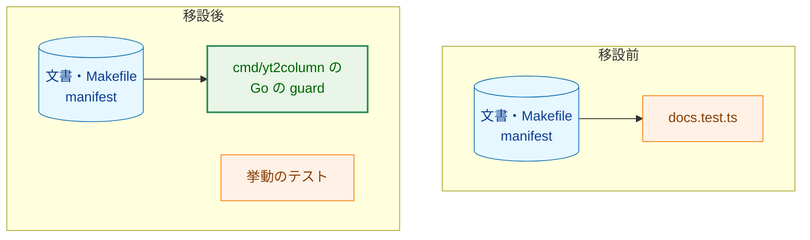
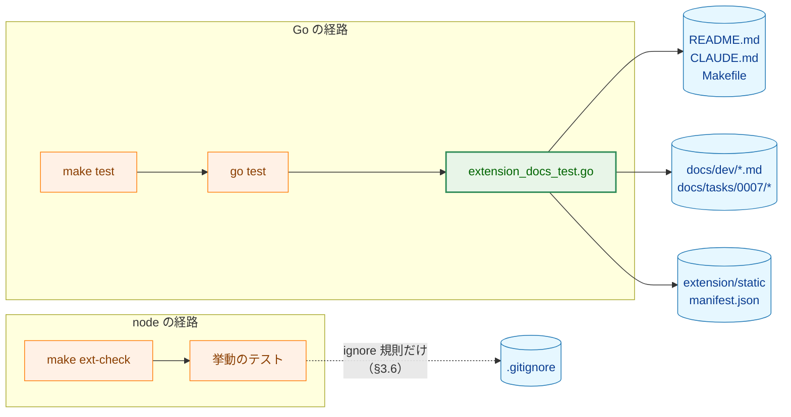
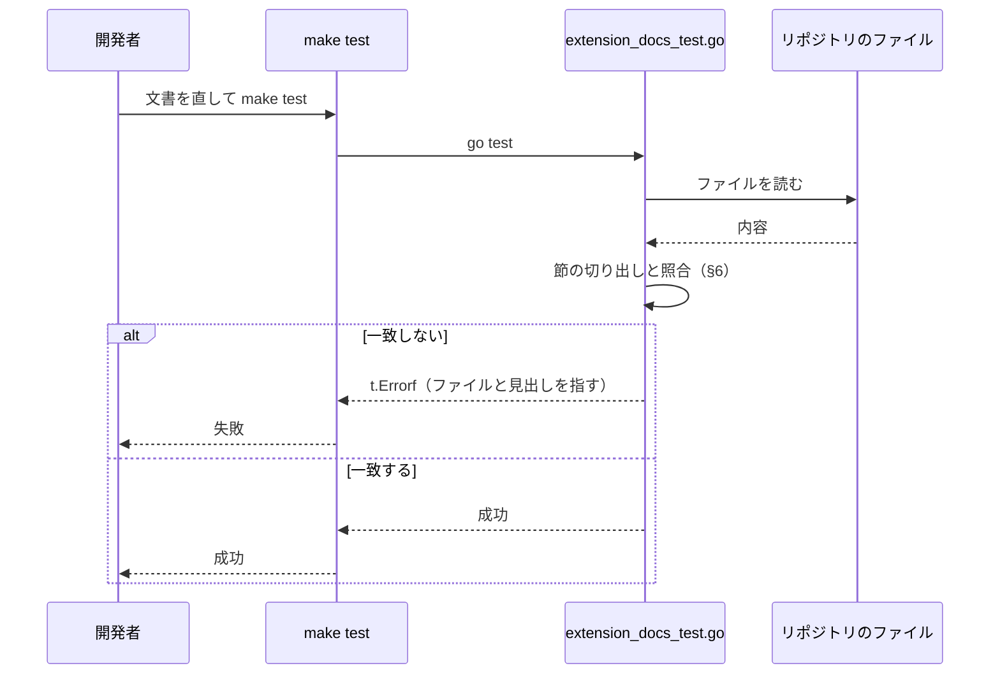
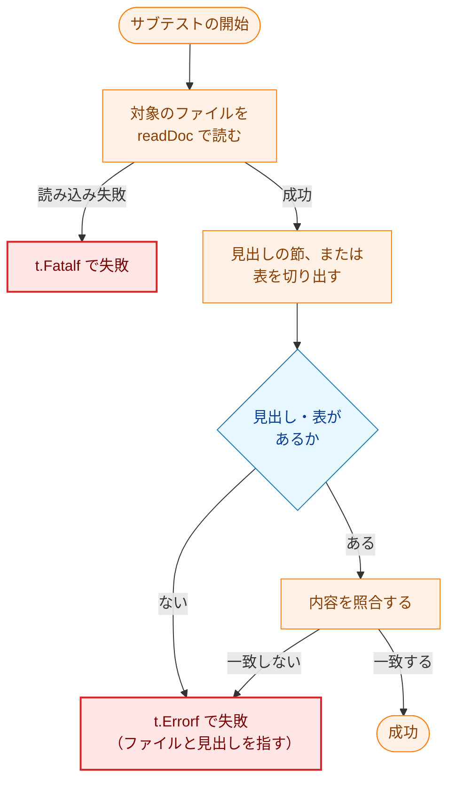

# アーキテクチャ設計書：文書の同期 guard を node から Go へ移す

## Document Status

| Item | Value |
|---|---|
| Status | `approved` |
| Created | 2026-10-13 |
| Review date | 2026-10-13 |
| Reviewer | isseis |
| Comments | - |

本書の F-NNN・AC-NN は [01_requirements.md](01_requirements.md) の項番、H-NN は [design_handoff.md](design_handoff.md) の項目（対応は §10）を指す。既存のコードと文書の行番号は、コミット `38885ab` で確かめたものである。

**用語。** 本書では、リポジトリの文書・`Makefile`・manifest（`extension/static/manifest.json`）の間で一致すべきテキストを照合するテストを「文書の同期 guard」（以下「guard」）と呼ぶ。guard はブラウザも npm もネットワークも使わず、リポジトリのファイルを読むだけである。拡張の実際の振る舞い（manifest の妥当性、`dist/` の内容、型検査、lint、build）を検査する node のテストを「挙動のテスト」と呼ぶ。`Makefile` の `ext-` で始まるターゲットを「`ext-` ターゲット」と呼ぶ。

## 1. 設計の全体像 (Design Overview)

### 1.1. 設計原則

1. **文書の同期 guard を Go のテストに集約する（F-001）。** 移す検査はリポジトリのファイルを読んで文字列と表を照合するだけで、node を必要としない。Go のテストは `make test`（`go test -tags test ./...`）で走り、node も npm も起動しない（`Makefile:68-69` の `test:` のレシピは `go test` だけを呼ぶ）。移した検査は既存の Go の文書 guard と同じ場所に置く（原則 2）。
2. **移した guard は既存の `cmd/yt2column/docs_test.go` と同じパッケージに置き、ヘルパを共有する（H-01・H-02）。** `cmd/yt2column/docs_test.go` は `package main` の `//go:build test` のテストとして、README・`project_overview.md`・`security.md` とタスクの記録を `make test` で検査している。移す guard の入力（文書・`Makefile`・manifest）は CLI のコードに依存しないが、Markdown の節の切り出しと表の分解のヘルパ（`cmd/yt2column/docs_test.go:301-324` の `markdownTables`、`:353-365` の `findTable` など）と、リポジトリのルートの相対パス（`cmd/yt2column/makefile_test.go:21` の `repositoryRoot`）を再利用できる。新しいパッケージを作ると、これらを複製するか公開する必要が生じる。
3. **検査は node のテストから削除し、同じ検査を二重に持たない（F-002）。** `extension/test/docs.test.ts` を削除する。拡張に残すのは挙動のテストだけとする。
4. **拡張 ID は manifest の `key` から導出し、文書には固定値として置かない（AC-02）。** 文書（`README.md` と `docs/dev/security.md`）と manifest の `key` の同期を、値の複製ではなく 1 つの計算で確かめる。
5. **検査が固定する形（見出し・表）は文書の契約として扱う。** 文書の構成を変える変更は、同じ変更で guard を更新する（`AGENTS.md` の「contracts are pinned」と同じ扱い。AC-01〜AC-07）。
6. **移した guard は対象を壊すと落ちることを確認する（F-004）。** `CLAUDE.md` の testing strategy に従い、対象を無効にして落ちることを確かめ、その記録を実装計画に残す（AC-13）。
7. **`.gitignore` の ignore 規則の guard は node に残す（H-07）。** `.gitignore` を守る検査（`extension/test/repository.test.ts:57-75` の `git check-ignore`）は、文書のテキスト同期ではなくリポジトリの衛生の検査であり、`git` の作業ツリーを前提とする。文書の guard はファイルを読むだけに保つ。理由と残るリスクは §3.6・§7.4・§11 に記す。
8. **文書だけの変更で node を要求しない（F-003）。** 文書の guard が `make test` に入るので、文書だけを変える変更では `make ext-test` を要求しない。`.gitignore` だけの変更は、原則 7 により引き続き `make ext-test` を要求する。`CLAUDE.md` の規則をこの形に直す（§3.7）。

### 1.2. 概念モデル

**図1 概念モデル**。矢印 A → B は「A を B が読む（または実行する）」を表す。各ノードの色は直後の凡例のとおり。実行に node を要するかは凡例に記す。

凡例: 青（`data`）は guard が読む静的データ、橙（`process`）は変更しない既存のテスト、緑（`enhanced`）は本タスクで加える Go の guard を表す。移設前は `docs.test.ts`（node）がデータを読み、移設後は Go の guard が読む。挙動のテスト（node）は移設の前後で変わらない。移設後に node を要するのは挙動のテストだけである。

## 2. システム構成 (System Structure)

### 2.1. 全体構成

**図2 全体構成**。矢印 A → B は「A が B を実行する」、または「A が B を読む」を表す。`make test` は Go のテストだけを実行し、guard はリポジトリのファイルを読む。`make ext-check` は型検査・lint・整形の検査・node のテスト・build を実行する（`Makefile:287-292`）。2 つの経路は独立しており、共通の入力（文書・`Makefile`・manifest）を読む役割は Go の guard に移す。

凡例: 青（`data`）は静的な入力ファイル、橙（`process`）は既存の実行経路、緑（`enhanced`）は本タスクで加える guard を表す。破線は、移設後も node 側に残る `.gitignore` の検査を表す（§3.6）。Go の経路は node を必要とせず、node の経路は `make ext-check` として残る。

### 2.2. コンポーネント配置

- **移す guard と拡張に固有のヘルパ:** `cmd/yt2column/extension_docs_test.go`（新規、`package main`、`//go:build test`）。`sectionByHeadingPrefix`・`extensionIDFromManifestKey` を置き、`cmd/yt2column/docs_test.go` のヘルパを共有する。
- **共有するヘルパ:** `cmd/yt2column/docs_test.go` を変更し、`docSection` を汎用の節の切り出し `sectionByHeading` に置き換える。`sectionByHeading` は両方のファイルが使うので、`markdownTables`・`findTable` と同じ `docs_test.go` に置く（§3.2・§3.5）。
- **削除:** `extension/test/docs.test.ts`。`extension/test/helpers/` のヘルパは、他のテストが使うものを残す（§3.7）。
- **変更:** `CLAUDE.md` の「Development Notes」の規則（F-003。`CLAUDE.md:211-215`）。
- **変更しない:** `extension/test/repository.test.ts`（ignore 規則の検査を含む。§3.6）、その他の挙動のテスト、`Makefile`、CI のワークフロー（H-03）。

### 2.3. データフロー

**図3 データフロー**。参加者 A から B へのメッセージは「A が B に何をするか」を表す。開発者が文書を直し、`make test` を実行すると、Go の guard がリポジトリのファイルを読んで照合する。node は起動しない。

凡例: `開発者` と `make test` は Go の経路の利用者と入口、`extension_docs_test.go` は移設する guard、`リポジトリのファイル` は guard が読む静的データを表す。node はこの経路に現れない。

## 3. コンポーネント設計 (Component Design)

### 3.1. 新しいテストファイル

`cmd/yt2column/extension_docs_test.go` に、次の検査を実装する。いずれも `t.Run` のサブテストとして名前を持ち、失敗のメッセージは対象のファイルと見出しを指す。

| 検査 | 対象のファイル | 照合する内容 |
|---|---|---|
| 拡張 ID の記載 | `README.md`・`docs/dev/security.md` | manifest の `key` から導出した拡張 ID を含む |
| `ext-` ターゲットの一覧 | `Makefile`・`CLAUDE.md` | 両者が列挙する `ext-` ターゲットの集合が一致する |
| manifest の permission | `docs/dev/security.md` §8.1 | §8.1 の `要求する権限` の列挙と `permissions` が集合として両方向に一致する |
| project overview の記述 | `docs/dev/project_overview.md` | `## 決定済みの方針` に `TypeScript`、`## 想定ディレクトリ構成` に `extension/` |
| タスク 0007 の調査の記録 | `docs/tasks/0007_browser_extension_skeleton/02_architecture.md` | `3.12.1`〜`3.12.3` の見出しと、各節の本文 |
| タスク 0007 の手動確認の記録 | `docs/tasks/0007_browser_extension_skeleton/03_implementation_plan.md` §5.1 | 定められた行の表と、結果などの列のセル |

拡張 ID の文字列は `docs/tasks/0011_localhost_server/01_requirements.md:131,137,220` にも現れる（localhost サーバが検査する `Origin` の契約）。これは移した 6 種の検査の対象外であり、本タスクでは固定しない（§11）。

### 3.2. ヘルパの契約

| ヘルパ | 契約 |
|---|---|
| `sectionByHeading(doc, heading string) string` | 前後の空白を除いて `heading` に完全一致する最初の見出し行を探し、**その行を含めず**、同じか高いレベルの次の見出し行の手前までを返す。見出しがなければ空文字列を返す。呼び出し側は `#` を含む見出し行全体（例 `## 決定済みの方針`、`### 8.1. ブラウザ拡張（#110）`）を渡す。`## `・`### `・`#### ` のいずれにも使える。 |
| `sectionByHeadingPrefix(doc, prefix string) string` | 前後の空白を除いて `prefix` で始まる最初の見出し行を探し、**その行を含めず**、レベルを問わず次の見出し行の手前までを返す（現行 `docs.test.ts` の `bodyAfterHeadingLine` と同じ。下位の見出しだけを残して本文を空にした場合も空文字列になる）。見出しがなければ空文字列を返す。`#### 3.12.1.` のように見出しの番号だけを渡す。 |
| `extensionIDFromManifestKey(key string) (string, error)` | `key` を base64 から DER に戻し、公開鍵として解析して DER に再エンコードし、SHA-256 の先頭 16 バイトを 16 進で表し、各桁 `0`〜`f` を `a`〜`p` に置き換えた文字列を返す。解析できない値はエラーを返す。 |

両ヘルパの「見出し行」は、行頭の 1 個以上の `#` の直後に空白が続く行（現行 `docs.test.ts` の `/^(#+)\s/` と同じ）であり、見出しのレベルは `#` の個数である。`#109 への含意は…`（`0007` の `02_architecture.md:839,865`）のように `#` の直後に空白がない行は見出しではない。この定義を外すと `3.12.1`・`3.12.2` の節が途中で切れる。

`markdownTables`（表の分解）・`findTable`（見出しの表の取得）・`readDoc`（ファイルの読み込み）・`repositoryRoot`（リポジトリのルートの相対パス）は既存のものを再利用する。新しいファイルに重複して定義しない。

### 3.3. 各検査の照合の詳細

- **拡張 ID の記載:** manifest の `key`（`extension/static/manifest.json`）を読み、`extensionIDFromManifestKey` で導出した値が `README.md` と `docs/dev/security.md` の本文に含まれることを確かめる。文書に拡張 ID の固定値を書く必要はない。
- **`ext-` ターゲットの一覧（抽出規則は契約）:** `Makefile` からは行頭の `ext-<名前>:` を、`CLAUDE.md` からは行頭の `` - `make ext-<名前>` `` を、それぞれ `ext-` ターゲットの名前として集める（この 2 つの形が契約であり、文書の書き方を変えるときは guard も同じ変更で直す）。両者を重複なしの集合にして比較する。`Makefile` から 1 件も集まらない場合は失敗させる（正規表現が一致しなくなったときに空同士で通さないため、現行 `extension/test/docs.test.ts:111` と同じ）。不一致のときは両方の集合を並べたメッセージで失敗させる。`Makefile` の `.PHONY` の行は行頭が `.PHONY` なので一致しない。
- **manifest の permission:** `### 8.1. ブラウザ拡張（#110）` の節を `sectionByHeading` で切り出し、その節の `要求する権限`（設計書 3.1 の manifest）の箇条書きが列挙する権限の集合と、manifest の `permissions` の集合が両方向に一致することを確かめる（manifest にあって文書にない権限も、文書にあって manifest にない権限も落ちる。AC-04 の双方向の要件）。節には要求しない権限（`tabs`・`history` など）も現れるので、比較の対象は `要求する権限` の列挙に限る。`permissions` が空または欠落の場合、または `要求する権限` の列挙が見つからない場合は失敗させる（何も検査しないまま通さないため）。
- **project overview の記述:** `## 決定済みの方針` の節に `TypeScript`、`## 想定ディレクトリ構成` の節に `extension/` を含むことを確かめる。
- **タスク 0007 の調査の記録:** `#### 3.12.1.`・`#### 3.12.2.`・`#### 3.12.3.` の見出しがそれぞれ存在することを確かめる。`sectionByHeadingPrefix(doc, "#### 3.12.1.")` が拡張 ID を含むことを確かめる。`sectionByHeadingPrefix(doc, "#### 3.12.2.")` と `sectionByHeadingPrefix(doc, "#### 3.12.3.")` をそれぞれ前後の空白を除いて空でないことを確かめる。節の本文（見出し行を含まない）について確かめるので、見出しを残したまま本文を空にすると落ちる（AC-06）。
- **タスク 0007 の手動確認の記録:** `### 5.1. 手動の確認と記録` の節を `sectionByHeading` で切り出し、`findTable(section, "AC")` で表を得る。表の本文の行の第 1 セルが、定められた AC の行（`AC-02`・`AC-03`・`AC-05`・`AC-07`・`AC-08`・`AC-10・AC-11`・`AC-13`・`AC-20`・`AC-21・AC-22・AC-31`・`AC-28・AC-29`・`AC-25`）とこの順で一致し、各行が 5 セル（0 起点で 0〜4）で、1〜4 番目のセル（確認の内容／ブラウザ・環境／日付／結果）が空でないことを確かめる。

検査 6 の「結果」列は 0 起点で 4 番目（5 列目）である。要件 §3.1 の検査 6 は「確認内容・ブラウザか環境・日付・結果の列」を空でないことの対象に挙げるので、確認の内容（0 起点で 1 番目）も検査する。現行 `extension/test/docs.test.ts:214` は 0 起点の 2〜4 だけを検査しており、確認の内容の列を空にしても落ちない。移設に合わせて要件の列挙に揃える（現行の表は 1 番目のセルがすべて埋まっているので、この変更で既存の文書は落ちない）。

### 3.4. 拡張 ID の導出の互換性

Chrome の拡張 ID は、manifest の `key` が表す DER の SubjectPublicKeyInfo の SHA-256 の先頭 16 バイトを、16 進の各桁 `0`〜`f` を `a`〜`p` に置き換えたものである。`extension/test/helpers/extensionId.ts:9-20` の `extensionIdFromManifestKey` は `node:crypto` の `createPublicKey`（`format: "der"`・`type: "spki"`）で `key` を解析し、DER に再エクスポートしてから SHA-256 を取る。Go では `encoding/base64`・`crypto/x509`（`ParsePKIXPublicKey`・`MarshalPKIXPublicKey`）・`crypto/sha256` で同じ計算を実装する。`key` が公開鍵として解析できない場合（秘密鍵を貼った場合など）はエラーとする。これは現行の TypeScript の `createPublicKey` が例外を投げるのと同じ扱いである（AC-02）。Go の導出値が node の導出値と一致することは、検査 1・5 が確かめる（README・`security.md`・`0007` の §3.12.1 は node で導出した値を記録しているので、Go の導出が食い違えば落ちる。§7.1）。

### 3.5. 既存のテストとの境界（H-02）

役割の境界は「`cmd/yt2column/docs_test.go` の既存の検査は CLI と各プロバイダの契約、`extension_docs_test.go` の検査はブラウザ拡張の契約」とする。対象のファイルは重なる（`README.md`・`security.md`・`project_overview.md`・文書の節）が、照合する内容は重ならない。

節の切り出しは、既存の `docSection`（`cmd/yt2column/docs_test.go:397-416`）を汎用の `sectionByHeading` に置き換える。`docSection` は `## ` の見出しだけを扱い、`### 8.1.`・`#### 3.12.1.` を切れないためである。既存の呼び出し（`docs_test.go:126`・`:277`）は `sectionByHeading(doc, "## <見出し>")` に直す。`docSection` は見出し行を含めずに次の `## ` までを返し、`sectionByHeading` も見出し行を含めずに同じか高いレベルの次の見出しまでを返すので、既存の検査が照合する文字列が節の本文に含まれる限り、結果は変わらない（§3.8 のとおり、既存の検査が引き続き通ることで確かめる）。

### 3.6. `.gitignore` の ignore 規則の扱い（H-07）

`.gitignore` を守る検査は `extension/test/repository.test.ts:57-75` の「build outputs are ignored」にあり、`git check-ignore` で `extension/node_modules/...`・`extension/dist/...`・`key.pem`・`extension/key.pem` を検査する。これは文書のテキスト同期ではなくリポジトリの衛生の検査であり、`git` を起動する。

本設計では、この検査を node 側に残す（案 A）。理由は、(1) 要件は文書のテキスト同期の guard の移設を求めており、この検査は含まれない、(2) 既存の挙動のテストは node 側に残す（要件 §2.3）、(3) 文書の guard はファイルを読むだけに保ち、`git` の作業ツリーを前提にしない（Go のテストは既に `make`・`ps`・`sh` を起動する。`internal/maketestutil/make.go:111-130`・`internal/transcript/exec_test.go:513`。したがって問題は外部コマンドの起動そのものではなく、`git check-ignore` が `.git` のある作業ツリーでしか意味を持たないことである）、(4) タスク `0007` の実装計画が、この検査が CI で走らないことを残るリスクとして受け入れ、`make ext-test` を手元で実行する運用に決めている（`docs/tasks/0007_browser_extension_skeleton/03_implementation_plan.md:471`、AC-06 の対応先は同 `:416`）ためである。

**残るリスク（明示）。** `.gitignore` だけを変える変更では、ignore 規則の検査はローカルの `make ext-test` でだけ走る。`make ext-test` は node と `npm ci`（ネットワーク）を要求する。CI はこの変更を守らない。`.gitignore` は `check-changes`（`.github/workflows/ci.yml:36`）がコードの変更とみなすので Go の `test` ジョブは走るが、Go の guard は `.gitignore` を読まないので通ってしまう。拡張のジョブは `has-extension-changes` の条件（`extension/scripts/has-extension-changes.sh`）に `.gitignore` がなく走らない。したがって、手元でテストを実行しない経路（GitHub のウェブ画面での編集、bot）では、`.gitignore` の破損が混入しうる。このリスクは、秘密鍵の混入を常時実行の `secret-scan` が担う点を除き、タスク `0007` が受け入れたものと同じである。`.gitignore` だけの変更では `make ext-test` を要求することを `CLAUDE.md` に明記する（AC-10・AC-12）。この穴を閉じる案は §11 に記す。

### 3.7. コンポーネントの責務

| ファイル | 種別 | 責務 |
|---|---|---|
| `cmd/yt2column/extension_docs_test.go` | 新規 | ブラウザ拡張の文書の同期 guard 6 種と、拡張に固有のヘルパ（`sectionByHeadingPrefix`・`extensionIDFromManifestKey`）。`//go:build test` で `make test` のときだけコンパイルする |
| `cmd/yt2column/docs_test.go` | 変更 | `docSection` を共有の `sectionByHeading` に置き換え、呼び出しを直す。既存の検査の内容は変えない |
| `extension/test/docs.test.ts` | 削除 | 移した 6 種の検査を行う node のテスト。削除する |
| `extension/test/helpers/extensionId.ts` | 変更なし | `extensionIdFromManifestKey`。`manifest.test.ts:85-89` が使うので残す |
| `extension/test/helpers/repoFile.ts`・`paths.ts` | 変更なし | `repository.test.ts` などが使うので残す |
| `extension/test/repository.test.ts` | 変更なし | 挙動のテストと ignore 規則の検査（§3.6） |
| `CLAUDE.md` | 変更 | 「Development Notes」の規則（`CLAUDE.md:211-215`）を、文書だけの変更で `make ext-test` を要求せず、`.gitignore` だけの変更では要求する形に直す（F-003） |
| `Makefile` | 変更なし | `test:` は `go test -tags test ./...` のまま（`Makefile:68-69`）。`ext-` ターゲットも変更しない |
| `.github/workflows/ci.yml` | 変更なし | ジョブの分類・トリガを変えない（H-03） |

`CLAUDE.md` の規則は、次の内容を満たすように書く（文言は実装で決める）。(a) 文書（`README.md`・`CLAUDE.md`・`docs/`）だけの変更では `make ext-test` を要求しない。(b) 文書のテキスト同期の guard は `make test`（`CLAUDE.md:209` が求める）に含まれ、node を必要としない。(c) `.gitignore` だけの変更では、ignore 規則の検査が node 側に残るので `make ext-test` を要求する。

### 3.8. 変更が要る既存のテスト

- `cmd/yt2column/docs_test.go` の `docSection` を `sectionByHeading` に置き換える。`docSection` を使う既存の検査（`TestProjectOverviewDocumentsConfig`・`TestClaudePlanRecordsManualRun`）が引き続き通ることを確かめる（§3.9）。
- `cmd/yt2column/docs_test.go` の `readDoc`・`markdownTables`・`findTable`・`tableRow` は変更しない。
- `extension/test/docs.test.ts` の削除の後、`extension/test/` の他のテストが使わないヘルパ・import が残っていないことを `make ext-lint`・`make ext-typecheck`・`make ext-check` で確かめる（AC-09）。
- 新しい文書 guard は `make test`（`-tags test`）で走らせるので、ファイルの先頭を `//go:build test` にする。`cmd/yt2column` のテストファイルの先頭行は一様ではない（`integration_test.go` と `integration_slack_test.go` は `//go:build integration`）が、文書 guard は統合テストではないので `//go:build test` とする。`TestFakesCarryBuildTag`（`internal/pipeline/pipeline_test.go:534-582`）は `testutil/` のファイル・`test_helpers*.go`・テスト専用パッケージのソースの先頭行を固定し、`_test.go` は対象にしないので、新しいファイルによる変更は要らない。

### 3.9. 受け入れ基準と設計の対応

| AC | 設計の節 |
|---|---|
| AC-01 | §3.1・§3.2・§7.1 |
| AC-02 | §3.2・§3.3・§3.4・§7.1 |
| AC-03 | §3.3 |
| AC-04 | §3.3 |
| AC-05 | §3.3 |
| AC-06 | §3.3・§7.2 |
| AC-07 | §3.3 |
| AC-08 | §3.7・§8 |
| AC-09 | §3.7・§3.8・§8 |
| AC-10 | §3.7・§7.4 |
| AC-11 | §1.1・§7.3 |
| AC-12 | §3.6・§3.7 |
| AC-13 | §7.2・§8 |

既存の `docSection` の置き換え（§3.5・§3.8）は、AC を直接には実現しないが、既存の検査を壊さないための変更である。

## 4. エラーハンドリング設計 (Error Handling Design)

guard はテストであり、製品コードのエラー型は定義しない。ファイルの読み込みの失敗（`readDoc`）は `t.Fatalf` でテストを失敗させる。照合の不一致は `t.Errorf` で失敗させ、メッセージに対象のファイルと見出し・セルを書く。`ext-` ターゲットの集合の不一致では両方の集合を並べて書く。対象のファイルが存在しない、見出しがない、表の形が違う場合も、無言で通さずに失敗させる（要件 4.3、AC-01〜AC-07）。

## 5. セキュリティ考慮事項 (Security Considerations)

**N/A。** guard が読むのはリポジトリにコミットされたファイルだけであり、信頼できる入力である。ネットワーク・外部コマンド・利用者が実行時に与える入力・秘密情報を扱わない（要件 §3.2・4.2）。拡張 ID は manifest の `key`（公開情報）から導出し、秘密鍵は扱わない。したがって脅威モデルはない。

## 6. 処理フロー詳細 (Processing Flow Details)

**図4 各 guard の実行フロー**。矢印 A → B は「A の次に B を行う」、ひし形は条件を表す。すべての検査が同じ形をとる。

凡例: 橙（`process`）は guard の手順、青（`decision`）は分岐、赤（`fail`）はテストを失敗させる手順を表す。

## 7. テスト戦略 (Test Strategy)

### 7.1. 静的 guard

移した 6 種の検査そのものが、文書・`Makefile`・manifest の契約を固定する静的 guard である。`make test` の一部として実行され、`make lint` でもコンパイルされる。ユニットテストは `yt-dlp`・LLM API・Webhook を呼ばない（`CLAUDE.md` の testing strategy）。移した guard はリポジトリのファイルを読むだけである。

`extensionIDFromManifestKey` の計算の正しさに、拡張 ID の固定値を書いた専用のテストは足さない。README・`security.md`・`0007` の §3.12.1 は node で導出した値を記録しているので、Go の導出の計算が変わると検査 1・5 が落ちる（AC-02）。固定値を Go のテストにも書くと、原則 4（拡張 ID を固定値として置かない）に反し、`key` を変えるときの修正箇所を増やす。`key` が公開鍵として解析できない場合にエラーを返すことは、検査 1・5 が `t.Fatalf` で落ちることで現れる。

### 7.2. 壊し確認

`CLAUDE.md` の testing strategy に従い、移した 6 種の各検査について、対象を無効にして落ちることを確認する。確認は、対象を壊す、Go のテストを実行してそのサブテストだけが落ちることを見る、壊した変更を戻す、の順で行う。確認の手順と結果を `03_implementation_plan.md` の手動確認の節に記録する（AC-13。タスク `0007` の §5.1 と同じ形式）。対象は、拡張 ID の 1 文字、manifest の `key` を別の有効な値に変える（検査 1・5 の導出元。AC-02）、`Makefile` の `ext-` ターゲット 1 つ、`security.md` の `要求する権限` の permission 1 つ、manifest の `permissions` の permission 1 つ（manifest から permission を消した場合に落ちることも確かめる。集合の比較が両方向であることの確認。AC-04）、`project_overview.md` の `TypeScript` と `extension/`、`0007` の `3.12.x` の見出し、`0007` の §5.1 のセル、`0007` の `3.12.2`・`3.12.3` の本文（本文だけを空にしても落ちることを確かめる。AC-06）。

### 7.3. 実行環境

Go の guard は macOS と Linux（CI）のどちらでも `make test` で動く。node も npm も必要としない。`make test` のレシピは `go test` だけを呼ぶ（`Makefile:68-69`）。拡張の経路（`make ext-check`）は従来どおり node を必要とする。

### 7.4. CI の実行範囲（H-03）

`ci.yml:36` の分類は `*.md`・`docs/`・`.claude/`・`LICENSE` だけの変更をコードの変更とみなさない。そのため文書だけの変更では Go のテストのジョブ（`ci.yml:55-74` の `test`）も拡張のジョブ（`ci.yml:115-165` の `extension`）も走らない。本タスクはこの分類を変えない。

**残るリスク（明示）。** 文書だけの変更では、文書の guard はローカルの `make test` でだけ走る。`CLAUDE.md:209` が「編集の後に `make test` と `make lint` を実行する」ことを求めるので、通常の開発では保護される。しかし、手元でテストを実行しない経路（GitHub のウェブ画面での編集、bot）では破損が混入し、それは次にコードの変更を含む PR で `make test` が走ったときに初めて検出される（原因の PR とは別の PR で検出されるため、原因の特定が遅れる）。このリスクは、タスク `0007` が受け入れたものと同じである（`docs/tasks/0007_browser_extension_skeleton/03_implementation_plan.md:471`）。文書だけの変更を CI で守る案は §11 に記す。`.gitignore` だけの変更の残るリスクは §3.6 に記した。

## 8. 実装の優先順位 (Implementation Priorities)

- **フェーズ 1: ヘルパと Go の guard（F-001）。** `docs_test.go` の `docSection` を `sectionByHeading` に置き換える。`extension_docs_test.go` に `sectionByHeadingPrefix`・`extensionIDFromManifestKey` と 6 種の検査を実装する。`make test` を通す。
- **フェーズ 2: node 側の削除（F-002）。** `extension/test/docs.test.ts` を削除し、未使用のヘルパ・import を始末する。`make ext-check` を通す。
- **フェーズ 3: 規則の見直し（F-003）。** `CLAUDE.md` の規則（`CLAUDE.md:211-215`）を §3.7 の内容に直す。
- **フェーズ 4: 壊し確認と記録（F-004）。** 6 種の検査の壊し確認を行い、結果を実装計画に記録する。

## 9. 将来の拡張性 (Future Extensibility)

- 新しい文書のテキスト同期の guard は、`extension_docs_test.go` にサブテストを足すだけで増やせる。ヘルパと実行経路を共有する。
- 文書だけの変更を CI でも guard したい場合は、`check-changes` の分類に guard が読むファイルを加えるか、常に走る小さなジョブを足す。これは実行時間と `check-changes` の設計に関わるので、別のタスクとする（#181。H-03）。
- `.gitignore` の ignore 規則の検査を Go へ移す場合は、`git check-ignore` を起動する Go のテストを足し、`repository.test.ts` の該当の節を削る（§11 の案 B）。

## 10. 設計への申し送りへの回答 (Handling of design_handoff Items)

| 項目 | 本設計の回答 |
|---|---|
| H-01（移した guard の置き場所） | `cmd/yt2column/extension_docs_test.go`（`package main`、`//go:build test`）に置く。既存の doc guard と同じ場所で、ヘルパと `repositoryRoot` を共有できる（§1.1 原則 2・§2.2） |
| H-02（既存 `docs_test.go` との境界とヘルパの再利用） | 境界は「既存は CLI とプロバイダの契約、移す検査は拡張の契約」。`docSection` を汎用の `sectionByHeading` に置き換え、表のヘルパは再利用する（§3.2・§3.5・§3.8・§3.9） |
| H-03（文書だけの変更を CI で保護するか） | 変えない。CI の分類・トリガはそのままとし、ローカルの `make test`（`CLAUDE.md:209`）に委ねる。残るリスクを §7.4 に明示した。CI で守る案は別のタスクとする（#181。§11） |
| H-04（タスク `0007` の文書の訂正の扱い） | 編集しない。`0007` の `02_architecture.md` に `docs.test.ts` への言及はない。`03_implementation_plan.md` の `docs.test.ts` への言及は、ステップの完了記録・AC トレーサビリティ表・マイルストーン・PR・リスク・成功基準のいずれも、そのとき何をしたかの履歴である。申し送りが現在形の指針として挙げた 2 か所（`03_implementation_plan.md:36` の英語の例外の説明と、`:445` の「`docs.test.ts::manual checks are recorded`（ステップ 5-6）は…確かめる」）も、完了したタスクの計画の記述であり、現在の指針は `CLAUDE.md`「Go Idioms」の例外と本タスクの `extension_docs_test.go` が担う。したがって、これらも履歴として残し、編集上の訂正も行わない（要件 §2.3・制約） |
| H-05（拡張 ID の導出と manifest の読み取りの Go 実装） | `encoding/json` で manifest を読み、`encoding/base64`・`crypto/x509`・`crypto/sha256` で導出する。解析の失敗はエラーとする（§3.4） |
| H-06（`extension/test` のヘルパの再利用と削除） | `extensionId.ts`・`repoFile.ts`・`paths.ts` は他のテストが使うので残す。`docs.test.ts` だけの import・リテラルは削除し、`make ext-check` で確かめる（§3.7・§3.8） |
| H-07（`.gitignore` の ignore 規則の guard の扱い） | node 側に残す（案 A）。`.gitignore` だけの変更では `make ext-test` を要求し、`CLAUDE.md` に明記する。残るリスクを §3.6 に明示した（§11） |

## 11. 決定の履歴（付録）

本節は、本タスクで採らなかった案と、後から読む人が疑問に思う決定を記録する。本体（§1〜§10）は現在の設計だけを述べる。

- **`.gitignore` の ignore 規則の検査を Go へ移す案（H-07 の案 B）。** `git check-ignore` を起動する Go のテストを `extension_docs_test.go` に足し、`extension/test/repository.test.ts:57-75` の節を削れば、`.gitignore` だけの変更でも node が不要になり、かつ `.gitignore` は `check-changes`（`ci.yml:36`）がコードの変更とみなすので Go の `test` ジョブで CI にも守られる。採らなかった理由は、(1) 要件は文書のテキスト同期の guard の移設を求めており、この検査は含まれない、(2) 既存の挙動のテストは node 側に残す（要件 §2.3）、(3) `git check-ignore` は `.git` のある作業ツリーでしか意味を持たず、`make test` がソースのアーカイブなど作業ツリーでない場所で失敗しうる（外部コマンドの起動自体は既存の Go のテストにも前例がある。§3.6）、(4) タスク `0007` がこの検査の CI の穴を残るリスクとして受け入れ、AC-06 を `repository.test.ts`（`0007` の `03_implementation_plan.md:416`）に結び付けているため。`.gitignore` だけの変更で node を避けたい要望が強ければ、別のタスクでこの案を採る。
- **文書だけの変更を CI で guard する案（H-03）。** `check-changes`（`ci.yml:24-53`）の分類に、guard が読むファイル（`README.md`・`CLAUDE.md`・`docs/` の一部）を加える、または文書の guard だけを走らせる常時の小さなジョブを足せば、文書だけの PR でも guard が走る。採らなかった理由は、要件が CI の変更をスコープ外とし（要件 §2.3・制約）、実行時間と `check-changes` の設計の変更を伴うため。移設の前後で CI の実行範囲は変わらない（文書だけの変更では、移設前の拡張の guard も移設後の Go の guard も走らない）。この案は別のタスクで扱う（#181）。
- **文書の guard を新しいパッケージに置く案（H-01）。** `internal/...` などの新しいパッケージに置けば、`cmd/yt2column` が拡張の文書に関心を持つことを避けられる。採らなかった理由は、Markdown のヘルパ（`docs_test.go` の `markdownTables`・`findTable`・`readDoc`）と `repositoryRoot` を公開するか複製する必要があり、既存の doc guard が `cmd/yt2column` に集まっているため。
- **`0011` の拡張 ID の記載。** `docs/tasks/0011_localhost_server/01_requirements.md:131,137,220` は拡張 ID を `Origin` の契約として固定する。guard の対象を 6 種の検査に限る要件（F-001）に従い、`0011` は対象外とする。manifest の `key` を変える場合は、`0011` の記載も別途直す必要がある。
