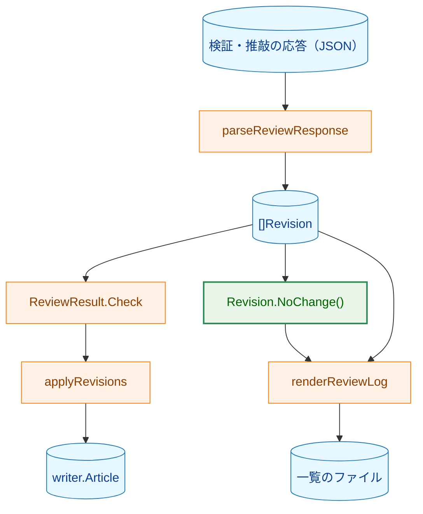
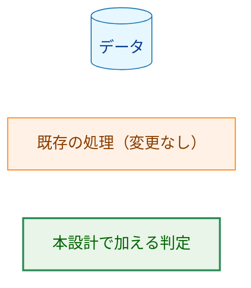
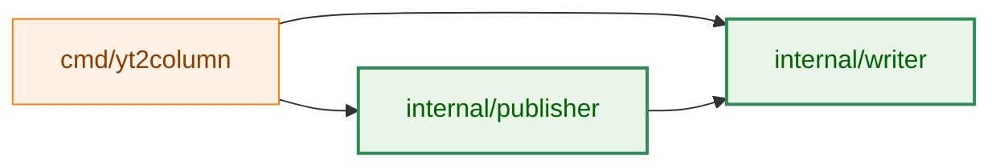
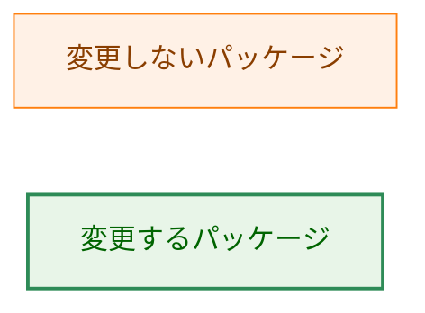
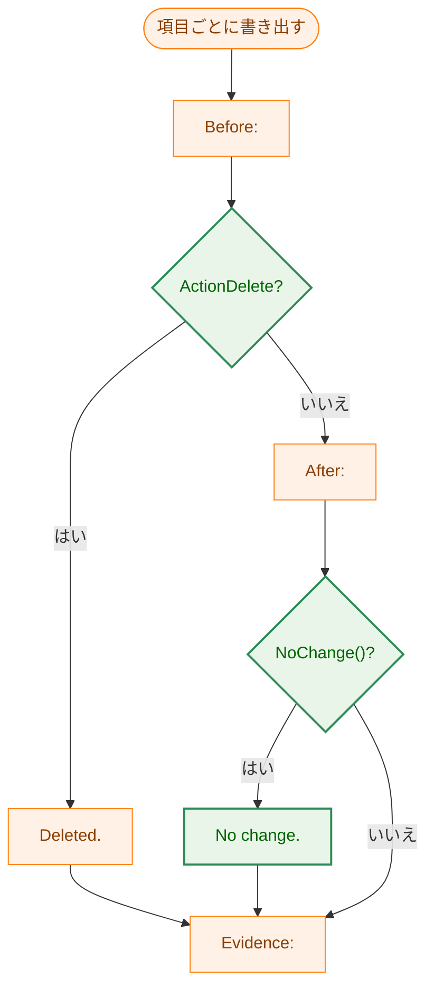

# アーキテクチャ設計書：変更のない検証・推敲の項目

## Document Status

| Item | Value |
|---|---|
| Status | `draft` |
| Created | 2026-10-14 |
| Review date | - |
| Reviewer | - |
| Comments | design_handoff.md の H-01（無変更の項目への応答の境界の契約の適用）に対応した。§3.4 で、無変更の項目が 0010 F-003・0010 §3.5.3 の境界の契約をそのまま受けることを記録し、§3.5 に design_handoff への対応を加えた。受理・書式の決定は変えていない。 |

本書の F-NNN・AC-NN は [01_requirements.md](01_requirements.md) の項番を指す。既存のコードの行番号は、コミット `56062fd` で確かめたものである。

**用語。** 本書では、要件書に従い、検証・推敲の応答の項目のうち `after` を持ち `before` と `after` が同じ文字列であるものを「無変更の項目」と呼ぶ。「一覧」は検証・推敲の LLM が返す項目の列、「一覧のファイル」は `--review-log` が書き出すファイル、「要約」は CLI が標準エラー出力に書く段階ごとの 1 行を指す。「文面」は記事のタイトルと本文の部分の組（0010 §1.1 の用語）を指す。

## 1. 設計の全体像 (Design Overview)

### 1.1. 設計原則

1. **無変更の判定は `Revision` の意味として型に置く。** 無変更とは「置換であり、前後が同じ」という `Revision` の性質である。一覧のファイルの書き出し（`internal/publisher`）が action と値の比較を自前で書かず、`writer.Revision` の判定（`NoChange()`）を呼ぶ。定義を型の側に 1 つ置き、呼び出し元が同じ比較を書き直さないようにする。
2. **受理の規則は変えない。** `Revision.check()`・`parseReviewResponse`・`ReviewResult.Check` は無変更の項目を既に受理している（`internal/writer/revision.go:53-85`・`internal/writer/review.go:38-125`）。無変更の項目は受理の規則（空値・制御文字・未知の action と reason・値の長さ）のいずれにも違反しないので、拒否を加えない。無変更の項目も、0010 F-003 が定める応答の境界の契約（0010 §3.5.3）を他の項目と同じく通り、契約は 0010 に置いたまま再定義しない（§3.4）。これは 0010 §1.1 の原則 4（一覧は検証・推敲の段階による変更の完全な記録になる）・原則 5（一覧は信頼できない入力として境界で検査し、補正しない）と CLAUDE.md「Reject, don't normalize」に反しない。原則 5 が禁じるのは、規則に反する入力の静かな修復・破棄・無視であり、規則を満たす項目をそのまま残し、意味を明示する扱いは含まない。原則 4 に対しては、無変更の項目を一覧に残したうえで §3.2 の `No change.` で変更がないことを明示するので、記録の読み手を誤らせない。0010 の決定から実際に変えるのは、一覧のファイルの書式（§3.2 で加える `No change.`）だけである。無変更の項目を拒否・受理する既存のテストは無い（`internal/writer`・`internal/publisher` のテストを検索して確認した）。
3. **一覧のファイルの書式の差分は 0013 が持ち、0010 §3.8 を基準とする。** 書式の正典は 0010 の [02_architecture.md](../0010_post_generation_review/02_architecture.md) §3.8 であり、本書はそれを変えない（0010 の完了済み文書は編集しない、というタスクの切り分けによる。要件 §5）。0010 §3.8 に本書 §3.2 の追加を加えたものを、現行の一覧のファイルの書式とする。0010 の [02_evaluation.md](../0010_post_generation_review/02_evaluation.md) と [package_reference.md](../../dev/developer_guide/package_reference.md) も編集しない。前者 §4.3 は「拒否するかどうかは #186 で検討する」と述べるが、その判断は本書と要件が下すので、0010 の文書を直す必要はない。後者は書式を記述していないので、変更を要しない。
4. **記事の文面は変えない。** 当てはめ（`applyRevisions`、`internal/writer/review.go:149-192`）は無変更の項目でも同じ位置を同じ文字列で置き換えるだけなので、結果の文面は当てはめの対象と同じになる。当てはめのコードは変えない。
5. **印は固定の英語の 1 行とする。** `No change.` は応答の値を含まない固定の文字列であり、応答の値をそのまま引用する既存の引用ブロックには手を加えない（§5）。
6. **要約は変えない。** 要約は、無変更の項目も含めて項目を数える（要件 §2.3 でスコープ外）。このため、`--review-log` を指定しない実行では、無変更の項目の発生は要約から分からない（§9 に残余として記す）。

### 1.2. 概念モデル

**図1 概念モデル。** 矢印 A → B は「A の出力を B が受け取る」を表す。矢印の意味は、既存の処理でも本設計で加える判定でも同じである。緑のノードは本設計で加える判定を表す。



**Legend**



`Revision.NoChange()` は一覧のファイルの書き出しだけが使う。`applyRevisions` は無変更の項目を特別扱いせず、既存の当てはめの規則で処理する。`parseReviewResponse` と `ReviewResult.Check` は無変更の項目を既に受理しており、本設計はそれらを変えない。

## 2. システム構成 (System Structure)

### 2.1. パッケージ構成

**図2 本設計で変更するパッケージと依存**。矢印 A → B は「A が B を import する」を表す。本設計に関わる import だけを示す。緑のパッケージは本設計で変更するもの、橙は変更しないもの。



**Legend**



パッケージの依存は変わらない。`internal/publisher` は既に `internal/writer` を import している（`internal/publisher/reviewlog.go:10`）。新しいパッケージ・import は加えない。

### 2.2. コンポーネント配置

| ファイル | 変更 | 責務 |
|---|---|---|
| `internal/writer/revision.go` | 変更 | `Revision.NoChange()` を加える。`check()`・`Check()` の doc コメントに受理の条件を明記する |
| `internal/publisher/reviewlog.go` | 変更 | `renderReviewLog` に `No change.` の分岐を加える |
| `internal/writer/revision_test.go` | 変更 | `NoChange()` の真偽表と、`Check` が無変更の項目を受理するケースを加える |
| `internal/writer/review_test.go` | 変更 | 無変更の項目を含む応答の受理と、無変更の項目を当てはめても文面が変わらないケースを加える |
| `internal/writer/steps_test.go` | 変更 | 無変更の項目だけの応答、無変更と変更を合わせた応答で `Write` が成功するケースを加える |
| `internal/publisher/reviewlog_test.go` | 変更 | 無変更の項目の書式のケースを加える |
| `internal/writer/review.go`・`article.go`・`errors.go` | 変更なし | 受理・当てはめ・失敗の種類は変えない |
| `cmd/yt2column/run.go` | 変更なし | 要約の件数を変えない（要件 §2.3）|
| `docs/tasks/0010_post_generation_review/02_architecture.md`・`02_evaluation.md` | 変更なし | 0010 §3.8 を書式の基準として参照する（§1.1 原則 3）|
| `docs/dev/developer_guide/package_reference.md` | 変更なし | パッケージの責務（書式を含まない）を変えない |

### 2.3. データフロー

「応答 → 検査 → 当てはめ → 記事」と「一覧 → ファイル」の 2 つのデータフローは、0010 §2.3 の図4 と同じである。本設計は、`Write` の成功時の流れのうち、一覧をファイルに書き出す部分（0010 図4 の `--review-log` の書き出し）に、無変更の項目の分岐を 1 つ加えるだけである。したがって、新しいシーケンス図は設けず、0010 §2.3 の図4 を現行のデータフローの正典とし、追加する分岐を §6 の図3 に示す。

## 3. コンポーネント設計 (Component Design)

### 3.1. 無変更の判定（`internal/writer/revision.go`）

```go
package writer

// Revision is one entry of the review list.
type Revision struct {
	Before   string // verbatim quote of the reviewed text
	Action   RevisionAction
	After    string // the replacement; empty exactly when Action is ActionDelete
	Reason   RevisionReason
	Evidence string // the quoted source material
}

// NoChange reports whether applying r leaves the reviewed text unchanged: r is
// an accepted-shaped replacement (a non-empty Before with After equal to it).
// The acceptance rules accept such a revision; the review log marks it.
func (r Revision) NoChange() bool
```

- **既存のフィールドは変えない。** `Revision` のフィールド集合は変わらないので、`internal/pipeline/pipeline_test.go` の `TestCommonTypesFieldSets`（`:406-414` で `Article` のフィールドを固定し、`Revision` 自体は固定していない。`Article` のフィールドも変えない）は変更なしで通る。`Article`・`ReviewResult`・`StepModel` の形も変えない。
- **判定の定義。** `NoChange()` は `ActionReplace` で、`Before` が空でなく、`Before == After` のときだけ真を返す。`Before` が空の `Revision`（ゼロ値）に真を返さないのは、そのような値は受理の規則を通らないためである（`check()` が `errEmptyRevisionBefore`・`errRevisionAfterMissing` で拒否する、`internal/writer/revision.go:56-71`）。この 1 条件により、`NoChange()` が真になるのは「受理された置換」という意図した定義域だけであり、呼び出し元が `Check` を通していない値で真を受け取ることはない。
- **受理の規則の文書化。** `Revision.check()`（`:53`）と `ReviewResult.Check()`（`:26`）の doc コメントに、`ActionReplace` で `Before == After` の項目を受理すること（拒否しないこと）を 1 文加える。検査の条件そのものは変えない。
- **判定を型に置く理由。** 無変更は `Revision` の意味（置換の前後が同じ）である。`writer` の外に同じ比較を書くと、定義が型から離れ、受理の規則を変えたときに食い違う。一覧のファイルの書き出しは `writer.Revision` の判定を呼ぶだけにする。

### 3.2. 一覧のファイルの書式（`internal/publisher/reviewlog.go`）

現行の `renderReviewLog`（`internal/publisher/reviewlog.go:74-93`）は、項目ごとに `Before:`・（削除なら `Deleted.`、それ以外は `After:`）・`Evidence:` を書く。本書は、`ActionReplace` の項目が無変更のとき、`After:` の引用の後に `No change.` の 1 行を加える。

**基準とする書式（0010 §3.8）に本設計が加えるもの。**

```text
## <N>. <reason の値>

Before:

> <before>

After:

> <after>

No change.

Evidence:

> <evidence の 1 行目>
> <evidence の 2 行目>
```

- **印の位置（決定）。** 要件 AC-06 が無変更の項目でも `After:` の引用を求めるため、`After:` の引用は残す。`No change.` は、`Deleted.` が置かれるのと同じ位置、すなわち `Evidence:` の直前（変更の内容を示す行の位置）に置く。無変更の項目の書式は、置換の書式の `After:` の引用の直後に `No change.` を 1 行加えたものになる。`After:` の引用を `No change.` に置き換える形は AC-06 に反するので採らない。AC-05 の「`Deleted.` と同じ位置」はこの位置を指すものとして実装し、テストでファイル全体の文字列を固定する。
- **他の項目の書式は変えない。** 削除は `Deleted.`、`Before != After` の置換は `After:` の引用だけを書き、`No change.` を書かない。
- **先頭の件数は変えない。** `- Revisions:` は無変更の項目を含めた項目の数である（`internal/publisher/reviewlog.go:77`）。
- **値の検査は変えない。** 無変更の項目でも、`before`・`after`・`evidence` は既存の制御文字・改行の検査を通った値であり、引用ブロック（`quoteBlock`、`:96-102`）の中に置く。`No change.` は固定の英語のリテラルであり、応答の値を含まない。
- **読み手。** 一覧のファイルを構造的に読むプログラムはリポジトリに無い。0010 の評価手順は `--review-log` を人が読む（0010 `02_evaluation.md` §2.4）。追加は無変更の項目にだけ 1 行を加えるもので、他の項目の書式を変えないので、既存の読み手の解釈を変えない。

### 3.3. 変更しないもの

- **受理の規則**（`Revision.check`・`parseReviewResponse`・`ReviewResult.Check`）: 無変更の項目を受理する条件は既存のままで変わらない。新しい拒否・新しい番兵は加えない。応答の境界の契約との関係は §3.4 に記す。
- **当てはめ**（`applyRevisions`）: 無変更の項目は、`before` の範囲を同じ文字列で置き換えるだけである。出現の数・重なり・見出しの規則は変わらない。
- **要約**（`cmd/yt2column` の `revisionCounts`、`cmd/yt2column/run.go:481-507`）: 無変更の項目を他の項目と同じく数える。要件 §2.3 のとおり本設計の対象外である（§9 に残余を記す）。
- **モデルの行**（`internal/publisher/file.go` の `renderArticle`）: 変えない。
- **`prompts/review_system.tmpl`**: 変えない（issue #186 の候補 C は要件でスコープ外）。

### 3.4. 応答の境界の契約の引き継ぎ（H-01）

**方針（決定）。** 検証・推敲の応答の境界の契約は、0010 F-003 と 0010 §3.5.3 に置いたまま再利用する。本書は契約を再定義せず、構文・上限の値・不正な入力の検出方法について 0010 の決定（[0010 の design_handoff.md](../0010_post_generation_review/design_handoff.md) H-01 と 0010 §3.11）を変えない。本書が記録するのは、無変更の項目がこの契約を他の項目と同じく受けること、および契約に新しい拒否を加えないことだけである。

**無変更の項目の形。** 無変更の項目は、0010 §3.5.3 の置換の形 `{"before": "<X>", "after": "<X>", "reason": "…", "evidence": "…"}` そのものであり、新しい形・新しいメンバーを持たない。消費するメンバーは置換の項目と同じ `before`・`after`・`reason`・`evidence` で、`delete` を持たない。

**契約の各要素と無変更の項目。** 境界の検査は、すべて `parseReviewResponse`（`internal/writer/review.go:38-71`）と `parseRevision`（`:75-125`）の中で、無変更かどうかを見ずに行う。無変更の判定（`Revision.NoChange()`）はこの経路に入らない（§3.1、§5）。

| 契約の要素（0010 §3.5.3） | 無変更の項目での扱い | 実装の箇所（変更しない） |
|---|---|---|
| 応答全体の大きさの上限（`maxTextBytes`、解析の前） | 他の項目と同じく適用される | `review.go:39-41` |
| 不正な UTF-8・対になっていないサロゲート・末尾のデータ・トップレベルの形 | 同上（標準ライブラリが黙って修復する入力を `strictjson` で拒否する） | `strictjson.ParseObject`、`review.go:42-45` |
| トップレベル・項目の未知のキーと重複したキー | 同上。たとえば無変更の項目に `delete` 以外の未知のキーや重複した `after` があれば拒否する | `Object.CollectOnly`、`review.go:46`・`:80` |
| 項目の数の上限（`maxRevisions`、256） | 無変更の項目も 1 件として数える | `review.go:58-60`、`revision.go:11` |
| `after` と `delete` のちょうど一方、`delete` は `true` だけ | 無変更の項目は `after` を持つ置換の形なので、この規則をそのまま受ける | `review.go:96-101` |
| `reason` の値、値の空・改行・制御文字 | 同上（`after` が `before` と同じでも、`after` の値の規則は省かない） | `revisionReasonFromWire`（`review.go:102-109`）、`Revision.check()`（`revision.go:53-85`） |
| 拒否の番兵（`ErrMalformedOutput`）と、部分的な一覧を返さないこと | 無変更の項目を含む応答が契約に反した場合も同じ番兵で拒否し、部分的な一覧を返さない | `review.go:38-71` |

- **新しい拒否を加えない。** 「`before` と `after` が同じ」ことは契約のどの要素にも反しないので、境界はこれを拒否しない（§1.1 原則 2、要件 AC-04）。逆に、無変更であることを理由に契約のいずれかの検査を省くこと（たとえば、`after` が `before` と同じなので `after` の検査を省く、など）もしない。
- **境界の後の検査も同じ。** `ReviewResult.Check`（`revision.go:26-39`）は `Revision.check()` を通じて同じ値の規則を `ErrInvalidReview` で確かめる（0010 §3.5.2）。無変更の項目にも分岐なく適用される。
- **テストへの帰結。** 境界の検査は無変更の項目で分岐しないので、契約の各要素の拒否は 0010 の既存のテスト（`internal/writer/review_test.go`・`internal/strictjson` のテスト）がそのまま確かめる（AC-04）。無変更の項目に固有の拒否のテストは加えない。ただし、AC-01 の受理のテストは、`Revision` を直接組み立てるだけでなく、応答の文字列から `parseReviewResponse` を通して確かめる。そうすることで、無変更の項目が境界の全体を通って受理されることを、`Check` だけのテストに頼らずに示す（§7）。

### 3.5. design_handoff の各項目への対応

| 項目 | 対応 |
|---|---|
| H-01 | 候補の方針を採る。境界の契約は 0010 F-003・0010 §3.5.3 に置いたまま再利用し、構文・上限の値・不正な入力の検出方法は再定義しない。無変更の項目は置換の形そのもので、契約の各要素を他の項目と同じく受け、契約に新しい拒否を加えないことを §3.4 に記録した。境界の検査は無変更の判定を参照しない（§3.1・§5）。テストは、AC-01 の受理を `parseReviewResponse` を通して確かめ、契約の拒否は既存のテストに依る（§7）|

## 4. エラーハンドリング設計 (Error Handling Design)

**新しいエラーは加えない。** 無変更の項目は受理の規則をすべて満たすので、`parseReviewResponse` は `ErrMalformedOutput` を返さず、`ReviewResult.Check` は `ErrInvalidReview` を返さない（既存のまま）。`Revision.NoChange()` は真偽値を返す純粋な判定で、失敗しない。

| 事象 | 返すエラー | 根拠 |
|---|---|---|
| 無変更の項目を含む応答 | エラーにしない（受理する）| F-001・AC-01・AC-02 |
| 既存の規則・応答の境界の契約に反する応答（無変更の項目を含む場合も同じ） | 0010 §4.1 の表のまま（`ErrMalformedOutput`・`ErrInvalidReview` など）| AC-04・§3.4 |
| 無変更の項目を含む一覧のファイルの書き出し | エラーにしない（`No change.` を書く）| F-002 |

0010 §5.4 の失敗の種類の表（JSON の形、出現なし、複数の出現、重なり、見出し、字数、打ち切り）は変えない。無変更の項目は失敗の種類に加えない。

## 5. セキュリティ考慮事項 (Security Considerations)

**条件付きガイドのトリガーに該当する。** 本設計は、検証・推敲の応答の値（信頼できない入力）を一覧のファイルに埋め込む処理を変えるため、[security.md](../../dev/security.md) §6 に該当する。

- **新しいデータの流れはない。** 外部コマンドの起動、ネットワーク送信、キャッシュの読み書き、秘密情報の取り扱いを加えない。LLM へ送る値も、`--out` の記事の書式も変えない。
- **印は固定の英語で、応答の値を持たない。** `No change.` はコードのリテラルであり、`before`・`after`・`evidence` を含まない。無変更の項目の値は、既存と同じく引用ブロックの中に置くので、値の中の `## ` などの Markdown の記号が一覧のファイルの見出しの構造を壊さない（security.md §6 の「一覧のファイルに入る値」を変えない）。
- **境界の契約は変えない。** 無変更の項目は、0010 F-003・0010 §3.5.3 の応答の境界の契約（大きさと項目の数の上限、未知・重複したキーの拒否、`strictjson` による不正な入力の拒否、`ErrMalformedOutput`）を他の項目と同じく受ける。無変更であることを理由に検査を省くことも、加えることもしない（§3.4）。
- **既存の境界検査を早めない。** 無変更の判定は、応答の解析（`parseReviewResponse`）と `CheckPublishable`（`ReviewResult.Check` を含む）の後に行う。制御文字・改行・不正な UTF-8 を含む値は、既存の検査が先に拒否する。`NoChange()` は `CheckPublishable` を通った記事の一覧にだけ使う（`ReviewLogWriter.Write`、`internal/publisher/reviewlog.go:42-51`）。
- **脅威モデルは 0010 §5.1 のまま。** 応答の値で一覧のファイルの構造を変えさせない、という対策は、無変更の項目にも同じく適用される。新たな残余のリスクはない。

## 6. 処理フロー詳細 (Processing Flow Details)

**図3 一覧のファイルの項目の書き出し**。矢印は処理の順序を表す。ひし形は分岐である。橙の箱は変更しない行、緑のひし形・箱は本設計で加える分岐と行を表す。



**Legend**


受理と当てはめは無変更の項目でも分岐しない。`parseReviewResponse` は応答を一覧にし、`ReviewResult.Check` と `applyRevisions` は既存の規則で処理する。無変更の項目は当てはめの対象の文面を変えないので、最終の字数の確認（0010 §3.2 の手順 4）の結果も変わらない。

## 7. テスト戦略 (Test Strategy)

**ユニットテストは API もネットワークも呼ばない**（0010 の F-007・AC-26 と同じ）。無変更の項目は、fake の応答（`internal/writer` のテストの応答の部品）と、直接組み立てた `writer.Article`（`internal/publisher` の `reviewArticle`、`internal/publisher/reviewlog_test.go:19-26`）で作る。

| AC | テスト | 検証内容 |
|---|---|---|
| AC-01 | `internal/writer/revision_test.go` の `TestRevisionNoChange`・`TestReviewResultCheck`、`internal/writer/review_test.go` の受理のケース | `ActionReplace` で `Before == After` の項目を `Check` が受理する。応答の文字列から `parseReviewResponse` を通し、無変更の項目を含む応答が境界の契約の全体を通って受理される（§3.4）|
| AC-02 | `internal/writer/steps_test.go` または `review_test.go` | 無変更の項目だけの応答、および無変更と変更の項目を合わせた応答で `Write` が成功し、`Review.Revisions` に応答の順序どおりに含まれる |
| AC-03 | `internal/writer/review_test.go` の `TestApplyRevisions` | 無変更の項目を当てはめた結果の文面が、当てはめの対象と同じ |
| AC-04 | `internal/writer/review_test.go`・`revision_test.go`・`internal/strictjson` の既存の拒否のケース | 既存の拒否（空値・制御文字・未知の action・reason・出現の数・重なり・見出し）、0010 F-003 の境界の契約による拒否（大きさと項目の数の上限、未知・重複したキー、不正な UTF-8 など）、削除・`Before != After` の置換の受理が変わらない。境界の検査は無変更の項目で分岐しないので、無変更の項目に固有の拒否のテストは加えない（§3.4）|
| AC-05・AC-06 | `internal/publisher/reviewlog_test.go` の `TestReviewLogWriterFormat` | 無変更の項目のファイル全体を文字列のリテラルと比べる。`Before:`・`After:`・`No change.`・`Evidence:` がこの順で読める |
| AC-07 | `internal/publisher/reviewlog_test.go` の既存のケース | 削除の `Deleted.`、置換の `After:`、先頭の `- Revisions:` の件数が変わらない |

- **無変更の判定の真偽表。** `Revision.NoChange()` を、`ActionReplace` で `Before == After` かつ `Before` が空でない（真）、`ActionReplace` で `Before != After`（偽）、`ActionReplace` のゼロ値（`Before` と `After` が空。偽）、`ActionDelete`（偽）、未知の action（偽）で確かめる。
- **テストが主張どおりに失敗できること。** `NoChange()` の分岐を `internal/writer/revision.go` から外すと `reviewlog_test.go` の無変更のケースが失敗し、`renderReviewLog` の分岐を外すと `No change.` の行が消えて失敗することを、実装時に確認する（CLAUDE.md「Every test must be able to fail for its stated reason」）。
- **ガードテストは更新しない。** `internal/pipeline/pipeline_test.go` の `TestCommonTypesFieldSets` はフィールド集合を固定しており、メソッドの追加は対象外である。`TestInterfaceDocComments` はインタフェース（`TranscriptSource`・`LLMClient`・`ArticleWriter`・`Publisher`）の doc コメントを固定しており、`ReviewResult.Check` の doc コメントの追加は対象外である。

## 8. 実装の優先順位 (Implementation Priorities)

1. **判定。** `internal/writer/revision.go` に `NoChange()` と doc コメントの 1 文を加え、`revision_test.go` に真偽表と `Check` の受理のケースを加える。
2. **書式。** `internal/publisher/reviewlog.go` の `renderReviewLog` に `No change.` の分岐を加え、`reviewlog_test.go` に無変更のケースを加える。
3. **統合の確認。** `internal/writer/review_test.go`・`steps_test.go` に、無変更の項目だけの応答と、無変更と変更を合わせた応答のケースを加える。

各段階の後に `make fmt`・`make test`・`make lint` を通す。

## 9. 将来の拡張性と残余 (Future Extensibility)

- **要約の観測性（残余）。** 要件 §2.3 により要約は変えない。したがって `--review-log` を指定しない実行では、無変更の項目は要約の件数に他の項目と同じく数えられ、無変更であることは要約から分からない。無変更の項目の発生を運用で知るには `--review-log` を使い、`No change.` の行を数える。要約の件数を無変更と変更に分ける変更は、要約の書式を定める別のタスクで扱う（本書では要件が定めない項目を増やさない）。
- **無変更の項目を拒否する場合。** 0010 の受理の規則と失敗の種類を変えることになるので、別のタスクの要件として扱う（本書では採らない）。
- **無変更の項目を出さないようテンプレートで促す場合。** `prompts/review_system.tmpl` の変更であり、モデルが守る保証がないため、無変更の項目が返る場合の扱い（本書）とは独立に検討する。

## 付録 A. 決定の経緯

issue #186 は、無変更の項目の扱いとして A（拒否する）・B（受理し一覧に印を付ける）・C（テンプレートで防ぐ）を挙げた。本設計は B を採る。理由は、A では 0010 の要件（F-006・§5.4）がリトライも部分受理も禁じているため、無害な 1 項目のために記事全体を失敗させること（0010 の評価では合格した記事に無変更の項目が 1 つあった。[02_evaluation.md](../0010_post_generation_review/02_evaluation.md) §3.5 の `zW1RBacSqjk` の項目 4）、C はモデルが守る保証がなくユニットテストで確かめられないことによる。要件 F-001・F-002 が B を定める。

## 付録 B. 0010 の文書との関係

本設計は、0010 §1.1 の設計原則に対して次のように関係する。

- **原則 5（拒否）との関係。** 0010 §1.1 原則 5 と CLAUDE.md「Reject, don't normalize」が禁じるのは、規則に反する入力や無意味な入力の静かな修復・破棄・無視である。無変更の項目は受理の規則のいずれにも違反しない。本設計はこれを拒否せず、応答の項目をそのまま残して `No change.` を付ける。これは静かな修復ではなく、意味の明示である。原則 5 に反しない（§1.1 原則 2）。
- **原則 4（完全な記録）との関係。** 0010 §1.1 原則 4 は一覧が検証・推敲の段階による変更の完全な記録になる、とする。無変更の項目は変更ではないが、本設計はこれを一覧に残したうえで `No change.` で変更がないことを明示するので、記録の読み手を誤らせない（§3.2）。
- **実際に変える決定。** 0010 の決定から変えるのは、一覧のファイルの書式に `No change.` を加える点（0010 §3.8）だけである。0010 の要件（F-003・AC-12・AC-13・AC-14・AC-20）は無変更の項目を拒否しておらず、本設計はそれらを満たす。0010 の文書は編集せず、現行の書式を 0010 §3.8 と本書 §3.2 の和とする（§1.1 原則 3）。
