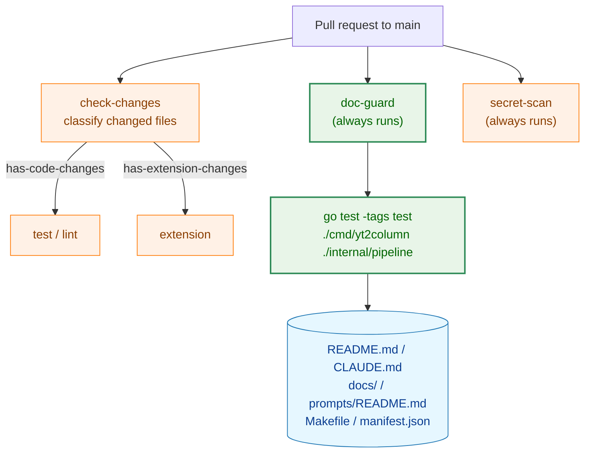
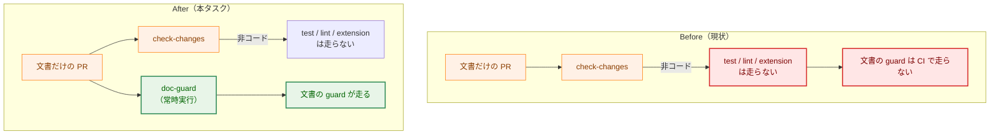
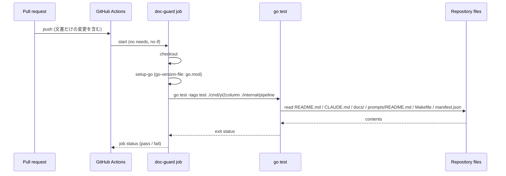
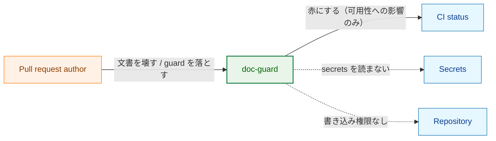

# アーキテクチャ設計書：文書だけの変更でも CI で文書の同期 guard を走らせる

## Document Status

| Item | Value |
|---|---|
| Status | `draft` |
| Created | 2026-10-14 |
| Review date | - |
| Reviewer | - |
| Comments | 本修正で `design_handoff.md` の項目（H-01）を変更したため、再承認が必要である。他の決定は変更していない。 |

## 1. 設計の全体像 (Design Overview)

### 1.1. 設計原則 (設計原則)

1.  **経路を 1 つ足すだけ。** 文書を読む Go の guard を実行するジョブ（`doc-guard`）を `ci.yml` に足す。既存の `check-changes` の分類と、`test`・`lint`・`extension`・`secret-scan` の各ジョブの実行条件・内容は変えない。
2.  **対象パッケージを明示して列挙する。** 文書を読む guard を持つパッケージ（`./cmd/yt2column`・`./internal/pipeline`）を `go test` の引数に列挙する。`-run` でテスト名を絞らない。`./...` を対象にすると、文書だけの PR でも全パッケージのテストを走らせることになり、要件 §4.1（性能）に反する。
3.  **秘密を扱わない。** `doc-guard` は `go test` を実行するだけで、secrets を渡さず、workflow レベルの `permissions: contents: read` を維持する。
4.  **検証は CI 上で行う。** GitHub Actions は手元で動かせないので、ジョブの挙動（文書だけの PR で走ること、guard を壊すと赤になること）は捨てコミットの PR で確認し、`03_implementation_plan.md` に記録する（要件 F-004）。

### 1.2. 概念モデル (Concept Model)

**Legend:** 橙=既存、緑=変更・追加、青=guard が読むデータ。

`doc-guard` は `check-changes` に依存しない（`needs` も `if` も持たない）。そのため、`check-changes` が文書だけの変更を「コードの変更でない」と分類しても、`doc-guard` は走る。

## 2. システム構成 (System Structure)

### 2.1. 全体構成 (Overall Architecture)

**Legend:** 赤=現状の問題、緑=本タスクで追加する経路。

移設（`0012`）の前後で CI の実行範囲は変わらない。本タスクは、文書だけの変更に対する実行範囲を、`check-changes` の分類を変えずに広げる。

### 2.2. コンポーネント配置 (Component Placement)

| ファイル | 変更 | 役割 |
|---|---|---|
| `.github/workflows/ci.yml` | `doc-guard` ジョブを追加 | 常時実行のジョブで `go test -tags test ./cmd/yt2column ./internal/pipeline` を実行する |
| `CLAUDE.md` | 「Development Notes」の規則を更新 | 文書だけの変更を CI が守ることを明記する |
| `docs/tasks/0012_doc_sync_guards/02_architecture.md` | §7.4 を更新 | 残るリスクの記述を、本タスクで CI が守るようになったことに合わせる |
| `docs/tasks/0014_doc_guard_ci/03_implementation_plan.md` | 手動確認の節に記録 | 捨てコミットでの検証結果を残す |

Go のソースコード、`Makefile`、`extension/` は変更しない。新しいパッケージ・型・インタフェースは追加しない。

### 2.3. データフロー (Data Flow)

`doc-guard` は `check-changes` の出力を読まない。`check-changes` が同時に走っていても、その成否・所要時間に依存しない。

## 3. コンポーネント設計 (Component Design)

### 3.1. `doc-guard` ジョブ

`ci.yml` に追加するジョブの形は、`secret-scan` ジョブに倣う。

-   **実行条件:** なし（`needs` も `if` も付けない）。すべての `pull_request`（`main` 向け）で走る。
-   **権限:** ジョブに `permissions` を付けず、workflow レベルの `permissions: contents: read` に委ねる。
-   **ステップ:**
    1.  `actions/checkout@v5`
    2.  `actions/setup-go@v6`（`go-version-file: go.mod`、`cache: true`）
    3.  `go test -tags test ./cmd/yt2column ./internal/pipeline`
-   **`-run` を付けない。** 対象パッケージのテストをすべて実行する。新しい guard を足したときに、テスト名の正規表現から漏れて実行されないことを避ける。

コマンドは `ci.yml` に直接書く（`Makefile` にターゲットを足さない）。理由は §10 の H-01 に記す。

### 3.2. 対象パッケージ

文書を読む guard を持つパッケージを対象にする。`rg` で `*_test.go` が `*.md` を読む箇所を洗い出した結果は次のとおりである。

| パッケージ | 文書を読む guard | 読む文書 |
|---|---|---|
| `cmd/yt2column` | `extension_docs_test.go`・`docs_test.go`（`//go:build test`） | `README.md`・`CLAUDE.md`・`docs/`・`0007`/`0008`/`0010` のタスク文書 |
| `internal/pipeline` | `pipeline_test.go`（`//go:build test`）の `package_reference.md` の検査と `TestPromptsREADMEMatchesContract` | `docs/dev/developer_guide/package_reference.md`・`prompts/README.md` |

これ以外のパッケージに、`*.md` を読む `_test.go` は見つからなかった（`internal/mergepr`・`internal/publisher`・`internal/job`・`cmd/yt2column` の `outpath_test.go` などの `.md` は、一時ディレクトリの出力ファイル名であり、リポジトリの文書ではない）。したがって対象はこの 2 パッケージで足りる。

### 3.3. 文書の更新

-   **`CLAUDE.md`（要件 F-002）。** 「Development Notes」の文書だけの変更に関する規則に、CI の `doc-guard` ジョブが文書の guard を実行することを追記する。移した guard が `make test` に含まれ node を必要としない、という現行の趣旨は維持する。
-   **`0012` の `02_architecture.md` §7.4（要件 F-003）。** 「残るリスク（明示）」の記述を、本タスク（#181）で文書だけの変更を CI が守るようになったことに合わせて更新する。残った限界（対象パッケージを明示列挙していること、後から別パッケージに足した文書 guard はコマンドを更新するまで守らないこと）は消さずに記す。`0012` は承認済みなので、編集の区分（決定変更か編集上の訂正か）を `requirements_process.md` §0 に従って判断し、必要なら `Comments` に記す。

## 4. エラーハンドリング設計 (Error Handling Design)

本タスクは新しいエラー型・エラー処理を追加しない。`doc-guard` ジョブは `go test` を 1 回実行するだけで、その非ゼロ終了をジョブの失敗とする。`go test` の失敗（テストの失敗、コンパイルエラー、対象パッケージの解決失敗）はいずれもジョブを赤にし、失敗したテスト名・パッケージ名がログに出る。

## 5. セキュリティ考慮事項 (Security Considerations)

### 5.1. 設計上の考慮

-   `doc-guard` は secrets を渡さず、環境変数も設定しない。workflow レベルの `permissions: contents: read` を維持する。ジョブに `permissions` を足さない（既定を広げない）。
-   `doc-guard` は `-run` を付けず対象パッケージの全テストを実行するため、テストが起動する子プロセス（テストバイナリの再実行、`/bin/sh`、テスト用の `yt-dlp`）と loopback の HTTP サーバーを起動し、一時ファイルと環境変数も扱う。外部サービス（DeepSeek・Slack）の統合テストは環境変数でゲートされ、`doc-guard` はそれらを設定しないので実行されない。
-   対象の guard（`0012` の文書 guard、`internal/pipeline` の文書 guard）は、いずれもリポジトリのファイルを読むだけで、利用者のデータ・秘密情報を扱わない。

### 5.2. 脅威モデル

**Legend:** 実線=起こりうる影響、点線=起きない経路。

外部の PR 作者ができる最悪のことは、`doc-guard` を赤にすることである。ジョブは secrets を読まず、リポジトリへ書き込む権限を持たない。したがって本タスクは新しい攻撃面を増やさない。

## 6. 処理フローの詳細 (Processing Flow Details)

### 6.1. 文書だけの PR での実行

1.  作者が文書だけを変えて PR を出す（例: `CLAUDE.md` の 1 行）。
2.  GitHub Actions が `pull_request` で workflow を起動する。
3.  `check-changes` が変更を分類し、`has-code-changes=false`・`has-extension-changes=false` を出力する。`test`・`lint`・`extension` は走らない。
4.  `doc-guard` は `needs`・`if` を持たないので起動する。checkout → setup-go → `go test -tags test ./cmd/yt2column ./internal/pipeline` を実行する。
5.  文書の guard が通ればジョブは緑、壊れていれば赤になる。`secret-scan` も独立に走る。

### 6.2. コードの変更を含む PR での実行

`check-changes` が `has-code-changes=true` を出力し、`test`・`lint` が走る。`doc-guard` も走り、`cmd/yt2column`・`internal/pipeline` のテストを重複して実行する。この重複は許容する（要件 §4.1）。`doc-guard` は race を付けず、`test` ジョブ（`make test-ci`）とは対象も実行内容も異なる。

## 7. テスト戦略 (Test Strategy)

### 7.1. 単体テスト

本タスクは Go のソースコードを追加しないので、新しい単体テストは書かない。`doc-guard` が実行するテスト（`cmd/yt2column`・`internal/pipeline` の文書 guard）は既存であり、`make test` でローカルにも走る。

### 7.2. 統合テスト（CI の挙動）

GitHub Actions の挙動は手元で再現できないので、捨てコミットの PR で確認する（要件 F-004）。

-   **文書だけの変更の PR:** `doc-guard` が走り、成功する（AC-06）。
-   **文書の guard を壊す変更の PR:** `doc-guard` が赤になる（AC-07）。壊す対象は、文書の guard が読むファイル（例: `CLAUDE.md` の `ext-` ターゲットの一覧から 1 つ削る）とする。捨てコミットは `main` にマージしない。

確認の手順と結果（workflow の実行 URL など）は `03_implementation_plan.md` の手動確認の節に記録する。

### 7.3. セキュリティテスト

`doc-guard` は secrets を扱わないので、新しいセキュリティテストは追加しない。秘密鍵の混入は既存の `secret-scan`（常時実行）が担う。`doc-guard` が追加の権限を持たないことは、`ci.yml` のレビューで確認する。

### 7.4. 既存テストへの影響

`check-changes` の分類を変えず、既存ジョブの条件・内容も変えないので、`extension/test/ciChanges.test.ts` などの既存テストへの影響はない。`make test`・`make lint`・`make ext-check` の対象は変わらない。

## 8. 実装の優先順位 (Implementation Priorities)

-   **フェーズ 1: `doc-guard` ジョブ（F-001）。** `ci.yml` に `doc-guard` ジョブを追加する。`check-changes` と既存ジョブは変更しない。
-   **フェーズ 2: 文書の更新（F-002・F-003）。** `CLAUDE.md` の規則と、`0012` の `02_architecture.md` §7.4 を更新する。
-   **フェーズ 3: 検証と記録（F-004）。** 捨てコミットの PR で AC-06・AC-07 を確認し、`03_implementation_plan.md` の手動確認の節に記録する。

## 9. 将来の拡張性 (Future Extensibility)

-   **別パッケージに文書 guard を足す場合。** `doc-guard` の `go test` の引数にそのパッケージを足す。`-run` で絞らない方針を保てば、そのパッケージの新しい guard も自動的に実行される。
-   **branch protection の必須チェック。** 必須チェックを設定している場合は、`doc-guard` を登録する人手の作業が要る（制約・`03_implementation_plan.md` の Next Steps）。
-   **`check-changes` の分類を変える案。** `.md`・`docs/` を除外から外す、または guard が読むファイルを分類に加える案は、実行時間と分類の設計を変えるので採らない（§11）。

## 10. 設計への申し送りへの回答 (Handling of design_handoff Items)

| 項目 | 本設計の回答 |
|---|---|
| H-01（コマンドの置き場） | `ci.yml` の `doc-guard` ジョブに `go test -tags test ./cmd/yt2column ./internal/pipeline` を直接書く。`Makefile` にターゲットを足さない。対象は 2 パッケージで固定であり、同じコマンドを複数の手順から呼ぶ必要がないため（`secret-scan` が `git grep` を直接書くのと同じ形。§3.1） |
| H-02（対象パッケージの範囲） | 対象は `./cmd/yt2column ./internal/pipeline`。`rg` で `*_test.go` が `*.md` を読む箇所を洗い出し、この 2 パッケージ以外にリポジトリの文書を読む guard がないことを確認した（§3.2）。`internal/pipeline` を足しても実行時間はほぼ変わらない（要件 §4.1 の実測） |
| H-03（`-tags` の選択） | `-tags test` のみ。対象の文書 guard は `//go:build test` で、`integration` を要しない（§3.2・要件 §4.4） |
| H-04（ジョブの権限と実行条件の明示） | workflow レベルの `permissions: contents: read` に委ね、ジョブに `needs`・`if`・追加の `permissions` を付けない（`secret-scan` と同じ）。分類の変更に依存せず常時走る（§3.1・§5.1） |

## 11. 決定の履歴（付録）

本節は、本タスクで採らなかった案と、後から読む人が疑問に思う決定を記録する。本体（§1〜§10）は現在の設計だけを述べる。

-   **`./...` を対象にする案。** `go test -tags test ./...` を `doc-guard` で呼べば、文書を読む guard を将来足しても自動的に守られる。採らなかった理由は、文書だけの PR でも全パッケージのテストを走らせることになり、実行時間が延びるため（要件 §4.1・§4.5）。対象を明示列挙し、新しい文書 guard を足すときにコマンドを更新する。
-   **`check-changes` の除外から `.md`・`docs/` を外す案。** 変更は 1 行で済むが、文書だけの PR でも race 付きの全テストと lint が走る。実行時間が延び、分類の設計も変わるため採らない（issue #181 の「採らない案」）。
-   **`Makefile` に `test-doc-guard` ターゲットを足す案。** 手元でも同じコマンドを再現できるが、対象は 2 パッケージで固定であり、`ci.yml` に直接書けば十分である。複数の手順から同じコマンドを呼ぶ必要が出たときに検討する（H-01）。
-   **文書 guard を `cmd/yt2column` に集約する案。** `internal/pipeline` の 2 つの文書 guard を `cmd/yt2column` へ移せば、対象を 1 パッケージにできる。採らなかった理由は、要件が guard 本体の変更をスコープ外とし（要件 §2.3）、`internal/pipeline` の guard が `internal/writer` の契約を読む（`TestPromptsREADMEMatchesContract`）など、パッケージ内のコードに依存しているため。
