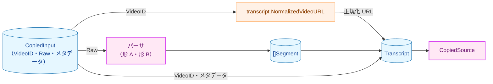
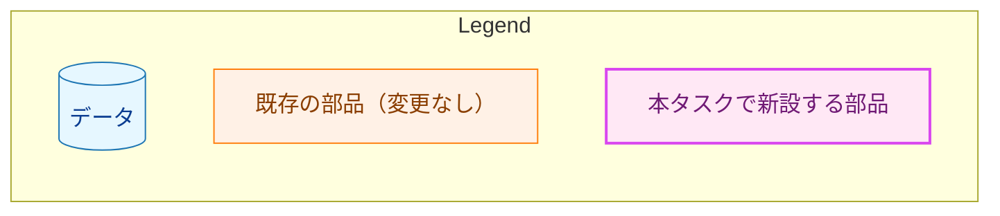
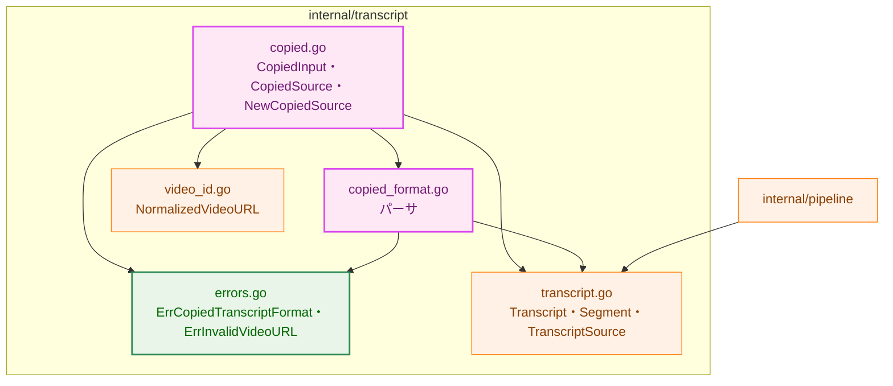
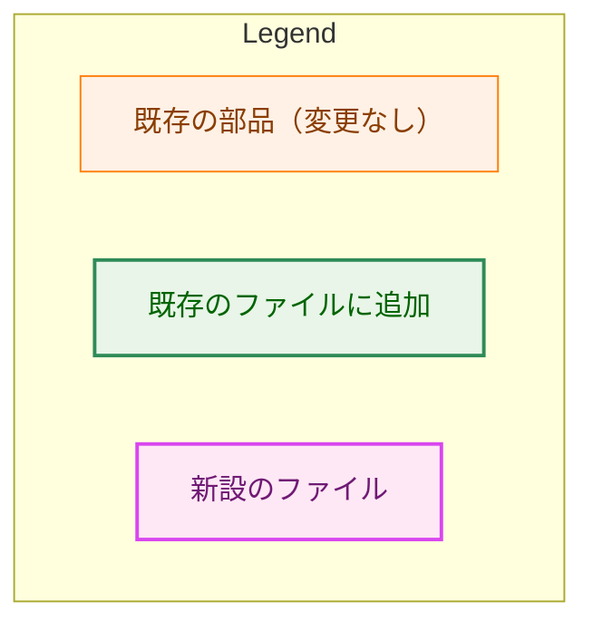
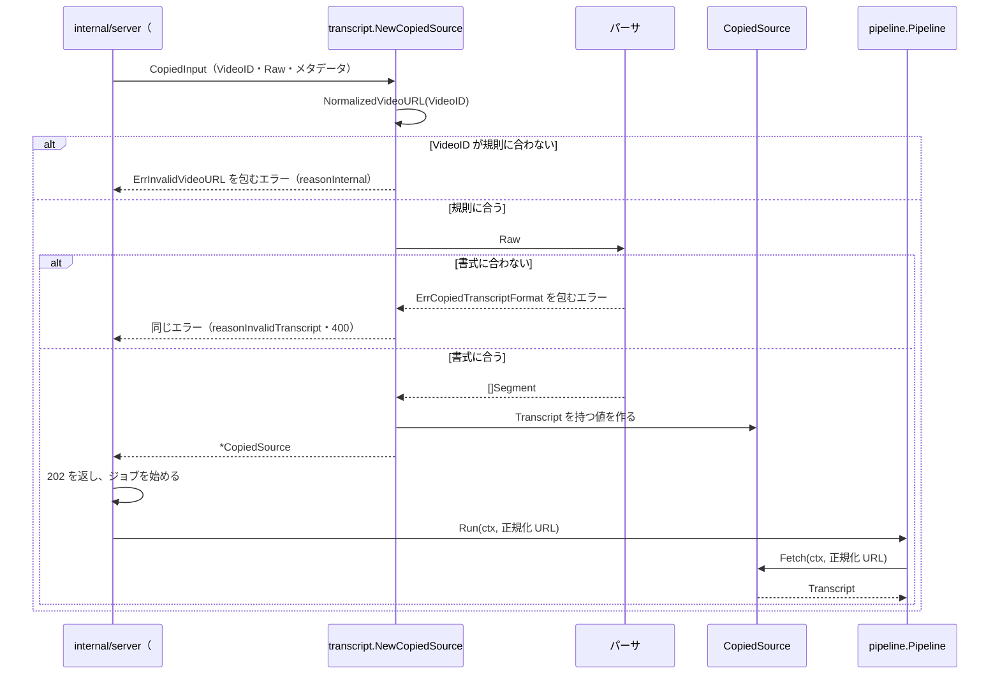
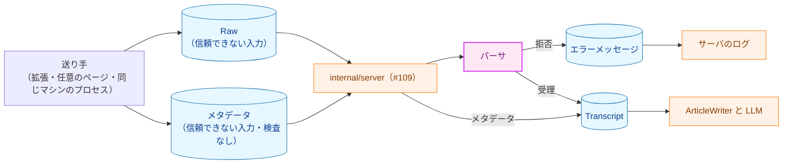
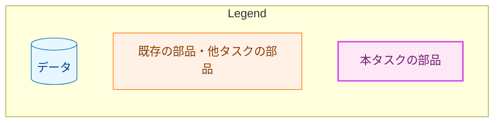
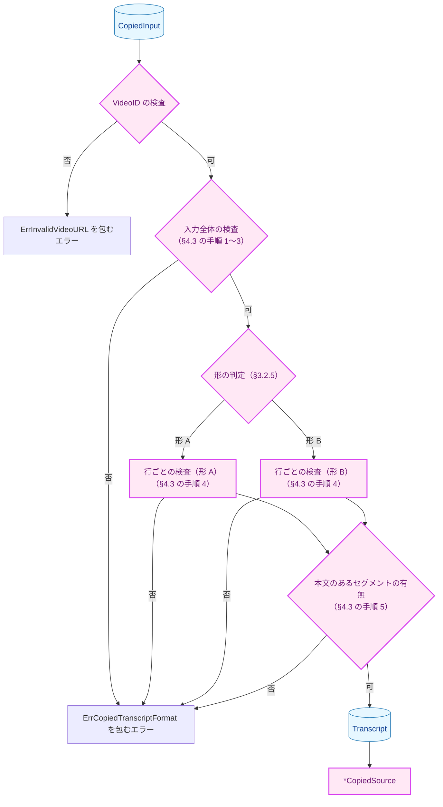
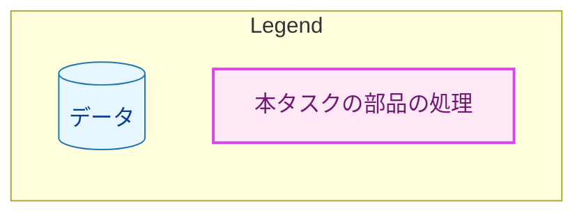
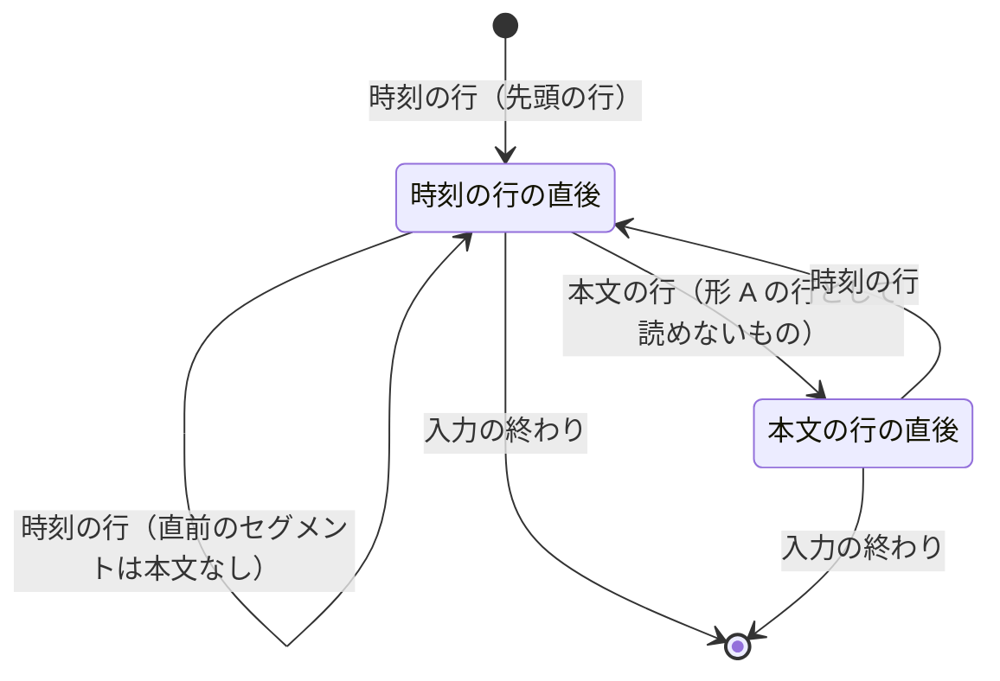

# アーキテクチャ設計書：コピーした字幕のパーサと TranscriptSource

## Document Status

| Item | Value |
|---|---|
| Status | `approved` |
| Created | 2026-10-14 |
| Review date | 2026-10-14 |
| Reviewer | isseis |
| Comments | 2026-10-14 記述の訂正（決定の変更なし）: 実データの追加のコミットを、存在しない `938a4d9` から squash 後の `4fe06e0` に改め、§3.4・§8 で `testdata/README.md`・`.gitattributes` が同コミットで追加済みであることを明記した。 |

本書の F-NNN・AC-NN は [01_requirements.md](01_requirements.md) の項番を指す。既存のコードと文書の行番号は、コミット `0a46cf0`（要件の承認のコミット）で確かめたものである。「0011 §N」は [0011_localhost_server/02_architecture.md](../0011_localhost_server/02_architecture.md) の節を、「0007」は [0007_browser_extension_skeleton/](../0007_browser_extension_skeleton/) の文書を指す。

**用語。** 本書では、要件書の用語（コピーした字幕・形 A・形 B・時刻の行・本文の行・字幕書式）に加えて、次の語を使う。

-   **読み上げ用ラベル:** 形 A で時刻の直後に連結される、画面読み上げ用の所要時間の文字列（例: `24 秒`・`1 minute, 6 seconds`）。要件書の「画面読み上げ用の所要時間のラベル」と同じものである。以下、単に「ラベル」とも書く。
-   **日本語 UI・英語 UI:** YouTube の表示言語が日本語・英語であることをいう。
-   **行:** 入力を行の区切り（LF または CRLF）で分けた 1 つ分。行の区切りそのものは行に含めない。入力の末尾の行の区切りは最後の行の終わりを示すだけで、その後ろに新しい行は始まらない（`a\n` は 1 行 `a` である）。行番号は 1 から数える。
-   **本文:** セグメントの字幕のテキスト（形 A では読み上げ用ラベルの後ろ、形 B では本文の行）。HTTP のリクエストの本文は「リクエストの本文」と書いて区別する。
-   **パーサ:** コピーした字幕を解析して `[]transcript.Segment` を作る、`internal/transcript` の非公開の関数群。
-   **source:** 本タスクで作る `transcript.CopiedSource` の値。`transcript.TranscriptSource` を実装する。

## 1. 設計の全体像 (Design Overview)

### 1.1. 設計原則

1. **書式を明示的に定義し、定義に合わない入力は拒否する。** 受理するのは §3.2 で定義する形 A と形 B だけである。表記の揺れを吸収する規則（空白の正規化、区切りの読み替え、行の結合など）を持たない（CLAUDE.md「Reject, don't normalize」、F-002）。ゆるく受理すると、本文の分割が黙ってずれる。たとえば形 A は `<時刻><読み上げ用ラベル><本文>` を区切りなしに連結した形なので、本文の先頭の数字をラベルの一部と取り違えかねない。拒否は利用者が気づけるが、誤った分割は気づかれないまま記事の生成に流れる。
2. **境界は時刻から導く。** 形 A の読み上げ用ラベルは、直前の時刻から日本語 UI と英語 UI のそれぞれについて一意に決まる。パーサは時刻からラベルを作り、行のその位置がラベルと一致するかだけを見る。ラベルの形を文字の並びから推測しない（F-002）。
3. **解析は構築のときに 1 回だけ行う。** `NewCopiedSource` が解析し、`CopiedSource` は解析済みの `Transcript` だけをフィールドに持つ。生の字幕のフィールドを持たないので、`Fetch` が解析をやり直すことは構造上ない（0011 §3.7、AC-09）。
4. **既存の型と関数を使い、変えない。** `transcript.Transcript`・`Segment`・`TranscriptSource` は変更しない（要件 4.5）。動画 ID から正規化 URL を作るのは既存の `transcript.NormalizedVideoURL` である。
5. **エラーは理由と行番号だけを持つ。** 拒否のエラーは `ErrCopiedTranscriptFormat` を包み、固定の理由の文と行番号だけを含む。入力の文字列を含めない（AC-06）。
6. **時間とメモリは入力の長さに比例する。** 入力を先頭から順に読み、各行で行う処理は行の長さに比例する（AC-08）。

### 1.2. 概念モデル

矢印 A → B は「A の値から B を作る」を表す。`CopiedSource` は、作った `Transcript` を `Fetch` でそのまま返す（§3.1）。





### 1.3. 既存コードとの関係

| 既存のもの | 本設計での扱い |
|---|---|
| `transcript.TranscriptSource`（`internal/transcript/transcript.go:23-28`） | `CopiedSource` が実装する。interface は変えない |
| `transcript.Transcript`・`Segment`（`transcript.go:7-21`） | 変更しない。`StartMs` はミリ秒、`Text` は本文をそのまま入れる。`internal/pipeline` の `TestCommonTypesFieldSets`（`internal/pipeline/pipeline_test.go:378`）は変更なしで通る |
| `transcript.NormalizedVideoURL`（`internal/transcript/video_id.go:62-69`） | `CopiedInput.VideoID` の検査と正規化 URL の導出に使う。動画 ID の規則を本タスクで再実装しない |
| 番兵エラー（`internal/transcript/errors.go:8-16`） | `ErrCopiedTranscriptFormat` を同じ `var` の並びに加える。動画 ID の誤りと URL の不一致には既存の `ErrInvalidVideoURL` を使う |
| json3 のパーサ（`internal/transcript/json3.go`） | 共有する処理はない。JSON ではない平文を解析するので、`internal/strictjson` は使わない。非公開の番兵で理由を分け、公開の番兵で包む形（`json3.go:20-28`・`:35`）は同じにする |
| `YtDlpSource.Fetch`（`internal/transcript/ytdlp.go:54-57`） | `Fetch` の冒頭で `ctx.Err()` を確かめる形をそろえる |
| `writer` の `validateTranscript`（`internal/writer/prompt.go:50-82`） | 変更しない。空・空白だけの `Segment.Text`（`prompt.go:61-65`）と、無効な UTF-8 の `Text`（`:76-80`）・メタデータ（`:71-75`）を拒否する。パーサが作る `Segments` はこの検査を必ず通る（§3.2.1 で入力の UTF-8 を、§3.2.4 で空白だけの本文を拒否し、§3.2.7 で本文のないセグメントを作らないため）。メタデータの UTF-8 は本タスクでは検査しない。サーバでは `strictjson` がリクエストの本文全体を検査する（0011 §3.6 (a)）。0011 §3.9 は、検査済みの `Transcript` で `writer.ErrInvalidTranscript` が起きないことを前提にする。本設計は、サーバから使う場合に限り、この前提を満たす |
| `writer` の `newTemplateData`（`prompt.go:84-98`） | 変更しない。各 `Segment.Text` を `\n` で連結してプロンプトに入れ、`StartMs` は使わない |
| 拡張の選択範囲の取得（0007 `02_architecture.md:380`・`extension/src/core/collect.ts:31`） | 変更しない。拡張は `window.getSelection().toString()` の文字列を、補正せずにそのまま扱う。§1.4.3 で、この文字列が本書の書式の調査に使ったクリップボードの文字列と同じであることを確かめた |

#### 1.3.1. 方針への例外

本設計は、既存の 2 つの方針に例外を設ける。

**例外 1: 「Declare, don't infer」（F-004）。**

-   **元の方針と出典:** CLAUDE.md「Declare, don't infer」は、呼び出し側が与えた文字列の中身を調べて振る舞いを選ぶことを禁じ、選択は型（列挙のフィールドと `switch`）に置くよう求める。
-   **例外とする理由:** コピーした字幕は YouTube の文字起こしパネルが作り、利用者がコピーした外部の値である。形 A か形 B か、どこが時刻でどこが本文かを、呼び出し側（拡張・サーバ）は型で表せない。書式は YouTube の UI が決めるので、こちらが型を変えても入力は変わらない。
-   **範囲:** 中身を調べて振る舞いを選ぶのは、パーサの中の次の 3 つに限る。形の判定（§3.2.5）、行の種類（時刻の行か本文の行か）の決定、読み上げ用ラベルの境界の決定。`CopiedSource` のほかの部分と、呼び出し側（サーバ）は、中身を調べない。サーバは `ErrCopiedTranscriptFormat` を `errors.Is` で判定し、エラーの文字列を調べない（0011 §3.7）。
-   **古い振る舞いを確かめている既存のテスト:** ない。
-   CLAUDE.md への記載の文面は §3.6 に定める。

**例外 2: 「字幕取得は `yt-dlp` に委譲する」。**

-   **元の方針と出典:** [project_overview.md](../../dev/project_overview.md):11 は「字幕取得: 外部コマンドの `yt-dlp` に委譲する。YouTube の非公式な仕様に依存する最も壊れやすい部分を、保守が活発なツールに任せるため。Go で字幕取得を自前実装しないこと」と定める。CLAUDE.md「Delegate the fragile part」（`CLAUDE.md:128`）も同じ方針である。
-   **例外とする理由:** `yt-dlp` による取得は HTTP 429 で失敗し続けることがあり（Issue #43）、字幕の取得を利用者のブラウザに任せる方式にした（Issue #104）。その結果、YouTube の文字起こしパネルの出力という、非公式で予告なく変わりうる書式に Go のコードが依存する。本タスクは字幕を取得しない（ネットワークに触れない）が、壊れやすさの性質は同じである。
-   **範囲:** パネルの出力の書式への依存は、`internal/transcript` のコピーした字幕のパーサに限る。YouTube のページやパネルを Go から取得・解析することはしない。`yt-dlp` による取得の経路（`YtDlpSource` と CLI）は残し、パネルの書式が変わって拒否が続く間の代わりの手段とする（§1.4.4）。
-   **古い振る舞いを確かめている既存のテスト:** ない。
-   `project_overview.md:11` と CLAUDE.md の当該の項に、この例外を加える（§3.4）。

### 1.4. 事前調査の結果（F-001）

調査は 2026-10-14 に行った。条件は、Brave 1.97.56（Chromium 155.0.8059.40、arm64、macOS）である。文字起こしパネルの最初のセグメントの時刻の先頭から、最後のセグメントの本文の末尾までをドラッグで選択し、Cmd+C でコピーして、`pbpaste` でファイルに書き出した。エディタを経由していない。§1.4.1・§1.4.2 はログインしていない状態の結果であり、ログインした状態と拡張の経路での結果は §1.4.3 に示す。表示言語は、表の「表示言語」の欄のとおりである。

#### 1.4.1. 動画ごとの属性と書式（AC-01b）

| 動画 ID | 字幕の言語 | 自動/手動 | 長さ（最後のセグメント） | ライセンス | ブラウザ | 表示言語 | 形 | 検索欄の表記 | `testdata/` |
|---|---|---|---|---|---|---|---|---|---|
| `IkngpxCMmRQ` | 日本語 | 自動 | 5:15（5:12） | CC BY | Brave | 日本語・英語 | A | `文字音声変換を検索`・`Search transcript` | 保存する |
| `nv94SmoSPQA` | 日本語 | 自動 | 2:10:45（2:10:37） | 標準 | Brave | 日本語・英語 | A | `文字音声変換を検索` | 保存しない |
| `LR6mhKRKX9Q` | 未記録 | 未記録 | 未記録（先頭の 3 セグメントだけを取得） | 未記録 | Brave | 日本語・英語 | A | `文字音声変換を検索` | 保存しない |
| `Yoboo9g7saY` | 日本語 | 手動 | 10:07（10:01） | CC BY | Brave | 日本語 | B | `動画内を検索` | 保存する |
| `mbyG85GZ0PI` | 英語 | 手動 | 1:21:27（1:21:11） | CC BY | Brave | 日本語 | B | `動画内を検索` | 保存する |
| `BkaUHsH_mkw` | 日本語 | 自動 | 10:11（10:02） | CC BY | Brave | 日本語 | B | `動画内を検索` | 保存しない（チャプターの見出しを含む） |
| `9nx455-_h68` | 英語 | 自動 | 16:51（16:50） | 標準 | Brave | 日本語 | B | `動画内を検索` | 保存しない |
| `W6srShxBCrk` | - | - | - | - | - | - | B（要件の作成時の観測） | - | - |

-   日本語の自動・日本語の手動・英語の自動・英語の手動のサンプルは、すべて得られた。
-   `W6srShxBCrk` は、2026-10-14 の時点で文字起こしを取得できなかった。形 B は要件の作成時の観測である。
-   `LR6mhKRKX9Q` は、時刻 `0:00` の読み上げ用ラベルを確かめるためだけに使った。字幕の言語・長さ・ライセンスは記録していない。
-   同じ動画が Chrome でも Brave でも同じ形になることは、要件の作成時に確かめている（要件 F-002）。本調査では Chrome を使っていない。
-   形 B の動画は、英語 UI で調べていない。形 B は読み上げ用ラベルを含まないので、表示言語で書式が変わる箇所はないとみているが、確かめていない（§5.4）。
-   `mbyG85GZ0PI` のパネルにはチャプターの切り替えがある。AC-01 は「チャプターのない動画を選ぶ」とするが、この動画のコピーにはチャプターの見出しが入らないので、サンプルとして使う。

観測した書式を次に示す。

| 動画 ID | 行数 | 時刻・本文の並び | 読み上げ用ラベル | 時刻の文法 | 行の区切り | 空行 | 本文の行数 | 前後の空白・末尾の改行 | 混じる表示項目 |
|---|---|---|---|---|---|---|---|---|---|
| `IkngpxCMmRQ` | 40 | 1 セグメント 1 行 | 日本語 `3 秒`・`5 分 4 秒`、英語 `3 seconds`・`5 minutes, 4 seconds` | `m:ss` | LF | なし | 1 | 行の前後の空白なし・末尾の改行なし | なし |
| `nv94SmoSPQA` | 896 | 1 セグメント 1 行 | 日本語 `1 時間 30 秒`・`1 時間 9 分`・`2 時間 10 分 26 秒`、英語 `2 minutes, 1 second`・`1 hour, 30 seconds`・`1 hour, 9 minutes`・`2 hours, 10 minutes, 26 seconds` | `m:ss`・`mm:ss`・`h:mm:ss` | LF | なし | 1 | 同上 | なし |
| `LR6mhKRKX9Q` | 3 | 1 セグメント 1 行 | `0:00` が日本語 `0 秒`、英語 `0 seconds` | `m:ss` | LF | なし | 1 | 同上 | チャプターの見出し `チャプター 2: 通常スピード` が独立した行として入る |
| `Yoboo9g7saY` | 370 | 時刻の行と本文の行が交互 | なし | `m:ss`・`mm:ss` | LF | なし | 常に 1 | 同上 | なし |
| `mbyG85GZ0PI` | 1398 | 同上 | なし | `m:ss`・`mm:ss`・`h:mm:ss`（181 行） | LF | なし | 0 または 1（本文のない時刻の行が 4 つ: `51:07`・`52:06`・`52:13`・`1:18:57`。`52:06`・`52:13`・`52:20` は時刻の行が 3 行続く） | 同上 | なし |
| `BkaUHsH_mkw` | 307 | 同上 | なし | `m:ss`・`mm:ss` | LF | なし | 1 | 同上 | チャプターの見出しが 3 行（本文の行の直後、時刻の行が来るはずの位置） |
| `9nx455-_h68` | 913 | 同上 | なし | `m:ss`・`mm:ss` | LF | なし | 1 | 同上 | チャプターの見出しが 7 行（同上。パネルには見えていない） |

すべてのサンプルに共通する観測は次のとおりである。

-   UTF-8 で、空白は U+0020 だけだった。NBSP・全角空白・タブ・CR はない。
-   どの行も、先頭と末尾に空白がない。本文の途中には空白がある（字幕の行の結合の跡とみられる）。
-   ファイルの末尾に改行がない。
-   時刻は減らない。同じ時刻が 2 回続く例がある（`nv94SmoSPQA` の `1:43:33`、`BkaUHsH_mkw` の `3:42`）。
-   本文は数字で始まりうる（`nv94SmoSPQA` の `1:00:57` + `1 時間 57 秒` + `1 種類の花が…`）。本文が `。` だけの行や、ラオ文字の行もある（自動字幕の誤認識）。
-   角括弧は `[拍手]`（形 A の自動字幕）と全角の `（拍手）`（形 B の手動字幕）の両方があった。
-   形 A の本文が空のセグメントは、コピーした文字列では観測していない。既存の `testdata/2tcCWM-sRBw.transcript_panel.html`（形 A のパネルの DOM）では、先頭のセグメントが時刻 `0:04`、ラベル `4 秒`、本文が空である。
-   パネルに見えていないチャプターの見出しの要素も、選択範囲に含まれてコピーされる（`BkaUHsH_mkw`・`9nx455-_h68`）。チャプターの見出しは形 A にも形 B にも入る。

#### 1.4.2. 長い動画の選択（AC-03）

-   2:10:45 の `nv94SmoSPQA`（896 行、106 KB）と 1:21:27 の `mbyG85GZ0PI`（1398 行、78 KB）で、パネル全体をドラッグ 1 回で選択できた。途中で選択が外れる、パネルの一部しか読み込まれない、といったことはなかった。
-   選択できる長さの上限には当たらなかった。調べた最長は 2 時間 10 分である。サーバのリクエストの本文の上限 4 MiB は、`nv94SmoSPQA` の大きさの約 40 倍にあたる。
-   選択できない場合に利用者が取れる手段は、既存の CLI（`yt2column <URL>`、`yt-dlp` で字幕を取る経路）を使うことである。パネルを複数回に分けてコピーし、つなげて送る手段は用意しない。つなげる際の重複の一部は時刻の減少として拒否されるが（§3.2.6）、欠落は検出できないからである。

#### 1.4.3. 拡張の経路とログインした状態

-   **拡張の経路。** 拡張は選択範囲を `window.getSelection().toString()` で読む（0007 `02_architecture.md:380`・`extension/src/core/collect.ts:31`）。本書の調査はクリップボード（Cmd+C）を使ったので、両者が同じ文字列になるかを確かめた。`IkngpxCMmRQ`（形 A）と `Yoboo9g7saY`（形 B）で、先頭の 3 セグメントを選択したまま DevTools の Console で `copy(window.getSelection().toString())` を実行し、`pbpaste` で書き出した。どちらも、クリップボードで得たサンプルの先頭とバイト列として一致した（形 A は 450 バイト、形 B は 151 バイト）。形 A の時刻・読み上げ用ラベル・本文の間に改行は入らない。0007 AC-13（`0007/01_requirements.md:158`）の「時刻の行と本文の行が改行で区切られている」は、形 B にあてはまる記述である。
-   **ログインした状態。** YouTube にログインした状態でも、`IkngpxCMmRQ` は形 A（検索欄 `文字音声変換を検索`）、`Yoboo9g7saY` は形 B（検索欄 `動画内を検索`）だった。`IkngpxCMmRQ` の先頭の 3 セグメントの `getSelection().toString()` は、ログインしない状態と 450 バイトすべてが一致した。`Yoboo9g7saY` は、アカウントの設定により既定の字幕が英語の手動字幕になったが、書式は形 B のまま（時刻の行と本文の行が LF で交互、末尾に改行なし）だった。調べたアカウントは 1 つである。

#### 1.4.4. 書式が変わったときの扱い

形 A・形 B のどちらにも合わない書式は拒否される。YouTube の UI の変更で書式が変わると、その書式の入力は、本書の §3.2 を改めるまで受理されない。その間、利用者は既存の CLI（`yt-dlp` の経路）を使う。開発者が新しい書式を定義するには、拒否された入力の実物が要る。利用者は、拒否されたときの選択範囲を Console の `copy(window.getSelection().toString())` と `pbpaste` でリポジトリの外のファイルに書き出し、開発者に渡す（security.md §7。字幕の全文は再配布の許諾のない限りコミットしない）。

## 2. システム構成 (System Structure)

### 2.1. パッケージ構成

新しいパッケージは作らない。`internal/transcript` にファイルを加える。

矢印 A → B は「A が B の関数を呼ぶ、または B の型を使う」を表す。





本タスクの部品を使うのは、#109 が作るサーバ（`internal/server`。まだリポジトリにない）である。サーバは `NewCopiedSource` で source を作り、`internal/pipeline` に渡す（§2.3）。

### 2.2. コンポーネント配置

| 部品 | 置き場所 | 公開/非公開 |
|---|---|---|
| `CopiedInput`・`CopiedSource`・`NewCopiedSource`・`(*CopiedSource).Fetch` | `internal/transcript/copied.go` | 公開（0011 §3.7 が必要とするもの） |
| `ErrCopiedTranscriptFormat` | `internal/transcript/errors.go` | 公開 |
| パーサ（時刻の文法、読み上げ用ラベルの導出、形の判定、行の分類） | `internal/transcript/copied_format.go` | 非公開 |
| 拒否の理由ごとの番兵 | `internal/transcript/copied_format.go` | 非公開 |

公開するのは 0011 §3.7 の契約に必要なものだけである（要件 4.5）。パーサを単独で公開しない。`CopiedSource` を通さずに `[]Segment` を使う呼び出し側がないためである。

### 2.3. データフロー

サーバ（#109）が本タスクの部品を使うときの流れを示す。サーバの部分は 0011 §3.5.2・§3.7 の設計であり、本タスクでは作らない。実線の矢印は呼び出し、点線の矢印は戻り値を表す。この図はノードを色で分類しないので、Legend を置かない。



## 3. コンポーネント設計 (Component Design)

### 3.1. 公開の型と関数

0011 §3.7 の契約の名前をそのまま使う。

```go
// CopiedInput is the input of NewCopiedSource. VideoID must already be
// validated by the caller (for the server, by ValidateVideoURL); Raw is the
// transcript text copied from YouTube's transcript panel, unmodified.
type CopiedInput struct {
	VideoID     string
	Raw         string
	Title       string
	ChannelName string
	Description string
}

// CopiedSource serves a transcript parsed from a CopiedInput. Its only field
// is the parsed Transcript; it has no field for the raw text. Build it with
// NewCopiedSource; a zero CopiedSource fails every Fetch.
type CopiedSource struct {
	transcript Transcript
}

// NewCopiedSource validates in.VideoID, parses in.Raw, and returns a source
// that serves the result. A VideoID that NormalizedVideoURL rejects returns an
// error wrapping ErrInvalidVideoURL; it is the caller's mistake, so classify
// it by the call site, never with errors.Is(err, ErrInvalidVideoURL). A Raw
// that matches neither form A nor form B returns an error wrapping
// ErrCopiedTranscriptFormat.
func NewCopiedSource(in CopiedInput) (*CopiedSource, error)

// Fetch returns the parsed transcript when videoURL is exactly the normalized
// URL of the input VideoID. It never parses again.
func (s *CopiedSource) Fetch(ctx context.Context, videoURL string) (Transcript, error)
```

```go
// ErrCopiedTranscriptFormat is wrapped by every error NewCopiedSource returns
// because the copied transcript does not match the defined format.
var ErrCopiedTranscriptFormat = errors.New("copied transcript does not match the expected format")
```

| 性質 | 内容 | AC |
|---|---|---|
| 構築の検査の順序 | `VideoID` を先に検査し、次に `Raw` を解析する。両方が誤っている入力は `ErrInvalidVideoURL` を包むエラーになる。サーバでは `VideoID` は検査済みなので、この順序が結果を変えることはない | AC-09 |
| 返す `Transcript` | `VideoID` は入力の値、`VideoURL` は `NormalizedVideoURL(VideoID)` の値、`Title`・`ChannelName`・`Description` は入力の値をそのまま（空を含む）、`Segments` はパーサの結果 | AC-11・AC-12・AC-13 |
| `Fetch` の検査 | 次の順に確かめ、最初に当たったエラーを返す。(1) `ctx.Err()` が nil でなければそのエラー（`YtDlpSource.Fetch` と同じ。`ytdlp.go:55-57`）。(2) 保持する `Segments` が空なら、`ErrInvalidVideoURL` を包まない固定の文のエラー（`copied transcript source is not initialized`。ゼロ値の `CopiedSource`）。(3) `videoURL` が保持する `Transcript.VideoURL` とバイト列として一致しなければ、`ErrInvalidVideoURL` を包むエラー。空文字列・別の動画の URL・正規化されていない URL（`youtu.be` の形など）はここで拒否する。エラーに `videoURL` の値を含めない。nil の `*CopiedSource` での呼び出しは、`NewCopiedSource` が成功時に nil を返さないので考えない | AC-10 |
| ゼロ値 | ゼロ値の `CopiedSource` は `Transcript.VideoURL` も空なので、(3) だけでは `Fetch(ctx, "")` を拒否できない。(2) がこれを拒否し、`TranscriptSource` の「空の `Transcript` を成功として返さない」（`transcript.go:23-25`）を守る | - |
| 解析のやり直し | `CopiedSource` のフィールドは `transcript` だけである。`Fetch` は保持した `Transcript` を返すだけである。なお、`Segment.Text` が `Raw` の部分文字列であれば、`Raw` のメモリは source が使われなくなるまで解放されない（§3.3） | AC-09 |
| 並行性 | 1 つの source は 1 つのジョブだけが使う（0011 §3.7）。返す `Segments` は保持しているスライスそのもので、写しを作らない。呼び出し側がこれを書き換えると、後の `Fetch` の結果も変わる。パイプラインの後段（`writer`）は `Segments` を読むだけである | - |

`Fetch` の URL の不一致と `VideoID` の誤りに `ErrInvalidVideoURL` を使うのは、どちらも「動画の URL・ID が規則や期待と合わない」という既存の意味に当たるためである。`ErrCopiedTranscriptFormat` は包まない（要件 F-003）。サーバは、`NewCopiedSource` の呼び出しで得たエラーのうち `ErrCopiedTranscriptFormat` を包まないものを `reasonInternal` に対応させる（0011 §3.7）。0011 §3.6 は `ErrInvalidVideoURL` を `reasonInvalidVideoURL` に対応させる。ただし、この対応は `ValidateVideoURL` を呼んだ箇所のエラーに限る。エラーの内容ではなく、呼び出した箇所で分ける。

### 3.2. 字幕書式の定義

本節が、パーサの受理する形を定める唯一の定義である（F-001）。§1.4 の観測をすべて受理する。観測していないが受理する形は、§3.2.8 に理由とともに列挙したものに限る。

#### 3.2.1. 入力全体と行の規則

-   入力は有効な UTF-8 である（AC-07）。
-   空白文字（Unicode の White_Space。Go の `unicode.IsSpace` が真の文字）以外の文字を 1 つ以上含む（AC-07）。
-   行の区切りは、入力の中ですべて LF（`\n`）か、すべて CRLF（`\r\n`）である。LF と CRLF の混在と、CRLF の一部でない CR は拒否する（AC-07a）。
-   入力の末尾の行の区切りは 0 個か 1 個である。末尾に区切りが 2 個以上続く入力は、空の行を含むものとして拒否する（AC-07a）。報告する行番号は、最初の空の行の番号（末尾の区切りの前にある行の数に 1 を足した値）である。`a\n\n` も `a\n\n\n` も 2 行目になる。
-   空の行（0 文字の行）を含まない。
-   どの行も、制御文字（Unicode の一般カテゴリ Cc。タブを含む）を含まない。行の区切りは行に含まれないので、この規則に当たらない。

#### 3.2.2. 時刻の文法

時刻は次のどちらかである。要件と §1.4.1 の `mm:ss` は、`m:ss` の分が 2 桁の場合として `m:ss` に含める。数字は ASCII の `0`〜`9` だけで、全角の数字は含まない。

| 形 | 規則 | 例 |
|---|---|---|
| `m:ss` | 分は `0`〜`59`。`0` 以外は先頭が `0` でない 1〜2 桁。秒は `00`〜`59` のちょうど 2 桁 | `0:00`・`0:24`・`10:08`・`59:59` |
| `h:mm:ss` | 時は `1`〜`99` で先頭が `0` でない 1〜2 桁。分・秒は `00`〜`59` のちょうど 2 桁 | `1:00:07`・`2:10:26` |

-   `05:00`（分の先頭の `0`）、`60:00`（`m:ss` で 60 分以上）、`0:5`（秒が 1 桁）、`0:01:00`（時が 0）、`100:00:00`（時が 3 桁）は時刻ではない。
-   `StartMs` は `((時 × 60 + 分) × 60 + 秒) × 1000` である。最大は 99:59:59（359,999,000 ミリ秒）で、`int64` で桁あふれしない。

#### 3.2.3. 読み上げ用ラベル

時刻からラベルを 2 通り（日本語 UI・英語 UI）導く。どちらも、0 の単位を省き、時・分・秒の順に並べる。すべての単位が 0 の時刻（`0:00`）だけは、秒を残す。

| | 単位の書き方 | 単位の区切り | 例 |
|---|---|---|---|
| 日本語 UI | `N 時間`・`N 分`・`N 秒` | 空白 1 つ | `0 秒`・`3 秒`・`1 分`・`1 分 6 秒`・`1 時間 9 分`・`1 時間 30 秒`・`2 時間 10 分 26 秒` |
| 英語 UI | `N hour`・`N minute`・`N second`。N が 1 のときは単数形、それ以外（0 を含む）は末尾に `s` を付けた複数形 | `, `（カンマと空白 1 つ） | `0 seconds`・`2 minutes, 1 second`・`24 seconds`・`1 minute`・`1 minute, 6 seconds`・`1 hour, 9 minutes`・`2 hours, 10 minutes, 26 seconds` |

`N` は先頭に `0` を付けない 10 進数である（`1:05` は `1 分 5 秒`）。時刻と読み上げ用ラベルの間、読み上げ用ラベルと本文の間に区切り文字はない。

#### 3.2.4. 形 A と形 B

**形 A の行。** `<時刻><読み上げ用ラベル><本文>` の連結である。

-   読み上げ用ラベルは、その行の時刻から導いたラベルと、文字列として一致する。ラベルの言語（日本語 UI か英語 UI か）は、入力の最初の行で一致した言語に固定する。以後の行は、同じ言語のラベルと一致しなければならない。1 回のコピーは 1 つの表示言語のパネルから得るので、言語が混ざることはない。
-   本文は、ラベルの直後から行末までである。0 文字でもよい（本文のないセグメント）。1 文字以上なら、空白文字だけであってはならない。本文の先頭・末尾の空白文字は、そのまま本文に含める。
-   行頭から時刻と読み上げ用ラベルを読み取る方法は、たかだか 1 通りである。行頭に `m:ss` と `h:mm:ss` の両方が当てはまるのは、`m:ss` の直後が `:` の場合だけである。読み上げ用ラベルは数字で始まるので、この場合に `m:ss` の直後へラベルが続くことはない。そこで、行頭が `m:ss` に一致して直後が `:` であり、かつ `h:mm:ss` には一致しない行（`0:12:34`・`1:23:4`・`0:01:00` など）は、時刻で始まらない行とする（`errCopiedNotTimestamp`）。

**形 B。** 時刻の行と本文の行の並びである。

-   時刻の行は、行全体が時刻の文法に一致する行である。前後に空白文字のある行は時刻の行ではない。
-   本文の行は、時刻の行の直後にある、時刻の行でない行である。時刻の行の後に続く本文の行は 0 行か 1 行である（§1.4.1 で 2 行以上の例はない）。本文の行は、空白文字だけであってはならない。
-   本文の行の直後の行は、時刻の行でなければならない。チャプターの見出し（§1.4.1）は、ここで拒否される。
-   本文の行のうち、行頭が形 A の行として読める（時刻の直後に、その時刻から導いた日本語 UI か英語 UI のラベルが続く）ものは、形 A と形 B の混在として拒否する（AC-05）。行頭が時刻の文法に一致するだけの本文（例: `1:30 から始めます`）は受理する（要件 F-002）。

本文が空白文字だけのセグメントを拒否するのは、`writer` の `validateTranscript` が、空白だけの `Segment.Text` を `ErrInvalidTranscript` で拒否するためである（`prompt.go:61-65`）。この誤りがジョブの中で起きると、利用者には「内部の誤り」として通知され（0011 §3.9）、書式の誤りとして伝わらない。パーサの段階で拒否すれば、`400` の `invalid_transcript` になる。

#### 3.2.5. 形の判定

先頭の行が時刻の文法に行全体で一致すれば形 B、そうでなければ形 A として、入力全体を解析する。判定は先頭の行だけで行い、拒否された入力をもう一方の形で解析し直さない。

-   形 A の行は読み上げ用ラベルを必ず含むので、行全体が時刻になることはない。
-   形 A として解析する入力に、行全体が時刻の行（形 B の時刻の行）が現れれば、`errCopiedMixedForms` で拒否する。
-   形 A として解析する入力に、時刻で始まらない行（形 B の本文の行、チャプターの見出しなど）が現れれば、`errCopiedNotTimestamp` で拒否する。
-   形 B として解析する入力の、形 A の行として読める本文の行は、`errCopiedMixedForms` で拒否する（§3.2.4）。

#### 3.2.6. 入力全体の規則

-   時刻は、前のセグメントの時刻以上である（同じ値は受理する）。前の時刻より小さい時刻は拒否する。本文のないセグメントの時刻も比較に含める。
-   本文が 1 文字以上あるセグメントが、1 つ以上ある（CLAUDE.md「Empty is an error」、AC-04a）。

時刻が減る入力を拒否するのは、形 B の本文の行に時刻だけの文字列が入った場合（§3.2.9）や、複数のコピーをつないだ場合（§1.4.2）の一部を検出するためである。観測では時刻は減らない（§1.4.1）。

#### 3.2.7. `Segments` の組み立て

-   本文が 1 文字以上あるセグメントごとに `Segment` を 1 つ作る。`StartMs` は時刻から求め（§3.2.2）、`Text` は本文を変えずに入れる。
-   本文のないセグメントは `Segments` に含めない（AC-04a）。
-   順序は入力の順である。

#### 3.2.8. 観測していないが受理する形

次の形は観測していないが、理由があって受理する。これ以外の観測していない形は受理しない。

| 形 | 受理する理由 |
|---|---|
| 行の区切りが CRLF の入力 | 要件 F-002 が定める（Windows のクリップボードを経由した文字列）。CR が本文の一部になることはないので、本文の分割を誤らない |
| 末尾の行の区切りが 1 個の入力 | 要件 F-002・AC-04a・AC-07a が定める |
| 時が 10〜99 の `h:mm:ss` | 10 時間を超える動画は実在しうる。時を 2 桁までに限っても桁あふれはない（§3.2.2） |
| 英語 UI の `N hours`（N ≥ 2）と、日本語 UI の時を含む各ラベル | 観測した `2 hours, 10 minutes, 26 seconds`・`1 hour, 9 minutes`・`2 時間 10 分 26 秒`・`1 時間 9 分` と同じ規則の組み合わせである |
| 形 A の本文の先頭・末尾の空白文字、形 B の本文の行の先頭・末尾の空白文字 | 本文は利用者が直せない YouTube の字幕の内容であり、手動字幕の末尾の NBSP などがありうる。本文をそのまま保持する限り、分割を誤らない。空白文字だけの本文は拒否する（§3.2.4） |
| 形 A の本文が空のセグメント | パネルの DOM に実在する（§1.4.1 の `2tcCWM-sRBw`）。要件 F-002・AC-04a が定める |

#### 3.2.9. 区別できない入力と、ラベルの言語の固定

形 B では、次の 2 つの場合を区別できない。要件 F-002 は、この 2 つを特別に拒否せず、形 B の通常の規則で解析すると定める。

-   **本文の行が時刻だけの文字列の場合。** 本文の行が `1:30` のように時刻の文法だけの文字列なら、§3.2.4 の定義により時刻の行になる。その本文は失われ、直前の時刻の行は本文のないセグメントになる。この時刻が前後の時刻と矛盾すれば §3.2.6 で拒否される（正しい入力の誤った拒否になる）が、矛盾しなければ受理される。
-   **本文のない時刻の行の直後に、チャプターの見出しがある場合。** 見出しは、その時刻の本文の行として受理される。見出しと本文を区別する手がかりは行の中にない。

拒否しない理由は、本文のない時刻の行が実在すること（`mbyG85GZ0PI` の 4 か所、§1.4.1）である。「時刻の行の直後の時刻の行」や「本文のない時刻の行の直後の行」を拒否すると、実データを拒否する。影響は、1 セグメントの本文の欠落、または見出しの 1 行が本文として記事の素材に入ることにとどまる。拡張（#111）は見出しを除かないので、見出しを含めないことは利用者への案内（§4.4）で求める。

もう 1 つ、要件より狭く受理する点がある。要件 F-002 は「行のラベルがどちらか（日本語 UI・英語 UI）と一致すること」を確かめるとするが、本設計は、ラベルの言語を入力の最初の行で固定し、言語が行ごとに変わる入力を拒否する（§3.2.4）。1 回のコピーは 1 つの表示言語のパネルから得るので、正しい入力を拒否することはない。

### 3.3. パーサ

パーサは `internal/transcript/copied_format.go` の非公開の関数である。入力は `string`、出力は `[]Segment` または `error` である。

-   検査は §4.3 の順に行い、最初に見つかった誤りで止まる。拒否したときは部分的な結果を返さない。
-   解析の時間とメモリは入力の長さに比例する（AC-08）。行番号を求めるために入力の先頭から数え直すなど、行ごとに入力の先頭からの長さに比例する処理をしない。
-   `Segment.Text` が `Raw` の部分文字列の場合、source が使われる間（ジョブの間）`Raw` 全体がメモリに残る。サーバでは `Raw` は 4 MiB 以下、同時に 2 件までなので（0011 §3.5.3・§3.8.2）、問題にならない。

### 3.4. コンポーネント責務表

| ファイル | 新規/変更 | 責務 |
|---|---|---|
| `internal/transcript/copied.go` | 新規 | `CopiedInput`・`CopiedSource`・`NewCopiedSource`・`Fetch`（§3.1） |
| `internal/transcript/copied_format.go` | 新規 | 字幕書式の定義（§3.2）に従うパーサ、時刻の文法、読み上げ用ラベルの導出、拒否の理由の非公開の番兵（§4.1） |
| `internal/transcript/errors.go` | 変更 | `ErrCopiedTranscriptFormat` を加える |
| `internal/transcript/copied_test.go` | 新規 | `NewCopiedSource`・`Fetch` のテスト（§7.1） |
| `internal/transcript/copied_format_test.go` | 新規 | パーサのテストと fuzz のテスト（§7.1・§7.3） |
| `internal/writer/prompt_test.go` | 変更 | `testdata/` の実データから `NewCopiedSource` で作った `Transcript` が `validateTranscript` を通るテスト（§7.1） |
| `testdata/IkngpxCMmRQ.transcript_copy.txt`・`testdata/Yoboo9g7saY.transcript_copy.txt`・`testdata/mbyG85GZ0PI.transcript_copy.txt` | 新規（コミット `4fe06e0` で追加済み） | 形 A・形 B の実データ（AC-01） |
| `testdata/README.md` | 変更（コミット `4fe06e0` で記載済み） | 上の 3 ファイルの出典・ライセンス・取得日・取得方法・加工内容（§3.5） |
| `.gitattributes` | 新規（コミット `4fe06e0` で追加済み） | `testdata/*.transcript_copy.txt -text`。`core.autocrlf` の設定で、チェックアウト時に行の区切りが CRLF に書き換わらないようにする（§3.5） |
| `CLAUDE.md` | 変更 | 「Declare, don't infer」と「Delegate the fragile part」の例外（§1.3.1・§3.6）。Architecture Overview の `TranscriptSource` の説明に `CopiedSource` を加える |
| `docs/dev/project_overview.md` | 変更 | 「決定済みの方針」の字幕取得（`:11`）に例外 2（§1.3.1）を加える。「パイプライン」の `TranscriptSource` の実装に `CopiedSource` を加える |
| `docs/dev/developer_guide/package_reference.md` | 変更 | `internal/transcript` の行に `CopiedSource`・`NewCopiedSource`・`ErrCopiedTranscriptFormat` を加える |
| `docs/translation_glossary.md` | 変更 | 「コピーした字幕」「形 A」「形 B」「時刻の行」「本文の行」「読み上げ用ラベル」の対訳 |

**更新が必要な既存のテスト。** ない。`TestCommonTypesFieldSets`（`internal/pipeline/pipeline_test.go:378`）は、`Transcript`・`Segment` を変えないので変更なしで通る。`TestPackageReferenceListsPackages`（同 `:610`）は、パッケージを増やさないので行の追加を求めない（`internal/transcript` の行の文面は更新する）。`TestFakesCarryBuildTag`（同 `:534`）は、`testutil/` にファイルを加えないので件数を変えない。

### 3.5. `testdata/README.md` に記録する内容

3 ファイルごとに次を記録する（AC-01、security.md §7）。

-   動画の URL・タイトル・チャンネル名・ライセンス（CC BY の表示と、YouTube のこの指定が指すライセンスの版と URI）。タイトルとチャンネル名は、実装の時点で動画のページから写す。
-   取得日（2026-10-14）。ブラウザとその版、YouTube の表示言語（日本語）、ログインしていないこと。
-   取得方法: パネルの最初のセグメントの時刻の先頭から、最後のセグメントの本文の末尾までを選択してコピーし、`pbpaste` でファイルに書き出した。先頭の表示項目とチャプターの見出しを含まない。
-   加工内容: なし（無改変）。末尾に改行がないこと、行の区切りが LF であること。
-   取得者を特定できる情報を含まないことを確かめたこと（URL・アカウントの情報がない）。`Yoboo9g7saY` の先頭の本文の `翻訳: … 校正: …` は、字幕の作成者のクレジットであり、動画のコンテンツの一部である。
-   これらのファイルのバイト列を変えないための設定: `.pre-commit-config.yaml:40-43` は `trailing-whitespace` と `end-of-file-fixer` の対象から `testdata/` を外しており、`.gitattributes` の `-text` は行の区切りの変換を止める。

### 3.6. CLAUDE.md に記載する例外

「Declare, don't infer」の項に、英語で次の内容を加える（F-004、AC-14）。

-   **範囲:** コピーした字幕の書式（形 A・形 B の時刻の文法と、時刻・読み上げ用ラベル・本文の並び）を解析して、セグメントの境界と `Segments` を組み立てること。中身を調べて振る舞いを選ぶのは、この解析に限る。
-   **理由:** この文字列は YouTube の文字起こしパネルが作り、利用者がコピーした外部の値であり、呼び出し側が型で表せない。書式は YouTube の UI の契約なので、こちらの型を変えても入力は変わらない。
-   **境界:** 例外は、`internal/transcript` のコピーした字幕のパーサと、`CopiedSource` が `Raw` を解析する箇所だけである。書式に合わない入力は、解釈を広げて受理せず、拒否する。

「Delegate the fragile part」の項には、§1.3.1 の例外 2 の範囲（パネルの出力の書式への依存はパーサに限ること、`yt-dlp` の経路を代わりの手段として残すこと）を加える。

## 4. エラーハンドリング設計 (Error Handling Design)

### 4.1. エラー型

公開の番兵は `ErrCopiedTranscriptFormat`（§3.1）だけを加える。拒否の理由は非公開の番兵で区別し、公開の番兵と一緒に包む。テストは `errors.Is` で理由まで確かめられる。呼び出し側は公開の番兵だけを見る。

```go
// Reasons a copied transcript is rejected. Each is wrapped together with
// ErrCopiedTranscriptFormat.
var (
	errCopiedInvalidUTF8    = errors.New("input is not valid UTF-8")
	errCopiedBlank          = errors.New("input has no non-whitespace character")
	errCopiedLineBreak      = errors.New("line breaks mix LF and CRLF or include a lone CR")
	errCopiedEmptyLine      = errors.New("empty line")
	errCopiedControlChar    = errors.New("line contains a control character")
	errCopiedNotTimestamp   = errors.New("line does not start with a timestamp where one is required")
	errCopiedLabelMismatch  = errors.New("screen-reader label does not match the timestamp")
	errCopiedBlankText      = errors.New("segment text is whitespace only")
	errCopiedMixedForms     = errors.New("line belongs to the other form")
	errCopiedTimestampOrder = errors.New("timestamp is earlier than the previous one")
	errCopiedNoText         = errors.New("no segment has text")
)
```

名前と文面は実装で変えてよい。理由の区分と、次の表の対応は変えない。

| 入力の例 | 位置 | 理由 |
|---|---|---|
| 無効な UTF-8 のバイト | どこでも | `errCopiedInvalidUTF8` |
| 空文字列、空白文字だけの入力 | 入力全体 | `errCopiedBlank` |
| LF と CRLF の混在、CRLF の一部でない CR（行末の CR を含む） | どこでも | `errCopiedLineBreak` |
| 空の行、末尾の 2 個以上の行の区切り | どこでも | `errCopiedEmptyLine` |
| タブなどの制御文字 | どこでも | `errCopiedControlChar` |
| `タイムライン` などの先頭の表示項目、チャプターの見出し、先頭の BOM（U+FEFF）、`05:00`・`100:00:00` などの時刻の文法の誤り | 形 A の各行、形 B の時刻の行の位置 | `errCopiedNotTimestamp` |
| 時刻の後のラベルが、導いたラベルと一致しない（カンマのない英語のラベル `1 minute 25 seconds`、先頭の行と別の言語のラベルを含む） | 形 A の各行 | `errCopiedLabelMismatch` |
| 空白文字だけの本文 | 形 A の本文、形 B の本文の行 | `errCopiedBlankText` |
| 行全体が時刻の行 | 形 A の各行 | `errCopiedMixedForms` |
| 形 A の行として読める本文の行 | 形 B の本文の行の位置 | `errCopiedMixedForms` |
| 前の時刻より小さい時刻 | 形 A の各行、形 B の時刻の行 | `errCopiedTimestampOrder` |
| 本文のあるセグメントがない（`0:00\n0:05` など） | 入力全体 | `errCopiedNoText` |

形 B の本文の行の位置にある `05:00`・`100:00:00` は、時刻の行ではないので本文の行として受理される（§3.2.4）。

### 4.2. エラーメッセージ設計パターン

-   書式の誤り: `copied transcript does not match the expected format: line <N>: <理由の文>`。入力全体の誤り（無効な UTF-8・空白だけ・本文のあるセグメントがない）は `line <N>` を付けない。行の区切りの誤りは、誤りのある区切りを含む行の番号を付ける。行番号は LF の数で数え、CRLF の一部でない CR は行を分けない。
-   動画 ID の誤り: `invalid video URL: copied transcript video ID must be 11 characters of [A-Za-z0-9_-]`。値を含めない。
-   `Fetch` の URL の不一致: `invalid video URL: does not match the copied transcript's video`。値を含めない。

メッセージは固定の文と行番号だけで作る。入力の文字列（本文・時刻・ラベル・メタデータ・URL）を含めない（AC-06、要件 4.2）。時刻も入力の一部なので含めない。

### 4.3. 検査の順序

拒否の理由が実装によって揺れないように、次の順で検査し、最初の誤りを返す。

1. 入力全体が有効な UTF-8 か（`errCopiedInvalidUTF8`）。
2. 空白文字以外の文字があるか（`errCopiedBlank`）。
3. 入力全体の行の区切りがそろっているか（`errCopiedLineBreak`）。入力の最初の区切りの種類を基準にし、それと異なる最初の区切りを報告する。行ごとの検査より前に、入力全体について行う。
4. 先頭の行から順に、1 行ずつ次を検査する。1 つの行の中では、この順に検査する。
    1. 空の行か（`errCopiedEmptyLine`）。
    2. 制御文字を含むか（`errCopiedControlChar`）。
    3. 形ごとの規則（§3.2.4・§3.2.5）。形 A の行は、時刻（`errCopiedMixedForms`・`errCopiedNotTimestamp`）、読み上げ用ラベル（`errCopiedLabelMismatch`）、本文（`errCopiedBlankText`）の順。形 B の行は、行の種類（`errCopiedNotTimestamp`・`errCopiedMixedForms`）、本文（`errCopiedBlankText`）の順。
    4. 時刻の順序（`errCopiedTimestampOrder`）。
5. 本文のあるセグメントがあるか（`errCopiedNoText`）。

### 4.4. 利用者への案内と、拒否の調べ方（AC-02）

`ErrCopiedTranscriptFormat` を利用者に示すのはサーバ（#109）と失敗の通知（#108）であり、本タスクの部品は利用者に直接何も表示しない。サーバは `400` の `invalid_transcript` を返し、`KindInvalidTranscript` の固定の文で通知する（0011 §3.4.3・§3.9）。本タスクは、その案内に含める内容を次のとおり定め、#109 と #108 への要求とする（§9）。

-   YouTube の表示言語を日本語か英語にすること。
-   文字起こしパネルの最初のセグメントの時刻から、最後のセグメントの本文までを送ること。先頭の表示項目（`タイムライン`・`文字起こし`・検索欄）を含めないこと。
-   チャプターの見出しを含めないこと。パネルに見えていない見出しもコピーに入ることがあること。
-   書式は YouTube の UI の変更で変わりうること。その場合は、本書の §3.2 を改めるまで受理されないこと。その間は CLI を使い、拒否された入力を §1.4.4 の方法で開発者に渡すこと。

利用者の誤り（見出しを含めた場合。§3.2.9 の場合を除く）、YouTube の書式の変更、拡張の誤りは、どれも `invalid_transcript` として届く。これらを見分けるには、エラーの理由と行番号（§4.2）が要る。0011 §3.10 の拒否のログは `reason` と `detail` だけを持ち、`invalid_transcript` の `detail` は理由と同じ固定の値なので、現状ではこの情報がどこにも残らない。そこで、#109 に、`invalid_transcript` で拒否したときに `NewCopiedSource` のエラーの文字列をログに書くことを求める（§9）。この文字列は固定の文と行番号だけからなり、入力の文字列を含まない（§4.2）ので、0011 §3.10 の「ログに書かないもの」に当たらない。

### 4.5. サイドエフェクト契約

`NewCopiedSource` と `Fetch` は、ファイル・ネットワーク・外部コマンド・環境変数・ログのどれにも触れない（要件 4.3）。結果は引数だけで決まる。副作用を切り替えるフラグやモードはない。

## 5. セキュリティ考慮事項 (Security Considerations)

### 5.1. 脅威モデル

矢印 A → B は「A の値が B に渡る」を表す。送り手のノードは色を付けない。サーバは認証（0011 §3.5.2）とリクエストの本文の上限 4 MiB（0011 §3.5.3）を適用してからパーサを呼ぶ。





### 5.2. 脅威と対策

| 脅威 | 対策 | AC |
|---|---|---|
| 大きな入力や病的な入力（非常に長い行、多数の行、多数の本文のない時刻の行）で、解析が時間やメモリを使い尽くす | 解析は入力の長さに比例する（§3.3）。入力の大きさはサーバのリクエストの本文の上限 4 MiB で抑えられる（0011 §3.5.3）。§7.3 で時間とメモリの上限を確かめる | AC-08 |
| 時刻の数字が大きく、`StartMs` が桁あふれする | 時を 2 桁までに限る文法で、桁あふれしない値だけを受理する（§3.2.2） | AC-05 |
| エラーメッセージを通して字幕の内容がログや通知に漏れる | メッセージは固定の文と行番号だけで作る（§4.2） | AC-06 |
| 書式に合わない入力を補正して受理し、本文の分割が黙ってずれる | 補正の規則を持たない。形 A のラベルは時刻から導いて照合する（§1.1） | AC-04b・AC-05 |
| 実装の誤りで、想定外の入力にパニックする、または誤った分割で受理する | fuzz のテストで、パニックしないことと受理した結果の不変条件を確かめる（§7.3） | AC-05 |
| 拒否の後に部分的な結果が使われる | 拒否したときは `nil` の `*CopiedSource` とエラーだけを返す | AC-05 |
| 字幕・メタデータの内容によるプロンプトインジェクション、制御シーケンスや双方向の制御文字の混入 | 本タスクの範囲外。`Raw` の行の制御文字（Cc）は行の構造の規則として拒否する（§3.2.1）が、本文の Cf（U+202E など）と、検査しないメタデータは通る。後段の既存の対策（security.md §6: 生成結果を実行しない、Webhook のメンションの拒否と `silent`、出典リンクをコードで付ける）に頼る | - |

### 5.3. 信頼できない入力の境界

| 境界 | 受理する形 | 上限 | 拒否 | AC |
|---|---|---|---|---|
| `CopiedInput.Raw` | §3.2 の字幕書式 | パーサにはない（サーバがリクエストの本文を 4 MiB で抑える） | `ErrCopiedTranscriptFormat` と理由の番兵を包むエラー | AC-05・AC-06・AC-07・AC-07a |
| `CopiedInput.VideoID` | `NormalizedVideoURL` が受理する 11 文字 | なし | `ErrInvalidVideoURL` を包むエラー | AC-09・AC-11 |
| `CopiedInput.Title`・`ChannelName`・`Description` | 任意の文字列（空を含む）。検査しない | なし | なし。UTF-8 の正しさは、サーバの `strictjson`（0011 §3.6 (a)）と `writer` の `validateTranscript`（`prompt.go:71-75`）が確かめる | AC-12 |
| `Fetch` の `videoURL` | `Transcript.VideoURL` と一致する文字列 | なし | `ErrInvalidVideoURL` を包むエラー | AC-10 |

### 5.4. 残余のリスク

-   **区別できない入力の受理。** §3.2.9 の 2 つの場合。
-   **選択の範囲の不足。** 利用者がパネルの途中から、または途中までを選択した場合、その入力は形 A・形 B に合うので受理され、動画の一部だけから記事が作られる。書式からは検出できない。#109 に、受理したときのセグメント数と最初・最後の `StartMs` をログに書くことを求める（§9）。これらは字幕の内容を含まない。
-   **YouTube の書式の変更。** 書式が変わると、その形の入力は §3.2 を改めるまですべて拒否される。補正して受理する経路はない。§4.4 のログが #109 で実装されれば、拒否の理由と行番号から、変わった規則を特定できる。
-   **確かめていない条件。** 形 B の英語 UI（§1.4.1）、Chrome での形（本調査では Brave だけ）、ログインした状態の複数のアカウント（調べたのは 1 つ、§1.4.3）。いずれかで別の書式になると、その条件の入力はすべて拒否される。
-   **パーサ自身に大きさの上限がない。** 要件 §3.2 のとおり、上限は呼び出し側の責務である。サーバ以外の呼び出し側を加えるときは、その呼び出し側が入力の大きさを抑える。

## 6. 処理フロー詳細 (Processing Flow Details)

### 6.1. `NewCopiedSource`

矢印は処理の進む向きを表す。エラーのノードは色を付けない。





### 6.2. 形 B の行の分類

形 B の各行は、直前の行の種類によって、どの種類の行が来てよいかが決まる。状態 A → B の矢印は「次の行が矢印のラベルの種類であれば、状態 B に移る」を表す。どの矢印にも当たらない行は拒否する。この図は色分けを使わないので、Legend を置かない。



## 7. テスト戦略 (Test Strategy)

### 7.1. ユニットテスト

ユニットテストは `yt-dlp`・ネットワーク・LLM に触れない。すべて文字列の入力だけで行う。本節は各テストが確かめる性質だけを定める。各テストがその理由で失敗しうることは、実装時にコードを壊して確かめる（CLAUDE.md「Testing Strategy」）。

-   **実データ（AC-04）:** `testdata/` の 3 ファイルを読み、`NewCopiedSource` で解析する。セグメント数、先頭と末尾のセグメントの `StartMs`・`Text`、特徴的な箇所（`IkngpxCMmRQ` の `1:00` の `1 分`、`mbyG85GZ0PI` の `1:00:07` と、本文のない `51:07` が `Segments` に入らないこと）を確かめる。期待値はファイルを目で読んで書いた定数とし、パーサの出力から作らない。各ファイルが §3.2 の書式に一致すること（AC-02 の静的な確認）は、この解析の成功で確かめる。各ファイルのバイト数が記録した値と一致することも確かめる。
-   **英語 UI（AC-04b）:** 英語 UI の実データは保存していない（`nv94SmoSPQA` は標準ライセンスで、`IkngpxCMmRQ` の英語 UI の文字列は保存していない）。英語 UI のラベルは、テストの中で組み立てた合成の行で確かめる（AC-04b の例、`2:01` の `2 minutes, 1 second`、`1:00:30` の `1 hour, 30 seconds`、`1:09:00` の `1 hour, 9 minutes`、`2:10:26`、`0:00` の `0 seconds`）。
-   **時刻とラベルの境界:** 本文が数字や `秒`・`seconds` で始まる行（例: `1:00:571 時間 57 秒1 種類`）を、ラベルと本文の境界を取り違えずに解析すること。
-   **本文のないセグメント（AC-04a）:** 要件の例に加え、形 A の `0:044 秒`（本文なし）と、本文のない時刻の行が 3 行続く形 B を確かめる。
-   **拒否（AC-05・AC-07・AC-07a）:** §4.1 の表の各行について、その理由だけで拒否される入力を作り、`errors.Is` で `ErrCopiedTranscriptFormat` と理由の番兵の両方を確かめる。入力は、ほかの規則には当たらないように作る（CLAUDE.md「A layered path needs inputs only one layer can handle」）。たとえば混在の検査には、時刻の順序の規則に当たらない時刻を使う。時刻の文法の誤り（`100:00:00` など）は、時刻の行が要る位置（先頭の行、または形 B の本文の行の直後）に置く。拒否する入力には、次のものも含める。先頭の表示項目だけの入力、チャプターの見出しを含む入力（`存在感のある声`・`チャプター 2: 通常スピード`）、先頭に BOM のある入力、形 A と形 B の混在（両方の向き）、先頭の行と別の言語のラベルを含む入力。
-   **観測していないが受理する形（§3.2.8）:** 本文の末尾に NBSP がある行、`10:00:00` を受理すること。
-   **行の区切り（AC-07a）:** 同じ内容の LF と CRLF の入力が同じ `Segments` になること。末尾の区切りが 0 個と 1 個で同じになること。混在・単独の CR・末尾の区切り 2 個を拒否すること。
-   **エラーの文面（AC-06）:** 拒否のエラーの `Error()` に、入力に含めた目印の文字列（本文・時刻・メタデータ）が現れないこと。行番号が正しいこと。
-   **source（AC-09〜AC-13）:** `VideoID` の誤りが `ErrInvalidVideoURL` を包み、`ErrCopiedTranscriptFormat` を包まないこと。`Fetch` が一致する URL でだけ返し、別の動画・`youtu.be` の形・`http` の形を拒否すること。メタデータが空を含めてそのまま入ること。`VideoURL` が入力の別の文字列から来ないこと（`Title` などに URL を入れても `VideoURL` は導出した値であること）。取り消された `ctx` でエラーを返すこと。
-   **ゼロ値:** ゼロ値の `CopiedSource` の `Fetch(ctx, "")` がエラーを返すこと。`videoURL` に空文字列を使うのは、URL の照合では拒否されず、`Segments` が空であることの検査だけが拒否する入力にするためである。
-   **再解析しないこと（AC-09）:** `reflect` で `CopiedSource` のフィールドが `Transcript` 型の 1 つだけであることを確かめる。
-   **`writer` との整合:** `internal/writer` のテスト（`prompt_test.go`）で、`testdata/` の 3 ファイルから `transcript.NewCopiedSource` で作った `Transcript` が `validateTranscript` を通ることを確かめる。`writer` の検査の条件を `internal/transcript` のテストに写さない。

### 7.2. 統合テスト

本タスク単体の統合テストはない。サーバからの呼び出しは #109 の統合テストで確かめる。

### 7.3. セキュリティテストと性能のテスト

**時間の予算。** 解析はサーバの `WriteTimeout`（60 秒。0011 §3.5.1）の中で、リクエストの本文の読み込み（最大 30 秒）の後に行われる。解析に使えるのは 30 秒未満であり、4 MiB の入力を 1 秒未満で解析することを目標とする。

-   **4 MiB の入力（AC-08）:** 次の 3 つの合成の入力を、それぞれ 4 MiB まで作る。(a) 1 行が最短の形 A の行（`0:000 秒x` の類）を繰り返したもの（セグメント数が最大になる）、(b) 1 行が 4 MiB 近い形 A の行、(c) 本文のない時刻の行が続き、最後に 1 つだけ本文がある形 B。どれも解析が成功することを確かめる。
-   **時間:** (a)・(b)・(c) のそれぞれの解析が 5 秒未満で終わることを確かめる。
-   **メモリ:** 並行に動くテストを使わず（`t.Parallel` を呼ばない）、入力を作り終えてから `runtime.MemStats.TotalAlloc` を測り、解析で割り当てたバイト数が入力の長さの定数倍（定数は実装時に (a) の実測から決め、余裕を持たせる）以下であることを確かめる。測った値を実装計画に記録する。
-   **fuzz:** Go の fuzz のテスト（`FuzzNewCopiedSource`）を置く。種は `testdata/` の 3 ファイルとテーブルの入力とする。次の 4 点を確かめる。(1) パニックしないこと。(2) 受理したときは、各 `Text` が空白文字以外を含む有効な UTF-8 であり、`StartMs` が減らないこと。(3) CR を含まない入力について、その LF を CRLF に置き換えた版が同じ結果になること。(4) 拒否したときは `ErrCopiedTranscriptFormat` を包み、メッセージが §4.1 の理由の文のいずれかと行番号だけからなること。`make test` では種だけを実行する。
-   **桁あふれ:** 時刻の行が要る位置で、`99:59:59` を受理し、`100:00:00` を拒否すること。

### 7.4. 受け入れ基準と設計要素の対応

| AC | 設計要素 | 確かめ方 |
|---|---|---|
| AC-01 | `testdata/` の 3 ファイル（コミット `4fe06e0`）、`testdata/README.md`（§3.5） | 静的な確認 |
| AC-01a | §1.4.1（`nv94SmoSPQA` の `2:10:26`、`mbyG85GZ0PI` の `1:00:07`） | 静的な確認 |
| AC-01b | §1.4.1 の 2 つの表 | 静的な確認 |
| AC-02 | §3.2（書式の定義）、実データの解析のテスト。利用者への案内（§4.4）は #108・#109 で確かめる | テスト・静的な確認 |
| AC-03 | §1.4.2 | 静的な確認 |
| AC-04 | §3.2.7、実データのテスト | テスト |
| AC-04a | §3.2.4・§3.2.6・§3.2.7 | テスト |
| AC-04b | §3.2.3・§3.2.4 | テスト |
| AC-05 | §3.2・§4.1・§4.3 | テスト |
| AC-06 | §4.2 | テスト |
| AC-07 | §3.2.1 | テスト |
| AC-07a | §3.2.1 | テスト |
| AC-08 | §3.3、§7.3 | テスト |
| AC-09 | §3.1 | テスト |
| AC-10 | §3.1 | テスト |
| AC-11 | §3.1 | テスト |
| AC-12 | §3.1 | テスト |
| AC-13 | §3.1・§3.2.7 | テスト |
| AC-14 | §3.6 | 静的な確認 |

## 8. 実装優先順位 (Implementation Priorities)

| フェーズ | 内容 | 依存 |
|---|---|---|
| 1 | `ErrCopiedTranscriptFormat` と理由の番兵、時刻の文法と読み上げ用ラベルの導出、パーサとそのテスト（合成の入力） | なし |
| 2 | `CopiedInput`・`CopiedSource`・`NewCopiedSource`・`Fetch` とそのテスト | フェーズ 1 |
| 3 | 実データのテスト、`writer` との整合のテスト（`testdata/README.md`・`.gitattributes` はコミット `4fe06e0` で追加済み） | フェーズ 2 |
| 4 | 4 MiB の入力、時間とメモリ、fuzz のテスト | フェーズ 1 |
| 5 | 文書（CLAUDE.md の 2 つの例外、`project_overview.md`、`package_reference.md`、`translation_glossary.md`） | フェーズ 2 |

#109 は、フェーズ 2 の公開の型と関数（0011 §3.7 の契約と同じ名前と性質）に依存する。

## 9. 将来の拡張性 (Future Extensibility)

-   **新しい書式。** YouTube の UI が変わって形 A・形 B 以外の書式になった場合は、F-001 と同じ調査をやり直し（§1.4.4 の方法で得た実物を含む）、§3.2 に定義を加え、`testdata/` にサンプルを加える。どの形として解析するかの判定（§3.2.5）は、新しい形が既存の形と先頭の行で区別できるように定める必要がある。
-   **表示言語の追加。** 日本語・英語以外の表示言語の読み上げ用ラベルは、§3.2.3 の表に行を加える形で受理できる。調査で実際のラベルを確かめてから加える。
-   **他のタスクへの要求。** 本書が #109・#108・#111 に求めることは次のとおりである。
    -   #109（サーバ、0011）: `NewCopiedSource` のエラーのうち `ErrCopiedTranscriptFormat` を包むものを `reasonInvalidTranscript` に、それ以外を `reasonInternal` に対応させる（0011 §3.7 のとおり）。`invalid_transcript` で拒否したときは、`NewCopiedSource` のエラーの文字列を拒否のログに書く（§4.4）。0011 §3.7 は「サーバはこのエラーをログに書く（§3.10）」とするが、§3.10 の拒否のログにこの属性がないので、0011 を改める必要がある。受理したときは、セグメント数と最初・最後の `StartMs` をログに書く（§5.4）。README の拒否の理由の一覧（0011 §3.12）の `invalid_transcript` に、§4.4 の案内を載せる。
    -   #108（失敗の通知）: `KindInvalidTranscript` の固定の文に、§4.4 の案内の要点（表示言語、送る範囲、チャプターの見出し）を含める。
    -   #111（拡張）: 選択範囲を `window.getSelection().toString()` のまま送り、チャプターの見出しを除かない（要件 F-002。security.md §8.1（`docs/dev/security.md:100`）と 0007 の設計（`02_architecture.md:380`）のとおり、ページの DOM の構造に依存しない）。見出しの入った入力は、パーサが `errCopiedNotTimestamp` で拒否する（§4.1）。ただし、本文のない時刻の行の直後の見出しは、その時刻の本文として受理され、`Segment.Text` に入る（§3.2.9）。拒否されたときの案内（§4.4）を、拡張の画面に表示するかどうかは #111 が決める。#111 の手動の確認では、送った文字列が §3.2 の書式に一致すること（§1.4.3 の方法）を確かめる。
