# アーキテクチャ設計書：失敗を Slack Webhook へ投稿する仕組み

## Document Status

| Item | Value |
|---|---|
| Status | `draft` |
| Created | 2026-10-14 |
| Review date | - |
| Reviewer | - |
| Comments | - |

本書の F-NNN・AC-NN は [01_requirements.md](01_requirements.md) の項番、H-NN は [design_handoff.md](design_handoff.md) の項目（対応は §3.8）を指す。「#109 §N」は [0011_localhost_server/02_architecture.md](../0011_localhost_server/02_architecture.md) の節を指す。既存のコードの行番号は、コミット `beefcee`（要件の承認のコミット）で確かめたものである。

**用語。** 本書では、要件書の用語に加えて次の語を使う。

-   **失敗の通知:** `failure.Notice` を Webhook へ投稿すること。記事の投稿（`SlackWebhookPublisher.Publish`）と区別する。
-   **通知の実装:** 本タスクが作る `failure.Notifier` の実装 `publisher.SlackFailureNotifier`（§3.2）。
-   **送信の経路:** Webhook URL を持ち、1 つのメッセージを Webhook へ `POST` して応答を検査する部品。現在は `SlackWebhookPublisher` のフィールドとメソッド（`internal/publisher/slack.go:78-83`・`:158-228`）に分かれている。本タスクで非公開の型 `webhookClient` に切り出し、記事の投稿と通知の実装が共有する（§3.1）。
-   **文面:** 通知の実装が投稿する `text` の値（§3.3）。
-   **種類の文:** `Kind` ごとに決めた固定の英語の一文（§3.3 の表）。
-   **目印:** URL が出力に漏れたかを検出するために、テストで Webhook URL に埋め込む識別用の文字列。
-   **受け手:** メソッドのレシーバ。

## 1. 設計の全体像 (Design Overview)

### 1.1. 設計原則

1. **送信の経路は 1 つにする。** Webhook URL の保持と、平文の URL の取り出し、伏せる部分（`slackwebhook.SensitiveParts`）の導出、リダイレクトを辿らないこと、応答の上限、`ok` の判定、時間の上限、Webhook URL を含まないエラーは、すべて `webhookClient` の中で決まる（H-01、CLAUDE.md「DRY」）。記事の投稿と通知の実装は、`webhookClient` を持ち、送るメッセージの文字列だけを渡す。記事の投稿の振る舞いは変えない。
2. **文面は値の形を検査してから組み立てる。** `RequestID` と `VideoID` は、呼び出し元の検証に頼らず、通知の実装が自分で形を検査する。合わなければ何も送らずにエラーを返す（CLAUDE.md「Reject, don't normalize」）。
3. **種類の文は `Kind` の網羅的な `switch` で決める。** `default` は `KindUnknown` と同じ文にする。エラーメッセージの文字列から推測しない（CLAUDE.md「Declare, don't infer」）。
4. **載せてはならないものは、型で載せられなくする。** `failure.Notice` は `RequestID`・`VideoID`・`Kind` しか持たない（#109 §3.9）。通知の実装は Webhook URL 以外の秘密情報を持たない。この形を guard のテストで固定する（H-04）。
5. **通知の実装は記録しない。** 失敗は戻り値だけで返す。ログを書くのは呼び出し元（#109 のサーバ）である（F-004）。そのため、エラーの文は、ログだけを読んで「通知が届いたかどうか」を判断できるように書き分ける（§4.2）。

### 1.2. 概念モデル

**図1 概念モデル**。矢印 A → B は「A の結果を B が受け取る」を表す。ラベルは受け渡す値または条件を示す。

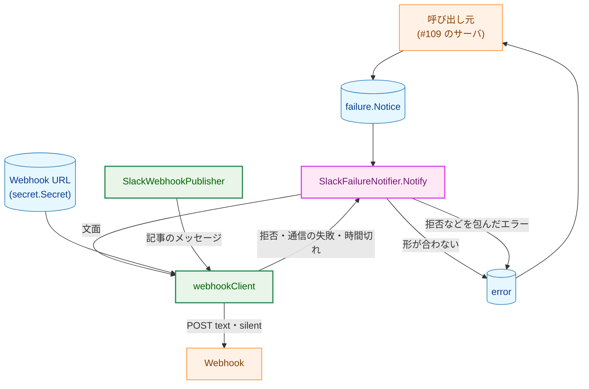

**Legend**

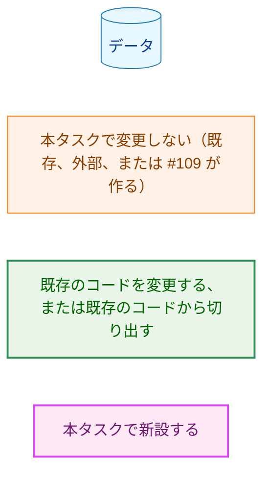

`SlackFailureNotifier.Notify` の中で、値の形の検査と文面の組み立てを行う（§3.4）。Webhook URL は `webhookClient` だけが持つ。

### 1.3. 既存コードとの関係

| 既存のもの | 本設計での扱い |
|---|---|
| `SlackWebhookPublisher` の `webhookURL`・`timeout`・`httpClient` のフィールド（`internal/publisher/slack.go:78-83`） | `webhookClient` に移す。`SlackWebhookPublisher` は `client webhookClient` と `interval` を持つ（§3.1） |
| `SlackWebhookPublisher.postMessage`・`postFailure`（`slack.go:158-194`・`:220-228`） | レシーバ（メソッドの受け手）を `webhookClient` に移す。URL の取り出しと伏せる部分の導出（現在は `Publish` の `slack.go:126-134`）を、移した送信の処理の中に入れる。それ以外の処理の中身は変えない（§3.1） |
| `newSlackWebhookPublisher` の `http.Client` の構築（`slack.go:106-118`。`CheckRedirect` が `http.ErrUseLastResponse` を返す） | `webhookClient` の構築関数に移し、記事の投稿と通知の実装が共有する |
| `NewSlackWebhookPublisher` の URL の検査（`slack.go:91-100`） | ゼロ値の拒否と `slackwebhook.ValidURL` の検査を非公開の関数に切り出し、`NewSlackFailureNotifier` と共有する。返す番兵とメッセージは変えない |
| `slackTransportError`・`slackErrorIdentifiers`・`containsSensitivePart`（`slack.go:233-291`） | 変更しない。`webhookClient` の送信の処理から、今と同じ形で呼ぶ |
| `SlackPostTimeout`（`slack.go:22-23`、30 秒） | 通知の実装の本番の時間の上限にそのまま使う（H-05） |
| `webhookPayload`（`slack.go:65-71`。`text` と `silent`） | そのまま使う。通知も同じ形で送る |
| `ErrSlackHTTPStatus`・`ErrSlackInvalidResponse`・`ErrSlackTransport`（`internal/publisher/slack_errors.go:10-16`）・`*SlackHTTPStatusError`（同 `:21-41`） | 変更しない。通知の実装は前の 2 つと判定できるエラーを `ErrSlackNoticeRejected` で包む（§4.1） |
| `rejectMention`（`internal/publisher/slack_message.go:142-149`） | 本番の経路では使わない。通知の実装のテストで、すべての文面がこの検査を通ることを確かめる（§5.2） |
| 記事の出典の行の自動リンクの形 `<URL>`（`internal/writer/output.go:171-175` の `sourceBlock`） | 通知の文面の動画の URL も同じ形で書く（§3.3） |
| `transcript.NormalizedVideoURL`（`internal/transcript/video_id.go:64-69`） | `VideoID` の形の検査と正規化 URL の導出にそのまま使う |
| `slackwebhook.ValidURL`・`SensitiveParts`（`internal/slackwebhook/slackwebhook.go:20-26`・`:34-67`） | 変更しない。構築と送信の経路で使う（既存の使い方と同じ） |
| `newSlackWebhookPublisherForLoopbackTest`（`internal/publisher/test_helpers_slack.go:35-51`） | loopback の URL と上限の検査と `webhookClient` の構築を非公開の関数に切り出し、通知の実装のテスト用の構築関数と共有する（H-06） |
| `internal/llm/llmhttp` | 使わない。LLM の adapter 用の送信部品で、`200` 以外の応答の本文を読まない（`package_reference.md`）。Webhook の応答の識別子の読み取りと `ok` の判定は `internal/publisher` の送信の経路にしかない |
| `internal/failure`（#109 §3.9。コミット `beefcee` の時点では未作成） | 型は変更しない。guard のテストだけを加える（§3.6、H-04） |

**前提とする、まだ実装されていない部品。** `internal/failure` は、#109 の最初の PR（#109 §8 の手順 1）が新設する。コミット `beefcee` の時点で、`internal/failure` のディレクトリはない。本タスクの通知の実装は、その PR がマージされた後に作る（§8）。#109 の設計書は、コミット `beefcee` の時点で `draft` である。本書は #109 §3.9 の型の定義と、#109 §3.4.2 のリクエスト ID の形（`crypto/rand` の 8 バイトを 16 進の小文字 16 文字で表す）をそのまま前提にする。#109 の承認の過程でこれらが変わった場合は、本書を改める（決定の変更として `draft` に戻す）。

**#109 と共有する事実。** リクエスト ID の形 `^[0-9a-f]{16}$` は、#109 が生成し、本設計が検査する（§3.4 の手順 2）。両者が別々に同じ事実を持つので、#109 が形を変えると、すべての通知が `ErrSlackInvalidNotice` で拒否される。この食い違いはサーバのログにしか現れない。そこで、#109 に、生成したリクエスト ID を実物の `SlackFailureNotifier`（loopback の送信先）に通すテストを置くよう求める（§8 の手順 4、§9）。

**他の文書の方針との関係。** 次の 3 点は、他の文書が定めたことと本設計の扱いが異なる。

-   **`package_reference.md` の更新を本タスクでは行わない。** 方針の出典は [package_reference.md](../../dev/developer_guide/package_reference.md) の冒頭（「パッケージを追加・削除する、または責務を変えるコミットで更新する」）である。本タスクは `internal/publisher` の責務に失敗の通知を加えるが、要件 §2.3 が文書の更新を #109 の F-010（#109 §3.12）に委ねているので、本タスクでは更新しない。#109 §3.12 の `package_reference.md` の更新に、`internal/publisher` の行（`SlackFailureNotifier`）を加えるよう #109 に伝える（§8 の手順 4）。新しいパッケージは作らないので、`TestPackageReferenceListsPackages`（`internal/pipeline/pipeline_test.go:610`）はそのまま通る。更新が必要な既存のテストはない。
-   **通知の文面を英語にする。** #109 §4.2 の表は、失敗の通知の例を日本語（「記事の生成に失敗しました（LLM の時間切れ）…」）で示している。一方、CLAUDE.md「Go Idioms」は Go の文字列リテラルを英語に限る。文面は Go の文字列リテラルとして持つので、本設計は英語にする（§3.3）。#109 §3.9 は文言を #108 に委ねており、#109 §4.2 の例は文面を固定するものではない。本書の §3.3 に合わせて例を改めるよう #109 に伝える。この例を確かめている既存のテストはない。
-   **メンションの記法の拒否の層を、通知の経路には置かない。** [security.md](../../dev/security.md) §6 は、記事の投稿で `silent` と、メンションの記法を含む記事の拒否の 2 つの層を併用すると定める（タスク 0006 の F-006）。通知の文面は、種類の文（定数）と、`[0-9a-f]{16}` と `[A-Za-z0-9_-]{11}` から組み立てた値だけでできているので、拒否の層が働く入力が存在しない。実行時に `rejectMention` を呼ぶと、決して真にならない分岐ができ、その分岐のテストは書けない（CLAUDE.md「Every test must be able to fail」）。そこで、拒否の層の代わりに、すべての `Kind` の文面に `rejectMention` を当てて通ることを確かめるテストを置く（§5.2、AC-06）。`silent` の層はそのまま使う。記事の投稿の 2 つの層は変えないので、更新が必要な既存のテストはない。

## 2. システム構成 (System Structure)

### 2.1. パッケージ構成

**図2 本設計に関わるパッケージと主な依存**。矢印 A → B は「A が B を import する」を表す。終端が × の線は、`depguard` で禁じる import を表す（§3.7）。`internal/secret` への import は省く。

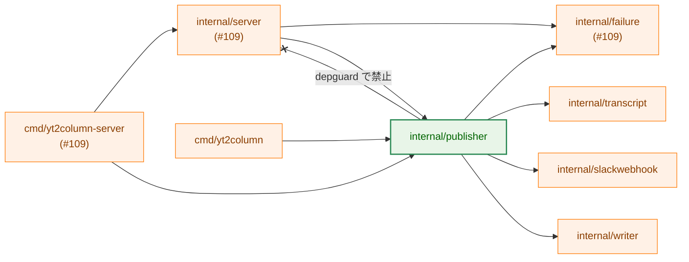

**Legend**

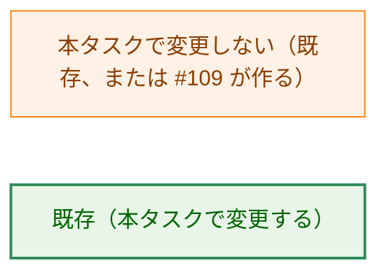

-   新しいパッケージは作らない。通知の実装は `internal/publisher` に置く（H-03、§3.2）。
-   `internal/publisher` → `internal/failure` と `internal/publisher` → `internal/transcript` の import が加わる。`internal/failure` は型だけのリーフパッケージ（#109 §2.1）で、`internal/transcript` は既に `internal/writer` を通して `internal/publisher` の依存に含まれている（`go list -deps ./internal/publisher` の結果、コミット `beefcee`）。どちらも循環を作らない。
-   `internal/server` は `internal/failure` の interface だけを使い、通知の実装の型を参照しない（#109 §2.1）。`internal/server` は記事の投稿のために `internal/publisher` を import するので、この性質は import の検査では確かめられない。#109 の側で保証する（H-03）。
-   `cmd/yt2column` は変更しない（F-005、AC-18）。CLI は、`publisher.NewSlackFailureNotifier` を呼べば通知の実装を使えるが、本タスクでは呼ばない。

### 2.2. コンポーネント配置

**図3 `internal/publisher` の中の配置**。矢印 A → B は「A が B を呼ぶ、または B を持つ」を表す。

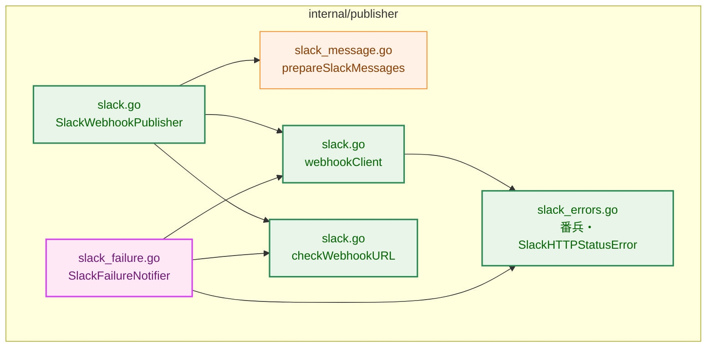

**Legend**

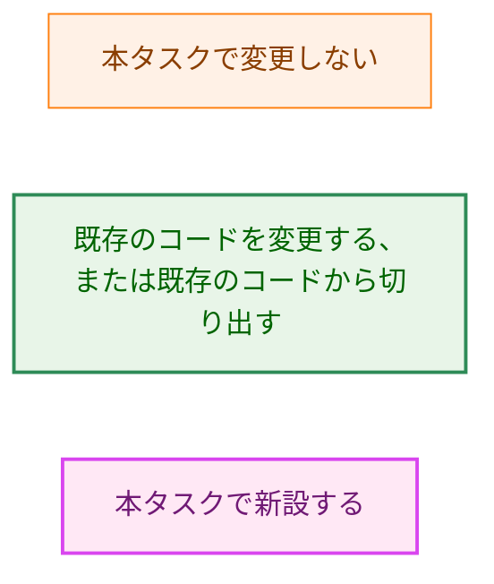

| コンポーネント | 配置 | 責務 |
|---|---|---|
| 送信の経路 | `internal/publisher/slack.go` の `webhookClient` | Webhook URL の保持と取り出し、伏せる部分の導出、1 つのメッセージの `POST`、時間の上限、リダイレクトの拒否、応答の上限と `ok` の判定、Webhook URL を含まないエラー（§3.1） |
| URL の検査 | `internal/publisher/slack.go` の `checkWebhookURL` | ゼロ値の拒否と `slackwebhook.ValidURL`。2 つの公開の構築関数が共有する |
| 記事の投稿 | `internal/publisher/slack.go` の `SlackWebhookPublisher` | 記事の準備（`slack_message.go`）、メッセージの間隔、`*SlackPostError`。送信は `webhookClient` に任せる。振る舞いは変えない |
| 通知の実装 | `internal/publisher/slack_failure.go` の `SlackFailureNotifier` | 構築、`Notice` の形の検査、文面の組み立て、`ctx` の確認、`webhookClient` による送信、エラーの包み直し（§3.2〜§3.4） |
| 番兵 | `internal/publisher/slack_errors.go` | 既存の番兵に、`ErrSlackInvalidNotice`・`ErrSlackNoticeRejected` を加える（§4.1） |
| guard | `internal/failure/failure_test.go` | `Notice` のフィールドの集合、`Notifier` のメソッドの集合、`Kind` のゼロ値と定数の並びを固定する（§3.6） |
| import の制限 | `.golangci.yml` の `depguard` | `internal/publisher` が `internal/server` と `log`・`log/slog` を import しないこと（§3.7） |

### 2.3. データフロー（成功）

**図4 通知の成功の流れ**。実線の矢印 `->>` は呼び出しまたは送信を、点線の矢印 `-->>` は戻り値または応答を表す。自分自身への矢印は、そのコンポーネント内部の処理を表す。失敗の分岐は §6.1 の図6 に示す。

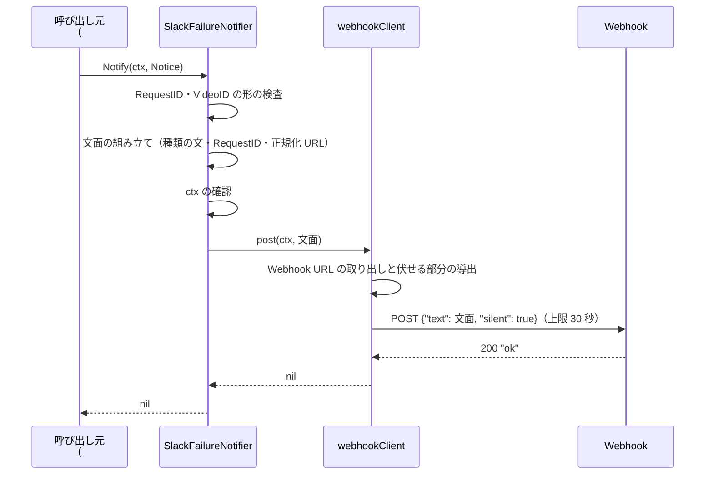

## 3. コンポーネント設計 (Component Design)

### 3.1. 送信の経路の共有（H-01）

`SlackWebhookPublisher` の送信に使う 3 つのフィールド（`webhookURL`・`timeout`・`httpClient`。`slack.go:78-83`）と、それを使う 2 つのメソッド（`postMessage`・`postFailure`）を、非公開の型 `webhookClient` に移す。

```go
// webhookClient holds the webhook URL and sends one message to a
// Slack-compatible Incoming Webhook. It reveals the URL and derives its
// sensitive parts itself, so no caller handles the plain URL. Its timeout
// bounds the send and the whole body read; its http.Client never follows a
// redirect. Shared by SlackWebhookPublisher and SlackFailureNotifier. Its
// fields are set once by newWebhookClient and never mutated afterwards.
type webhookClient struct {
	webhookURL secret.Secret
	timeout    time.Duration
	httpClient *http.Client
}

// newWebhookClient returns a client for webhookURL with the given timeout.
// transport, when non-nil, replaces the default transport (a test seam).
func newWebhookClient(webhookURL secret.Secret, timeout time.Duration, transport http.RoundTripper) webhookClient

// configured returns errZeroWebhookURL when the client holds no webhook URL.
func (c webhookClient) configured() error

// post sends message with silent set and returns nil only for a 200 response
// whose body is exactly "ok". (Moved from SlackWebhookPublisher.postMessage;
// the URL reveal and SensitiveParts move in from Publish.)
func (c webhookClient) post(ctx context.Context, message string) error

// checkWebhookURL returns errZeroWebhookURL for a zero secret and
// errInvalidWebhookURL for a value slackwebhook.ValidURL rejects.
func checkWebhookURL(webhookURL secret.Secret) error

// SlackWebhookPublisher after the change.
type SlackWebhookPublisher struct {
	interval time.Duration
	client   webhookClient
}
```

-   **URL を `webhookClient` に持たせる理由。** 伏せる部分（`parts`）は、送信に使う URL と同じ値から導かなければならない。URL を呼び出し元が持って `post` に渡す形では、この対応を呼び出し元ごとの約束で守ることになる。`webhookClient` が URL を持ち、`post` の中で取り出して導出すれば、対応は型で決まる（CLAUDE.md「Enforce invariants with the type」）。伏せる部分は平文なので、フィールドには持たず、`post` の呼び出しごとに導出する。導出の費用は、送信の時間（秒の単位）に比べて無視できる（CLAUDE.md「Performance」）。
-   `post` の振る舞い（`context.WithTimeoutCause` による上限、`webhookPayload`、`Content-Type`、8,193 バイトまでの読み込み、`ok` の判定、`*SlackHTTPStatusError`・`ErrSlackInvalidResponse`・`ErrSlackTransport`・時間切れと中断のエラー）は、現在の `postMessage`・`postFailure`（`slack.go:158-194`・`:220-228`）と同じである。`post` の返すエラーがちょうど 1 つの番兵に一致するという約束（`slack.go:215-219` のコメント）も変えない。
-   `Publish` は、先頭（`prepareSlackMessages` の前）で `client.configured()` を呼び、URL の有無を確かめる。今と同じく、ゼロ値では記事の準備のエラーより先に `errZeroWebhookURL` を返す（`slack.go:126-130`）。`post` も、URL のない `webhookClient` では送らずに `errZeroWebhookURL` を返す。ゼロ値の `SlackWebhookPublisher` は、今と同じく `errZeroWebhookURL` を返し、何も送らず、`*SlackPostError` を返さない（`TestSlackPublishZeroValue`、`slack_test.go:1093`）。
-   `post` は送信の前に `ctx` を確かめない。現在の `postMessage` も確かめず、確認は `Publish` のループ（`slack.go:144-146`）にある。通知の実装は `post` を呼ぶ前に自分で確かめる（§3.4 の手順 3）。`post` に確認を加えないのは、記事の投稿の `*SlackPostError` の `Attempted`（`slack_errors.go:43-52`）の意味を変えないためである。
-   `checkWebhookURL` は、`NewSlackWebhookPublisher` の検査（`slack.go:92-98`）をそのまま切り出したものである。返す番兵（`errZeroWebhookURL`・`errInvalidWebhookURL`）もメッセージも変えない。
-   **既存の 2 つの方式を選ばなかった理由。** (1) 通知の実装が `*SlackWebhookPublisher` を持ち、その非公開のメソッド `postMessage` を呼ぶ形は、既存のコードを変えずに済む。しかし、通知の実装が使わない `interval` を持つ `SlackWebhookPublisher` の値を抱えることになり、通知の実装の上限をテストで短くするにも記事の投稿の構築関数を経由する必要がある。送信の経路そのものを型として切り出せば、両者が同じ部品を対等に持つ形になる。(2) 送信の経路を `internal/slackwebhook` に移す形（H-01 の候補 (b)）は、`*SlackHTTPStatusError` などのエラー型と番兵も移すことになり、`internal/config`・`cmd/yt2column` が import する検査用のリーフパッケージに `net/http` の送信が入る。共有に必要なのは同じパッケージの中の 2 つの型だけなので、パッケージを越えて移す理由がない（YAGNI）。

**更新が必要な既存のテスト。** 内容を変えるテストはない（補助関数の拡張は §7.3）。`SlackWebhookPublisher` のフィールドとメソッドを直接参照するテストはなく（コミット `beefcee` で `internal/publisher` の `_test.go` に `.httpClient`・`.timeout`・`postMessage` への参照がないことを `grep` で確かめた）、テストは構築関数（`newSlackWebhookPublisherForLoopbackTest`）を通して作る。記事の投稿の既存のテスト（`TestSlackPublishPayload`・`TestSlackPublishResponses`・`TestSlackPublishRedirect`・`TestSlackPublishTimeout`・`TestSlackPublishBodyFailures`・`TestSlackPublishCanceled`・`TestSlackPublishErrorsOmitWebhookURL`・`TestSlackPublishZeroValue`・`TestSlackPublishErrorClasses` ほか。`internal/publisher/slack_test.go`）が、変更しないまま通ることで、振る舞いを変えていないことを確かめる。

### 3.2. 通知の実装の型と構築（H-03・H-06）

```go
// SlackFailureNotifier posts a failure.Notice to a Slack-compatible Incoming
// Webhook (Mattermost is the verified target) as one silent message. It holds
// the webhook URL only inside its webhookClient and has no logger or writer:
// every failure is returned, never printed. Its fields are set once by the
// constructor and never mutated afterwards, so it is safe for concurrent use.
// Notify on the zero value or a nil pointer fails without sending.
type SlackFailureNotifier struct {
	client webhookClient
}

var _ failure.Notifier = (*SlackFailureNotifier)(nil)

// NewSlackFailureNotifier validates webhookURL with checkWebhookURL, as
// NewSlackWebhookPublisher does, and returns a notifier whose send is bounded
// by SlackPostTimeout. It never reads environment variables and never
// touches the network. A rejection never holds the URL or any part of it.
func NewSlackFailureNotifier(webhookURL secret.Secret) (*SlackFailureNotifier, error)

// Notify checks notice, builds the message text from the fixed sentence of
// notice.Kind, notice.RequestID, and the normalized URL of notice.VideoID,
// and posts it once. It never retries and never writes any output.
func (s *SlackFailureNotifier) Notify(ctx context.Context, notice failure.Notice) error
```

-   **置き場所（H-03）。** `internal/publisher` に置く。送信の経路（§3.1）を同じパッケージの中で共有でき、非公開の型のまま使えるためである。`internal/publisher` は `internal/server` を import しない（§3.7）。CLI からも `publisher.NewSlackFailureNotifier` で使える（F-005）。
-   **構築。** `checkWebhookURL` で検査し、`newWebhookClient(webhookURL, SlackPostTimeout, nil)` を持つ値を返す。ネットワークに触れない（AC-12）。
-   **テスト用の構築（H-06）。** 既存の `newSlackWebhookPublisherForLoopbackTest`（`test_helpers_slack.go:35-51`）の検査（loopback の URL であること、時間の上限が正であること、URL が空でないこと）と `webhookClient` の構築を、非公開の関数 `newLoopbackWebhookClient(t testing.TB, timeout time.Duration, endpoint string, transport http.RoundTripper) (webhookClient, bool)` に切り出す。検査に失敗したら `t.Fatal` を呼んで `false` を返し、呼び出し元は nil を返す（`TestNewSlackWebhookPublisherForLoopbackTestRejects` が `fatalRecorder` で確かめている、nil を返す振る舞いを保つため）。失敗のメッセージは、2 つの構築関数に共通する語（`slack test client: ...`）に改め、今と同じく URL を含めない。この上に、非公開の `newSlackFailureNotifierForLoopbackTest(t testing.TB, timeout time.Duration, endpoint string, transport http.RoundTripper) *SlackFailureNotifier` を `test_helpers_slack.go`（`//go:build test`）に加える。`SlackTestOptions` ではなく `timeout` を取るのは、`SlackTestOptions` の `Interval` が通知に関係しないためである。`slackwebhook.ValidURL` を当てないので `http` の URL を使える。テストは `timeout` に短い値（たとえば 100 ミリ秒）を渡して AC-10 を確かめる。
-   **公開のテスト用の構築関数は作らない。** 記事の投稿には他のパッケージのテストのための `NewSlackWebhookPublisherForLoopbackTest` があるが、通知の実装を他のパッケージのテストから実物で使う予定は今はない（#109 のサーバのユニットテストは fake の `failure.Notifier` を使う。#109 §7.1）。§1.3 の #109 のテスト（リクエスト ID を実物に通す）のために必要になれば、#109 が既存の形に合わせて公開する（§9）。

### 3.3. 文面（H-02）

文面は次の行からなる。行の区切りは `\n` である。

```
yt2column failure: <種類の文>
request: <RequestID>
video: <https://www.youtube.com/watch?v=<VideoID>>
```

-   `VideoID` が空のときは、3 行目を書かない（AC-03）。
-   3 行目の URL は `transcript.NormalizedVideoURL(VideoID)` の返す値で、`<` と `>` で囲んだ CommonMark の自動リンクとして書く。記事の出典の行と同じ形である（`internal/writer/output.go:171-175`）。記事の投稿はこの形の行を含むメッセージを Mattermost へ送っており、タスク 0006 の統合テスト（`internal/publisher/slack_integration_test.go`）は、その送信が `200` の `ok` で受理されることを確かめている。リンクとして描画されるかどうかはテストでは確かめていないので、#109 の手動の確認に含めるよう求める（§8 の手順 4）。囲まない URL では、末尾の `_` や `-` などの文字をリンクに含めるかどうかがリンクにする側（Mattermost）の規則に左右され、`_` で終わる動画 ID では別の動画を指すリンクになりうる。囲めばその曖昧さがない。
-   1 行目の接頭辞 `yt2column failure:` は、記事のメッセージと通知を、チャンネルの上で見分けるためのものである。
-   時刻は載せない（F-002）。

**種類の文。** `Kind` から種類の文への対応は、`slack_failure.go` の非公開の関数の網羅的な `switch` で決める。`default` は `KindUnknown` と同じ文を返す（AC-04）。

| `Kind` | 種類の文 |
|---|---|
| `KindUnknown`・列挙にない値 | `the request failed for an unclassified reason` |
| `KindBodyTooLarge` | `the request body exceeded the size limit` |
| `KindInvalidBody` | `the request body was not a valid request` |
| `KindInvalidVideoURL` | `the video URL was not accepted` |
| `KindInvalidTranscript` | `the copied transcript was not in the expected format` |
| `KindTranscriptTooLong` | `the transcript was too long for the prompt limit` |
| `KindLLMTimeout` | `the LLM call timed out` |
| `KindLLMEmpty` | `the LLM returned an empty response` |
| `KindLLMTruncated` | `the LLM response was cut off before it finished` |
| `KindLLM` | `the LLM call failed` |
| `KindPublish` | `posting the article failed; part of it may already be in the channel` |
| `KindInternal` | `an internal error occurred` |

-   種類の文は互いに異なる（AC-02）。`KindPublish` の文は、記事の投稿が途中で失敗した場合（#109 §3.9 の最後の項目）に、チャンネルに残った断片の意味を利用者が読み取れるようにする。
-   文面に現れる文字は、種類の文の英字・空白・`;`、接頭辞の `yt2column`（数字の `2` を含む）、接頭辞と行の見出しの `:`、改行、`[0-9a-f]`、`<https://www.youtube.com/watch?v=`・`[A-Za-z0-9_-]`・`>` だけである。`@`・`&`・`|`・`!` を含まず、`<` の直後は常に `h` である。メンションの記法（`@` に続く名前、`<!`・`<@`、文字参照、`<a|b>` の形）は現れない（AC-06）。

### 3.4. `Notify` の手順

`Notify` は次の順に処理する。どの手順で失敗しても、後の手順は行わない。

1. **受け手と URL の確認。** 受け手が nil、または `client.configured()` がエラーを返すなら、非公開の `errZeroNotifier` を返す。送らない。
2. **値の形の検査と文面の組み立て。** `RequestID` が `^[0-9a-f]{16}$` に一致しなければ、`ErrSlackInvalidNotice` を包むエラーを返す。`VideoID` が空でなく、`transcript.NormalizedVideoURL` が拒否すれば、同じく `ErrSlackInvalidNotice` を包むエラーを返す。どちらのエラーも、値そのものを含まない（`RequestID` に `<!channel>` のような値が来ても、エラーを書いたログに写らない）。検査を通れば §3.3 の文面を組み立てる（AC-04a）。
3. **`ctx` の確認。** `ctx.Err()` が nil でなければ、それを包み、送っていないことを示すエラー（§4.2）を返す。送らない（AC-10）。
4. **送信。** `client.post` を 1 回だけ呼ぶ（AC-11）。
5. **結果の包み直し。** `post` のエラーが `ErrSlackHTTPStatus` または `ErrSlackInvalidResponse` と判定できるとき（`errors.Is`）、`ErrSlackNoticeRejected` と元のエラーの両方で判定できるエラーにして返す（AC-08・AC-09）。それ以外のエラー（送信の途中の時間切れ・中断、`ErrSlackTransport`）は、どれも届いたかどうかが分からない（§4.1 の表の「0 回または 1 回」）ので、届いたかもしれないことを示すエラー（§4.2）で包んで返す。元のエラーは `%w` で残す。

-   検査（手順 2）を `ctx` の確認（手順 3）より先に行うのは、呼び出し元の誤りを、`ctx` の状態によらず同じエラーで返すためである。
-   手順 3 と手順 4 の間で `ctx` が取り消された場合、`post` の中の `http.Client.Do` が中断を返す。この場合にリクエストが送られたかどうかは `net/http` の動作に依存し、本設計は保証しない。AC-10 が求めるのは「キャンセル済みの `ctx` で送らない」ことで、手順 3 がそれを保証する。この場合のエラーは手順 5 のとおり「届いたかもしれない」と示す。
-   `Notify` はパッケージの外の値を変えず、自分のフィールドも変えない。同じ値を複数の goroutine から同時に呼べる（#109 のサーバは、ジョブの goroutine と本文の検査の後の goroutine から呼ぶ。#109 §3.9）。`http.Client` は並行に使える。投稿の失敗のあとも、次の `Notify` はそのまま送る（AC-16）。

### 3.5. 時間の上限と `ctx`（H-05）

-   本番の上限は `SlackPostTimeout`（30 秒、`slack.go:22-23`）とする。新しい値を設けない。#109 のサーバは `Notify` の `ctx` に 60 秒の期限を付ける（#109 §3.9）ので、通知の実装の上限が先に切れる。
-   上限は `webhookClient.post` の中の `context.WithTimeoutCause(ctx, timeout, errSlackPostTimeout)`（`slack.go:159`）で与える。呼び出し元の `ctx` から派生するので、`ctx` の取り消しにも従う。`ctx` の期限が長くても、上限で打ち切る（AC-10）。`http.Client.Timeout` は使わない（security.md §3、既存の方針のまま）。
-   1 回の `Notify` にかかる時間は、上限（30 秒）に、検査と文面の組み立て（定数の時間）を加えたものを超えない（要件 4.1）。

### 3.6. guard（H-04）

`internal/failure/failure_test.go`（`//go:build test`）に、次の 4 つのテストを置く。

| テスト | 確かめること | 失敗したときのメッセージで案内すること |
|---|---|---|
| `TestNoticeFieldSet` | `reflect.TypeFor[Notice]()` の公開フィールドが、`RequestID string`・`VideoID string`・`Kind failure.Kind` の 3 つだけである | フィールドを足すと、通知の文面に載せてよいものの範囲（#109 §3.9）が変わる。#108 の文面と #109 の設計の見直しが要る |
| `TestNotifierMethodSet` | `reflect.TypeFor[Notifier]()` のメソッドが `Notify` の 1 つだけで、型が `func(context.Context, Notice) error` である | 同上 |
| `TestKindZeroValue` | `Kind` のゼロ値が `KindUnknown` と等しい | `Notice{}` の `Kind` が「不明」を表さなくなる。`iota` の並びを戻す |
| `TestKindConstants` | パッケージの `_test.go` 以外のすべての Go のファイルを `go/parser` で読み、`Kind` 型の定数の名前を宣言の順に集める。その並びが、要件 F-001 の列挙（`KindUnknown` から `KindInternal` まで）と一致する。1 つも見つからなければ失敗する | `Kind` を足したら、`internal/publisher` の種類の文の `switch` と、そのテストの表に行を加える |

-   `internal/pipeline` の `TestCommonTypesFieldSets`（`internal/pipeline/pipeline_test.go:378`）と同じ考え方の guard だが、対象の型の置き場所に合わせて `internal/failure` に置く（H-04 の候補）。`internal/pipeline` の guard はパイプラインの段階の間で受け渡す型を対象にしており、`failure` の型はパイプラインの段階を通らない。
-   `TestKindZeroValue` は、`iota` の割り当ての結果を確かめる。`KindUnknown` を `iota + 1` で宣言すると失敗する。種類の文の `switch` の `default` も同じ文を返すので、通知の実装のテストではこの誤りを見つけられない。
-   `TestKindConstants` は値ではなく、宣言の名前と並びを確かめる。定数とそれ自身のリテラルを比べるテストではない（CLAUDE.md「Do not assert that a constant equals its own literal」）。`iota` の `const` ブロックでは 2 つ目以降の定数が型を書かないので、型を書いた定数から始まる同じブロックの続きの定数も `Kind` 型として数える。#109 がファイルの名前や分け方を変えても、パッケージのすべてのファイルを読むので結果は変わらない。`Kind` の定数が 1 つも見つからない形に変わった場合は、何も確かめずに通るのではなく失敗する。
-   #109 の手順 1 の PR が同等の guard を既に置いていた場合は、それを使い、重複するテストを加えない。

### 3.7. 静的な検査（`depguard`）

`.golangci.yml` の `depguard` に、次の規則を加える。

| 規則 | 対象のファイル | 禁じる import | 確かめる AC |
|---|---|---|---|
| `publisher-no-server` | `**/internal/publisher/**` | `github.com/isseis/yt2column/internal/server` | AC-17 |
| `publisher-no-log` | `**/internal/publisher/**`（`_test.go` を除く） | `log`・`log/slog` | AC-15 |

-   AC-17 は「`go list` の依存の検査」を挙げているが、本設計は `make lint` の `depguard` で確かめる。`internal/server` は `internal/publisher` を import する（#109 §2.1）ので、`internal/publisher` が `internal/server` を直接または間接に import すれば循環になり、コンパイラが拒否する。したがって、`depguard` で直接の import だけを禁じれば足りる。`publisher-no-server` は、サーバが `internal/publisher` を使わなくなるなど、この前提が崩れた場合にも依存の向きを保つための、意図の宣言である。
-   `publisher-no-log` は、AC-15 が対象とする通知の実装だけでなく、`internal/publisher` のすべての本番のファイルに当てる。通知の実装は送信の経路（`slack.go`）を共有しており、送信の経路が出力を書けば通知の失敗の経路から出力が出る。ファイルごとに分けず、パッケージ全体で「書かない」ことを保つ。コミット `beefcee` の時点で、`internal/publisher` の `_test.go` 以外のファイルは `log`・`log/slog` を import していない（`grep` で確かめた）ので、既存のコードは違反しない。
-   AC-15 の「標準出力・標準エラー出力に書かない」のうち、`fmt.Print*` と `os.Stdout`・`os.Stderr` への書き込みは `depguard` では禁じられない（`fmt` と `os` は他の目的で使う）。これはコードのレビューと、`SlackFailureNotifier` がロガーも `io.Writer` も持たないこと（§3.2 の型の定義）で確かめる。

### 3.8. design_handoff の各項目への対応

| 項目 | 本設計の対応 | 節 |
|---|---|---|
| H-01 送信の経路の共有 | 候補 (a)。`SlackWebhookPublisher` の送信の部分を、Webhook URL ごと、同じパッケージの非公開の型 `webhookClient` に切り出して共有する。候補 (b)（`internal/slackwebhook` へ移す）は採らない。キャンセル済みの `ctx` で送らないことは、`Notify` の側（手順 3）で保証する。要件の仮称 `ErrWebhookResponseRejected` は `ErrSlackNoticeRejected` と名付け、`internal/publisher` に置く。`ErrSlackHTTPStatus`・`ErrSlackInvalidResponse` と判定できるエラーを `Notify` がこれで包む。`internal/failure` には置かない（#109 の型を変えないため） | §3.1・§3.4・§4.1 |
| H-02 種類の文と文面 | 3 行の文面（接頭辞と種類の文、`request:`、`video:`）。動画の URL は記事と同じ `<URL>` の形。種類の文は英語の固定の一文で、表で定める。`KindUnknown` と列挙にない値は「unclassified reason」の文 | §3.3 |
| H-03 置き場所と依存の向き | `internal/publisher` に置く。`internal/publisher` が `internal/server` を import しないことを `depguard` で固定する。`internal/server` が実装の型を参照しないことは #109 が保証する | §2.1・§3.2・§3.7 |
| H-04 guard | `internal/failure/failure_test.go` に、フィールドの集合・メソッドの集合・`Kind` のゼロ値・`Kind` の定数の並びの 4 つの guard を置く | §3.6 |
| H-05 上限と `ctx` | 上限は既存の `SlackPostTimeout`（30 秒）。`context.WithTimeoutCause` による既存の上限をそのまま使い、`http.Client.Timeout` は使わない。`ctx` が取り消されていれば送らない | §3.4・§3.5 |
| H-06 テスト用の構築 | 非公開の `newSlackFailureNotifierForLoopbackTest`（時間の上限と transport を引数に取る）。loopback の検査と `webhookClient` の構築は、既存のテスト用の構築関数と共有する | §3.2 |

### 3.9. コンポーネント責務表

| ファイル | 新規/変更 | 責務 |
|---|---|---|
| `internal/publisher/slack.go` | 変更 | `webhookClient`・`newWebhookClient`・`configured`・`post`・`checkWebhookURL` の切り出し。`SlackWebhookPublisher` のフィールドを `interval` と `client` に改める。記事の投稿の振る舞いは変えない（§3.1） |
| `internal/publisher/slack_failure.go` | 新規 | `SlackFailureNotifier`・`NewSlackFailureNotifier`・`Notify`、`errZeroNotifier`、`Kind` から種類の文への `switch`、`RequestID` の形の検査、文面の組み立て（§3.2〜§3.4） |
| `internal/publisher/slack_errors.go` | 変更 | `ErrSlackInvalidNotice`・`ErrSlackNoticeRejected` を加える（§4.1）。既存の番兵のコメント「Sentinels for SlackWebhookPublisher」（`slack_errors.go:8`）を、送信の経路の番兵であることが分かる形に改める |
| `internal/publisher/publisher.go` | 変更 | パッケージコメント（`publisher.go:1-2`「defines the publishing stage」）に、失敗の通知の実装も置くことを加える |
| `internal/publisher/test_helpers_slack.go` | 変更 | `newLoopbackWebhookClient` の切り出しと、`newSlackFailureNotifierForLoopbackTest` の追加（§3.2） |
| `internal/publisher/slack_test.go` | 変更 | 補助関数 `requireErrorOmitsEndpoint` が `Unwrap() []error` の枝もたどるようにする（§7.3）。テストの内容は変えない |
| `internal/publisher/slack_failure_test.go` | 新規 | 通知の実装のテスト（§7.1・§7.3） |
| `internal/failure/failure_test.go` | 新規 | guard（§3.6） |
| `.golangci.yml` | 変更 | `depguard` の 2 つの規則（§3.7） |

-   `cmd/yt2column` と、要件 §2.3 が #109 に委ねた文書（`CLAUDE.md`・`project_overview.md`・`security.md`・`package_reference.md`・`README.md`）は変更しない。
-   **更新が必要な既存のテスト。** 記事の投稿のテストの内容を変えるものはない（§3.1）。`TestNewSlackWebhookPublisherForLoopbackTestRejects`（`slack_test.go:414`）は、テスト用の構築関数の失敗のメッセージが変わっても、内容を変えずに通る（メッセージが空でないこと、目印を含まないこと、nil を返すことだけを確かめているため）。`internal/pipeline` の `TestFakesCarryBuildTag`（`pipeline_test.go:534`）は `testutil/` のファイルの数を数えるが、本タスクは `testutil/` にファイルを加えない。`TestCommonTypesFieldSets` は対象の型を変えないので、そのまま通る。

## 4. エラーハンドリング設計 (Error Handling Design)

### 4.1. エラー型

```go
// package publisher (slack_errors.go)

// Sentinels for SlackFailureNotifier, added to the existing ones.
var (
	// ErrSlackInvalidNotice reports a Notice whose RequestID or VideoID does
	// not have the accepted shape. Nothing is sent.
	ErrSlackInvalidNotice = errors.New("webhook: the failure notice is not valid")
	// ErrSlackNoticeRejected reports a response that did not acknowledge the
	// failure notice: a non-200 status (including 3xx, which is never
	// followed), or a 200 whose body is not exactly "ok" or exceeds the
	// limit. The returned error also matches ErrSlackHTTPStatus or
	// ErrSlackInvalidResponse.
	ErrSlackNoticeRejected = errors.New("webhook: the server rejected the failure notice")
)

// package publisher (slack_failure.go), unexported
var errZeroNotifier = errors.New("webhook: the notifier has no webhook URL")
```

`Notify` が返すエラーの分類は次のとおりである。どの分類のエラーも、Webhook URL もその一部も含まない。

| 状況 | 判定（`errors.Is`・`errors.AsType`） | 送信 |
|---|---|---|
| 受け手が nil、またはゼロ値 | 非公開の `errZeroNotifier`（下記） | しない |
| `RequestID`・`VideoID` の形が合わない | `ErrSlackInvalidNotice` | しない |
| `ctx` が取り消されている・期限を過ぎている | `context.Canceled`・`context.DeadlineExceeded` | しない |
| `200` 以外の状態（3xx を含む） | `ErrSlackNoticeRejected` と `ErrSlackHTTPStatus`（`*SlackHTTPStatusError`） | 1 回 |
| `200` で本文がちょうど `ok` でない、または 8,192 バイトを超える | `ErrSlackNoticeRejected` と `ErrSlackInvalidResponse` | 1 回 |
| 接続・TLS・名前解決の失敗、本文の読み込みの失敗 | `ErrSlackTransport` | 0 回または 1 回 |
| 送信の途中で通知の実装の上限を過ぎた | `context.DeadlineExceeded` | 0 回または 1 回 |
| 送信の途中で呼び出し元の `ctx` が取り消された | `context.Canceled`・`context.DeadlineExceeded` | 0 回または 1 回 |

-   **番兵の関係。** `ErrSlackNoticeRejected` と判定できるエラーの集合は、`ErrSlackHTTPStatus` と `ErrSlackInvalidResponse` の和と一致する。`ErrSlackTransport`・`ErrSlackInvalidNotice`・`context` のエラーとは重ならない。`webhookClient.post` 自身が返すエラーがちょうど 1 つの番兵に一致するという約束（§3.1）は変わらず、2 つ目の番兵を加えるのは `Notify` の包み直しだけである。記事の投稿は `ErrSlackNoticeRejected` を返さず、記事の投稿のエラーの分類（`TestSlackPublishErrorClasses`、`slack_test.go:1106`）は変わらない。
-   **包み方。** `ErrSlackNoticeRejected` で包むときは、元のエラーも `%w` で残す（Go 1.20 以降の複数の `%w`）。`*SlackHTTPStatusError` の状態コードと識別子（`id`・`request_id`）を、呼び出し元が `errors.AsType` で取り出し、ログに書けるようにするためである。`Is` と `Unwrap` を持つ名前付きの型を新設しても同じことができるが、標準ライブラリの包み方で足りるので型を増やさない。この包み方では `errors.Unwrap` が nil を返す `Unwrap() []error` のエラーができる。AC-13 の「`errors.Unwrap` でたどれるすべてのエラー」は、本設計では「`Unwrap() error` と `Unwrap() []error` の両方でたどれるすべてのエラー」と読み、その広い範囲で確かめる（§7.3）。
-   **`errZeroNotifier` が非公開である理由。** この分類は `NewSlackFailureNotifier` を通して作った値では起きず、nil のポインタかゼロ値の `SlackFailureNotifier{}` で `Notify` を呼んだ場合（呼び出し元の組み立ての誤り）にしか起きない。呼び出し元がこれを他の失敗と分けて扱う必要はなく、ログに書けば足りるので、番兵を公開しない。記事の投稿の `errZeroWebhookURL`（非公開。メッセージは "the publisher has no webhook URL"、`slack.go:44`）と同じ扱いだが、メッセージは分ける。通知の失敗のログで主語を取り違えないためで、記事の投稿の振る舞いは変えない。
-   `Notify` は `*SlackPostError` を返さない。通知は 1 つのメッセージなので、何通目まで送ったかを表す必要がない。

### 4.2. エラーメッセージ設計パターン

-   既存の番兵と同じく、`webhook:` で始まる英語の一文とする。
-   `ErrSlackInvalidNotice` を包むエラーは、どのフィールドが合わなかったか（`the request ID is not 16 lowercase hexadecimal characters`・`the video ID is not 11 characters of [A-Za-z0-9_-]`）だけを書き、値を書かない。
-   呼び出し元はエラーの文をログに書くだけなので、ログを読む人が、通知が届いたかどうかをエラーの文から判断できるようにする。送っていない場合（§3.4 の手順 1〜3）は `the failure notice was not sent`、送信の途中の時間切れ・中断と通信の失敗（手順 5）は `the failure notice may have been posted` を、文の先頭に置く。記事の投稿の `*SlackPostError` の "may have been posted" と同じ考え方である。
-   応答の拒否は、`*SlackHTTPStatusError` の既存のメッセージ（状態コードと、受理した形の識別子だけ。`slack_errors.go:27-39`）をそのまま含む。応答の本文の自由文は含まない（security.md §3）。

例（呼び出し元のログに現れる形）:

```
webhook: the server rejected the failure notice: webhook: unexpected HTTP status 403 (id: web.incoming_webhook.disabled.app_error, request_id: 8x3k...)
webhook: the failure notice is not valid: the request ID is not 16 lowercase hexadecimal characters
webhook: the failure notice was not sent: context canceled
webhook: the failure notice may have been posted: webhook: the post timed out after 30s: context deadline exceeded
```

### 4.3. サイドエフェクト契約

| 時点 | 起こしてよい副作用 | 起こさない副作用 |
|---|---|---|
| `NewSlackFailureNotifier` | なし | ネットワークへの送信、環境変数の読み込み、出力 |
| `Notify`（検査・`ctx` の確認で失敗） | なし | ネットワークへの送信、出力 |
| `Notify`（送信） | Webhook への `POST` を 1 回 | 再試行、リダイレクト先への送信、2 つ目のメッセージ、標準出力・標準エラー出力・ログ・ファイルへの書き込み |

## 5. セキュリティ考慮事項 (Security Considerations)

### 5.1. 脅威モデル

**図5 脅威モデル**。実線の矢印 A → B は「A から B へ値が流れる」を表す。点線の矢印は、防ぐべき漏洩・悪用の経路を表し、ラベルはその経路を止める仕組みを示す。

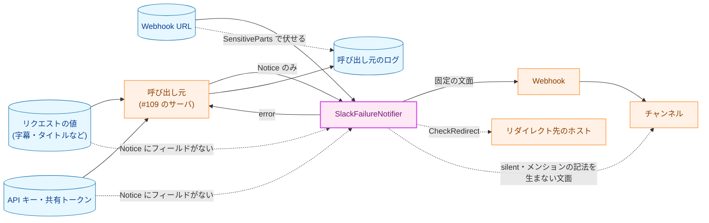

**Legend**

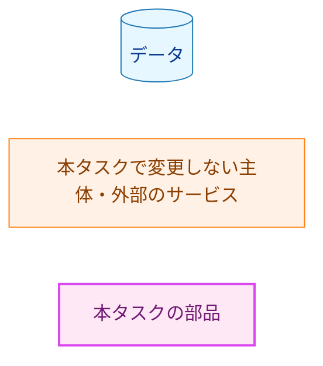

`NOTIFIER` から `CHAN` への点線は、失敗の通知の投稿が、チャンネルの利用者にメンションによる着信通知を起こす経路を表す。チャンネルへの投稿そのものは、`HOOK` から `CHAN` への実線の正当な経路である。

### 5.2. 脅威と対策

| 脅威 | 対策 | 確かめ方 |
|---|---|---|
| 字幕などのリクエストの値・API キー・共有トークンが、通知に載る | `Notice` にそれらのフィールドがない（#109 §3.9）。`SlackFailureNotifier` は Webhook URL 以外の秘密情報を持たない | `TestNoticeFieldSet`（§3.6）、AC-05 の文面の全体の照合 |
| Webhook URL が文面に載る | 文面は種類の文・`RequestID`・正規化 URL だけで組み立てる | AC-05（目印の URL で全 `Kind` を通知し、文面に URL・パス・末尾 8 文字が現れない） |
| Webhook URL がエラーに載る | 送信の経路の既存の対策（`*url.Error` を包まない、`SensitiveParts` に重なる識別子を捨てる。`slack.go:233-276`）をそのまま使う。通知の実装のエラーは値を含まない | AC-12・AC-13 |
| リダイレクトで Webhook URL が別のホストへ送られる | `CheckRedirect` が `http.ErrUseLastResponse` を返す（`webhookClient` の構築関数に移すが、変えない） | AC-09 |
| 呼び出し元の誤りで、`RequestID` にメンションの記法などが入る | `^[0-9a-f]{16}$` の検査。合わなければ送らない。エラーにも値を写さない | AC-04a |
| 失敗の通知の投稿が、メンションとして扱われて着信通知を起こす | `silent`。文面にメンションの記法が現れない | AC-06（全 `Kind` の文面に `rejectMention` を当てて通ること、`@`・`&`・`|`・`!` を含まないこと） |
| 応答しない、または巨大な応答を返す送信先で、通知が終わらない | 上限 30 秒、応答の本文は 8,193 バイトまで | AC-08・AC-10 |
| 投稿の失敗の経路から秘密情報が出力に流れる | 通知の実装と送信の経路は書かない。`log`・`log/slog` を `depguard` で禁じる | AC-15 |

### 5.3. 信頼できない入力の境界

| 境界 | 受理する形 | 上限 | 拒否時の扱い | 検査する箇所 |
|---|---|---|---|---|
| Webhook の応答 | 状態 `200` で本文がちょうど `ok`。3xx には従わない | 8,192 バイト（8,193 バイトまで読む） | `ErrSlackNoticeRejected`。再試行しない | `webhookClient.post`（既存の処理） |
| `Notice.RequestID` | `^[0-9a-f]{16}$` | 16 文字 | `ErrSlackInvalidNotice`。送らない | `Notify` の手順 2 |
| `Notice.VideoID` | 空、または `transcript.NormalizedVideoURL` が受理する 11 文字 | 11 文字 | `ErrSlackInvalidNotice`。送らない | `Notify` の手順 2 |
| `Notice.Kind` | 任意の値 | - | 列挙にない値は `KindUnknown` と同じ種類の文 | 種類の文の `switch` |

-   `200` 以外の応答の本文から読むのは、既存の処理と同じく `id`・`request_id` の識別子だけである（`slack.go:249-276`）。自由文は読まない。
-   `RequestID` の検査に、大文字を小文字に直すなどの補正はしない（CLAUDE.md「Reject, don't normalize」）。

### 5.4. 残余のリスク

-   **通知は `silent` なので、気づかれにくい。** Mattermost では、`silent` の投稿は通知も未読の表示も起こさない（security.md §6）。利用者は、チャンネルを開くか、サーバのログを読むまで失敗に気づかない。`silent` は要件（F-003）と #109 §3.9 が定めており、記事の投稿と同じ扱いにするため、本設計はこれを変えない。この弱さを受け入れられない場合は、#109 と要件の見直し（`silent` を外す、別のチャンネルへ送るなど）として扱う。
-   **Webhook が使えないと、通知も届かない。** 記事の投稿と同じ Webhook へ送るので、Webhook の URL の失効や停止の間は、どちらも失敗する。通知の失敗は呼び出し元のログに残る（#109 §3.10、#109 §5.4 と同じ）。
-   **記事の投稿の失敗に続く通知は、同じ理由で失敗しやすい。** `KindPublish` の通知は、失敗した記事のメッセージの直後に、メッセージの間隔（1 秒。`slack.go:28`）を置かずに同じ Webhook へ送られる。記事の投稿がリクエスト数の制限（`429`）や Webhook の側の拒否で失敗した場合、通知も同じ理由で `ErrSlackNoticeRejected` になりやすく、記録はサーバのログだけになる。要件 §2.3 は再試行と待ち合わせを対象外としているので、受け入れる。同時に送られる投稿の数は、#109 の枠（同時実行数の上限 2。通知は枠を持ったまま行う。#109 §3.8.2・§3.9）により、記事と通知を合わせて最大で 2 である。
-   **送信の途中で時間切れや取り消しが起きると、通知が届いたかどうかが分からない。** 送信の途中で上限を過ぎた、または取り消された場合、Webhook が受け取ったかどうかは分からない（記事の投稿の `Attempted` と同じ事情）。エラーの文がそのことを示す（§4.2）。呼び出し元は再試行しないので、通知の重複は起きないが、欠落は起こりうる。
-   **通知だけを止める手段がない。** 不具合ですべてのリクエストが失敗すると、認証済みのリクエストごとに通知が投稿される。通知を止めるには、サーバを止めるか Webhook を無効にするしかないが、どちらの方法でも記事の投稿まで止まる。通知の集約・抑制は要件 §2.3 の対象外である。止める手段が必要になれば、#109 の設定として、`failure.Notifier` を包む別の実装で加える（§9）。
-   **`silent` は Slack では効かない。** 検証の対象は Mattermost である（要件 4.4）。Slack では通知が届くが、文面にメンションの記法がないので、チャンネル全体への通知は起きない。

## 6. 処理フロー詳細 (Processing Flow Details)

### 6.1. `Notify` の分岐

**図6 `Notify` の処理と失敗の分岐**。矢印は処理の順序を表し、ラベルは分岐の条件を示す。

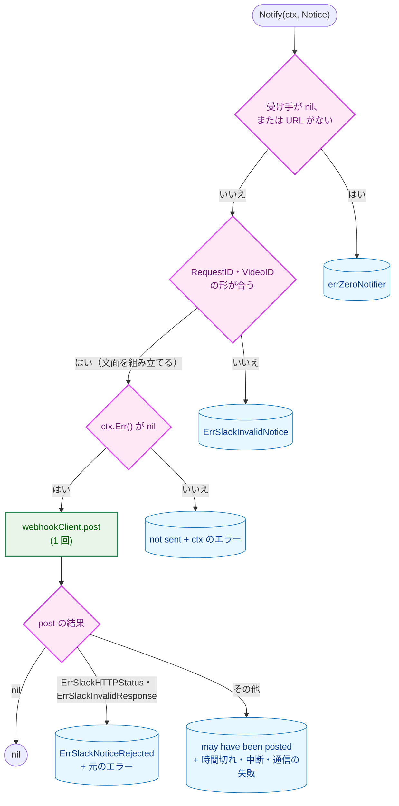

**Legend**

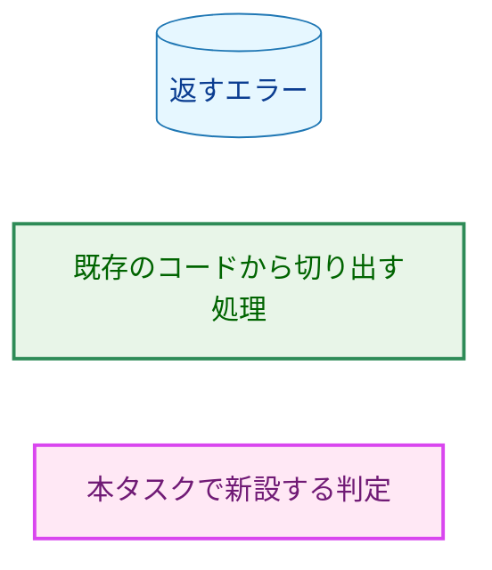

`E1`〜`E3` の分岐では、送信先にリクエストは届かない。`E4` の分岐では、ちょうど 1 つのリクエストが届いている。`E5` の分岐では、0 または 1 つのリクエストが届いている。

## 7. テスト戦略 (Test Strategy)

### 7.1. ユニットテスト

ユニットテストは実際の Webhook を呼ばない。`internal/publisher` の既存のテスト用のサーバ（`slack_test.go` の `newSlackServer`・`newSlackOKServer`。リクエストを記録する `httptest.Server`）と、`newSlackFailureNotifierForLoopbackTest` を使う。目印を含む Webhook URL のパスには、既存の `slackWebhookPath`（`slack_test.go:30`）を使う。

| 対象 | 主なテスト |
|---|---|
| 文面（AC-02・AC-03・AC-05） | `KindUnknown` を含む 12 の `Kind`、列挙にない値（`Kind(-1)`・`KindInternal + 1`）について、`VideoID` が空の場合と空でない場合に、受け取った `text` が期待する文面の全体と一致する（表で照合する）。12 の種類の文が互いに異なる。`VideoID` が空のとき `video:` の行がない。`VideoID` が `_` で終わる場合も、3 行目が `<` と `>` で囲んだ正規化 URL である |
| 値の形の検査（AC-04a） | `RequestID` が空・15 文字・17 文字・大文字を含む・`<!channel>` を含む、`VideoID` が 10 文字・12 文字・`/` を含む、の各場合に `ErrSlackInvalidNotice` を返し、送信先がリクエストを受け取らない |
| ゼロ値（AC-04） | `KindUnknown` で投稿でき、パニックしない。nil の `*SlackFailureNotifier` とゼロ値の `SlackFailureNotifier{}` で `Notify` するとエラーを返し、パニックせず、送らない |
| 送信の形（AC-07） | `POST`、`Content-Type: application/json`、本文が `text` と `silent: true` の 2 つのメンバだけを持つ |
| 応答の拒否（AC-08・AC-14） | `200` で `""`・`OK`・`ok\n`・`{"ok":true}`、`400`・`403`・`500`、8,193 バイトの本文で、`ErrSlackNoticeRejected` と判定でき、パニックしない。`ErrSlackTransport` の場合（閉じたサーバ）は `ErrSlackNoticeRejected` と判定できない |
| リダイレクト（AC-09） | `302` と `Location` に別のテスト用のサーバを指定すると `ErrSlackNoticeRejected`、リダイレクト先のリクエストの数が 0 |
| 時間の上限と `ctx`（AC-10） | 応答を返さないサーバで、上限 100 ミリ秒、`ctx` の期限 1 時間のとき、`context.DeadlineExceeded` と判定できるエラーが 5 秒以内に返る（5 秒は、呼び出し元の期限（1 時間）ではなく通知の実装の時間の上限（100 ミリ秒）で打ち切られたことを示すための、余裕を持たせた固定の値である）。取り消し済みの `ctx` で送信先のリクエストの数が 0 |
| 再試行しない（AC-11） | AC-08・AC-09・AC-10 の各場合で、送信先のリクエストの数がちょうど 1（取り消し済みの `ctx` では 0） |
| 構築（AC-12） | ゼロ値の `secret.Secret`、`http://`・ホストのない URL・制御文字を含む URL でエラー。メッセージに URL もその一部も現れない。`https` の正しい URL で構築しても、TLS のテスト用のサーバ（`httptest.NewTLSServer`）のリクエストの数が 0 |
| 失敗の後の再利用（AC-16） | `500` を返した後に `ok` を返すサーバで、2 回目の `Notify` が成功し、リクエストの数が 2 |
| 並行の呼び出し | 1 つの値から複数の goroutine で同時に `Notify` し（`make test` の `-race` の下で）、すべてが成功し、リクエストの数が呼び出しの数と一致する |
| guard（AC-01・AC-01a） | §3.6 の 4 つのテスト |
| 記事の投稿の振る舞い | `internal/publisher` の既存のテストが、変更しないまま通る（§3.1） |

### 7.2. 統合テスト

-   本タスクでは、実際の Webhook へ投稿する統合テストを加えない。通知は、記事の投稿と同じ送信の経路で、同じ形のペイロード（`text` と `silent`）を送る。文面に使う Markdown の要素は、改行と `<URL>` の自動リンクだけで、どちらも記事の投稿で使っている（記事の出典の行、`internal/writer/output.go:171-175`）。この経路とペイロードが Mattermost で受理されることは、タスク 0006 の統合テスト（`internal/publisher/slack_integration_test.go`、`make test-integration-slack`）が確かめている。このテストは表示を確かめないので、通知の表示（`<URL>` がリンクになること、改行）は #109 の手動の確認に含める（§8 の手順 4）。新しい外部の機能は使わない。
-   本番の構成（サーバから実際の Webhook への通知）の確認は、#109 の統合テストと手動の確認に含める（#109 §7.2）。

### 7.3. セキュリティテスト

-   **AC-05（文面に秘密情報が現れない）。** 目印の値をパスに含む Webhook URL（`slackWebhookPath`）で構築し、すべての `Kind` について通知する。受け取ったすべての `text` に、URL・パス・末尾 8 文字・`slackwebhook.SensitiveParts` の各要素が現れないことを確かめる。あわせて文面の全体を表で照合する（§7.1）。
-   **AC-06（メンションの記法）。** 受け取ったすべての `text` に `rejectMention`（`slack_message.go:142-149`）を当てて nil であること、`@`・`&`・`|`・`!` を含まないことを確かめる。この検査が失敗しうることは、種類の文の 1 つに `@channel` を含めた実装で失敗することで確かめる（CLAUDE.md「Every test must be able to fail」）。
-   **AC-13（エラーに URL が現れない）。** 同じ目印の URL で、AC-08 の各応答、3xx、時間切れ、接続の拒否（送信先のサーバを閉じた後の URL）を起こす。返されたエラーから、`Unwrap() error` と `Unwrap() []error` の両方をたどって得られるすべてのエラーの `Error()` に、`SensitiveParts` の各要素が現れないことを確かめる（§4.1 のとおり、AC-13 の文言より広い範囲）。この検査では、既存の補助関数 `requireErrorOmitsEndpoint`（`slack_test.go:208-223`。`TestSlackPublishErrorsOmitWebhookURL` が使う）を共有して使う。この関数は現在 `errors.Unwrap` だけでたどる（`slack_test.go:216`）ので、`Unwrap() []error` の枝もたどるように改める。記事の投稿のエラーは `Unwrap() []error` を持たないので、既存の呼び出し元の結果は変わらない。`fmt` の各書式（`%v`・`%+v`・`%#v`・`%s`）で `SlackFailureNotifier` の値を書いても目印が現れないことも、既存の `struct formatting` の部分テスト（`slack_test.go:1060-1067`）と同じ形で確かめる。
-   **テストが失敗しうることの確認。** 各テストは、対象の検査を外した実装（`RequestID` の検査を外す、`ctx` の確認を外す、包み直しを外す、`CheckRedirect` を外す、など）で失敗することを確かめ、コミットメッセージに書く。

### 7.4. 受け入れ基準と設計要素の対応

| AC | 設計要素 | 確かめ方 |
|---|---|---|
| AC-01 | §3.6 `TestNoticeFieldSet`・`TestNotifierMethodSet`・`TestKindZeroValue` | ユニット（guard） |
| AC-01a | §3.6 `TestKindConstants` | ユニット（guard） |
| AC-02 | §3.3 | ユニット（文面の表） |
| AC-03 | §3.3 | ユニット |
| AC-04 | §3.3 の `switch` の `default`・§3.4 の手順 1 | ユニット |
| AC-04a | §3.4 の手順 2 | ユニット |
| AC-05 | §3.3・§5.2 | §7.3 |
| AC-06 | §3.3・§1.3 の「他の文書の方針との関係」の 3 点目 | §7.3 ＋ 静的な確認（種類の文の表） |
| AC-07 | §3.1 `webhookClient.post` | ユニット |
| AC-08 | §3.4 の手順 5・§4.1（`ErrSlackNoticeRejected` が要件の仮称 `ErrWebhookResponseRejected` に当たる） | ユニット |
| AC-09 | §3.1（`CheckRedirect`）・§3.4 の手順 5 | ユニット |
| AC-10 | §3.4 の手順 3・§3.5 | ユニット |
| AC-11 | §3.4 の手順 4 | ユニット |
| AC-12 | §3.1 `checkWebhookURL`・§3.2 | ユニット |
| AC-13 | §3.1（既存の対策）・§4.1 | §7.3 |
| AC-14 | §3.4・§4.1 | ユニット |
| AC-15 | §3.2 の型・§3.7 `publisher-no-log` | 静的な確認（`make lint` とレビュー） |
| AC-16 | §3.4 の最後の項目 | ユニット |
| AC-17 | §3.7 `publisher-no-server` | 静的な確認（`make lint`） |
| AC-18 | §2.1・§3.9 | 静的な確認（`cmd/yt2column` の差分がないこと） |

## 8. 実装優先順位 (Implementation Priorities)

**前提。** #109 の手順 1 の PR（`internal/failure` の新設）がマージされていること。マージされるまで、手順 1 だけを先に進めてよい（`internal/failure` に依存しない）。

1. **送信の経路の切り出し（振る舞いを変えないリファクタリング）。** `webhookClient`・`newWebhookClient`・`configured`・`post`・`checkWebhookURL` を切り出し、`SlackWebhookPublisher` をそれに切り替える。テスト用の構築関数の検査を `newLoopbackWebhookClient` に切り出す。既存のテストを変更せずに通す。1 つのコミットにする。
2. **通知の実装。** `slack_failure.go`・番兵・テスト用の構築関数・`requireErrorOmitsEndpoint` の拡張・`slack_failure_test.go`（§7.1・§7.3）・パッケージコメント。
3. **guard と静的な検査。** `internal/failure/failure_test.go`（§3.6）と `.golangci.yml` の `depguard` の規則（§3.7）。
4. **#109 への連絡。** #109 の issue に、次を記録する。(a) 通知の実装の名前（`publisher.NewSlackFailureNotifier`）。(b) §3.3 の文面（#109 §4.2 の例を改めるため）。(c) `package_reference.md` の `internal/publisher` の行に通知の実装を加えること（#109 §3.12）。(d) リクエスト ID の形 `^[0-9a-f]{16}$` を本設計が検査していること（§1.3）と、#109 が生成したリクエスト ID を実物の `SlackFailureNotifier` に通すテストを置くこと。(e) 通知が `silent` のために利用者に気づかれにくいこと（§5.4）。(f) #109 の手動の確認で、通知の表示（`<URL>` のリンクと改行）を Mattermost で確かめること（§3.3）。

手順 1 は手順 2 の前提である。手順 3 の guard は手順 2 と独立しており、順序を入れ替えてよい。

## 9. 将来の拡張性 (Future Extensibility)

-   **CLI からの通知。** `publisher.NewSlackFailureNotifier` は `internal/server` に依存しないので、CLI から構築して呼べる。ただし `Notice.RequestID` の形（16 進 16 文字）を CLI が満たす値を持たないので、CLI から通知するときは、#109 と合わせて `Notice` の契約（`RequestID` を空にできるようにするなど）を決め直す（要件 F-005）。そのとき、`RequestID` の検査（§3.4 の手順 2）と文面の 2 行目の扱いを本書で改める。
-   **他のパッケージのテストからの実物の利用。** #109 のテスト（§1.3 のリクエスト ID のテストなど）が通知の実装の実物を loopback の送信先で使う必要が生じたら、`NewSlackWebhookPublisherForLoopbackTest` と同じ形の公開のテスト用の構築関数を `test_helpers_slack.go` に加える。
-   **新しい `Kind`。** #109 が `Kind` を加えると、`TestKindConstants`（§3.6）が失敗する。種類の文の `switch` と表、テストの表に行を加えてから guard を改める。加え忘れた `Kind` は `default` の文（unclassified reason）で投稿されるので、通知自体は失われない。
-   **通知の集約・抑制・停止。** 要件 §2.3 の対象外である。必要になれば、`failure.Notifier` を包む別の実装（たとえば設定で通知を止める実装）として、`SlackFailureNotifier` を変えずに加えられる。
