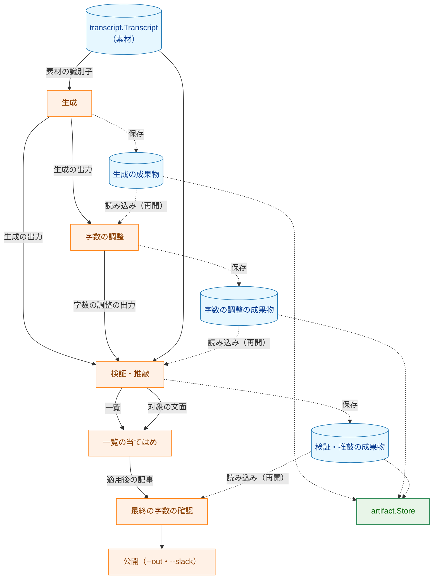
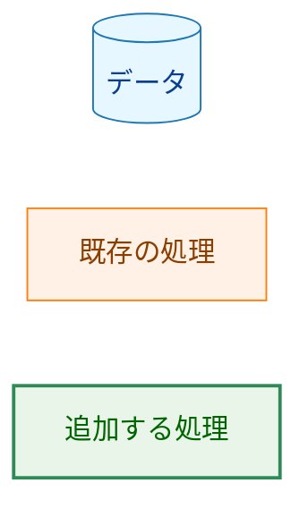
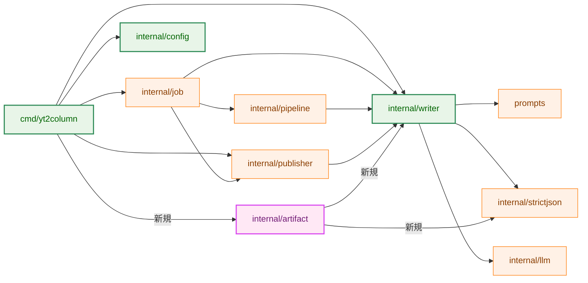
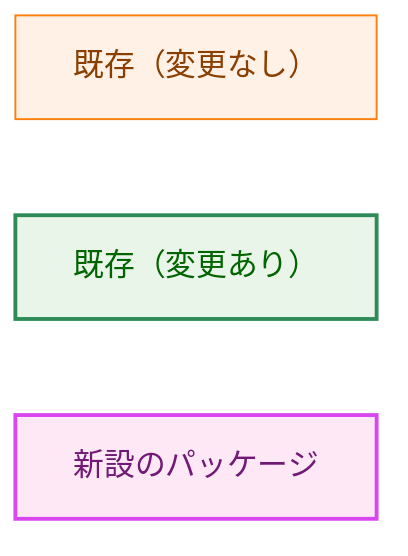
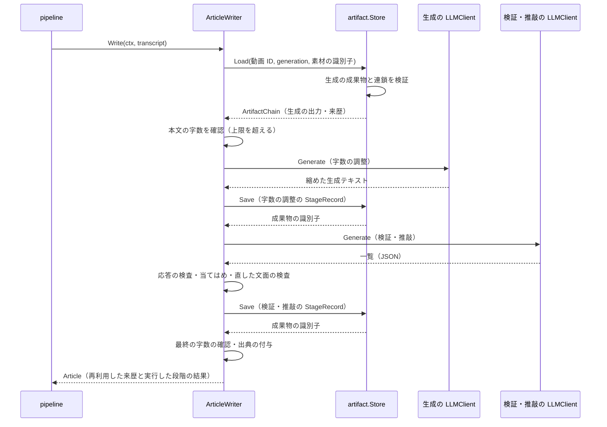
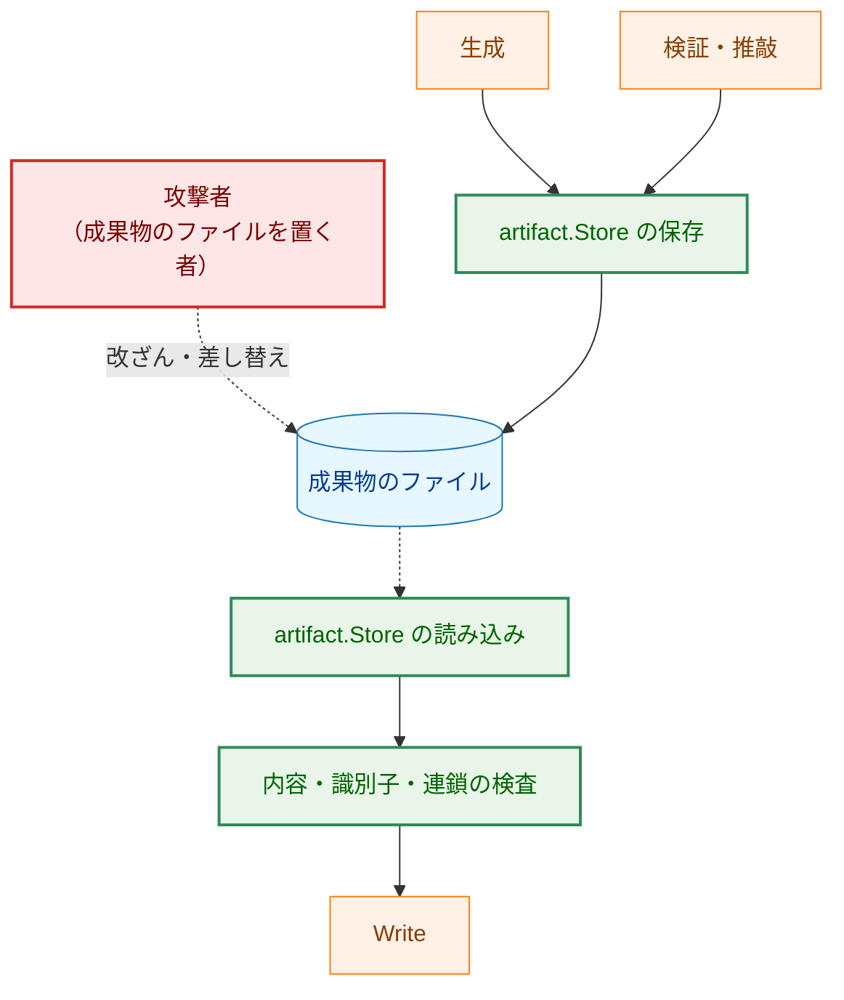
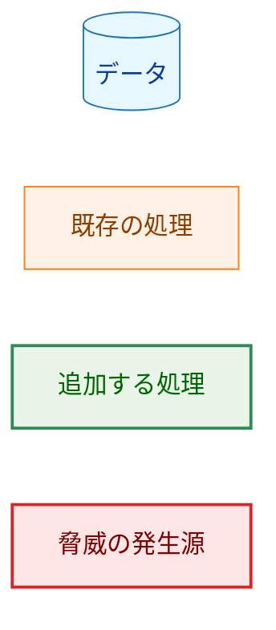
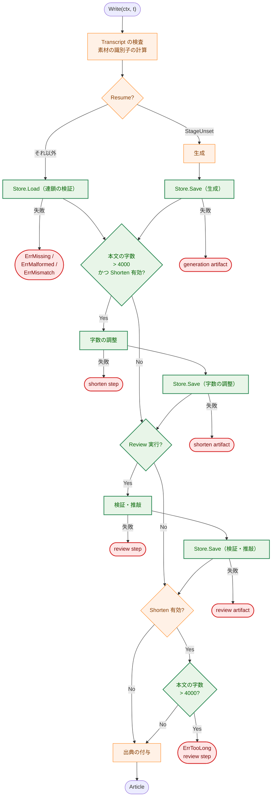
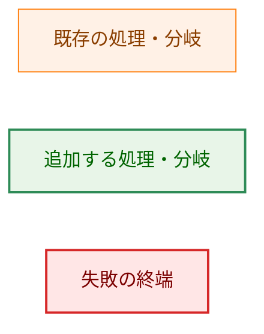
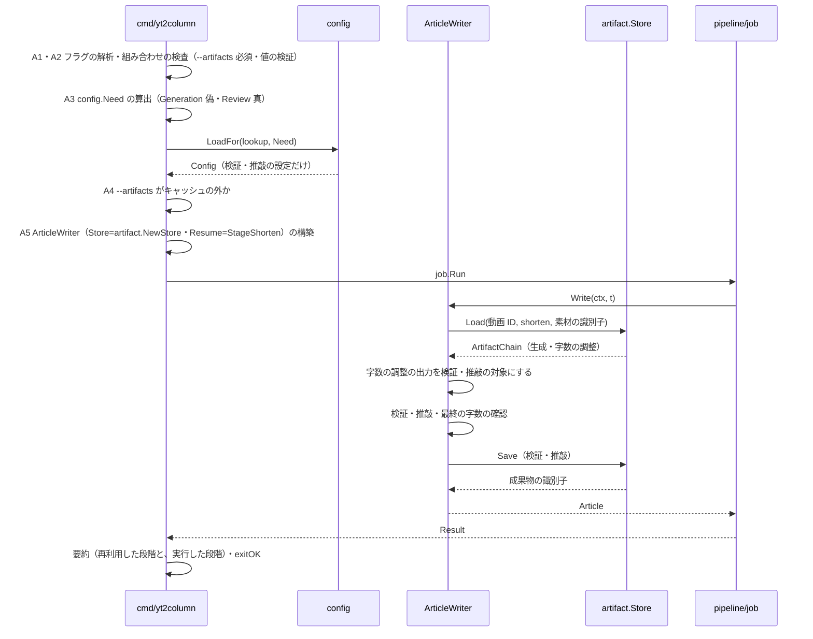

# アーキテクチャ設計書：パイプラインの中間生成物の保存と再開

## Document Status

| Item | Value |
|---|---|
| Status | `approved` |
| Created | 2026-10-14 |
| Review date | 2026-10-14 |
| Reviewer | isseis |
| Comments | 2026-10-14: §5.1 の成果物の脅威の表のセルで、フラグの表記を `O_CREATE` と `O_EXCL` の 2 つに分けた（元の表記の縦棒が Markdown の列区切りとして解釈され、行が 3 列になっていたため。表示の修正のみで、決定は変えていない）。2026-10-15: §3.9 の評価の手順で、`--keep-cache` を最初の実行だけでなく手順のすべての実行に付けると訂正した（成功した実行のたびにキャッシュが削除されるため。計画と 0010 の 02_evaluation.md はすでに全実行に付けている。表示の整合のみで、決定は変えていない） |

本書の F-NNN・AC-NN は [01_requirements.md](01_requirements.md) の項番、H-NN は [design_handoff.md](design_handoff.md) の項目（対応は §3.10）を指す。既存のコードの行番号は、コミット `704ff5e`（要件定義書を承認したコミット。コードは `4b2d227` と同じ）で確かめたものである。

**用語。** 要件定義書に従い、生成・字数の調整・検証・推敲を「段階」と呼ぶ（`generation`・`shorten`・`review`）。段階の出力のうち再利用のために保存するもの（生成の出力・字数の調整の出力・検証・推敲の一覧・適用後の記事）を「中間生成物」、その保存形式を「成果物」（`writer.StageRecord` の値を書き出すファイルと、それを読み書きする `internal/artifact`）と呼ぶ。各段階が消費した入力を示す値を「入力の識別子」、成果物が自身の内容から計算する値を「成果物の識別子」と呼ぶ。段階が使ったテンプレートの system と user の組を「テンプレートの識別子」（`TemplateIdentity`）と呼ぶ。中間生成物に付ける、段階の名前・モデル名と ModelVersion・テンプレートの識別子・入力の識別子の組を「来歴」と呼ぶ（要件定義書 §6）。0010 と同じく、段階の間で受け渡すタイトルと本文の部分の組を「文面」、`"# " + タイトル + "\n" + 本文の部分` を連結した文字列を「文面の文字列」と呼ぶ（0010 §3.2）。「素材」は生成のテンプレートに埋め込む 4 つの値（動画タイトル・チャンネル名・概要欄・字幕）を指す。

## 1. 設計の全体像 (Design Overview)

### 1.1. 設計原則

1. **保存と再開は `writer` 段階の入出力として扱う。** 中間生成物は `ArticleWriter.Write` の中で生まれ、再開の検証には `Write` が受け取る `Transcript`（素材）が要る（AC-21）。そのため、段階の実行、保存の呼び出し、再開の適用を `writer` に置く。ファイルの形式と読み書きは別パッケージ `internal/artifact` が担い、`writer` は `ArtifactStore` インタフェースを通してだけ触る（§2.1・§3.1）。`internal/job` と `internal/pipeline` は変更しない。
2. **保存するかどうかは `writer.Options` に明示して渡す。** 呼び出し側が `ArtifactStore` を渡すことで保存を宣言する（CLI は `--artifacts` のときだけ渡す）。設定の値やフラグの有無から保存の有無を推測しない（CLAUDE.md「Declare, don't infer」）。`Options` のゼロ値（`Store` が nil）は「保存も再開もしない」であり、既存の `writer.New(client, writer.Options{...})` の呼び出しは振る舞いが変わらない（AC-05・AC-32）。
3. **再開する段階は `Options` の 1 つの値で表す。** `ArtifactOptions.Resume`（`Stage` の値）が、再利用する段階の出力を指す。段階の実行の有無は、この値と既存の `Shorten.Enabled`・`Review.Enabled` から `Write` が導く。保存された値から再開の段階を推測しない（「Declare, don't infer」）。
4. **成果物の形式は 1 か所で定義する。** JSON の構文、識別子の計算、上限、読み書きを `internal/artifact` に集める。保存と再開は同じ定義を読む（要件 §4.5）。
5. **再開の入力は信頼できない入力として境界で検査し、補正しない。** 成果物の構文は `internal/strictjson` で厳密に検査し、未知のキー・重複したキー・末尾の内容・上限の超過を拒否する（§3.2）。文面は生成テキストの検査（0010 §3.6 の `checkGeneratedText`）を再利用し、検証・推敲の一覧は 0010 §3.5.3 の規則を再利用する。壊れた入力は部分受理しない（AC-20・AC-23）。
6. **連鎖を検証してから再開する。** 成果物は、自身の入力の識別子を 1 つ記録する。再開のときは、再開する段階から生成の出力まで入力を順にたどり、生成の入力が今の素材と一致することを確かめる。新しい生成で前の実行の後段の成果物が残っても、これを拒否する（AC-21・H-11）。
7. **段階が完了した時点で保存する。** 後の段階が失敗しても、それより前の段階の成果物は残る（AC-04）。保存の失敗は、その段階の失敗として扱い、記事を公開しない（AC-06）。
8. **再開では、呼ばない段階の LLM の設定を必須にしない。** `Write` が実行する段階を `config.Need` で CLI に伝え、CLI は実行する段階のプロバイダの設定だけを検査する（AC-15）。
9. **書き込みは一時ファイルと `rename(2)` で行う。** 中断の後、成果物のファイルは「置き換え前」か「置き換え後」のどちらかであり、書きかけの内容が次の再開に受理されないようにする（AC-20・§4.3）。

### 1.2. 概念モデル

**図1 概念モデル**。矢印 A → B は「A の出力を B が入力として受け取る」を表す。ただし「検証・推敲」から「一覧の当てはめ」への矢印は、検証・推敲の段階が受け取った文面を、そのまま当てはめの対象として渡すことを表す。点線の矢印は保存・読み込み（ディスクを経由する流れ）を表す。角を丸めた四角形は段階、円柱はデータである。



**Legend**



`--after generation` は生成の出力から、`--after shorten` は字数の調整の出力から、`--after review` は適用後の記事から始める。`--after review` 以外は、再開した段階より後の段階を通常どおり実行する。`--after review` は段階を実行せず、最終の字数の確認と公開だけを行う（F-003）。

### 1.3. 既存コードとの関係

| 既存のもの | 本設計での扱い |
|---|---|
| `writer.ArticleWriter`・`writer.New`（`internal/writer/writer.go:33-142`） | インタフェースは変えない。`Options` に `Artifacts` を加え、`New` の検査を段階の実行の有無に合わせる（§3.1） |
| `writer.Options`（`writer.go:44-67`） | `Artifacts ArtifactOptions` を加える。`Shorten.Enabled`・`Review.Enabled` の意味は「その段階を実行してよい」であり、最終の字数の確認は `Shorten.Enabled` に従う（0010 と同じ。§3.1） |
| `writer.Article`（`writer.go:17-25`） | 変更しない。再開では、再利用した段階のモデル名と ModelVersion を成果物から入れて組み立てる（AC-27。§3.5） |
| `writer.Write`（`writer.go:193-240`） | 段階の実行の有無を `Artifacts.Resume` から導き、各段階の完了時に `ArtifactStore.Save` を呼ぶ（§3.6） |
| 生成テキストの検査 `checkGeneratedText`（`output.go:44-78`） | 成果物の文面の検査に再利用する。変更しない（§3.2） |
| 検証・推敲の応答の検査（`review.go:38-125`、`revision.go`） | 成果物の一覧の検査に再利用する。一覧を成果物の形から読む補助関数を `writer` に加える（§3.2・H-08） |
| テンプレートの読み込み（`template.go:92-102`） | 読み込んだテンプレートの識別子（埋め込みか上書きファイルか、内容のダイジェスト）を `checkedTemplate` に持たせる（§3.2） |
| `internal/strictjson`（`CollectOnly`・`AsBool` など） | 成果物の JSON の検査に再利用する。変更しない |
| `internal/config`（`config.go:204-222` の `Load`） | 実行する段階を表す `Need` を受け取る `LoadFor` を加える。既存の `Load` は `LoadFor(need=全部)` として残す（§3.7） |
| `internal/llm/provider` | 変更しない。CLI が `New`・`NewReview` を必要な段階のときだけ呼ぶ（§3.7） |
| `internal/publisher`（`renderArticle`、`ReviewLogWriter`） | 変更しない。モデルの行は `Article` から作られ、再開では成果物の来歴が入る（AC-27。§3.5） |
| `internal/job`・`internal/pipeline` | 変更しない。保存・読み込みは `Write` の中（`ArtifactStore` の実装）で起きる |
| `cmd/yt2column/run.go` | フラグ `--artifacts`・`--after`、組み合わせの検査、`config.Need` の算出、`writer.Options` の組み立て、要約と案内を加える（§3.8） |
| `docs/dev/developer_guide/package_reference.md` | `internal/artifact` の行を加える |

**他のタスクの方針への例外。** 次の 2 つは、既存の設計書が定めた方針を、本タスクの要件に従って変える。

- **`Write` の外部への影響は `LLMClient.Generate` の呼び出しだけである。** 方針の出典は、タスク 0004 の [02_architecture.md](../0004_article_writer/02_architecture.md) のサイドエフェクト契約（「外部への影響は `LLMClient.Generate` の 1 回の呼び出しだけである」）である。本タスクでは、`Options.Artifacts.Store` が設定されたとき、`Write` は段階の完了ごとに成果物を書き、再開のときに読む。`Options` のゼロ値（`Artifacts.Store` が nil）では従来どおり `Generate` だけを呼ぶので、`Generate` の回数と `Article` のゼロ値を確かめている既存のテスト（`internal/writer/writer_test.go`・`test_helpers.go:136`、`internal/job/job_test.go:184`・`:223`、`cmd/yt2column/integration_test.go`）は変更せずに通る。例外にするのは、要件 F-001・AC-04 が、段階の出力を（後の段階が失敗しても）残すことを求めており、段階の出力と素材の両方を持つのは `Write` だけだからである。
- **`writer.New` は nil でない `LLMClient` を要求する。** 方針の出典は `writer.go:101-104`（`nilcheck.IsNil(client)` を拒否する）である。本タスクでは、生成の `LLMClient` を使う段階（生成・字数の調整）を実行しない再開（`--after shorten`・`--after review`、および `--no-shorten` を付けた `--after generation`）で、生成の `LLMClient` を nil にできる（AC-15）。要件 F-003 が、再開した段階より前の LLM を呼ばず、その設定を必須にしないと定めているためである。`New` は、実行しない段階のクライアントが nil であることだけを許し、実行する段階のクライアントが nil なら従来どおり拒否する。nil の生成クライアントを渡す既存のテストは無いので、既存のテストは変更せずに通る。

## 2. システム構成 (System Structure)

### 2.1. パッケージ構成

**図2 本設計で変更するパッケージと主な依存**。矢印 A → B は「A が B を import する」を表す。本設計に関わる import だけを示す。ラベル「新規」の矢印は、本設計で加わる import である。



**Legend**



`internal/` のパッケージ間に新しく加わる依存は `internal/artifact` → `internal/writer` と `internal/artifact` → `internal/strictjson` の 2 つで、ほかに `cmd/yt2column` → `internal/artifact` が加わる。`internal/writer` は `internal/artifact` を import せず、成果物を読む・書く操作は `writer.ArtifactStore` インタフェースを通して受け取る。実装を利用側（`writer`）のパッケージで定義し、別パッケージ（`internal/artifact`）が実装する形は、`llm.LLMClient` と `internal/llm/deepseek`、`publisher.Publisher` と `internal/publisher` の既存の形にそろえたもので、循環は生じない。

### 2.2. コンポーネント配置

| コンポーネント | 配置 | 責務 |
|---|---|---|
| 段階の実行と再開の適用 | `internal/writer/writer.go`（`templateWriter.Write`） | `Artifacts.Resume` から実行する段階を導き、各段階の完了時に保存し、再開では保存された文面から始める |
| 成果物の型と接点 | `internal/writer/artifact.go`（新設） | `Stage`・`StageRecord`・`TemplateIdentity`・`ArtifactChain`、`ArtifactStore` インタフェース、素材の識別子 |
| 生成テキストの検査の再利用 | `internal/writer/output.go`・`review.go`・`revision.go` | 成果物の文面と一覧を、0010 と同じ規則で検査する |
| 成果物の形式と読み書き | `internal/artifact/`（新設） | JSON の構文、識別子の計算、連鎖の検証、上限、一時ファイルと `rename`、ディレクトリとファイルの種別の検査 |
| 設定の読み込み | `internal/config`（`LoadFor`） | 実行する段階のプロバイダの設定だけを検査する |
| フラグと組み合わせの検査 | `cmd/yt2column`（`run.go`） | `--artifacts`・`--after` の解析、使い方の誤りの検査、`writer.Options` の組み立て、要約と案内 |
| モデルの行 | `internal/publisher`（`renderArticle`、変更なし） | 再利用した段階のモデル名を、`Article` から出力する（AC-27） |

### 2.3. データフロー（成功時）

**図3 `Write` のデータフロー（`--after generation` で字数の調整と検証・推敲を実行する場合）**。実線の矢印 `->>` は呼び出しを、点線の矢印 `-->>` は戻り値を表す。`artifact.Store` は `writer.ArtifactStore` の実装である。



保存だけを行う通常の実行（`--after` なし）では `Load` を呼ばず、生成・字数の調整・検証・推敲の完了ごとに `Save` を呼ぶ。再開では、呼ばない段階の `Save` を呼ばず、実行した段階だけを保存する（AC-18）。

## 3. コンポーネント設計 (Component Design)

### 3.1. `writer.Options` の拡張と段階の実行の導出

```go
package writer

// Stage names one of the pipeline's post-transcript stages. The zero value is
// StageUnset, which no artifact uses.
type Stage int

const (
	StageUnset Stage = iota
	StageGeneration
	StageShorten
	StageReview
)

// ArtifactOptions configures saving the intermediate artifacts of a run and
// resuming from a saved one. The zero value saves nothing and starts from
// generation.
type ArtifactOptions struct {
	// Store saves each completed stage's output and loads the chain to
	// resume from. Required when Resume is set; nil otherwise saves nothing
	// and resumes from nothing.
	Store ArtifactStore
	// Resume is the stage whose saved output to start from. StageUnset
	// starts from generation.
	Resume Stage
}

// Options configures the ArticleWriter returned by New. The zero value
// generates the article only: neither post-generation step runs and no
// artifact is saved.
type Options struct {
	SystemTemplatePath string
	UserTemplatePath   string
	Shorten            ShortenOptions
	Review             ReviewOptions
	Artifacts          ArtifactOptions
}
```

`Write` は `Artifacts.Resume` と `Shorten.Enabled`・`Review.Enabled` から、実行する段階を次のように導く。

| 段階 | 実行する条件 |
|---|---|
| 生成 | `Artifacts.Resume == StageUnset` |
| 字数の調整 | `Shorten.Enabled` かつ `Artifacts.Resume` が `StageUnset` か `StageGeneration` |
| 検証・推敲 | `Review.Enabled` かつ `Artifacts.Resume` が `StageReview` でない |
| 最終の字数の確認 | `Shorten.Enabled`（0010 と同じ。再開でも同じ規則。AC-16） |

- **`Shorten.Enabled`・`Review.Enabled` の意味は変えない。** どちらも「その段階を実行してよい」であり、最終の字数の確認が `Shorten.Enabled` に従うことも 0010 と同じである。再開で実行しない段階は、`Resume` との組み合わせで決まる。たとえば `--after review` では、`Shorten.Enabled`・`Review.Enabled` が真でも、両段階とも実行せず、最終の字数の確認だけを行う。
- **`New` の検査（§1.3 の例外）。** `New` は次の組み合わせを拒否する。エラーは番兵を持たない非公開のエラーで、CLI は使い方の誤りとして報告する。
  - `Artifacts.Resume` が `StageUnset` でないのに `Artifacts.Store` が nil（型付きの nil を含む。`nilcheck.IsNil` を使う。再開の入力が無い）。
  - 使う段階があるクライアントが nil（型付きの nil を含む。`nilcheck.IsNil` を使う）。クライアントごとに判定する。生成の `LLMClient` は生成と字数の調整の両方が使うので、生成または字数の調整を実行し得る（`Resume == StageUnset`、または `Resume == StageGeneration` かつ `Shorten.Enabled`）のに nil なら拒否する。検証・推敲を実行するのに `Review.Client` が nil の場合も拒否する。生成だけで判定すると、`--after generation` で字数の調整が走るのに nil のクライアントが `New` を通り、`runShorten` で nil の呼び出しになる。
  - 使う段階が無いクライアントが nil でない、または実行しない段階のテンプレートのパスが空でない。生成の `LLMClient` は、生成も字数の調整も実行しないとき（`--after shorten`・`--after review`、`--no-shorten` を付けた `--after generation`）に nil でなければならない。`--after review` では `Review.Enabled` が真でも検証・推敲を実行しないので、`Review.Client` は nil でなければならず、`--review-system-prompt` などは拒否される。
- **`Options` のゼロ値。** `Artifacts.Store` が nil、`Resume` が `StageUnset` なので、`Write` は従来どおり生成だけを行う（AC-05・AC-32）。

### 3.2. 成果物の形式と識別子（H-01）

**ファイルの配置（AC-10）。** 成果物は、`--artifacts` のディレクトリの直下に、動画 ID と段階の名前から決まる固定の名前で置く。動画 ID は `transcript` の検証を通ったものだけを使う（`writer.go:197` の `validateTranscript`）。段階ごとに 1 ファイルとする。

```text
<dir>/<videoID>.generation.json   生成の出力（字数の調整の前の記事）
<dir>/<videoID>.shorten.json      字数の調整の出力（検証・推敲の前の記事。走ったときだけ）
<dir>/<videoID>.review.json       検証・推敲の一覧と、適用後の記事（走ったときだけ）
```

**JSON の構文（H-01）。** 各ファイルは、次の形の JSON オブジェクト 1 つだけからなる。キーは `CollectOnly` で許可したものだけで、未知のキー・重複したキー・末尾の内容は拒否する。`revisions` は `stage` が `review` のときだけ現れる。

```json
{
  "version": 1,
  "stage": "review",
  "model": "claude-opus-5-5",
  "model_version": "",
  "system": {"embedded": true, "digest": "…"},
  "user": {"embedded": false, "digest": "…"},
  "input": "…",
  "id": "…",
  "title": "…",
  "body": "…",
  "revisions": [
    {"before": "…", "after": "…", "reason": "meaning_change", "evidence": "…"},
    {"before": "…", "delete": true, "reason": "unsupported", "evidence": "…"}
  ]
}
```

| 要素 | キー | 規則 |
|---|---|---|
| 形式の版 | `version` | 必須。整数 `1` だけを受理する。他の値は「対応しない版」として拒否する |
| 段階 | `stage` | `generation`・`shorten`・`review` のいずれかと完全に一致する |
| モデル名 | `model` | 必須。`checkModelString`（`output.go:120-131`）の規則を満たす |
| モデルの版 | `model_version` | 必須（空を許す）。空でなければ `checkModelString` の規則を満たす |
| テンプレートの識別子 | `system`・`user` | 必須。`{"embedded": 真偽値, "digest": 16 進の文字列}`。`embedded` は `Value.AsBool`、`digest` は空でない 16 進の文字列（SHA-256 の 64 文字） |
| 入力の識別子 | `input` | 必須。空でない SHA-256 の 16 進の文字列（素材の識別子か、前段の成果物の識別子） |
| 成果物の識別子 | `id` | 必須。空でない SHA-256 の 16 進の文字列（内容から計算する。下記） |
| タイトル | `title` | 必須。`textString(title, body)` を `checkGeneratedText` に通して受理される |
| 本文 | `body` | 必須。同上。本文の部分（出典のブロックを含まない） |
| 検証・推敲の一覧 | `revisions` | `stage` が `review` のときだけ必須。0010 §3.5.3 の規則（要素の数は `maxRevisions` 以下、未知のキー・重複したキー・`after`/`delete`・`reason`・制御文字の規則）を満たす。`generation`・`shorten` のときは現れてはならない |

- **一覧の検査の再利用（H-08）。** `revisions` の形（`before`・`after`/`delete`・`reason`・`evidence`）は、0010 の検証・推敲の応答と同一である。`writer` に、この形の配列を検査して `[]writer.Revision` に変換する補助関数を加え、`internal/artifact` がそれを呼ぶ。規則を 2 か所に持たない（DRY）。`artifact` は、読み込んだ成果物の `revisions` をこの補助関数に渡し、拒否されたら `ErrMalformed` として扱う。書き込みは、`writer.Revision` の公開されたフィールドと `WireValue` から、同じ形に組み立てる。
- **文面の検査の再利用。** `textString`・`checkGeneratedText`・`checkModelString` は `writer` の非公開の関数なので、`writer` に成果物の検査のための公開の補助関数を加える（`output.go` を変更する）。`writer.CheckStageText(title, body string) error` は `textString` と `checkGeneratedText` を行い、`checkGeneratedText` が返したタイトルと本文が引数と完全に一致することを確かめる（一致しなければ `ErrMalformedOutput`）。`checkGeneratedText` はタイトルの前後の空白・タブを除き、本文の改行（CRLF・CR）を LF に揃えるので、戻り値を捨てて検査だけに使うと、正規化した値を検査し、正規化していない保存値を使うことになる（検査した値と使う値がずれ、「Reject, don't normalize」にも反する）。`writer.CheckModelText(name, value string) error` は `checkModelString` を行う。`internal/artifact` はこの 2 つを呼ぶ。`checkGeneratedText` は本文の先頭の U+FEFF を 1 個除去するが、要件 F-004 は「再利用の境界では正規化せず、先頭の U+FEFF を拒否する」と定める。除去された本文は引数と一致しないので、この拒否は `CheckStageText` の一致の確認が行い、`artifact` は U+FEFF のための検査を別に持たない（規則を 2 か所に持たない。0010 の生成の経路と異なる点である。§3.10 H-05）。モデル名とモデルの版は `CheckModelText` で検査する（AC-22）。
- **段階の照合。** 読み込んだ成果物の `stage` は、読み込もうとした段階（`Load` の引数）および連鎖のたどりで期待する前段の段階と一致しなければならない。一致しなければ `ErrMismatch` とする。
- **ダイジェストの共通化（DRY）。** 値の区切りが曖昧にならないよう、複数の値を「値の長さを表す 10 進の文字列 + `:` + 値」の形で連結し、その SHA-256 を返す `writer.Digest(parts ...string) string` を `writer` に置く。エンコーディングを 1 か所に固定する。 (1) 素材の識別子は、動画 ID（`Transcript.VideoID`）と素材の 4 つの値（動画タイトル・チャンネル名・概要欄・`newTemplateData`（`prompt.go:87-98`）が作る字幕の文字列）をこの順に `Digest` に渡す `writer.MaterialID(t transcript.Transcript) string` とする。動画 ID を含めるのは、F-004・AC-21 が入力の識別子と照合する値に動画 ID を挙げているためである。動画 ID とのひも付けをファイル名 `<videoID>.<stage>.json` だけに任せると、利用者が書き換えられるディレクトリ内の名前に頼ることになり、要件 §4.2・AC-10 の「ディレクトリ内の任意の名前を信用しない」と食い違う。動画 ID を含めれば、別の動画 ID の名前にコピーした生成の成果物は、素材が同じでも §3.3 の手順 4 で `ErrMismatch` になる。(2) 成果物の識別子 `id` は、成果物の内容を決める値（`version`・`stage`・`model`・`model_version`・`system`・`user`・`input`・`title`・`body`・各 `revision` の値）を決まった順に `Digest` に渡した値とする。文字列でない値と可変長の部分は、区切りが一意になる形に固定する。真偽値（`embedded`）は `"true"`・`"false"`、`version` は 10 進の文字列とする。`revisions` は、先に要素の数を 10 進の文字列で渡し、各要素を `before`、種別のタグ（`"after"` か `"delete"`）、`after` の値（`delete` のときは渡さない）、`reason`、`evidence` の順に渡す。タグを渡さないと、`delete` の項目と `after` の値が `"true"` の項目のように、異なる一覧が同じ部品の列になり、同じ `id` を持ちうる。`internal/artifact` は (2) に `writer.Digest` を使う。読み込みのときは、記録された `id` が内容から計算した値と一致することを確かめ、一致しなければ `ErrMalformed` とする。
- **テンプレートの識別子。** 段階が使った system と user のテンプレートについて、埋め込みの既定か上書きファイルかと、その内容の SHA-256 を記録する。`checkedTemplate[T]`（`template.go:86-88`）に、読み込み時にテンプレートのテキストのダイジェストと埋め込みかどうかを持たせる。上書きファイルのパスは記録しない（ローカルのパスを成果物に入れない。要件 §4.2）。
- **上限（H-01・H-05）。** ファイル全体の上限を `maxArtifactBytes = 4 MiB` とする。この上限は、生成テキスト（≤ 1 MiB）と検証・推敲の応答（≤ 1 MiB）の両方を 1 つのファイルに収めるため、両者の合計に JSON のエスケープの余裕を加えた値である。読み込みは、ファイルの大きさが上限を超えていれば、内容を読む前に拒否する。文面の上限は `checkGeneratedText` の `maxTextBytes`（1 MiB）、一覧の上限は `maxRevisions`（256）を再利用する。
- **不正な入力の検出。** 正しい UTF-8・対になっていないサロゲート・末尾の内容・トップレベルがオブジェクトであることは `strictjson.ParseObject`（`strictjson.go:67-80`）が検査する。未知のキーとその重複は `CollectOnly`（`strictjson.go:104-116`）、真偽値の型は `AsBool`（`strictjson.go:190-203`）が拒否する。`encoding/json` が黙って修復・破棄・無視する入力は受理しない（AC-20・AC-23）。

### 3.3. 連鎖の検証（H-11・F-004）

成果物は、自身が消費した入力の識別子を `input` に 1 つだけ記録する。再開のときは、`Load` が、再開する段階から生成の出力まで、次のようにたどって検証する。

1. 再開する段階のファイルを読む。無ければ `ErrMissing`（AC-19）。
2. その成果物の `input` を、前段の候補の識別子と照合する。前段の候補は、段階の順序から決まる（生成の前段は素材、字数の調整の前段は生成、検証・推敲の前段は字数の調整または生成）。`input` がどの候補とも一致しなければ `ErrMismatch`（AC-21）。
3. 前段の成果物を読んで、その `id` が一致することを確かめ、同じ手順を生成の出力まで繰り返す。
4. 生成の出力に達したら、その `input` が、いまの `Transcript` から計算した素材の識別子（`MaterialID`）と一致することを確かめる。一致しなければ `ErrMismatch`。

- **検証・推敲の前段の決め方。** 検証・推敲の前段は、字数の調整の出力か生成の出力のどちらかである（字数の調整が走らなかった場合）。`input` を、字数の調整の成果物の `id` と照合し、一致すればそれを前段とし、一致せず生成の成果物の `id` と一致すれば生成を前段とする。どちらとも一致しなければ `ErrMismatch` である。字数の調整の成果物のファイルが無いこと（`ErrMissing`）は、字数の調整が走らなかった実行（AC-03）の正常な状態なので、ここではエラーにせず「字数の調整の候補が無い」として生成との照合に進む。字数の調整の成果物のファイルがあって壊れている（`ErrMalformed`）場合は、前段かどうかを判定できないので、補正せず `ErrMalformed` で拒否する（利用者はそのファイルを消して再開できる）。この扱いを決めないと、字数の調整が走らなかった連鎖の `--after review` が、無い字数の調整の成果物を読もうとして `ErrMissing` で失敗する。段階を記録する追加のフィールドは設けない（`input` の照合で一意に決まる）。
- **H-11 の扱い。** 同じ動画 ID で生成からやり直し、字数の調整または検証・推敲が走らなかった場合、前の実行の後段の成果物が残る（AC-03・AC-10）。新しい生成の出力の `id` は前のものと異なるので、残った後段の成果物を `--after shorten`・`--after review` で使おうとすると、手順 2 か 4 で一致しなくなり `ErrMismatch` になる。前段の照合を直前の 1 段で打ち切らないのは、この状態を見逃さないためである。
- **`Load` の戻り値。** `Load` は、再開する段階の成果物と、検証のために読んだ前段の成果物を、`ArtifactChain`（§3.5）として返す。`Write` は、再利用した段階の来歴（モデル名・ModelVersion・テンプレート）を `Article` に写すのに使う（AC-27）。

### 3.4. 保存の手順と中断への強さ（H-03）

**保存は段階の完了時に行い、記事の公開より前に行う。** `Write` は、段階の出力を検査した直後に `Save` を呼ぶ。`Save` の失敗はその段階の失敗であり、記事を公開しない（AC-06）。公開（パイプラインの段「投稿」）より前に全段階が終わるので、公開の後に行う保存はない。

**書き込みは一時ファイルと `rename(2)` で行う。**

1. `--artifacts` のディレクトリを確かめる。存在しない、ディレクトリでない、シンボリックリンクである場合は `ErrMissing`（AC-09）。`os.OpenRoot` はディレクトリ名のシンボリックリンクを辿るので、開く前に `os.Lstat` で種別を確かめ、開いた後に `os.Root.Stat(".")` の結果が `os.SameFile` で `Lstat` の結果と同じであることを確かめる（確認と開く処理の間でパスが置き換わった場合も `ErrMissing`）。`os.Lstat` と `os.OpenRoot` には `filepath.Clean` したパスを渡す。末尾に `/` や `/.` が付いたパス（`link/` など）では `os.Lstat` が最後のシンボリックリンクを辿ってリンク先のディレクトリを報告し、`os.SameFile` の照合も一致するので、`Clean` しなければシンボリックリンクを拒否できない（`go1.27.1` で確認）。この確認は CLI の組み立て（§3.8）で 1 回だけ行い、`Store` は開いたディレクトリのハンドルを保持する。以後の読み書きはそのハンドルを基準に行うので、パスが後から置き換わっても別の場所を読み書きしない。
2. 同じディレクトリに一時ファイルを作る。`os.CreateTemp` はパスを基準にするので使わず、手順 1 のハンドル（`os.Root`）の `OpenFile` に `O_CREATE|O_EXCL` とモード `0o600` を渡し、ランダムな接尾辞の名前で作る（衝突したら名前を変えて再試行する）。`O_EXCL` は、その名前に既に何かがあれば、シンボリックリンク（リンク先が無いものを含む）であっても作成を拒否するので、一時ファイルの作成はリンク先を作らず、書き込まない。`O_NOFOLLOW` は `os.Root.OpenFile` では効かない（下の「読み込み」を参照）ので、この保証には使わない。名前は `.yt2column-artifact-<videoID>.<stage>.<ランダム>.tmp` とし、動画 ID を含める（下の回収で同じ動画 ID のものだけを選ぶため）。
3. 内容を書き、`Sync` してから閉じる。
4. `os.Root.Rename` で `<videoID>.<stage>.json` に置き換える（既存の成果物を上書きする。AC-10）。置き換え先の名前がシンボリックリンクであっても、`rename(2)` はリンクそのものを置き換え、リンク先に書き込まない。`os.Rename` を使うとパスを基準にするので、手順 1 で開いたハンドルの保証が失われる。
5. ディレクトリをベストエフォートで同期する。失敗は無視する（`rename` の後なので、エラーを返すと「保存に失敗した」と誤って伝えることになる。`cache_consistency.md` §5.3 と同じ考え方）。

- **中断の後の状態。** `rename` の前（手順 2・3）に中断した場合、残るのは一時ファイルだけで、対象の成果物は前の内容のままか存在しない。次の読み込みは、一時ファイルの名前を対象の成果物として扱わない（固定の名前だけを読む。AC-10）。`rename` の後に中断した場合、対象は新しい内容である。
- **一時ファイルの回収。** `artifact.NewStore` を呼ぶ CLI の組み立ての時点では、動画 ID はまだ分からない（字幕の取得の後に決まる）。そのため、回収は `Store` がその実行で最初に `Load` または `Save` を呼ばれたとき（引数から動画 ID が分かる時点）に、手順 1 のハンドルを基準に、同じ動画 ID の `.yt2column-artifact-<videoID>.*.tmp` を削除する。中断で残った一時ファイルを回収する（`cache_consistency.md` §5 の dangling の回収と同じ考え方）。
- **読み込みは、名前の種別を `Lstat` で確かめ、開いた記述子が同じファイルであることを確かめる。** `os.Root.OpenFile` は `O_NOFOLLOW` を無視し、ルート内を指す相対シンボリックリンクを辿って対象を開く（ルートの外を指すものだけを拒否する。`go1.27.1` で確認）。そのため、開き方でシンボリックリンクを拒否することはできず、次の 3 つの確認で拒否する。
  1. 固定の名前を `os.Root.Lstat` で調べ、通常のファイルでない（シンボリックリンク・FIFO・ディレクトリなど）場合は拒否する。名前が無い場合は `ErrMissing` である。
  2. 同じ名前を `O_RDONLY|O_NONBLOCK` で開く（`Lstat` の後に FIFO へ置き換わっても、開く処理でブロックしないため）。手順 1 が通常のファイルと報告した後に開く処理が失敗した場合（名前がルートの外を指すシンボリックリンクに置き換わって "path escapes from parent" になった、名前が消えたなど）は、名前が確認の後に変わったので `ErrMalformed` とする（素のエラーを返さない）。
  3. 開いた記述子の `Stat` で、通常のファイルであること、手順 1 の結果と `os.SameFile` で同じファイルであること、大きさが `maxArtifactBytes` 以下であることを確かめ、`io.LimitReader` で上限 + 1 バイトまで読む。

  手順 1 と 2 の間で名前がシンボリックリンクや別のファイルに置き換わった場合、開く処理が失敗すれば手順 2 で、開けても開いた記述子は手順 1 で調べたファイルと一致しないので手順 3 で拒否する。この照合により、読み込む内容は、手順 1 で通常のファイルと確かめたファイルのものに限られる。種別と大きさの最終的な判定を開いた記述子で行う点は `template.go:104-139` の `readOpenedFile` と同じであり、`Lstat` は名前がシンボリックリンクかどうかを知るためだけに加える。拒否は `ErrMalformed` である（§4.1）。
- **`rename` を使い、`link(2)` を使わない理由。** 0010 の `atomicFile`（`publisher/file.go:64-87`）は、既存のファイルを上書きしないため `link(2)` を使う。成果物は同じ動画 ID・同じ段階の保存を置き換える（AC-10）ので、上書きする `rename(2)` を使う。`link(2)` と `rename(2)` は意味が違うため、`atomicFile` を共有せずに `internal/artifact` の中に同じ手順を持つ。手順（一時ファイル・`Sync`・置き換え・ディレクトリの同期）の形はそろえる。
- **`cache_consistency.md` との関係。** 成果物の保存は、キャッシュ（`internal/transcript`）とは独立である。成果物の世代の切り替えは、`rename` の 1 回だけであり、読み込み側が内容・識別子・連鎖を厳密に検証する（§3.2・§3.3）ので、中断の後に壊れた内容が受理されることはない。`cache_consistency.md` §7 のチェックリストは、成果物には適用しない（対象はキャッシュのコードである）。

### 3.5. 再利用の型と `Article` の組み立て（H-02）

```go
package writer

// TemplateIdentity names the template one stage used: whether it is the
// embedded default and a digest of its text. The override file's path is not
// recorded.
type TemplateIdentity struct {
	Embedded bool
	Digest   string
}

// StageRecord is one stage's output, saved by or loaded from the store.
type StageRecord struct {
	Stage        Stage
	Title        string
	Body         string        // the body part, without the source block
	Revisions    []Revision    // StageReview only
	Model        string
	ModelVersion string
	System       TemplateIdentity
	User         TemplateIdentity
	Input        string // the identifier of the input this stage consumed
	ID           string // the identifier of this record, computed from its content
}

// ArtifactChain is the loaded chain that ends at the resume stage, verified to
// form one run. Generation is always present; Shorten and Review are present
// only when the chain contains them.
type ArtifactChain struct {
	Generation StageRecord
	Shorten    *StageRecord
	Review     *StageRecord
}

// ArtifactStore saves and loads the intermediate artifacts of a run.
// Implementations must reject malformed input rather than repair it, and must
// not create the artifacts directory.
type ArtifactStore interface {
	// Load verifies the chain of videoID's artifacts that ends at stage
	// against materialID and returns it.
	Load(ctx context.Context, videoID string, stage Stage, materialID string) (ArtifactChain, error)
	// Save writes one completed stage's record for videoID and returns its
	// identifier.
	Save(ctx context.Context, videoID string, record StageRecord) (id string, err error)
}
```

- **動画 ID の受け渡し。** ファイル名 `<videoID>.<stage>.json`（§3.2）を決めるのに動画 ID が要るので、`Load`・`Save` は動画 ID を引数に取る。`Write` は `validateTranscript` を通した `Transcript.VideoID` だけを渡す（AC-10）。`internal/artifact` は、受け取った動画 ID を `transcript` の動画 ID の検証にもう一度通し、通らなければファイルを開く前に拒否する（パスの区切りなどを含む値でディレクトリの外を指さないため）。

- **`Article` の組み立て（AC-27）。** `Write` は、再利用した段階の来歴と、実行した段階の結果から `Article` を組み立てる。
  - `Model`・`ModelVersion`: 生成を実行した場合は生成の応答の値、再開した場合は `ArtifactChain.Generation` の値。
  - `Shorten`: 字数の調整を実行した場合はその `StepModel`、`--after shorten`・`--after review` で再利用した場合は `ArtifactChain.Shorten` から作る `StepModel`（`ArtifactChain.Shorten` が nil なら `Shorten` も nil）。
  - `Review`: 検証・推敲を実行した場合はその `ReviewResult`、`--after review` で再利用した場合は `ArtifactChain.Review` から作る `ReviewResult`（一覧とモデル）。
  `renderArticle`（`publisher/file.go:203-214`）は `Article` からモデルの行を作るので、再開でも再利用した段階の行が出力される。
- **`Article` を変更しない理由。** 保存に必要な生成の出力（字数の調整の前の文面）と字数の調整の出力（検証・推敲の前の文面）は `Write` の内部にあり、`Article` に足す必要が無い。`Article` の exported フィールドの集合を固定する `TestCommonTypesFieldSets`（`internal/pipeline/pipeline_test.go:406-414`）は変更せずに通る。
- **`StageRecord.Input` の決め方。** 生成を実行する場合、`Input` は `MaterialID(t)` である。字数の調整を実行する場合、`Input` は生成の成果物の識別子である（実行したならその `Save` の戻り値、再利用したなら `ArtifactChain.Generation.ID`）。検証・推敲を実行する場合、`Input` は前段（字数の調整または生成）の成果物の識別子である。

### 3.6. 段階の実行と `Write` の順序

`templateWriter.Write` は、0010 §3.2 の順序を、`Artifacts.Resume` に合わせて次のように進める。どこかで失敗したら、ゼロ値の `Article` とエラーを返す。

1. `Transcript` の検査と素材の識別子の計算。
2. 再開する場合: `Store.Load(ctx, t.VideoID, Resume, materialID)` を呼び、連鎖を検証して `ArtifactChain` を得る（AC-19〜AC-21）。生成を実行しない場合、`Article` の `Model`・`ModelVersion` を `ArtifactChain.Generation` から決める。再開しない場合（`Store` が設定されているとき）は `Load` を呼ばないが、`Store` のディレクトリが使えることは CLI の組み立てで確かめ済みである（§3.8）。
3. 生成（`Resume == StageUnset` のとき）: 既存の生成を行い、完了時に `Store.Save` で生成の成果物を保存する（AC-04）。再開した場合は、`ArtifactChain.Generation` の `Title`・`Body` を生成の出力とする。
4. 字数の調整（実行する条件は §3.1 の表）: 本文が上限を超えていれば実行し、完了時に保存する。`--after generation` で字数の調整を実行しない場合（`Shorten.Enabled` が偽、または本文が上限以内）は、`Save` を呼ばない。`--after shorten`・`--after review` では、`ArtifactChain.Shorten` の `Title`・`Body` を検証・推敲の対象とする。
5. 検証・推敲（実行する条件は §3.1 の表）: 0010 §3.5 の処理を行い、完了時に一覧と適用後の記事を 1 つの成果物として保存する。`--after review` では、`ArtifactChain.Review` の `Title`・`Body` を適用後の記事とする。
6. 最終の字数の確認（`Shorten.Enabled` のとき）: この時点の本文の字数が上限を超えていれば `ErrTooLong`（AC-16）。
7. 出典の付与と `Article` の組み立て（§3.5）。

- **各段階の `Generate` の前の `ctx.Err()` の確認** は 0010 と同じである。`Store.Save`・`Store.Load` の直前にも `ctx.Err()` を確かめる。
- **保存の呼び出しは段階の出力の検査の後である。** 検査に通らない出力は保存しない。`Save` が失敗した場合、その段階の失敗として扱い、以降へ進まない（AC-06）。

### 3.7. 設定の読み込み（H-04）

```go
package config

// Need says which LLM configurations a run uses, so LoadFor reads and
// validates only those. A stage that does not run does not contribute its
// provider's variables.
type Need struct {
	Generation bool // the generation client is built (generation and/or shorten runs)
	Review     bool // the review client is built (the review step runs)
}

// LoadFor reads and validates the variables the run needs, and rejects no
// other provider variable. It returns each rejection with a fixed,
// value-free reason.
func LoadFor(lookup LookupFunc, need Need) (Config, error)

// Load reads and validates the full configuration. It is LoadFor with both
// needs set, so a run that does not resume keeps the behavior of task 0010.
func Load(lookup LookupFunc) (Config, error)
```

| 実行 | `Need.Generation` | `Need.Review` |
|---|---|---|
| `--after` なし（通常の実行） | 真 | 真（0010 と同じく、`--no-review` でも検証・推敲の設定を検査する） |
| `--after generation` | `--no-shorten` を付けたときだけ偽、それ以外は真 | `--no-review` を付けたときだけ偽、それ以外は真 |
| `--after shorten` | 偽 | `--no-review` を付けたときだけ偽、それ以外は真 |
| `--after review` | 偽 | 偽 |

- **生成を実行しないときの生成の設定。** `Need.Generation` が偽のとき、`LoadFor` は `YT2COLUMN_LLM_PROVIDER`・`YT2COLUMN_MODEL` を必須にせず、生成のプロバイダの API キー・`YT2COLUMN_CLAUDE_EFFORT`・`ANTHROPIC_WORKSPACE_ID` を検査しない。`Need.Review` が偽のときは、`YT2COLUMN_REVIEW_PROVIDER`・`YT2COLUMN_REVIEW_MODEL` と検証・推敲のプロバイダの変数を検査しない（AC-15）。
- **`--after` なしの実行は 0010 と同じ。** 要件 §2.3 が、`--no-review`・`--no-shorten` の既存の振る舞いの変更をスコープ外としている。そのため、再開しない実行では `Need` の両方を真とし、0010 §3.7 の「`--no-review` でも検証・推敲の設定を検査する」を保つ。これは 0010 が `Load` にフラグを渡さなかったために生じた振る舞いであり、本設計で `LoadFor` に段階を渡せるようになった後も、通常の実行では意図的に保つ。再開のときだけ、実行する段階に合わせて `Need` を絞る。
- **`provider.New`・`provider.NewReview` の呼び出し。** クライアントを作るかどうかは `Need` ではなく、§3.1 の表で段階を実行するかどうかから決める。`Need` は設定の検査の範囲だけを表し、通常の実行では `--no-review` でも `Need.Review` が真なので（上の表）、`Need` から作ると、実行しない検証・推敲のクライアントを作って `writer.New` に渡し、`errReviewClientSet` で拒否される（現在の `buildWriter`（`run.go:357-393`）が `!opts.noReview` のときだけ作るのと同じ規則を保つ）。CLI（`cmd/yt2column`）は、生成または字数の調整を実行するとき（`--after` なし、または `--after generation` で `--no-shorten` が無いとき）だけ `provider.New` を呼んで生成の `LLMClient` を作り、検証・推敲を実行するとき（`--no-review` が無く、`--after review` でないとき）だけ `provider.NewReview` を呼ぶ。作らないクライアントは `writer.New` に nil で渡す（§3.1 の例外）。
- **値の扱いは既存の規則を共有する。** 補正しない、空の値はエラー、選んだプロバイダに関係しない変数は検査しない、という規則（0009 の F-006）はそのままである。`LoadFor` は、`Need` で選んだプロバイダの変数だけを読む。

### 3.8. フラグと組み合わせの検査（H-06・F-005）

`cmd/yt2column` に加えるフラグは次の 2 つである。

| フラグ | 種類 | 意味 |
|---|---|---|
| `--artifacts <path>` | 文字列 | 中間生成物を保存するディレクトリ。`--after` と同時に指定した場合は、保存と再利用の両方に使う |
| `--after <stage>` | 文字列 | `generation`・`shorten`・`review` のいずれか。その段階の保存された出力から再開する。`--artifacts` を必須とする |

**使い方の誤り（LLM の呼び出しの前。終了コード 2。AC-30）。** 次の場合は `exitUsage` で終わる。

- `--after` を `--artifacts` なしで指定した（AC-24）。
- `--after` に `generation`・`shorten`・`review` 以外の値を指定した（AC-25）。エラーのメッセージには、拒否した値を含める（制御文字は既存の `stderrWriter` がエスケープする）。
- `--system-prompt`・`--user-prompt` を `--after` と同時に指定した（生成を実行しないため。AC-26）。
- `--review-log` を `--after review` と同時に指定した（検証・推敲を実行しないため。AC-16）。
- `--artifacts` のパスがキャッシュディレクトリの中にある（AC-08。`--out`・`--review-log` と同じ `outPathInsideCacheDir`（`cmd/yt2column/outpath.go:29`）を使う）。

フラグを指定したかどうかは、既存の `chooseDestination`（`run.go:306-330`）と同じく `flag.FlagSet.Visit` で判定する。`--after` の値の検証は、受理する 3 つの値への `switch` で行う（「Declare, don't infer」）。

**実行の失敗（終了コード 1。AC-09・AC-30）。** `--artifacts` のディレクトリが存在しない・使えない（ディレクトリでない、シンボリックリンクである）場合は、CLI の組み立て（手順 A5）で `artifact.NewStore(dir)` がディレクトリを開くときに検出し、yt-dlp と LLM を呼ぶ前に、実行の失敗（終了コード 1）として報告する（AC-09）。`run.go` は、この失敗を設定の誤り（終了コード 2）ではなく実行の失敗として扱う。成果物の不在・破損・食い違いは、`Store.Load` が実際にファイルを開く時点で検出し、実行の失敗（終了コード 1）とする。AC-30 の「事前の確認を別に設けない」は、CLI がディレクトリを stat などで別に確認しないことを意味し、`NewStore` が実際に開く 1 回の確認と矛盾しない。

**既存のフラグとの組み合わせ（H-06）。**

- `--no-shorten`・`--no-review` は、再開と同時に指定できる。どちらも段階の実行を止めるだけであり、`Resume` と矛盾しない。たとえば `--after shorten --no-review` は、検証・推敲を実行せず、最終の字数の確認（`--no-shorten` が無ければ）と公開だけを行う。公開するのは字数の調整の出力であり、`--after review` が公開する検証・推敲の適用後の記事とは異なる。
- 上書きテンプレート（`--shorten-system-prompt` など）は、その段階を実行しないときに `writer.New` が拒否する（§3.1）。`--after shorten` の `--shorten-system-prompt`、`--after review` の `--review-system-prompt` は、それぞれ字数の調整・検証・推敲を実行しないので、使い方の誤りになる。
- 当初案の `--article`・`--review-only` は設けない（要件 F-005）。

**構築。** `deps`（`run.go:44-51`）は変更しない。CLI の組み立て（手順 A5）で `artifact.NewStore` を呼ぶ（`--artifacts` のときだけ）。単体テストと統合テストは、`t.TempDir` に作った実際のディレクトリで `artifact.Store` を使う（fake は要らない）。`buildWriter`（`run.go:357-393`）は、`Need` に応じて生成・検証・推敲の `LLMClient` を必要なときだけ作り、`writer.Options` の `Artifacts` に、`artifact.NewStore(dir)` の結果（`--artifacts` が指定されたときだけ）と `Resume`（`--after` の値）を渡す。

**要約。** 既存の要約の行（`reportSuccess`、`run.go:444-464`）と段階の行（`reportStepSummary`、`run.go:469-477`）は、`Article` から作られるので、再開でもそのまま正しく出る。`--artifacts` を指定した実行では、保存した成果物のディレクトリを 1 行で報告する。

### 3.9. 出力・評価の手順（H-07・H-08・H-09）

- **モデルの行（H-07・AC-27）。** `renderArticle`（`publisher/file.go:203-214`）は変更しない。`Article.Model`・`Article.Shorten`・`Article.Review` に、再利用した段階の来歴（§3.5）が入るので、`--out` と Webhook の出力に、実行した段階と再利用した段階の両方のモデルの行が、どの段階のものか分かる形で出る（`- Model:`・`- Shorten model:`・`- Review model:`）。ModelVersion が空のときは既存の `modelVersionOrNone` が `(none)` と書く（0010 §3.8 と同じ）。
- **一覧のファイル（H-08・AC-07）。** `--review-log` の Markdown は、0010 の `ReviewLogWriter`（`publisher/reviewlog.go`）が `Article.Review` から作る。再開で検証・推敲を実行した場合は新しい一覧が `Article.Review` に入り、`--after review` の場合は `ArtifactChain.Review` から入る。`--review-log` のファイルは読み取りの入力には使わず、成果物（`<videoID>.review.json`）だけを読む（AC-07）。
- **`--artifacts` は書き込み可能でなければならない。** 再開でも実行した段階の成果物を保存するので（AC-18）、読み取り専用のディレクトリでは再開できない。凍結した生成の出力を守る場合は、成果物を別のディレクトリに複製してから再開する（§5.3）。
- **評価の手順（H-09・AC-34）。** [0010 の 02_evaluation.md](../0010_post_generation_review/02_evaluation.md) §2 に、生成を 1 回だけ行って成果物を保存し、同じ生成の出力に別の字数の調整・検証・推敲を当てるコマンドの形を加える。手順のすべての実行に `--keep-cache` を付ける（成功した実行の後はキャッシュが既定で削除され、次の実行が字幕を取り直す。取り直した字幕が保存時と変わると再開が AC-21 で拒否されるため。AC-17）。段階の呼び出し回数と料金については、再開では呼ばない段階があることを記録する。評価の再実行と §3 の記録の更新はスコープ外である。

### 3.10. design_handoff の各項目への対応

| 項目 | 対応 |
|---|---|
| H-01 | 形式は JSON とし、キーは `version`・`stage`・`model`・`model_version`・`system`・`user`・`input`・`id`・`title`・`body`・`revisions`（`review` のみ）である（§3.2）。識別子は SHA-256 の 16 進で、素材の識別子は `writer` が、成果物の識別子は `writer.Digest` を使って `internal/artifact` が計算する。上限はファイル全体が 4 MiB、文面が 1 MiB、一覧が 256 項目である。不正な入力の検出は `internal/strictjson` を再利用する |
| H-02 | 段階の出力の保存と再開を `writer.Write` に置く。ファイルの形式と読み書きは `internal/artifact` が担い、`writer.ArtifactStore` インタフェースを通す（§1.1・§3.1）。`Article` は変更しない（§3.5）。再開の指定は `ArtifactOptions.Resume`（`Stage`）で表す |
| H-03 | 段階の完了時に、公開の前に保存する（§3.4・§3.6）。`--artifacts` のディレクトリは CLI の組み立てで 1 回開いてハンドルを保持し、以後はそのハンドルを基準に読み書きする。一時ファイルに書いて `rename(2)` で置き換え、ディレクトリの同期はベストエフォートである。中断で残った一時ファイルは次の実行で回収する。中断で残り得る状態と、それを読み込みが拒否することを §3.4 に示す |
| H-04 | `config.LoadFor(lookup, need)` を加え、実行する段階のプロバイダの設定だけを検査する（§3.7）。`--after` なしの実行は 0010 と同じく `Need` の両方を真とする。`--after generation` は字数の調整が走り得るので、`--no-shorten` が無ければ生成の設定を必須とする（AC-15） |
| H-05 | 不正な入力の検出は `strictjson` に集める（§3.2）。上限はファイル 4 MiB・文面 1 MiB・一覧 256 項目である。読み込みは、`os.Root.Lstat` で名前が通常のファイルであることを確かめてから `O_NONBLOCK` で開き、開いた記述子の `Stat` で種別・大きさと、`Lstat` の結果と同じファイルであること（`os.SameFile`）を確かめる（§3.4・§5）。成果物には形式の版（`version`）を記録し、対応しない版は拒否する。冒頭の U+FEFF は除去せず拒否する（§3.2） |
| H-06 | `--no-shorten`・`--no-review` は再開と同時に指定できる（§3.8）。上書きテンプレートは、その段階を実行しないとき `writer.New` が拒否する。`--after` の値は 3 つの値への `switch` で検証する。`--article`・`--review-only` は設けない |
| H-07 | `renderArticle` は変更せず、`Article` の `Model`・`Shorten`・`Review` に再利用した来歴を入れる（§3.5・§3.9）。ModelVersion が空のときは既存の `(none)` を使う |
| H-08 | 一覧の成果物は、0010 の検証・推敲の応答と同じ形で保存し、`writer` の補助関数で検査する（§3.2）。`--review-log` の Markdown は `Article.Review` から作り、読み取りの入力には使わない（§3.9） |
| H-09 | 評価の手順（0010 §2）に、成果物を固定して段階だけを比べる方法と `--keep-cache` を加える（§3.9・AC-34） |
| H-10 | 保存は `--artifacts` で有効にする（既定では保存しない。要件 F-002）。既定の保存先は設けない（§3.8） |
| H-11 | 成果物は入力の識別子を 1 つ記録し、再開のときに生成の出力まで連鎖を検証する（§3.3）。古い後段の成果物と新しい生成の出力が混ざった状態は `ErrMismatch` で拒否する |

### 3.11. コンポーネント責務表

| ファイル | 変更 | 責務 | 更新が要る既存のテスト |
|---|---|---|---|
| `internal/writer/artifact.go` | 新設 | `Stage`・`StageRecord`・`TemplateIdentity`・`ArtifactChain`・`ArtifactStore`、素材の識別子 | — |
| `internal/writer/writer.go` | 変更 | `Options` に `Artifacts`、`New` の検査、`Write` の段階の実行と保存・再開、`Article` の組み立て | `internal/writer/writer_test.go`（`Options` の組み立ては既存のまま。nil の生成クライアントを許す新しいテストを加える） |
| `internal/writer/output.go` | 変更 | 成果物の検査のための公開の補助関数（`CheckStageText`・`CheckModelText`。§3.2）。`checkGeneratedText` の規則は変えない | なし |
| `internal/writer/template.go` | 変更 | `checkedTemplate` にテンプレートの識別子（埋め込みか、内容のダイジェスト）を持たせる | なし（`parseTemplate` の期待は変わらない） |
| `internal/writer/review.go`・`revision.go` | 変更 | 成果物の一覧を読む補助関数（0010 の規則を再利用）| なし（既存の `parseReviewResponse` は変えない） |
| `internal/artifact/artifact.go`・`format.go`・`store.go` | 新設 | 形式、識別子の計算、連鎖の検証、上限、読み書き | — |
| `internal/config/config.go` | 変更 | `Need`・`LoadFor`。`Load` は `LoadFor` に委譲 | `config_test.go`：`Load` の期待は変わらない。`LoadFor` の行を加える |
| `internal/llm/provider/provider.go` | なし | 変更しない（呼び出し側が段階に応じて `New`・`NewReview` を呼ぶ） | なし |
| `cmd/yt2column/run.go` | 変更 | フラグ、組み合わせの検査、`config.Need` と `writer.Options` の組み立て、要約 | `run_test.go`・`signal_test.go`・`main_test.go`：`Options{}` に `Artifacts` が加わるが、ゼロ値は保存も再開もしないので既存の期待は変わらない |
| `internal/writer/test_helpers.go` | 変更 | fake の `ArtifactStore`（`//go:build test`。`testutil/` の外に置き、`TestFakesCarryBuildTag` の固定の数（17）を変えない） | — |
| `docs/dev/developer_guide/package_reference.md` | 変更 | `internal/artifact` の行、`internal/writer`・`internal/config` の記述 | `TestPackageReferenceListsPackages`（行を加えれば通る） |
| `README.md`・`docs/dev/project_overview.md`・`docs/dev/security.md` | 変更 | フラグ、設定、保存する中間生成物と読み込みの境界 | `cmd/yt2column/docs_test.go` の `TestREADMEDocumentsFlags`（README にフラグを加える） |
| `docs/tasks/0010_post_generation_review/02_evaluation.md` | 変更 | 評価の手順（§2）に、成果物を固定した比較を加える（AC-34） | なし |

## 4. エラーハンドリング設計 (Error Handling Design)

### 4.1. エラー型

```go
package artifact

// ErrMissing reports that the artifacts directory or the requested artifact
// is missing or unusable (not a directory, a symbolic link, or absent). It
// maps to a run failure (AC-09, AC-19).
var ErrMissing = errors.New("artifact is missing")

// ErrMismatch reports that an artifact's stage or input identifier does not
// match the requested stage, the current material, or the previous stage's
// artifact (AC-21).
var ErrMismatch = errors.New("artifact does not match the run")

// ErrMalformed reports that an artifact's content breaks a rule: it is empty,
// too large, not valid UTF-8, has an unknown or duplicate key or trailing
// data, an unsupported version, or its title, body, model, or review list
// fails validation. Every return wraps it together with
// writer.ErrMalformedOutput (AC-20, AC-22).
var ErrMalformed = errors.New("malformed artifact")
```

```go
package writer

// ArtifactError wraps every failure to save or load a stage's artifact. Error
// prefixes the stage name; Unwrap returns the original error.
type ArtifactError struct {
	Stage Stage
	Err   error
}

func (e *ArtifactError) Error() string
func (e *ArtifactError) Unwrap() error
```

| 失敗 | 返すエラー | 根拠 |
|---|---|---|
| `--artifacts` のディレクトリが無い・使えない | `artifact.ErrMissing` | AC-09 |
| 再開する段階の成果物が無い | `artifact.ErrMissing` | AC-19 |
| 成果物の内容が空・壊れている・大きすぎる | `artifact.ErrMalformed`（`writer.ErrMalformedOutput` を包む）| AC-20 |
| 文面・モデル名が生成テキストの規則に反する | `artifact.ErrMalformed`（`writer.ErrMalformedOutput` を包む）| AC-22 |
| 成果物の形式の版が対応しない | `artifact.ErrMalformed`（`writer.ErrMalformedOutput` を包む。理由が「対応しない版」と分かる）| §3.2 |
| 成果物の名前が通常のファイルでない（シンボリックリンク・FIFO・ディレクトリなど）、または `Lstat` と開く処理の間で別のファイルに置き換わった・開く処理が失敗した | `artifact.ErrMalformed`（`writer.ErrMalformedOutput` を包む）| AC-11・§3.4 |
| 成果物の入力の識別子がいまの入力と食い違う | `artifact.ErrMismatch` | AC-21 |
| 成果物の書き込みの失敗 | `artifact.ErrMissing`（ディレクトリが使えない場合）または素の `*os.PathError` などを `%w` で包む | AC-06 |
| `ArtifactOptions.Resume` が設定されているのに `Store` が nil | `writer` の非公開のエラー（使い方の誤り）| §3.1 |

`writer.Write` が返す保存・読み込みの失敗は、どの失敗でも `*writer.ArtifactError` で包み、失敗した段階を示す。`Write` は、どの失敗でもゼロ値の `Article` を返す。

- **`ErrMalformed` の包み方。** `errors.New` は何も包まないので、`ErrMalformed` を返す `internal/artifact` の内部の補助関数は、`fmt.Errorf("%w: %w: %s", ErrMalformed, writer.ErrMalformedOutput, reason)` の形で、`ErrMalformed` と `writer.ErrMalformedOutput` の両方を包む。`reason` は破られた規則だけを示し、成果物の値を含めない（AC-20・AC-22）。
- **失敗した段階は `*writer.ArtifactError` で宣言する。** `Write` は、`Store.Load`・`Store.Save` の失敗を、対象の段階を入れた `*writer.ArtifactError` で包む。生成の段階は `Step` の列挙に無く `*StepError` で表せないので、生成・字数の調整・検証・推敲を同じ型で表す。CLI は `errors.AsType[*writer.ArtifactError]` で段階を取り出す。
- **段階の名前。** 保存・読み込みの失敗のエラーのメッセージは、対象の段階の名前（`generation`・`shorten`・`review`）を含む（AC-29）。`ArtifactError.Error` が段階の名前を前置する。字数の調整と検証・推敲の段階の LLM の失敗は、0010 の `*StepError`（0010 §4.1）のままである。
- **再開のフラグの組み合わせの誤り（AC-30）** は、`run.go` が LLM を呼ぶ前に使い方の誤り（終了コード 2）として報告する。成果物の不在・破損・食い違いは、`Store` が実際に開く時点で検出し、実行の失敗（終了コード 1）として報告する。

### 4.2. エラーメッセージ設計パターン

- **成果物の値を含めない。** 読み込みの拒否は、破られた規則（未知のキーがある、識別子が一致しない、など）だけを示す。成果物の値は信頼できない入力であり、記事の本文や素材の引用を含むので、標準エラー出力に出すと端末を操作されうるためである（0010 §4.2 と同じ）。
- **食い違いの原因と回復を示す。** `ErrMismatch` のメッセージは、期待した識別子と実際の識別子（どちらも素材または成果物の内容の SHA-256 であり、記事の本文を含まない）と、食い違った箇所（素材か、前段の成果物か）を示す。あわせて、素材が保存時と変わった場合の回復（`--after` を外して再実行する、`--keep-cache` を付ける）を案内する。`--after` なしの実行は成果物を保存するだけで、前段の成果物を置き換えない（AC-03・§3.3）。
- **不在と破損と食い違いを区別する。** エラーのメッセージは、成果物が無い（`ErrMissing`）、壊れている（`ErrMalformed`）、食い違う（`ErrMismatch`）のどれかを示す。`errors.Is` の判定に使う（CLAUDE.md「Error Testing」）。
- **失敗の段階を示す。** 保存・読み込みの失敗は、`*writer.ArtifactError` の `Stage` で段階が分かり、メッセージは `generation artifact: …` のように段階の名前を前置する。字数の調整・検証・推敲の LLM の失敗は、0010 の `*StepError` で `shorten step: …`・`review step: …` となる（AC-29）。

### 4.3. サイドエフェクト契約

| フラグ・設定 | 抑止する外部への影響 | 許す外部への影響 |
|---|---|---|
| 既定（`--artifacts` なし） | 成果物の読み書き | 生成の LLM の呼び出し 1 回、字数の調整の最大 1 回、検証・推敲の 1 回。本タスクの前と同じ（AC-05・AC-32） |
| `--artifacts <dir>` のみ | なし | 既定に加えて、実行した段階ごとに `<dir>/<videoID>.<stage>.json` を 1 つ作る（既存のものを置き換える） |
| `--after generation` | 生成の LLM の呼び出しと、生成の成果物の書き換え | 字数の調整（走る場合）・検証・推敲の LLM の呼び出しと、その成果物の書き込み |
| `--after shorten` | 生成・字数の調整の LLM の呼び出し | 検証・推敲の LLM の呼び出しと、その成果物の書き込み |
| `--after review` | すべての LLM の呼び出しと成果物の書き込み | 最終の字数の確認と公開だけ |

`--artifacts` のディレクトリは CLI が作らない（利用者が用意する。AC-09・AC-11）。`writer.New` は、`Artifacts` の検査と、有効な段階のテンプレートの上書きファイルの読み込みだけを行い、LLM もディスクの成果物も触れない。

## 5. セキュリティ考慮事項 (Security Considerations)

### 5.1. 脅威モデル

**図4 脅威モデル**。矢印 A → B は「A のデータが B に流れる」を表す。点線は信頼できないデータの流れを表す。



**Legend**



| 脅威 | 対策 |
|---|---|
| 改ざんした成果物で、意図しない記事を公開する | 公開する記事は、成果物の値ではなく、その後の段階の出力から作る。検証・推敲を実行しない `--after review` では、成果物の文面がそのまま公開されるが、文面は生成テキストの検査を通り、投稿の前に `CheckPublishable` とメンションの検査を通る（0010 §5.1 と同じ） |
| 成果物に巨大な内容や大量の項目を入れて、メモリや時間を使い切らせる | ファイル全体 4 MiB、文面 1 MiB、一覧 256 項目の上限（§3.2）。読み込みは上限を超えるファイルを、内容を読む前に拒否する |
| `encoding/json` が黙って修復する入力（不正な UTF-8・対になっていないサロゲート・重複したキー・末尾の内容）で、検査した値と使う値をずらす | `strictjson` の既存の検査と `CollectOnly`・`AsBool` で拒否する（§3.2） |
| 成果物の識別子を偽って、別の実行の成果物を使わせる | 読み込みで `id` を内容から再計算して照合し（§3.2）、連鎖を生成の出力まで検証する（§3.3）。生成の入力は今の素材の識別子（動画 ID を含む）と照合する |
| シンボリックリンクや FIFO を成果物の名前・ディレクトリに置き、リンク先のファイルを読み書きしたり、FIFO でプロセスを停止させたりする | `--artifacts` のディレクトリは CLI の組み立てで 1 回開き、以後はそのハンドルを基準に読み書きする（パスが後から置き換わっても別の場所を読み書きしない）。`os.Root.OpenFile` は `O_NOFOLLOW` を無視してルート内の相対シンボリックリンクを辿るので、読み込みは `os.Root.Lstat` で通常のファイルに限ってから `O_NONBLOCK` で開き、開いた記述子の `Stat` が通常のファイルで、`Lstat` の結果と `os.SameFile` で一致することを確かめる（FIFO・シンボリックリンク・確認と読み込みの間の置き換えを拒否する。§3.4）。一時ファイルは `O_CREATE` と `O_EXCL` で作るので、既存のシンボリックリンクの先を作らない |
| 成果物に API キー・Webhook URL・ローカルのパスが入る | 成果物には記事の値・素材から作った値・モデル名・テンプレートの内容のダイジェストだけを書き、設定の値と上書きファイルのパスを書かない（§3.2）。成果物を書く前に、記事の値を `CheckPublishable` で検査する |
| 成果物の値を端末に出す | 読み込みの拒否のメッセージに成果物の値を含めない（§4.2） |
| 巨大な一時ファイルを残す | 一時ファイルは同じディレクトリに作り、`rename` の前に失敗した場合は削除し、次の実行の開始時にも同じ動画 ID の一時ファイルを回収する。固定の名前のファイルだけを読むので、残った一時ファイルは読まれない（§3.4） |

### 5.2. 中間生成物の権限と保存先（AC-08・AC-11）

- 成果物のファイルは `0o600` で作り、所有者だけが読める。ディレクトリは利用者が用意したものを使い、CLI は作らない。
- 保存先はキャッシュディレクトリの外に限る（AC-08）。キャッシュの削除で成果物が消えるのを防ぎ、`--out`・`--review-log` と同じ規則にそろえる。
- 成果物には、記事の本文（信頼できない LLM の出力）と、検証・推敲の一覧の根拠の引用（素材＝字幕などの信頼できないテキスト）が入る。API キー・Webhook URL・共有トークン・ローカルのパスは入れない（要件 §4.2）。

### 5.3. 残余のリスク

- **成果物の内容が破損する（ビット化けなど）。** `id` の再計算が検出するのは、内容と識別子の食い違いである。内容と識別子が同じように書き換わる改ざんは検出しないが、成果物は利用者自身のファイルであり、攻撃者が利用者の権限を持つのと同じことになるので、この範囲は対象外とする（`cache_consistency.md` §6 と同じ考え方）。
- **ハードリンクは拒否しない。** 成果物の名前が、ディレクトリの外の通常のファイルへのハードリンクであっても、`Lstat` と開いた記述子は同じ通常のファイルを示すので、読み込みは拒否しない。ディレクトリにハードリンクを作れるのは利用者の権限を持つ者であり、読んだ内容は §3.2・§3.3 の検証を通らなければ使わないので、この範囲は対象外とする。
- **同じディレクトリを複数のプロセスが同時に使う。** 成果物のディレクトリにはロックが無い。同じ動画 ID を同時に実行すると、成果物が互いに置き換わりうる。読み込みの検証（`id` の再計算と連鎖）が、食い違う状態を拒否する。キャッシュディレクトリのロック（`internal/cachelock`）は、キャッシュを共有する実行を直列化するが、成果物のディレクトリは別である。単一ライターの前提（`cache_consistency.md` §3 P1）を、成果物のディレクトリにも適用する。
- **読み取り専用のディレクトリでは再開できない。** 再開でも実行した段階の成果物を保存する（AC-18）。凍結した生成の出力を守る場合は、成果物を複製したディレクトリで再開する（§3.9）。
- **前段をやり直した実行は、後段の古い成果物を残す。** 生成からやり直して字数の調整・検証・推敲が走らない場合、前の実行の `<videoID>.shorten.json`・`<videoID>.review.json` が残る（AC-03）。これらを使う再開は連鎖の検証で `ErrMismatch` になる（AC-21）が、ディレクトリを人が見ると、そろった連鎖に見える。評価（AC-34）でディレクトリを比べるときは、生成の成果物の識別子が一致することを確かめる。
- **`--after review` は検証・推敲を再実行しない。** 成果物の適用後の記事をそのまま公開する。これは要件 F-003 の定義どおりである。成果物の文面は生成テキストの検査を通るが、検証・推敲の再実行による品質の確認は行わない。

## 6. 処理フロー詳細 (Processing Flow Details)

### 6.1. `Write` の全体フロー

**図5 `Write` の処理の流れ（`--after generation` の場合）**。矢印は処理の順序を表す。ひし形は分岐である。「エラー」の終端は、すべてゼロ値の `Article` を返す。



**Legend**



### 6.2. CLI の実行の手順

**図6 CLI の実行の手順（`--after shorten` を指定した場合）**。実線の矢印 `->>` は呼び出しを、点線の矢印 `-->>` は戻り値を表す。



## 7. テスト戦略 (Test Strategy)

### 7.1. ユニットテスト

ユニットテストは LLM の API もネットワークも呼ばない（AC-31）。`internal/writer` のテストは、fake の `ArtifactStore`（`internal/writer/test_helpers.go`、`//go:build test`。`testutil/` の外に置き、`TestFakesCarryBuildTag` の固定の数（17）を変えない）と `t.TempDir` を使う。`internal/artifact` のテストは、実際のディレクトリとファイルを `t.TempDir` に作って読み書きする。

- **保存（AC-01〜AC-05・AC-18）。** 段階をすべて実行した実行で、`Save` が生成・字数の調整・検証・推敲の 4 つの `StageRecord`（review は一覧と適用後の記事を持つ）を受け取り、それぞれの値が `Write` の途中の値と一致することを確認する。字数の調整が走らない実行では字数の調整の `Save` が呼ばれないこと、`--artifacts` なし（`Store` が nil）では `Save` が呼ばれないことを確認する。
- **段階の完了時の保存（AC-04）。** 検証・推敲を失敗させたとき、生成と字数の調整の `Save` が呼ばれていることを確認する。
- **保存の失敗（AC-06・AC-29）。** `Save` がエラーを返したとき、`Write` がゼロ値の `Article` を返し、メッセージが段階の名前を含むことを確認する。
- **再開（AC-12〜AC-14・AC-18）。** `Resume` の各値について、`Load` が呼ばれること、呼ばない段階の LLM（fake）が呼ばれないこと、実行する段階の LLM だけが呼ばれること、`Article` の `Model`・`Shorten`・`Review` が再利用した来歴と実行した結果から組み立てられることを確認する。`--after review` ではどの fake も呼ばれないことを確認する。
- **最終の字数の確認と `--review-log`（AC-16）。** 再開でも `Shorten.Enabled` に従って最終の字数の確認が行われること、検証・推敲を実行する再開では `ReviewResult` が入り、`--after review` では `ArtifactChain.Review` から入ることを確認する。
- **検証（AC-19〜AC-23）。** artifact の内容の各規則（`version`、未知のキー、重複したキー、末尾の内容、上限、冒頭の U+FEFF、`stage` の照合、文面・モデル名の検査、一覧の規則）について、その規則だけに反する入力を表で並べ、`errors.Is` の判定（`ErrMissing`・`ErrMalformed`・`ErrMismatch`・`writer.ErrMalformedOutput`）を確認する。境界では、上限ちょうどを受理し、1 つ超えを拒否することを確認する。
- **連鎖の検証（AC-21・H-11）。** 生成・字数の調整・検証・推敲の 3 つの成果物を書き、素材を変えた場合、前段の識別子を変えた場合、後の段階の成果物を残したまま生成をやり直した場合に、`--after shorten`・`--after review` が `ErrMismatch` で拒否することを確認する。`ErrMismatch` のメッセージが、期待と実際の識別子と回復を含むことも確認する。
- **`New` の検査（§3.1）。** `Resume` が設定されているのに `Store` が nil の場合、生成を実行するのに生成の `LLMClient` が nil の場合、実行しない検証・推敲の `Client` が nil でない場合、実行しない段階のテンプレートのパスがある場合を、それぞれ拒否することを確認する。
- **保存の手順（§3.4）。** 一時ファイルと `rename` の手順、中断で残った一時ファイルの回収、開いたハンドルを基準にした読み書きを確認する。`--artifacts` のディレクトリを作らない（利用者が用意する）ことを確認する。
- **設定（AC-15）。** `LoadFor` の各行（§3.7 の表）を、`LookupFunc` の fake で確認する。生成を実行しない再開で `YT2COLUMN_MODEL` が未設定でも通ること、`--after generation` で `--no-shorten` が無ければ生成の設定が必要なことを確認する。
- **出力（AC-27）。** 再利用した段階の来歴から `Article` を組み立て、`renderArticle` が `- Model:`・`- Shorten model:`・`- Review model:` の行を、段階の区別が付く形で書くことを確認する。

各テストは、対象の仕組みを壊すと失敗することを確かめてからコミットする（CLAUDE.md「Every test must be able to fail for its stated reason」）。

### 7.2. 統合テスト

- **CLI の組み立て（`cmd/yt2column`、fake の `LLMClient`）。** 次のことを確認する。
  - `--artifacts` を付けた実行で、成果物のファイルが 4 つ作られること。
  - `--after` の各値で、呼ばれない段階の LLM が呼ばれず、`--after review` では LLM が 1 つも呼ばれないこと。
  - 組み合わせの誤り（`--after` なしの `--artifacts` は許すが、`--artifacts` なしの `--after`、`--after review` と `--review-log`、`--after` と `--system-prompt`、`--after` の不正な値）が、LLM を呼ばずに `exitUsage` で終わること（AC-24〜AC-26・AC-16）。
  - `--artifacts` がキャッシュディレクトリの中にある場合に `exitUsage` で終わること（AC-08）。
  - `--artifacts` のディレクトリが無い・使えない場合に、終了コード 1 で終わること（AC-09・AC-30）。
  - 生成の設定を外した再開（`--after review`）で、`YT2COLUMN_MODEL` やプロバイダの API キーが未設定でも通ること（AC-15）。
- **既存のテスト（AC-32）。** `--artifacts`・`--after` を付けない既存の CLI のテストは、引数も期待も変えずに通る。`internal/writer`・`internal/job` の既存のテストは、`Options{}` を使い、`Article` を `==` で比べたまま変更しない。
- **実 API の統合テスト。** 既存の `TestIntegrationCLI`（`cmd/yt2column/integration_test.go`）は変更しない。成果物の保存と再開を実 API で通す確認は、評価（AC-34）の実行で行う。実 API の応答は揺れるため、自動のテストにしない（0010 §7.2 と同じ考え方）。

### 7.3. セキュリティテスト

- §5.1 の各脅威に対応する入力（巨大なファイル、項目の数の超過、未知のキー・重複したキー、不正な UTF-8、対になっていないサロゲート、冒頭の U+FEFF、識別子の食い違い、対応しない形式の版、シンボリックリンクのディレクトリ・ファイル（ルートの外を指すものと、ルート内の通常のファイルを指す相対のものの両方）、成果物の名前の FIFO、確認と読み込みの間でファイルを置き換える競合）を、§7.1 の検証と連鎖のテストに含める。FIFO を成果物の名前に置いても、読み込みがブロックせずに拒否することを確認する。
- 成果物のファイルのモードが `0o600` であること、`--artifacts` のディレクトリを作らないこと、成果物に API キー・Webhook URL・上書きファイルのパスが入らないことを確認する。
- 読み込みの失敗のエラーに、成果物の値の一意の印が含まれないことを確認する。

### 7.4. 受け入れ基準と設計要素の対応

| AC | 設計要素 | 主なテスト |
|---|---|---|
| AC-01 | §3.2・§3.6 | 保存 |
| AC-02 | §3.2・§3.5 | 保存 |
| AC-03 | §3.6 | 保存 |
| AC-04 | §3.4・§3.6 | 段階の完了時の保存 |
| AC-05 | §3.1・§4.3 | 保存 |
| AC-06 | §4.1・§3.6 | 保存の失敗 |
| AC-07 | §3.2・§3.9 | 検証（一覧）、出力 |
| AC-08 | §3.8 | CLI の組み立て |
| AC-09 | §3.4・§3.8・§4.1 | CLI の組み立て、保存の手順、検証 |
| AC-10 | §3.2・§3.4 | 保存、検証 |
| AC-11 | §5.2 | セキュリティテスト |
| AC-12〜AC-14 | §3.1・§3.6 | 再開 |
| AC-15 | §3.7 | 設定 |
| AC-16 | §3.1・§3.6・§3.8 | 最終の字数の確認、CLI の組み立て |
| AC-17 | §1.1・§1.3・§3.6 | 再開（字幕の取得。`internal/job`・`internal/pipeline` は変更せず、既存の取得とキャッシュをそのまま使う）|
| AC-18 | §3.6 | 再開、保存 |
| AC-19〜AC-23 | §3.2・§3.3・§4.1 | 検証、連鎖の検証 |
| AC-24〜AC-28 | §3.8 | CLI の組み立て |
| AC-29 | §4.1・§4.2 | 保存の失敗、検証 |
| AC-30 | §3.8・§4.1 | CLI の組み立て |
| AC-31 | §7.1 | すべてのユニットテスト |
| AC-32 | §1.3・§3.1・§7.2 | 既存のテスト |
| AC-33 | §3.9 | 文書（`docs_test.go`） |
| AC-34 | §3.9 | 文書（レビュー） |

## 8. 実装優先順位 (Implementation Priorities)

1. **フェーズ 1: `internal/artifact`。** `Stage`・`StageRecord` などの型は `internal/writer` に置くので、まず `writer` の型（`artifact.go`）を新設し、次に `internal/artifact` の形式・識別子・連鎖の検証・読み書きとそのテストを作る。他に依存しない。
2. **フェーズ 2: `internal/writer` の保存と再開。** `Options` に `Artifacts` を加え、`checkedTemplate` にテンプレートの識別子を持たせ、`Write` の段階の実行を `Resume` に合わせ、保存と再開を組み込む。`New` の検査を §3.1 の形にする。既存のテストが通ることを確かめながら進める。
3. **フェーズ 3: 設定。** `internal/config` に `Need`・`LoadFor` を加え、`Load` を `LoadFor` に委譲する。`config_test.go` の `Load` の期待が変わらないことを確かめる。
4. **フェーズ 4: CLI。** `cmd/yt2column` のフラグ・組み合わせの検査・`Need` の算出・`writer.Options` の組み立て・要約。`run.go` の既存のテストが通ることを確かめる。
5. **フェーズ 5: 文書。** README・`project_overview.md`・`security.md`・`package_reference.md` と、0010 の `02_evaluation.md` §2（AC-33・AC-34）。
6. **フェーズ 6: 評価。** この仕組みでの評価は、要件 §2.3 のとおり本タスクのスコープ外である。評価を切り替えるときに、§3.9 の手順を使う。

## 9. 将来の拡張性 (Future Extensibility)

- **保存する段階の追加。** 生成の前に字幕を整形する段階（0010 §9）を加える場合、`Stage` に値を 1 つ足し、その成果物の形式と連鎖を §3.2・§3.3 の形で定める。段階の実行の分岐は、§3.1 の表を網羅的な `switch` で書く（「Declare, don't infer」）。
- **世代管理。** 同じ動画 ID・同じ段階の成果物を置き換える現在の形（AC-10）を、世代ごとに残す形に変える場合は、ファイル名に実行の識別子を加え、`--after` にその識別子を受け取る形にする。要件 §2.3 がスコープ外としている。
- **成果物の形式の互換。** 別のバージョンの CLI との互換（要件 §4.4）は対象外である。形式を変える場合は、形式の版（`version`）を上げ、`internal/artifact` が複数の版を読む形にする。
- **評価の自動化。** 成果物を固定した比較（§3.9）を使うと、字数の調整・検証・推敲の組み合わせを多数試す評価を自動化できる。実 API の呼び出しは人が承認する（要件 §5）。
