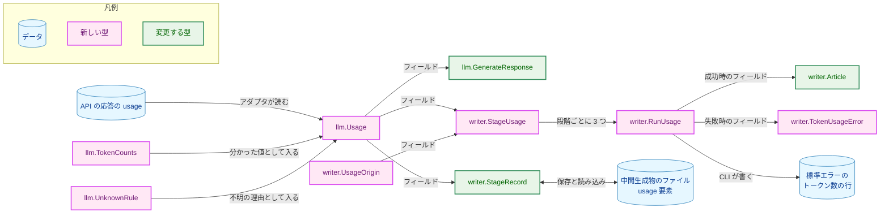
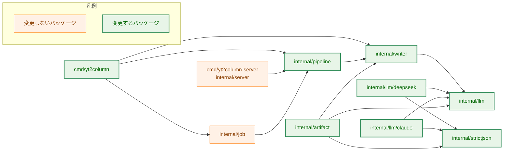
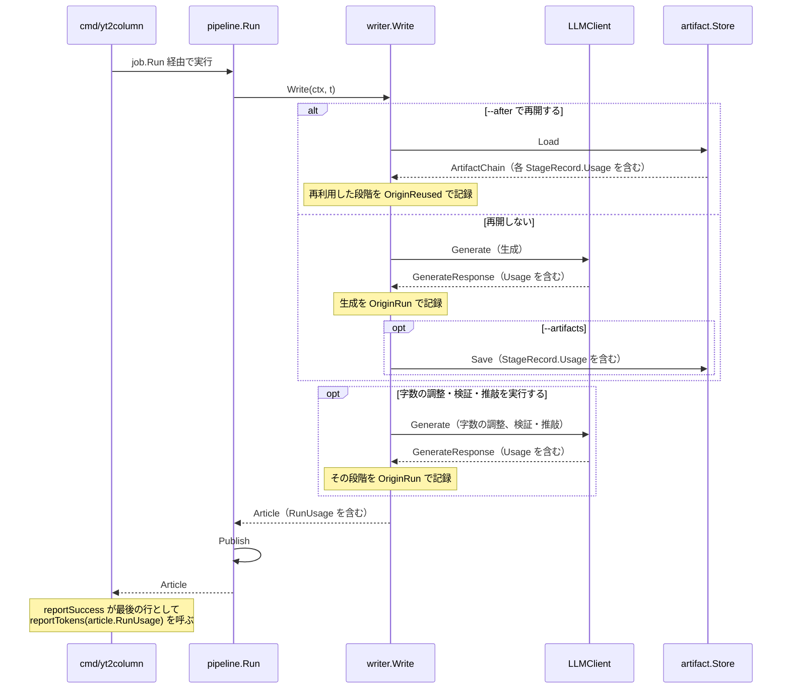
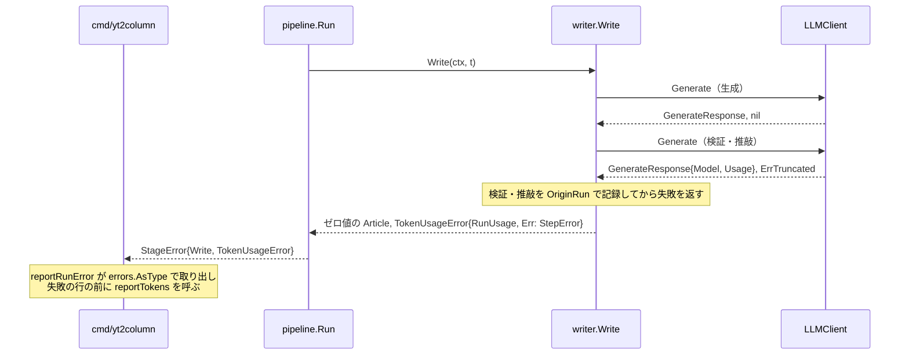
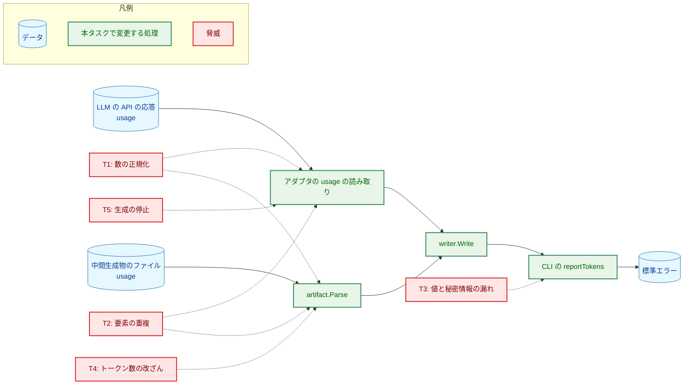
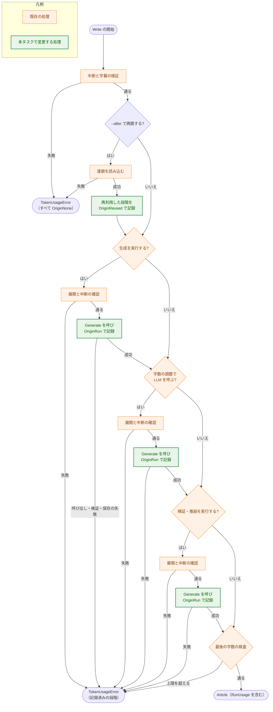
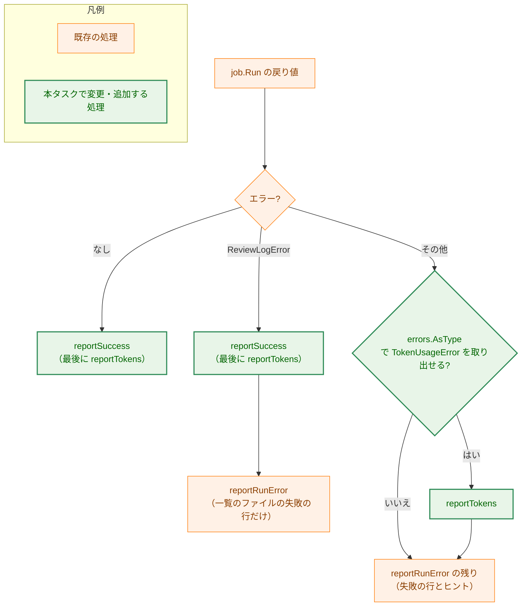

# アーキテクチャ設計書：LLM のトークン数の段階ごとの記録と出力

## Document Status

| Item | Value |
|---|---|
| Status | `draft` |
| Created | 2026-10-15 |
| Review date | - |
| Reviewer | - |
| Comments | - |

本書の既存コードへの言及（`file:line`）は、コミット `593c696` で確かめた。

**本書の用語。** 要件定義書の「トークン数」は、本書では次の 4 つの語に使い分ける。

| 語 | 型 | 意味 |
|---|---|---|
| トークン数 | `llm.TokenCounts` | 1 回の呼び出しの、4 つの区分（入力・キャッシュから読んだ入力・キャッシュに書き込んだ入力・出力）の値 |
| 使用量 | `llm.Usage` | 1 回の呼び出しのトークン数が「分かった」のか「不明（理由つき）」なのかを表す値 |
| 段階の使用量 | `writer.StageUsage` | 1 つの段階（生成、字数の調整、検証・推敲のいずれか）の使用量に、モデル名と由来を添えた値 |
| 実行の使用量 | `writer.RunUsage` | 1 回の `Write` の 3 つの段階について、段階の使用量を束ねた値 |

「不明」「再利用した値」「再利用の印」「不明の印」「段階」「中間生成物」「来歴」「再開」は、要件定義書の用語と同じである。本書の「段階」は、要件定義書と同じく `ArticleWriter` の中の処理（生成、字数の調整、検証・推敲）を指す。`pipeline.Stage` が表す字幕の取得・記事の生成・公開の単位は「パイプラインの段階」と書く。「H-nn」は [design_handoff.md](design_handoff.md) の項目であり、対応を §3.9 にまとめる。

## 1. 設計の全体像 (Design Overview)

### 1.1. 設計原則

1. **使用量は「分かった」か「不明」のどちらかであり、型で区別する。** `internal/llm` に、トークン数を保持する `TokenCounts` と、使用量を「分かった」か「不明（理由つき）」かのどちらかで表す `Usage` を置く。`Usage` のフィールドは非公開で、`Usage` のゼロ値は「不明（使用量を読まなかった）」であり、0 トークンとは読めない。トークン数は符号なしの整数で持ち、負の値を型で作れなくする（[CLAUDE.md](../../../CLAUDE.md)「Declare, don't infer」「Enforce invariants with the type」）。
2. **不明の理由は列挙型で宣言する。** 理由は、壊れた規則を表す列挙値と、アダプタの定数である要素名からなる。理由の文字列は `internal/llm` の 1 か所で組み立て、応答の値を入れられない形にする（要件 AC-08）。
3. **プロバイダ固有の要素名はアダプタの中に閉じる。** `usage` の要素名と 4 つの区分への対応、Claude の `null` を 0 とする解釈、DeepSeek のキャッシュの書き込みを 0 とする宣言は、`internal/llm/deepseek` と `internal/llm/claude` の中だけに置く（要件 F-001・AC-03）。
4. **`usage` の検証の失敗は、応答の拒否にしない。** `usage` は、応答の本文の検証（既存の `Collect` の呼び出し）とは別の読み取りで扱い、その失敗は使用量を「不明」にするだけで、応答の受理・拒否を変えない（要件 F-002・AC-09）。
5. **数値の検証は `internal/strictjson` に 1 つだけ置く。** 負でない `int64` の読み取りと `null` の判定を `strictjson` に加え、DeepSeek・Claude・中間生成物の 3 か所が共有する（要件 §4.5、H-06）。
6. **実行の使用量は、成功では `Article` で、失敗ではエラーで運ぶ。** `writer.Article` に実行の使用量（`RunUsage`）を加える。失敗した実行では、`Write` と `pipeline.Run` が、失敗までに記録した段階の使用量を持つエラー型 `*writer.TokenUsageError` でエラーを包む。`ArticleWriter` の値は localhost サーバが複数のジョブで共有するので（§1.3）、実行ごとの記録を `ArticleWriter` の中に持たせない。
7. **値の由来は型で宣言する。** 各段階の使用量には、その実行で呼んだのか、`--after` で再利用した中間生成物の値なのか、呼ばなかったのかを、列挙型 `UsageOrigin` で持たせる。CLI は値の内容から由来を推測しない（要件 AC-14・AC-15、H-03）。
8. **要約の行の書式は 1 か所で定義し、出力される形で定義する。** CLI の `reportTokens` が成功と失敗の両方で同じ行を書く。書式は、標準エラーの伏せ字とエスケープ（`redact.Line`）を通った後の形で定め、段階・由来・状態は固定の位置の固定の語で示す（要件 §4.5・AC-15、H-04）。
9. **トークン数で振る舞いを変えない。** トークン数は記録して出力するだけで、生成、字数の調整、検証・推敲の分岐、リクエストの内容、呼び出しの回数を変えない（要件 §3.2・§4.1）。

### 1.2. 概念モデル



**図1 概念モデル**。矢印 A → B は「A の値が B に入る、または B として読み書きされる」を表し、ラベルは入り方を表す。`StageRecord` と中間生成物のファイルの間の双方向の矢印は、保存（`artifact.Marshal`）と読み込み（`artifact.Parse`）を表す。

### 1.3. 既存コードとの関係

本タスクが変える既存の振る舞いと、変えないものを示す。

-   **`GenerateResponse` はトークン数を持たない。** `llm.GenerateResponse` は `Text`・`Model`・`ModelVersion` だけを持つ（`internal/llm/llm.go:57-61`）。DeepSeek のアダプタは最上位の要素を `Collect(keyModel, keyChoices, keySystemFingerprint)` で読み（`internal/llm/deepseek/response.go:52`）、Claude のアダプタは `Collect(keyModel, keyStopReason, keyContent)` で読む（`internal/llm/claude/response.go:78`）。どちらも `usage` を読まない。
-   **アダプタは、どの失敗でもゼロ値の `GenerateResponse` を返す。** DeepSeek の `parseResponse` は、打ち切り・想定外の終了理由・空の応答でもゼロ値を返し（`internal/llm/deepseek/response.go:84-92`）、`Generate` もエラーのときはゼロ値を返す（`internal/llm/deepseek/deepseek.go:88-94`）。Claude も同じである（`internal/llm/claude/response.go:95-104`、`internal/llm/claude/claude.go:93-99`）。本設計は、この契約を 3 つのエラー（打ち切り・想定外の終了理由・空の応答）について変える（§3.2）。
-   **`Collect` は、消費する要素の重複を拒否する。** `Object.Collect` は、指定したキーが 2 回現れるとエラーを返す（`internal/strictjson/strictjson.go:85-97`）。そのため、`usage` を既存の最上位の `Collect` に加えると、`usage` の重複で応答全体が `ErrInvalidResponse` になり、AC-09 に反する。本設計は、`usage` を別の `Collect` で読む（§3.4）。
-   **`AsInt64` は負数と `-0` を受理し、エラーに値を含める。** `Value.AsInt64` は `json.Number.Int64`（`strconv.ParseInt`）で読む（`internal/strictjson/strictjson.go:207-224`）。Go 1.26 で確かめた結果、`-1` は `-1`、`-0` は `0` として受理され、`1.0`・`1.5`・`1e3`・`1E3` は構文エラー、`9223372036854775808` は範囲外のエラーになる。範囲外と構文のエラーのメッセージは、`strconv.ParseInt: parsing "9223372036854775808": value out of range` のように入力の値を含む。そのため、`AsInt64` は「負でない整数」の検証にそのまま使えず、エラーをそのまま出すと AC-08 に反する（§3.3）。
-   **`Article` は呼んだ段階のモデル名だけを持つ。** `Article` は生成のモデル（`Model`・`ModelVersion`）、字数の調整の `*StepModel`、検証・推敲の `*ReviewResult` を持ち、`==` で比べられる（`internal/writer/writer.go:15-31`）。`Shorten == nil`・`Review == nil` は「その段階は LLM を呼ばなかった」を表す（[0010 の 02_architecture.md](../0010_post_generation_review/02_architecture.md) §1.1 の 3）。`Write` はどの失敗でもゼロ値の `Article` を返す（`internal/writer/writer.go:269`）。本設計は `Article` に `RunUsage` を加え、ゼロ値の `Article` を返す規則は変えない（§3.5・§3.6）。
-   **`pipeline.Run` は、公開の失敗でもゼロ値の `Article` を返す。** `Write` が成功して `Publish` が失敗すると、書いた `Article` を捨てて `&StageError{Stage: StagePublish}` を返す（`internal/pipeline/pipeline.go:104-115`）。`job.Run` は `pipe.Run` のエラーをそのまま返し、`Result.Article` を設定しない（`internal/job/job.go:152-158`）。本設計は、公開の失敗のエラーに実行の使用量を付ける（§3.6）。
-   **`ArticleWriter` の値は、サーバでは複数のジョブが共有する。** `yt2column-server` は `ArticleWriter` を起動時に 1 つ作り（`cmd/yt2column-server/run.go:237`）、`server.Options.Writer` として全ジョブに渡す。各ジョブは `pipeline.New(input.source, s.writer, s.publisher)` で同じ値を使う（`internal/server/job.go:63-69`）。そのため、実行ごとの使用量を `writer.Options` に渡した記録先や `templateWriter` のフィールドに書くと、並行するジョブの値が混ざる。本設計は、使用量を戻り値（`Article` とエラー）だけで運ぶ（§3.6）。
-   **中間生成物の形式の版は 1 で、`id` は版を含む。** `artifactVersion` は 1（`internal/artifact/artifact.go:20`）で、`Parse` は宣言したキー以外を `CollectOnly` で拒否し（`internal/artifact/format.go:130`）、版が違えば `unsupported artifact version` で拒否する（`internal/artifact/format.go:195-200`）。`recordID` は版の数字を最初の部分に含む（`internal/artifact/format.go:357-381`）。
-   **`--after review` は字数の調整の中間生成物も読み、古いファイルを消さない。** `loadReview` は、検証・推敲の中間生成物を読んだ後で字数の調整の中間生成物を読む。後者がない（`ErrMissing`）場合だけ字数の調整なしの連鎖として扱い、それ以外の失敗（`ErrMalformed` を含む）はそのまま返す（`internal/artifact/store.go:177-195`）。`loadRecord` は `Parse` のエラーを、どの段階のファイルかを付けずに返す（`internal/artifact/store.go:251-254`）。ストアは一時ファイル以外を消さないので、字数の調整が LLM を呼ばなかった実行でも、前の実行が保存した字数の調整の中間生成物はそのまま残る。
-   **CLI の要約は `reportSuccess` と `reportRunError` が書き、どの行も `redact.Line` を通る。** 成功は `reportSuccess`（`cmd/yt2column/run.go:597-620`）、失敗は `reportRunError`（`cmd/yt2column/run.go:695-723`）が書く。検証・推敲の一覧のファイルの失敗（`*job.ReviewLogError`）では、`reportSuccess` を呼んだ後に `reportRunError` を呼ぶ（`cmd/yt2column/run.go:320-329`）。どの行も `stderrWriter.line` を通り（`cmd/yt2column/run.go:201-212`）、`redact.Line` の `escapeNonPrintable` を受ける。`escapeNonPrintable` は、`strconv.Quote` の結果から外側の引用符を除いた文字列を返し、表示できない文字だけでなく `"` と `\` もエスケープする（`internal/redact/redact.go:191-199`）。
-   **CLI の「usage」は、使い方の誤りを指す。** `cmd/yt2column/run.go` には `exitUsage`（:34）・`usageHint`（:41）・`writeUsage`（:181）・`usageError` がある。本設計は、トークン数を扱う側の名前には「usage」を単独で使わない（`reportTokens`・`TokenUsageError`）。

#### 他のタスクの方針への例外

本設計は、既存の設計書が定めた次の方針を変える。

1. **「アダプタはどの拒否でも `GenerateResponse` のゼロ値を返す」の例外。**
    -   **元の方針と場所:** [0003 の 02_architecture.md](../0003_deepseek_llm_client/02_architecture.md) §「応答の検証」（「どの拒否でも `GenerateResponse` のゼロ値を返す」）と図6 の注記。Claude のアダプタ（0009）は同じ契約で実装されている（`internal/llm/claude/claude.go:93-99`）。
    -   **例外の内容と理由:** 打ち切り（`llm.ErrTruncated`）・想定外の終了理由（`llm.ErrUnexpectedFinishReason`）・空の応答（`llm.ErrEmptyResponse`）では、アダプタは `Model` と `Usage` だけを設定した `GenerateResponse` をエラーとともに返す（§3.2）。要件 F-005・AC-17 が、これらの失敗した呼び出しの使用量を呼び出し元に渡すことを求めるためである。`Text` と `ModelVersion` は空のままとし、`writer` はエラーのときに `Text` を読まない（0004 の AC-14 の規則「`Generate` が空でない `Text` とエラーを同時に返しても `Text` を使わない」は変わらない）。ほかのエラー（`ErrInvalidResponse`・HTTP の状態・通信の失敗・リクエストの不正・タイムアウト）では、これまでどおりゼロ値を返す。
    -   **更新が要るテスト:** `assertRejected`（`internal/llm/deepseek/test_helpers.go:207-215`、`internal/llm/claude/test_helpers.go:227-236`）は、すべての失敗でゼロ値の応答を確かめる。3 つのエラーでは `Model` と `Usage` を確かめるように改める。これを使う次のテストが影響を受ける。
        -   DeepSeek: `TestGenerateFinishReason`・`TestGenerateEmptyContent`・`TestGenerateValidationOrder`（`internal/llm/deepseek/response_test.go:161-171`）・`TestGenerateResponseFixtures` の「length fixture is truncated」（同 :66）・`TestGenerateSentinelsDistinct`（`internal/llm/deepseek/deepseek_test.go:701-771`）。
        -   Claude: `TestGenerateStopReason`・`TestGenerateEmptyText`・`TestGenerateValidationOrder`（`internal/llm/claude/response_test.go:139-160`）・`TestGenerateSentinelsDistinct`（`internal/llm/claude/claude_test.go:798-860`）。
2. **「`Article` を変更しない」の例外。**
    -   **元の方針と場所:** [0017 の 02_architecture.md](../0017_intermediate_artifacts/02_architecture.md) §3.5「`Article` を変更しない理由」。
    -   **例外の内容と理由:** `Article` に `RunUsage` を加える（§3.5）。要件 F-003 と §4.5 が、段階ごとの使用量を `ArticleWriter` の結果として呼び出し元に渡し、後続の #99（料金の概算。§9）が `Article` から取り出せることを求めるためである。`RunUsage` は比較できる値だけからなるので、`Article` は `==` で比べられるままである。
    -   **更新が要るテスト:** `internal/pipeline/pipeline_test.go:401-414` の `TestCommonTypesFieldSets` の `GenerateResponse` と `Article` の行（要件 §4.4）。`Article` を値で比べる `TestWriteArticle`（`internal/writer/output_test.go:36-87`。比較は :75-82）は、期待する `Article` に `RunUsage` を加える。失敗の経路で `Article{}` と比べるテスト（`writer_test.go`・`steps_test.go`・`artifact_test.go`）は、`Write` がゼロ値の `Article` を返し続けるので変わらない。
3. **「`Shorten`・`Review` の nil が『呼ばなかった』を表す」に、同じ事実の 2 つ目の表し方を加える。**
    -   **元の方針と場所:** 0010 の 02_architecture.md §1.1 の 3。
    -   **内容と理由:** `RunUsage` の各段階の `UsageOrigin` も「呼ばなかった」を表す。失敗した実行では `Article` がゼロ値なので、`TokenUsageError` は `Article` に頼らずに段階ごとの由来を持つ必要があり、成功と失敗で同じ型を使うために `Article` にも同じ型を置く。2 つの表し方が食い違わないように、成功した `Article` について次を不変条件とし、テストで確かめる（§3.5・§7.1）。
        -   `RunUsage.Generation.Origin != OriginNone`。
        -   `(Shorten != nil) == (RunUsage.Shorten.Origin != OriginNone)`、`(Review != nil) == (RunUsage.Review.Origin != OriginNone)`。
        -   各段階の `StageUsage.Model` は、`Article.Model`・`Shorten.Model`・`Review.Model.Model` と等しい。
    -   **更新が要るテスト:** ない（既存の nil の規則は変えない）。

#### 要件 AC-27 との関係

AC-27 は、トークン数に関わらない振る舞いを検証する既存のテストが、fake の `LLMClient` の変更を除いてそのまま通ることを求める。本設計では、次の既存のテストに手を入れる。どれも、AC-27 が認める例外（fake の `LLMClient` の変更）に含まれない変更なので、レビューでの了承が要る。

-   **アダプタの失敗の契約のテスト（上の例外 1 の一覧）。** AC-17 が 3 つのエラーで使用量を返すことを求めるので、ゼロ値を確かめる部分は、要件どうしの衝突として改める。テキスト・終了理由・エラーの番兵の確認は変えない。
-   **`TestWriteArticle`（上の例外 2）。** `Article` を値で比べるので、新しいフィールドの期待値を加える。記事の本文・モデルの確認は変えない。
-   **`TestCommonTypesFieldSets`・`TestInterfaceDocComments`（`internal/pipeline/pipeline_test.go:455-490`）。** 型の形と契約の文言を固定する guard であり、要件 §4.4 のとおり同じ変更で更新する。

これ以外の既存のテスト（記事の本文、モデル名の行、検証・推敲の一覧、中間生成物の再開の規則、サーバ）は変更しない。

## 2. システム構成 (System Structure)

### 2.1. パッケージ構成



**図2 パッケージの依存（本タスクに関わる主要なものだけ）**。矢印 A → B は「A が B を import する」を表す。`internal/artifact` から `internal/llm` への依存は、本タスクで加わる（中間生成物の使用量を `llm.Usage` として組み立てるため）。`internal/llm` は標準ライブラリだけに依存するパッケージなので、`.golangci.yml` の `depguard` の規則に変更は要らない。それ以外の矢印は、現在すでにある依存である。`internal/job` と `internal/server` は変更しない。

### 2.2. コンポーネント配置

| パッケージ | 本タスクで持つ責務 |
|---|---|
| `internal/llm` | `TokenCounts`・`UnknownRule`・`Usage` の定義。`GenerateResponse.Usage` の追加と、`LLMClient` の契約（エラーのときに何を返すか）の改訂 |
| `internal/strictjson` | `Value.IsNull` と `Value.AsNonNegativeInt64` の追加 |
| `internal/llm/deepseek`・`internal/llm/claude` | 応答の `usage` の読み取りと検証、4 つの区分への対応、不明の理由の選択。打ち切り・想定外の終了理由・空の応答で `Model` と `Usage` を返すこと |
| `internal/writer` | `UsageOrigin`・`StageUsage`・`RunUsage`・`TokenUsageError` の定義。`Article.RunUsage`・`StageRecord.Usage` の追加。各段階の使用量の記録と、失敗時の `TokenUsageError` での包み |
| `internal/artifact` | 形式の版 2。`usage` 要素の保存と読み込み、`recordID` への追加、版 1 の拒否のメッセージと、読み込みの失敗に段階の名前を付けること |
| `internal/pipeline` | `Write` の成功後の失敗（公開の失敗、`Write` と公開の間の中断）を `TokenUsageError` で包むこと |
| `cmd/yt2column` | トークン数の行の書式の定義（`reportTokens`）と、成功・失敗の要約での出力 |

### 2.3. データフロー



**図3 成功した実行のデータフロー**。矢印 A ->> B は呼び出し、A -->> B はその戻り値を表す。どの段階を実行するかの条件（`stageRuns`、`internal/writer/writer.go:119-127`）は 0017 の §3.6 のままであり、図は使用量の記録の位置だけを示す。シーケンス図はノードの色分けを使わないので、凡例を置かない。



**図4 失敗した実行のデータフロー（検証・推敲の打ち切りの例）**。矢印の意味は図3 と同じである。公開の失敗では、`pipeline.Run` が `Write` の返した `Article.RunUsage` を `TokenUsageError` に入れ、`StageError{Publish}` の中に置く（§3.6）。

## 3. コンポーネント設計 (Component Design)

### 3.1. `internal/llm` の使用量の型

新しいファイル `internal/llm/usage.go` に置く。

```go
package llm

// TokenCounts is the token count one LLM call reported, in the four
// categories that are priced differently. The fields are unsigned, so a
// negative count cannot be represented.
type TokenCounts struct {
	Input      uint64 // input neither read from nor written to the prompt cache
	CacheRead  uint64 // input read from the prompt cache
	CacheWrite uint64 // input written to the prompt cache
	Output     uint64 // output, reasoning and thinking output included
}

// UnknownRule is why a usage is unknown. The zero value RuleNotRead means no
// usage was read: the call failed before its usage was read, or the client
// reports none.
type UnknownRule int

const (
	RuleNotRead UnknownRule = iota
	RuleMissing               // a required member is missing
	RuleDuplicate             // a consumed member appears more than once
	RuleNotObject             // the usage member is not an object
	RuleNotNonNegativeInteger // a count is not a non-negative integer that fits int64
	RuleRecordedUnknown       // a saved record stores the usage as unknown
)

// Usage is the token usage of one call: known counts, or unknown with a rule
// and the member it applies to. The zero value is unknown with RuleNotRead,
// so it is never read as zero tokens. It is comparable with ==.
type Usage struct {
	known  bool
	counts TokenCounts
	rule   UnknownRule
	member string
}

// KnownUsage returns the usage with the given counts.
func KnownUsage(counts TokenCounts) Usage

// UnknownUsage returns an unknown usage. member names the usage member the
// rule applies to, relative to the provider's usage object ("" for the usage
// member itself). It must be a constant of the caller, never a response or
// file value, and must not contain a space.
func UnknownUsage(rule UnknownRule, member string) Usage

// Counts returns the counts and true when the usage is known, or the zero
// counts and false when it is unknown.
func (u Usage) Counts() (TokenCounts, bool)

// UnknownReason returns why the usage is unknown as one space-free token, or
// "" when it is known: "usage:<rule>" or "usage.<member>:<rule>" for a broken
// rule, "not-read" for RuleNotRead, "recorded-unknown" for
// RuleRecordedUnknown, and "invalid-rule" for a rule outside the enumeration.
func (u Usage) UnknownReason() string
```

-   **ゼロ値は「不明（使用量を読まなかった）」である。** トークン数を報告しない失敗（HTTP の状態・通信の失敗・タイムアウト・`ErrInvalidResponse`）では、アダプタが返すゼロ値の `GenerateResponse` の `Usage` がそのまま `not-read` の不明になる。トークン数を返さない既存の fake の `LLMClient` も、変更なしで不明を返す（要件 AC-27）。0 トークンを表すには、`KnownUsage(TokenCounts{})` を明示する。
-   **「プロバイダが `usage` を返さなかった」と「呼び出しが失敗して読まなかった」を区別する。** 前者は、成功した応答に `usage` がない場合で、アダプタが `RuleMissing`（理由 `usage:missing`）を選ぶ。後者はゼロ値（理由 `not-read`）である。前者はプロバイダの仕様変更の兆しであり（要件 F-002）、後者は呼び出しの失敗そのものの結果で、その失敗は失敗の行が説明する。両者は理由の語が異なるので、0018（後続の評価のタスク）と運用者は行だけで見分けられる。
-   **3 つの状態（呼ばなかった・分かった・不明）のうち、「呼ばなかった」は `Usage` に持たせない。** 呼ばなかったことは段階の性質なので、`writer.StageUsage.Origin` で表す（§3.5）。`Usage` は「実際に行った呼び出しの結果」だけを表す。
-   **トークン数を符号なしにする理由。** 負の値を型で作れなくすれば、`KnownUsage` に検査とエラーが要らず、実際には通らないエラーの分岐も生じない。値の範囲は、`strictjson.Value.AsNonNegativeInt64`（§3.3）が `int64` の範囲に限るので、要件の「`int64` で表せる」を満たす。呼び出し元は、`AsNonNegativeInt64` が返した負でない値を `uint64` に変換して渡す。
-   **理由の文字列を 1 か所で組み立てる理由。** 規則は列挙型で、要素名は呼び出し元の定数である。理由の文字列（空白を含まない 1 語）は `UnknownReason` だけが作るので、文法が 1 つに決まり、README の説明と一致させやすい（§3.8）。要素名に応答の値を入れないことは、`UnknownUsage` の文書の要求であり、アダプタと中間生成物の読み込みは、それぞれ自分の定数だけを渡す（要件 AC-08）。
-   **AC-03 の確認。** `TokenCounts`・`UnknownRule`・`Usage`・`GenerateResponse` のフィールド名と、`internal/llm` の識別子と文字列は、プロバイダ固有の要素名を含まない。要素名はアダプタが実行時に渡す値であり、`internal/llm` のソースには現れない。これを `internal/llm` のテストで確かめる（§7.1）。

### 3.2. `GenerateResponse` と `LLMClient` の契約（H-02）

```go
package llm

// GenerateResponse is the generated text and the model that produced it,
// with the token usage the response reported.
// ModelVersion is an opaque, provider-defined identifier of the model or
// backend version that produced the text, comparable only within one provider.
// It is empty when the provider reports none.
type GenerateResponse struct {
	Text         string
	Model        string
	ModelVersion string
	Usage        Usage
}

// LLMClient sends a provider-common request and returns the generated result.
// Implementations must not return an empty response without an error;
// a truncated generation is an error. They report a failure with
// ErrInvalidRequest, ErrTruncated, ErrUnexpectedFinishReason, or
// ErrEmptyResponse, and report a timeout or cancellation with an error that
// matches context.DeadlineExceeded or context.Canceled.
//
// With ErrTruncated, ErrUnexpectedFinishReason, or ErrEmptyResponse, the
// returned response carries the Model and the Usage of the rejected response,
// and an empty Text and ModelVersion. With any other error it is the zero
// value, whose Usage is unknown.
type LLMClient interface {
	Generate(ctx context.Context, req GenerateRequest) (GenerateResponse, error)
}
```

-   **エラーとともに使用量を運ぶ方法として、戻り値の `GenerateResponse` を使う。** 候補は (a) 戻り値の `GenerateResponse` の `Usage` を使う、(b) 使用量を持つエラー型を `internal/llm` に加え、`errors.AsType` で取り出す、の 2 つだった。(a) を採る。(a) では、使用量を得られない失敗のときに、既存のゼロ値の応答がそのまま不明になり、アダプタの拒否の経路（ゼロ値を返す箇所）を変えずに済む。呼び出し元（`writer`）は、成否にかかわらず `resp.Usage` を読むだけでよい。(b) では、アダプタの 3 つのエラーの経路に包むエラーを加え、`writer` は取り出せなかったときの既定値を別に持つことになる。
-   **アダプタの中での受け渡し。** `parseResponse` は、3 つのエラーのときに `Model` と `Usage` を持つ応答を返し、ほかの拒否ではゼロ値を返す。`Generate` は、`generate` が返した応答を、エラーのときも捨てずにそのまま返す（エラーの接頭辞は既存のとおり付ける。`internal/llm/deepseek/deepseek.go:88-94`、`internal/llm/claude/claude.go:93-99`）。ほかのエラーでゼロ値になることは、それぞれの経路がゼロ値を返すことで成り立つ。この境界は、`TestGenerateSentinelsDistinct` を、3 つのエラーの行で `Model`・`Usage` を確かめ、ほかのすべての行でゼロ値を確かめるように広げて固定する（§7.1）。
-   **3 つのエラーで `Model` も返す理由。** トークン数の行はモデル名を含む（要件 F-004・F-005 は同じ書式を求める）。打ち切りの行のモデル名がないと、0018 は失敗した実行の推定コストに使う単価を、行から決められない。どちらのアダプタも、終了理由を判定する前に `model` を読んでいる（`internal/llm/deepseek/response.go:56`、`internal/llm/claude/response.go:82`）ので、返す値は既存の検証（空でない文字列）を通っている。表示に使えるかの検査（制御文字など）は `writer` が行う（§3.5）。
-   **`ModelVersion` は返さない。** トークン数の行は `ModelVersion` を含まないので、要件はこれを求めない（YAGNI）。
-   **契約の文言の guard。** `TestInterfaceDocComments`（`internal/pipeline/pipeline_test.go:455-490`）の `LLMClient` の行に、3 つのエラーで `Model` と `Usage` を返す文を加える。

### 3.3. `internal/strictjson` の追加（H-06）

```go
package strictjson

// IsNull reports whether the value is the JSON literal null. The zero Value
// is not null.
func (v Value) IsNull() bool

// AsNonNegativeInt64 returns the value as a non-negative integer that fits
// int64. It rejects a non-number, null, a number with a fraction or an
// exponent (1.0, 1e3), a number with a leading minus sign (-1 and -0), and a
// number outside int64. Its errors name the broken rule only, never the
// value.
func (v Value) AsNonNegativeInt64() (int64, error)
```

-   **受理する構文。** JSON の数のうち、符号・小数部・指数部のない 10 進の整数で、`int64` の範囲にあるものだけを受理する。`ParseObject` を通った文書の値なので、先頭の 0（`01`）は文書の構文検査で既に拒否されている。
-   **`-0` を拒否する理由。** `-0` は数としては 0 だが、負の符号を持つ表記である。受理すると、符号を黙って捨てる正規化になる（[CLAUDE.md](../../../CLAUDE.md)「Reject, don't normalize」）。両プロバイダの応答と本プロジェクトの `Marshal` は `-0` を書かないので、受理する理由もない。
-   **エラーに値を含めない。** `AsInt64` のエラーは `strconv.ParseInt` のメッセージ（値を含む）をそのまま返す（§1.3）。`AsNonNegativeInt64` は、壊れた規則ごとの非公開の静的なエラー（数でない・負の符号・整数でない・範囲外）を返し、`strconv` のエラーを包まない。
-   **`AsInt64` は変えない。** `AsInt64` の既存の呼び出し元は、字幕の `tStartMs`（`internal/transcript/json3.go:148-158`）と中間生成物の版（`internal/artifact/format.go:195`）である。前者の `decodeTimestamp` は、`AsInt64` の後に負の値を拒否して「負でない整数」を実装しているが、`-0` を受理し、エラーに値を含む点で、`AsNonNegativeInt64` と規則が異なる。字幕の読み取りは本タスクの範囲外なので、この違いを既知の差として残し、移行は [#259](https://github.com/isseis/yt2column/issues/259) で扱う。中間生成物の版は、範囲外でも `unsupported artifact version` で拒否されるので、変える必要がない。
-   **`IsNull` を加える理由。** Claude の `cache_read_input_tokens`・`cache_creation_input_tokens` の `null`（要件 AC-02a）と、中間生成物の不明の表し方（§3.7）の 2 か所で、`null` とそれ以外を区別する必要がある。現在の `strictjson` には `null` を判定する手段がない（`As...` はどれも `null` をほかの種類と同じエラーで拒否する。`internal/strictjson/strictjson.go:173-267`）。

### 3.4. アダプタの `usage` の読み取り（H-01）

両アダプタの `parseResponse` は、最上位のオブジェクトを `ParseObject` で読んだ後、既存の検証とは別に `usage` を読み、`llm.Usage` を作る。

-   **最上位の `usage` は、既存の `Collect` とは別の `Collect(keyUsage)` で読む。** §1.3 のとおり、既存の `Collect` に加えると、`usage` の重複で応答全体が拒否される。別の呼び出しにすることで、`usage` の重複は不明になり、応答の検証の結果は変わらない（要件 AC-06・AC-09）。
-   **`usage` の中は `Collect`（`CollectOnly` ではない）で読む。** 消費しない要素は値の種類にかかわらず無視し、消費する要素の重複は不明にする（要件 AC-06・AC-07）。
-   **4 つの区分への対応。** 要件 F-001 の表のとおりである。

| 区分 | DeepSeek | Claude |
|---|---|---|
| 入力 | `prompt_cache_miss_tokens` | `input_tokens` |
| キャッシュから読んだ入力 | `prompt_cache_hit_tokens` | `cache_read_input_tokens`（`null` は 0） |
| キャッシュに書き込んだ入力 | 読まない。常に 0 | `cache_creation_input_tokens`（`null` は 0） |
| 出力 | `completion_tokens` | `output_tokens` |

-   **不明になる場合と、その理由。** 次のどれかに当たれば、その呼び出しの `Usage` は不明であり、ほかの要素の値を部分的に使わない（要件 AC-05）。規則は `llm.UnknownRule` の値、要素名はアダプタの定数である。

| 場合 | 規則 | 要素名 | 理由の例 |
|---|---|---|---|
| 最上位の `usage` がない | `RuleMissing` | なし | `usage:missing` |
| 最上位の `usage` が重複している | `RuleDuplicate` | なし | `usage:duplicate` |
| `usage` がオブジェクトでない（`null` を含む） | `RuleNotObject` | なし | `usage:not-an-object` |
| `usage` の中で、消費する要素が重複している | `RuleDuplicate` | その要素 | `usage.completion_tokens:duplicate` |
| 消費する要素がない | `RuleMissing` | その要素 | `usage.output_tokens:missing` |
| 消費する要素の値が `AsNonNegativeInt64` で拒否される（Claude のキャッシュの 2 つの要素の `null` を除く） | `RuleNotNonNegativeInteger` | その要素 | `usage.input_tokens:not-a-non-negative-integer` |

-   **`usage` を読む時点。** 応答の本文の形の検証（`ErrInvalidResponse`）を通った後、終了理由の判定の前に読む。`ErrInvalidResponse` ではゼロ値を返し（`Usage` は `not-read`）、打ち切り・想定外の終了理由・空の応答と成功では、読んだ `Usage` を返す（§3.2、要件 F-005）。
-   **重複を共有の関数にしない理由。** 2 つのアダプタで共通なのは「`Collect` で読み、各要素を `AsNonNegativeInt64` で読む」部分で、これは `strictjson` の関数の呼び出しの並びにすぎない。要素の集合、`null` の扱い、DeepSeek で 0 と宣言する区分はアダプタごとに違い、共有の関数に移すとプロバイダごとの指定を引数で渡すことになる。数値の検証そのもの（規則の本体）は `strictjson` に、理由の組み立ては `llm.Usage` に 1 つずつあるので、要件 §4.5 の「検証を複製しない」を満たす。
-   **テストの入力（H-01）。** 受理のテストは、既存の記録済みの応答（`testdata/deepseek_chat_completion_stop.json`・`deepseek_chat_completion_length.json`・`claude_messages_end_turn.json`・`claude_messages_max_tokens.json`）をそのまま使う。4 つとも、消費しない要素（DeepSeek の `prompt_tokens`・`total_tokens`・`prompt_tokens_details`・`completion_tokens_details`、Claude の `cache_creation`・`output_tokens_details`・`service_tier`・`inference_geo`）を含む実際の形である。ただし、記録済みの応答はキャッシュの値がどれも 0 で、区分の取り違えを検出できないので、AC-01・AC-02 のテストは、記録済みの応答の `usage` の値だけを区分ごとに異なる値へ置き換えた入力を、テストのヘルパーで組み立てる。Claude の `null` の入力（AC-02a）と、不正な形（AC-04〜AC-07）も同じヘルパーで組み立てる。

### 3.5. `internal/writer` の型（H-03）

```go
package writer

// UsageOrigin is where a stage's token usage came from. The zero value
// OriginNone means the stage called no LLM in this run and reused no
// artifact, so the stage has no usage to report.
type UsageOrigin int

const (
	// OriginNone is the zero value: the stage made no LLM call and reused
	// nothing.
	OriginNone UsageOrigin = iota
	// OriginRun means this run called the stage's LLM client.
	OriginRun
	// OriginReused means the run reused the stage's artifact, and the usage
	// is the one that artifact recorded.
	OriginReused
)

// StageUsage is one stage's token usage, the model its call reported, and
// where both came from. Model is empty when Origin is OriginNone, or when a
// failed call reported no model that passed the model-name rules.
type StageUsage struct {
	Origin UsageOrigin
	Model  string
	Usage  llm.Usage
}

// RunUsage is the token usage of each stage of one Write.
type RunUsage struct {
	Generation StageUsage
	Shorten    StageUsage
	Review     StageUsage
}

// Article is the generated column article. It stays comparable with ==:
// the step results are pointers, nil when the step called no LLM.
type Article struct {
	Title        string
	Body         string // Markdown
	SourceURL    string
	Model        string        // the generation model
	ModelVersion string        // opaque, provider-defined; empty when the provider reports none
	Shorten      *StepModel    // nil when the shorten step called no LLM
	Review       *ReviewResult // nil when the review step did not run
	RunUsage     RunUsage      // each stage's token usage
}

// StageRecord is one stage's output, saved by or loaded from the store.
type StageRecord struct {
	Stage        Stage
	Title        string
	Body         string     // the body part, without the source block
	Revisions    []Revision // StageReview only
	Model        string
	ModelVersion string
	Usage        llm.Usage  // the token usage of the stage's call
	System       TemplateIdentity
	User         TemplateIdentity
	Input        string // the identifier of the input this stage consumed
	ID           string // the identifier of this record, computed from its content
}
```

-   **3 つの状態の区別（要件 AC-11・AC-11a）。** 「呼ばなかった」は `Origin == OriginNone`、「呼んでトークン数が分かった（0 を含む）」は `Origin != OriginNone` かつ `Usage.Counts()` の第 2 戻り値が真、「呼んだがトークン数が不明」は `Origin != OriginNone` かつ偽である。
-   **由来の区別（要件 AC-14）。** `OriginRun` と `OriginReused` で宣言する。CLI はこの列挙値から再利用の印を決め、モデル名や値の内容を見ない。
-   **`OriginNone` をゼロ値にする理由と、その危険への対策。** ゼロ値を「呼ばなかった」にすると、`Write` が段階の由来の設定を忘れても、設定し忘れが本当に「呼ばなかった」場合と区別できない（どちらも行が出ない）。ゼロ値を「未設定」にして行を出す案は、`Write` の早い失敗（字幕の検証、`--after` の読み込み）でも 3 つの段階すべてに「呼ばなかった」を明示する必要があり、設定し忘れが逆向きに起きる（要件 AC-20 に反する行が出る）。そのため、ゼロ値を `OriginNone` とし、設定し忘れはテストで検出する。
-   **設定し忘れを検出するテスト。** 成功した `Article` については、§1.3 の例外 3 の不変条件（`Shorten`・`Review` の nil と `Origin` の一致など）を、`stageRuns` の組み合わせ（字数の調整と検証・推敲の有効・無効、字数の調整が LLM を呼ぶか、`--after` の 3 つの値と再開しない場合）のすべてで確かめる。失敗した実行については、失敗の経路ごとに期待する `Origin` を確かめる（§7.1）。実装では、`Write` の中の `Origin` の設定を 1 つ消してこれらのテストが失敗することを確かめる（[CLAUDE.md](../../../CLAUDE.md)「Every test must be able to fail for its stated reason」）。
-   **`StageUsage` を公開のフィールドの構造体にする理由。** `StageUsage` を作るのは `Write` と `pipeline.Run`（`Article.RunUsage` をそのまま入れるだけ）で、読むのは CLI と、将来の #99 である。構築関数で `OriginNone` とモデル名・使用量の組み合わせを制限しても、上の設定し忘れ（正しい形の誤った値）は防げない。組み合わせの検証は上の不変条件のテストに任せ、型は単純な値にする。
-   **`StepModel` に使用量を加えない理由。** 生成のモデルは `StepModel` でなく `Article.Model`・`ModelVersion` にあり、字数の調整は `*StepModel`、検証・推敲は `ReviewResult.Model` と、形がそろっていない（`internal/writer/writer.go:17-31`、`internal/writer/revision.go:14-17`）。`StepModel` に加えると、生成の使用量だけ別の場所に置くことになる。また、失敗した実行では `Article` がゼロ値なので、`TokenUsageError` に同じ情報を持たせる型がいずれにせよ要る。そのため、3 つの段階を同じ形で持つ `RunUsage` を `Article` と `TokenUsageError` の両方で使う。
-   **`StageUsage.Model` を持つ理由。** 成功した実行では、`Model` は `Article` のモデルの値と等しい（同じ値から作り、§1.3 の例外 3 の不変条件としてテストで確かめる）。それでも `StageUsage` に持たせるのは、失敗した実行の行のモデル名を出すためと（`Article` はゼロ値）、#99 が使用量とモデル名を 1 つの値から取り出せるようにするためである（要件 §4.5）。
-   **`StageUsage.Model` に入れる値。** その実行で呼んだ段階では、`resp.Model` に、生成の応答のモデル名と同じ規則（`checkModelPair` の `Model` の規則。`internal/writer/output.go:135-162`）を当て、通った値だけを入れる。通らなければ空にする（要件 §4.2「モデル名は検証を通った値だけを出す」）。成功した段階では、この規則は既存の検証（`checkResponse`、`runReview` の `checkModelPair`）と同じなので、値は必ず通る。再利用した段階では、中間生成物の読み込みが同じ規則で検証した `StageRecord.Model` を入れる（`internal/artifact/format.go:213-223`）。空のモデル名は「検証を通ったモデル名がない」の宣言であり、CLI はそれを固定の語で示す（§3.8）。空のモデル名は検証が拒否するので、検証を通った値と衝突しない。
-   **`StageRecord.Usage`。** 生成、字数の調整、検証・推敲の各段階の関数が、`resp.Usage` から設定する。保存（`Save`）と読み込み（`Load`）を通って `ArtifactChain` に入り、再開で `OriginReused` の `StageUsage` になる。
-   **段階の関数の戻り値。** `generateStage`・`shortenStage`・`reviewStage` と、その中の `runShorten`・`runReview`（`internal/writer/writer.go:343-435`、`internal/writer/shorten.go:14-38`、`internal/writer/review.go:248-275`）は、`Generate` を呼んだ場合、成否にかかわらずその段階の `StageUsage` を `Write` に返す。`Generate` を呼ぶ前の失敗（テンプレートの展開、`ctx.Err()`）では `OriginNone` の `StageUsage` を返す。
-   **`Article.CheckPublishable` は `RunUsage` を検査しない。** 公開先（`--out`・Webhook）は使用量を出さない（要件 §2.3）。`StageUsage.Model` は上のとおり、作るときに検証済みである。#99 が料金の概算を公開先に出すときに、その経路で検査を加える。
-   **fake の `LLMClient` の範囲（要件 AC-27）。** `GenerateResponse` にフィールドが増えても、既存の fake（`internal/llm/testutil/mocks.go` の `FakeLLMClient`・`FakeLLMSequence`）と、各テストのリテラルの `llm.GenerateResponse{...}` は、そのままコンパイルでき、不明を返す。トークン数を返す必要があるのは、本タスクの新しいテストだけである。

### 3.6. 失敗した実行の使用量の受け渡し（H-02）

```go
package writer

// TokenUsageError carries the token usage of the stages that ran, or were
// reused, before a run failed. Write wraps every failure in it, and
// pipeline.Run wraps a failure after a successful Write in it. Error returns
// Err's message unchanged, so wrapping does not change what a caller logs;
// Unwrap returns Err.
type TokenUsageError struct {
	RunUsage RunUsage
	Err      error
}

func (e *TokenUsageError) Error() string
func (e *TokenUsageError) Unwrap() error
```

-   **`Write` の失敗。** `Write` は、どの失敗でもゼロ値の `Article` と、`*TokenUsageError` で包んだエラーを返す。`TokenUsageError.RunUsage` は、失敗までに記録した段階（再利用した段階と、その実行で `Generate` を呼んだ段階）の使用量である。`Generate` がエラーを返した段階も、`Generate` が戻った時点で `OriginRun` として記録する（`Usage` は `resp.Usage`。使用量を得られない失敗では `not-read` の不明）。`Generate` を呼ばなかった段階は `OriginNone` のままである。
-   **包む位置。** `*TokenUsageError` は `Write` が返すエラーの一番外側に置き、その中に既存の `*StepError`・`*ArtifactError`・`ErrTooLong` などがそのまま入る。`errors.Is`・`errors.AsType` は包みを通り抜けるので、既存の判定（`cmd/yt2column/run.go:742-749` の `reportStepHints`、`internal/server/job.go:109-150` の `classify`）は変わらない。`Error()` は中のエラーのメッセージをそのまま返すので、CLI とサーバのエラーの行も変わらない（要件 AC-27・AC-28）。
-   **`Write` の成功後の失敗。** `pipeline.Run` は、`Write` が成功した後の次の 2 つの失敗を、`Article.RunUsage` を持つ `*writer.TokenUsageError` で包む。
    -   公開の失敗: `&StageError{Stage: StagePublish, Err: &writer.TokenUsageError{RunUsage: article.RunUsage, Err: err}}`。`StageError` を外側に置くのは、既存の公開の失敗と同じく、`StageError` が、失敗したパイプラインの段階（`StagePublish`）を示すためである。
    -   `Write` と公開の間の中断（`ctx.Err()`）: `&writer.TokenUsageError{RunUsage: article.RunUsage, Err: ctxErr}`。
    `pipeline.Run` がゼロ値の `Article` を返す規則は変えない。`TokenUsageError` は、`Write` の結果（実行の使用量）を運ぶ型なので `writer` に置き、`pipeline` はそれを作るだけである（`pipeline` はすでに `writer` に依存している）。
-   **契約の文言。** `ArticleWriter` の文書に「失敗では `*TokenUsageError` で包んだエラーを返す」を、`pipeline.Run` の文書に「`Write` の成功後の失敗を `*writer.TokenUsageError` で包む」を加え、前者を `TestInterfaceDocComments` の `ArticleWriter` の行に加える。
-   **`job.Run` は変えない。** `job.Run` は `pipe.Run` のエラーをそのまま返すので、`TokenUsageError` は CLI まで届く。検証・推敲の一覧のファイルの失敗（`*job.ReviewLogError`）は公開の後に起き、`Result.Article` が設定されている（`internal/job/job.go:158-169`）ので、CLI は `Result.Article.RunUsage` を使う。
-   **字幕の取得の失敗・使い方の誤り・`--after` の入力の拒否（要件 AC-20）。** 字幕の取得の失敗では `Write` を呼ばないので、`TokenUsageError` はない。`--after` の読み込みの失敗では、`Write` は `TokenUsageError` を返すが、その `RunUsage` はすべて `OriginNone` なので、行は出ない。`--after` の読み込みが成功した後の失敗では、再利用した段階が `OriginReused` で入っている（要件 AC-20 の後半、AC-14）。
-   **なぜ `ArticleWriter.Write` の戻り値の形を変えないか。** 失敗時の使用量を戻り値（例: `Write` が失敗でも使用量だけを持つ `Article` を返す）で運ぶと、0004・0010・0017 が定めた「`Write` はどの失敗でもゼロ値の `Article` を返す」を変え、`pipeline.Run`・`job.Run`・サーバのすべての呼び出し元で、失敗時の `Article` の扱いを見直すことになる。エラーで運べば、使用量を読む CLI だけが `errors.AsType` を足せばよい。
-   **行が出ない場合。** 2 回目のシグナル（`signalrun` は 1 回目のシグナルの後に配送を止めるので、2 回目は既定の動作でプロセスを終わらせる）、`kill -9`、CLI の panic では、要約を書く前にプロセスが終わり、トークン数の行は出ない。それまでに呼んだ LLM の料金はかかっている。本タスクはこれらに対する仕組みを設けない。0018 は、トークン数の行も終了の行もない記録を「料金が不明の実行」として扱う（§5.2）。

### 3.7. 中間生成物の形式の変更（H-05）

-   **形式の版を 2 に上げる。** `artifactVersion` を 2 にする。`Marshal` は版 2 だけを書き、`Parse` は版 2 だけを読む。
-   **要素の形。** 最上位に `usage` を加え、`model_version` の直後に置く。分かったトークン数は 4 つの要素を持つオブジェクト、不明は `null` で表す。

```json
{"version":2,"stage":"generation","model":"deepseek-flash","model_version":"aeb5...","usage":{"input":46,"cache_read":0,"cache_write":0,"output":85},"system":{...},"user":{...},"input":"...","id":"...","title":"...","body":"..."}
```

```json
{"version":2,"stage":"review","model":"claude-opus-5-5","model_version":"","usage":null,"system":{...},"user":{...},"input":"...","id":"...","title":"...","body":"...","revisions":[]}
```

-   **4 つの区分を 1 つのオブジェクトにまとめる理由。** 不明を `null` の 1 か所で表せ、「4 つの要素のどれかだけがない」状態を形として持たない。最上位に並べると、不明を 4 つの要素すべての `null` で表すか、別の要素で表すことになり、一部だけ `null` の組み合わせを拒否する規則が増える。
-   **読み込みの規則（要件 AC-22）。** `usage` は必須の要素とし、最上位の `CollectOnly` の一覧に加える（`internal/artifact/format.go:34-37`）。`usage` がない・重複している場合は拒否する。値が `null` なら不明、オブジェクトなら `CollectOnly("input", "cache_read", "cache_write", "output")` で読み、4 つすべてを必須として `AsNonNegativeInt64` で読む。宣言していない要素・重複・欠け・負数・`-0`・小数・`int64` を超える数・文字列などは、どれも `artifact.ErrMalformed` で拒否する。応答の `usage` と違い、中間生成物は本プロジェクトが書いた形なので、宣言していない要素も拒否する（要件 §3.2）。
-   **不明の理由は記録しない。** 不明は `null` だけで表し、理由を保存しない。理由を保存するには、規則と要素名をファイルに書き、読み込みで両方を閉じた集合と照合する必要がある。要素名はプロバイダごとの集合なので、`internal/artifact` がプロバイダの要素名を知ることになる。読み込んだ不明の `Usage` は `llm.UnknownUsage(llm.RuleRecordedUnknown, "")` とし、行の理由は `recorded-unknown` になる。元の理由は、その中間生成物を保存した実行の標準エラーにだけ残ることを README に書く。
-   **`id` の計算（要件 AC-24）。** `recordID` が組み合わせる部分の並びのうち、`ModelVersion` の直後に使用量を加える。分かった値なら固定の語 `usage-known` と 4 つの区分の 10 進の値を、不明なら固定の語 `usage-unknown` だけを加える。`writer.Digest` は各部分の長さを前置するので、並びが異なれば `id` も異なる。不明の理由は `id` に含めない。そのため、理由が異なる不明（保存前のアダプタの理由と、読み込み後の `recorded-unknown`）でも `id` は同じになる。そのため、`Marshal` の後の `Parse` による往復の検査（`internal/artifact/format.go:109-115`）と、`Parse` の `id` の照合（`internal/artifact/format.go:182-184`）は、どちらも通る。
-   **読み込みの失敗に段階の名前を付ける。** `loadRecord` は、`Parse` のエラーと大きさの上限の失敗に、読んでいたファイルの段階の名前を付けて返す（`internal/artifact/store.go:245-256`。読み取りの失敗のメッセージだけは、すでに段階の名前を含む）。`--after review` で字数の調整の中間生成物が壊れていても、エラーは `review artifact:` だけでなく、壊れたのが字数の調整のファイルであることを示す。
-   **版 1 の拒否と、更新後の手順（要件 AC-23）。** 版 1 の中間生成物には `usage` がないが、`CollectOnly` は一覧の要素が欠けていることを拒否しないので、`Parse` は版の検査（`parseStage`）まで進み、版が違うことで拒否する。番兵は既存のとおり `artifact.ErrMalformed` である。メッセージは `unsupported artifact version 1; this CLI reads version 2 only; move away the artifacts an older CLI saved, or use a new --artifacts directory, then rerun` とする。「`--after` を付けずに実行し直す」を回復の方法にしない理由は、§1.3 のとおりストアが前の実行の字数の調整の中間生成物を消さないためである。更新前の CLI で字数の調整が LLM を呼んだ動画では、更新後に字数の調整が LLM を呼ばないと、版 1 の字数の調整の中間生成物が残る。そのため、`--after review` は、実行し直しても同じ失敗を繰り返す。README には、更新後は新しい `--artifacts` のディレクトリを使うことを書く。
-   **`--after review` の照合の経路（要件 AC-14）。** `Load` は、`--after review` では生成、字数の調整、検証・推敲の中間生成物を連鎖として読み、`ArtifactChain` に入れる（0017 の §3.3）。各 `StageRecord` は `Usage` を持つので、`Write` は既存の照合の経路をそのまま使い、各段階を `OriginReused` の `StageUsage` にする。新しい読み込みの経路は作らない（要件 §4.5）。

### 3.8. 要約の行の書式（H-04）

トークン数の行は、段階ごとに 1 行である。書式は、`redact.Line` を通った後に標準エラーに現れる形で定める。

```text
yt2column: tokens: <stage> <origin> known input=<n> cache_read=<n> cache_write=<n> output=<n> <model>
yt2column: tokens: <stage> <origin> unknown reason=<reason> <model>
```

| 位置 | 内容 | 値 |
|---|---|---|
| 接頭辞 | 固定 | `yt2column: tokens: ` |
| 第 1 の語 | 段階 | `generation`・`shorten`・`review`（`writer.Stage.String()`。`--after` の値と同じ） |
| 第 2 の語 | 由来 | `run`（この実行の呼び出し）・`reused`（再利用した中間生成物の値） |
| 第 3 の語 | 状態 | `known`（分かった）・`unknown`（不明） |
| 以降（`known`） | 4 つの区分 | `input=`・`cache_read=`・`cache_write=`・`output=` の順に 10 進の整数 |
| 以降（`unknown`） | 理由 | `reason=` に続けて、`llm.Usage.UnknownReason` の空白を含まない 1 語 |
| 最後 | モデル名 | `model=` に続けて、行の終わりまでがモデル名。検証を通ったモデル名がない場合は、`model=` の代わりに固定の語 `nomodel` |

例:

```text
yt2column: tokens: generation reused known input=46 cache_read=0 cache_write=0 output=85 model=deepseek-flash
yt2column: tokens: shorten run known input=1800 cache_read=0 cache_write=0 output=2400 model=deepseek-flash
yt2column: tokens: review run unknown reason=usage.output_tokens:not-a-non-negative-integer model=claude-opus-5-5
yt2column: tokens: generation run unknown reason=not-read nomodel
```

-   **`redact.Line` を通った後の形で定める理由。** 行は `stderrWriter.line` を通り、`escapeNonPrintable` が `"`・`\`・表示できない文字をエスケープする（§1.3）。行の中で値を引用符で囲むと、引用符がエスケープされて、README に書いた形と出力が異なる。そこで本設計は、行の中で値を引用符で囲まず、エスケープを `redact.Line` の 1 層だけにする。固定の部分（接頭辞・3 つの語・区分の名前・整数・理由の 1 語・`nomodel`）は、エスケープの対象になる文字を含まないので、`redact.Line` を通っても変わらない。
-   **モデル名を行の終わりまでとし、最後に置く理由。** モデル名は、応答のモデル名の検証（空白だけでない・制御文字を含まない）を通った値で、空白・`"`・`\`・表示できない書式の文字（Unicode の Cf。例: U+202E）を含みうる（`internal/writer/output.go:166-174`）。行の最後に置き、`model=` の後から行の終わりまでをモデル名とすれば、空白を含んでも境界は曖昧にならない。`"`・`\`・表示できない文字は `redact.Line` が `strconv.Quote` と同じ形（外側の引用符を除いたもの）でエスケープするので、読む側は `model=` の後の文字列を `"` で囲んでから `strconv.Unquote` に渡せば元に戻せる（README にこの手順を書く）。ただし、モデル名に秘密情報と同じ文字列が現れた場合は、その部分が伏せ字の印に置き換わり、元には戻せない。モデル名は最後のフィールドなので、ほかのフィールドの境界は変わらない。
-   **固定の位置の固定の語（要件 AC-15）。** 段階・由来・状態は、接頭辞の後の第 1〜3 の語で、空白を含まない固定の語である。`known` の行の区分と、`unknown` の行の理由も空白を含まないので、0018 は、接頭辞で行を選び、空白で区切った語を前から読み、最後のフィールドだけを「`model=` から行の終わりまで」または `nomodel` として読めばよい。値の中身を見て判定する必要はない。
-   **不明の行に数値を出さない（要件 AC-15a・AC-18）。** `unknown` の行は区分の要素を書かない。0 も書かない。
-   **呼ばなかった段階の行は出さない（要件 AC-13）。** `Origin` が `OriginNone` の段階は行を出さない。列挙の外の値は `writer` が作らないが、`reportTokens` の `switch` の `default` も行を出さない。設定し忘れの危険は §3.5 のテストで扱う。
-   **行の順序。** 段階の順（生成、字数の調整、検証・推敲）である。
-   **既存の要約との順序。** 成功した実行では、`reportSuccess` の最後の行として（公開先とモデル名、字数の調整、検証・推敲の項目数、一覧のファイル、中間生成物の保存の各行の後）書く。失敗した実行では、`reportRunError` の最初に（失敗の行とヒントの前に）書く。失敗では、標準エラーの最後の行が失敗の内容であるほうが、人が読む場合も、最後の行をエラーとして扱うスクリプトにとっても自然だからである。検証・推敲の一覧のファイルの失敗では、`reportSuccess` が `Result.Article.RunUsage` から行を書き、`reportRunError` は `*job.ReviewLogError` の分岐で戻る（`cmd/yt2column/run.go:696-699`）ので、行は 2 回出ない。この順序を README に書く。どちらの場合も既存の行は変えない（要件 §4.4）。
-   **書式の定義は 1 か所。** 1 行の文字列を作る関数と、`RunUsage` から 3 行を書く `reportTokens` を `cmd/yt2column` に 1 つずつ置き、成功と失敗の両方がこれを呼ぶ（要件 §4.5）。接頭辞・3 つの語・区分の名前・`nomodel` は、`cmd/yt2column` の定数とし、README と定数の一致をドキュメントの契約のテストで確かめる（§7.1、既存の `TestArtifactDocsContract`（`cmd/yt2column/docs_test.go:521`）と同じ形）。

### 3.9. `design_handoff.md` の各項目への対応

| 項目 | 本設計の対応 |
|---|---|
| H-01（アダプタのテストの応答の形） | 記録済みの 4 つの応答をそのまま受理と打ち切りのテストに使う。区分の取り違えの検出、`null`、不正な形の入力は、記録済みの応答の `usage` だけを置き換える形でヘルパーが組み立てる（§3.4） |
| H-02（失敗した呼び出しのトークン数の受け渡し） | アダプタは 3 つのエラーで `Model` と `Usage` を持つ `GenerateResponse` を返す（§3.2）。`Write` はどの失敗でもゼロ値の `Article` と `*TokenUsageError` を返し、`pipeline.Run` は公開の失敗と中断を `*TokenUsageError` で包む。不明とその理由は `llm.Usage` が `UnknownRule` で運ぶ（§3.1・§3.6） |
| H-03（`Article` と結果の型の形） | `StepModel` は変えず、3 つの段階を同じ形で持つ `RunUsage` を `Article.RunUsage` と `TokenUsageError.RunUsage` に置く。呼ばなかった・分かった・不明は `UsageOrigin` と `Usage` で、由来は `UsageOrigin` で宣言する。既存の nil の規則との不変条件をテストで確かめる。`TestCommonTypesFieldSets` は同じ変更で更新する（§3.5・§1.3） |
| H-04（要約の行の書式） | 段階の名前は `--after` の値とそろえ、固定の接頭辞、固定の位置の 3 つの語、空白のない値、行の終わりまでのモデル名からなる、`redact.Line` を通った後の形で定める。成功では既存の要約の後、失敗では失敗の行の前に書く（§3.8） |
| H-05（中間生成物の形式の変更） | 版を 2 に上げ、`usage` をオブジェクトか `null` とする。理由は記録しない。`id` には `ModelVersion` の直後に使用量を加える。版 1 は、古い中間生成物を移すか新しいディレクトリを使う手順を示すメッセージで拒否し、読み込みの失敗に段階の名前を付ける。`--after review` は既存の連鎖の読み込みから `Usage` を得る（§3.7） |
| H-06（数値の検証の方法） | `AsInt64` の挙動を確かめた（§1.3）。`strictjson` に `AsNonNegativeInt64` と `IsNull` を加え、3 か所で共有する。`-0` も拒否する。字幕の `decodeTimestamp` との規則の差は既知の差として残す（§3.3） |

### 3.10. コンポーネント責務表

| ファイル | 変更 | 責務 | 更新が要る既存のテスト |
|---|---|---|---|
| `internal/llm/usage.go` | 新規 | `TokenCounts`・`UnknownRule`・`Usage`・`KnownUsage`・`UnknownUsage`・`UnknownReason` | なし |
| `internal/llm/llm.go` | 変更 | `GenerateResponse.Usage`。`LLMClient` の契約の文 | なし（guard は `internal/pipeline` の行を参照） |
| `internal/strictjson/strictjson.go` | 変更 | `Value.IsNull`・`Value.AsNonNegativeInt64` | なし |
| `internal/llm/deepseek/response.go`・`deepseek.go` | 変更 | `usage` の読み取りと検証、3 つのエラーでの `Model`・`Usage` の返却、`Generate` が応答を捨てないこと | `test_helpers.go` の `assertRejected`、`response_test.go` の `TestGenerateFinishReason`・`TestGenerateEmptyContent`・`TestGenerateValidationOrder`・`TestGenerateResponseFixtures`（打ち切りの記録済みの応答の行）、`deepseek_test.go` の `TestGenerateSentinelsDistinct`。受理のテストはフィールドごとに比べるので（`response_test.go:44-63`）変わらない |
| `internal/llm/claude/response.go`・`claude.go` | 変更 | DeepSeek と同じ。キャッシュの 2 つの要素の `null` を 0 とすること | `test_helpers.go` の `assertRejected`、`response_test.go` の `TestGenerateStopReason`・`TestGenerateEmptyText`・`TestGenerateValidationOrder`、`claude_test.go` の `TestGenerateSentinelsDistinct` |
| `internal/writer/writer.go` | 変更 | `Article.RunUsage`、`RunUsage`・`StageUsage`・`UsageOrigin` の定義、`Write` の段階ごとの記録と `TokenUsageError` での包み、再利用した段階の `OriginReused`。`ArticleWriter` の文書 | なし（失敗の経路の `Article{}` との比較は変わらない） |
| `internal/writer/artifact.go` | 変更 | `StageRecord.Usage` | なし（`StageRecord` を作るテストは、`Usage` のゼロ値のままでも通る） |
| `internal/writer/errors.go` | 変更 | `TokenUsageError` | なし |
| `internal/writer/shorten.go`・`review.go` | 変更 | 呼び出しの成否にかかわらず、その段階の `StageUsage` を呼び出し元に返すこと（§3.5） | なし（非公開の関数を直接呼ぶテストはない。`steps_test.go` は `Write` を通す） |
| `internal/writer/output.go` | 変更 | `newArticle` が `RunUsage` を受け取ること。`CheckPublishable`（`article.go`）は変えない | `output_test.go` の `TestWriteArticle`（期待する `Article` に `RunUsage` を加える） |
| `internal/artifact/artifact.go`・`format.go`・`store.go` | 変更 | 版 2、`usage` の保存と読み込み、`recordID`、版 1 のメッセージ、`loadRecord` の `Parse` のエラーへの段階の名前 | `format_test.go` の `fieldsFrom`（`usage` を加える）と、版・キーの拒否の表 |
| `internal/pipeline/pipeline.go` | 変更 | 公開の失敗と、`Write` の後の中断を `*writer.TokenUsageError` で包むこと。`Run` の文書 | `pipeline_test.go` の `TestCommonTypesFieldSets`（`GenerateResponse` に `Usage: llm.Usage`、`Article` に `RunUsage: writer.RunUsage`）と `TestInterfaceDocComments`（`LLMClient`・`ArticleWriter` の文） |
| `cmd/yt2column/run.go` | 変更 | トークン数の行の書式の定数と `reportTokens`、成功・失敗の要約での呼び出し | なし。既存のテストは標準エラーを部分文字列で照合する（`run_test.go` の `wantStderr`・`notStderr`）。出てはならない文字列として照合するもの（`the shorten step ran`・`the review step returned`・`the run failed:` など）は、トークン数の行に現れない。行の形を見る `requireSafeOutput`（`run_test.go:310-330`）は、行が `yt2column: ` で始まることだけを求め、トークン数の行もそれを満たす |
| `cmd/yt2column/docs_test.go` | 変更 | README のトークン数の行の書式と、`run.go` の定数の一致を確かめる契約のテストの追加 | なし |
| `README.md` | 変更 | トークン数の行の書式、区分の意味、再利用の印、不明の表し方と理由の語、モデル名のエスケープの戻し方、行の順序、更新後は新しい `--artifacts` のディレクトリを使うこと（要件 AC-15・AC-29） | なし |
| `docs/dev/project_overview.md`・`docs/dev/security.md`・`docs/dev/developer_guide/package_reference.md` | 変更 | CLI の出力の説明、`usage` の受理の形と拒否の規則（`security.md` §6）、`internal/llm`・`internal/strictjson`・`internal/artifact` の記述（要件 AC-29） | なし |

`internal/job`・`internal/server`・`cmd/yt2column-server`・`internal/publisher` は変更しない（要件 AC-28）。

## 4. エラーハンドリング設計 (Error Handling Design)

### 4.1. エラー型

| 型・番兵 | パッケージ | 用途 |
|---|---|---|
| `*TokenUsageError` | `internal/writer` | 失敗した実行の段階ごとの使用量を運ぶ。`Error()` は中のエラーのメッセージのまま（§3.6） |
| 非公開の静的なエラー（数でない・負の符号・整数でない・範囲外） | `internal/strictjson` | `AsNonNegativeInt64` の拒否。値を含めない |
| `artifact.ErrMalformed` | `internal/artifact` | 中間生成物の `usage` の不正と、版 1 の拒否（既存の番兵） |

-   **`usage` の検証の失敗はエラーにしない。** アダプタは `usage` の不正を `llm.UnknownUsage` の規則として記録し、`Generate` の戻り値のエラーには影響させない（要件 AC-09）。
-   **既存のエラーの判定は変わらない。** `TokenUsageError` は `errors.Is`・`errors.AsType` に対して透過である。

### 4.2. エラーメッセージ設計パターン

-   **不明の理由。** `llm.Usage.UnknownReason` が組み立てる 1 語（§3.1・§3.4）。応答の値を含めない。
-   **中間生成物の拒否。** 既存の `malformed`・`malformedf`（`internal/artifact/artifact.go:51-61`）を使い、`usage: <規則>` または `usage.<要素名>: <規則>` の形で、ファイルの値を含めない。`loadRecord` は段階の名前を付ける（§3.7）。
-   **版 1 の拒否。** §3.7 のメッセージ。版の数字はファイルの値だが、`AsInt64` を通った整数であり、既存のメッセージも含めている（`internal/artifact/format.go:200`）。

### 4.3. サイドエフェクト契約

本タスクは新しいフラグも動作のモードも加えない。

| 振る舞い | 本タスクの後 |
|---|---|
| LLM の API への送信 | 変えない。リクエストの内容と呼び出しの回数は同じ（要件 §4.1） |
| `--out` のファイル・Webhook の投稿・検証・推敲の一覧のファイル | 変えない。トークン数を書かない（要件 §2.3） |
| 中間生成物のファイル（`--artifacts`） | `usage` 要素が加わり、版が 2 になる。保存する条件と場所は変えない。古いファイルを消さない |
| 標準エラー | トークン数の行が加わる。既存の行は変えない。版 1 の拒否のメッセージが変わり、中間生成物の読み込みの失敗に段階の名前が付く |
| 終了コード | 変えない。トークン数が不明でも成功は 0 のまま（要件 AC-15a） |
| サーバのログ・応答 | 変えない（要件 AC-28） |

## 5. セキュリティ考慮事項 (Security Considerations)

### 5.1. 脅威モデル



**図5 脅威モデル**。実線の矢印 A → B は「A の値が B に渡る」を表す。破線の矢印 T → X は「脅威 T が処理 X に向かう」を表す。API の応答と中間生成物のファイルは信頼できない入力、標準エラーは出力先である。

| 脅威 | 内容 | 対策 |
|---|---|---|
| T1: 数の正規化 | 標準ライブラリの丸め・正規化で、不正な数（巨大な数・負数・`-0`・小数）が受理される | `AsNonNegativeInt64` が、符号・小数部・指数部・範囲外を拒否する（§3.3）。応答では不明、中間生成物では `ErrMalformed` |
| T2: 要素の重複 | 重複した要素の後勝ち | 応答の `usage` は最上位の重複も中の重複も不明にする（別の `Collect`。§3.4）。中間生成物は `CollectOnly` で拒否する（§3.7） |
| T3: 値と秘密情報の漏れ | 応答の値・API キー・Webhook URL が標準エラーに出る | 行は数値・固定の語・列挙値から作った理由・検証済みのモデル名だけを含む（§3.1・§3.8）。`strictjson` のエラーのメッセージ（値を含みうる）を理由に入れない。行は `stderrWriter.line` を通り、伏せ字とエスケープを受けるので、改行や制御文字で別の行を偽ることもできない（要件 §4.2） |
| T4: トークン数の改ざん | 中間生成物のトークン数だけを書き換え、再開の要約の値を偽る | トークン数を `id` に含め、`Parse` が `id` を照合する（§3.7、要件 AC-24）。ただし、`id` は秘密の鍵を使わない識別子なので、書き換えた後に `id` を計算し直したファイルは検出できない。これは 0017 の §5.3 の残余のリスク（中間生成物のディレクトリに書ける者は、内容を任意に作れる）と同じであり、本タスクで新たに生じるものではない。改ざんの影響は推定コストを誤らせることに限られる |
| T5: 生成の停止 | プロバイダが `usage` の形を変えると、記事が生成できなくなる | `usage` の不正は応答の拒否にせず、不明として記録する（要件 F-002・AC-09） |

### 5.2. 残余のリスク

-   **トークン数の値そのものの正しさ。** CLI は、プロバイダが報告した値を形の上で検証するだけで、値が実際の課金と一致するかを確かめる手段はない。0018 の推定コストは、この前提に立つ。
-   **行が出ない終わり方。** 2 回目のシグナル、`kill -9`、panic では、トークン数の行が出ない（§3.6）。要件 §4.3 の「失敗までに受け取った呼び出しのトークン数を失わない」は、CLI が要約を書く終わり方についての保証である。
-   **Claude の `null` の解釈。** `null` を 0 とするのは、プロンプトキャッシュを指定しないことを前提とする（要件 §5）。プロンプトキャッシュを指定する変更は、要件定義書と本設計の変更を伴う。

## 6. 処理フロー詳細 (Processing Flow Details)

### 6.1. `Write` の使用量の記録



**図6 `Write` の使用量の記録**。矢印 A → B は「A の次に B を行う」を表し、ラベルは分岐の条件を表す。「展開と中断の確認」はテンプレートの展開と `ctx.Err()` の確認で、ここで失敗した段階は `Generate` を呼んでいないので `OriginNone` のままである。`TokenUsageError` で終わる経路では、`Write` はいずれもゼロ値の `Article` を返す。段階の実行の条件（`stageRuns`）と順序は 0017 の §3.6 のままであり、図は記録の位置だけを示す。

### 6.2. CLI の要約



**図7 CLI の要約の手順**。矢印 A → B は「A の次に B を行う」を表し、ラベルは分岐の条件を表す。成功では `reportSuccess` の中で、失敗では `reportRunError` の最初で `reportTokens` を呼ぶ。`reportTokens` は `RunUsage` の 3 つの段階を順に見て、`OriginNone` でない段階の行を書く（§3.8）。

## 7. テスト戦略 (Test Strategy)

### 7.1. ユニットテスト

-   **`internal/llm`。** ゼロ値の `Usage` が不明で、`UnknownReason` が `not-read` を返すこと、`KnownUsage(TokenCounts{})` が 0 の分かった値であり、ゼロ値と `!=` であること、`UnknownReason` が規則と要素名ごとに §3.4 の 1 語を返し、空白を含まないこと。AC-03 の静的な確認として、`internal/llm` の本番のソース（`_test.go` を除く `.go`）が、両アダプタの消費する要素名（`prompt_cache_hit_tokens`・`prompt_cache_miss_tokens`・`completion_tokens`・`input_tokens`・`cache_read_input_tokens`・`cache_creation_input_tokens`・`output_tokens`）を含まないことを確かめるテストを置く。
-   **`internal/strictjson`。** `AsNonNegativeInt64` が `0`・`int64` の最大値を受理し、`-1`・`-0`・`1.0`・`1.5`・`1e3`・`9223372036854775808`・文字列・真偽値・`null`・配列・オブジェクトを拒否すること、拒否のエラーのメッセージが入力の値の文字列を含まないこと。`IsNull` が `null` だけで真であること。
-   **アダプタ（要件 AC-25）。** どのテストも、公開の `Generate` を `net/http/httptest` のサーバに向けて呼ぶ（`parseResponse` を直接呼ばない）。記録済みの応答の受理、区分ごとに異なる値での対応（AC-01・AC-02）、Claude の `null`（AC-02a）、`usage` の不在・種類の違い・最上位の重複（AC-04・AC-06）、要素ごと・不正な形ごとの不明（AC-05）、消費しない要素の無視（AC-07）、理由が値を含まないこと（AC-08）、`usage` の状態にかかわらず既存のエラーが同じであること（AC-09）、記録済みの打ち切りの応答での使用量とモデル名（AC-17）。`TestGenerateSentinelsDistinct` は、3 つのエラーの行で `Model`・`Usage` を確かめ、`ErrInvalidResponse`・HTTP の状態・通信の失敗・リクエストの不正・タイムアウト・取り消しの行でゼロ値の応答を確かめる（§3.2）。
-   **`internal/writer`（fake の `LLMClient`。要件 AC-26）。**
    -   段階ごとに異なる使用量を返す `FakeLLMSequence` と fake の検証・推敲のクライアントで、`Article.RunUsage` の各段階が対応する呼び出しの値であること（AC-10）、呼ばなかった段階が `OriginNone` であること（AC-11）、不明の段階が他の段階に影響しないこと（AC-11a）。
    -   §1.3 の例外 3 の不変条件を、`stageRuns` の組み合わせと再開のすべてで確かめる（§3.5）。
    -   失敗の各経路（字幕の検証、`--after` の読み込み、展開の失敗、呼び出しの前の中断、検証・推敲の呼び出しの失敗、打ち切りで `Usage` を返す fake、`context.DeadlineExceeded`、検証・推敲の応答の形の不正、保存の失敗、最後の字数の検査）で、`errors.AsType[*TokenUsageError]` が取り出せ、各段階の `Origin` が期待どおりであること（AC-16〜AC-20）。再開で `OriginReused` になること（AC-14）。
-   **`internal/artifact`。** 使用量の往復（分かった値と不明）、`usage` の要素ごと・不正な形ごとの拒否（AC-22）、版 1 の拒否とメッセージ（AC-23）、トークン数だけが異なる 2 つの記録の `id` の違いと、書き換えたファイルの拒否（AC-24）。版 2 の生成と検証・推敲の中間生成物と、版 1 の字数の調整の中間生成物がある状態で `--after review` の `Load` を呼び、エラーが字数の調整の段階を示すこと。
-   **`internal/pipeline`。** 公開の失敗のエラーから `*writer.TokenUsageError` が取り出せ、`StageError` のパイプラインの段階が `StagePublish` であること。`TestCommonTypesFieldSets`・`TestInterfaceDocComments` の更新。
-   **`cmd/yt2column`。** fake の `LLMClient`・`TranscriptSource`・`Publisher` と `t.TempDir` で、成功・失敗・再開の各実行の標準エラーの行を、§3.8 の書式どおりに、`redact.Line` を通った後のバイト列として確かめる（AC-12〜AC-15a・AC-16〜AC-21）。モデル名が空白・`"`・`\`・U+202E を含む場合の行と、`nomodel` の行を含める。失敗では行が失敗の行の前にあること、検証・推敲の一覧のファイルの失敗では行が 1 回だけ出ることを確かめる。README の書式と定数の一致を、契約のテストで確かめる（AC-15・AC-29）。

各テストは、[CLAUDE.md](../../../CLAUDE.md)「Every test must be able to fail for its stated reason」に従い、対象の仕組みを壊して失敗することを実装時に確かめる。

### 7.2. 統合テスト

-   既存の CLI の統合テスト（`cmd/yt2column/integration_test.go`）が、ループバックの fake の API で、記録済みの応答の形の `usage` から行が出ることを確かめる（実際の API は呼ばない）。
-   サーバの既存のテスト（`internal/server/job_test.go` の `TestFailureClassification` など）が変更なしで通ること（AC-28）。

### 7.3. セキュリティテスト

-   不明の理由とトークン数の行が、応答の値（巨大な数の文字列など）・API キーを含まないこと（AC-08、要件 §4.2）。
-   `int64` を超える数・`-0`・重複が、応答では不明に、中間生成物では `ErrMalformed` になること（T1・T2）。

### 7.4. 受け入れ基準と設計要素の対応

| AC | 設計の要素 | 確かめるテスト（§7.1） |
|---|---|---|
| AC-01・AC-02・AC-02a | §3.4 の対応表と `null` の扱い | アダプタ |
| AC-03 | §3.1（`internal/llm` の型と名前） | `internal/llm` の静的な確認 |
| AC-04〜AC-08 | §3.1・§3.3・§3.4（別の `Collect`、`AsNonNegativeInt64`、理由の列挙型） | アダプタ、`internal/strictjson`、`internal/llm` |
| AC-09 | §3.4（`usage` を既存の検証と分ける）、§4.1 | アダプタ |
| AC-10・AC-11・AC-11a | §3.5（`RunUsage`・`StageUsage`・`UsageOrigin`） | `internal/writer` |
| AC-12・AC-13・AC-15a | §3.8 | `cmd/yt2column` |
| AC-14 | §3.5（`OriginReused`）、§3.7（`--after review` の経路）、§3.8 | `internal/writer`、`cmd/yt2column` |
| AC-15 | §3.8（固定の語、README との一致） | `cmd/yt2column` の契約のテスト |
| AC-16・AC-18・AC-19 | §3.6（`TokenUsageError`、`pipeline.Run` の包み） | `internal/writer`、`internal/pipeline`、`cmd/yt2column` |
| AC-17 | §3.2（3 つのエラーでの `Model`・`Usage`）、§3.6 | アダプタ、`internal/writer`、`cmd/yt2column` |
| AC-20 | §3.6（`OriginNone` の段階は行を出さない） | `internal/writer`、`cmd/yt2column` |
| AC-21〜AC-24 | §3.7 | `internal/artifact`、`cmd/yt2column` |
| AC-25 | §7.1 のアダプタの方針（`httptest`、記録した形の応答） | アダプタ |
| AC-26 | §7.1 の `internal/writer`・`cmd/yt2column` の方針（fake と `t.TempDir`） | `internal/writer`、`cmd/yt2column` |
| AC-27 | §1.3「要件 AC-27 との関係」（手を入れる既存のテストの一覧） | 一覧にないテストが変更なしで通ること |
| AC-28 | §3.6（`TokenUsageError` が `errors.Is`・`AsType` と `Error()` に対して透過）、§3.10（サーバを変えない） | サーバの既存のテスト |
| AC-29 | §3.10 の文書の行 | `cmd/yt2column` の契約のテスト（README）と、レビューでの確認（ほかの文書） |

## 8. 実装優先順位 (Implementation Priorities)

1. **フェーズ 1: 型と数値の検証。** `internal/llm` の `TokenCounts`・`UnknownRule`・`Usage`、`GenerateResponse.Usage`、`internal/strictjson` の `IsNull`・`AsNonNegativeInt64`、`TestCommonTypesFieldSets` の `GenerateResponse` の行。
2. **フェーズ 2: アダプタ。** DeepSeek と Claude の `usage` の読み取り、3 つのエラーでの `Model`・`Usage`、`assertRejected` などの更新、`TestInterfaceDocComments` の `LLMClient` の文。
3. **フェーズ 3: `writer` と中間生成物。** `StageRecord.Usage`、`internal/artifact` の版 2 と `loadRecord` の段階の名前、`RunUsage`・`StageUsage`・`UsageOrigin`・`TokenUsageError`、`Write` の記録と包み、`Article.RunUsage` と `TestCommonTypesFieldSets` の `Article` の行。中間生成物の形式と `Write` の再利用の記録は互いに依存するので、同じフェーズに置く。
4. **フェーズ 4: パイプラインと CLI。** `pipeline.Run` の公開の失敗の包み、`reportTokens` と成功・失敗の要約。
5. **フェーズ 5: 文書。** README と契約のテスト、`project_overview.md`・`security.md`・`package_reference.md`。

## 9. 将来の拡張性 (Future Extensibility)

-   **料金の概算（#99）。** `Article.RunUsage` と `TokenUsageError.RunUsage` は、段階ごとの使用量とモデル名を持つ。#99 は、単価の表とこの値から概算を求め、`Publisher` と CLI の要約に渡す。そのとき、公開先に出す値の検査を `CheckPublishable` に加える。
-   **プロバイダの追加。** 新しいアダプタは、自分の `usage` の要素を 4 つの区分に対応させ、`strictjson` の `AsNonNegativeInt64` で読み、不明の理由を `UnknownRule` で選ぶ。区分を持たないものは、DeepSeek のキャッシュの書き込みと同じく、アダプタで 0 を宣言する。AC-03 の静的な確認の要素名の一覧にも加える。
-   **プロンプトキャッシュの指定。** Claude で `cache_control` を送る場合は、`null` の解釈（§5.2）を見直し、要件定義書と本設計を変更する。
-   **推論の出力の内訳。** 要件の対象外としたが、必要になれば `TokenCounts` に区分を加え、中間生成物の版を上げる。
-   **字幕の `tStartMs` の読み取り。** `decodeTimestamp` を `AsNonNegativeInt64` に移すと、負でない整数の規則が 1 つになる（§3.3、[#259](https://github.com/isseis/yt2column/issues/259)）。

## 付録 A. 決定の経緯

-   **`writer.Options` に記録先を渡す案を採らなかった。** 実行ごとの使用量の記録先（呼び出し元が作ったオブジェクト）を `writer.Options` に渡し、`Write` がそこに書く案は、失敗の経路（`Write` の中の失敗、公開の失敗）を区別せずに扱えるが、サーバが 1 つの `ArticleWriter` を複数のジョブで共有するので（§1.3）、並行するジョブの値が混ざる。
-   **`pipeline.Run` が公開の失敗でも `Article` を返す案を採らなかった。** 0001 以来の「失敗ではゼロ値の `Article` を返す」を変え、`job.Run` とサーバの呼び出し元で、失敗時の `Article` の扱いを見直すことになる。エラーで運ぶ方が、変更が CLI の読み取りに閉じる。
-   **値を引用符で囲む行の書式を採らなかった。** 最初の案は、モデル名と理由を `strconv.Quote` で囲んでいた。標準エラーの行は `redact.Line` で `"` と `\` もエスケープされるので、出力が書式と一致しなかった（§3.8）。
-   **トークン数の行を機械可読な別ファイルにしなかった。** 要件 F-004 の決定（新しいフラグを設けない）に従う。
