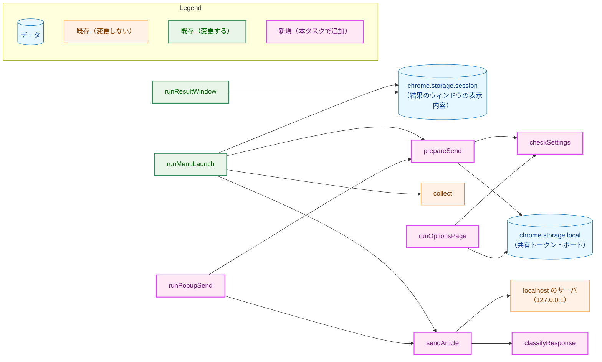
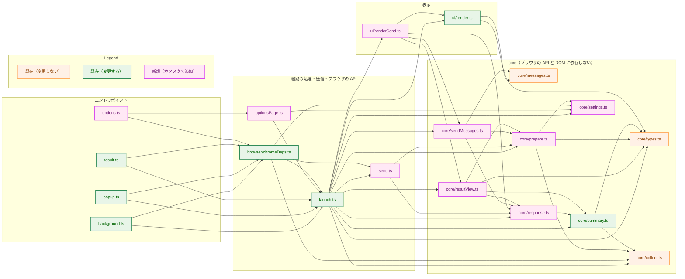
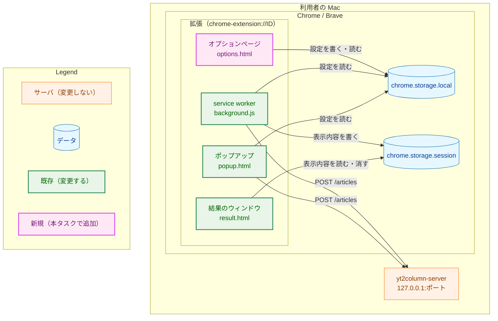
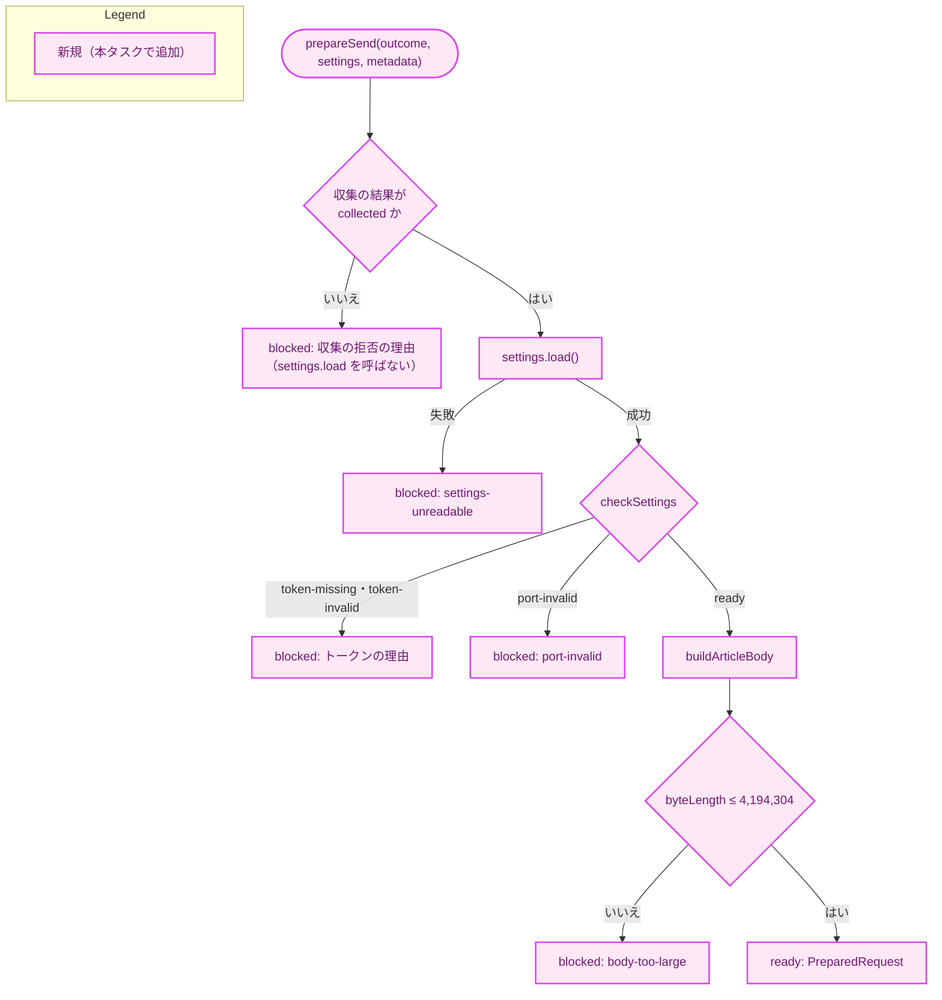
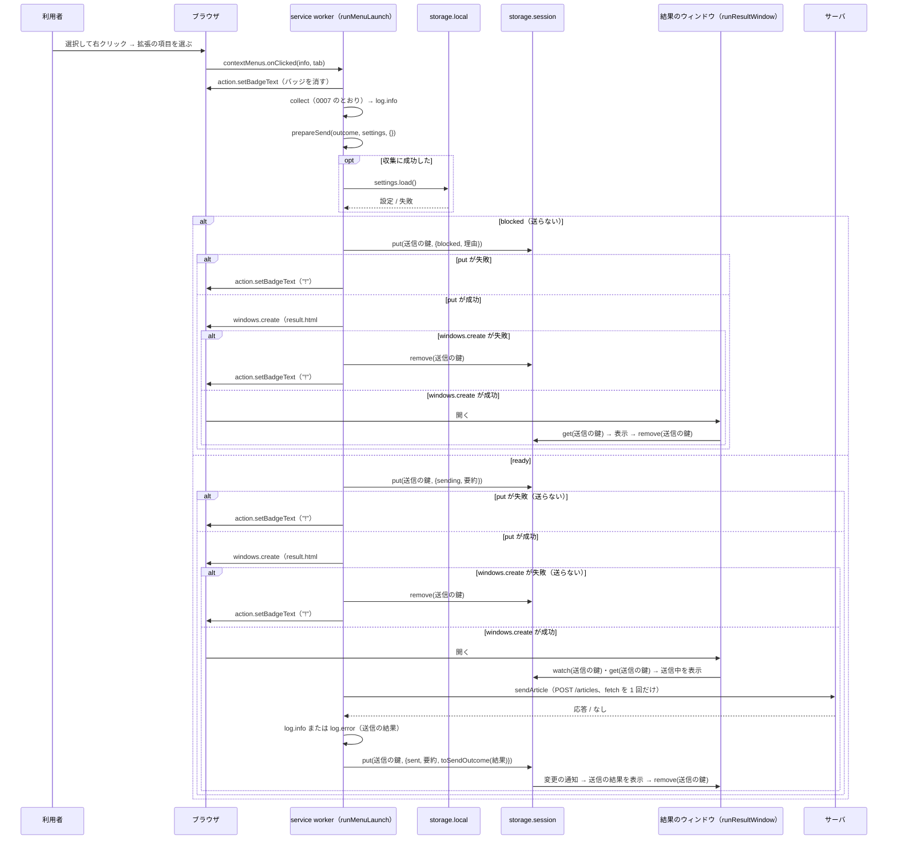
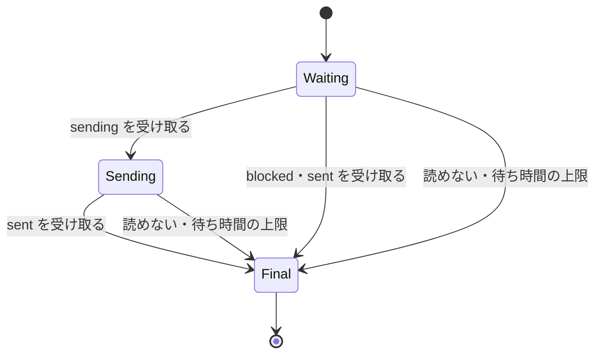
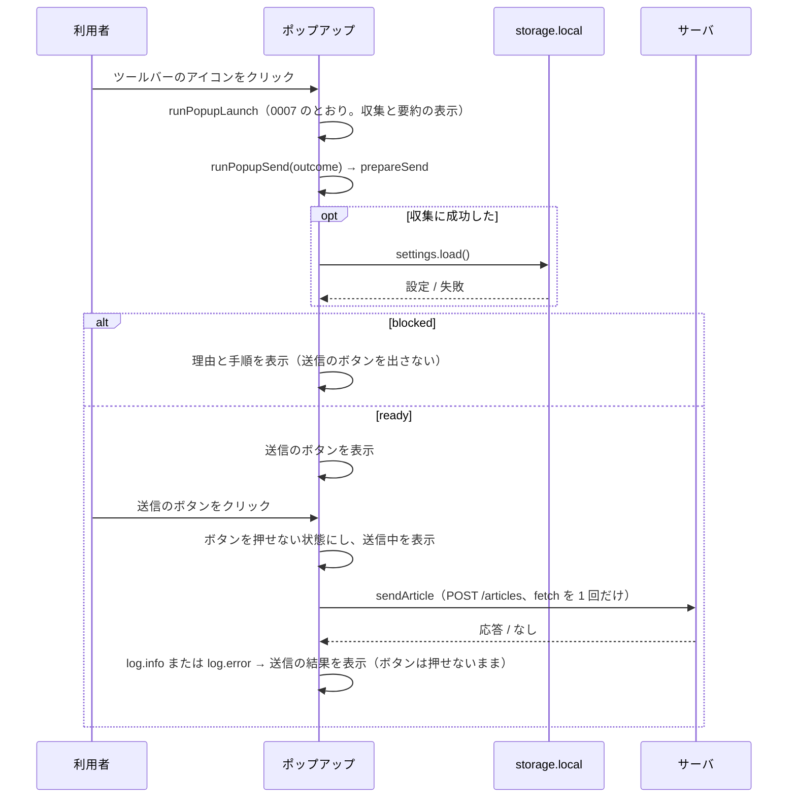
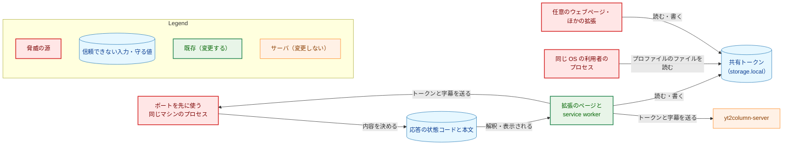
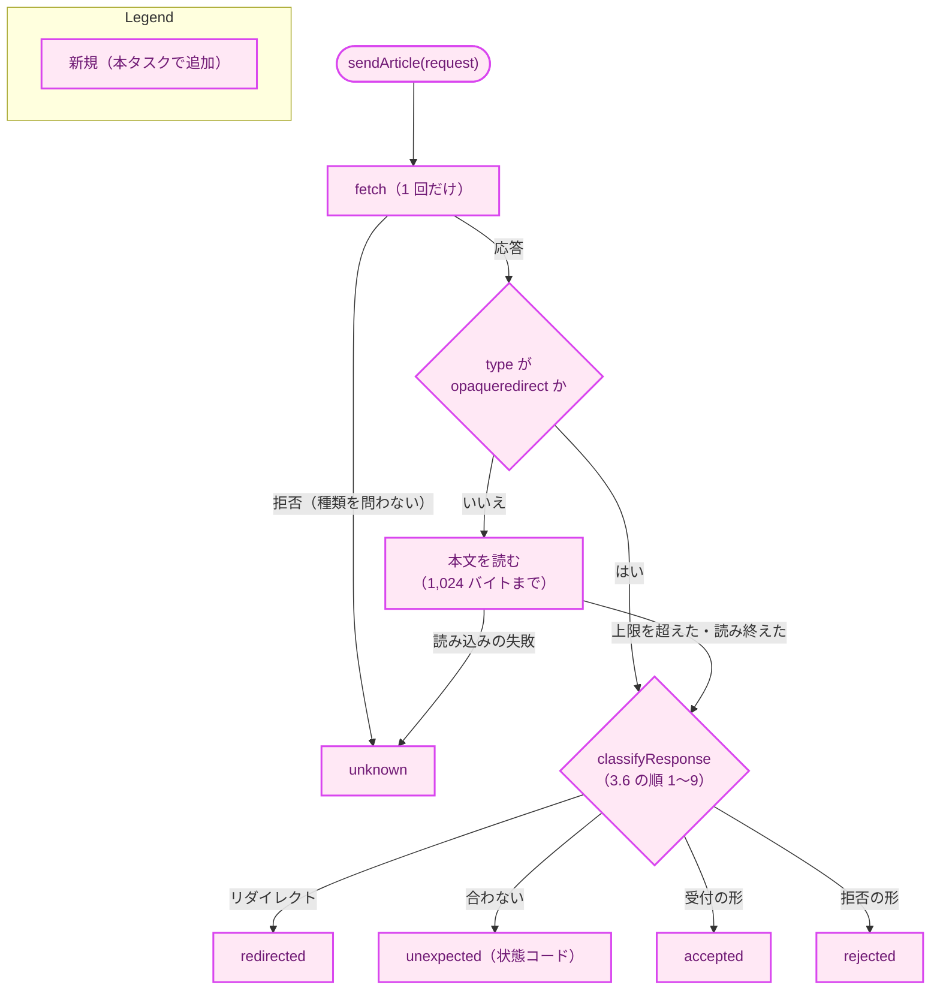

# アーキテクチャ設計書：ブラウザ拡張からサーバへの送信と結果の表示

## Document Status

| Item | Value |
|---|---|
| Status | `draft` |
| Created | 2026-10-16 |
| Review date | 2026-10-16 |
| Reviewer | isseis |
| Comments | 2026-10-16: 実装計画のレビューで、AC-30 の確かめ方（7.4 の「文書（静的な確認）」）が実行する検査を定めていないことが分かった。タスク 0012 の方針（文書のテキストの同期のガードは Go のテストに置く）に合わせ、README・security.md の AC-30 の記述と、実装計画 §5.1 の手動の確認の記録を確かめる Go のガードのテストを `cmd/yt2column/extension_docs_test.go` に加えることにした（1.3・3.12・3.14・7.3・7.4）。「Go のテストを変更しない」を改めるので決定の変更として扱い、状態を `draft` に戻した。Go のソース（テスト以外）とサーバは変更しない |

本書は [01_requirements.md](01_requirements.md)（要件定義書。以下、要件書）の設計である。既存のファイルに関する記述は、コミット `c4b656e` のファイルで確かめた。`file:line` はこのコミットの行番号を指す。F-NNN・AC-NN は要件書の項番を指す。要件のレビューで設計に申し送られた事項（[design_handoff.md](design_handoff.md) の H-01〜H-07）への対応は 3.13 にまとめる。

本書は次の文書を参照する。

-   **0007 の設計書:** [`docs/tasks/0007_browser_extension_skeleton/02_architecture.md`](../0007_browser_extension_skeleton/02_architecture.md)。拡張の骨格と収集の設計。「0007 §N」はその節を指す。
-   **API の設計書:** [`docs/tasks/0011_localhost_server/02_architecture.md`](../0011_localhost_server/02_architecture.md)。サーバと HTTP API の設計。「API の設計書 §N」はその節を指す。

本書では、0007 の設計書の用語（拡張のディレクトリ、メニューの経路、ポップアップの経路、収集の結果、表示用の要約、結果のウィンドウ、拡張のページ、経路の処理）をそのまま使い、次の用語を加える。

-   **設定:** 共有トークンとポート。`chrome.storage.local` に保存する（3.3）。
-   **送る前の確認:** 0007 の収集の確認（`collect`）の後に行う、設定と本文の大きさの確認（要件書 F-004。3.4）。
-   **送信の結果:** 1 回の送信で得る、受付・拒否・結果が分からない・想定外の応答のどれか（3.6 の `SendResult`・`SendOutcome`）。リダイレクトの応答は、想定外の応答の一種として扱う（要件書 F-007）。
-   **結果のウィンドウの表示内容:** メニューの経路で service worker が結果のウィンドウへ渡す値。送らない理由・送信中・送信の結果のどれか（3.8 の `ResultView`）。
-   **送信の鍵:** 1 回のメニューの起動で、結果のウィンドウの表示内容を `chrome.storage.session` に置くときの鍵。0007 の要約の鍵と同じく、起動ごとに作る（3.8）。
-   **送信のクライアント:** 要件書 6. の用語。本設計では `core/prepare.ts`（本文の組み立て）、`send.ts`（送信）、`core/response.ts`（応答の解釈）、`core/sendMessages.ts` と `ui/renderSend.ts`（表示）がこれに当たる。#170（動画のタイトル・チャンネル名・概要欄を DOM から取るタスク。9.）はこれらを変更しない。

## 1. 設計の全体像 (Design Overview)

### 1.1. 設計原則

-   **0007 の層の分け方をそのまま使う。** 判定（設定の検証、本文の組み立てと大きさの確認、応答の解釈、理由と文言の対応）は、ブラウザの API も DOM も参照しない関数として `extension/src/core/` に置く。`fetch` と `chrome.storage` は、経路の処理が受け取る依存の interface の向こうに置き、テストでは fake に置き換える（要件書 4.5、0007 §1.1）。
-   **送信の処理は 1 つにまとめる。** 2 つの起動の経路は、同じ `prepareSend`（送る前の確認と本文の組み立て）と同じ `sendArticle`（送信と応答の解釈）を呼ぶ。経路ごとに異なるのは、いつ確認するか（ポップアップは開いた時点、メニューは送る直前）と、結果をどこに表示するかだけである（AC-21）。
-   **確認を通った値だけを送れることを型で保証する。** `collect` だけが `CollectedInput` を作る（0007 §3.2）のと同じく、送るリクエスト（`PreparedRequest`）は `prepareSend` だけが作れる型とする。`sendArticle` は `PreparedRequest` だけを受け取るので、確認を通っていない入力・設定・大きさで送ることはできない（要件書 F-002、CLAUDE.md「Enforce invariants with the type, not with convention」）。
-   **応答は信頼できない入力として扱い、受理する形に合わなければ拒否する。** 応答の本文の文字列は表示しない。`reason` は型の値に変換してから固定の文言に対応させる（要件書 3.2・4.5、CLAUDE.md「Declare, don't infer」「Reject, don't normalize」）。
-   **結果が分からなければ、処理されたかもしれないものとして案内する。** 応答を受け取れない場合も、表示する内容を読めない場合も、自動で再送せず、送り直す前に Slack を確かめるよう案内する。「もう一度起動する」とは案内しない。記事の二重の投稿を避けることを、待ち時間の短さより優先する（要件書 F-003・F-007）。
-   **共有トークンは、保存先と `Authorization` ヘッダにだけ置く。** 本文・ログ・結果のウィンドウへ渡す値・表示に、トークンの値を入れない（要件書 4.2）。
-   **収集の部分の振る舞いを変更しない。** `collect`・`SelectionReader`・`CollectedInput`・`renderSummary`・`rejectionMessage` の振る舞いは変更しない（要件書 4.5、0007 §9）。0007 の内部の補助関数を本タスクで再利用するために公開する（export を加える）変更はあるが、振る舞いは変えない（3.11）。

### 1.2. 概念モデル

矢印 A → B は「A が B を使う（呼び出す、または読み書きする）」を表す。



-   ポップアップの経路は、0007 の `runPopupLaunch` が返す収集の結果を `runPopupSend` に渡す（`runPopupLaunch` は 0007 のまま変更しない）。
-   `prepareSend` は、収集の結果が拒否なら設定を読まずに拒否の理由を返す（AC-17）。収集に成功していれば、設定を読み、`checkSettings` で検証し、本文を組み立てて大きさを確かめる。
-   `sendArticle` は `fetch` を 1 回だけ呼び、応答を `classifyResponse` で解釈する。応答を受け取れなければ「結果が分からない」とする。
-   メニューの経路は、結果のウィンドウの表示内容を `chrome.storage.session` に書き、結果のウィンドウがそれを読んで表示する（0007 と同じ受け渡し）。

### 1.3. 既存のコードとの関係

本タスクは Go のソースを変更しない。Go のテストは、文書のガード（`cmd/yt2column/extension_docs_test.go`。3.12）だけを加える。サーバ側と API は API の設計書 §3.4 のまま使う（要件書 5.）。変更は拡張のディレクトリ、CI の変更検出のスクリプト、文書（README・security.md・CLAUDE.md）に限る。

拡張の中で既存のものを変える箇所は次のとおりである。0007 の設計書が定めた方針に対する例外を含むので、方針・例外の理由・更新が必要なテストを 3.11 にまとめる。

-   manifest に `host_permissions` と `options_ui` を加え、`minimum_chrome_version` を上げる（3.1）。
-   メニューの経路は、収集した内容を表示する代わりに送信し、送信の結果を表示する（3.8）。
-   結果のウィンドウは、表示用の要約を 1 回読む（`take`）代わりに、表示内容の更新を待つ。表示内容を読めない場合の固定の文言を、Slack を確かめる案内に変える（3.8）。
-   0007 の補助関数（`hasExactKeys`・`isRejectionReason`・文言の要素の作成）を公開して再利用する（3.11）。
-   lint の規則（型の表明の禁止）を、本タスクのブランド付きの型に広げ、`chrome.storage.sync` の参照を禁止する（3.11）。
-   成果物の検査（`check-dist`）が、manifest の `options_ui.page` の参照も確かめる（3.11）。
-   CI の拡張のジョブを起動する条件に、README・security.md とサーバの応答の定義のファイルを加える（3.11）。

## 2. システム構成 (System Structure)

### 2.1. ディレクトリ構成

本タスクで加える・変えるファイルだけを示す。ほかは 0007 §2.1 のとおりである。

```
extension/
  types/
    core-encoding.d.ts     # core が使う TextEncoder・TextDecoder の宣言（新規。tsconfig.core.json だけが読む）
  static/
    manifest.json          # host_permissions・options_ui・minimum_chrome_version（変更。3.1）
    popup.html             # 収集の表示と送信の表示の 2 つの領域（変更。3.8）
    options.html           # オプションページ（新規。3.10）
    style.css              # 送信の表示とオプションページの書式（変更。3.9）
  src/
    core/
      settings.ts          # SharedToken・ServerPort・checkSettings・SettingsReader・SettingsStore（新規。3.3）
      prepare.ts           # ArticleBody・PreparedRequest・prepareSend・送らない理由（新規。3.4）
      response.ts          # SendResult・SendOutcome・ServerRejectReason・RequestId・classifyResponse（新規。3.6）
      sendMessages.ts      # 送らない理由と送信の結果の文言（新規。3.7）
      resultView.ts        # ResultView・parseResultView（新規。3.8）
      summary.ts           # hasExactKeys・isRejectionReason を公開する（変更。3.11）
    ui/
      render.ts            # 文言の要素の作成を公開する（変更。3.11）
      renderSend.ts        # 送らない理由・送信中・送信の結果の表示（新規。3.9）
    browser/
      chromeDeps.ts        # 設定の保存先・表示内容の保存先・fetch の実装を加える（変更。3.3・3.5・3.8）
    send.ts                # sendArticle（新規。3.5）
    optionsPage.ts         # runOptionsPage（新規。3.10）
    launch.ts              # runMenuLaunch・runResultWindow の変更、runPopupSend の追加（変更。3.8）
    background.ts          # メニューの経路の依存の追加（変更）
    popup.ts               # runPopupSend の呼び出し（変更）
    result.ts              # 結果のウィンドウの依存の変更（変更）
    options.ts             # オプションページのエントリポイント（新規）
  scripts/
    check-dist.ts          # manifest の options_ui.page の参照の検査（変更。3.11）
    has-extension-changes.sh  # README.md・security.md・internal/server/response.go を条件に加える（変更。3.11）
  eslint.config.js         # ブランド付きの型の表明の禁止、storage.sync の禁止（変更。3.11）
  tsconfig.core.json       # types/core-encoding.d.ts を読む（変更）
  test/
    *.test.ts              # 3.12
```

-   `send.ts` は `core/` に置かない。`fetch` の応答（`ReadableStream`）と `AbortSignal` を扱い、DOM の型を使うためである。応答の本文の解釈（`classifyResponse`）は、受け取ったバイト列だけを扱うので `core/` に置く。
-   `core/` が使う `TextEncoder`（本文のバイト数）と `TextDecoder`（応答の本文の UTF-8 の検査）は、ES の lib になく、DOM の lib と `@types/node` にだけ宣言がある。0007 の `types/core-url.d.ts`（0007 §3.8）と同じく、`core/` が使うメンバーだけを宣言した `types/core-encoding.d.ts` を置き、`tsconfig.core.json` だけがこれを読む。

### 2.2. コンポーネントの依存関係

矢印 A → B は「A が B を import する（型だけの import を含む）」を表す。この図は、本タスクで加える・変えるファイルが import するものだけを示す。変えないファイルが import するもの（`core/collect.ts` → `core/acceptedUrl.ts` など）は 0007 §2.2 のとおりで、ここでは省く。



-   `send.ts` は `launch.ts` を import しない。`sendArticle` はログを出さず、ログは呼び出し側（経路の処理）が出す（3.8）。
-   `optionsPage.ts` が `launch.ts` を import するのは、`Logger` の型を使うためである。`chromeDeps.ts` が `send.ts` を import するのは、`fetch` の実装の型（`FetchFn`）を使うためである。
-   `core/resultView.ts` は `core/summary.ts` の `parseSummary`・`hasExactKeys`・`isRejectionReason` を使い、表示用の要約の検査を再実装しない（3.8）。`core/response.ts` も、応答のメンバの集合の検査に `hasExactKeys` を使う（3.6）。

### 2.3. 実行時の配置

矢印 A → B は「A が B を呼び出す、または B へデータを渡す」を表す。



-   メニューの経路は service worker から、ポップアップの経路はポップアップから送る（H-01。3.8）。0007 §3.12.1 の観測で、どちらから送っても `Origin` は `chrome-extension://clfmbbcdpnjcefbdihdoahomaifbabkk` で、`host_permissions` があれば preflight なしで応答を読めた。
-   収集（選択範囲の読み取り）は 0007 §2.3 のとおりで、この図では省く。
-   2 つの起動の経路のデータの流れ（シーケンス図）は 3.8 に、送信から送信の結果までの判定の流れは 6. に示す。

## 3. コンポーネント設計 (Component Design)

### 3.1. manifest（要件書 4.2・4.4、H-07）

0007 §3.1 の表のうち、次の項目を変える。ほかの項目（`permissions` を含む）は変えない。

| 項目 | 値 | 理由 |
|---|---|---|
| `host_permissions` | `["http://127.0.0.1/*"]` | 下表 |
| `options_ui` | `{"page": "options.html", "open_in_tab": true}` | オプションページ（F-001）。`open_in_tab: true` で通常のタブに開く。拡張の管理ページの中の小さな枠より、64 文字のトークンを貼り付けて確かめやすいためである |
| `minimum_chrome_version` | `"103"` | 送信の時間の上限に使う `AbortSignal.timeout()` が Chrome 103 で加わったため（要件書 4.4）。0007 の値 `"102"`（`chrome.storage.session` のため）より新しい。作業時点の安定版（Chrome 154・Brave 1.96。0007 §3.12.1）は満たす |

**加える権限とその理由（AC-31）:**

| 権限 | 使う API | 必要な理由 | インストール時の警告 |
|---|---|---|---|
| `host_permissions` の `http://127.0.0.1/*` | `fetch`（`POST http://127.0.0.1:<ポート>/articles`） | 宣言しないと、`Content-Type: application/json` の `POST` は preflight（`OPTIONS`）になり、サーバは `OPTIONS` を `405` で拒否する。宣言すれば preflight なしで送り、応答を読める（0007 §3.12.1、API の設計書 §3.4.1・§9） | ホストの権限の警告（「127.0.0.1 上のデータの読み取りと変更」） |
| `options_ui`（権限ではなく宣言） | なし | オプションページ（F-001） | なし |

-   ホストの権限の一致はポートを区別しない（Chrome の match pattern は、ポートを書かないパターンがすべてのポートに一致する）。ポートを設定で変えられる（F-001）ので、ポートを書かない。`127.0.0.1` 以外のホスト（`localhost`・`[::1]`・ほかのマシン）を加えない（要件書 2.3）。この権限が及ぶ範囲（送信以外に許すこと）は 5.4 に書く。
-   `storage` の権限は 0007 から持っている。本タスクでは `chrome.storage.session` に加えて `chrome.storage.local` を使う（3.3）が、どちらも同じ `storage` の権限で使える。`permissions` は変わらない。
-   `tabs` などの閲覧内容全般に及ぶ権限、`127.0.0.1` 以外のホストの権限、`content_scripts`・`content_security_policy`・`web_accessible_resources`・`externally_connectable` は、0007 §3.1 のとおり宣言しない（要件書 4.2）。
-   オプションページは拡張のページなので、Manifest V3 の既定の CSP がそのまま適用される。スクリプトは `<script type="module" src>` で読み、インラインのスクリプトを書かない（0007 §3.13 の `popup.html`・`result.html` と同じ）。

### 3.2. ブランド付きの型（要件書 4.5）

確認を通った値であることを型で保証するため、次の型は、型にだけ存在する目印（ブランド）を持つ。

| 型 | 置き場所 | 作れる関数 | 意味 |
|---|---|---|---|
| `CollectedInput`（0007） | `core/collect.ts` | `collect` | 収集の確認を通った入力 |
| `SharedToken` | `core/settings.ts` | `parseToken` | `^[0-9a-f]{64}$` に一致した文字列 |
| `ServerPort` | `core/settings.ts` | `parsePort` | 受理する形のポートの 10 進の文字列 |
| `PreparedRequest` | `core/prepare.ts` | `prepareSend` | 送る前の確認をすべて通った、送るリクエスト |
| `RequestId` | `core/response.ts` | `parseRequestId` | 小文字の 16 進 16 文字 |

-   目印の記号はそれぞれのモジュールの外へ公開しないので、ほかのモジュールはリテラルでこれらの型を作れない。作り手の関数自身は型の表明（`as`）で作る。作り手のファイルとテスト以外での型の表明は lint で禁止する（3.11）。
-   ほかの型（`SendResult`・`ResultView` など）は値の和の型で、ブランドを持たない。拒否の理由と送信の結果の種別は文字列の定数の和の型で表し、文言の対応は網羅性を型検査で確かめる `switch` で書く（0007 の `rejectionMessage` と同じ。要件書 4.5）。
-   本文（`ArticleBody`。3.4）にはブランドを付けない。本文が送られるのは `PreparedRequest` の中だけで、`PreparedRequest` は `prepareSend` だけが作れるので、本文に別の保証は要らない。

### 3.3. 設定の検証と保存（F-001・F-004・AC-01〜AC-06・AC-15・AC-15b、H-06）

```typescript
// core/settings.ts

declare const tokenBrand: unique symbol;
declare const portBrand: unique symbol;

/** A string that matched ^[0-9a-f]{64}$ exactly. Only parseToken creates it. */
export type SharedToken = string & { readonly [tokenBrand]: true };

/** A decimal string of 1024..65535 with no leading zero. Only parsePort creates it. */
export type ServerPort = string & { readonly [portBrand]: true };

/** The port used when none is stored; the same as the server's default. */
export const defaultPort: ServerPort; // "8765"

/** Returns the value unchanged when it has the accepted form; otherwise undefined. */
export function parseToken(value: unknown): SharedToken | undefined;
export function parsePort(value: unknown): ServerPort | undefined;

/** The raw values read from storage; undefined means the key is absent. */
export interface StoredSettings {
  readonly token: unknown;
  readonly port: unknown;
}

export type SettingsBlockReason = "token-missing" | "token-invalid" | "port-invalid";

export type SettingsCheck =
  | { readonly kind: "ready"; readonly token: SharedToken; readonly port: ServerPort }
  | { readonly kind: "blocked"; readonly reason: SettingsBlockReason };

/** Checks the token, then the port, in the order F-004 fixes. Never repairs a value. */
export function checkSettings(stored: StoredSettings): SettingsCheck;

/** Reads the stored settings. Rejects when the storage cannot be read. */
export interface SettingsReader {
  load(): Promise<StoredSettings>;
}

/** The options page's view of the storage: reading plus the three writes. */
export interface SettingsStore extends SettingsReader {
  saveToken(token: SharedToken): Promise<void>;
  clearToken(): Promise<void>;
  savePort(port: ServerPort): Promise<void>;
}
```

**受理する形:** `parseToken` は、値が文字列で、`^[0-9a-f]{64}$` に完全に一致するときだけ、その値をそのまま返す。`parsePort` は、値が文字列で、10 進の数字だけからなり、先頭が `0` でなく、`1024`〜`65535` の整数を表すときだけ返す（API の設計書 §3.2.2 と同じ形）。どちらも、前後の空白・改行を取り除く、大文字を小文字にする、数値に変換して書き直すといった補正をしない（CLAUDE.md「Reject, don't normalize」）。`[0-9]`・`[0-9a-f]` は ASCII の文字だけに一致させ、全角の英数字は一致しない（AC-02）。

**同じ関数で、入力と保存した値の両方を検査する（H-06）:** オプションページの入力（3.10）と、保存先から読んだ値（`checkSettings`）は、同じ `parseToken`・`parsePort` で検査する。保存先は、オプションページ以外（開発者のコンソール、将来の版の拡張）からも書き換えられうる。読んだ値も補正せずに検査し、合わなければ送らない。

**`checkSettings` の判定:**

| 保存した値 | 結果 |
|---|---|
| トークンが欠落（`undefined`） | `token-missing` |
| トークンが存在し、`parseToken` が受理しない（文字列以外を含む） | `token-invalid` |
| トークンは受理し、ポートが欠落 | `ready`（ポートは `defaultPort`。AC-04） |
| トークンは受理し、ポートが存在し、`parsePort` が受理しない（`"80"`・`"08765"`・`""`・数値の `8765` など） | `port-invalid`（`8765` に置き換えない。AC-15b） |
| どちらも受理 | `ready` |

要件書 F-004 は、トークンの値が形に合わない場合を「未設定」と同じく送らないとし、理由を区別するかを設計に委ねている。本設計は `token-invalid` を `token-missing` と区別する。どちらも同じ手順（オプションページでトークンを貼り直す）を示すが、「設定したはずなのに未設定と表示される」という食い違いを避けるためである。

**保存先（H-06）:**

| 項目 | 方針 |
|---|---|
| 保存先 | `chrome.storage.local` だけ。`chrome.storage.sync` は使わない（要件書 F-001。トークンがブラウザの外へ出るため） |
| キー | `sharedToken` と `serverPort` の 2 つ。トークンとポートを別のキーにするのは、片方を保存・消去しても、もう片方に触れないためである（要件書 F-001「それまでに保存した値を変更しない」） |
| 値の形 | どちらも文字列（`parseToken`・`parsePort` が受理した文字列そのもの）。ポートも数値ではなく文字列で保存し、読んだ値を入力と同じ関数で検査する |
| 実装 | `browser/chromeDeps.ts` の `createSettingsStore(area)` が、渡された保存先の `get`・`set`・`remove` で `SettingsStore` を実装する。`load` は 2 つのキーを 1 回の `get` で読む。エントリポイント（`background.ts`・`popup.ts`・`options.ts`）は `chrome.storage.local` を渡す |
| 読み込みの失敗 | `load` が失敗（Promise の拒否）したら、`prepareSend` は「設定を読み込めない」とする（3.4。AC-15a） |

`load` が 2 つのキーを 1 回で読むため、`chromeDeps.ts` の `StorageArea`（`extension/src/browser/chromeDeps.ts:13-17`。現在は `get(keys: string)`）を、次のとおり複数のキーを受け取る形に広げる。

```typescript
// browser/chromeDeps.ts

/** The chrome.storage area surface used (session for result views, local for settings). */
export interface StorageArea {
  get(keys: string | readonly string[]): Promise<Record<string, unknown>>;
  set(items: Record<string, unknown>): Promise<void>;
  remove(keys: string | readonly string[]): Promise<void>;
}
```

**`storage.sync` を使わないことの保証（AC-06）:** `createSettingsStore` は保存先を引数で受け取るので、エントリポイントが `chrome.storage.sync` を渡す誤りは、`createSettingsStore` のユニットテストでは見つけられない。そこで、拡張のソースで `storage.sync` を参照することを lint で禁止する（3.11）。lint の規則のテスト（`lintRules.test.ts`）は、`chrome.storage.sync` を参照するソースが規則に違反することを確かめる。`createSettingsStore` のユニットテストは、保存と消去が渡された保存先にだけ書くことを確かめる。

### 3.4. 送る前の確認と本文の組み立て（F-002・F-004・AC-07〜AC-09・AC-14〜AC-17）

```typescript
// core/prepare.ts

/** Optional members of the request body. #170 supplies them; this task passes none. */
export interface ArticleMetadata {
  readonly title?: string | undefined;
  readonly channelName?: string | undefined;
  readonly description?: string | undefined;
}

/** The serialized request body and its UTF-8 size. */
export interface ArticleBody {
  readonly json: string;
  readonly byteLength: number;
}

export function buildArticleBody(input: CollectedInput, metadata: ArticleMetadata): ArticleBody;

/** The server's body limit (API design §3.5.3). */
export const maxBodyBytes = 4_194_304;

declare const preparedBrand: unique symbol;

/** A request that passed every check. Only prepareSend creates it. */
export interface PreparedRequest {
  readonly url: string; // http://127.0.0.1:<port>/articles
  readonly port: ServerPort; // for the developer log
  readonly token: SharedToken;
  readonly body: ArticleBody;
  readonly [preparedBrand]: true;
}

/** Why a collected input is not sent; declared, never inferred from text. */
export type PreflightReason = "settings-unreadable" | SettingsBlockReason | "body-too-large";

/** Runtime set of the preflight reasons; a Record, so it stays in step with the union. */
export const preflightReasons: Record<PreflightReason, true>;

/** Every reason a launch ends without a request: collection or preflight. */
export type BlockReason = RejectionReason | PreflightReason;

export type PrepareOutcome =
  | { readonly kind: "ready"; readonly request: PreparedRequest }
  | { readonly kind: "blocked"; readonly reason: BlockReason; readonly cause?: unknown };

/** Never throws. Does not read settings when the collection was rejected. */
export function prepareSend(
  outcome: CollectOutcome,
  settings: SettingsReader,
  metadata: ArticleMetadata,
): Promise<PrepareOutcome>;
```

-   `preflightReasons` は、0007 の `rejectionReasons`（`extension/src/core/types.ts:13-18`）と同じ形の、和の型の値の実行時の一覧である。結果のウィンドウが読んだ値を検査するのに使う（3.8）。
-   `PrepareOutcome` の `blocked` の `cause` は、`settings-unreadable` のときの `load` の拒否の値で、開発者向けのログに出すためだけに持つ。表示の文言は `reason` だけで決める。

**確認の順序（要件書 F-004）:** `prepareSend` は、次の順に確かめ、最初に当てはまった理由で送らない。

矢印 A → B は「A の判定の後に B へ進む」を表す。



-   収集の拒否の理由（0007 の `RejectionReason`）は、そのまま `BlockReason` として返す。文言も 0007 の `rejectionMessage` を使う（3.7）。
-   `prepareSend` は例外を投げない。

**本文の組み立て（`buildArticleBody`）:**

-   本文は、次のメンバを持つオブジェクトを `JSON.stringify` した文字列とする。`videoUrl`（`CollectedInput.url`）と `transcript`（`CollectedInput.selection`）は必ず持つ。`metadata` のメンバは、値が空文字列でも `undefined` でもないものだけを持つ。値は補正しない（AC-07）。`undefined` と空文字列のメンバは本文に現れない。`null` を書くことはない（AC-08）。
-   `ArticleMetadata` の各メンバを `string | undefined` と宣言するのは、tsconfig の `exactOptionalPropertyTypes: true`（`extension/tsconfig.json:10`）の下でも、#170 が DOM から読んだ `string | undefined` の値をそのまま渡せるようにするためである。
-   `CollectedInput.title`（タブのタイトル）は本文に入れない（要件書 F-002。AC-09）。API の `title` は動画のタイトルであり、タブのタイトルではない。`metadata.title` は #170 が DOM から取る動画のタイトルのためのもので、本タスクでは呼び出し側が渡さない。
-   `PreparedRequest.token` は本文に入れない（AC-09）。`buildArticleBody` はトークンを引数に取らないので、本文にトークンが入る経路がない。
-   本文のバイト数は、`JSON.stringify` の結果を `TextEncoder` で UTF-8 にしたバイト列の長さで数える。UTF-16 の長さ（`length`）や文字数は使わない（AC-16）。`JSON.stringify` は、対になっていないサロゲートを `\uXXXX` のエスケープにする（ES2019 以降）ので、結果は常に UTF-8 に変換できる。そのようなエスケープを含む本文をサーバは `invalid_body` で拒否する（API の設計書 §3.6 の (a)）。拡張は選択範囲を補正しないので、この拒否はサーバに任せる。
-   大きさの確認は、送るのと同じ本文に対して行う。上限ちょうど（4,194,304 バイト）は送り、1 バイトでも超えれば `body-too-large` とする（AC-16）。

**送り先の URL:** `PreparedRequest.url` は `http://127.0.0.1:` と `ServerPort` と `/articles` を連結した文字列とする。ホストは固定で、利用者が設定する手段はない（要件書 4.2）。`ServerPort` は数字だけの文字列なので、連結した URL の構造を変えうる文字を含まない。

### 3.5. 送信（F-003・AC-10〜AC-13・AC-26、H-02・H-03）

```typescript
// send.ts

/** The parts of a fetch Response that sendArticle reads. */
export interface FetchResponse {
  readonly type: string;
  readonly status: number;
  readonly body: ReadableStream<Uint8Array> | null;
}

export type FetchFn = (url: string, init: RequestInit) => Promise<FetchResponse>;

export interface SendDeps {
  readonly fetch: FetchFn;
  /** Returns a signal that aborts after ms milliseconds (AbortSignal.timeout in production). */
  timeoutSignal(ms: number): AbortSignal;
}

/** Upper bound for the whole exchange, from the call until the response body is read. */
export const sendTimeoutMs = 25_000;

/**
 * Calls deps.fetch exactly once and classifies what came back. Never throws
 * and never retries. Returns { kind: "unknown", cause } when no complete
 * response arrived.
 */
export function sendArticle(request: PreparedRequest, deps: SendDeps): Promise<SendResult>;
```

**リクエスト（AC-10・AC-12）:** `sendArticle` は `deps.fetch` を 1 回だけ、次の値で呼ぶ。

| `RequestInit` の項目 | 値 | 理由 |
|---|---|---|
| `method` | `"POST"` | API の設計書 §3.4.1 |
| `headers` | `Content-Type: application/json`、`Authorization: Bearer <SharedToken>` の 2 つだけ | API の設計書 §3.4.1。`Content-Type` に `charset` などの引数を付けない。`Origin` はブラウザが付ける |
| `body` | `ArticleBody.json` | 3.4 で大きさを確かめた本文そのもの |
| `redirect` | `"manual"` | リダイレクトを辿らない（F-003）。応答は `type` が `"opaqueredirect"` の応答になる |
| `credentials` | `"omit"` | cookie などの資格情報を送らない（F-003） |
| `cache` | `"no-store"` | 送信の応答をキャッシュから返さない・キャッシュに置かない |
| `signal` | `deps.timeoutSignal(sendTimeoutMs)` | 送信の時間の上限（下記） |

**応答の受け取り:**

-   `fetch` が拒否（`TypeError`・`AbortError`・`TimeoutError` など、種類を問わない）したら、「結果が分からない」とする。
-   応答の `type` が `"opaqueredirect"` なら、リダイレクトとする（3.6）。本文は読まない。
-   それ以外の応答では、本文を `body.getReader()` で読み、読んだバイト数の合計が `maxResponseBytes`（1,024 バイト。3.6）を超えた時点で `cancel()` して読むのをやめ、「上限を超える本文」とする。`body` が `null` なら長さ 0 の本文とする。本文の読み込みが失敗（接続の切断、時間の上限による中断）したら、「結果が分からない」とする（要件書 F-007「応答の本文を読み切れない」）。
-   受け取った状態コードと本文（または上限を超えたこと、リダイレクトであること）を `classifyResponse`（3.6）に渡す。`classifyResponse` は例外を投げない設計（3.6）だが、万一例外が出た場合も `sendArticle` は例外を投げず、応答は受け取っているので想定外の応答（`check: "classification-error"`）とする。

本文を `Response.arrayBuffer()` や `Response.text()` で読まないのは、どちらも本文の全体を読み終えるまで上限を適用できないためである。サーバの代わりにポートを使う別のプロセス（API の設計書 §5.4）は、際限なく大きな本文を返しうる。`text()` はさらに、無効な UTF-8 を U+FFFD に置き換える（H-04）。

**再送しない（AC-11）:** `sendArticle` は、どの結果でも `fetch` を 2 回以上呼ばない。再送の仕組み（再試行の回数、待ち時間）を持たない。拡張が保証するのは `fetch` の呼び出しが 1 回であることで、ブラウザのネットワークの層が接続の再利用の失敗で送り直すことは制御できない。この場合の扱いは 5.4 に書く。

**「結果が分からない」の区別（H-02）:** ブラウザの `fetch` は、接続の拒否（サーバが起動していない）も、本文の送信の途中の切断も、`TypeError` で拒否する（Fetch の仕様は、ネットワークの誤りを区別せずに `TypeError` にすると定めている）。本書の作成時点では、Chrome と Brave で両者の拒否の値を比べる観測はしていない。本設計は、両者を区別しない前提に立つ。`TimeoutError`（時間の上限）は名前で区別できるが、時間の上限でもリクエストがサーバに届いている可能性がある。そこで、どれも区別せず「結果が分からない」の 1 つにまとめ、表示ではサーバが起動していない可能性と処理されている可能性の両方を示す（要件書 F-007、H-02 の候補の方針のとおり）。開発者向けのログには、拒否の値とその `name` を経路の処理が出す（3.8）。

**送信の時間の上限（H-03）:** 上限は 25 秒とし、`fetch` の呼び出しから本文を読み終えるまでの全体に適用する（`signal` は本文の読み込みも中断する）。

-   H-03 の候補は「サーバの `WriteTimeout`（60 秒）より少し長い値」だった。本設計はこれより短い値を採る。Chrome の拡張のドキュメント（「The extension service worker lifecycle」、`https://developer.chrome.com/docs/extensions/develop/concepts/service-workers/lifecycle`）は、service worker が `fetch()` の応答を 30 秒を超えて待つと停止されうると記している。メニューの経路は service worker から送るので、上限を 30 秒以上にすると、拡張自身の上限が働く前に service worker が止まり、結果を表示できなくなりうる。
-   上限を 30 秒より短くすれば、時間の上限は「結果が分からない」として表示されると見込む。この挙動は本タスクの作業時点の Chrome・Brave で確かめていないので、7.2 の手動の確認（応答しないサーバ）で確かめる。確かめられなかった場合でも、結果のウィンドウの待ち時間の上限（3.8）が「結果が分からない」を表示するので、結果のウィンドウが送信中のまま終わることはない。
-   service worker が停止されるまでの 30 秒の計測は、拡張の API を呼び出すたびにやり直される。メニューの経路は、送信の時間の上限の起点を、最後の拡張の API の呼び出し（`windows.create` の完了）の直後に置き、その間にほかの拡張の API を待たない（3.8）。
-   サーバの応答は、本文の解析が終わり次第返り、記事の生成を待たない（API の設計書 §3.5.2）。4 MiB の入力の解析は、`-race` 付きのビルドで約 3.2 秒と測られている（`internal/transcript/copied_format_test.go:478-487` のコメント）。通常の応答は 25 秒より十分に短い。ただし、サーバが応答を書くまでの最悪の時間（`ReadTimeout` 30 秒の本文の読み込みと解析）は 25 秒より長い。サーバが 25 秒から 60 秒の間に応答する場合は「結果が分からない」と表示するが、その表示は送り直す前に Slack を確かめるよう案内するので、記事の二重の投稿にはつながらない。本設計はこれを受け入れる。
-   ポップアップの経路にはこの service worker の制約がないが、同じ上限を使う。2 つの経路で振る舞いを変えないためである（AC-21）。

### 3.6. 応答の解釈（F-006・F-007・AC-23〜AC-25・AC-28・AC-29、H-04）

```typescript
// core/response.ts

/** The reason values the server sends (API design §3.4.3). */
export type ServerRejectReason =
  | "forbidden_host"
  | "not_found"
  | "method_not_allowed"
  | "unsupported_media_type"
  | "forbidden_origin"
  | "unauthorized"
  | "too_many_requests"
  | "body_too_large"
  | "invalid_body"
  | "invalid_video_url"
  | "invalid_transcript"
  | "internal_error";

/** The status code each reason is sent with; a Record, so a missing reason fails the type check. */
export const serverRejectStatus: Record<ServerRejectReason, number>;

export function isServerRejectReason(value: unknown): value is ServerRejectReason;

declare const requestIdBrand: unique symbol;

/** Sixteen lowercase hexadecimal characters. Only parseRequestId creates it. */
export type RequestId = string & { readonly [requestIdBrand]: true };

export function parseRequestId(value: unknown): RequestId | undefined;

/** Upper bound for the response body; a valid response is under 100 bytes. */
export const maxResponseBytes = 1_024;

/** What sendArticle received, before interpretation. */
export type ReceivedResponse =
  | { readonly kind: "body"; readonly status: number; readonly bytes: Uint8Array }
  | { readonly kind: "body-over-limit"; readonly status: number }
  | { readonly kind: "redirected" };

/** Which check an unexpected response failed; for the developer log only. */
export type UnexpectedCheck =
  | "body-over-limit"
  | "encoding"
  | "escape"
  | "json-shape"
  | "duplicate-member"
  | "member-set"
  | "request-id"
  | "status-pairing"
  | "classification-error";

/** Runtime set of the unexpected checks; a Record, so it stays in step with the union. */
export const unexpectedChecks: Record<UnexpectedCheck, true>;

/** A send result without the cause of "unknown": what is displayed and stored. */
export type SendOutcome =
  | { readonly kind: "accepted"; readonly requestId: RequestId }
  | { readonly kind: "rejected"; readonly reason: ServerRejectReason; readonly requestId: RequestId }
  | { readonly kind: "unknown" }
  | { readonly kind: "unexpected"; readonly status: number; readonly check: UnexpectedCheck }
  | { readonly kind: "redirected" };

/** What sendArticle returns: "unknown" also carries the failure, for the developer log. */
export type SendResult =
  | Exclude<SendOutcome, { kind: "unknown" }>
  | { readonly kind: "unknown"; readonly cause: unknown };

/** Drops the cause of "unknown"; the only way a SendResult becomes a stored or displayed value. */
export function toSendOutcome(result: SendResult): SendOutcome;

/** Interprets a received response. Never returns "unknown" and never throws. */
export function classifyResponse(
  received: ReceivedResponse,
): Exclude<SendOutcome, { kind: "unknown" }>;
```

-   表示と結果のウィンドウへ渡す値には `SendOutcome` を使い、`cause` は開発者向けのログにだけ出す。`SendResult` は型の上では `SendOutcome` に代入できるが、代入しても実行時の値から `cause` は消えない。
-   そこで、`SendResult` から `SendOutcome` への変換は、`unknown` を `{ kind: "unknown" }` として作り直す `toSendOutcome` だけで行う。経路の処理は、表示と保存先への書き込み（`ResultViewStore.put`。3.8）の前に必ずこれを通す。`cause` を保存先に書くと `parseResultView` がその値を拒否し、結果のウィンドウが送信の結果を表示できなくなるためである（0007 の `CollectOutcome` の `cause` と同じ）。表示の文言は種別だけで決め、`cause` の内容で分岐しない。
-   `redirected` は、要件書 F-007 では想定外の応答の一種である。状態コードを示せない（ブラウザが元の状態コードを渡さない）ので、`unexpected` と別の種別にしている。表示の案内は `unexpected` と同じにする（3.7）。
-   `unexpected` の `check` は、どの判定に合わなかったかを示す固定の値で、開発者向けのログで、サーバの版の食い違いとポートを使う別のプロセスの応答などを見分けるために持つ。利用者には表示しない。
-   `serverRejectStatus` は `reason` と状態コードの組の表である。`forbidden_origin` と `forbidden_host` はどちらも `403` なので、状態コードから `reason` は決まらない。組の照合は、受け取った `reason` から引いた状態コードが、受け取った状態コードと一致するかで行う。

**受理する形と判定の順序:** `classifyResponse` は次の順に判定し、どれかに合わなければその時点で「想定外の応答」（`unexpected`。状態コードと `check` を持つ）とする。リダイレクトは `redirected` とする。

| 順 | 判定 | 合わないときの `check` | 合わない例（AC-28） |
|---|---|---|---|
| 1 | リダイレクトでない | （`redirected` になる。AC-12） | - |
| 2 | 本文が上限（1,024 バイト）以下 | `body-over-limit` | 上限を超える本文 |
| 3 | 本文のバイト列が正しい UTF-8 である | `encoding` | 無効な UTF-8 |
| 4 | 本文の文字列が `\` を含まない | `escape` | `"accepted"` のようなエスケープ、対になっていないサロゲートのエスケープ |
| 5 | `JSON.parse` が成功し、結果が（配列でも `null` でもない）オブジェクトで、そのすべての自身のメンバの値が文字列である | `json-shape` | 空の本文、JSON でない `400`、JSON の配列、先頭の BOM（順 3 で文字として残り、`JSON.parse` が失敗する） |
| 6 | 本文の文字列の `"` の数が、メンバの数の 4 倍と等しい | `duplicate-member` | 重複したメンバ（下記） |
| 7 | メンバの集合が、`status` が `accepted` なら `{status, requestId}`、`rejected` なら `{status, reason, requestId}` とちょうど一致する（0007 の `hasExactKeys` で確かめる。3.11） | `member-set` | 余分なメンバ、欠けたメンバ、`status` が表にない値 |
| 8 | `requestId` が `^[0-9a-f]{16}$` に一致する（`parseRequestId`） | `request-id` | 大文字を含む、15 文字、17 文字 |
| 9 | `accepted` なら状態コードが `202`。`rejected` なら `reason` が `ServerRejectReason` のどれかで、`serverRejectStatus[reason]` が状態コードと一致する | `status-pairing` | `202` で `rejected`、`200` で受付の形、`401` で受付の形、表にない `reason`、`unauthorized` で `403` |

**解析した値の扱い:** `JSON.parse` の結果は、攻撃者が決めた名前（`__proto__`・`hasOwnProperty`・`toString`・`constructor` など）の自身のメンバを持ちうる。`classifyResponse` は、メンバの一覧を `Object.keys` だけで、メンバの有無を `Object.hasOwn`（または `hasExactKeys` が使う同等の `Object.prototype.hasOwnProperty.call`）だけで調べ、値は自身のメンバとして（`Object.keys` で得た名前か `Object.values` で）だけ読む。解析した値のメソッドを呼ばず、継承したメンバを読まない。こうすれば、どの名前のメンバでも例外も継承した値の読み取りも起きない。`__proto__` は `JSON.parse` では通常の自身のメンバになり、順 7 で拒否される。

**標準の JSON の解析が黙って修復するものの拒否（H-04）:** 要件書 3.2 は、標準の解析が黙って修復・破棄・無視すれば受理できてしまう入力を拒否するよう求めている。ブラウザの API でそれに当たるものと、本設計の検出の手段を次に示す。

| 修復・破棄・無視 | 起きる場所 | 検出の手段 |
|---|---|---|
| 無効な UTF-8 を U+FFFD に置き換える | `Response.text()`・`TextDecoder` の既定 | `Response.text()` を使わず、`TextDecoder("utf-8", { fatal: true, ignoreBOM: true })` で復号する。`fatal: true` は無効な UTF-8 で例外を投げる（順 3） |
| 先頭の BOM を取り除く | `TextDecoder` の既定（`ignoreBOM: false`） | `ignoreBOM: true` で BOM を文字として残す。U+FEFF は JSON の空白ではないので、順 5 の `JSON.parse` が失敗する |
| 対になっていないサロゲートのエスケープを受理する | `JSON.parse` | 順 4 で `\` を含む本文を拒否する |
| 重複したメンバの前の値を捨てる | `JSON.parse`（`reviver` にも前の値は渡らない） | 順 4・5・6 の組み合わせ（下記） |

**重複したメンバの検出の根拠（順 4〜6）:**

-   受理する形のメンバの名前と値は、どれも英小文字・数字・`_` だけからなる（`status`・`reason`・`requestId` と、その値）。
-   したがって、正当な応答はエスケープを含まず、順 4 で `\` を含む本文を拒否しても、正当な応答を拒否することはない。サーバは `encoding/json` の `json.Marshal` で応答を書き（`internal/server/response.go:212`）、`json.Marshal` がエスケープするのは `<`・`>`・`&`、U+2028・U+2029、制御文字、無効な UTF-8 だけで、応答の値はこれらを含まない。
-   `\` を含まない JSON の文字列では、すべての `"` が文字列の始まりか終わりなので、`"` の数は文字列の数の 2 倍になる。
-   順 5 で値がすべて文字列のオブジェクトであることを確かめた後では、重複がなければ、文字列はメンバの名前と値だけで、その数はメンバの数の 2 倍になる。したがって `"` の数はメンバの数の 4 倍になる。
-   メンバが重複していれば、`JSON.parse` が捨てたメンバの名前（と、値が文字列なら値）の分だけ文字列が多くなり、`"` の数がメンバの数の 4 倍を超える。

この手段は、JSON の構文を拡張の中で解析し直さずに済み、空白やメンバの順序に依存しない。重複の例（`{"status":"accepted","status":"rejected",...}`、前の値が数値・`null`・オブジェクトのもの）は、ユニットテストの入力に加える（3.12）。

**サーバが本文を JSON で返さない応答:** API の設計書 §3.4.2 の「ハンドラに届かない応答」（`400`・`431`・`417`）は、順 5 で想定外の応答になり、状態コードを示す。

**`requestId` が空の応答:** サーバは、リクエスト ID の生成に失敗すると `requestId` が空文字列の `internal_error` を返す（`internal/server/handler.go:32-36`）。この応答は順 8 で想定外の応答（状態コード `500`）になる。リクエスト ID の生成は `crypto/rand.Read`（`internal/server/response.go:173`）で行い、Go 1.24 以降の `crypto/rand.Read` は失敗するとエラーを返さずにプログラムを止める（Go のドキュメントの記述。本リポジトリは `go 1.26.5`。`go.mod:3`）。したがって、この応答は実際には返らないと考えられるが、返った場合も、受理する形に合わない応答として扱う。

**「想定外の応答」の表示に応答の本文を使わない（AC-25・AC-29）:** `classifyResponse` が返す `unexpected` は状態コードと固定の `check` だけを持ち、本文の文字列も、解析した値も持たない。`rejected` と `accepted` が持つのは、`ServerRejectReason` の値（固定の文字列の和の型）と `RequestId`（16 進 16 文字に限る）だけである。応答の本文に由来する、形を確かめていない文字列が表示に届く経路はない。

### 3.7. 文言（F-004・F-006・F-007・AC-14・AC-24・AC-26）

```typescript
// core/sendMessages.ts

/** Message for a launch that ends without a request. Collection reasons use rejectionMessage. */
export function blockMessage(reason: BlockReason): RejectionMessage;

/** Message for a server rejection; distinct for every reason. */
export function serverRejectMessage(reason: ServerRejectReason): RejectionMessage;

/** Message for every send outcome; rejected delegates to serverRejectMessage. */
export function sendOutcomeMessage(outcome: SendOutcome): RejectionMessage;

/** Message shown when a result window cannot read what to display. */
export const unreadableResultMessage: RejectionMessage;
```

-   `RejectionMessage`（`text` と `steps`）は 0007 の `core/messages.ts` の型をそのまま使う。
-   `blockMessage` は、`RejectionReason` の値を 0007 の `rejectionMessage` に渡し、`PreflightReason` の値に本タスクの文言を対応させる。3 つの関数とも、`switch` の `default` で `never` 型を受け、理由を加えたのに文言を加え忘れた場合に型検査で失敗させる（要件書 4.5）。
-   文言はソースの規則に従い英語とし、正確な字句は実装で決める（0007 §3.5 と同じ）。下表は趣旨である。

**送らない理由（`PreflightReason`）:**

| 理由 | 文言の趣旨 | 操作の手順の趣旨 |
|---|---|---|
| `settings-unreadable` | 拡張の設定を読み込めなかった | もう一度起動する。続く場合はオプションページで設定を保存し直す |
| `token-missing` | 共有トークンが設定されていない | ツールバーのアイコンを右クリックして「オプション」を開く → サーバの起動時に表示されたトークン（またはトークンのファイルの内容）を貼り付けて保存する → もう一度起動する |
| `token-invalid` | 保存された共有トークンの形が正しくない | `token-missing` と同じ |
| `port-invalid` | 保存されたポートの設定が正しくない | オプションページでポートを設定し直す（サーバの `YT2COLUMN_SERVER_PORT` と同じ値、変えていなければ `8765`） |
| `body-too-large` | 送る内容が大きすぎる（4 MiB を超える） | 選択する字幕の範囲を減らす |

送らない理由では何も送っていないので、「もう一度起動する」と案内してよい。

**サーバの拒否（`ServerRejectReason`）:** 要件書 F-006 の表のとおりに対応させる。`not_found`・`method_not_allowed`・`unsupported_media_type` は要件書の表で 1 行にまとめられているが、互いに区別できる文言にする（AC-24）。12 の理由の文言は、テストで互いに異なることを確かめる。要件書の表に加えて、次を添える。

-   `too_many_requests`: 要件書の「しばらく待ってから送り直す」の前に、「先に送った記事が生成中の可能性がある。送り直す前に Slack を確かめる」を添える。サーバが別の記事を処理中である場合、多くは利用者自身が直前に送った記事（「結果が分からない」と表示されたものを含む）であり、同じ動画を送り直すと記事が二重に投稿されるためである。
-   サーバが Slack にも失敗を通知する拒否（要件書 F-006 で設計に委ねられた事項）: `body_too_large`・`invalid_body`・`invalid_video_url`・`invalid_transcript`・`internal_error` の文言には、Slack にも失敗の通知が届きうることを添える。`internal_error` は、枠を取る前の拒否では通知されない（API の設計書 §3.4.3）が、拡張は両者を区別できないので「届きうる」とする。

**送信の結果:**

| 種別 | 文言の趣旨 | 操作の手順の趣旨 |
|---|---|---|
| `accepted` | サーバが受け付けた。記事の生成と投稿の結果（成功・失敗）は Slack に届く | なし |
| `unknown` | サーバから応答を受け取れなかった。サーバが起動していない可能性と、サーバがリクエストを受け取って処理している可能性の両方がある | Slack に記事または失敗の通知が届いていないか確かめる → 届いていなければ、サーバが起動していることを確かめてから送り直す → 続く場合は、この時刻の前後のサーバのログを確かめる |
| `unexpected` | サーバの応答を解釈できなかった（状態コードを示す） | サーバの版が拡張と合っているか、オプションページのポートの設定が正しいかを確かめる → 送り直す前に Slack を確かめる |
| `redirected` | サーバがリダイレクトで応答した | `unexpected` と同じ |

**表示内容を読めない場合（`unreadableResultMessage`）:** 結果のウィンドウが表示内容を読めない場合（3.8）の文言で、「結果を表示できない。送った場合は、送り直す前に Slack を確かめる」を趣旨とする。0007 の `missingResultText`（`extension/src/launch.ts:59-60`。「もう一度起動する」）を置き換える。結果のウィンドウは、送信が始まった後にも開いているので、「もう一度起動する」と案内すると、記事の二重の投稿を招くためである。

### 3.8. 経路の処理（F-005・AC-14・AC-17〜AC-22・AC-32、H-01・H-05）

```typescript
// core/resultView.ts

/** The collected variant of the 0007 display summary. */
export type CollectedSummary = Extract<OutcomeSummary, { kind: "collected" }>;

/** What a result window displays; what the menu path stores in storage.session. */
export type ResultView =
  | { readonly kind: "blocked"; readonly reason: BlockReason }
  | { readonly kind: "sending"; readonly summary: CollectedSummary }
  | { readonly kind: "sent"; readonly summary: CollectedSummary; readonly outcome: SendOutcome };

/** Accepts only a value of exactly the ResultView shape; otherwise undefined. Never repairs. */
export function parseResultView(value: unknown): ResultView | undefined;
```

-   `parseResultView` は、0007 の `parseSummary`（表示用の要約）・`hasExactKeys`（メンバの集合の一致）・`isRejectionReason`（`extension/src/core/summary.ts:69-87`）と、`preflightReasons`・`isServerRejectReason`・`parseRequestId`・`unexpectedChecks` を使い、同じ検査を再実装しない。`unexpected` の `status` は 100〜599 の整数だけを受理する。`sent` の `outcome` の `unknown` に `cause` があれば、形が違うものとして拒否する（メンバの集合の検査による）。

```typescript
// browser/chromeDeps.ts

/** The chrome.storage.onChanged surface used to follow a result view. */
export interface StorageChangeEvents {
  addListener(callback: StorageChangeListener): void;
  removeListener(callback: StorageChangeListener): void;
}

export type StorageChangeListener = (
  changes: Record<string, { readonly newValue?: unknown }>,
  areaName: string,
) => void;
```

```typescript
// launch.ts（本タスクで変える・加える部分）

/** Hands a ResultView from the service worker to the result window. Replaces SummaryStore. */
export interface ResultViewStore {
  put(key: string, view: ResultView): Promise<void>;
  /** Returns the stored value; undefined when absent. Does not remove it. */
  get(key: string): Promise<unknown>;
  remove(key: string): Promise<void>;
  /**
   * Calls listener with each value newly stored under key in storage.session.
   * Removals are not reported. Returns a function that stops the listener.
   */
  watch(key: string, listener: (value: unknown) => void): () => void;
}

export interface MenuLaunchDeps {
  readonly reader: SelectionReader;
  readonly settings: SettingsReader;
  readonly send: SendDeps;
  readonly store: ResultViewStore;
  readonly newKey: () => string;
  readonly now: () => number;
  openResultWindow(key: string): Promise<void>;
  signalDisplayFailure(): Promise<void>;
  clearDisplayFailure(): Promise<void>;
  readonly log: Logger;
}

export interface PopupSendDeps {
  readonly settings: SettingsReader;
  readonly send: SendDeps;
  readonly now: () => number;
  readonly log: Logger;
}

export interface ResultWindowDeps {
  readonly store: ResultViewStore;
  /** Runs callback once after ms milliseconds; returns a function that cancels it. */
  schedule(ms: number, callback: () => void): () => void;
  readonly log: Logger;
}

/** Context-menu path: collect, prepare, show the window, then send once. Never throws. */
export function runMenuLaunch(
  info: chrome.contextMenus.OnClickData,
  tab: chrome.tabs.Tab | undefined,
  deps: MenuLaunchDeps,
): Promise<void>;

/** Popup send controls below the 0007 summary. Sends at most once per popup. Never throws. */
export function runPopupSend(
  container: HTMLElement,
  outcome: CollectOutcome,
  deps: PopupSendDeps,
): Promise<void>;

/** Result window: shows the stored view and follows it until a final view or the wait limit. */
export function runResultWindow(container: HTMLElement, hash: string, deps: ResultWindowDeps): Promise<void>;

/** How long a result window waits for the result after it opens. */
export const resultWaitMs = sendTimeoutMs + 10_000;
```

`launchContextFromTab`・`runPopupLaunch`・`PopupLaunchDeps` は 0007 のまま変えない。`ResultViewStore` は `browser/chromeDeps.ts` の `createResultViewStore(area, events)` が実装し、`watch` は `events`（`chrome.storage.onChanged`）の通知のうち、`areaName` が `"session"` で、鍵が一致し、`newValue` があるものだけを listener に渡す。

**送信を行う場所（H-01）:** メニューの経路は service worker から、ポップアップの経路はポップアップから送る。送信の処理（`prepareSend` と `sendArticle`）は同じ関数で、実行する場所だけが異なる（AC-21）。

-   H-01 の候補の方針は、ポップアップも service worker に送信を依頼し、ポップアップが閉じられれば結果のウィンドウに示す方法だった。本設計はこれを採らない。ポップアップから service worker へ依頼するには、拡張の中のメッセージの受け口（`runtime.onMessage` または `runtime.onConnect`）が要る。拡張の中のメッセージは、拡張のページだけでなく、拡張がページに注入した関数（isolated world）からも送れる。YouTube のページの描画を担うプロセスが乗っ取られた場合、受け口は、利用者の操作なしに送信を起動する入口になる。
-   本設計は、0007 の設計が「拡張は `runtime.onMessage` を使わない」（0007 §5.1 の脅威の表）としているのを保つ。また、候補の方針には、ポップアップが閉じられたことの検出と、その場合に結果のウィンドウを開く処理も要る。
-   ポップアップから送る場合に失われるのは、送信中に利用者がポップアップを閉じたときの結果の表示だけである。サーバの応答は本文の解析が終わり次第返り、通常は短い時間で返る（3.5・design_handoff.md の H-03）ので、その間にポップアップを閉じることはまれである。閉じた場合、ポップアップの中の `fetch` は中断され、拡張は何も表示しない。リクエストがサーバに届いていれば、サーバはジョブを続け、結果は Slack に届く。自動で再送することはない（要件書 F-005）。
-   この場合に利用者が送り直して記事が二重に投稿されることを避けるため、送信中の表示に「結果が表示されるまでポップアップを閉じない。閉じた場合は、送り直す前に Slack を確かめる」ことを示す。

**シーケンス図の表記:** 本書のシーケンス図は、0007 §3.6 と同じく、ノードを色で分類しないので Legend を置かない。実線の矢印 A → B は「A が B を呼び出す、または B へデータを渡す（保存先の変更の通知を含む）」を、点線は戻り値を表す。

**メニューの経路（`runMenuLaunch`、H-05）:**



-   **結果のウィンドウを先に開く（H-05）:** 送る前に、送信中を示す表示内容を書いてウィンドウを開き、送信の後に同じ送信の鍵へ送信の結果を書く。ウィンドウは保存先の変更を待って表示を更新する。こうすると、送信中であることを常に見える場所に示せる（AC-22）。0007 の失敗の扱い（`put` の失敗でウィンドウを開かない、ウィンドウを開けなければ鍵を消してバッジを表示する）はそのまま使う。
-   **送信中を示せなければ送らない:** 送信中の `put` が失敗した場合とウィンドウを開けない場合は、送信の結果を示す場所がない。利用者に見えないまま記事の生成を始めさせないよう、送らずにバッジ（`!`）を表示する。
-   **送信の後の書き込みの失敗:** 送信の結果の `put` が失敗したら、`log.error` に記録し、バッジを表示する。結果のウィンドウは待ち時間の上限で「結果が分からない」を表示する（下記）。
-   **送信の時間の上限の起点:** `windows.create` の完了の後、ほかの拡張の API を待たずに `sendArticle` を呼ぶ（3.5）。
-   **送らない場合（`blocked`）:** 0007 と同じく、理由を書いてウィンドウを開く。
-   **2 回の起動:** 続けて 2 回起動すると、それぞれが別の送信の鍵とウィンドウで送る。メニューの経路では、項目を選ぶこと自体が送る意図を表す（要件書 1.）ので、二重の起動を止める仕組みは設けない。

**結果のウィンドウ（`runResultWindow`）:** 結果のウィンドウの表示は、次の状態の間を一方向にだけ移る。



矢印 A → B は「A の状態で、ラベルの事象が起きると B の状態に移る」を表す。`Final` は、`blocked`・`sent`・読めない場合・待ち時間の上限のどれかの表示で、以後の事象をすべて無視する。状態図はノードを色で分類しないので Legend を置かない。

-   ハッシュから送信の鍵を取り、`watch` で通知を受け始めてから `get` で現在の値を読む。`get` の後・`watch` の前に送信の結果が書かれた場合に、通知を取りこぼさないためである。通知と `get` の結果はどちらが先に届いてもよく、どちらも同じ状態の移り方に従う。たとえば、通知で `sent` を表示した後に、先に呼んだ `get` が `sending` を返しても、表示は戻らない。
-   値は `parseResultView` で形を確かめる。`sending` は、`Waiting` のときだけ表示する。`blocked` と `sent` は `Final` に移って表示する。
-   **読めない場合:** ハッシュがない、`get` が失敗する、`get` が値を返さない（`Waiting` のまま値がない）、`parseResultView` が拒否する、のどれかに当たれば、`Final` に移り、`unreadableResultMessage`（3.7。Slack を確かめる案内）を表示し、`log.error` に記録する。いずれの場合でも、送信が始まった可能性を否定できないためである。
-   **待ち時間の上限:** 開いてから `resultWaitMs`（35 秒。送信の時間の上限 25 秒に 10 秒を加えた値）までに `Final` に移らなければ、`Final` に移り、「結果が分からない」（`unknown`）を表示し、`log.error` に記録する。service worker が送信の途中で止まった場合（3.5）にも、ウィンドウが送信中のまま終わらないためである。この上限は送信の時間の上限より長いので、service worker が正常に動いている限り、先に送信の結果が届く。
-   **`Final` に移ったとき:** `watch` をやめ、待ち時間の上限の予約（`schedule` で登録したもの）を取り消し、送信の鍵を `remove` で消す（0007 の `take` と同じく、表示した値を保存先に残さない）。`watch` は削除を通知しないので、自身の `remove` で状態が動くことはない。待ち時間の上限の後に service worker が送信の結果を書いた場合、その値は `chrome.storage.session` にブラウザの終了まで残る。大きさは本節の末尾のとおり小さく、受け入れる。
-   **送信中の表示:** 結果のウィンドウの送信中の表示にも、ポップアップと同じく「結果が表示されるまでこのウィンドウを閉じない。閉じた場合は、送り直す前に Slack を確かめる」ことを示す。

**ポップアップの経路（`runPopupSend`）:**



-   `popup.html` に、0007 の要約を表示する領域と、送信の表示の領域の 2 つを置く。`popup.ts` は、`runPopupLaunch` を前者の領域で呼び、返った収集の結果を `runPopupSend` に後者の領域とともに渡す。
-   送る前の確認は、ポップアップを開いた時点で 1 回だけ行う（要件書 F-004）。ポップアップを開いている間に設定が変わっても読み直さない。オプションページを開くとポップアップは閉じるので、次に開いたときに新しい設定で確かめる。
-   送らない場合（`blocked`）は、送信のボタンを表示せず、理由と手順を表示する（要件書 F-004「送信のボタンを押せない状態にして理由を示す」）。収集の拒否の場合は、0007 の要約の領域が理由を表示しているので、送信の領域には何も表示しない。
-   **1 回だけ送る（AC-19・AC-20）:** 送信の状態（未送信・送信中・送信済み）は `runPopupSend` の中で持ち、未送信のときのクリックだけが送信を始める。送信を始めた時点で、状態を送信中にし、ボタンを押せない状態（`disabled`）にする。ボタンの `disabled` だけに頼らず、状態でもクリックの重複を止める。送信が終わった後（結果によらず）も、ボタンは押せないまま残す。もう一度送るには、ポップアップを開き直す（要件書 F-005）。
-   ポップアップを開いただけでは送らない。送るのはボタンのクリックの処理だけである（AC-19）。

**開発者向けのログ:** 両方の経路は、0007 の収集の結果のログに加えて、次を固定のラベルで出す。

-   送らない理由（`settings-unreadable` を除く）と、`accepted`・`rejected` は `log.info` に出す。
-   失敗にあたる結果（`unknown`・`unexpected`・`redirected`・`settings-unreadable`、結果のウィンドウの読めない場合と待ち時間の上限）は `log.error` に出す。開発者モードでは、`console.error` に出した記録は、コンソールを開いていなかった場合も拡張の管理ページの「エラー」に残るので、後から調べられる。
-   送信の記録には、送信の開始の時刻（ISO 8601）、送信にかかった時間（ミリ秒）、ポート、送信の結果を含める。`unknown` では `cause` とその `name` を、`unexpected` では状態コードと `check` を、`settings-unreadable` では `load` の拒否の値を含める。サーバのログには時刻とリクエスト ID が載る（API の設計書 §3.10）ので、`unknown` のようにリクエスト ID がない場合も、時刻でサーバのログと照らし合わせられる。
-   `PreparedRequest` と `SharedToken` はログに渡さない。ログに出す値の型（`CollectOutcome`・`PrepareOutcome` の `blocked`・`SendResult`・`ServerPort`）はトークンを持たないので、型の上でトークンがログに届く経路がない（AC-32）。

**結果のウィンドウへ渡す値（AC-32）:** `ResultView` が持つのは、送らない理由・表示用の要約（0007 の短くした値）・`toSendOutcome` で `cause` を除いた送信の結果だけで、トークンも選択範囲の全文も持たない。表示内容の大きさは 0007 の表示用の要約（0007 §3.6）に数十バイトを加えたものに収まり、収集した値の大きさによらない。

### 3.9. 表示（F-006・F-007・AC-23〜AC-25・AC-29）

```typescript
// ui/render.ts（本タスクで公開する）

/** The message text and, when present, its numbered steps; textContent only. */
export function messageNodes(doc: Document, message: RejectionMessage): HTMLElement[];

// ui/renderSend.ts

/** Replaces the children of container with a text-only rendering of a send outcome. */
export function renderSendOutcome(container: HTMLElement, outcome: SendOutcome): void;

/** Replaces the children of container with a text-only rendering of a result view. */
export function renderResultView(container: HTMLElement, view: ResultView): void;
```

-   `messageNodes` は、0007 の `rejectedNodes`（`extension/src/ui/render.ts:68-88`）の、文言と手順のリストを作る部分を公開したものである。`renderSummary` はこれを使い続け、振る舞いは変えない。`renderSend.ts` は送らない理由・送信の結果の文言の表示に同じ `messageNodes` を使い、手順のリストの表示を再実装しない。
-   0007 §3.7 の規則（要素は `createElement`、文字列は `textContent` だけ、HTML を解釈する API を lint で禁止、既定の CSP）をそのまま守る。`renderResultView` は、`sending`・`sent` の要約の部分に 0007 の `renderSummary` を使う。
-   **リクエスト ID（要件書 F-006）:** `accepted` と `rejected` では、文言とは別の要素に `requestId` を表示する。その要素には CSS の `user-select: all` を当て、クリックで値の全体を選択してコピーできるようにする。値は 16 進 16 文字に限られる（3.6）。
-   **状態コード:** `unexpected` では、文言とは別の要素に状態コードの数値を表示する。`check` は表示しない。`redirected` は状態コードを表示せず、リダイレクトで応答したことを文言で示す（要件書 F-007）。
-   **送信中:** ポップアップと結果のウィンドウのどちらも、送信中であることを文言で示し、閉じないことの案内を添える（3.8。AC-22）。
-   応答の本文の文字列は、どの表示にも現れない（3.6）。

### 3.10. オプションページ（F-001・AC-01〜AC-03・AC-05・AC-06）

```typescript
// optionsPage.ts

export interface OptionsPageDeps {
  readonly store: SettingsStore;
  readonly log: Logger;
}

/** Builds the options form into container and wires its actions. Never throws. */
export function runOptionsPage(container: HTMLElement, deps: OptionsPageDeps): Promise<void>;
```

-   `static/options.html` は、`<body>` とスクリプトの読み込みだけを持つ。フォームの要素は `runOptionsPage` が作る。テストは `options.html` を読まずに、jsdom の要素で `runOptionsPage` を実行できる。
-   **共有トークンの欄:** `<input type="password" autocomplete="new-password" spellcheck="false">`。入力中の値は伏せ字で表示される（要件書 F-001「画面の共有などで読み取られにくい形」）。`<form>` の送信は使わず、ボタンのクリックの処理だけで保存する。ブラウザのパスワードの管理機能が、フォームの送信をきっかけにトークンの保存を勧めること（保存すればトークンが Google アカウントなどへ同期される）を避けるためである。Chrome はパスワードの欄の `autocomplete="off"` を無視するので、`new-password` を使う。保存を勧められないことは 7.2 の手動の確認で確かめる。
-   **トークンの保存:** 保存を押すと、欄の値を `parseToken` で検査し、受理すれば `saveToken` で保存して欄を空にし、受理しなければ保存せずに理由を示す。拒否の理由は 1 つの固定の文言（小文字の 16 進 64 文字で、前後の空白・改行を含まないこと）とし、入力の値を表示に含めない。
-   **トークンの設定済みの表示:** ページを開いたときと保存・消去の後に、`load` で読んだトークンを `parseToken` で検査し、「設定済み」「未設定」「保存された値の形が正しくない」のどれかだけを表示する。トークンの値そのものも、先頭や末尾の数文字も表示しない（AC-01）。
-   **消去:** 消去のボタンは `clearToken` を呼ぶ（AC-05）。ポートには触れない。
-   **ポートの欄:** `<input type="text" inputmode="numeric">`。ポートは秘密ではないので、次の 3 つの状態を表示する。
    -   保存された値を `parsePort` が受理する: その値を欄に入れる。
    -   保存されていない: 欄を空にし、既定値 `8765` を使うことを示す。
    -   保存された値を `parsePort` が受理しない: 欄を空にし、保存された値の形が正しくなく、送信が止まること（`port-invalid`）を示す。保存された値そのものは表示しない。送る前の確認（3.3）と表示が食い違わないためである。
-   **ポートの保存:** 保存を押すと `parsePort` で検査し、受理すれば `savePort`、受理しなければ保存せずに理由を示す（AC-03）。保存したポートを消去して既定値に戻す操作は設けない。`8765` を保存すれば同じ結果になる。
-   **保存の失敗:** `saveToken`・`clearToken`・`savePort`・`load` が失敗したら、操作が失敗したことを表示し、`log.error` に固定のラベルで記録する。入力の値はログに出さない。
-   トークンとポートは別のボタンで保存する。片方の入力が拒否されても、もう片方の保存には影響しない（要件書 F-001「拒否した入力は保存せず、それまでに保存した値を変更しない」）。

### 3.11. 既存の設計からの変更と、更新するテスト

本タスクは、0007 の設計書が定めた次の方針に対する例外、または変更を含む。表には、元の方針とその場所、変更の内容、変更の理由、元の振る舞いを確かめていて更新が必要な既存のテストを示す。

| 元の方針（場所） | 本タスクでの変更 | 理由 | 更新が必要な既存のテスト |
|---|---|---|---|
| `host_permissions`・`options_ui` を宣言しない（0007 §3.1 の表） | 宣言する（3.1） | 0007 §3.1 の表と §9 が、送信と設定画面を #111 で加えるとしていた。要件書 4.2・AC-31 | `extension/test/manifest.test.ts:28-41`（最上位のキーの集合） |
| `minimum_chrome_version` は `"102"`（0007 §3.1） | `"103"` にする（3.1） | `AbortSignal.timeout()` のため（要件書 4.4） | `extension/test/manifest.test.ts:48-50`。`extension/src/background.ts:39-43` のコメント（「the manifest supports Chrome 102」）も改める |
| 結果のウィンドウは表示用の要約を 1 回読んで消す（`take`。0007 §3.6、`extension/src/launch.ts:14-23`・`extension/src/browser/chromeDeps.ts:95-109`） | `get`・`watch`・`remove` で、送信中から送信の結果への更新を待つ（3.8） | 0007 の `take` は値を 1 回しか読めず、送信中の表示（AC-22）の後に送信の結果を表示できない | `extension/test/chromeDeps.test.ts:112-`（`take` が読んで消すこと）、`extension/test/launch.test.ts:56-92`（`take` を持つ fake の保存先 `recordingStore`）、`396-`・`414-`（結果のウィンドウが表示用の要約を表示すること） |
| 結果のウィンドウが値を読めないときは「もう一度起動する」と表示する（0007 §3.6、`extension/src/launch.ts:59-60` の `missingResultText`） | Slack を確かめる案内（`unreadableResultMessage`）を表示する（3.7・3.8） | 送信の後にも開いているウィンドウで「もう一度起動する」と案内すると、記事の二重の投稿を招く | `extension/test/launch.test.ts:436-`・`449-`・`459-`・`474-`（固定の文言を表示すること） |
| メニューの経路は表示用の要約を結果のウィンドウに渡す（0007 §3.6、`extension/src/launch.ts:91-125`） | 結果のウィンドウの表示内容（`ResultView`）を渡し、送信する（3.8） | 要件書 F-005（収集した内容の表示を送信の結果の表示に置き換える） | `extension/test/launch.test.ts:146-172`（`MenuLaunchDeps` を作る `menuHarness`）、`229-`・`248-`・`262-`（2 つの経路で保存した要約を比べるもの）、`288-`・`301-`（メニューの経路を実行するもの）、`311-`〜`350-`（`put`・`windows.create` の失敗） |
| `storage` の権限は `chrome.storage.session` のため（0007 §3.1 の権限の表） | `chrome.storage.local` にも使う（3.3） | 共有トークンとポートの保存（要件書 F-001） | なし（権限の集合は変わらない）。security.md §8.1 の記述を改める（3.14） |
| `StorageArea` は 1 つのキーを受け取る（`extension/src/browser/chromeDeps.ts:13-17`） | 複数のキーを受け取る（3.3）。`chrome.storage.onChanged` を `StorageChangeEvents`（3.8）として受け取る | 設定の 2 つのキーを 1 回で読むため | `extension/test/chromeDeps.test.ts:97-`（fake の `StorageArea`） |
| 0007 の補助関数は非公開（`extension/src/core/summary.ts:69-87` の `hasExactKeys`・`isRejectionReason`、`extension/src/ui/render.ts:68-88` の `rejectedNodes`） | `hasExactKeys`・`isRejectionReason` を公開し、`rejectedNodes` の文言の部分を `messageNodes` として公開する（3.8・3.9） | 表示内容の検査と文言の表示を再実装しないため（CLAUDE.md「DRY」）。振る舞いは変えない | なし（`summary.test.ts`・`render.test.ts` は公開の関数を通して同じ振る舞いを確かめる） |
| 型の表明の禁止は `CollectedInput` だけ（0007 §3.2、`extension/eslint.config.js:85-102`） | `SharedToken`・`ServerPort`・`PreparedRequest`・`RequestId` にも広げる（下記） | 3.2 | `extension/test/lintRules.test.ts:126-`（`CollectedInput` の規則の範囲を確かめるもの）。既存の確かめ方を残したまま、新しい型の行を加える |
| （新規）`chrome.storage.sync` の参照を禁止する | `storage.sync` のメンバーの参照を `no-restricted-syntax` で禁止する | 3.3（AC-06。エントリポイントの配線はユニットテストで確かめられない） | `extension/test/lintRules.test.ts` に行を加える |
| 成果物の検査は manifest の `background.service_worker`・`action.default_popup` の参照を確かめる（0007 §3.9、`extension/scripts/check-dist.ts:129-132`） | `options_ui.page` も確かめる | オプションページの書き誤りを、ブラウザへの読み込みの前に見つけるため | `extension/test/checkDist.test.ts:135-157`（manifest の参照）と、その manifest を書く補助関数に、オプションページの引数を加える |
| ポップアップは `document.body` に要約を表示する（`extension/src/popup.ts:10-14`） | `popup.html` の 2 つの領域に分ける（3.8） | 送信の表示を、0007 の要約の表示（`renderSummary` は `replaceChildren` で領域の中身を置き換える）と別の領域に置くため | なし（`runPopupLaunch` は表示する先の要素を引数で受け取る） |
| 拡張のジョブを起動するのは `extension/*`・`Makefile`・`.github/workflows/*`・`go.mod` の変更（0007 §3.10、`extension/scripts/has-extension-changes.sh:15`） | `README.md`・`docs/dev/security.md`・`internal/server/response.go` を加える | 拡張のテストが README の拒否の理由の表（`serverReasons.test.ts`）と security.md §8.1 の `host_permissions` の記述（`manifest.test.ts`）を読み、README の表はサーバの拒否の理由（`internal/server/response.go`）に合わせて改められるため。これらを変える PR で拡張のテストを実行しないと、食い違いが後の無関係な PR で初めて見つかる | `extension/test/ciChanges.test.ts`：起動するパスの一覧に 3 つのパスを加え、起動しないパスの一覧（`ciChanges.test.ts:53` の `README.md` など）からこれらを除く。スクリプトの冒頭のコメントの起動の条件の説明も改める。CLAUDE.md の「文書だけの変更は `make ext-test` を要しない」の記述に、README.md と security.md を除くことを加える |

**lint の規則の構成:** `eslint.config.js` の flat config では、同じファイルに当たる 2 つの設定のオブジェクトが同じ規則（`no-restricted-syntax`）を設定すると、後のものが前のものを置き換える。0007 の規則がファイルの限定のたびに共通の選択子（`restrictedSyntax`）を並べ直している（`extension/eslint.config.js:85-102`）のはこのためである。本タスクでは、ブランド付きの型ごとに作り手のファイルが異なる（`core/collect.ts`・`core/settings.ts`・`core/prepare.ts`・`core/response.ts`）。そこで、作り手のファイルごとに 1 つの設定のオブジェクトを置き、それぞれ、共通の選択子と、そのファイルが作らない型への表明を禁止する選択子のすべてを並べる。それ以外の `src/`・`scripts/` のファイルには、すべての型への表明を禁止する。テストのファイルは対象外とする（0007 と同じ）。`storage.sync` の禁止は共通の選択子に加える。

-   **Go のテスト:** `cmd/yt2column/extension_docs_test.go:85-115` は、manifest の `permissions` と security.md の「### 8.1. ブラウザ拡張（#110）」の節の「**要求する権限**」の一覧が一致することを確かめる。`permissions` は変わらないので、このテストは変更しない。security.md の見出しも変えない（3.14）。`host_permissions` は「**要求する権限**」の一覧（最初の `。` まで）の外に、別の項目として書く。一覧の中に書くと、`declaredPermissions`（`cmd/yt2column/extension_docs_test.go:403`）がそれを権限として読み、manifest の `permissions` にないとして失敗するためである。`host_permissions` と security.md の記述の同期は、拡張のテスト（`manifest.test.ts`）が確かめる（3.12）。`cmd/yt2column-server/docs_test.go:130-148` は security.md §8.2 が `chrome.storage.local` を含むことを確かめる。§8.2 を改めた後も、この語を残す。

### 3.12. テストの構成

テストは 0007 §3.11 と同じく `node --test` で実行し、実際のブラウザも実際のサーバも起動しない（要件書 5.）。`fetch` は fake の `FetchFn` に、保存先は fake の `StorageArea`・`StorageChangeEvents` に、時刻と待ち時間の予約は fake の `now`・`schedule` に置き換える。応答の本文は、fake の `FetchResponse` の `body` に、Node.js の `ReadableStream` で渡す。

| テストのファイル | 対象 | 主な AC |
|---|---|---|
| `test/settings.test.ts`（新規） | `parseToken`・`parsePort`・`checkSettings`。AC-02・AC-03 の各入力、文字列以外の値、判定の順序、ポートの欠落で `8765` | AC-02〜AC-04・AC-15・AC-15b |
| `test/prepare.test.ts`（新規） | `buildArticleBody`・`prepareSend`。本文のメンバと値の保持、任意のメンバの省略、タイトルとトークンが本文に現れないこと、UTF-8 のバイト数の境界（多バイト文字で 4,194,304 と 4,194,305）、`load` の失敗、収集の拒否で `load` を呼ばないこと、確認の順序 | AC-04・AC-05・AC-07〜AC-09・AC-14〜AC-17 |
| `test/response.test.ts`（新規） | `classifyResponse`・`toSendOutcome`（`unknown` の `cause` を除くこと）。3.6 の表の各判定と `check` の値、AC-28 の各例、重複したメンバ（前の値が文字列・数値・`null`・オブジェクト）、無効な UTF-8、BOM、エスケープ、`__proto__`・`hasOwnProperty`・`toString`・`constructor` のメンバ、`` を含む `reason`・`requestId`、`serverRejectStatus` の各組 | AC-24・AC-25・AC-28 |
| `test/send.test.ts`（新規） | `sendArticle`。fake の `FetchFn` に渡した URL と `RequestInit`（メソッド・ヘッダの完全な集合・`redirect`・`credentials`・`signal`）、`fetch` の拒否と時間の上限で `unknown` になり `fetch` が 1 回だけ呼ばれること、本文の読み込みの失敗、上限を超える本文で読むのをやめること、`opaqueredirect` | AC-10〜AC-12・AC-26 |
| `test/sendMessages.test.ts`（新規） | `blockMessage`・`serverRejectMessage`・`sendOutcomeMessage`・`unreadableResultMessage`。理由ごとの文言が互いに異なること、送らない理由の文言（`settings-unreadable`・`port-invalid`・`body-too-large` を含む）、`unknown`・想定外の応答・`too_many_requests`・`unreadableResultMessage` の文言に Slack を確かめる案内があること | AC-14・AC-15a・AC-15b・AC-16・AC-24・AC-26 |
| `test/serverReasons.test.ts`（新規） | `serverRejectStatus` の組が、README の拒否の理由の表（`README.md:265-`）とちょうど一致すること | AC-24（下記） |
| `test/resultView.test.ts`（新規） | `parseResultView`。形の違う値の拒否、`unknown` に `cause` があれば拒否すること、表にない理由の拒否 | AC-32 |
| `test/renderSend.test.ts`（新規） | `renderSendOutcome`・`renderResultView` を jsdom の要素で実行する。リクエスト ID と状態コードの表示、リダイレクトの表示、送らない理由の表示、`` を含む値が要素にならないこと、想定外の応答の表示に応答の本文の文字列が現れないこと | AC-12・AC-15a・AC-15b・AC-16・AC-23〜AC-25・AC-28・AC-29 |
| `test/optionsPage.test.ts`（新規） | `runOptionsPage`。保存・拒否・消去、保存後に値が表示されないこと、拒否した入力で保存先の値が変わらないこと、ポートの 3 つの状態の表示、ログと表示にトークンが現れないこと | AC-01〜AC-03・AC-05・AC-32 |
| `test/chromeDeps.test.ts`（変更） | `createSettingsStore` が保存と消去を渡された保存先にだけ書くこと。`createResultViewStore` の `get`・`remove`、`watch` が `session` 以外の領域・別の鍵・削除の通知を渡さないこと、止めた後に渡さないこと | AC-06 |
| `test/launch.test.ts`（変更） | `runMenuLaunch`・`runPopupSend`・`runResultWindow`。2 つの経路で同じ本文と同じ結果の分類になること、収集の拒否で設定を読まず送らないこと、ポップアップを開いただけで送らないこと、クリックの繰り返しで 1 回だけ送ること、ボタンが押せない状態になること、送信中の `put` の失敗とウィンドウを開けない場合に送らないこと、`unknown` の送信の結果を `cause` なしで保存先に書くこと、結果のウィンドウの状態の移り方（通知が `get` の前・後に届く場合、`get` が値なしを返す場合、`get` が失敗する場合、待ち時間の上限、`Final` の後の事象を無視すること）、読めない場合に Slack を確かめる案内を表示すること、失敗の結果を `log.error` に出すこと、fake のロガー・保存先・描画した DOM のテキストにトークンが現れないこと | AC-14・AC-17〜AC-21・AC-32 |
| `test/manifest.test.ts`（変更） | 最上位のキーの集合、`host_permissions` がちょうど `["http://127.0.0.1/*"]`、`options_ui`、`minimum_chrome_version`、`permissions` が 0007 の 4 つのまま。security.md §8.1 が `host_permissions` の各値を記していること | AC-31 |
| `test/lintRules.test.ts`（変更） | ブランド付きの型の表明の禁止の範囲（作り手のファイルでは自身の型だけを許すこと）、`storage.sync` の禁止 | AC-06 |
| `test/checkDist.test.ts`（変更） | `options_ui.page` の参照 | - |
| `test/ciChanges.test.ts`（変更） | `README.md`・`docs/dev/security.md`・`internal/server/response.go` の変更で拡張のジョブが起動すること | - |
| `test/secretsAbsent.test.ts`（新規） | `src/`・`static/` のファイルに、API キーと Webhook URL を扱う設定・入力欄・保存先を示す語（`webhook`・`api key`・`apikey`・`api_key`、秘密の環境変数の名前 `DEEPSEEK_API_KEY`・`ANTHROPIC_API_KEY`・`SLACK_WEBHOOK_URL`。大文字と小文字を区別しない）が現れないこと。`port-invalid` の文言が示す `YT2COLUMN_SERVER_PORT` は秘密ではないので対象にしない | AC-33 |
| `cmd/yt2column/extension_docs_test.go`（Go。変更） | README・security.md が F-008 の内容を記し、#111 で決めるとした古い記述を残していないこと。本タスクの実装計画 §5.1 の手動の確認の表のすべての欄が埋まっていること（0007 の記録の検査と同じ形）。node を使わないので、文書だけの変更でも CI の `doc-guard` のジョブで実行される（タスク 0012 の方針） | AC-30 |

-   **サーバの拒否の理由の表との同期（AC-24）:** `serverRejectStatus` はサーバの `rejectReason`（`internal/server/response.go`）と同じ組を持つ必要がある。拡張のテストは Go のコードを読めない。そこで、README の拒否の理由の表を介して同期を確かめる。README の表は、Go のテスト（`cmd/yt2column-server/docs_test.go:88-114`）がサーバの組とちょうど一致することを確かめている。拡張のテスト（`serverReasons.test.ts`）が `serverRejectStatus` と README の表の一致を確かめる。サーバの組を変える PR は、Go のテストを通すために README も改める。CI は `internal/server/response.go` と `README.md` の変更で拡張のジョブを起動する（3.11）ので、その PR で拡張のテストが食い違いを検出する。拡張のテストがリポジトリのファイルを読む形は、0007 の `repository.test.ts`（Makefile・CI の設定を読む）と同じである。
-   AC-32 の「識別できるトークンの値」は、テストごとに固定の 64 文字の値を使い、fake のロガーが受け取った値・fake の保存先に書かれた値・描画した DOM の `textContent` を、`JSON.stringify` などで文字列にしてから、その値を含まないことを確かめる。
-   各テストと lint の規則が対象の誤りで失敗することは、実装のときに対象を壊して確かめる（CLAUDE.md「Every test must be able to fail for its stated reason」）。

### 3.13. design_handoff の各項目への対応

| 項目 | 採った方針 | 本書の節 |
|---|---|---|
| H-01 送信を行う場所と、送信中にポップアップを閉じた場合 | メニューの経路は service worker から、ポップアップの経路はポップアップから送る。送信の処理の関数は同じ。候補の方針（ポップアップも service worker に依頼する）は、拡張の中のメッセージの受け口が要り、注入した関数からも送信を起動できる入口になるので採らない。ポップアップを閉じると送信は中断され、結果は表示されない。自動で再送しない。送信中の表示で、閉じないことと、閉じた場合は送り直す前に Slack を確かめることを案内する | 3.8 |
| H-02 「結果が分からない」の検出と区別 | `fetch` の拒否（種類を問わない）と本文の読み込みの失敗を「結果が分からない」にする。接続の拒否と送信後の切断は区別しない前提に立つ（観測はしていない。Fetch の仕様はネットワークの誤りを区別しない）。拒否の値とその `name` は開発者向けのログに出す | 3.5 |
| H-03 送信の時間の上限 | 25 秒。候補（60 秒より少し長い値）より短いのは、service worker が 30 秒を超える `fetch` で停止されうるため。結果のウィンドウにも待ち時間の上限（35 秒）を設ける。service worker の挙動は手動の確認で確かめる | 3.5・3.8・7.2 |
| H-04 応答の本文の厳格な解析 | `getReader()` で読み、1,024 バイトを超えたら `cancel()` して想定外の応答にする。`TextDecoder` の `fatal: true`・`ignoreBOM: true`、`\` を含む本文の拒否、`"` の数による重複の検出、メンバの集合と値の検査 | 3.5・3.6 |
| H-05 結果のウィンドウと表示用の値の受け渡し | 送信の前に結果のウィンドウを開き、送信中の表示内容を書いて、送信の後に送信の結果で上書きする。ウィンドウは保存先の変更を待ち、一方向の状態の移り方で表示する。渡す値は `ResultView`（理由・表示用の要約・`cause` を除く送信の結果）で、読む側で `parseResultView` で厳格に検査する | 3.8 |
| H-06 設定の保存と読み出しの形 | `chrome.storage.local` のキー `sharedToken`・`serverPort`（別のキー、どちらも文字列）。入力と読み出しを同じ `parseToken`・`parsePort` で検査する。トークンの欄は `type="password"`・`autocomplete="new-password"` | 3.3・3.10 |
| H-07 manifest の変更と既存のガードのテスト | `host_permissions: ["http://127.0.0.1/*"]`、`options_ui`（`open_in_tab: true`）、`minimum_chrome_version: "103"`。`manifest.test.ts`・`check-dist` を改める。Go のガードのテストは変更しない | 3.1・3.11 |

### 3.14. コンポーネント責務表

| ファイル | 新規/変更 | 責務 |
|---|---|---|
| `extension/static/manifest.json` | 変更 | 3.1 |
| `extension/static/options.html` | 新規 | オプションページの骨格。`options.js` を `<script type="module" src>` で読む |
| `extension/static/popup.html` | 変更 | 要約の領域と送信の領域の 2 つの要素（3.8） |
| `extension/static/style.css` | 変更 | 送信の表示（リクエスト ID の `user-select: all` など）とオプションページの書式 |
| `extension/types/core-encoding.d.ts` | 新規 | `core/` が使う `TextEncoder`・`TextDecoder` のメンバーの宣言（2.1） |
| `extension/tsconfig.core.json` | 変更 | `types/core-encoding.d.ts` を `include` に加える |
| `extension/src/core/settings.ts` | 新規 | `SharedToken`・`ServerPort`・`defaultPort`・`parseToken`・`parsePort`・`StoredSettings`・`SettingsBlockReason`・`SettingsCheck`・`checkSettings`・`SettingsReader`・`SettingsStore`（3.3） |
| `extension/src/core/prepare.ts` | 新規 | `ArticleMetadata`・`ArticleBody`・`buildArticleBody`・`maxBodyBytes`・`PreparedRequest`・`PreflightReason`・`preflightReasons`・`BlockReason`・`PrepareOutcome`・`prepareSend`（3.4） |
| `extension/src/core/response.ts` | 新規 | `ServerRejectReason`・`serverRejectStatus`・`isServerRejectReason`・`RequestId`・`parseRequestId`・`maxResponseBytes`・`ReceivedResponse`・`UnexpectedCheck`・`unexpectedChecks`・`SendOutcome`・`SendResult`・`toSendOutcome`・`classifyResponse`（3.6） |
| `extension/src/core/sendMessages.ts` | 新規 | `blockMessage`・`serverRejectMessage`・`sendOutcomeMessage`・`unreadableResultMessage`（3.7） |
| `extension/src/core/resultView.ts` | 新規 | `CollectedSummary`・`ResultView`・`parseResultView`（3.8） |
| `extension/src/core/summary.ts` | 変更 | `hasExactKeys`・`isRejectionReason` を公開する（振る舞いは変えない。3.11） |
| `extension/src/send.ts` | 新規 | `FetchResponse`・`FetchFn`・`SendDeps`・`sendTimeoutMs`・`sendArticle`（3.5） |
| `extension/src/ui/render.ts` | 変更 | `rejectedNodes` の文言の部分を `messageNodes` として公開する（`renderSummary` の振る舞いは変えない。3.9） |
| `extension/src/ui/renderSend.ts` | 新規 | `renderSendOutcome`・`renderResultView`（3.9） |
| `extension/src/optionsPage.ts` | 新規 | `OptionsPageDeps`・`runOptionsPage`（3.10） |
| `extension/src/options.ts` | 新規 | オプションページのエントリポイント。`chrome.storage.local` の設定の保存先で `runOptionsPage` を呼ぶ |
| `extension/src/launch.ts` | 変更 | `SummaryStore` を `ResultViewStore` に置き換える。`missingResultText` を削り、`unreadableResultMessage` を使う。`MenuLaunchDeps`・`ResultWindowDeps` の変更、`PopupSendDeps`・`runPopupSend`・`resultWaitMs` の追加、`runMenuLaunch`・`runResultWindow` の変更（3.8） |
| `extension/src/browser/chromeDeps.ts` | 変更 | `StorageArea` を複数のキーに広げる。`createSummaryStore` を `createResultViewStore`（`StorageArea` と `StorageChangeEvents`）に置き換える。`createSettingsStore`（3.3）、`fetch` と `AbortSignal.timeout` による `SendDeps` の実装、結果のウィンドウの `schedule`（`setTimeout`）を加える |
| `extension/src/background.ts` | 変更 | メニューの経路の依存に、`chrome.storage.local` の設定の読み込み・`SendDeps`・`now` を加える。最小の Chrome の版のコメントを改める |
| `extension/src/popup.ts` | 変更 | 2 つの領域で `runPopupLaunch` と `runPopupSend` を呼ぶ |
| `extension/src/result.ts` | 変更 | `ResultViewStore`（`chrome.storage.session` と `chrome.storage.onChanged`）と `schedule` で `runResultWindow` を呼ぶ |
| `extension/eslint.config.js` | 変更 | ブランド付きの型の表明の禁止、`storage.sync` の参照の禁止（3.11） |
| `extension/scripts/check-dist.ts` | 変更 | `options_ui.page` の参照の検査（3.11） |
| `extension/scripts/has-extension-changes.sh` | 変更 | `README.md`・`docs/dev/security.md`・`internal/server/response.go` を、拡張のジョブを起動する条件に加え、冒頭のコメントを改める（3.11） |
| `extension/test/*.test.ts` | 新規・変更 | 3.12 |
| `CLAUDE.md` | 変更 | 「Development Notes」の、文書だけの変更は `make ext-test` を要しないという記述に、README.md と security.md の変更は拡張のテスト（`serverReasons.test.ts`・`manifest.test.ts`）が読むので `make ext-test` を要することを加える（3.11） |
| `cmd/yt2column/extension_docs_test.go` | 変更 | AC-30 の文書の記述と、実装計画 §5.1 の記録の検査を加える（3.12）。既存の検査は変えない |
| `README.md` | 変更 | F-008: 「Browser extension」の節を、送信する現在の振る舞いに改める（「never sends anything」を削る）。オプションページを開いて共有トークン（とポートを変えた場合はポート）を設定する手順、2 つの起動の手段からの送信、「結果が分からない」の表示のときは送り直す前に Slack を確かめること、`requestId` でサーバのログと Slack の通知を照合できること、`requestId` のない失敗は時刻で照合すること、送信中にポップアップと結果のウィンドウを閉じないこと、拡張の「サイトへのアクセス」で `127.0.0.1` を許可しないと「結果が分からない」になること。「The shared token」の節の「once it sends requests (#111)」の記述を改める |
| `docs/dev/security.md` | 変更 | F-008: §8 の冒頭の、拡張が「収集した字幕・URL・タイトル」を送るという記述（`docs/dev/security.md:89`）を、字幕と URL を送り、タブのタイトルを送らないことに改める。§8 の「トークンの受け渡しと保存先は #109・#111 で決める」を決まった内容（オプションページに貼り付け、`chrome.storage.local`）に改める。§8.1 に、送信すること、`host_permissions` の `http://127.0.0.1/*` とその理由と及ぶ範囲（「**要求する権限**」の一覧の外の別の項目として。3.11・5.4）、`storage` の権限の用途に `chrome.storage.local` を加えること、トークンの保存先の理由と残余のリスク（5.4）、トークンをログ・表示・本文に出さないこと、API キーと Webhook URL を持たないこと、応答を受け取れない場合に自動で再送しないこと、応答を受理する形で検査し本文の文字列を表示しないことを加える。§8.2 の「確定は #111」を改める（`chrome.storage.local` の語は残す）。見出しは変えない |

0007 と 0011 の文書のうち、#111 で決めるとした記述は、それぞれのタスクの記録として残し、変更しない（要件書 F-008）。Go のソースは変更しない。Go のテストは `extension_docs_test.go` の文書のガードだけを加える。

## 4. エラーハンドリング設計 (Error Handling Design)

### 4.1. エラーの表し方

拡張の中のエラーは、例外のクラスを定義せず、0007 と同じく値の和の型で表す。送らない理由は `BlockReason`、送信の結果は `SendResult`（表示では `SendOutcome`）である。

| 起きること | 表し方 | 利用者に示すもの | 開発者向けのログ |
|---|---|---|---|
| 収集の拒否（0007） | `BlockReason` の `RejectionReason` | 0007 の文言と手順 | 0007 のとおり |
| 設定を読み込めない | `settings-unreadable` | 文言と手順 | `log.error` に理由と `load` の拒否の値 |
| トークンが未設定・形が正しくない | `token-missing`・`token-invalid` | 文言と、オプションページで貼り付ける手順 | `log.info` に理由 |
| ポートの設定が正しくない | `port-invalid` | 文言と、ポートを設定し直す手順 | `log.info` に理由 |
| 本文が大きすぎる | `body-too-large` | 文言と手順 | `log.info` に理由 |
| サーバが受け付けた | `accepted` | 文言とリクエスト ID | `log.info` に結果・時刻・所要時間・ポート |
| サーバが拒否した | `rejected` と `ServerRejectReason` | 理由ごとの文言とリクエスト ID | `log.info` に同上 |
| 応答を受け取れない（接続の拒否・切断・時間の上限・本文の読み込みの失敗） | `unknown` | 文言と、Slack を確かめる手順 | `log.error` に同上と `cause`・その `name` |
| 応答が受理する形に合わない | `unexpected`（状態コードと `check`） | 文言・状態コード・手順 | `log.error` に同上と状態コード・`check` |
| リダイレクトの応答 | `redirected` | 文言と手順 | `log.error` に同上 |
| 結果のウィンドウが表示内容を読めない | 表示では `unreadableResultMessage` を使う | 文言と、Slack を確かめる手順 | `log.error` |
| 結果のウィンドウが待ち時間の上限までに送信の結果を受け取らない | 表示では `unknown` として扱う | 文言と、Slack を確かめる手順 | `log.error` |
| 表示内容の保存先への書き込み・`windows.create` の失敗 | 拒否の理由ではない（0007 の表示の失敗） | バッジ（`!`） | `log.error` |
| オプションページの保存・消去・読み込みの失敗 | 拒否の理由ではない | 操作が失敗した旨の固定の文言 | `log.error`（入力の値を含めない） |

### 4.2. 失敗時の扱いの原則

-   `prepareSend`・`sendArticle`・`classifyResponse` と経路の処理は例外を投げない。service worker のイベントの処理は例外で終わらず、失敗の後も次の起動は通常どおり動作する（要件書 4.3、0007 §4.2）。
-   送信の結果の判定を、例外の種類やメッセージの文字列で行わない。`fetch` と本文の読み込みのどの失敗も「結果が分からない」の 1 つにまとめる（H-02）。
-   送る前に判断に迷う場合は、送らない側に倒す。設定の読み込みの失敗、形の合わない保存した値、送信中を示せない場合は送らない。
-   送った後、または送ったかどうか分からない状態で判断に迷う場合は、「処理されたかもしれない」側に倒す。応答を受け取れない場合、受理する形に合わない場合、結果のウィンドウが表示内容を読めない場合は、送り直す前に Slack を確かめるよう案内し、自動で再送しない。
-   表示の文言は理由と種別だけで決める。`cause` の内容（ブラウザのエラーメッセージ）と応答の本文は利用者に表示しない。

### 4.3. 副作用の契約

起動の手段と画面ごとに、起こしうる外部への副作用を示す。表にない副作用は起こさない。

| 経路・画面 | `chrome.storage.local` | `chrome.storage.session` | ネットワーク | ウィンドウ・バッジ |
|---|---|---|---|---|
| メニューの経路（収集の拒否） | 読まない | 表示内容を 1 つ書く | 送らない | 結果のウィンドウを開く。失敗時にバッジ |
| メニューの経路（送る前の確認で送らない） | 読む | 表示内容を 1 つ書く | 送らない | 同上 |
| メニューの経路（送る） | 読む | 送信中と送信の結果を同じ送信の鍵に書く | `fetch` を 1 回（`POST /articles`）。送信中の書き込みと結果のウィンドウを開くことに成功した後だけ | 結果のウィンドウを開く。失敗時にバッジ（この場合は送らない） |
| ポップアップを開く | 収集に成功した場合だけ読む | 使わない | 送らない | なし |
| ポップアップの送信のボタン | 読まない（開いた時点の確認を使う） | 使わない | `fetch` を 1 回（`POST /articles`）。ポップアップごとに最大 1 回 | なし |
| 結果のウィンドウ | 使わない | 読み、表示した後に消す | 送らない | なし |
| オプションページ | 読む。利用者の保存・消去の操作のときだけ書く | 使わない | 送らない | なし |

送信先は、どの経路でも `http://127.0.0.1:<ポート>/articles` だけである。`chrome.storage.sync` はどの経路でも使わない。

## 5. セキュリティ考慮事項 (Security Considerations)

### 5.1. 脅威モデル

矢印 A → B は「A が B に影響を与えうる経路」を表す。



| 脅威 | 対策 |
|---|---|
| 応答の本文のマークアップが拡張のページで HTML として解釈される | 応答の本文の文字列を表示しない。`reason` は固定の文言に、`requestId` は 16 進 16 文字に限る（3.6）。表示は `textContent` だけ（0007 §3.7）。AC-25・AC-29 のテスト |
| 偽の応答が、受け付けたように見せる・別の理由を装う | 受理する形の厳格な検査（3.6）。状態コード・`status`・`reason`・`requestId` の組が合わなければ想定外の応答。偽のサーバが本物と同じ形の応答を返すことは防げない（5.4） |
| 重複したメンバ・無効な UTF-8・エスケープ・特別な名前のメンバで、検査をすり抜ける・例外を起こす | `TextDecoder` の `fatal`・`ignoreBOM`、`\` の拒否、`"` の数による重複の検出、`Object.keys`・`Object.hasOwn` だけによるメンバの検査（3.6、H-04） |
| 巨大な応答・応答しないサーバで、拡張が待ち続ける・メモリを使い続ける | 本文の上限 1,024 バイトと読み込みの中断（3.5）。送信の時間の上限 25 秒と、結果のウィンドウの待ち時間の上限 35 秒（3.5・3.8） |
| リダイレクトで、トークンと字幕を別の送り先へ送らせる | `redirect: "manual"` でリダイレクトを辿らない（3.5、AC-12） |
| 共有トークンが本文・ログ・表示・結果のウィンドウへ渡す値に漏れる | トークンは `PreparedRequest` と保存先にだけあり、`buildArticleBody` はトークンを受け取らない。ログ・`ResultView`・表示の型はトークンを持たない（3.4・3.8）。AC-09・AC-32 のテスト |
| 共有トークンがブラウザの外（Google アカウント）へ同期される | `chrome.storage.local` だけを使い、`storage.sync` の参照を lint で禁止する（3.3、AC-06）。トークンの欄はブラウザのパスワードの管理機能に保存を勧めさせない（3.10） |
| 画面の共有などで、入力中・保存済みのトークンを読み取られる | 入力欄は `type="password"`。保存後は設定済みかどうかだけを表示する（3.10、AC-01） |
| ほかの拡張・ウェブページが、保存したトークンを読む・書き換える | `chrome.storage.local` は拡張ごとに分かれる（0007 §3.12.3）。オプションページは拡張のページで、`web_accessible_resources` を宣言しない（0007 §3.1）。保存先が書き換えられても、読んだ値を検査し、合わなければ送らない（3.3） |
| 乗っ取られたページから、拡張に送信を起動させる | 拡張の中のメッセージの受け口を設けない（3.8 の H-01）。送信を起動するのは、右クリックメニューの項目の選択とポップアップのボタンのクリックだけである |
| 送り直しによる記事の二重の投稿 | 自動で再送しない。ポップアップは 1 回だけ送る。応答がない・想定外の場合、結果のウィンドウが読めない場合は Slack を確かめるよう案内し、「もう一度起動する」と案内しない（3.5・3.7・3.8） |
| 拡張が API キーや Webhook URL を扱い、漏らす | 拡張はこれらを持たず、入力も保存も表示もしない。AC-33 の静的な確認（3.12） |
| 送信先を利用者や第三者が変え、トークンを外へ送らせる | 送信先のホストは `127.0.0.1` に固定し、設定できるのは受理する形のポートだけ（3.4）。`host_permissions` も `127.0.0.1` だけ（3.1） |

### 5.2. 信頼できない入力の境界

| 境界 | 受理する形 | 上限 | 拒否時の扱い | 検査する箇所 |
|---|---|---|---|---|
| オプションページのトークンの入力 | 文字列で `^[0-9a-f]{64}$` に完全一致 | 64 文字（形で決まる） | 保存せず理由を示す | `parseToken`（3.3） |
| オプションページのポートの入力 | 10 進の数字だけ、先頭が `0` でない、`1024`〜`65535` | 5 文字（形で決まる） | 保存せず理由を示す | `parsePort`（3.3） |
| 保存先から読んだトークン・ポート | 上の 2 つと同じ。ポートの欠落は `8765` | 同上 | 送らない | `checkSettings`（3.3） |
| 応答の本文（バイト列） | BOM のない正しい UTF-8、`\` を含まない | 1,024 バイト | 想定外の応答 | `sendArticle`・`classifyResponse`（3.5・3.6） |
| 応答の本文（JSON） | ちょうど 1 つのオブジェクト。値はすべて文字列。メンバの重複なし。メンバの集合は `status` ごとに固定（将来メンバが増えることを許さない） | 同上 | 想定外の応答 | `classifyResponse`（3.6） |
| 応答のメンバの値と状態コード | `status` は `accepted`・`rejected`、`reason` は `ServerRejectReason`、`requestId` は `^[0-9a-f]{16}$`。状態コードとの組が 3.6 の順 9 に合う | 同上 | 想定外の応答 | `classifyResponse`（3.6） |
| 結果のウィンドウが読む表示内容（`chrome.storage.session`） | `ResultView` の形とちょうど一致 | - | Slack を確かめる案内 | `parseResultView`（3.8） |

-   応答の本文は、数値も入れ子の値も受理しない（順 5）ので、要件書 3.2 が挙げる検査のうち、数値の表現の範囲と配列の要素の種類の検査は該当しない。
-   送る値（選択範囲の文字列、タブの URL）は、0007 の境界をそのまま使う。送る前に新たに確かめるのは本文の大きさだけである（要件書 3.2）。

### 5.3. 権限

追加するのは `host_permissions` の `http://127.0.0.1/*` と `options_ui` の宣言だけで、理由は 3.1 の表に書いた。`permissions` は 0007 の 4 つのままである。権限が及ぶ範囲は 5.4 に書く。

### 5.4. 残るリスク

-   **ポートを先に使うプロセスへの送信:** サーバが停止している間に、同じマシンの他の利用者のプロセスが `127.0.0.1:<ポート>` で待ち受けると、拡張はそのプロセスに共有トークンと字幕を送る。拡張はサーバを認証しない（要件書 2.3、API の設計書 §5.4）。そのプロセスが本物と同じ形の応答を返せば、拡張は受け付けたと表示する。Mac を使う利用者が 1 人だけであることを前提に、このリスクを受け入れる。
-   **ホストの権限が及ぶ範囲:** `http://127.0.0.1/*` のホストの権限は、送信のほかに、次の 2 つを許す。(1) 拡張が `127.0.0.1` のどのポートのサービス（開発用のサーバなど）にも要求を送り、応答を読むこと。(2) `scripting` の権限と合わせて、`http://127.0.0.1` のタブに利用者の操作なしで関数を注入すること。拡張のコードはどちらも行わない（送信先は `/articles` だけで、注入は `activeTab` で起動したタブに対してだけ行う。0007 §3.6）。拡張のコードが乗っ取られた場合の影響が、これだけ広がる。このリスクは受け入れ、security.md §8.1 に記す。
-   **`chrome.storage.local` のトークン:** プロファイルのディレクトリに暗号化されずに保存され、同じ OS の利用者として動くプロセスは読める。これはサーバのトークンのファイル、`.envrc` の秘密と同じ信頼の範囲である（0007 §3.12.3、API の設計書 §5.4）。また、0007 §3.12.3 の観測では、拡張が注入した関数（isolated world）から `chrome.storage.local` を読めた。本タスクの拡張が注入する関数は選択範囲と `location.href` だけを読み、`chrome.storage` を参照しない。注入した関数の環境でトークンを読めるのは、ページの描画を担うプロセスが攻撃で乗っ取られた場合に限られる。トークンで行えるのは、サーバに記事の生成を依頼すること（LLM の料金の消費）だけである。このリスクは受け入れる。
-   **送信中にポップアップ・結果のウィンドウを閉じる:** 結果が表示されず、利用者が送り直すと記事が二重に投稿されうる。送信中の表示で案内する（3.8）。結果のウィンドウを閉じた後に service worker が書いた表示内容は、ブラウザの終了まで `chrome.storage.session` に残る。結果のウィンドウのページのスクリプトが読み込めなかった場合も、送信は行われ、結果は表示されない。
-   **ポップアップを開いた後の設定の変更:** ポップアップは開いた時点の設定で送る（3.8）。開いている間にトークンを消去しても、その後のクリックは開いた時点のトークンで送る。オプションページを開くとポップアップは閉じるので、実際に起きるのは、別のウィンドウで設定を変えた場合だけである。受け入れる。
-   **サーバが本文を読み切る前の拒否が「結果が分からない」になる:** サーバは `401`・`403`・`404`・`405`・`415`・`429`・`413` を、本文を読まずに `Connection: close` で返す（API の設計書 §3.5.2）。数 MiB の本文を送っている途中でサーバが接続を閉じると、ブラウザは応答を受け取れず、`fetch` が `TypeError` で拒否されることがある（API の設計書 §3.5.2 の末尾）。その場合、本当の理由（トークンの誤り、サーバが処理中など）ではなく「結果が分からない」を表示する。記事の二重の投稿にはつながらない（拒否されたリクエストはジョブを始めない）。`unknown` の手順に、続く場合はサーバのログを確かめることを含め（3.7）、7.2 の手動の確認で頻度を記録する。
-   **ホストの権限を利用者が取り消した場合:** 利用者が拡張の「サイトへのアクセス」で `127.0.0.1` を許可しないと、`application/json` の `POST` は preflight になり、サーバは `OPTIONS` を `405` で拒否し、`fetch` は `TypeError` で拒否する。リクエストは送られないが、拡張は「結果が分からない」を表示する。README に記す（3.14）。
-   **ネットワークの層の再送:** 拡張は `fetch` を 1 回だけ呼ぶが、ブラウザは、再利用した接続が応答の前に切れた場合に、リクエストを送り直すことがある。サーバは同じ記事の二重の生成を防がない（API の設計書 §5.4）。ブラウザの層の振る舞いで、拡張からは制御できない。受け入れる。
-   **service worker の停止:** 3.5 の service worker の挙動を確かめられなかった場合、メニューの経路で時間の上限に近い送信は、結果のウィンドウの待ち時間の上限による「結果が分からない」の表示になる。表示は安全側（Slack を確かめる案内）である。
-   **サーバの拒否の理由と状態コードの組の変更:** サーバが拒否の理由を加えた場合、拡張はその応答を想定外の応答として表示する。拡張とサーバで理由と状態コードの組が食い違うことは、3.12 の README を介したテストで検出する。

### 5.5. 対象クライアント環境の検証

`_context.md` の対象クライアント環境（Mattermost への Incoming Webhook）は、拡張が Webhook に送らないので該当しない。拡張が新たに使うブラウザの機能と、その確かめ方を示す。

| 機能 | 確かめた・確かめる内容 |
|---|---|
| `host_permissions` の `http://127.0.0.1/*` と `POST`（`application/json`） | 0007 §3.12.1 で、macOS の Chrome 154・Brave 1.96 の service worker と拡張のページから、preflight なしで `Origin` 付きで届き、応答を読めることを観測済み。AC-13 の手動の確認で、実際のサーバに対して確かめる |
| `chrome.storage.local` | 0007 §3.12.3 で、macOS の Chrome・Brave で拡張のページから読み書きできることを観測済み |
| `options_ui`（`open_in_tab: true`）、`chrome.storage.onChanged`、`AbortSignal.timeout`、`redirect: "manual"`、`ReadableStream` の読み込み、`TextDecoder` の `fatal`・`ignoreBOM`、パスワードの欄の `autocomplete="new-password"` | Chrome と Brave の標準の API（`AbortSignal.timeout` は Chrome 103 以降）。7.2 の手動の確認で、両方のブラウザで確かめる |
| service worker の `fetch` の 30 秒の制約（3.5） | 本書の作成時点では確かめていない。7.2 の応答しないサーバの確認で確かめる。確かめられなくても、結果のウィンドウの待ち時間の上限で安全側に表示する（5.4） |

## 6. 処理フロー詳細 (Processing Flow Details)

2 つの起動の経路の流れは 3.8 のシーケンス図、送る前の確認の順序は 3.4 のフローチャート、結果のウィンドウの状態の移り方は 3.8 の状態図に示した。ここでは、送信から送信の結果までの判定の流れを示す。

矢印 A → B は「A の判定の後に B へ進む」を表す。



## 7. テスト戦略 (Test Strategy)

### 7.1. ユニットテスト

3.12 のとおり、`node --test` で fake の依存と jsdom を使う。テストは合成した値だけを使い、実際のサーバの応答を記録したものも YouTube のページの実データも加えない。応答の本文の例は、API の設計書 §3.4.2 の形の文字列から作る。

### 7.2. 統合テスト（手動）

ブラウザとサーバを起動する自動テストは設けない（要件書 5.）。次の手動の確認を、macOS の Chrome と Brave の作業時点の安定版で行い、実装計画に結果を記録する。LLM API と Slack Webhook を実際に呼ぶのは AC-34 だけとする（要件書 5.）。一時的なローカルのサーバは、リポジトリに含めない。

| AC・項目 | 手動の確認 |
|---|---|
| AC-01 | トークンを保存し、オプションページを開き直すと「設定済み」だけが表示される |
| AC-13 | 実際のサーバに送り、サーバのログで `Origin` が `chrome-extension://clfmbbcdpnjcefbdihdoahomaifbabkk` で、`OPTIONS` が届いていないことを確かめる（Chrome と Brave） |
| AC-14 | トークンを消去した状態で、メニューとポップアップのそれぞれから起動し、理由と手順が表示される |
| AC-18・AC-22・AC-23 | メニューの経路で、結果のウィンドウが送信中を表示した後に送信の結果とリクエスト ID を表示する。ポップアップの経路で、送信中の表示とボタンが押せないことを確かめる。字幕の書式に合わない選択範囲（`invalid_transcript`）で送り、記事の生成に至らない形で確かめる |
| AC-24 | `unauthorized`（オプションページに別の 64 文字を保存する）と `invalid_transcript`（字幕の書式でない選択範囲）は実際のサーバで確かめる。`too_many_requests` は、実際のサーバでは 2 つのジョブを生成の途中で止めておく必要があり、記事の生成に至る（要件書 5.）。そこで、API の設計書 §3.4.2 の形の `429` の応答を返す一時的なローカルのサーバをポートに置いて確かめる |
| AC-27 | サーバを起動していない状態で、両方の経路から送ると「結果が分からない」が表示される |
| AC-34 | 視聴中の YouTube ページで字幕を選択し、両方の経路から送ると、記事が Slack に投稿される（Chrome） |
| 3.5 の service worker の挙動 | 接続を受け付けて応答しない一時的なローカルのサーバをポートに置き、メニューの経路から送る。25 秒後に結果のウィンドウが「結果が分からない」を表示し、service worker のコンソールと拡張の管理ページの「エラー」に送信の結果の記録が残ることを確かめる |
| AC-12 の実際の振る舞い | `302` を返す一時的なローカルのサーバで、リダイレクト先に要求が届かず、リダイレクトの表示になることを確かめる |
| 本文を読み切る前の拒否（5.4） | 1〜4 MiB の選択範囲を、誤ったトークンで両方の経路から送り、`unauthorized` と「結果が分からない」のどちらになるかを記録する |
| トークンの欄（3.10） | オプションページでトークンを保存したとき、Chrome と Brave がパスワードの保存を勧めないことを確かめる |

### 7.3. セキュリティテスト

-   AC-25・AC-29: `response.test.ts`・`renderSend.test.ts`。
-   AC-06: `chromeDeps.test.ts` と lint の `storage.sync` の禁止（`lintRules.test.ts`）。
-   AC-32: `launch.test.ts`・`optionsPage.test.ts`・`resultView.test.ts` の、識別できるトークンの値の検索。
-   AC-31: `manifest.test.ts`。
-   AC-33: `secretsAbsent.test.ts`（静的な確認）。
-   AC-30: `cmd/yt2column/extension_docs_test.go`（静的な確認）。

### 7.4. 受け入れ基準と設計の対応

| AC | 設計 | 確かめ方 |
|---|---|---|
| AC-01 | 3.10 | `optionsPage.test.ts`・手動（7.2） |
| AC-02・AC-03 | 3.3・3.10 | `settings.test.ts`・`optionsPage.test.ts` |
| AC-04 | 3.3・3.4 | `settings.test.ts`・`prepare.test.ts` |
| AC-05 | 3.3・3.10 | `optionsPage.test.ts`・`prepare.test.ts` |
| AC-06 | 3.3 | `chromeDeps.test.ts`・`lintRules.test.ts` |
| AC-07〜AC-09 | 3.4 | `prepare.test.ts` |
| AC-10・AC-11 | 3.5 | `send.test.ts` |
| AC-12 | 3.5・3.9 | `send.test.ts`・`renderSend.test.ts`・手動（7.2） |
| AC-13 | 3.1・3.5 | 手動（7.2） |
| AC-14 | 3.4・3.7 | `prepare.test.ts`・`sendMessages.test.ts`・`launch.test.ts`・手動（7.2） |
| AC-15 | 3.3・3.4 | `settings.test.ts`・`prepare.test.ts` |
| AC-15a | 3.4・3.7・3.9 | `prepare.test.ts`・`sendMessages.test.ts`・`renderSend.test.ts` |
| AC-15b | 3.3・3.7・3.9 | `settings.test.ts`・`sendMessages.test.ts`・`renderSend.test.ts` |
| AC-16 | 3.4・3.7・3.9 | `prepare.test.ts`・`sendMessages.test.ts`・`renderSend.test.ts` |
| AC-17 | 3.4・3.8 | `prepare.test.ts`・`launch.test.ts` |
| AC-18 | 3.8 | `launch.test.ts`・手動（7.2） |
| AC-19〜AC-21 | 3.8 | `launch.test.ts` |
| AC-22 | 3.8・3.9 | 手動（7.2） |
| AC-23 | 3.6・3.9 | `response.test.ts`・`renderSend.test.ts`・手動（7.2） |
| AC-24 | 3.6・3.7 | `response.test.ts`・`sendMessages.test.ts`・`serverReasons.test.ts`・手動（7.2） |
| AC-25 | 3.6・3.9 | `response.test.ts`・`renderSend.test.ts` |
| AC-26 | 3.5・3.7 | `send.test.ts`・`sendMessages.test.ts` |
| AC-27 | 3.5 | 手動（7.2） |
| AC-28 | 3.6・3.9 | `response.test.ts`・`renderSend.test.ts` |
| AC-29 | 3.6・3.9 | `renderSend.test.ts` |
| AC-30 | 3.12・3.14 | `cmd/yt2column/extension_docs_test.go`（静的な確認） |
| AC-31 | 3.1 | `manifest.test.ts` |
| AC-32 | 3.4・3.8・3.10 | `launch.test.ts`・`optionsPage.test.ts`・`resultView.test.ts` |
| AC-33 | 3.12 | `secretsAbsent.test.ts`（静的な確認） |
| AC-34 | 全体 | 手動（7.2） |

## 8. 実装優先順位 (Implementation Priorities)

1.  **core:** `settings.ts`・`prepare.ts`・`response.ts`・`sendMessages.ts`・`resultView.ts`、`summary.ts` の公開、`types/core-encoding.d.ts`、lint の規則の拡張とそのテスト（AC-02〜AC-04・AC-07〜AC-09・AC-15〜AC-17・AC-24・AC-25・AC-28）。ブラウザの API に依存しないので、最初に固める。
2.  **送信と保存先:** `send.ts`、`chromeDeps.ts` の `StorageArea` の拡張・`createSettingsStore`・`createResultViewStore`・`SendDeps` の実装とそのテスト（AC-06・AC-10〜AC-12・AC-26）。
3.  **manifest とオプションページ:** `manifest.json`・`options.html`・`optionsPage.ts`・`options.ts`、`check-dist` の変更とそのテスト（AC-01〜AC-03・AC-05・AC-31）。
4.  **経路の処理と表示:** `launch.ts`・`render.ts` の公開・`renderSend.ts`・`popup.html`・エントリポイントとそのテスト、`serverReasons.test.ts` と `has-extension-changes.sh`・`ciChanges.test.ts` の変更（AC-12・AC-14・AC-18〜AC-21・AC-23・AC-29・AC-32・AC-33）。
5.  **手動の確認と文書:** 7.2 の確認と、README・security.md・CLAUDE.md の更新（AC-13・AC-22・AC-27・AC-30・AC-34）。

## 9. 将来の拡張性 (Future Extensibility)

-   **任意のメタデータ（#170）:** #170 は DOM から動画のタイトル・チャンネル名・概要欄を取り、`prepareSend` の `metadata` 引数に渡す。メタデータは `CollectedInput` に加えず、別の引数で渡す。こうすれば、`collect`・`buildArticleBody`・`sendArticle`・`classifyResponse` と表示は変更しない（要件書 4.5）。
-   **生成・投稿の結果の表示:** サーバが結果を照会する API を持てば（API の設計書 §9）、`accepted` の `requestId` を照会の鍵に使える。`ResultView` に種別を加え、結果のウィンドウの状態の移り方を広げる。
-   **ポートの自動の受け渡し:** サーバが設定ディレクトリにポートを書き出す形（API の設計書 §9）を採っても、拡張はファイルを読めない。拡張の設定は引き続きオプションページで行う。
-   **オプションページを開くボタン:** 現在は、トークンが未設定の場合に手順の文言でオプションページの開き方を示す。ポップアップと結果のウィンドウに `chrome.runtime.openOptionsPage()` を呼ぶボタンを加えることもできる（権限は要らない）。
-   **ホストの権限の確認:** ホストの権限が取り消された状態（5.4）を送る前に見分けるには、`chrome.permissions.contains` で確かめて `PreflightReason` に理由を加える。
