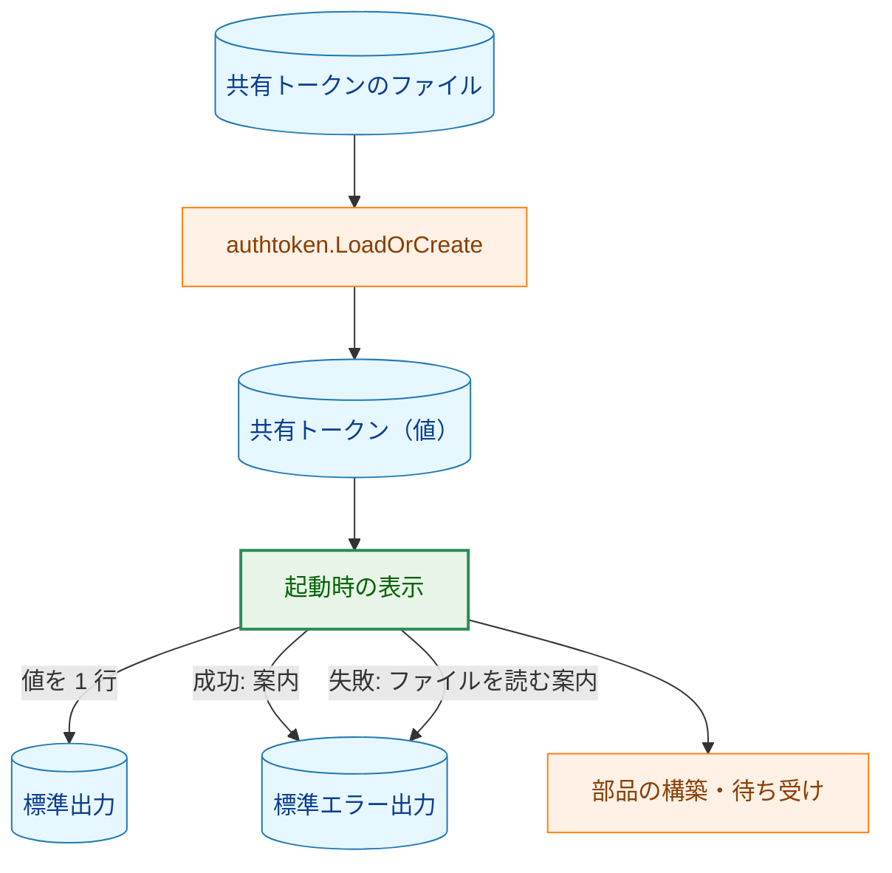
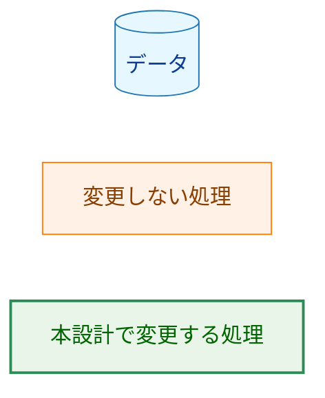
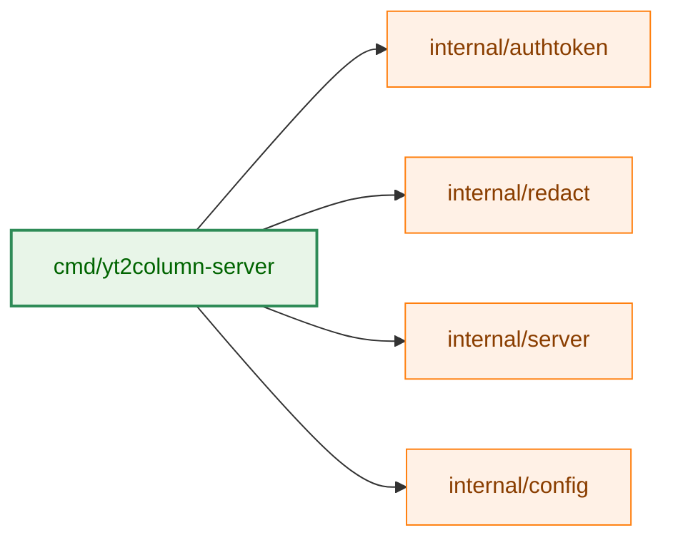
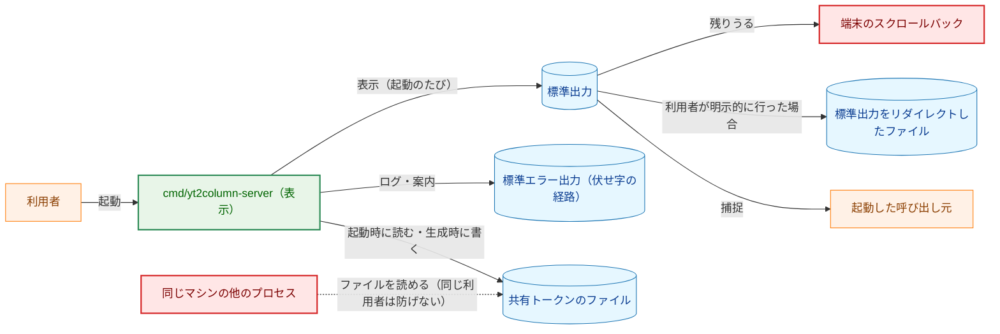
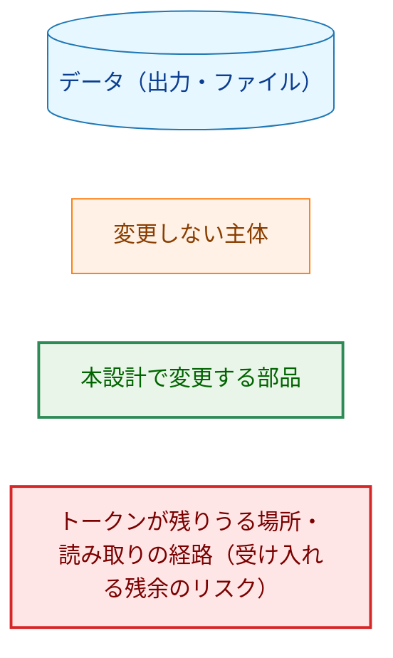
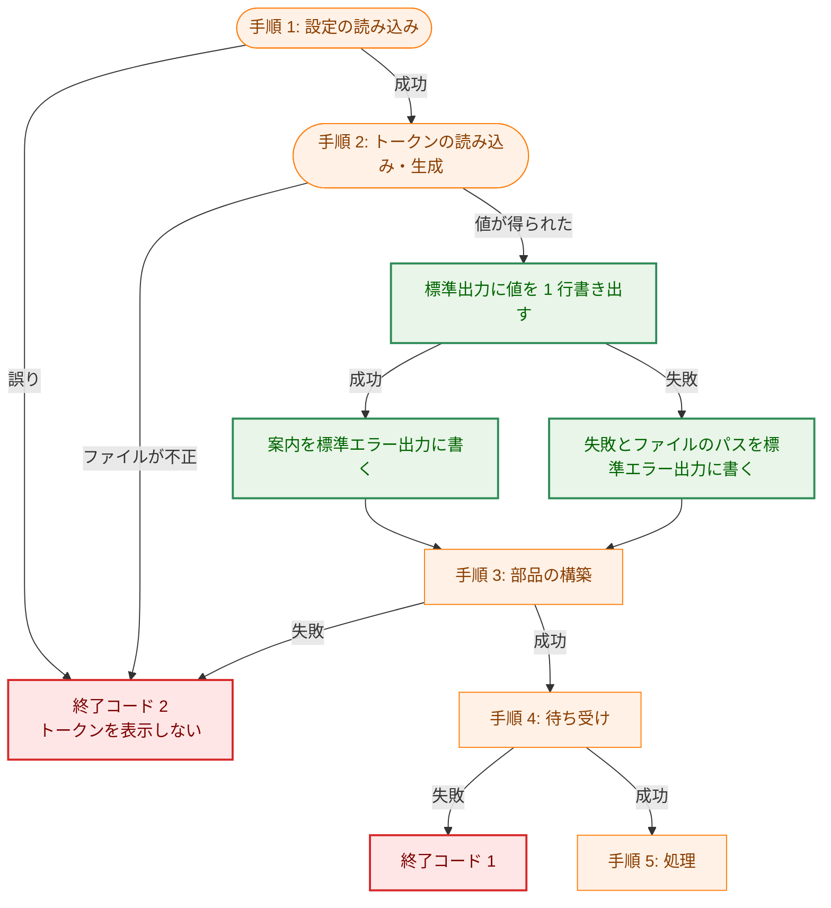
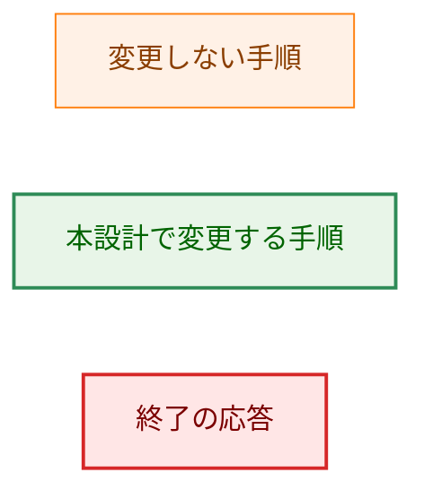
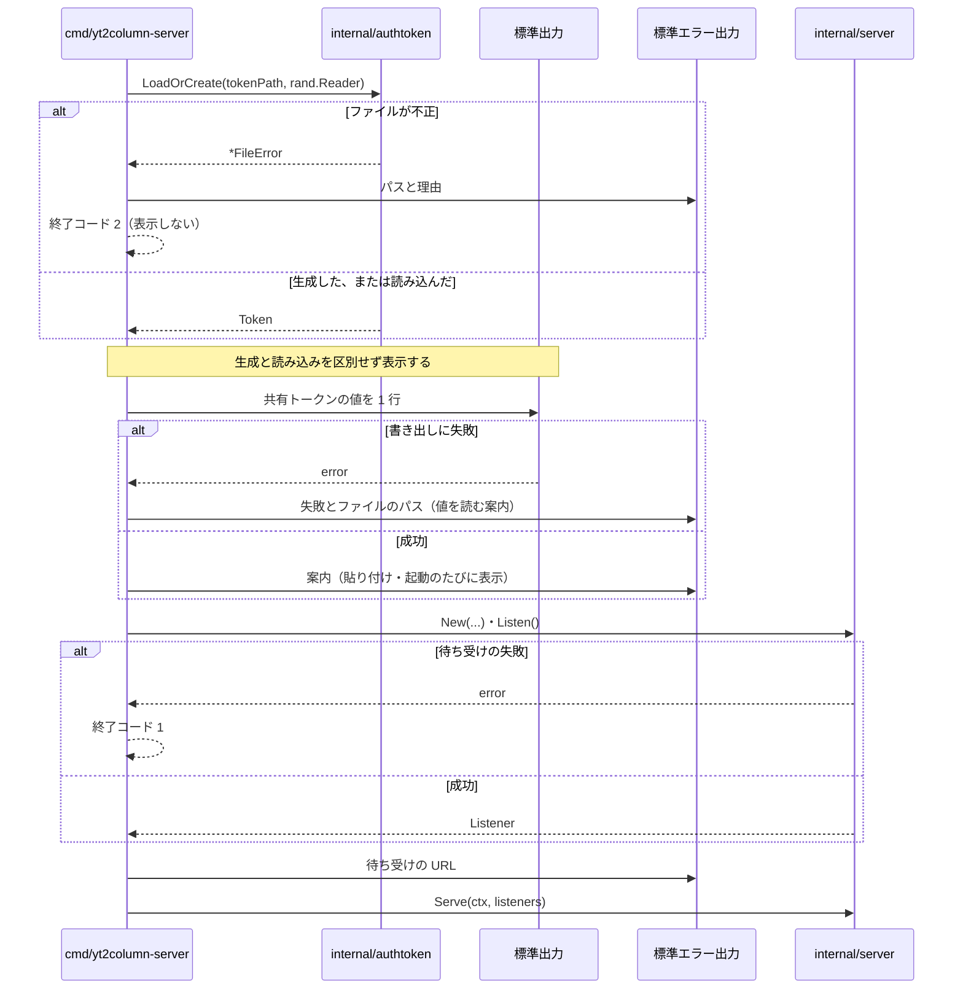

# アーキテクチャ設計書：localhost サーバの起動時に共有トークンを表示する

## Document Status

| Item | Value |
|---|---|
| Status | `approved` |
| Created | 2026-10-16 |
| Review date | 2026-10-16 |
| Reviewer | isseis |
| Comments | レビューでの修正: §2.1 の「`internal/authtoken` は契約・実装とも変更しない」を、トークンのファイルの生成・保存・読み込み・検査の振る舞いは変えない一方、`LoadOrCreate` と内部の `create` が `created` の戻り値を外し、`Token.Value` のコメントを改める（§3.2）旨に改めた。決定の変更はない。 |

本書は [01_requirements.md](01_requirements.md)（要件定義書。以下、要件書）の設計である。F-NNN・AC-NN は要件書の項番、H-NN は [design_handoff.md](design_handoff.md) の項目を指す（対応は §3.3）。既存のファイルの行番号は、コミット `3180ae3`（要件書を承認したコミット）で確かめたものである。

**参照する文書。** タスク `0011_localhost_server`（以下 `0011`）は、本設計が変更の対象とする localhost サーバ（`cmd/yt2column-server`・`internal/server`・`internal/authtoken`）と共有トークンの仕様を作った。本書の「`0011` F-NNN」は `0011` の [01_requirements.md](../0011_localhost_server/01_requirements.md) の項番、「`0011` §N」は `0011` の [02_architecture.md](../0011_localhost_server/02_architecture.md) の節を指す。セキュリティの観点は [security.md](../../dev/security.md) §8（特に §8.2）に従う。

**用語。** 要件書の用語（共有トークン、生成した起動、読み込んだ起動、標準出力、標準エラー出力）を使う。加えて次を使う。

-   **表示:** サーバが起動時に共有トークンの値を標準出力へ書き出すこと（F-001）。
-   **案内:** 表示のあとに標準エラー出力へ書き出す、拡張への貼り付けを促す 1 行（F-001）。
-   **起動の手順:** `cmd/yt2column-server` の `run` が行う手順の列。手順 1〜5 は `0011` §3.1 の番号をそのまま使う。
-   **`created`:** `0011` の `internal/authtoken.LoadOrCreate` の第 2 戻り値。その呼び出しがトークンを生成したかどうかを表す。本設計で外す（§3.2）。

## 1. 設計の全体像 (Design Overview)

### 1.1. 設計原則

1.  **表示の条件から「生成したとき」を外す。** `run` は `created` で表示を分岐せず、起動のたびに同じ手順で表示する（F-001・AC-01〜AC-03）。表示の中身は変えない。標準出力へ共有トークンの値だけを 1 行（値 + 改行）書き出す（`0011` の実装そのもの）。
2.  **表示は best-effort とし、失敗しても起動を止めない。** 標準出力への書き出しに失敗しても、標準エラー出力へ 1 行を書いて起動を続ける。標準出力が閉じたパイプの場合も同じ扱いにする（表示より前に、閉じたパイプへの書き込みでプロセスが終了しないようにする。§3.1）（値の取り出しの失敗は表示の失敗ではなく `Token` の不変条件の違反なので、`0011` のまま終了コード 2 で終える。§3.1）。トークンの値はファイルに残るので、利用者はファイルから読める（要件書 4.3）。これは現在の「書き出しに失敗したら終了コード 2 で終える」という振る舞いを変える（§1.4）。
3.  **共有トークンの生成・保存・読み込み・検査は `0011` のままにする。** ファイルの場所・形式・権限・生成方法・読み込み時の検査は変えない（要件書 2.3・5）。`run` が `created` を使わなくなると、`created` を読む本番のコードがなくなるので、`LoadOrCreate` の戻り値から外す（§3.2）。
4.  **出力先の分離を維持する。** 標準出力に書くのはトークンの 1 行だけ、ログ・案内・エラーは標準エラー出力に書く（`0011` §3.1・§3.10）。トークンは引き続き `redact.SecretStrings` が返す伏せ字の対象に含め、ログの経路に値が流れても伏せ字になるようにする（F-001・AC-06）。
5.  **表示に新しい部品を足さない。** 変更は `cmd/yt2column-server` の起動の手順（`run` と、プロセスの入口 `main`）に閉じる。新しいパッケージ・型・インタフェース・エラー型は加えない（要件書 4.5）。
6.  **表示以外の手段を設けない。** 起動のたびに表示するので、`--show-token` のような別の表示の手段は設けない（要件書 2.3）。

### 1.2. 概念モデル

**図1 概念モデル。** 実線の矢印 A → B は「A から B へ値が渡る」を表す。緑のノードは本設計で変更する処理である。図1 は手順 3〜5 を 1 つのノードにまとめる（手順ごとの流れは §6 の図4）。



**Legend**



-   `LoadOrCreate` は生成したか読み込んだかを返さない。生成した起動でも読み込んだ起動でも `TOKEN` から `DISPLAY` へ進む（§3.1・§3.2）。
-   `DISPLAY` の失敗は `SERVE` を止めない。`STDERR` に書いたあと `SERVE` へ進む（§1.1 原則 2）。閉じたパイプへの書き込み（SIGPIPE）も、この失敗に含める（§3.1）。

### 1.3. 既存コードとの関係

| 既存のもの | 本設計での扱い |
|---|---|
| `run`（`cmd/yt2column-server/run.go:133-224`） | 変更する。手順 2 の表示を、生成した起動だけでなく起動のたびに行い、失敗しても終了しないようにする（§3.1） |
| `authtoken.LoadOrCreate`（`internal/authtoken/authtoken.go:99`） | 戻り値から `created` を外す（`(Token, error)`）。ファイルの扱いは `0011` §3.3 のまま保つ（§3.2） |
| `authtoken.Token.Value`（`internal/authtoken/authtoken.go:135`） | 変更しない。表示のために値を取り出す経路としてそのまま使う |
| `redact.SecretStrings`（`internal/redact`） | 変更しない。トークンを伏せ字の対象に含める呼び出し（`run.go:170`）を維持する |
| `run` の標準出力・標準エラー出力の引数（`run.go:133`） | 変更しない。テストが書き込みに失敗する `io.Writer` を渡せる形をそのまま使う（要件書 4.5） |
| `0011` の要件書・設計書 | 変更しない。当時の振る舞いの記録として残す（要件書 §1・F-002） |
| `internal/server`・`internal/config`・`internal/failure` | 変更しない。起動より後の処理と、共有トークン以外の設定は対象外 |

### 1.4. `0011` の設計への例外

本設計は、`0011` が定めた方針を 2 点変える。いずれも要件書（§1・§2.1、F-001）が求めるものであり、`0011` の文書（要件書・設計書・`design_handoff.md`）は当時の記録として変更しない（要件書 F-002）。

1.  **表示の条件（方針の変更）。**
    -   **元の方針:** `0011` F-001 は「生成したときだけ標準出力に表示する」とし、`0011` AC-02 は「再起動時に新しいトークンを表示しない」ことと定める。`0011` §3.1 の手順 2 と §3.3 の「表示」の行も同じである。実装では `run.go:172-183` が `created` の真のときだけ値と案内を書き出す。
    -   **例外の理由:** 共有トークンは再起動をまたいで同じ値を使うため、2 回目以降の起動では値が表示されない。利用者が値を再び必要とするとき（ブラウザのプロファイルを作り直した、拡張を入れ直した、別のブラウザで使う）に使える既存の経路は、ファイルを削除して作り直す手順（`0011` F-010）だけである。それまで使っていた値はこの手順で無効になる。起動のたびに表示すれば、破壊的な手順を取らずに値を確認できる（要件書 §1、[#266](https://github.com/isseis/yt2column/issues/266)）。
    -   **更新が必要な既存のテスト:** `cmd/yt2column-server/run_test.go` の `TestTokenShownOnlyWhenCreated`（`:261-286`）は、2 回目の起動が標準出力へ何も書かないことを確かめている。本設計では 2 回目も表示するので、このテストを「起動のたびに表示する」ことを確かめる形に改める（§7）。`cmd/yt2column-server/server_test.go:26` の、このテストを名指しするコメントも改める。
2.  **表示に失敗したときの振る舞い（実装が選んでいた挙動の変更）。**
    -   **元の挙動:** `0011` の文書は表示の失敗を定めていない。実装は、トークンの値の取り出しに失敗すると（`run.go:173-177`）、標準出力への書き出しに失敗すると（`run.go:178-181`）、いずれも標準エラー出力に 1 行を書いて終了コード 2 で起動を止める。
    -   **例外の理由:** 要件書 4.3 は「表示に失敗しても、サーバを停止させない。トークンの値はファイルに残るので、利用者はファイルから読める」と定める。表示は利用者の利便のための出力であり、サーバの提供を止める理由にはしない。変えるのは標準出力への書き出しの失敗だけで、値の取り出しの失敗（`run.go:173-177`）は終了コード 2 のまま残す（§3.1）。
    -   **更新が必要な既存のテスト:** `cmd/yt2column-server/run_test.go` の `TestStartupFailures`（`:114-121`）の「token not written to stdout」の行は、標準出力が失敗すると終了コード `exitUsage` で止まることを確かめている。本設計では止まらないので、この行を外し、表示に失敗しても待ち受けることを確かめるテストを別に加える（§7）。

## 2. システム構成 (System Structure)

### 2.1. パッケージ構成

**図2 本設計に関わるパッケージと依存。** 矢印 A → B は「A が B を import する」を表す。本設計に関わる import だけを示す。緑は本設計で変更するパッケージ、橙は変更しないパッケージである。新しいパッケージ・import は加えない。



**Legend**


変更は `cmd/yt2column-server` の `run` に閉じる。`internal/authtoken` はトークンのファイルの生成・保存・読み込み・検査の振る舞いを変えないが、`LoadOrCreate` と内部の `create` が `created` の戻り値を外し、`Token.Value` のコメントを改める（§3.2）。`internal/redact` はトークンの伏せ字の経路として引き続き使う（変更なし）。

### 2.2. コンポーネント配置

| ファイル | 変更 | 責務 |
|---|---|---|
| `cmd/yt2column-server/run.go` | 変更 | 手順 2 の表示を起動のたびに行い（`created` で分岐しない）、表示の失敗で起動を止めない。案内を常に書く（§3.1） |
| `cmd/yt2column-server/main.go` | 変更 | 表示より前に、閉じたパイプへの書き込みでプロセスが終了しないようにする（§3.1） |
| `cmd/yt2column-server/run_test.go` | 変更 | `TestTokenShownOnlyWhenCreated` を「起動のたびに表示する」テストに改める。`TestStartupFailures` から表示失敗の行と、その行だけが使う `stdoutFails` のフィールド・分岐（`:62-63`・`:194`・`:216`）を外す。表示に失敗しても待ち受けるテストを加える（§7） |
| `cmd/yt2column-server/server_test.go` | 変更 | 2 回目の起動の表示を参照するコメントを改め、標準出力に表示された値を `Authorization: Bearer` に使って認証を確かめる（AC-07。§1.4・§7） |
| `cmd/yt2column-server/test_helpers.go` | 変更 | 表示に失敗する標準出力を渡して起動する補助を、必要に応じて加える。`startServerChild` に、子プロセスの標準出力として読み手を閉じたパイプを渡せる形を加える（SIGPIPE のテスト。§7）。`startServer` が待ち受けの再試行のたびに標準出力を同じバッファへ書き足す点を改める（§7） |
| `cmd/yt2column-server/docs_test.go` | 変更 | `TestServerDocsContract` に、README・`security.md` §8.2 の新しい記載を固定する検査を加える（§7。AC-08・AC-09 の静的な確認） |
| `internal/authtoken/authtoken.go` | 変更 | `LoadOrCreate` と内部の `create` の戻り値から `created` を外す。ファイルの扱いは変えない（§3.2）。`Token.Value` のコメント（`:132-134`）の「for the one-time display after creation」を、起動のたびの表示に合わせて改める |
| `internal/authtoken/authtoken_test.go` | 変更 | `created` の検査だけを外し、値・ファイル・エラーの検査を残す（§3.2） |
| `internal/server/test_helpers.go` | 変更 | `newTestToken` の `created` の検査を、返った `Token` がファイルの値と一致する検査に置き換える（§3.2） |
| `README.md` | 変更 | 起動のたびの表示、貼り付け、再確認の経路、リダイレクトの注意（§3.4。F-002） |
| `docs/dev/security.md` §8.2 | 変更 | 表示のタイミング、露出の経路、ログへの非露出、標準出力と標準エラー出力の分離（§3.4。F-002） |
| `docs/dev/developer_guide/package_reference.md` | 変更 | `cmd/yt2column-server` の行の、生成したトークンを一度だけ表示する旨の 2 か所（「a created token is written to standard output once, before listening, and nowhere else」「Standard error carries every line except the created token」）を、起動のたびに表示する形に改める（§3.4） |
| `docs/dev/project_overview.md`・`CLAUDE.md` | 変更なし | 起動時の表示の条件を記述していない（`CLAUDE.md:116-123` はサーバの部品を列挙するだけ、`project_overview.md` に共有トークンの表示の記述はない。要件書 §5 の「変える必要がある場合」に当たらない） |
| `docs/tasks/0011_localhost_server/` の文書 | 変更なし | 当時の記録として残す（要件書 §1・F-002） |

### 2.3. データフロー

起動時の表示のデータフローは、`0011` §6.2 の「起動と終了の流れ」と本設計 §6 の図4 が示すとおりである。本設計は、`0011` §6.2 のシーケンスのうち、トークンの読み込み・生成のあとに表示を加える位置と、失敗時に起動を続ける分岐だけを変える。受理後のリクエスト処理（`0011` §6.1）は変更しない。

## 3. コンポーネント設計 (Component Design)

### 3.1. 起動時の表示（`cmd/yt2column-server/run.go`）

`run` の署名は変えない。標準出力・標準エラー出力は引数として受け取り、テストが差し替えられる形をそのまま使う（要件書 4.5）。

```go
// run starts the server and serves until ctx is canceled, then returns the
// process exit code. Steps 1 to 3 touch no network and change no file other
// than creating the token file when it is absent. A failure there stops the
// start with exitUsage before the server listens, except a failure to display
// the token, which is written to standard error and does not stop the start.
// Standard output receives the shared token on every start; everything else
// goes to standard error.
func run(ctx context.Context, args []string, lookup config.LookupFunc, stdout, stderr io.Writer, d deps) int
```

手順 2 の表示は、次の規則で行う。

| 項目 | 方針 |
|---|---|
| 表示の条件 | 起動のたび（生成した起動と読み込んだ起動を区別しない） |
| 表示の内容 | 共有トークンの値だけを 1 行。値 + 改行（`0011` と同じ） |
| 表示先 | 標準出力（`stdout`）。ほかの出力へ値は書かない |
| 案内の内容 | 値ではなく、貼り付けと再確認の案内。起動の種類で分けず、常に同じ文言にする |
| 案内の表示先 | 標準エラー出力（`stderr`）。伏せ字の経路（`redact.Line`）を通す |
| 表示の失敗 | 標準エラー出力に 1 行を書き、起動を続ける（終了しない）。値は書かず、ファイルのパスを案内する |
| 順序 | 手順 1（設定）の後、手順 3（部品の構築）・手順 4（待ち受け）の前（`0011` §3.1 の順序を維持する） |

-   **`created` を外す理由。** 表示の条件を外すと `created` は表示の判断に使われなくなり、読む本番のコードがなくなる（§3.2）。`run` は `token, err := authtoken.LoadOrCreate(...)` の形で受け取る。
-   **案内を常に同じ文言にする理由。** 利用者が取る行動（値を拡張へ貼り付ける、必要なら起動し直す）は、生成した起動でも読み込んだ起動でも同じである。案内を「生成した/読み込んだ」で分けると分岐が増え、テストも 2 通りになる。要件書 F-001 はどちらでもよいとしており、単純な方（常に同じ文言）を採る（YAGNI）。案内は、値が再び表示されないとする記述を含めず、「起動のたびに表示する」ことを述べる（F-001・AC-02）。
-   **表示の失敗を終了にしない理由。** 要件書 4.3 による。表示は利用者の利便のための出力であり、失敗しても値はファイルに残る。失敗の 1 行は、値を伏せたうえで（`redact.Line` を通す）、利用者がファイルを読めるようパスを示す。`LoadOrCreate` が返す `Token` は検証済みの非ゼロの値を持つ（`internal/authtoken/authtoken.go:177-181`・`:244-248`。値の取り出しに失敗する `Token` は正常に返らない）ので、実際に起こりうる失敗は標準出力への書き出しである。値の取り出しに失敗した場合は表示の失敗として扱わず、`0011` のまま 1 行を書いて終了コード 2 で終える。取り出しに失敗する `Token` はゼロ値であり、起動を続けても手順 3 の `server.New` がゼロのトークンを拒む（`internal/server/server.go:142`）ので、続ける分岐は到達しても終了コード 2 に終わるだけである。
-   **標準出力が閉じたパイプの場合（SIGPIPE）。** 読み手が終了したパイプ（例: `yt2column-server | true`）へ表示を書くと、OS の既定の扱いではプロセスが SIGPIPE で終了し、書き込みがエラーを返す前に起動が止まる。そうなると原則 2 が成り立たない。そこで本設計は、表示より前に（`main` で `run` を呼ぶ前に）`signal.Ignore(syscall.SIGPIPE)` を呼び、閉じたパイプへの書き込みでプロセスが終了せず `syscall.EPIPE` を返すようにする。`signal.Notify` で購読してチャネルを読まない形より、読まれないチャネルを残さない。無視は子プロセスに引き継がれるが、サーバは子プロセスを起動しない。閉じたパイプへの書き込みは、ほかの書き込みの失敗と同じく、標準エラー出力へ 1 行を書いて起動を続ける扱いにする。標準エラー出力も閉じたパイプの場合は、ログが失われるだけで、待ち受けは続く。
-   **手順 2 のコメント。** `run.go` の手順 2 のコメント「so a token created by a start whose listen then fails is still shown once」も、起動のたびに表示する形に改める。
-   **表示は値をそのまま書き出す。** 標準出力へのトークンの 1 行は伏せ字の経路を通さない。利用者がそのままコピーできる必要があるためである（F-001）。トークンは `redact.SecretStrings` の対象に残すので、同じ値が別の経路（ログ・案内・エラー）へ流れた場合は伏せ字になる（§3.2・§5）。

### 3.2. 共有トークンの読み込み・生成（`internal/authtoken`、戻り値だけ変更）

`internal/authtoken.LoadOrCreate` の戻り値から `created` を外す。ファイルの扱い（場所・形式・権限・生成方法・読み込み時の検査、同時の初回起動で他方のファイルを読んで上書きしないこと）は変えない。

```go
// LoadOrCreate reads the token file at path, or creates it when it does not
// exist. random is the source of the token bytes; production passes
// crypto/rand.Reader. A file that exists but does not meet the accepted form is
// reported as a *FileError wrapping ErrInvalidTokenFile and is neither repaired
// nor regenerated.
func LoadOrCreate(path string, random io.Reader) (Token, error)
```

-   **外す理由。** `0011` で `created` を読む本番のコードは `run` の表示の判断だけだった。本設計で表示の条件を外すと、`created` を読むのは `internal/authtoken` のテストだけになる。CLAUDE.md の「Before preserving an exported field as an extension point, count its real uses」に従い、使われない戻り値を残さない。リポジトリの外に利用者はいない。内部の `create` の `created` も `LoadOrCreate` が返すためだけにあるので、同じく外す。
-   **要件書との関係。** 要件書 2.3・5 が `0011` のままとするのはトークンのファイルの扱いであり、戻り値の形は含まない。ファイルの扱いは変えないので、要件書の範囲に収まる。
-   **テスト。** `internal/authtoken` のテストは `created` の検査だけを外す。生成したか読み込んだかは、ファイルの有無と値の一致で確かめられる（`TestLoadOrCreateCreates`・`TestLoadOrCreateReadsAgain`・`TestCreateDoesNotOverwriteExisting` ほか）。`internal/server` の `newTestToken` は、返った `Token` がファイルの値と一致することを確かめる。
-   **文書。** `security.md` §8.2 の「生成」の行の「`created=false` を返し」を「その値を返し」に改める（§3.4）。
-   **表示の失敗は `authtoken` のエラーにしない。** `authtoken` は値の読み込み・生成までを行い、表示は `cmd/yt2column-server` の責務である。`authtoken` が表示の成否を知る必要はない。

### 3.3. design_handoff の各項目への対応

| 項目 | 本設計の対応 | 節 |
|---|---|---|
| H-01 表示の判断と `created` の扱い | 表示は `created` で分岐せず起動のたびに行う。使われなくなる `created` は `LoadOrCreate` の戻り値から外す（ファイルの扱いは変えない）。表示の行は値 + 改行（`0011` のまま）。案内は常に同じ文言とする（分岐で変えない） | §1.1・§3.1・§3.2 |
| H-02 露出の経路と README の起動例 | `0011` の起動例（標準エラー出力だけをファイルに残す `2>>server.log`）を維持し、README に標準出力をリダイレクトするとトークンがそのファイルに残る旨の注意を加える。`security.md` §8.2 にも経路を列挙する | §3.4・§5 |
| H-03 表示の検査の作り方 | `run` の標準出力・標準エラー出力の引数に、`bytes.Buffer` と書き込みに失敗する `io.Writer` を渡して確かめる。トークンが標準出力の 1 行だけに載り、標準エラー出力のログと失敗の通知に出ないことは、既存の `requireNoSecret` と同じ手段で確かめる | §7 |

### 3.4. 文書（F-002、AC-08・AC-09）

| 文書 | 加える・改める内容 |
|---|---|
| `README.md` | 「Running the server」節: トークンが起動のたびに標準出力に表示されること（現在の「on the first start only」を改める）。「The shared token」節: 初回に生成し、2 回目以降は同じ値を読み込んで表示すること（現在の「prints it once」「does not print it」を改める）。値を再び確認する主たる経路を「起動し直す」とし、ファイルを読む手順を表示に失敗したときの補足として残す。標準出力をファイルにリダイレクトするとトークンがそのファイルに残る注意を加える（`2>>server.log` はログだけを残す形として維持する） |
| `docs/dev/security.md` §8.2 | 「表示と作り直し」の記述を、生成した起動だけでなく起動のたびに表示する形に改める。露出の経路（標準出力、端末のスクロールバック、標準出力をリダイレクトしたファイル、起動した呼び出し元による出力の捕捉）、ログへの非露出、標準出力と標準エラー出力の分離、表示に失敗しても起動を続けることを記す。「生成」の行の「`created=false` を返し」を「その値を返し」に改める（§3.2） |
| `docs/dev/developer_guide/package_reference.md` | `cmd/yt2column-server` の行の「a created token is written to standard output once, before listening, and nowhere else」を「the shared token is written to standard output on every start, before listening, and nowhere else」に、「Standard error carries every line except the created token」を「Standard error carries every line except the shared token」に改める |

-   **案内の文言（実装で確定する）。** 標準エラー出力に書く 1 行は、値を含まず、「標準出力に表示したこと」「拡張のオプションページに貼り付けること」「起動のたびに表示すること」「ファイルのパス」を述べる。表示に失敗した場合は、値を含まず、失敗の理由とファイルのパスを示して、ファイルを読むよう案内する。いずれも Go の文字列リテラル（英語）である（`_context.md` の Source-language rule）。
-   **README の起動例。** `0011` §3.12 の `curl` の例（トークンを引数に置かず標準入力から渡す）は変えない。変えるのは表示のタイミングの説明と、リダイレクトの注意である。
-   **用語集。** `docs/translation_glossary.md` は変更しない。本設計が新しく導入する用語はない。要件書の用語（共有トークンなど）は既に登録されており、本設計が使う「表示」「案内」は一般語である。

## 4. エラーハンドリング設計 (Error Handling Design)

**新しいエラー型・番兵を加えない。** 表示の失敗は戻り値にせず、標準エラー出力に書いて起動を続ける（要件書 4.3）。`run` の終了コードの分類は変えない。

| 事象 | 扱い |
|---|---|
| 設定の誤り（手順 1） | `0011` のまま。`*VarError` を変数ごとに 1 行書き、終了コード 2 で終える（値を表示しない。AC-05） |
| トークンのファイルが不正（手順 2） | `0011` のまま。`*FileError` のパスと理由を 1 行書き、終了コード 2 で終える。**値を表示しない**（AC-04） |
| トークンを読み込み・生成できた（手順 2） | 表示を試みる。標準出力への書き出しに失敗しても（閉じたパイプへの書き込みを含む）終了しない。標準エラー出力に値を含まない 1 行を書き、手順 3 へ進む（要件書 4.3）。値の取り出し（`Reveal`）の失敗は `Token` の不変条件の違反であり、`0011` のまま終了コード 2 で終える（§3.1） |
| 部品の構築の失敗（手順 3） | `0011` のまま。終了コード 2 |
| 待ち受けの失敗（手順 4） | `0011` のまま。終了コード 1 |
| 処理の失敗（手順 5） | `0011` のまま。変更しない |

-   **値の露出を新たに作らない。** 表示に失敗したときの 1 行も、案内と同じく `redact.Line` を通し、トークン・API キー・Webhook URL を伏せ字にする（AC-06）。

## 5. セキュリティ考慮事項 (Security Considerations)

**条件付きガイドのトリガーに該当する。** 本設計は共有トークン（秘密情報）の表示を変えるため、[security.md](../../dev/security.md) §2・§8 に従う。方針の全体は `security.md` §8 のままで、変更するのは表示のタイミングと露出の扱いだけである。

### 5.1. 脅威モデル

**図3 共有トークンの露出経路。** 矢印 A → B は「A が B を起動する、B へ書き出す、または B を読む」を表す。実線は本設計に関わる経路、点線は本設計が加えない既存の経路（残余のリスク）を表す。



**Legend**



### 5.2. 露出と対策

| 項目 | 扱い |
|---|---|
| 表示先 | 標準出力だけ。ログ・案内・エラーは標準エラー出力に分ける（`0011` §3.1・§3.10） |
| 起動のたびの表示による露出（受け入れる） | 端末のスクロールバック、標準出力をリダイレクトしたファイル（利用者が明示的に行った場合）、起動した呼び出し元（`nohup`・`tee`・端末の出力の保存など）による出力の捕捉にトークンが残りうる。利用者 1 人の macOS で起動は手動であることを前提に、要件書 4.2・4.3 のとおり受け入れる |
| ログへの非露出 | ログへは標準エラー出力に書く経路だけを使い、その経路は `redact.Writer`/`redact.Line` を通す（`0011` §3.10）。利用者が標準エラー出力だけをファイルに残す起動例（`2>>server.log`）では、トークンはそのファイルに残らない |
| ほかの出力への非露出 | 応答・エラーメッセージ・失敗の Slack への投稿にトークンを載せない（`0011` の AC-02・AC-21・AC-24・AC-27 を維持する。AC-06） |
| 表示の失敗 | 失敗の 1 行も伏せ字の経路を通す。値を別の出力へ移さない（§3.1・§4） |
| トークンの生成・比較・検査 | `0011` のまま（§3.2）。変えない |
| 拡張への受け渡し | 利用者が表示された値を拡張のオプションページに貼り付ける経路（`0011`、F-001）は、この非露出の禁止に含まない |
| 新しい外部サービスの機能 | N/A。本設計は新しい外部サービスの機能を利用しない。表示の先は標準出力と標準エラー出力だけで、ネットワークを使わない |

### 5.3. 残余のリスク

-   **起動のたびの表示で、値が残る場所が増える。** 端末のスクロールバックやリダイレクト先のファイルに値が残りやすくなる。利用者 1 人の macOS を前提に受け入れる（要件書 4.2。§5.2）。
-   **トークンはローテーションされないので、捕捉された値は無期限に有効である。** 起動のたびに同じ値を表示するため、呼び出し元やシェルの履歴に残った 1 つの値が、利用者がファイルを削除して作り直すまで有効であり続ける。要件書 4.2 は「起動は手動」を前提にこの露出を受け入れる。サーバを、監視の下で起動したり、出力を捕捉する道具（`nohup`・`tee`・セッションのログ・launchd など）から起動したりしないことを運用の前提とする（要件書 2.3 は起動の自動化を対象外とする）。
-   **標準出力が詰まっていると、起動が表示の完了を待つことになる。** 表示は手順 2 で同期に行う 1 回の小さな書き込み（65 バイト程度）である。標準出力の読み手が停止してパイプのバッファが埋まっている場合、書き込みが完了するまで待ち受けを開始しない。要件書 F-001 が表示を待ち受けより前に置くため、この順序を変えない（表示は 1 回で、通常は即座に終わると想定する）。
-   **同じ OS 利用者として動くプロセスは、共有トークンのファイルを読める。** `0011` §5.4 のままで、本設計は変えない（受け入れる）。
-   **表示に失敗した起動では、利用者が値を見るにはファイルを読む必要がある。** 案内にファイルのパスを示すので、値は確認できる（要件書 4.3）。

## 6. 処理フロー詳細 (Processing Flow Details)

### 6.1. 起動の手順と表示

**図4 起動の手順と表示。** 矢印 A → B は処理の順序と分岐を表し、ラベルは分岐の条件を表す。緑のノードは本設計で変更する手順、赤のノードは終了の応答である。



**Legend**



### 6.2. 起動と表示のシーケンス

**図5 起動と表示の流れ。** 実線の矢印 `->>` は呼び出しまたは出力を、点線の矢印 `-->>` は戻り値を表す。



-   表示は手順 3・4 より前に行うので、待ち受けが失敗した起動でも利用者はトークンを確認できる（`0011` §3.1 の順序を維持する。要件書 F-001・4.3）。
-   表示に失敗した起動でも、手順 3・4 へ進む（図4 の `FALL` → `BUILD`）。

## 7. テスト戦略 (Test Strategy)

ユニットテストは、実際のブラウザ・LLM の API・Slack の Webhook を呼ばない（要件書 §5、`0011` の制約を維持する）。表示の検査は、`run` の標準出力・標準エラー出力の引数に `bytes.Buffer` または書き込みに失敗する `io.Writer` を渡して行う（要件書 4.5）。トークンが標準出力の 1 行だけに載り、標準エラー出力のログと失敗の通知に出ないことは、既存の `requireNoSecret`（`cmd/yt2column-server/test_helpers.go:671-678`）と `TestOutputsOmitSecrets`（`run_test.go:302-338`）と同じ手段で確かめる。

| AC | 主なテスト | 検証内容 |
|---|---|---|
| AC-01 | `run_test.go` の `TestTokenShownOnEveryStart`（改称。旧 `TestTokenShownOnlyWhenCreated`）の初回の起動、`server_test.go` の `TestServerEndToEnd` | ファイルがない起動で、生成したトークンが標準出力に 1 行で表示され、`0600` のファイルに保存される。同じ値で API の認証が通る |
| AC-02 | `TestTokenShownOnEveryStart` の 2 回目の起動 | ファイルがある起動で、保存済みのトークンが標準出力に 1 行で表示され、新しい値は生成されずファイルも変わらない。標準エラー出力の案内に「再び表示されない」とする記述が現れない |
| AC-03 | `TestTokenShownOnEveryStart`・`TestServerEndToEnd` の 2 回目の起動 | 再起動しても同じ共有トークンが表示され、同じ値で API の認証が通る |
| AC-04 | `run_test.go` の `TestStartupFailures` の「token file readable by others」の行、`internal/authtoken` の不正なファイルの各ケース | トークンのファイルが不正な場合、待ち受けを開始せずに終了し、その出力に値が現れない。ファイルを修復も再生成もしない |
| AC-05 | `TestStartupFailures` の「model and webhook missing」の行 | 必要な設定が欠けている場合、トークンを表示せずに終了し、その出力に欠けている設定の値・API キー・Webhook URL・共有トークンが現れない |
| AC-06 | `TestOutputsOmitSecrets`、`TestStartupFailures` の `requireNoSecret` の検査、`internal/server` の応答の検査 | 共有トークンが、標準出力への表示とトークンのファイルを除き、ログ・エラーメッセージ・応答・失敗の Slack への投稿に現れない（識別できる値を使う） |
| AC-07 | `server_test.go` の `TestServerEndToEnd`（標準出力の 1 行を取り出して認証する） | 標準出力の 1 行の値だけを取り出して `Authorization: Bearer` に使うと、API の認証が通る |
| AC-08 | `docs_test.go` の `TestServerDocsContract`（README の検査を追加） | README に、起動のたびの表示、貼り付け、再確認、ファイルを読む補足の手順、リダイレクトの注意が記載されている（静的な確認） |
| AC-09 | `docs_test.go` の `TestServerDocsContract`（`security.md` §8.2 の検査を追加） | `security.md` §8.2 に、起動のたびの表示、露出の経路、ログへの非露出、標準出力と標準エラー出力の分離が記載されている（静的な確認） |

-   **表示に失敗しても待ち受けるテスト（要件書 4.3）。** 既存のトークンのファイルがある状態で、書き込みに失敗する標準出力を渡して `run` を起動する。標準エラー出力に失敗の 1 行（失敗の理由とファイルのパスを含み、トークン・API キー・Webhook URL を含まない）が出ること、トークンのファイルが書き換えられないこと、サーバがリクエストを受理すること、停止したときの終了コードが 0 であることを確かめる。`startServer`（`test_helpers.go:238-263`）は標準出力を `bytes.Buffer` に固定しているので、書き込みに失敗する `io.Writer` を渡せる補助を加える（実装で決める）。
-   **標準出力が閉じたパイプでも待ち受けるテスト（SIGPIPE。要件書 4.3）。** SIGPIPE はプロセス全体に働くので、`run` を同じプロセスで呼ぶテストでは確かめられない。既存の子プロセスのテスト（`startServerChild` の `childModeMain`。本番の `main` をそのまま動かす）を使い、子の標準出力に読み手を閉じた `os.Pipe` の書き込み側を渡して起動する。子が待ち受けを開始すること、標準エラー出力に表示の失敗の 1 行が出ること、SIGTERM で停止したときの終了コードが 0 であることを確かめる。
-   **`startServer` の再試行と標準出力。** `startServer` は、待ち受けの前にポートを取られた試行を再試行し、すべての試行の出力を同じバッファへ書き足す（`test_helpers.go:232-236` のコメント）。`0011` では 2 回目以降の試行はトークンを生成しないので標準出力は 1 行のままだったが、本設計では試行のたびに表示するので、再試行が起きると標準出力が複数行になり、「標準出力 == 値 + 改行」の検査（AC-01・AC-02）と、1 行を取り出して認証する検査（AC-07）が偶発的に失敗する。`startServer` は試行ごとに標準出力のバッファを新しくし、待ち受けた試行の標準出力だけを返す形に改める。
-   **`TestStartupFailures` の改修。** 「token not written to stdout」の行（`run_test.go:114-121`）を外す（表示の失敗は起動を止めないため）。この行だけが使う `stdoutFails` のフィールドと分岐も外す。他の行は維持する。表の `tokenShown` の説明（`:54-56`）は「起動のたびに表示する」に合わせて改める。
-   **`internal/authtoken` のテスト。** `created` の検査だけを外し、残りの検査は変えない（§3.2）。外した後に `go tool cover -func` が関数ごとに変わらないことを確かめる（CLAUDE.md「Deleting a test is a claim that must be checked」）。
-   **テストが主張どおりに失敗できること。** 実装時に、次の 3 つを確認する。2 回目の起動で表示しない形に壊すと `TestTokenShownOnEveryStart` の 2 回目の起動が失敗すること。表示の失敗で終了する形に戻すと、表示失敗のテストが失敗すること。閉じたパイプの扱いを外すと、閉じたパイプのテストが（子が SIGPIPE で終了して）失敗すること（CLAUDE.md「Every test must be able to fail for its stated reason」）。
-   **ガードテスト。** `internal/pipeline/pipeline_test.go` の `TestPackageReferenceListsPackages` は新しいパッケージを加えないので変わらない（`package_reference.md` の行の文面は固定していない）。`TestFakesCarryBuildTag`・`TestCommonTypesFieldSets`・`TestInterfaceDocComments` は対象を変えない。`docs_test.go` の `TestServerDocsContract` は、README・`security.md` §8.2 の既存の検査（`tokenName`・`0600`・`O_NOFOLLOW`・`link(2)` など）を維持したまま、本設計の記載の検査を加える。

## 8. 実装優先順位 (Implementation Priorities)

変更は小さく、1 つのフェーズで行う。各段階の後に `make fmt`・`make test`・`make lint` を通す。

1.  **起動時の表示。** `cmd/yt2column-server/run.go` の手順 2 を、`created` で分岐せず起動のたびに表示する形にし、表示の失敗で終了しないようにする。案内を常に同じ文言にする。表示より前に、閉じたパイプへの書き込みでプロセスが終了しないようにする（`main.go`。§3.1）。使われなくなる `created` を `LoadOrCreate` の戻り値から外す（§3.2）。
2.  **テスト。** `TestTokenShownOnlyWhenCreated` を `TestTokenShownOnEveryStart` に改める。`TestStartupFailures` の表示失敗の行を外し、表示に失敗しても待ち受けるテストと、標準出力が閉じたパイプでも待ち受ける子プロセスのテストを加える。`server_test.go` のコメントを改める（§7）。
3.  **文書。** README・`security.md` §8.2・`package_reference.md` を更新する（§3.4）。`TestServerDocsContract` に README・`security.md` §8.2 の記載の検査を加える（§7）。

## 9. 将来の拡張性 (Future Extensibility)

-   **表示以外の手段。** 起動のたびに表示するので、`--show-token` のような別の手段は設けない（要件書 2.3）。将来必要になれば、起動時の表示を抑えるフラグ（例: 標準出力が端末でないときに表示しない）と併せて検討する。
-   **表示の抑制・切り替え。** 標準出力が端末でない場合に表示を抑える形は、本設計では採らない。表示に失敗しても起動を続けるので、標準出力が書き込めない起動でも待ち受けを妨げない（閉じたパイプを含む。§3.1）。出力を捕捉する呼び出し元（`nohup` など）から起動しないことは運用の前提のままである（§5.3）。
-   **トークンのローテーション・複数のトークン。** 要件書 2.3 の対象外であり、本設計は変えない。表示のタイミングを変える余地は残る（§3.1 の表示の判断に閉じる）。

## 付録 A. `0011` との関係

-   **変える決定は 2 つだけである。** `0011` の決定から変えるのは、表示の条件（生成したときだけ → 起動のたび）と、表示の失敗の扱い（終了コード 2 で終える → 起動を続ける）である（§1.4）。トークンの生成・保存・読み込み・検査、リクエストの認証、`internal/server` の処理は変えない。`LoadOrCreate` の戻り値から `created` を外すのは、表示の条件を変えた結果、使われなくなった値を除くことである（§3.2）。
-   **`0011` の文書は編集しない。** `0011` の要件書・設計書・`design_handoff.md` は当時の記録として残し、現行の振る舞いは本設計と、本設計が更新する生きている文書（README・`security.md`）が記す。`0020` の F-008 と同じ方針である（要件書 §1・F-002）。
