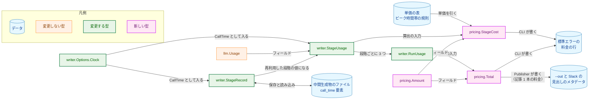
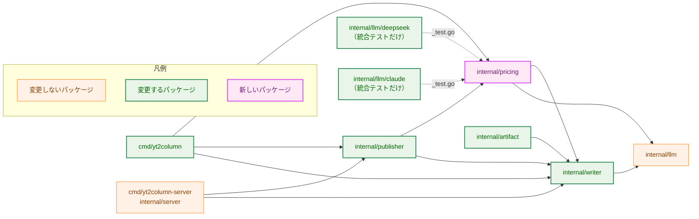
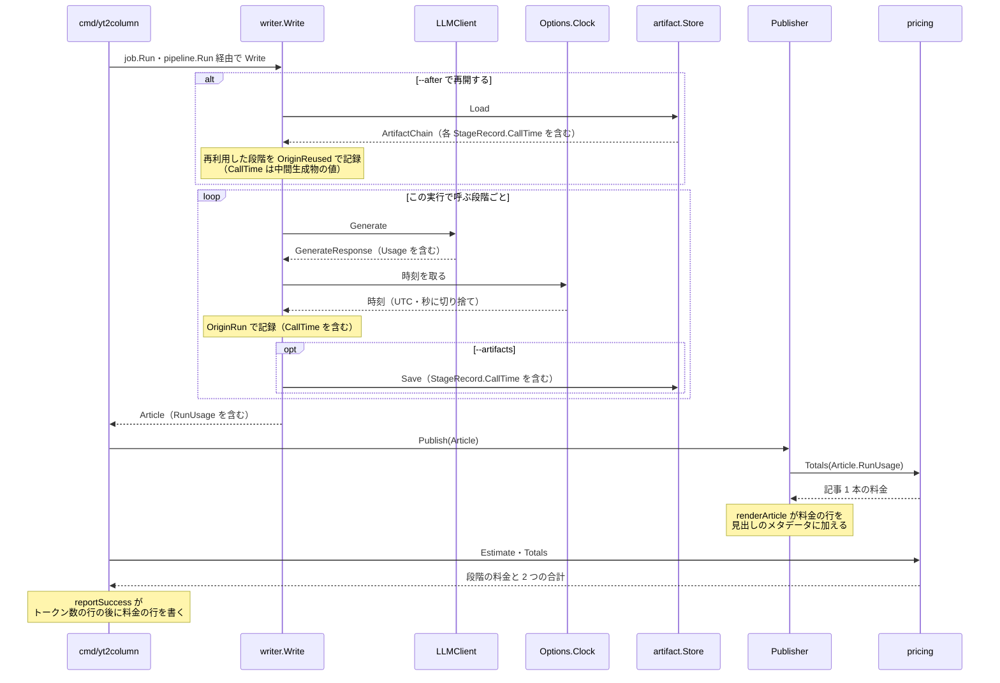
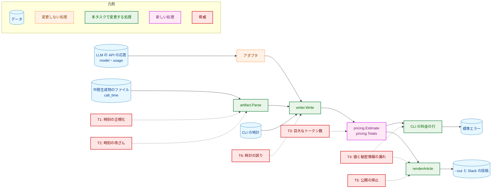
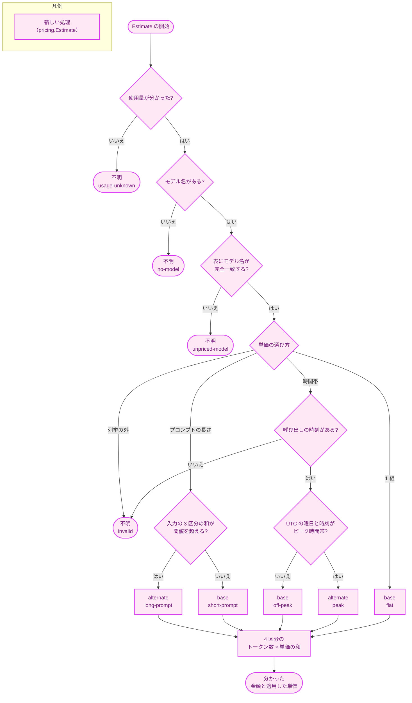
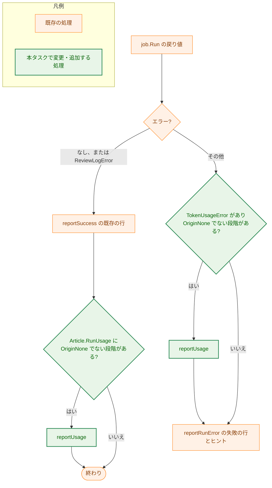

# アーキテクチャ設計書：LLM の料金の概算の算出と、利用者への提示

## Document Status

| Item | Value |
|---|---|
| Status | `approved` |
| Created | 2026-10-16 |
| Review date | 2026-10-16 |
| Reviewer | isseis |
| Comments | - |

本書の既存コードへの言及（`file:line`）は、コミット `15d9b72` で確かめた。

**本書の用語。** 要件定義書の用語に加えて、本書では次の語を使う。

| 語 | 型 | 意味 |
|---|---|---|
| 段階の使用量 | `writer.StageUsage` | 0019 の型。1 つの段階の由来・モデル名・使用量（`llm.Usage`）に、本タスクで呼び出しの時刻を加える |
| 実行の使用量 | `writer.RunUsage` | 0019 の型。段階ごとの段階の使用量を 3 つ束ねた値 |
| 金額 | `pricing.Amount` | 米ドルの正確な金額。10^-12 米ドルを単位とする整数で持つ |
| 段階の料金 | `pricing.StageCost` | 1 つの段階の料金の概算。「分かった（金額と適用した単価）」か「不明（理由つき）」のどちらか |
| 合計 | `pricing.Total` | 「この実行の料金」または「記事 1 本の料金」。「分かった（金額）」か「不明」のどちらか |
| 単価の組 | `pricing.rates`（非公開） | 4 つの区分それぞれの、100 万トークンあたりの単価 |
| 適用した単価 | `pricing.RateBasis` | 段階の料金の算出に使った単価の組の種類（`flat`・`off-peak`・`peak`・`short-prompt`・`long-prompt`） |

「段階」「由来」「再利用の印」「不明」「中間生成物」「来歴」「再開」は、要件定義書（と、それが参照する 0017・0019）の用語と同じである。「H-nn」は [design_handoff.md](design_handoff.md) の項目であり、対応を §3.10 にまとめる。

## 1. 設計の全体像 (Design Overview)

### 1.1. 設計原則

1. **単価の表と算出は、新しいパッケージ `internal/pricing` の 1 か所に置く。** 単価の表・ピーク時間帯の規則・段階の料金の算出・2 つの合計・金額の書式を `internal/pricing` に置き、CLI の要約・`Publisher`・統合テストのログが同じ関数を使う（要件 §4.5、H-01）。プロバイダのアダプタは単価を知らない。
2. **金額は整数で正確に持ち、表示のときだけ四捨五入する。** 単価は「100 万トークンあたりのマイクロ米ドル（10^-6 米ドル）」の符号なし整数で持つ。単価 × トークン数は 10^-12 米ドルの単位でちょうど整数になるので、`math/big` の整数で誤差なく算出し、表示の桁で四捨五入（0.5 は切り上げ）する。桁あふれは起きない（要件 F-002・AC-08、H-02）。
3. **料金は「分かった」か「不明（理由つき）」のどちらかであり、型で区別する。** `StageCost` と `Total` のゼロ値は「不明」であり、0 米ドルとは読めない。不明の理由と適用した単価は列挙型で宣言し、どちらもゼロ値は「設定されていない」を表し、出力では固定の語 `invalid` になる（要件 F-003）。
4. **単価の選び方は表で宣言し、モデル名の中身から推測しない。** 各モデルが「単価が 1 組」「時間帯で 2 組」「プロンプトの長さで 2 組」のどれかを列挙型で宣言し、算出はその値の `switch` で単価の組を選ぶ。`default` は不明にする。モデル名の照合は完全一致だけである（[CLAUDE.md](../../../CLAUDE.md)「Declare, don't infer」、要件 AC-04）。
5. **呼び出しの時刻は `writer` が取得し、段階の使用量とともに運ぶ。** `Generate` が戻った直後に、`writer.Options` で差し替えられる時計から時刻を取り、`StageUsage.CallTime` と `StageRecord.CallTime` に入れる。時刻は 0019 の使用量と同じ経路（成功では `Article.RunUsage`、失敗では `*writer.TokenUsageError`、再開では中間生成物）を通る（H-03）。
6. **`Publisher` は `Article.RunUsage` から記事 1 本の料金を算出する。** `writer.Article` に料金のフィールドを加えない。`renderArticle` が `pricing` の関数で記事 1 本の料金を求めて見出しのメタデータに 1 行を加える。CLI と localhost サーバは同じ `Publisher` を使うので、どちらの投稿にも同じ行が載る（H-04）。
7. **中間生成物の時刻は 1 つの形だけを受理する。** `call_time` 要素は `YYYY-MM-DDTHH:MM:SSZ`（UTC、秒の精度）の 20 バイトの文字列だけを受理し、それ以外は `artifact.ErrMalformed` で拒否する。時刻は `id` の計算に含める（要件 F-007、H-05）。
8. **料金で振る舞いを変えない。** 料金は算出して出力するだけで、生成・字数の調整・検証・推敲・公開の分岐、リクエストの内容、呼び出しの回数、終了コードを変えない。料金が不明でも公開する（要件 §3.2・§4.3・AC-25）。

### 1.2. 概念モデル



**図1 概念モデル**。矢印 A → B は「A の値が B に入る、または B の算出・出力に使われる」を表し、ラベルは入り方を表す。`StageRecord` と中間生成物のファイルの間の双方向の矢印は、保存（`artifact.Marshal`）と読み込み（`artifact.Parse`）を表す。`writer.Options.Clock` は現在の時刻を返す関数（時計）で、本タスクで加える。「単価の表」はコード内の定数であり、外部の入力ではない（要件 §3.2）。

### 1.3. 既存コードとの関係

本タスクが使う既存の振る舞いと、変える振る舞いを示す。

-   **段階の使用量は、由来・モデル名・使用量を持ち、時刻を持たない。** `StageUsage` は `Origin`・`Model`・`Usage` だけを持つ（`internal/writer/writer.go:47-51`）。`Write` は、`Generate` が戻った直後に `stageUsage(resp)` で `OriginRun` の値を作り（`internal/writer/writer.go:393-399`。呼び出しは `internal/writer/writer.go:416`・`internal/writer/shorten.go:29`・`internal/writer/review.go:257`）、再利用した段階は `reusedUsage(record)` で `StageRecord` の値から作る（`internal/writer/writer.go:403-405`）。`Write` はどの失敗でも、記録済みの段階の使用量を `*TokenUsageError` で包んで返す（`internal/writer/writer.go:309-390`）。本設計は、この 2 つの関数に呼び出しの時刻を加えるだけで、時刻を 0019 の経路にそのまま載せる（§3.4）。
-   **`Article` は `RunUsage` を持ち、`==` で比べられる。** `Article.RunUsage` は 0019 で加わった（`internal/writer/writer.go:17-26`）。`TestCommonTypesFieldSets` は `Article` のフィールドの集合を固定する（`internal/pipeline/pipeline_test.go:431-484`）が、`StageUsage` のフィールドは固定しない。本設計は `Article` のフィールドを変えないので、この guard は変わらない。`time.Time` は `==` で比べられる型なので、`StageUsage` に `time.Time` を加えても `Article` は `==` で比べられるままである。ただし `time.Time` の `==` はタイムゾーン（`*time.Location`）とモノトニック時計の読みも比べるので、本設計は時刻を「UTC・秒に切り捨て・モノトニック時計の読みなし」の 1 つの形に正規化してから保持する（§3.4）。
-   **時計はどこにも注入されていない。** 本番のコードで `time.Now` を呼ぶのは、`internal/llm/llmhttp/llmhttp.go:90`（送信の所要時間の計測）と `internal/server/job.go:55`（ジョブの所要時間）だけである。`writer.Options`（`internal/writer/writer.go:79-85`）には時計のフィールドがない。CLI とサーバの `writer.Options` は、どちらも `writertestutil.DefaultOptions` と `reflect.DeepEqual` で比べるテストで一致を固定している（`cmd/yt2column/run_test.go:1684-1700`、`cmd/yt2column-server/run_test.go:378-396`）。
-   **中間生成物の形式の版は 2 で、`id` は版と使用量を含む。** `artifactVersion` は 2（`internal/artifact/artifact.go:21`）、`Parse` は宣言したキー以外を `CollectOnly` で拒否し（`internal/artifact/format.go:158`）、版が違えば `unsupported artifact version` で拒否する（`internal/artifact/format.go:232-236`）。`recordID` は、版・段階・モデル名・モデルの版・使用量（`usageIDParts`）・テンプレート・入力・本文の順に部分を並べる（`internal/artifact/format.go:437-464`）。
-   **`renderArticle` が `--out` と Slack の共通の本文を作る。** `renderArticle` は、見出し・モデル名の行（生成、字数の調整、検証・推敲）・空行・本文の順に書く（`internal/publisher/file.go:203-214`）。`FilePublisher` はそれをファイルに書き（`internal/publisher/file.go:111`）、Slack の `prepareSlackMessages` は `CheckPublishable` と UTF-8 の検査の後で `renderArticle` の結果を分割し、メンションを検査する（`internal/publisher/slack_message.go:25-56`）。localhost サーバも同じ `Publisher` を使う。
-   **CLI のトークン数の行は `reportTokens` が書き、成功と失敗で同じ関数を呼ぶ。** `tokensLine`（`cmd/yt2column/run.go:637-667`）と `reportTokens`（`cmd/yt2column/run.go:670-684`）がある。成功では `reportSuccess` の最後（`cmd/yt2column/run.go:714`）、失敗では `reportRunError` の最初（`cmd/yt2column/run.go:795-797`）で呼ぶ。どの行も `stderrWriter.line` を通って `redact.Line` を受ける。
-   **CLI は `deps.newWriter` で `ArticleWriter` を作る。** `deps` は `newWriter func(llm.LLMClient, writer.Options) (writer.ArticleWriter, error)` を持ち（`cmd/yt2column/run.go:73-80`）、`run` は `writer.Options` を組み立てて渡す（`cmd/yt2column/run.go:547`）。そのため、CLI のテストは `newWriter` を包んで `writer.Options` に固定の時計を入れられる。
-   **DeepSeek のアダプタは、キャッシュに書き込んだ入力を常に 0 と宣言する。** `internal/llm/deepseek/response.go:150-155` は `CacheWrite: 0` の `llm.KnownUsage` を返す。

#### 他のタスクの方針への例外

本設計は、既存の設計書が定めた次の方針を変える。

1. **0019 の方針「公開先は使用量を出さない」の例外。**
    -   **元の方針と場所:** [0019 の 01_requirements.md](../0019_token_usage/01_requirements.md) §2.3（`--out`・Webhook・検証・推敲の一覧にトークン数を書かない）、[0019 の 02_architecture.md](../0019_token_usage/02_architecture.md) §3.5「`Article.CheckPublishable` は `RunUsage` を検査しない」と §4.3 のサイドエフェクト契約（「`--out` のファイル・Webhook の投稿: 変えない。トークン数を書かない」）。0019 の §9 は、#99 が料金を公開先に出すときに `CheckPublishable` に検査を加えることを見込んでいた。
    -   **例外の内容と理由:** `--out` と Slack の見出しのメタデータに、`Article.RunUsage` から算出した記事 1 本の料金の行を 1 行加える（要件 F-006）。トークン数そのものは出さない。行は、`pricing.Amount` を整数の除算で書いた数字と、固定の英語の文言だけからなり、モデル名・応答の値を含まない。`StageUsage.Model` は単価の表を引く鍵として使うだけで、出力しない。そのため、0019 の §9 が見込んだ `CheckPublishable` の検査は要らず、`CheckPublishable` は変えない（§3.7）。
    -   **更新が要るテスト:** `internal/publisher/file_test.go:64`（見出し全体を `==` で比べる）と、同じファイルの `TestRenderArticleSteps`（`internal/publisher/file_test.go:94-125`。3 つのサブテストが `renderArticle` の結果全体を比べる）。`internal/publisher/testutil/integration.go:166-170` の `integrationHeader`（`renderArticle` の写しで、`TestIntegrationArticles` がずれを検出する）。これらはいずれも、期待値に料金の行（`RunUsage` がゼロ値なので、不明の行）を加える。`renderArticle` の結果と比べる Slack のテスト（`internal/publisher/slack_test.go`・`slack_message_test.go`）は、期待値も `renderArticle` から作るので変わらない。`cmd/yt2column/run_test.go:1614` は見出しの前半を部分文字列で照合し、料金の行はその後に来るので変わらない。
2. **中間生成物の形式の版を 2 から 3 に上げる。**
    -   **元の方針と場所:** [0019 の 02_architecture.md](../0019_token_usage/02_architecture.md) §3.7（版 2 と、版 1 の拒否）。0017 の §4.4 は、別のバージョンの CLI との互換を対象外とする。
    -   **内容と理由:** `call_time` 要素を加え、版を 3 にして版 2 を拒否する（要件 F-007・AC-30）。版 2 の拒否は、0019 が版 1 を拒否したのと同じ既存の経路（`parseStage` の版の検査）とメッセージで行う。
    -   **更新が要るテスト:** `internal/artifact/format_test.go` の `fieldsFrom`（:125-130。`call_time` を加える）、キーと版の拒否の表、版 1 の拒否のメッセージに `"version 2"` を含むことを確かめる部分（:696-702。`"version 3"` に改め、版 2 の入力の行を加える）。中間生成物の形式の版を固定するドキュメントの契約のテスト（`cmd/yt2column/docs_test.go:751` の `"version 2"`）と、それが照らす README（`README.md:183-184`）。
3. **「モデル名はコードにハードコードしない」との関係。**
    -   **元の方針と場所:** [project_overview.md](../../dev/project_overview.md)「前提・制約」の「モデル名は頻繁に更新される。コードにハードコードせず設定で与える」。
    -   **内容と理由:** 単価の表はモデル名をコードに持つ（要件 F-001 の決定）。これは、使うモデルを選ぶ設定ではなく、応答が報告したモデル名に対する単価の参照表である。使うモデルは引き続き設定（`YT2COLUMN_MODEL` など）で与え、表にないモデルを選んでも生成と公開は変わらず、料金が不明になるだけである（要件 AC-10）。方針の本文は変えず、`project_overview.md` に、単価の表がこの方針の対象外であることの注記を加える（§3.9）。
    -   **更新が要るテスト:** ない。

#### 要件 AC-39 との関係

AC-39 は、料金に関わらない振る舞いを検証する既存のテストが、`--out`・Slack の本文の料金の行と、中間生成物の時刻と形式の版への追従を除き、そのまま通ることを求める。本設計で手を入れる既存のテストを、AC-39 のどの例外によるかとともに示す。

-   **`--out`・Slack の本文の料金の行への追従。** 上の例外 1 の一覧（`file_test.go:64`、`TestRenderArticleSteps`、`integrationHeader`）。
-   **中間生成物の時刻と形式の版への追従。** 上の例外 2 の一覧に加えて、`call_time` を持たない `StageRecord` を保存・読み込みするテストの値に、`CallTime` を加える。`Marshal` はゼロの時刻を拒否し（§3.5）、`Write` は時刻のない再利用の記録を拒否する（§3.4）ためである。
    -   `internal/artifact/format_test.go:38-48` の `validGeneration` と、それを使う `validReview`・`reviewOf`（`internal/artifact/store_test.go:44`）。`store_test.go`（17 か所）と `chain_test.go`（23 か所）は、これらの関数を通して値を作るので、関数の変更だけで追従する。
    -   `cmd/yt2column/run_test.go:2353-2362` の `TestRunArtifactExitCodes`（`artifact.Marshal` を直接呼ぶ）。
    -   `internal/writer/artifact_test.go:50-90` の再開の連鎖の値と、`internal/writer/usage_test.go:193-201`・:254・:297・:496 の再開の値。
-   **`StageUsage.CallTime` への追従（レビューでの了承が要る）。** `RunUsage` や保存した `StageRecord` を `==` や `reflect.DeepEqual` で比べる `internal/writer` のテスト。`TestWriteArticle`（`internal/writer/output_test.go:36-87`。:81-82 が `RunUsage` を比べる）、`internal/writer/usage_test.go` の `TestWriteRunUsagePerStage`・`TestWriteRunUsageResume`・`TestWriteFailureRunUsage`（`requireFailureUsage` が `RunUsage` を比べる）・`TestWriteSavesUsage`、`internal/writer/artifact_test.go` の `TestWriteSavesAllArtifacts` など保存した `StageRecord` を比べるテスト。`writer.Options.Clock` に固定の時計を入れ、期待する値に `CallTime` を加える。これらは、中間生成物に保存する時刻と同じ値をメモリの中で比べるテストである。AC-39 の例外（中間生成物の時刻）と同じ理由で変更が要るが、対象が中間生成物そのものではないので、ここで明示する。トークン数・モデル名・由来の確認は変えない。
-   **変更が要らないもの。** `internal/pipeline/pipeline_test.go` の `RunUsage` のリテラル（:258-284・:301-330）は、`RunUsage` をそのまま運ぶことを確かめるテストで、`CallTime` のゼロ値のまま通る。

これ以外の既存のテスト（記事の本文、モデル名の行、0019 のトークン数の行、検証・推敲の一覧、中間生成物の再開の規則の判定、サーバ）は、確認の内容を変えない。

## 2. システム構成 (System Structure)

### 2.1. パッケージ構成



**図2 パッケージの依存（本タスクに関わる主要なものだけ）**。矢印 A → B は「A が B を import する」を表す。`internal/pricing` からの矢印と `internal/pricing` への矢印は、本タスクで加わる。破線の矢印は、統合テスト（`integration` のビルドタグ付きの `_test.go`）だけの import である。それ以外の矢印は、現在すでにある依存である。`internal/pricing` は標準ライブラリ（`math/big`・`time` など）と本リポジトリのパッケージだけに依存するので、`.golangci.yml` の `depguard` の規則に変更は要らない。`internal/server` と `cmd/yt2column-server` は変更しない（`Publisher` を通して料金の行が載る）。

**`internal/pricing` が `internal/writer` に依存する理由。** 2 つの合計は、段階の由来（`writer.UsageOrigin`）で含める段階を選ぶ。由来は `writer` の型なので、合計の関数は `writer.RunUsage` を受け取る。逆向きにすると（`writer` が `pricing` に依存し、`Article` に料金を持たせる）、文章の生成を担う `writer` が単価の表を知ることになる。さらに `Article` が料金の型を持つので、`TestCommonTypesFieldSets` も変更が要る（§3.7 の「`Publisher` が算出する理由」）。`writer` は `pricing` を import しないので、循環しない。`pricing` は `writer` の値の型（`RunUsage`・`StageUsage`・`UsageOrigin`）だけを使い、`writer` の関数を呼ばない。

### 2.2. コンポーネント配置

| パッケージ | 本タスクで持つ責務 |
|---|---|
| `internal/pricing`（新規） | 単価の表・ピーク時間帯の規則と、その形の検証。段階の料金の算出（`Estimate`）、2 つの合計（`Totals`）、金額の書式（`Amount.Format`） |
| `internal/writer` | `StageUsage.CallTime`・`StageRecord.CallTime`・`Options.Clock` の追加。`Generate` が戻った直後の時刻の取得 |
| `internal/artifact` | 形式の版 3。`call_time` 要素の保存・読み込み・検証と、`recordID` への追加 |
| `internal/publisher` | `renderArticle` の見出しのメタデータへの、記事 1 本の料金の行の追加 |
| `cmd/yt2column` | 料金の行と合計の行の書式の定義と、成功・失敗の要約での出力 |
| `internal/llm/deepseek`・`internal/llm/claude` | 統合テストのログへの、トークン数と料金の概算の出力（本番のコードは変えない） |

### 2.3. データフロー



**図3 成功した実行のデータフロー**。矢印 A ->> B は呼び出し、A -->> B はその戻り値を表す。CLI と `Write` の間の `job.Run`・`pipeline.Run` は省いた。どの段階を実行するかの条件（`stageRuns`）は 0017 の §3.6 のままであり、図は時刻の取得と料金の算出の位置だけを示す。失敗した実行では、`Write` が `*TokenUsageError` に `RunUsage`（`CallTime` を含む）を入れて返し、CLI の `reportRunError` が、トークン数の行の後、失敗の行の前に料金の行を書く（§6.2）。localhost サーバの実行は、CLI の部分がサーバに替わるだけで、`Publisher` の部分は同じである。シーケンス図はノードの色分けを使わないので、凡例を置かない。

## 3. コンポーネント設計 (Component Design)

### 3.1. `internal/pricing` の型と関数

新しいパッケージ `internal/pricing` に置く。ファイルは、型と算出（`pricing.go`）、単価の表とピーク時間帯の規則（`rates.go`）、金額（`amount.go`）に分ける。

```go
// Package pricing estimates what an LLM call cost from its token counts and
// the providers' published rates, which this package holds as constants.
// It uses writer's value types only and never calls into writer.
package pricing

// Amount is an exact non-negative amount of US dollars, in units of 10^-12
// USD, so that every rate times every count is a whole number. The zero value
// is 0 USD. An Amount is immutable: no method mutates or exposes its integer.
// Compare amounts by their Format output, never with ==.
type Amount struct {
	pico *big.Int // nil means 0
}

// Format returns the amount in US dollars with exactly places digits after
// the decimal point, rounded half up ("0.002345" for places 6). It never uses
// an exponent and never omits the integer part.
func (a Amount) Format(places int) string

// RateBasis is which rate set a known cost used. The zero value BasisUnset is
// not a basis; a known cost never carries it.
type RateBasis int

const (
	BasisUnset       RateBasis = iota
	BasisFlat                  // the model has one rate set
	BasisOffPeak               // off-peak rates of a time-of-day model
	BasisPeak                  // peak rates of a time-of-day model
	BasisShortPrompt           // rates at or below a prompt-length threshold
	BasisLongPrompt            // rates above a prompt-length threshold
)

// UnknownReason is why a stage cost is unknown. The zero value ReasonUnset
// means no reason was determined; together with ReasonInvalid it marks a
// state the rate table or the callers should never produce.
type UnknownReason int

const (
	ReasonUnset         UnknownReason = iota
	ReasonUsageUnknown                // the stage's token counts are unknown
	ReasonNoModel                     // the stage has no verified model name
	ReasonUnpricedModel               // the model is not in the rate table
	ReasonInvalid                     // an invariant is broken: no call time for a time-of-day model, or an unknown scheme
)

// StageCost is the estimated cost of one stage: known, with its amount and
// the rate set used, or unknown, with a reason. The zero value is unknown with
// ReasonUnset, so it is never read as 0 USD.
type StageCost struct {
	known  bool
	amount Amount
	basis  RateBasis
	reason UnknownReason
}

// Known returns the amount, the rate set used, and true when the cost is known.
func (c StageCost) Known() (Amount, RateBasis, bool)

// Unknown returns the reason and true when the cost is unknown.
func (c StageCost) Unknown() (UnknownReason, bool)

// Total is the sum of the costs of a set of stages: known, or unknown when any
// stage in the set is unknown. The zero value is unknown.
type Total struct {
	known  bool
	amount Amount
}

// Amount returns the amount and true when the total is known.
func (t Total) Amount() (Amount, bool)

// Estimate returns the cost of one call of model with usage, whose Generate
// returned at callTime. The model is matched against the rate table exactly.
// callTime is read in UTC and is used only by a time-of-day model.
func Estimate(model string, usage llm.Usage, callTime time.Time) StageCost

// Totals returns the cost of this run (the stages with OriginRun) and the cost
// of the article (the stages with OriginRun or OriginReused). A stage with
// OriginNone is in neither set. The article total is unknown when the
// generation stage is OriginNone, because an article always has one.
func Totals(run writer.RunUsage) (thisRun, article Total)
```

-   **3 つの不明の理由と、その優先順位（要件 F-003・AC-09）。** `Estimate` は、使用量が不明なら `ReasonUsageUnknown`、そうでなくモデル名が空なら `ReasonNoModel`、そうでなく表にないモデル名なら `ReasonUnpricedModel` を返す。上流の原因（使用量の読み取り）を先に示す。使用量の不明の詳しい理由は、同じ段階のトークン数の行が示す。
-   **不変条件の破れは、3 つの理由と別の `invalid` で示す。** 時間帯で単価が変わるモデルの段階に呼び出しの時刻がない場合と、表の単価の選び方が列挙の外の値の場合は、推測で単価を選ばずに `ReasonInvalid` の不明とする（fail-closed）。どちらも、`Write` が時刻を必ず入れること（§3.4）と、表の検証（§3.2）によって、実際の実行では起きない。ゼロ値の `StageCost`（`ReasonUnset`）も、算出を経ずに作った値でだけ現れる。行では、`ReasonUnset` と `ReasonInvalid` を同じ固定の語 `invalid` で出す（§3.6）。要件 F-003 の 3 つの理由（利用者の環境で起き得る原因）とは別の語なので、利用者は `invalid` を「CLI の実装の誤り」と読める。要件の 3 つの理由の定義は変わらない。
-   **ゼロ値を不明にする理由。** `StageCost{}` と `Total{}` が 0 米ドルと読めると、算出を経ずに作った値（設定し忘れ）が「無料」として出力される。ゼロ値を不明にし、理由と適用した単価のゼロ値を「設定されていない」にすれば、設定し忘れは `invalid` の行として現れ、ほかの原因（使用量の不明など）と取り違えられない。0 米ドルの合計（`--after review` の「この実行の料金」。要件 AC-13）は、`Totals` が明示的に「分かった 0」を作る。
-   **状態ごとの取り出し方。** `Known` と `Unknown` は、それぞれの状態でだけ意味のある値を、真偽値とともに返す。呼び出し元は、意味のない状態の値（不明のときの適用した単価など）を読めない。
-   **`Totals` の規則（要件 F-004・AC-11〜AC-14）。** 各集合の段階のどれかが不明なら、その合計は不明である。集合が空なら「分かった 0」である（「この実行の料金」で起きる）。「記事 1 本の料金」は、生成の段階が `OriginNone` なら不明とする。成功した `Article` では生成の段階は必ず `OriginNone` でない（0019 の §1.3 の例外 3 の不変条件）。失敗した実行で生成の段階が `OriginNone` なら、ほかの段階もすべて `OriginNone` であり、そのとき CLI は料金の行を出さない（§3.6）。この規則は、`RunUsage` を持たない `Article`（テストの値など）を `Publisher` に渡したときに、0 米ドルでなく不明を出すためのものである。`Publisher` と CLI の両方が `Totals` を使うので、規則を `pricing` の 1 か所に置く。
-   **合計は、正確な金額の和を四捨五入する。** 段階の金額を四捨五入してから足すのではない。そのため、合計の行の値は、段階の行の値の和と最後の桁で異なることがある。README にこのことを書く（§3.9）。
-   **`Amount` を `==` で比べない。** `Amount` は `*big.Int` を持つので、`==` はポインタを比べる。`Amount`・`StageCost`・`Total` を比べるテストとコードは、`Format` の結果か、`Known`・`Amount` の真偽値で比べる。これらの型は `writer.Article` に入らないので、`Article` が `==` で比べられることには影響しない。

### 3.2. 単価の表とピーク時間帯の規則（H-01）

`internal/pricing/rates.go` に置く。表と、その要素の型は、どれもパッケージの外に公開しない。

```go
package pricing

// microUSDPerMTok is a rate in 10^-6 USD per million tokens. A rate of
// $0.003 per million tokens is 3000. It is unsigned, so a negative rate
// cannot be written.
type microUSDPerMTok uint64

// rates is one rate set: the rate of each of the four token categories.
type rates struct {
	input      microUSDPerMTok
	cacheRead  microUSDPerMTok
	cacheWrite microUSDPerMTok
	output     microUSDPerMTok
}

// rateScheme is how a model's rate set is chosen. The zero value is not a
// scheme, so an entry that forgets to declare one fails validation.
type rateScheme int

const (
	schemeUnset      rateScheme = iota
	schemeFlat                  // one rate set
	schemeTimeOfDay             // off-peak and peak rate sets, chosen by the call time
	schemePromptTier            // two rate sets, chosen by the prompt length
)

// modelRates is one entry of the rate table. Each field other than model,
// scheme, and base belongs to one scheme and must be zero for the others.
type modelRates struct {
	model     string
	scheme    rateScheme
	base      rates    // flat: the rates; time of day: off-peak; prompt tier: at or below the threshold
	alternate rates    // time of day: peak; prompt tier: above the threshold
	threshold uint64   // prompt tier only: the largest prompt length that uses base
	peak      peakRule // time of day only
}

// peakRule is the weekly peak window of a time-of-day model, in UTC: the
// weekdays it applies to and the half-open [start, end) minute-of-day ranges.
type peakRule struct {
	weekdays []time.Weekday
	ranges   []minuteRange
}

type minuteRange struct {
	start, end int // minutes after 00:00 UTC; start is included, end is not
}
```

-   **表の中身（2026-10-16 の確認。要件 F-001、H-01）。** 実装では、表に写す時点でもう一度出典のページと照らし、確認日をその日に更新する（§8 のフェーズ 1）。

| モデル | 単価の選び方 | `base`（入力 / キャッシュの読み / キャッシュの書き込み / 出力） | `alternate` | 閾値 |
|---|---|---|---|---|
| `deepseek-flash` | 時間帯 | オフピーク: 150000 / 3000 / 0 / 600000 | ピーク: 300000 / 6000 / 0 / 1200000 | - |
| `claude-opus-5-5` | 1 組 | 4000000 / 200000 / 5000000 / 20000000 | - | - |
| `claude-sonnet-5-5` | 1 組 | 2000000 / 100000 / 2500000 / 10000000 | - | - |
| `claude-haiku-5-5` | プロンプトの長さ | 閾値以下: 100000 / 10000 / 125000 / 500000 | 閾値超: 500000 / 50000 / 625000 / 2500000 | 100000 |

  単位はマイクロ米ドル / 100 万トークンである（例: 150000 は $0.15）。`deepseek-flash` のピーク時間帯は、月曜から金曜の UTC [01:00, 04:00) と [06:00, 10:00) である。

-   **出典と確認日の記録（要件 AC-02）。** 各エントリの直前のコメントに、出典の URL と確認日を書く（例: `// Source: https://api-docs.deepseek.com/quick_start/pricing (checked 2026-10-16)`）。ピーク時間帯の規則も同じ形のコメントを持つ。出典と確認日をフィールドにしない理由は、算出に使わない値であり、要件がコメントでの記録を求めているためである。
-   **単価の単位をマイクロ米ドル / 100 万トークンにする理由（H-02）。** 出典のページの単価は、どれも小数点以下 6 桁以内の米ドルである（最も細かいのは DeepSeek のキャッシュに当たった入力の $0.003）。マイクロ米ドルにすれば、すべての単価を整数で正確に書け、単価 × トークン数は 10^-12 米ドルの単位で整数になる。
-   **DeepSeek のキャッシュに書き込んだ入力の単価は 0 とする（要件 F-001 の判断）。** 「区分がない」ことを宣言する形（区分ごとの有無のフラグ）も考えたが、採らない。DeepSeek のアダプタはこの区分を常に 0 と宣言しており（§1.3）、0 トークン × 単価は単価によらず 0 なので、宣言の形を増やしても算出の結果は変わらない。区分ごとの有無を持たせると、「区分がないのに 0 でないトークン数」を表す不明の理由と、その検査が要る。DeepSeek がこの区分を報告するようになれば、アダプタの対応（0019 の F-001）と単価の表を同じ変更で更新する（§3.9 の手順）。表のコメントに、0 がアダプタの宣言に対応することを書く。
-   **照合は `model` の完全一致（要件 AC-04）。** 表のモデル名と `==` で照らす。大文字小文字の無視・前方一致・空白の除去はしない。
-   **表の形の検証（要件 AC-03）。** 非公開の `validate` 関数が表を検査し、規則ごとの番兵のエラーを返す。実際の表に対するユニットテストが `validate` を呼び、エラーなら失敗する。検査の規則は次のとおり。

| 規則 | 番兵のエラー（非公開） |
|---|---|
| モデル名が空 | `errEmptyModel` |
| モデル名が重複している | `errDuplicateModel` |
| `scheme` が列挙の外の値（ゼロ値の `schemeUnset` を含む） | `errUnknownScheme` |
| 時間帯またはプロンプトの長さで変わるモデルの `alternate` がゼロ値（単価が 1 組しかない） | `errMissingAlternate` |
| その単価の選び方に属さないフィールド（単価が 1 組のモデルの `alternate`・`threshold`・`peak`、時間帯のモデルの `threshold`、プロンプトの長さのモデルの `peak`）がゼロ値でない | `errUnusedField` |
| プロンプトの長さで変わるモデルの `threshold` が 0 | `errNonPositiveThreshold` |
| 時間帯で変わるモデルの `peak` が、曜日を持たない、曜日が重複するか `time.Sunday`〜`time.Saturday` の外、範囲を持たない、`start >= end`、範囲が [0, 1440) の外、範囲が重なる | `errInvalidPeakRule` |

  負の単価は、型（`microUSDPerMTok` は符号なし）で書けない。負の単価の定数を書けばコンパイルが失敗するので、AC-03 の「負の単価はテストを失敗させる」より強い。`validate` の各規則は、壊した表を与える表駆動のテストで、その規則だけで失敗することを確かめる（[CLAUDE.md](../../../CLAUDE.md)「Reject, don't normalize」）。

### 3.3. 段階の料金の算出（H-02）

`Estimate` は次の順に処理する。手順の詳細は実装に任せ、本節は観測できる規則だけを定める。

1. 使用量が不明なら `ReasonUsageUnknown`、モデル名が空なら `ReasonNoModel`、表にないモデル名なら `ReasonUnpricedModel` の不明を返す（§3.1）。
2. モデルの `scheme` の `switch` で単価の組を選ぶ。`default` は `ReasonInvalid` の不明を返す（表の検証を通った表では現れない）。
    -   `schemeFlat`: `base`、`BasisFlat`。
    -   `schemeTimeOfDay`: `callTime` がゼロ値なら `ReasonInvalid` の不明。そうでなければ `callTime.UTC()` の曜日が `peak` の曜日の集合に入り、かつ時刻（分）が `peak` の範囲のどれかに入れば `alternate`・`BasisPeak`、そうでなければ `base`・`BasisOffPeak`。
    -   `schemePromptTier`: 入力の 3 つの区分（入力・キャッシュの読み・キャッシュの書き込み）の和が `threshold` 以下なら `base`・`BasisShortPrompt`、超えれば `alternate`・`BasisLongPrompt`。
3. 4 つの区分のトークン数 × 選んだ組の対応する単価の和を、10^-12 米ドルの整数として `math/big.Int` で求め、`Amount` にする。

-   **`math/big` を使う理由（要件 AC-08、H-02）。** トークン数の型は `uint64`（`internal/llm/usage.go:6-11`）で、0019 のアダプタと中間生成物の検証が `int64` の範囲に限るが、`llm.KnownUsage` は任意の `uint64` を受け取る。単価は最大で 2000 万（Opus 5.5 の出力の $20）なので、1 つの区分の積は `uint64` の上限（約 1.8 × 10^19）を容易に超える。`math/bits.Mul64` で 128 ビットの積を作る方法もあるが、4 つの区分の和と、合計での段階の和でも桁あふれを扱う必要があり、そのたびに「表せない」場合の分岐と、その不明の理由が要る。`math/big` なら `uint64` のどの値でも桁あふれが起きず、AC-08 の「表せない場合」そのものがなくなる。性能は問題にならない（要件 §4.1）。`float64` は 0.5 の境界の四捨五入で結果が変わり得るので使わない（H-02）。
-   **プロンプトの長さの和も桁あふれさせない（要件 AC-07a・AC-08）。** 3 つの区分の和は `uint64` を超え得る。和が閾値を超えるかの判定は、桁あふれを起こさない方法で行う。
-   **時刻の判定は UTC で行う（要件 AC-06）。** `callTime` のタイムゾーン（`*time.Location`）にかかわらず `UTC()` で曜日と時刻を読む。境界は開始を含み終了を含まない（01:00:00 はピーク時間帯、04:00:00 はオフピーク時間帯）。時刻は秒の精度で持つので（§3.4）、境界の判定は分の境界で正確である。
-   **表示の四捨五入（要件 AC-15・AC-23）。** `Amount.Format(places)` は、10^-12 米ドルの整数を 10^(12-places) で割り、余りが除数の半分以上なら切り上げる（0.5 は切り上げ）。標準エラーは `places = 6`、`--out` と Slack は `places = 4` を使う。結果は「単価の出典の値から手で計算した正確な値を、表示の桁で四捨五入した値」と一致する。

### 3.4. 呼び出しの時刻の取得と受け渡し（H-03）

```go
package writer

// StageUsage is one stage's token usage, the model its call reported, the
// time its Generate call returned, and where all three came from. Model is empty when
// Origin is OriginNone, or when a failed call reported no model that passed
// the model-name rules. CallTime is in UTC, truncated to the second, with no
// monotonic clock reading; it is the zero time when Origin is OriginNone.
type StageUsage struct {
	Origin   UsageOrigin
	Model    string
	Usage    llm.Usage
	CallTime time.Time
}

// StageRecord is one stage's output, saved by or loaded from the store.
type StageRecord struct {
	Stage        Stage
	Title        string
	Body         string     // the body part, without the source block
	Revisions    []Revision // StageReview only
	Model        string
	ModelVersion string
	Usage        llm.Usage // the token usage of the stage's call
	CallTime     time.Time // when the stage's Generate call returned; UTC, whole seconds, never zero
	System       TemplateIdentity
	User         TemplateIdentity
	Input        string // the identifier of the input this stage consumed
	ID           string // the identifier of this record, computed from its content
}

// Options configures the ArticleWriter returned by New. (Existing fields are
// unchanged.) Clock returns the current time; nil selects time.Now.
type Options struct {
	SystemTemplatePath string
	UserTemplatePath   string
	Shorten            ShortenOptions
	Review             ReviewOptions
	Artifacts          ArtifactOptions
	Clock              func() time.Time
}
```

-   **時刻を取る位置。** `generateStage`・`runShorten`・`runReview` は、`Generate` が戻った直後（成否にかかわらず）に時計から時刻を取り、`stageUsage` に渡す。`stageUsage` は時刻を `UTC()` で UTC にし（これでモノトニック時計の読みも除かれる）、秒に切り捨てて `CallTime` に入れる。`StageRecord.CallTime` には同じ値を入れる。`Generate` を呼ぶ前の失敗（テンプレートの展開、`ctx.Err()`）では、0019 のとおり `OriginNone` のゼロ値の `StageUsage` であり、`CallTime` もゼロ値である。
-   **`Generate` が失敗した段階にも時刻を入れる（要件 F-007）。** 打ち切り（`llm.ErrTruncated`）などでは、使用量が分かった段階の料金を算出するのに時刻が要る（要件 AC-19）。通信の失敗やタイムアウトでは応答を受け取っていないので、`CallTime` は正確には「`Generate` が戻った時刻」である。このとき使用量は不明なので、時刻は料金に使われず、中間生成物も保存されない。それでも「`OriginRun` の段階は必ず時刻を持つ」という 1 つの規則にそろえる。
-   **アダプタではなく `writer` で取る理由。** 候補は (a) アダプタが `GenerateResponse` に受信の時刻を入れる、(b) `writer` が `Generate` の戻りで取る、の 2 つだった。(b) を採る。(a) では、2 つのアダプタと `GenerateResponse` の形（`TestCommonTypesFieldSets` の guard）を変えることになる。さらに、時刻を返さない既存の fake の `LLMClient`（`internal/llm/testutil/mocks.go`）はゼロ値の時刻を返すので、`writer` がそれを別に扱う必要がある。その結果、要件 AC-39 が守りたい既存のテストの多くに手が入る。(b) では、時計の注入は `writer.Options` の 1 か所で、fake の `LLMClient` は変わらない。(a) と (b) の時刻の差は、アダプタが応答の本文を読み終えてから `Generate` が戻るまでの時間（応答の検証。ミリ秒の単位）であり、要件 F-002 が認める境界の食い違い（プロバイダが請求に使う時刻が文書化されていない）よりも小さい。
-   **時刻を秒に切り捨てる理由。** 中間生成物の形を秒の精度の 1 つの形にするため（§3.5）、メモリの中の値も同じ精度にする。メモリの値と中間生成物の値が同じになるので、ピーク時間帯の判定に使った時刻と記録した時刻が一致する（要件 AC-27）。ピーク時間帯の境界は分の単位なので、切り捨てで判定は変わらない。
-   **`Clock` の nil を `time.Now` にする理由。** 本番の呼び出し元（CLI の `run`、`cmd/yt2column-server/run.go:95`）と、既存のテストの `writer.Options` のリテラルを変えずに済む。本番の呼び出し元は `Clock` を設定しない。`reflect.DeepEqual` は nil の関数どうしだけを等しいとみなすので、CLI とサーバの `writer.Options` を比べる既存のテスト（§1.3）は変更なしで通り、どちらかが本番で `Clock` を設定すれば失敗する。テストは `Clock` に固定の時刻を返す関数を入れる（要件 AC-36）。CLI のテストは、`deps.newWriter` を包んで `Options.Clock` を設定する（§1.3）。`ArticleWriter` の値はサーバで複数のジョブが共有するが（0019 の §1.3）、時計は状態を持たない関数なので、共有しても互いに干渉しない。
-   **再利用した段階。** `reusedUsage` は `StageRecord.CallTime` を `StageUsage.CallTime` に入れる（要件 AC-18・AC-28）。
-   **時刻のない再利用の記録は `Write` が拒否する。** `ArtifactStore` の契約（`internal/writer/artifact.go` の `ArtifactStore` の文書）に「`Load` が返す各記録の `CallTime` はゼロでない」を加える。`Write` は、読み込んだ連鎖の記録のどれかの `CallTime` がゼロなら、LLM を呼ばずに、新しい番兵 `writer.ErrMissingCallTime` を包んだ `*ArtifactError` で失敗する（`internal/writer` には中間生成物の不正を表す既存の番兵がない。`internal/writer/errors.go:10-24`）。`artifact.Parse` はゼロの時刻を拒否するので（§3.5）、本番の `Store` では起きない。それでも、不変条件を 1 つの `ArtifactStore` の実装でなく契約に置くことで、fake の `Store` や将来の実装でも、時刻のない段階が料金の算出に届かない（fail-closed。[CLAUDE.md](../../../CLAUDE.md)「Empty is an error」）。
-   **不変条件のテスト。** 0019 の §3.5 の不変条件のテスト（`requireRunUsageInvariants`、`internal/writer/usage_test.go:46`）に、「`Origin != OriginNone` の段階は `CallTime` がゼロ値でない」「`OriginNone` の段階は `CallTime` がゼロ値」を加える。失敗の各経路のテストでも同じことを確かめる。

### 3.5. 中間生成物の形式の変更（H-05）

-   **形式の版を 3 に上げる。** `artifactVersion` を 3 にする。`Marshal` は版 3 だけを書き、`Parse` は版 3 だけを読む。版 2 は、既存の版の検査（`internal/artifact/format.go:232-236`）が `unsupported artifact version 2; this CLI reads version 3 only; ...` のメッセージと `artifact.ErrMalformed` で拒否する（要件 AC-30）。メッセージの文言は 0019 のものから変えない。
-   **要素の形。** 最上位に `call_time` を加え、`usage` の直後に置く。値は、`YYYY-MM-DDTHH:MM:SSZ` の形の 20 バイトの JSON の文字列である。

```json
{"version":3,"stage":"generation","model":"deepseek-flash","model_version":"aeb5...","usage":{"input":46,"cache_read":0,"cache_write":0,"output":85},"call_time":"2026-10-16T01:00:00Z","system":{...},"user":{...},"input":"...","id":"...","title":"...","body":"..."}
```

-   **受理する形を 1 つにする（要件 §3.2・AC-29）。** 受理するのは、年 4 桁・月 2 桁・日 2 桁・`T`・時 2 桁・分 2 桁・秒 2 桁・大文字の `Z` からなる、UTC の秒の精度の形だけである。次はどれも `artifact.ErrMalformed` で拒否する。
    -   `call_time` がない、または重複している（既存の最上位の `CollectOnly` が検出する）。
    -   文字列でない（数・`null` など）、UTF-8 として不正、不対のサロゲートのエスケープ（既存の `strictjson.RequiredString` の規則）。
    -   UTC オフセットの付いた形（`+00:00`・`+09:00`）、小文字の `z`、小数の秒、秒の欠け、空白、日付と時刻の区切りの違い（小文字の `t`・空白）、桁数の違い。
    -   範囲を超えた日付と時刻（2 月 30 日、`24:00:00`、`23:59:60`）。
    -   ゼロの時刻（`0001-01-01T00:00:00Z`）。メモリの中のゼロ値は「時刻がない」を表すので（§3.4）、ファイルでも受理しない。
-   **検出の方法（要件 §3.2）。** 書式 `2006-01-02T15:04:05Z`（末尾の `Z` は書式の要素でなく文字そのもの）で `time.Parse` を呼び、成功したら同じ書式で書き直した文字列が入力の文字列とバイト単位で一致することを確かめる。`time.Parse` が受理し得る別の書き方（桁数の違いなど）は、書き直した文字列との不一致で拒否される。範囲を超えた日付は `time.Parse` が拒否する。エラーのメッセージは `call_time: missing`・`call_time: not a UTC time in whole seconds` のように規則だけを示し、ファイルの値を含めない。
-   **秒の精度にする理由。** ピーク時間帯の境界は分の単位なので、秒より細かい精度は判定に要らない。精度を 1 つに決めれば、受理する形が 1 つになり、往復（`Marshal` の後の `Parse`）で値が変わらない。
-   **`id` の計算（要件 AC-31）。** `recordID` の部分の並びで、使用量（`usageIDParts`）の直後に、`call_time` の文字列（書式 `2006-01-02T15:04:05Z` で書いた値）を 1 つの部分として加える。`writer.Digest` は各部分の長さを前置するので、時刻だけが異なる 2 つの記録は異なる `id` を持ち、時刻だけを書き換えたファイルは `Parse` の `id` の照合（`internal/artifact/format.go` の `recordID(record) != id`）で拒否される。
-   **保存の時の時刻の検査。** `Marshal` は、`CallTime` が「UTC（`Location() == time.UTC`）・ナノ秒が 0・ゼロでない」の 3 つを満たさなければ、`artifact.ErrMalformed` で保存を拒否する。書式 `2006-01-02T15:04:05Z` の末尾の `Z` は文字そのものなので、UTC でない時刻をそのまま書くと、その時刻のタイムゾーンでの時計の値に `Z` を付けただけの、誤った時刻（例: 日本時間なら 9 時間のずれ）になり、小数の秒は黙って捨てられる。どちらも形としては正しいので、既存の `Parse` による往復の検査と `id` の照合では検出できない。そのため `Marshal` が書く前に拒否する（[CLAUDE.md](../../../CLAUDE.md)「Reject, don't normalize」）。`Write` は保存する段階に必ずこの形の時刻を入れる（§3.4）ので、これは実装の誤りのときだけ起き、その実行は保存の失敗として止まる（fail-closed）。
-   **`--after` の経路は変えない。** `Load` が返す `ArtifactChain` の各 `StageRecord` が `CallTime` を持ち、`Write` の既存の再利用の経路（`reusedUsage`）がそれを使う。新しい読み込みの経路は作らない（要件 §4.5）。

### 3.6. 標準エラーの料金の行の書式

料金の行は、段階ごとに 1 行と、合計ごとに 1 行である。書式は、`redact.Line` を通った後に標準エラーに現れる形で定める。

```text
yt2column: cost: <stage> <origin> known usd=<amount> <basis> at=<time>
yt2column: cost: <stage> <origin> unknown reason=<reason> at=<time>
yt2column: cost-total: <total> known usd=<amount>
yt2column: cost-total: <total> unknown
```

| 位置 | 内容 | 値 |
|---|---|---|
| 接頭辞 | 固定 | 段階の行は `yt2column: cost: `、合計の行は `yt2column: cost-total: ` |
| 段階の行の第 1 の語 | 段階 | `generation`・`shorten`・`review`（0019 のトークン数の行と同じ） |
| 段階の行の第 2 の語 | 由来 | `run`・`reused`（0019 のトークン数の行と同じ） |
| 合計の行の第 1 の語 | 合計の種類 | `run`（この実行の料金）・`article`（記事 1 本の料金） |
| 状態の語 | 状態 | `known`・`unknown` |
| `known` の次 | 金額 | `usd=` に続けて、小数点以下 6 桁の金額（`Amount.Format(6)`。例 `usd=0.002345`） |
| 段階の行の `usd=` の次 | 適用した単価 | `flat`・`off-peak`・`peak`・`short-prompt`・`long-prompt`、または `invalid` |
| 段階の行の `unknown` の次 | 理由 | `reason=` に続けて、`usage-unknown`・`no-model`・`unpriced-model`（要件 F-003 の 3 つ）、または `invalid` |
| 段階の行の最後 | 呼び出しの時刻 | `at=` に続けて、中間生成物の `call_time` と同じ形（`YYYY-MM-DDTHH:MM:SSZ`）の時刻。時刻がゼロなら `at=none` |

例:

```text
yt2column: cost: generation reused known usd=0.000158 peak at=2026-10-16T01:12:09Z
yt2column: cost: shorten run known usd=0.001710 off-peak at=2026-10-16T04:02:41Z
yt2column: cost: review run unknown reason=unpriced-model at=2026-10-16T04:03:15Z
yt2column: cost-total: run unknown
yt2column: cost-total: article unknown
```

```text
yt2column: cost: generation run known usd=0.032000 flat at=2026-10-16T05:00:01Z
yt2column: cost: review run known usd=0.000610 short-prompt at=2026-10-16T05:00:40Z
yt2column: cost-total: run known usd=0.032610
yt2column: cost-total: article known usd=0.032610
```

-   **固定の位置の固定の語（要件 AC-16・AC-21）。** どの語も空白を含まない固定の語か、数字・小数点・時刻の書式の文字だけの値である。モデル名は行に含めない（同じ段階のトークン数の行が持つ）。そのため、行は `redact.Line` のエスケープの対象になる文字を含まず、README に書いた形のまま出る。読む側は、接頭辞で行を選び、空白で区切った語を前から読めばよい。
-   **呼び出しの時刻を出す理由。** 適用した単価（`peak`・`off-peak`）が正しいかは、判定に使った時刻がなければ確かめられない。`--artifacts` を付けない実行では時刻はどこにも残らず、再利用した段階の時刻は中間生成物の中にしかない。行に時刻を出せば、利用者はコンソールの利用履歴と照らすときに、境界をまたいだ呼び出しや CLI の時計のずれ（§5.1 の T6）に、標準エラーだけで気付ける。時間帯で単価が変わらないモデルの行にも、同じ位置に時刻を出し、どの段階の行も同じ数の語を持つようにする。`at=none` は §3.4 の不変条件の下では現れない。
-   **Claude の段階の適用した単価（要件 AC-16）。** 時間帯で単価が変わらないモデルの行は、適用した単価の位置に `flat` か、プロンプトの長さの語（`short-prompt`・`long-prompt`）を出す。プロンプトの長さの語は要件が求めるものではないが、`claude-haiku-5-5` の料金をコンソールの利用履歴と照らすときに、どちらの単価で算出したかを確かめられるようにする（要件 F-002 の時間帯の語と同じ理由）。1 つのモデルが時間帯とプロンプトの長さの両方で単価を変える形は、この 1 語では表せない（§9）。
-   **`invalid` の語。** 適用した単価と理由の位置の `invalid` は、`pricing` の不変条件の破れ（§3.1 の `ReasonInvalid`・`ReasonUnset`、`BasisUnset`）と、列挙の外の値を表す。CLI は列挙値を `switch` で語に対応させ、`default` で `invalid` を出す（0019 の `llm.Usage.UnknownReason` の `invalid-rule` と同じ考え方）。要件 F-003 の 3 つの理由とは別の語であり、README には「CLI の実装の誤りで、利用者の環境では起きない」と書く。
-   **合計の行の接頭辞を分ける理由。** 段階の行の第 1 の語（段階の名前）と合計の種類の語が同じ位置にあると、読む側は語の値で行の種類を見分けることになる。接頭辞を分ければ、行の種類は接頭辞だけで決まる（[CLAUDE.md](../../../CLAUDE.md)「Declare, don't infer」）。
-   **行を出す条件（要件 AC-14・AC-15・AC-19・AC-20）。** 段階の行は、0019 のトークン数の行と同じく、`Origin` が `OriginNone` でない段階だけに出す。合計の行は、段階の行が 1 行以上出るときだけ 2 行とも出す。3 つの段階がすべて `OriginNone` なら、トークン数の行と同じく料金の行も合計の行も出ない（要件 AC-20）。
-   **行の順序。** トークン数の行（3 行まで）の直後に、段階の順（生成、字数の調整、検証・推敲）の段階の行、`run`、`article` の合計の行の順に書く。成功した実行では `reportSuccess` の最後、失敗した実行では `reportRunError` の最初（失敗の行とヒントの前）である。0019 と同じく、失敗では標準エラーの最後の行が失敗の内容になる。検証・推敲の一覧のファイルの失敗（`*job.ReviewLogError`）では、0019 と同じく `reportSuccess` だけが書き、行は 2 回出ない。
-   **書式の定義は 1 か所（要件 §4.5）。** `reportTokens` の呼び出しを、トークン数の行に続けて料金の行と合計の行を書く 1 つの関数（`reportUsage`）の呼び出しに置き換え、成功と失敗の両方がこれを呼ぶ。接頭辞・語・`usd=`・`reason=`・`at=` は `cmd/yt2column` の定数とし、README と定数の一致を、0019 のトークン数の行と同じ形の契約のテスト（`cmd/yt2column/docs_test.go`）で確かめる（要件 AC-21・AC-40）。時刻の書式の文字列は、`internal/artifact` の `call_time` の書式と同じ値を使う（§3.5）。

### 3.7. `--out` と Slack の見出しのメタデータ（H-04）

`renderArticle` は、モデル名の行（生成、字数の調整、検証・推敲）の後、本文の前の空行の直前に、次の 1 行を加える。

```text
- Estimated cost: 0.0023 USD
- Estimated cost: unknown
```

-   **金額（要件 AC-23）。** `pricing.Totals(a.RunUsage)` の記事 1 本の料金を `Amount.Format(4)` で書き、通貨の語 `USD` を付ける。要件 AC-23 の「概算であることを示す語」は、行の見出しの `Estimated` が担う。`(approximate)` のような語を重ねて付けない。概算であることの詳しい説明（請求額との違いが生じる場合と、請求額はコンソールで確かめること）は README に書く（§3.9）。
-   **`$` を使わない理由。** 要件 F-006 の例は `$0.0023` だが（例であり、AC-23 は記号を定めない）、Slack 互換の Incoming Webhook の投稿先として検証の対象にしている Mattermost は、`$` で囲んだ範囲を数式（インラインの LaTeX）として表示する設定を持ち、`$` を含む行がその設定の下でどう表示されるかを、本設計の時点で確かめていない。`$` を書かずに `USD` の語で通貨を示せば、この確認が要らなくなる。米ドルであることと金額の桁数は、要件 AC-23 のとおりである。
-   **不明（要件 AC-25）。** 記事 1 本の料金が不明なら、固定の語 `unknown` だけを書き、数値（0 を含む）を書かない。理由は書かない（要件 F-006 の決定）。`renderArticle` は失敗を返さないので、料金が不明でも公開は本タスクの前と同じに進む。
-   **1 回だけ現れる（要件 AC-24）。** 行は `renderArticle` の結果に 1 回だけ現れ、Slack の分割（`splitSlackText`）は `renderArticle` の結果を分けるだけなので、見出しのメタデータは最初のメッセージに 1 回だけ現れる。
-   **既存の検査は変わらない（要件 AC-26）。** 行は、数字・小数点・固定の英語の語・`-`・`:`・空白だけからなり、Slack のメンションの規則（M1〜M4。`internal/publisher/slack_message.go:156-182`）が探す `<`・`@`・`&` を含まない。メンションの検査と UTF-8 の検査は、行を加えた後の `renderArticle` の結果に対して、本タスクの前と同じ関数で行われる。料金の行がメンションの規則に当たらないことを、記事 1 本の料金が分かった場合と不明の場合の両方で、`findMention` に行を渡すテストで確かめる。Mattermost での表示は、要件 AC-34 の手動の確認で確かめる。
-   **分割の境界が変わる。** 料金の行は最初のメッセージに 30 コードポイント程度を加えるので、これまで 1 つのメッセージにちょうど収まっていた記事が 2 つに分かれ得る。分割の規則（上限と分け方）は変わらない。既存の分割のテストは、長さを `renderArticle` の結果から求めるので、この変化に追従する。
-   **`CheckPublishable` を変えない理由。** §1.3 の例外 1 のとおり、行はモデル名などの値を含まないので、公開できるかの検査の対象になる値がない。
-   **`Publisher` が算出する理由（H-04）。** 候補は (a) `writer.Article` に算出済みの料金を持たせる、(b) 呼び出し元（`pipeline` や CLI）が算出して `Publisher` に渡す、(c) `Publisher` が `Article.RunUsage` から算出する、の 3 つだった。(c) を採る。`Article.RunUsage` は 0019 で `Publisher` まで届いており（`Publish(ctx, Article)`）、時刻も `StageUsage` に入るので、算出に要る値はすべて `Article` にある。(a) は `writer` が単価の表を知り、`Article` の形が変わる（§2.1）。(b) は `Publisher` の interface（`Publish(ctx, Article)`）か `Article` の形を変え、CLI とサーバの両方の呼び出し元を変える。(c) では、CLI とサーバが同じ `Publisher` を使うことで、同じ値が載ることが構造で保証される（要件 AC-24）。
-   **語を英語にする理由（要件 F-006）。** 既存の見出しのメタデータ（`- Model: ...`）と同じく英語にし、Go の文字列のリテラルを英語にする規則（[CLAUDE.md](../../../CLAUDE.md)「Go Idioms」）に従う。

### 3.8. 統合テストのログ（要件 F-008）

-   **`make test-integration-cli`・`make test-integration-cli-slack`。** CLI の標準エラーをログに出しているので、§3.6 の行がそのまま出る。コードの変更は要らない。
-   **`make test-integration-deepseek`・`make test-integration-claude`。** 各アダプタの `integration_test.go` の `generate` と `truncated` の各サブテストで、`Generate` が戻った直後に `time.Now()` を取り、`pricing.Estimate(response.Model, response.Usage, now)` の結果と、4 つの区分のトークン数を `t.Logf` で出す。金額は `Amount.Format(6)` で、適用した単価の種類か不明の理由を添える。モデル名は既存のとおり `%+q` でエスケープして出す（`internal/llm/deepseek/integration_test.go` の既存の `t.Logf`）。ログの語は、§3.6 の CLI の行の語と同じにするが、機械可読の契約にはしない（要件 AC-33 は手動の確認）。

### 3.9. 文書と単価の更新の手順（要件 F-010）

-   **README（要件 AC-40）。** README に次を書く。
    -   §3.6 の行の書式と各語の意味。`at=` の時刻の意味。
    -   2 つの合計の違い。合計は正確な和を四捨五入するので、段階の行の和と最後の桁で異なり得ること。
    -   §3.7 の `--out`・Slack の行。
    -   不明の理由（要件 F-003 の 3 つと、CLI の実装の誤りでだけ現れる `invalid`）。
    -   DeepSeek のピーク時間帯の判定。CLI の時計の UTC で判定すること、中国の祝日を判定しないので概算が実際より多くなり得ること、境界をまたぐ呼び出しの判定がプロバイダと食い違い得ること。
    -   料金は概算であり、請求額はコンソールで確かめること。再利用した段階は、その実行の CLI の単価の表で算出されること（§5.2）。サーバの投稿の `unknown` の理由を CLI で調べる手順（§5.2）。
    -   版 2 の中間生成物を再開に使えないこと（新しい `--artifacts` のディレクトリを使う）。`README.md:183-184` の版の記述を 3 に改める。
-   **単価の更新の手順（要件 AC-41）。** 開発者向けの新しい文書 `docs/dev/developer_guide/pricing_update.md`（英語。CLAUDE.md の文書の言語の例外に従う）に置く。内容は、出典のページで単価と時間帯の規則を確かめる、`internal/pricing/rates.go` の表と確認日のコメントを更新する、手で計算した期待値のテスト（§7.1）を更新する、新しいモデルを加えるときは単価の選び方を宣言して `validate` のテストを通す、の手順である。`rates.go` の先頭のコメントからこの文書を指し、`CLAUDE.md` の Development Guides の一覧に 1 行加える。置き場所を `rates.go` のコメントだけにしない理由は、手順が表の外の作業（出典の確認、テストの期待値の更新、README の対象モデルの一覧）を含むためである。
-   **`project_overview.md`・`package_reference.md`（要件 AC-42）。** `project_overview.md` では、CLI の出力の説明に料金の行を加え、中間生成物の形式の版を 3 に改め、「前提・制約」のモデル名の項に、単価の表が対象外であることの注記を加える（§1.3 の例外 3）。`package_reference.md` に `internal/pricing` の行を加え、`internal/artifact` の行（:33）の形式の版を 3 と `call_time` に改める。`cmd/yt2column/docs_test.go:750` 付近の、`package_reference.md` に型の名前が書かれていることを確かめる表に、`internal/pricing` の公開の型を加える。
-   **`security.md`。** §6（信頼できない入力）に、中間生成物の `call_time` の受理の形と拒否の規則を加える。

### 3.10. `design_handoff.md` の各項目への対応

| 項目 | 本設計の対応 |
|---|---|
| H-01（単価の表の置き場所と形） | 新しいパッケージ `internal/pricing` に、非公開の表として置く。各モデルは単価の選び方（1 組・時間帯・プロンプトの長さ）を列挙型で宣言し、単価はマイクロ米ドル / 100 万トークンの符号なし整数で持つ。DeepSeek のキャッシュに書き込んだ入力の単価は 0 とする。出典と確認日はエントリごとのコメントに書く。表の形は `validate` と実際の表に対するテストで確かめる。`design_handoff.md` の単価を表に写す前に、実装の時点でもう一度出典のページと照らす（§3.2） |
| H-02（算出の方法と桁あふれ） | 単価 × トークン数を 10^-12 米ドルの整数として `math/big` で求め、表示のときだけ四捨五入（0.5 は切り上げ）する。`float64` は使わない。`math/big` なので桁あふれは起きず、表せない場合の扱いは要らない（§3.3） |
| H-03（呼び出しの時刻の取得と受け渡し） | `writer` が `Generate` の戻りで `Options.Clock`（nil は `time.Now`）から時刻を取り、UTC・秒に切り捨てて `StageUsage.CallTime` と `StageRecord.CallTime` に入れる。成功・失敗・再開は 0019 の使用量の経路にそのまま載る（§3.4） |
| H-04（料金の `Publisher` までの経路） | `Article` は変えず、`Publisher` の `renderArticle` が `Article.RunUsage` から `pricing.Totals` で記事 1 本の料金を求める。CLI とサーバは同じ `Publisher` を使うので同じ値になる（§3.7） |
| H-05（中間生成物の時刻の形） | `call_time` は `YYYY-MM-DDTHH:MM:SSZ` の 20 バイトの文字列だけを受理する。`time.Parse` の後に同じ書式で書き直した文字列とのバイト単位の一致で、ほかの書き方を拒否する。ゼロの時刻も拒否する。時刻は `id` に含める（§3.5） |

### 3.11. コンポーネント責務表

| ファイル | 変更 | 責務 | 更新が要る既存のテスト |
|---|---|---|---|
| `internal/pricing/pricing.go` | 新規 | `RateBasis`・`UnknownReason`・`StageCost`・`Total`・`Estimate`・`Totals` | なし |
| `internal/pricing/rates.go` | 新規 | 非公開の単価の型と表・ピーク時間帯の規則と出典のコメント、`validate` | なし |
| `internal/pricing/amount.go` | 新規 | `Amount` と `Format` | なし |
| `internal/writer/writer.go` | 変更 | `StageUsage.CallTime`、`Options.Clock`、`stageUsage`・`reusedUsage` の時刻、`generateStage` の時刻の取得、`shortenStage`・`reviewStage`（`internal/writer/writer.go:450-509`）が保存する `StageRecord` への `CallTime` の設定、時刻のない再利用の記録の拒否 | `output_test.go` の `TestWriteArticle`、`usage_test.go` の `RunUsage` を比べるテストと再開の値（§1.3「要件 AC-39 との関係」） |
| `internal/writer/artifact.go`・`errors.go` | 変更 | `StageRecord.CallTime`、`ArtifactStore` の契約の文、`ErrMissingCallTime` | `artifact_test.go` の保存した `StageRecord` を比べるテストと再開の連鎖の値（同上） |
| `internal/writer/shorten.go`・`review.go` | 変更 | `Generate` の戻りでの時刻の取得 | なし（`Write` を通すテストは上の行に含む） |
| `internal/artifact/artifact.go`・`format.go` | 変更 | 版 3、`call_time` の保存・読み込み・検証、`Marshal` の時刻の検査、`recordID` への追加 | `format_test.go` の `fieldsFrom`・`validGeneration` と、キー・版の拒否の表。`store_test.go`・`chain_test.go` は `validGeneration`・`reviewOf` を通して追従する |
| `internal/publisher/file.go` | 変更 | `renderArticle` の料金の行 | `file_test.go:64` と `TestRenderArticleSteps`（`file_test.go:94-125`。見出し全体の比較） |
| `internal/publisher/testutil/integration.go` | 変更 | `integrationHeader` に料金の行（不明）を加える | `TestIntegrationArticles` 自体は変えない（`integrationHeader` とのずれを検出するテストなので、`integrationHeader` を直せば通る） |
| `cmd/yt2column/run.go` | 変更 | 料金の行と合計の行の書式の定数、行を書く関数（`reportUsage`）、成功・失敗の要約での呼び出し | `run_test.go:2353-2362` の `TestRunArtifactExitCodes`（`artifact.Marshal` に渡す記録に `CallTime` を加える）。ほかの既存のテストは標準エラーを部分文字列で照合し、料金の行は既存の照合の文字列を含まないので変わらない |
| `cmd/yt2column/docs_test.go` | 変更 | README の料金の行の書式と定数の一致の契約のテスト。`package_reference.md` の型の一覧に `internal/pricing` を加える | :747-752 の表（`internal/pricing` の行の追加と、`internal/artifact` の行の `"version 2"` を `"version 3"` に改める） |
| `internal/llm/deepseek/integration_test.go`・`internal/llm/claude/integration_test.go` | 変更 | トークン数と料金の概算のログ | なし |
| `README.md` | 変更 | §3.9 の内容 | なし |
| `docs/dev/developer_guide/pricing_update.md` | 新規 | 単価の更新の手順（英語） | なし |
| `CLAUDE.md` | 変更 | Development Guides に `pricing_update.md` を加える | なし |
| `docs/dev/project_overview.md`・`docs/dev/security.md`・`docs/dev/developer_guide/package_reference.md` | 変更 | §3.9 の内容 | なし |

`internal/llm`（本番のコード）・`internal/pipeline`・`internal/job`・`internal/server`・`cmd/yt2column-server` は変更しない。

## 4. エラーハンドリング設計 (Error Handling Design)

### 4.1. エラー型

| 型・番兵 | パッケージ | 用途 |
|---|---|---|
| `artifact.ErrMalformed` | `internal/artifact` | 中間生成物の `call_time` の不正、版 2 の拒否、`Marshal` での正規の形でない時刻の拒否（既存の番兵） |
| `writer.ErrMissingCallTime`（新規） | `internal/writer` | `ArtifactStore.Load` が時刻のない記録を返したときの `Write` の失敗。`*ArtifactError` に包む（§3.4） |
| 非公開の番兵（`errEmptyModel` など、§3.2 の表） | `internal/pricing` | 単価の表の形の検証。テストだけが呼ぶ |

-   **料金の算出はエラーを返さない。** `Estimate`・`Totals` は、算出できない場合を不明の値で表し、`error` を返さない（要件 AC-25・§4.3）。料金が不明であることは、生成と公開の失敗の理由にならない。
-   **単価の表の検証は実行時に行わない。** 表はコード内の定数なので、形の誤りは実行のたびの入力ではなく、コードの誤りである。`validate` は実際の表に対するユニットテストで呼び、誤った表は `make test` を失敗させる（要件 AC-03）。実行時に検証して起動を止める案は、CLI とサーバの起動の経路にエラーの分岐を加えるだけで、テストが既に防いでいる誤りしか検出しない。

### 4.2. エラーメッセージ設計パターン

-   **中間生成物の拒否。** 既存の `malformed`・`malformedf`（`internal/artifact/artifact.go`）を使い、`call_time: missing`・`call_time: not a string`・`call_time: not a UTC time in whole seconds`・`call_time: zero time` の形で、ファイルの値を含めない。`loadRecord` が段階の名前を付けるのは 0019 のとおりである。`Marshal` の時刻の拒否は `call_time: not a UTC time in whole seconds` と `call_time: zero time` のどちらかで、`Store.Save` は既存のとおりそのエラーを包んで返す。
-   **料金の行の理由。** §3.6 の固定の語だけで、応答や素材の値を含めない（要件 §4.2）。

### 4.3. サイドエフェクト契約

本タスクは新しいフラグも動作のモードも加えない。

| 振る舞い | 本タスクの後 |
|---|---|
| LLM の API への送信 | 変えない。リクエストの内容と呼び出しの回数は同じ（要件 §4.1） |
| 単価の取得のためのネットワーク | 行わない（要件 §2.3・§4.1） |
| `--out` のファイル・Slack の投稿（CLI とサーバ） | 見出しのメタデータに料金の行が 1 行加わる。公開の条件・分割・検査の規則は変えない |
| 検証・推敲の一覧のファイル | 変えない |
| 中間生成物のファイル（`--artifacts`） | `call_time` 要素が加わり、版が 3 になる。保存する条件と場所は変えない。古いファイルを消さない |
| 標準エラー | 料金の行と合計の行が加わる。既存の行は変えない（要件 AC-22）。版 2 の中間生成物の拒否のメッセージは、版の数字だけが変わる |
| 終了コード | 変えない。料金が不明でも成功は 0 のまま |
| サーバのログ・HTTP の応答 | 変えない（要件 §2.3） |

## 5. セキュリティ考慮事項 (Security Considerations)

### 5.1. 脅威モデル



**図4 脅威モデル**。実線の矢印 A → B は「A の値が B に渡る」を表す。破線の矢印 T → X は「脅威 T が処理 X に向かう」を表す。API の応答と中間生成物のファイルは信頼できない入力、標準エラーと投稿は出力先である。

| 脅威 | 内容 | 対策 |
|---|---|---|
| T1: 時刻の正規化 | `time.Parse` が受理する別の書き方（UTC オフセット、小数の秒、桁数の違い）や範囲外の日付が、黙って別の時刻として受理される | 1 つの形だけを受理し、書き直した文字列とのバイト単位の一致で確かめる。ゼロの時刻も拒否する（§3.5、要件 AC-29） |
| T2: 時刻の改ざん | 中間生成物の時刻だけを書き換え、再利用した段階のピーク時間帯の判定（料金）を偽る | 時刻を `id` に含め、`Parse` が `id` を照合する（要件 AC-31）。`id` は秘密の鍵を使わないので、`id` を計算し直したファイルは検出できない。これは 0017 の §5.3 の残余のリスク（中間生成物のディレクトリに書ける者は内容を任意に作れる）と同じで、本タスクで新たに生じるものではない。影響は料金の概算を誤らせることに限られる |
| T3: 巨大なトークン数 | `int64`（または `uint64`）の上限に近いトークン数で、算出が桁あふれし、負の値や小さな値を出す | `math/big` で算出し、`uint64` のどの値でも桁あふれが起きない（§3.3、要件 AC-08）。トークン数の上限は 0019 の検証（`int64` の範囲）のままである |
| T4: 値と秘密情報の漏れ | 応答のモデル名・API キー・Webhook URL が料金の行や投稿に出る | 料金の行と投稿の行は、金額の数字と固定の語だけからなる。モデル名は表を引く鍵として使うだけで出力しない（§3.6・§3.7、要件 §4.2）。標準エラーの行は `redact.Line` を通る |
| T5: 公開の停止 | 料金が不明、または算出の失敗で記事が公開されない | 算出はエラーを返さず、不明は `unknown` の行として出す（§4.1、要件 AC-25） |
| T6: 時計の誤り | CLI のマシンの時計がずれ、ピーク時間帯の判定が実際と異なる | CLI の時計を信頼の前提とする（要件 F-002 の決定）。段階の行が、適用した単価（`peak`・`off-peak`）と判定に使った時刻（`at=`）を示すので、利用者はコンソールの利用履歴と照らして気付ける（§3.6・§5.2） |

### 5.2. 残余のリスク

-   **概算と請求額の食い違い。** 次の場合、概算は請求額と異なる。どれも README に書く（§3.9）。
    -   中国の祝日の呼び出しは、オフピークの単価で請求されるが、ピーク時間帯として算出され得る（概算が多くなる向き。要件 F-002 の決定）。
    -   ピーク時間帯の境界をまたぐ呼び出しは、プロバイダの判定と食い違い得る。CLI の時刻は応答を受け取って検証した後の時刻であり、プロバイダが請求に使う時刻は文書化されていない。
    -   CLI のマシンの時計がずれていれば、判定がずれる（T6）。
    -   単価の表が古い（プロバイダが単価を変えた、`deepseek-flash` のエイリアスが単価の異なるモデルを指すようになった）。表の確認日と出典をコメントに持ち、更新の手順を文書にする（§3.9）。
-   **再利用した段階は、再開した CLI の単価の表で算出する。** 中間生成物は呼び出しの時刻を持つが、算出に使った単価を持たない。単価の表を更新した CLI で `--after` を使うと、再利用した段階は新しい単価で算出され、同じ中間生成物から異なる「記事 1 本の料金」が出る。単価を中間生成物に記録すると、表の値をファイルが運ぶことになり、その検証の規則が要る（要件 F-001 の決定は単価をコードに持つ）。そのため、これを既知の制限とし、README に書く。単価の更新は、更新の手順の文書（§3.9）に従い PR の差分として残るので、どの期間の記録がどの単価で算出されたかは、リポジトリの履歴から分かる。
-   **サーバの投稿の `unknown` の理由は、サーバでは分からない。** サーバのログと HTTP の応答は変えない（要件 §2.3）ので、サーバからの投稿が `- Estimated cost: unknown` のとき、その理由はどこにも出ない。調べるには、同じモデルの設定で CLI を実行し、標準エラーの `cost:` の行の理由を読む。README にこの手順を書く。
-   **モデル名の表記の違い。** プロバイダが応答の `model` に、表のモデル名と異なる表記（日付付きのスナップショットの名前など）を返すと、そのモデルの料金は `unpriced-model` の不明になる。推測で近いモデルの単価を使わない（要件 AC-10）。行の理由で気付けるので、表にその名前を加える（F-010 の手順）。
-   **行が出ない終わり方。** 2 回目のシグナル、`kill -9`、panic では、0019 のトークン数の行と同じく料金の行も出ない（0019 の §3.6）。
-   **0018 との順序。** 版 2 の中間生成物は再開に使えない。2026-10-16 の時点で 0018 の基準の集合はまだ作られておらず、要件 §5 が順序を定めているので、既存の利用者のデータは失われない。

## 6. 処理フロー詳細 (Processing Flow Details)

### 6.1. 段階の料金の算出



**図5 段階の料金の算出**。矢印 A → B は「A の次に B を行う」を表し、ラベルは分岐の条件を表す。ひし形のノードは判定、角の丸いノードは開始と `Estimate` の戻り値である。図のノードはすべて本タスクで新しく作る `Estimate` の処理である。`invalid` に至る 2 つの分岐（時刻がない、単価の選び方が列挙の外）は、§3.4 の不変条件と表の検証の下では通らない。

### 6.2. CLI の要約



**図6 CLI の要約の手順**。矢印 A → B は「A の次に B を行う」を表し、ラベルは分岐の条件を表す。`reportUsage` は、0019 のトークン数の行、段階の料金の行、2 つの合計の行をこの順に書く（§3.6）。`ReviewLogError` の場合に `reportRunError` が一覧のファイルの失敗の行だけを書くことは、0019 の §6.2 のままであり、図では省いた。

## 7. テスト戦略 (Test Strategy)

### 7.1. ユニットテスト

-   **`internal/pricing` の算出（要件 AC-05〜AC-08・AC-35）。** 期待値は、出典のページの単価から手で計算した文字列（`Amount.Format(6)` と `Format(4)` の結果）とし、テストのコメントに計算式を書く。単価の表の定数や算出のコードから期待値を導かない。
    -   4 つのモデルそれぞれで、4 つの区分が互いに異なる 0 でないトークン数（区分の取り違えが値の違いになる値）を与える（AC-05）。
    -   `deepseek-flash` の時刻の境界（00:59:59・01:00:00・03:59:59・04:00:00・05:59:59・06:00:00・09:59:59・10:00:00）と、土曜・日曜の 01:00:00、UTC 以外のタイムゾーン（例: `Asia/Tokyo` の `time.FixedZone`）で表した時刻（AC-06）。
    -   Claude のモデルで、ピーク時間帯とオフピーク時間帯の時刻、ゼロの時刻で同じ金額になること（AC-07）。
    -   `claude-haiku-5-5` の入力の和が 100,000 と 100,001、1 つの区分だけで閾値を超える入力（区分ごとに 1 つ）。ほかの 3 つのモデルで入力が 100,000 を超えても単価が変わらないこと（AC-07a）。
    -   各区分が `int64` の上限の入力と `uint64` の上限の入力（`llm.KnownUsage` が受け取れる最大の値）で、手で計算した金額が出て負にならないこと（AC-08）。
    -   `Format` の四捨五入の境界（ちょうど 0.5 の桁が切り上がること、6 桁と 4 桁）。
-   **`internal/pricing` の不明（要件 AC-04・AC-09〜AC-11）。** 不明の使用量、空のモデル名、表にないモデル名（`deepseek-v4-pro`・`claude-fable-5-1`・`gpt-5`）、大文字小文字だけが異なる・接尾辞（`-latest`）を加えた・前後に空白を加えたモデル名、が、それぞれの理由の不明になり、`Known` の第 3 戻り値が偽であること。時間帯のモデルのゼロの時刻が `ReasonInvalid` になること。`StageCost{}` が `ReasonUnset` の不明で、`Total{}` が不明であること。
-   **`internal/pricing` の合計（要件 AC-11〜AC-14）。** 3 つの段階が `OriginRun` の実行、`--after generation`・`--after shorten`・`--after review` に当たる由来の組み合わせ、`OriginNone` の段階を含む組み合わせ、不明の段階が `OriginReused` だけにある組み合わせ（「この実行の料金」は分かり、「記事 1 本の料金」は不明）、生成の段階が `OriginNone` の組み合わせ（記事 1 本の料金が不明）。期待値は手で計算する。
-   **`internal/pricing` の表の形（要件 AC-01〜AC-03）。** 実際の表に `validate` を通すテストと、§3.2 の各規則だけを壊した表で、その規則の番兵が返ることを確かめる表駆動のテスト。AC-01 の「4 つのモデルの単価の組がある」は、モデル名ごとに単価の選び方と組の数を確かめるテストで固定する。
-   **`internal/writer`（要件 AC-27・AC-36）。** `Options.Clock` に段階ごとに異なる時刻を返す fake の時計を入れ、各段階の `StageUsage.CallTime` と保存した `StageRecord.CallTime` がその時刻（UTC・秒に切り捨て）であること。打ち切りなど `Generate` が失敗した段階にも時刻が入ること。再開した段階は中間生成物の時刻であること。fake の `ArtifactStore` が時刻のない記録を返すと、`Write` が LLM を呼ばずに `ErrMissingCallTime` で失敗すること。§3.4 の不変条件を、0019 の不変条件のテストのすべての組み合わせで確かめる。
-   **`internal/artifact`（要件 AC-29〜AC-31）。** `call_time` の往復、要素ごと・不正な形ごとの拒否（§3.5 の一覧の 1 つずつを、それだけを壊した入力で）、版 2 の拒否、時刻だけが異なる 2 つの記録の `id` の違い、時刻だけを書き換えたファイルの拒否、ゼロの時刻・UTC でないタイムゾーンの時刻・小数の秒を持つ時刻の `StageRecord` を、`Marshal` がそれぞれ拒否すること。
-   **`internal/publisher`（要件 AC-23〜AC-26）。** 料金が分かった `Article` と不明の `Article` の `renderArticle` の見出しのメタデータ、`--out` のファイルと Slack の投稿（`httptest`）の両方に行が 1 回だけ現れること、Slack の分割が起きる長さの記事でも最初のメッセージに 1 回だけ現れること、料金の行がメンションの規則に当たらないこと。
-   **`cmd/yt2column`（要件 AC-15〜AC-22・AC-37）。** 段階ごとに異なるトークン数とモデル名を返す fake の `LLMClient`、fake の `TranscriptSource` と `Publisher`、`t.TempDir`、固定の時計（`deps.newWriter` を包んで `Options.Clock` を設定する）を使い、成功・失敗・`--after` の各実行の標準エラーの行を、§3.6 の書式どおりのバイト列として確かめる。確かめる項目は次のとおり。
    -   失敗では、料金の行が失敗の行の前にあること。検証・推敲の一覧のファイルの失敗では、行が 1 回だけ出ること。
    -   0019 のトークン数の行を出さない実行では、料金の行も出ないこと。既存の行が変わらないこと。
    -   `at=` が固定の時計の時刻であること。`RateBasis` と `UnknownReason` の列挙の外の値とゼロ値が `invalid` になること。
    -   README の書式と定数が一致すること（契約のテスト。AC-21・AC-40）。
    -   ピーク時間帯の時刻で保存した中間生成物を、オフピーク時間帯の時計で `--after` で再開しても、再利用した段階がピーク時間帯の単価で算出されること（逆も。AC-28）。

各テストは、[CLAUDE.md](../../../CLAUDE.md)「Every test must be able to fail for its stated reason」に従い、対象の仕組みを壊して失敗することを実装時に確かめる。

### 7.2. 統合テスト

-   **手動の確認（要件 AC-32〜AC-34）。** 人の承認を得て、`make test-integration-cli` のログの料金の行と合計の行を DeepSeek のコンソールの利用履歴と照らす（祝日を除く）。`make test-integration-deepseek`・`make test-integration-claude` のログにトークン数と料金の概算が出ることを確かめる。`make test-integration-cli-slack` で、投稿の見出しのメタデータに料金の行が表示されることを Mattermost で確かめる。日時と結果は `03_implementation_plan.md` に記録する。
-   **サーバの既存のテスト（要件 AC-38）。** `internal/server` と `cmd/yt2column-server` の既存のテストが変更なしで通ること。サーバの経路で料金の行が載ることは、`Publisher` のテスト（同じ `renderArticle` を通る）で確かめる。

### 7.3. セキュリティテスト

-   料金の行と投稿の行が、モデル名・応答の値・API キーを含まないこと（モデル名に秘密情報に似た文字列や制御文字を入れた fake で確かめる。要件 §4.2）。
-   `call_time` の不正な形が、どれも `ErrMalformed` になり、LLM を呼ばず公開しないこと（T1。CLI のテストで `--after` の入力として与える）。
-   `int64` の上限に近いトークン数で、負の値や桁あふれした値が出ないこと（T3）。

### 7.4. 受け入れ基準と設計要素の対応

| AC | 設計の要素 | 確かめるテスト（§7.1） |
|---|---|---|
| AC-01〜AC-03 | §3.2（表、`validate`、符号なしの単価） | `internal/pricing` の表の形 |
| AC-04 | §3.2（完全一致） | `internal/pricing` の不明 |
| AC-05・AC-06・AC-07・AC-08 | §3.3（`math/big`、UTC、四捨五入） | `internal/pricing` の算出 |
| AC-07a | §3.2（`schemePromptTier` と閾値）、§3.3（入力の 3 区分の和） | `internal/pricing` の算出 |
| AC-09〜AC-11 | §3.1（理由の列挙型、ゼロ値の不明、`Totals`） | `internal/pricing` の不明と合計 |
| AC-12〜AC-14 | §3.1（`Totals`） | `internal/pricing` の合計、`cmd/yt2column` |
| AC-15〜AC-22 | §3.6 | `cmd/yt2column` |
| AC-23〜AC-26 | §3.7 | `internal/publisher` |
| AC-27・AC-28 | §3.4 | `internal/writer`、`cmd/yt2column` |
| AC-29〜AC-31 | §3.5 | `internal/artifact` |
| AC-32〜AC-34 | §3.8（統合テストのログ）、§7.2 | 手動の確認 |
| AC-35〜AC-37 | §7.1 の方針（手で計算した期待値、固定の時計、fake） | 各テスト |
| AC-38 | §3.7（`Publisher` で算出）、§3.11（サーバを変えない） | サーバの既存のテスト |
| AC-39 | §1.3「要件 AC-39 との関係」 | 一覧にないテストが変更なしで通ること |
| AC-40〜AC-42 | §3.9 | `cmd/yt2column` の契約のテスト（README・`package_reference.md`）と、レビューでの確認（ほかの文書） |

## 8. 実装優先順位 (Implementation Priorities)

1. **フェーズ 1: `internal/pricing`。** 単価の表（出典のページとの再確認を含む）、`validate`、`Amount`、`Estimate`・`Totals` とそのユニットテスト。`Totals` は `writer` の既存の値の型だけを使うので、ほかのパッケージの変更を待たずに作れる。
2. **フェーズ 2: 呼び出しの時刻と中間生成物。** `writer` の `CallTime`・`Options.Clock`、`internal/artifact` の版 3 と `call_time`。中間生成物の形式と `Write` の再利用の時刻は互いに依存するので、同じフェーズに置く。
3. **フェーズ 3: 出力。** CLI の料金の行と合計の行、`renderArticle` の料金の行、統合テストのログ。
4. **フェーズ 4: 文書。** README と契約のテスト、`pricing_update.md`、`CLAUDE.md`・`project_overview.md`・`security.md`・`package_reference.md`。

## 9. 将来の拡張性 (Future Extensibility)

-   **モデルとプロバイダの追加（#15 の Gemini など）。** アダプタが 0019 の 4 つの区分への対応を宣言し、単価の表にエントリを加えれば、算出・出力はそのまま使える（要件 §4.5）。
-   **本設計の形で表せない単価の規則。** 次の変更は、単価の表へのエントリの追加では済まず、型と行の書式の変更を伴う。
    -   1 つのモデルが時間帯とプロンプトの長さの両方で単価を変える形。`rateScheme` に値を加えるだけでなく、適用した単価を 1 語で示す行の書式（§3.6）と `RateBasis` を変える必要がある。
    -   UTC の 0 時をまたぐ時間帯（例: 金曜 22:00 から土曜 02:00）。`peakRule` は曜日の集合と、1 日の中の [開始, 終了) の範囲だけを持つので、範囲を 1 週間の中の分で表す形に変える。
-   **より細かい単価。** 小数点以下 7 桁以上の米ドルの単価が現れたら、`microUSDPerMTok` の単位を細かくし、`Amount` の単位を合わせる。表示の結果は変わらない。
-   **プロンプトキャッシュの指定。** Claude で `cache_control` を送る場合は、キャッシュの書き込みの TTL ごとの単価を区別する必要があり、`rates` の形と要件定義書を変更する（要件 §5）。
-   **予算の上限。** 料金で実行を制限する機能（要件 §2.3 の対象外）は、`Estimate` の結果を使えるが、料金で振る舞いを変えない本設計の原則（§1.1 の 8）を変えることになるので、別のタスクで要件から決める。
-   **機械可読な出力。** 標準エラーの行の書式を固定したので、0018 の評価はそれを読める。別の形式が要れば、要件 F-005 の決定（新しいフラグを設けない）を見直す。

## 付録 A. 決定の経緯

-   **`float64` で算出する案を採らなかった。** 0.5 の境界の四捨五入で、表示の値が手で計算した値と食い違い得る（H-02）。
-   **`uint64` と `math/bits` で算出する案を採らなかった。** 積と和のそれぞれで桁あふれの分岐と「表せない」場合の不明の理由が要る。`math/big` なら分岐がない（§3.3）。
-   **アダプタが時刻を返す案を採らなかった。** `GenerateResponse` の形と 2 つのアダプタ、既存の fake を変えることになる（§3.4）。
-   **`Article` に料金を持たせる案を採らなかった。** `writer` が単価の表に依存し、`Article` の形と `TestCommonTypesFieldSets` が変わる。`Publisher` は `Article.RunUsage` から同じ値を求められる（§3.7）。
-   **合計の行を段階の行と同じ接頭辞にする案を採らなかった。** 行の種類を語の値で見分けることになる（§3.6）。
