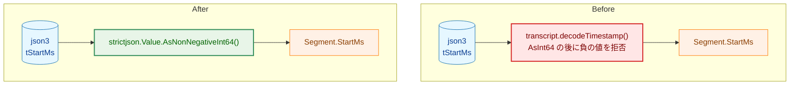

# 設計書：字幕の `tStartMs` の読み取りを `strictjson` の負でない整数の読み取りに一本化する

## Document Status

| Item | Value |
|---|---|
| Status | `approved` |
| Created | 2026-10-16 |
| Review date | 2026-10-16 |
| Reviewer | isseis |
| Comments | 実装計画の検討で、AC-11・AC-12 の検証を inspection から実行されるガードテストに移し（§7）、`make deadcode` を完了条件から外した（§8。実行しても exit 0 のままで到達不能なテスト専用のヘルパを列挙するため、ゲートにならない）。検証の手段だけの変更で、作るものは変えない（編集上の修正）。 |

## 0. 本書の方針

本書は、要件定義書 [01_requirements.md](01_requirements.md)（`approved`）の F-001〜F-004・AC-01〜AC-16 を実装するための設計を記す。対象が 1 つの関数の置き換えと 2 つの非公開シンボルの削除に閉じ、新しい型・インターフェース・エラー型・依存・境界の検出方法を伴わないため、設計上の未決事項はない。以下の各節は、通常の設計書の節立てを保ちつつ、該当がないものは「変更なし」と記す。

## 1. 設計の全体像 (Design Overview)

**設計原則:**

-   「負でない整数」の規則をコードベースで 1 つ（`internal/strictjson.Value.AsNonNegativeInt64`）にする（[CLAUDE.md](../../../CLAUDE.md)「DRY」）。
-   負の符号を黙って捨てる正規化をなくす（同「Reject, don't normalize」）。
-   新しい型・機構・依存を増やさない（同「YAGNI」）。

**概念モデル:** 変更は、字幕 json3 の `tStartMs` を読む 1 経路だけである。

**Legend:**

| Class | 意味 |
|---|---|
| `data` | 信頼できない入力（json3 の値） |
| `process` | 変更なしのコンポーネント |
| `problem` | 置き換える既存の実装 |
| `enhanced` | 変更後の実装 |

## 2. システム構成 (System Structure)

パッケージ構成とデータフローは変更なし。変更は `internal/transcript` の json3 パーサ（`decodeEvent`）の 1 呼び出しに限る。`internal/strictjson` は変更なし（0019 で追加済みの `AsNonNegativeInt64` を使う）。新しいコンポーネント配置・シーケンスは生じない。

## 3. コンポーネント設計 (Component Design)

**新規の型・インターフェース・番兵:** なし。`Segment`（`StartMs int64`）は変更なし。

**変更:**

-   `internal/transcript/json3.go` の `decodeEvent` は、`tStartMs` の値を `Value.AsNonNegativeInt64` で読む。非公開の `decodeTimestamp` と `errNegativeTimestamp` を削除する。
-   `internal/transcript` の外から観測できる契約（`parseSubtitles` のシグネチャ、`Segment`、`ErrParseSubtitles`・`ErrNoSubtitles`・`*ParseError`）は変更なし。`internal/pipeline` の guard（`TestCommonTypesFieldSets`）が固定する型のフィールド集合も変更なし。

**使う契約（0019 §3.3 のまま。変更しない）:** `Value.AsNonNegativeInt64` は、符号・小数部・指数部のない 10 進の整数で `int64` の範囲にあり負でないものを受理し、それ以外を規則ごとの非公開のエラーで拒否する。エラーは入力の値を含まない。

**`Value.AsInt64` は変更しない。** 中間生成物の形式の版（`internal/artifact/format.go:228`）が使い続ける。

## 4. エラーハンドリング設計 (Error Handling Design)

要件 F-002 のとおりとする。新しいエラー型・番兵を定義しない。

-   拒否は `ErrParseSubtitles` を包む `*ParseError`（`Path` に呼び出し元が渡したパス）として返り、`ErrNoSubtitles` にマッチしない。部分的な結果を返さない。これは既存の `parseSubtitles` の包みで満たす。
-   拒否のエラーメッセージは、拒否した値の文字列を含めない（従来は範囲外・非整数で `strconv` のメッセージとして含んでいた）。

## 5. セキュリティ考慮事項 (Security Considerations)

要件 §4.2 のとおり。

-   拒否のエラーに信頼できない入力（`tStartMs` の値）を含めない（[security.md](../../dev/security.md) §6「拒否のエラーに値を含めない」）。
-   `tStartMs` の値によって実行する処理を選ばない。値は `Segment.StartMs` として保持するだけである。
-   標準エラーの行が `redact.Line` を通ることは 0017・0019 のままとする。

## 6. 処理フローの詳細 (Processing Flow Details)

`decodeEvent` の `tStartMs` の読み取りは次の 1 経路になる。

1.  `members.Collect("tStartMs")` で値を取り出す。欠落は `errMissingTimestamp`、重複は `Collect` の規則で拒否する（従来どおり）。
2.  値 `start` を `start.AsNonNegativeInt64()` で読む。拒否はそのまま返し、`parseSubtitles` が `ErrParseSubtitles` として包む。
3.  受理した値を `Segment{StartMs: startMs, Text: text}` に入れる。

`segs` を持たない、または本文が空白だけのイベントは、従来どおり `tStartMs` を読む前に捨てる（AC-07）。

## 7. テスト戦略 (Test Strategy)

-   **単体テスト:** `internal/transcript/json3_test.go` に、AC-16 のテストを加える。`-0` の `tStartMs` が `ErrParseSubtitles` で拒否されること、負の値・範囲外の値の拒否のエラーメッセージが値の文字列を含まないこと。テストは、読み取りを本タスクの前の `decodeTimestamp`（`-0` を受理する）に戻すと失敗することを確かめる。
-   **既存テスト:** `TestParseSubtitlesTimestamps`（`−1`・小数・文字列・範囲外）・重複・上限・UTF-8 と、実データ（`testdata/` の json3）のテストは、`-0` を追加する行を除きそのまま通る。実際のサンプルに `-0` はなく、結果は変わらない（AC-14・AC-15）。
-   **静的確認:** AC-11（`internal/transcript` の exported の番兵の集合が変わらない）と AC-12（自前の負の値検査を残さない）は、`internal/transcript/json3_test.go` に加えるガードテストで固定する。ガードは `json3.go` と `errors.go` を読み、AC-12 は `tStartMs` の読み取りが `AsNonNegativeInt64` であることと `AsInt64`・自前の負の値検査が残っていないことを、AC-11 は `errors.go` の exported の番兵（`Err` で始まる宣言）の集合が本タスクの前と同じであることを確かめる。対象が 1 ファイルの読み取りでも、inspection ではなく実行される検査に置く。
-   外部コマンド・API・Webhook を呼ばない（[CLAUDE.md](../../../CLAUDE.md)「Testing Strategy」）。

## 8. 実装の優先順位 (Implementation Priorities)

フェーズ 1 のみ。

| フェーズ | 内容 | 成果物 |
|---|---|---|
| 1 | `decodeEvent` の読み取りの置き換え、`decodeTimestamp`・`errNegativeTimestamp` の削除、テストの追加、`make fmt`・`make test`・`make lint` の確認 | `internal/transcript/json3.go`・`json3_test.go` |

## 9. 将来の拡張性 (Future Extensibility)

該当なし。今後「負でない整数」を読む箇所は、`Value.AsNonNegativeInt64` を使う（0019 §9 と同じ）。
