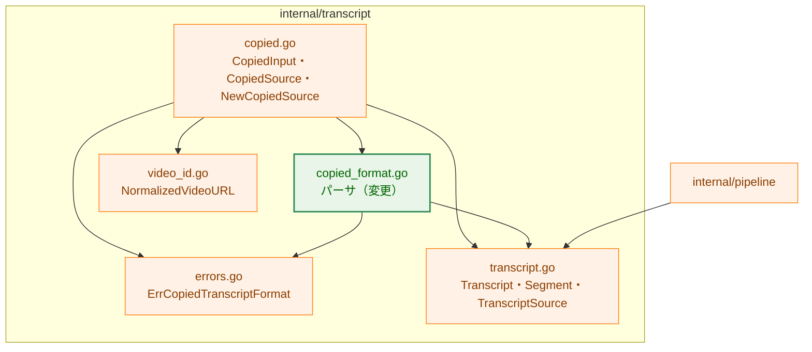
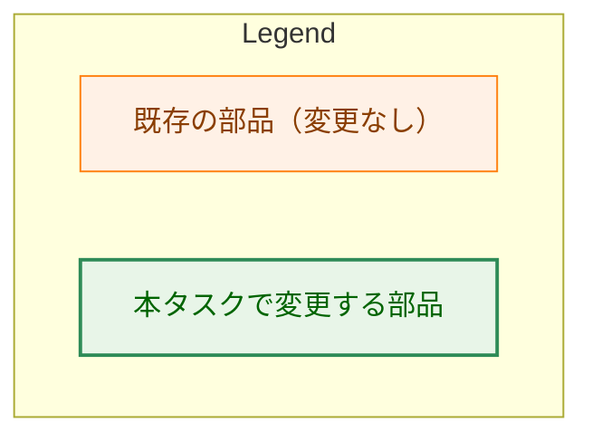
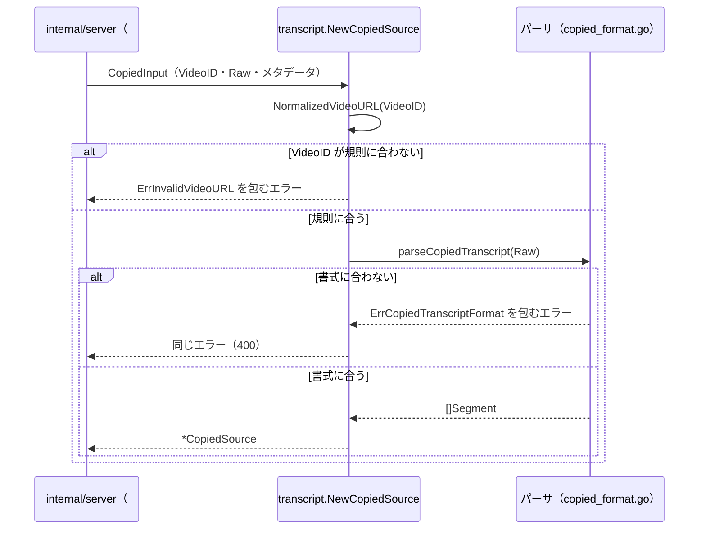
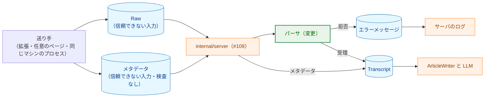
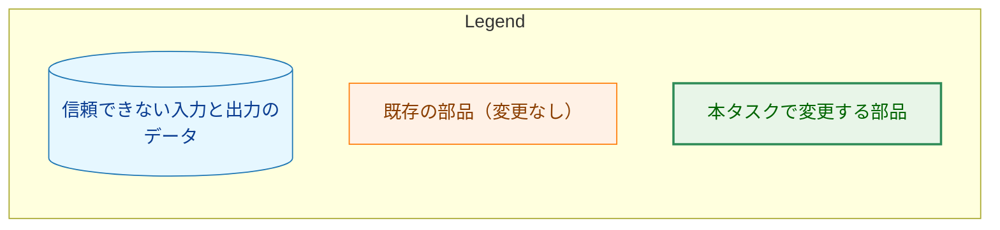
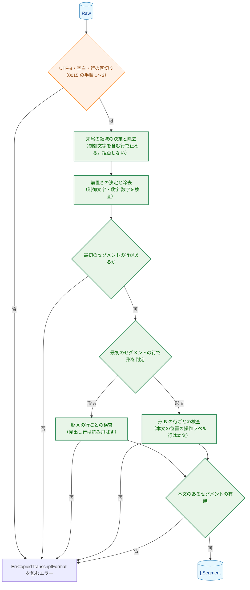
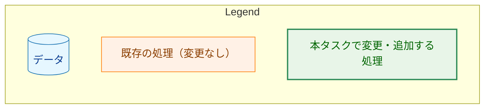

# アーキテクチャ設計書：コピーした字幕に混じるパネルの行（前置き・チャプター見出し・末尾の操作ラベル）を読み飛ばす

## Document Status

| Item | Value |
|---|---|
| Status | `approved` |
| Created | 2026-10-17 |
| Review date | 2026-10-17 |
| Reviewer | isseis |
| Comments | - |

## 1. 設計の全体像 (Design Overview)

本タスクは、`internal/transcript` のコピーした字幕のパーサ（`copied_format.go`）が、パネル全体をコピーした入力に混じる表示項目（最初のセグメントより前の行・チャプターの見出し行・入力の末尾の空白行と操作ラベル行）で `ErrCopiedTranscriptFormat` を返していた振る舞いを変える。タスク `0015_copied_transcript_source` が定めた書式（形 A・形 B）と公開の契約はそのままに、明示的に定義した行だけを読み飛ばす。実装は `internal/transcript` の非公開の関数の変更に限る。

### 1.1. 設計原則

0015 §1.1 の設計原則を引き継ぎ、次の 4 点を加える。

1. **読み飛ばす行を明示的に定義し、それ以外のセグメントでない行は拒否する。** 読み飛ばすのは、前置き（F-007）・形 A のチャプターの見出し行（F-001）・末尾の領域（F-002・F-006）だけである。表記の揺れを吸収する規則は持たない（CLAUDE.md「Reject, don't normalize」）。0015 §1.1 の原則 1（定義に合わない入力は拒否する）は維持し、拒否の対象から上記の行を除く。0015 の「セグメントでない行をすべて拒否する」という単純な扱い（`copied_format.go:313-319`・`:370-371`）では、issue #301 の実入力（パネル全体のコピー）を受理できないので、この変更は要件を満たすために必要である（「既存の単純な扱いを採用しない理由」）。
2. **読み飛ばす位置は内容から推測せず、時刻の文法で決まる位置で決める。** 前置きの範囲は、行の内容を一覧と照合して決めるのではなく、行の先頭から時刻を読める最初の行（最初のセグメントの行。F-007）の位置で決める。文書のレベルで言えば、「最初のセグメントの行より前」という位置の規則だけを置き、内容による判定を足さない。
3. **形の判定は先頭の行ではなく最初のセグメントの行で行う。** 0015 §3.2.5 は形を「先頭の行」で判定する（`copied_format.go:98-101`）。前置きを除くので、判定を最初のセグメントの行に移す。判定の規則そのもの（行全体が時刻の文法に一致するか）は変えない。
4. **検出できる範囲で、セグメントを黙って失わない。** 読み飛ばしで本来のセグメントを落とさないため、前置きでも実害のある行（制御文字を含む行、数字・`:`・数字の連続を含む行）は拒否する（F-007 の決定）。形 B では、直前の行が時刻だけの行である操作ラベル行は、末尾の領域のラベルとせず、その時刻の行の本文とする（F-002 の「本文の位置」）。この保証は、パーサが検出できる行に対するものであり、前置きにあって字幕の行に似ているが時刻の文法に一致しない行は、なお読み飛ばされて失われる（§5.4 残余のリスク）。0015 §1.1 の原則 1 が述べた「誤った分割は気づかれないまま記事の生成に流れる」という懸念を、読み飛ばしによっても生じさせない。

0015 §1.1 の原則 2（境界は時刻から導く）・原則 3（解析は 1 回だけ）・原則 4（既存の型を変えない）・原則 5（エラーは理由と行番号だけ）・原則 6（時間とメモリは入力の長さに比例する）は、本設計でもそのまま成り立つ。

### 1.2. 概念モデル

矢印 A → B は「A の処理の後に B の処理を行う」を表す。`Raw` は入力、`[]Segment` は出力である。最初のセグメントの行より前の行（前置き）と入力の末尾の領域（末尾の空白行と操作ラベル行）を取り除いてから、形を判定し、残った行をセグメントとして組み立てる。


### 1.3. 既存コードとの関係

本書の既存のコードに関する記述は、コミット `b4466af` の作業ツリーで確認した。

| 既存のもの | 本設計での扱い |
|---|---|
| パーサ（`internal/transcript/copied_format.go`） | 変更する。`parseCopiedTranscript`（`:86-102`）の形の判定・行の分類・行の検査の順序を、§3.2.1・§3.2.3・§3.2.4 のとおりにする。時刻の文法（`:174-197`）・読み上げ用ラベルの導出（`:210-258`）・ラベルの照合（`:264-276`）は変えない |
| `CopiedInput`・`CopiedSource`・`NewCopiedSource`・`Fetch`（`internal/transcript/copied.go`） | 変更しない。新しいフィールドも関数も足さない。`NewCopiedSource` は `VideoID` を検査した後、`Raw` の解析を `parseCopiedTranscript` に委ねるだけである（`copied.go:43-46`） |
| 拒否の理由の非公開の番兵（`copied_format.go:16-28`） | 変更しない。読み飛ばしに新しい理由は要らない（前置きの実害のある行は既存の `errCopiedControlChar`・`errCopiedNotTimestamp` で拒否する） |
| `ErrCopiedTranscriptFormat`（`internal/transcript/errors.go:18`） | 変更しない。公開の番兵は増やさない（F-004・AC-14） |
| `transcript.Transcript`・`Segment`・`TranscriptSource`（`transcript.go`） | 変更しない。`internal/pipeline` の `TestCommonTypesFieldSets`（`internal/pipeline/pipeline_test.go:432`）は変更なしで通る |
| `transcript.NormalizedVideoURL`（`video_id.go:62-69`） | 変更しない。動画 ID の検査と正規化 URL の導出にそのまま使う |
| `writer` の `validateTranscript`（`internal/writer/prompt.go:50-82`） | 変更しない。パーサが作る `Segments` はこの検査を通る（空白だけの `Text` と空の `Segments` を作らないことは 0015 §1.3 のとおりで、本設計でも保つ） |
| 拡張（`extension/`）とサーバ（`internal/server`） | 変更しない。拡張は選択範囲を補正せずに送り、サーバは `ErrCopiedTranscriptFormat` を `errors.Is` で判定する（0015 §1.3・§9） |

#### 1.3.1. 方針への例外（0015 の設計からの変更）

本設計は、`docs/tasks/0015_copied_transcript_source/02_architecture.md`（以下 0015）が定めた 3 つの規則を変更する。いずれも要件が定める変更であり、古い振る舞いを確かめている既存のテストの扱いを併記する。

**例外 1: 入力の末尾の行の区切りの数の規則（F-006）。**

-   **元の規則と出典:** 0015 §3.2.1 は「入力の末尾の行の区切りは 0 個か 1 個である。末尾に区切りが 2 個以上続く入力は、空の行を含むものとして拒否する」と定める（実装は `copied_format.go:148-157` の `splitCopiedLines` と `:280-288` の空の行の検査）。
-   **例外とする理由:** 範囲の選び方によっては、コピーした文字列の末尾に空行や操作ラベル行（`動画の時間と同期`）が入る（要件 §1）。これを拒否すると `invalid_transcript` になる。本設計は、末尾の行の区切りの数に上限を設けず、末尾の領域（空白行と操作ラベル行）を無視する（F-006）。
-   **古い振る舞いを確かめている既存のテスト:** `TestParseCopiedRejects` の `two trailing separators`・`three trailing separators`、`TestParseCopiedLineBreaks` の `trailingRejects` の同名の 2 ケース（受理に変わる）、および `TestParseCopiedRejects` の `form B whitespace-only text`（`0:00\n \n`。末尾の U+0020 だけの行が末尾の領域になるので、`errCopiedBlankText` 行 2 から、本文のあるセグメントがない `errCopiedNoText` に変わる）。これらは未変更だと失敗する。§3.5 で書き換える。`form B whitespace-only text` は F-006 の規則（末尾の空白文字だけの行を無視する）から導かれる変更であり、要件 `01_requirements.md` の AC-18 に編集上の訂正（editorial correction）として追記済みである（要件の Document Status の Comments）。

**例外 2: 形の判定の位置（F-007）。**

-   **元の規則と出典:** 0015 §3.2.5 は「先頭の行が時刻の文法に行全体で一致すれば形 B、そうでなければ形 A として、入力全体を解析する」と定める（実装は `copied_format.go:98-101`）。
-   **例外とする理由:** 前置きを除くと先頭の行が時刻の行とは限らない。形の判定を最初のセグメントの行に移す（F-007）。判定の規則そのものは変えない。
-   **古い振る舞いを確かめている既存のテスト:** 先頭の行が最初のセグメントの行と一致する入力のテストは影響を受けない。前置きのある入力のテスト（`empty line at the start`・`leading display items`）は §3.5 で書き換える。形の判定そのものを確かめる既存のテスト（`form B text reads as form A` など）は、先頭の行が時刻の行であるため結果を変えない。

**例外 3: セグメントでない行の拒否（F-001・F-002・F-006・F-007）。**

-   **元の規則と出典:** 0015 §1.1 の原則 1 と §3.2.4・§3.2.5 は、時刻の行と本文の行以外の行（表示項目・チャプターの見出しなど）を `errCopiedNotTimestamp` で拒否する。CLAUDE.md「Declare, don't infer」の例外の境界（0015 §3.6）も、書式に合わない入力は「解釈を広げて受理せず、拒否する」とする。
-   **例外とする理由:** issue #301 の実入力は、パネルの前置き・チャプターの見出し行・末尾のボタンを含み、0015 の規則では拒否される。要件は、内容から特定できる行（見出しの形・操作ラベルの一覧。§3.2.2・§3.2.3 で定義）と、位置で決まる前置き・末尾の領域だけを読み飛ばし、それ以外のセグメントでない行は引き続き拒否すると定める（F-001・F-002・F-003・F-006・F-007）。
-   **古い振る舞いを確かめている既存のテスト:** `leading display items`（`タイムライン\n`。拒否から `errCopiedNoText` に変わる）、`empty line at the start`（受理に変わる）、`chapter heading after text` は形 A の見出しの位置ではないため拒否のまま変わらない。§3.5 に一覧を示す。
-   **CLAUDE.md への記載（AC-27）。** 「Declare, don't infer」の例外の境界に、前置き・形 A の見出し行・末尾の領域の読み飛ばしを加える。境界の文面は「前置きの範囲は時刻の文法で決まる位置で決めること」「最初のセグメントの行より後で読み飛ばすのは本書で明示的に定義した行だけであること」を記す（要件 AC-27）。

**0015 から変えないもの。** 時刻の文法・読み上げ用ラベル・形 A・形 B の本文の規則・入力全体の規則（UTF-8、空白だけの入力の拒否、行の区切りの統一、セグメントの間の空行と制御文字の拒否）・`Segments` の組み立て・エラーの契約・サイドエフェクト契約は、0015 のままとする。

## 2. システム構成 (System Structure)

### 2.1. パッケージ構成

新しいパッケージを作らない。変更するのは `internal/transcript` のパーサと、そのテスト、および例外の境界の記載（CLAUDE.md）だけである。

矢印 A → B は「A が B の関数を呼ぶ、または B の型を使う」を表す。本設計で変更するファイルを緑（`enhanced`）で示す。





### 2.2. コンポーネント配置

| 部品 | 置き場所 | 公開/非公開 | 変更 |
|---|---|---|---|
| `CopiedInput`・`CopiedSource`・`NewCopiedSource`・`(*CopiedSource).Fetch` | `internal/transcript/copied.go` | 公開 | なし |
| `ErrCopiedTranscriptFormat` | `internal/transcript/errors.go` | 公開 | なし |
| パーサ（前置き・末尾の領域の決定、見出し行の読み飛ばし、形の判定、行の検査） | `internal/transcript/copied_format.go` | 非公開 | あり |
| 読み飛ばす行の形と操作ラベルの一覧（定数） | `internal/transcript/copied_format.go` | 非公開 | あり（新設） |
| 拒否の理由ごとの番兵 | `internal/transcript/copied_format.go` | 非公開 | なし |

公開するのは 0015 §3.7 の契約に必要なものだけである（要件 4.5）。読み飛ばす行の形と操作ラベルの一覧は、呼び出し側（サーバ・拡張）に同じ規則を持たせず、`internal/transcript` の 1 か所に定数として置く（要件 §4.5 保守性）。

### 2.3. データフロー

サーバ（#109）が本タスクの部品を使うときの流れを示す。サーバの部分は 0011 §3.5.2・§3.7 の設計であり、本タスクでは作らない。`parseCopiedTranscript` の中の処理は §6.1 に示す。実線の矢印は呼び出し、点線の矢印は戻り値を表す。この図はノードを色で分類しないので、Legend を置かない。



## 3. コンポーネント設計 (Component Design)

### 3.1. 公開の型と関数

公開の型と関数は変更しない。0015 §3.1 のとおりである。字面を再掲する。

```go
// CopiedInput is the input of NewCopiedSource. VideoID must already be
// validated by the caller (for the server, by ValidateVideoURL); Raw is the
// transcript text copied from YouTube's transcript panel, unmodified.
type CopiedInput struct {
	VideoID     string
	Raw         string
	Title       string
	ChannelName string
	Description string
}

// CopiedSource serves a transcript parsed from a CopiedInput.
type CopiedSource struct {
	transcript Transcript
}

// NewCopiedSource validates in.VideoID, parses in.Raw, and returns a source
// that serves the result.
func NewCopiedSource(in CopiedInput) (*CopiedSource, error)

// Fetch returns the parsed transcript when videoURL is exactly the normalized
// URL of the input VideoID.
func (s *CopiedSource) Fetch(ctx context.Context, videoURL string) (Transcript, error)

// ErrCopiedTranscriptFormat is wrapped by every error NewCopiedSource returns
// because the copied transcript does not match the defined format.
var ErrCopiedTranscriptFormat = errors.New("copied transcript does not match the expected format")
```

`NewCopiedSource` の契約（`ErrInvalidVideoURL` と `ErrCopiedTranscriptFormat` の使い分け）と、`Fetch` の検査の順序は、0015 §3.1 のまま変えない。本設計が変えるのは、`Raw` を解析するときの受理・拒否の境界だけである。

### 3.2. 字幕書式の定義（0015 §3.2 への追加と変更）

本節が、本タスクで変える書式の規則を定める。時刻の文法（0015 §3.2.2）・読み上げ用ラベル（§3.2.3）・形 A と形 B の本文の規則（§3.2.4）・入力全体の規則（§3.2.1）・`Segments` の組み立て（§3.2.7）のうち、本節で挙げないものは 0015 のままとする。

#### 3.2.1. 前置き（F-007）

形 A・形 B のどちらの入力でも、**最初のセグメントの行**より前の行（**前置き**）を解析の対象から除く。

-   **最初のセグメントの行**とは、入力の先頭から順に見て、行の先頭から時刻を読める（0015 §3.2.2 の時刻の文法で読み取りが成功する）最初の行である。時刻だけの行（形 B の時刻の行）と、時刻で始まりそれ以外の文字が続く行（形 A の行）のどちらでもよい。行の残りの内容は、最初のセグメントの行かどうかの判定に使わない。
-   前置きの行は、次のいずれかに当たる場合を除いて、内容にかかわらず読み飛ばす（0 文字の行・空白文字だけの行・`動画の関連情報`・`タイムライン`・`文字起こし`・検索欄のラベル・チャプターの見出し行など）。前置きの行の内容を一覧と照合しない。
-   前置きでも、次の行は読み飛ばさずに拒否する（実害を防ぐ）。**1 つの行の中で制御文字の検査を先に行う（0015 §3.2.1 と同じ順序）。**
    -   制御文字（Unicode の一般カテゴリ Cc。タブを含む）を含む行は、その行の行番号の `errCopiedControlChar` で拒否する。
    -   ASCII の数字・`:`（ASCII）・ASCII の数字がこの順に連続する部分を含む行（例: `05:00`・`60:00`・`0:5`・先頭に U+FEFF や空白が付いた `0:00`）は、その行の行番号の `errCopiedNotTimestamp` で拒否する。時刻の文法に合わない時刻か、前に文字が付いた時刻である可能性があり、読み飛ばすとそのセグメントを黙って失うためである。先頭に BOM や空白が付いた行も、数字・`:`・数字の連続を含むのでここで拒否される。
-   文書全体の検査（生バイトの UTF-8、空白文字以外の文字を含まない入力の拒否、行の区切りの統一。0015 §3.2.1）は、前置きを含む入力の全体に、従来どおり適用する。
-   最初のセグメントの行がない入力（前置きと末尾の領域だけの入力）は、`errCopiedNoText`（0015 §3.2.6。本文のあるセグメントがない）で拒否する。
-   前置きの行は、読み上げ用ラベルの言語の固定（0015 §3.2.4）に影響しない。言語は最初のセグメントの行で固定する。
-   前置きの判定は最初のセグメントの行で終わる。最初のセグメントの行より後には適用しない（F-003）。
-   拒否のエラーの行番号は、前置きを除く前の入力の行番号とする（AC-15）。

#### 3.2.2. チャプターの見出し行（F-001）

形 A の入力を解析するとき、最初のセグメントの行より後の行が**見出しの形**に一致する場合、その行をチャプターの見出し行として読み飛ばす。読み飛ばした行はセグメントを作らず、セグメントの数・`StartMs`・`Text`・順序に影響しない。見出しの形は要件 F-001 の表のとおりである（`チャプター`・`Chapter` + U+0020 + 先頭に `0` を付けない正の整数 + `:` + U+0020 + タイトル。タイトルの最後の文字は空白文字でない）。行の先頭・末尾の空白文字を許さず、行全体の制御文字の検査（0015 §3.2.1）を適用する。見出しの語の言語は読み上げ用ラベルの言語の固定に影響しない。

-   最初のセグメントの行より前の見出し行は、前置きとして読み飛ばす（§3.2.1）。
-   形 B では、見出し行は読み飛ばさない。0015 §3.2.9 のとおり、本文のない時刻の行の直後の見出しは、その時刻の本文の行として受理される（**本文の位置**の考え方は §3.2.3 と同じである）。形 B の 2 つ目以降のチャプターの見出しは将来のタスクとする（要件 §2.3）。
-   見出しの形に一致しない見出しの表記（全角コロン `：`、区切りの空白がない `チャプター2: タイトル` など）は、最初のセグメントの行より後では §3.2.4 により拒否する。観測していない表記を推測で受理しない。
-   見出しの形を、`internal/transcript` の 1 か所の定数として置く。

#### 3.2.3. 末尾の領域（F-002・F-006）

形 A・形 B のどちらの入力でも、入力の末尾に続く、空白文字だけの行（0 文字の行を含む）と操作ラベル行からなる行の並び（**末尾の領域**）を解析の対象から除く。除いた後、入力は末尾の領域の直前の行で終わるとみなす。

-   **末尾の領域の形。** 末尾の領域は、入力の最後の行から前に向かって、次のどちらかに当たる行が続く限りの範囲である。空白文字だけの行と操作ラベル行は、どの順で何行混じってもよい。
    -   行の内容が 0 文字であるか、空白文字（0015 §3.2.1 と同じく、Unicode の White_Space。Go の `unicode.IsSpace` が真の文字）だけからなる行。
    -   操作ラベルの一覧（後述）のいずれかと行全体が完全に一致し、かつ**本文の位置にない**行。
-   **本文の位置。** 直前の行が時刻だけの行（形 B の時刻の行）である位置をいう。形 B では、操作ラベル行が本文の位置にある場合、その行を末尾の領域のラベルとせず、その時刻の行の本文とする（F-002）。これにより、最後のセグメントの本文の全体が操作ラベルと完全に一致する入力でも、その本文を読み飛ばさない（AC-33）。直前の行が時刻だけの行でない位置の操作ラベル行（本文の行の後・空行の後など）は、末尾の領域のラベルとして読み飛ばす。
-   **操作ラベルの一覧。** 次の 2 文字列である。行全体がこのいずれかと完全に一致することを要する。前後に空白文字のある行、ラベルの一部だけを含む行（例: `動画の時間と同期について話します`）、ラベルに別の文字が続く行は一致しない。行全体の制御文字の検査（0015 §3.2.1）を適用する。
    -   日本語 UI: `動画の時間と同期`（パネルの末尾のボタン。`testdata/2tcCWM-sRBw.transcript_panel.html:3206`・`:3211`、要件 §1 の観測）
    -   英語 UI: `Sync to video time`（2026-10-17 に観測。要件 §1）
    観測していない操作ラベルは加えない（0015 §1.4.4）。操作ラベル行は読み上げ用ラベルの言語の固定に影響しない。
-   **末尾に限る。** 最初のセグメントの行と末尾の領域の間にある空行（0 文字の行）は、従来どおり `errCopiedEmptyLine` で拒否する（0015 §3.2.1）。0 文字でない空白文字だけの行は、従来どおり形ごとの検査で拒否する（形 A の行と、本文を待っていない形 B の位置では `errCopiedNotTimestamp`、本文を待っている形 B の位置では `errCopiedBlankText`。`copied_format.go:313-319`・`:370-371`・`:376-378`）。理由と行番号を変えない。最初のセグメントの行より前の空白文字だけの行は、前置きとして読み飛ばす（§3.2.1）。制御文字を含む行は末尾の領域に含めない。末尾の領域はその行の直後で終わり、その行は前置き（§3.2.1）または最初のセグメントの行から末尾の領域の直前までの行として検査され、`errCopiedControlChar` で拒否される（タブ（U+0009）だけの行のように空白文字だけからなる行でも同じ。AC-26）。末尾の領域の決定は拒否をしないので、末尾の制御文字が、それより前の行の誤りより先に報告されることはない（例: `0:00\n\nx\n\t\n` は従来どおり `errCopiedEmptyLine` 行 2）。
-   **末尾の行の区切り。** 末尾の領域を無視するので、末尾の行の区切りの数に上限を設けない。入力の最後の行の区切りの有無も問わない。末尾の領域を取り除いた後に残る入力の行番号は、除く前の行番号を保つ（拒否のエラーの行番号を変えない）。
-   **形 B の本文のないセグメント。** 形 B の最後の時刻の行の後にある空白文字だけの行は、本文の行ではなく末尾の領域として無視し、その時刻は本文のないセグメントになる（0015 §3.2.7 により `Segments` に含めない）。0015 ではこの入力（例: `0:00\nx\n0:05\n \n`）を `errCopiedBlankText` で拒否していたが、本設計は受理する。
-   **他のセグメントでない行の拒否（F-003）。** 最初のセグメントの行より後で、末尾の領域より前にある、§3.2.2 の見出し行以外のセグメントでない行は、引き続き `errCopiedNotTimestamp` で拒否する。これは、利用者がパネル以外の文字列を選んだ場合と、YouTube の UI の変更で新しい種類の行が現れた場合を検出するためである。

#### 3.2.4. 検査の順序（F-006 の追加）

0015 §4.3 の検査の順序を、次のように変える。最初に見つかった誤りで止めることは変えない。

1.  入力全体が有効な UTF-8 か（`errCopiedInvalidUTF8`）。
2.  空白文字以外の文字があるか（`errCopiedBlank`）。
3.  入力全体の行の区切りがそろっているか（`errCopiedLineBreak`）。
4.  末尾の領域を、入力の最後から前に向かって決め、除く。制御文字を含む行と、本文の位置（直前の行が時刻だけの行である位置）にある操作ラベル行は末尾の領域に含めず、そこで末尾の領域を終える（§3.2.3）。この手順は拒否をせず、範囲を決めるだけである。
5.  残った行の先頭から前置きを決め、除く。前置きの各行に、制御文字の検査と数字・`:`・数字の検査をこの順に適用する。最初のセグメントの行に達した時点で前置きは終わる。最初のセグメントの行がなければ `errCopiedNoText` で拒否する（§3.2.1）。
6.  形の判定を最初のセグメントの行で行う（最初のセグメントの行が時刻だけの行なら形 B、そうでなければ形 A）。
7.  最初のセグメントの行から末尾の領域の直前までの行に、0015 §4.3 の手順 4（行ごとの検査）を適用する。形 A では、見出しの形に一致する行の読み飛ばしの判定を、空の行の検査と制御文字の検査の後、形ごとの規則の前に置く。
8.  本文のあるセグメントがあるか（`errCopiedNoText`）。

手順 4 の「本文の位置」の判定は、直前の行が時刻だけの行かどうかで行う。この判定は形の判定（手順 6）より前に行うが、行の局所的な性質だけから決まる。手順 4 が拒否をしないので、手順 5・7 の拒否は行の順に起こり、報告する誤りは入力の先頭から見て最初の誤りの行になる（0015 §4.3 と同じ）。

### 3.3. パーサの構造

パーサは `internal/transcript/copied_format.go` の非公開の関数のままである。入力は `string`、出力は `[]Segment` または `error` である。

-   **検査する行の範囲。** 検査するのは、前置きと末尾の領域を除いた、最初のセグメントの行から末尾の領域の直前までの行だけである。拒否のエラーの行番号は、除く前の入力の行番号とする（AC-15）。
-   **読み飛ばす行の形を 1 か所に置く。** 見出しの形を判定する非公開の関数と、操作ラベルの一覧の定数を 1 か所に置く。新しい操作ラベルが観測されたときは、一覧に 1 行を加えるだけで対応できる形にする（要件 §4.5）。
-   **時刻の文法と読み上げ用ラベルは変えない。** 前置きの判定と形の判定に、既存の `parseTimestampPrefix`（`:174-197`）を使う。新しい時刻の読み取りを実装しない。
-   **解析は入力の長さに比例する。** 末尾の領域の決定と前置きの決定は、それぞれ入力の行数に比例する。前置きの各行の数字・`:`・数字の検査は、行の長さに比例する。`Segment.Text` が `Raw` の部分文字列である性質（0015 §3.3）は変えない。

### 3.4. コンポーネント責務表

| ファイル | 新規/変更 | 責務 |
|---|---|---|
| `internal/transcript/copied_format.go` | 変更 | 前置き・末尾の領域の決定、見出し行の読み飛ばし、形の判定の位置の変更、検査の順序の変更。読み飛ばす行の形と操作ラベルの一覧の定数 |
| `internal/transcript/copied_format_test.go` | 変更 | 書き換える既存ケース（§3.5）と、AC-01〜AC-15・AC-21〜AC-26・AC-28〜AC-33 を確かめる新しいケース |
| `CLAUDE.md` | 変更 | 「Declare, don't infer」の例外の境界に、前置き・形 A の見出し行・末尾の領域の読み飛ばしを加える（AC-27） |
| `docs/tasks/0024_copied_transcript_panel_lines/02_architecture.md` | 新規 | 本書 |

`internal/transcript/copied.go`・`errors.go`・`copied_test.go`・`internal/writer/prompt_test.go`・`internal/pipeline` の guard は変更しない。

### 3.5. 更新が必要な既存のテスト

`internal/transcript/copied_format_test.go` の次のケースは、0015 の振る舞いを確かめており、本設計で結果が変わる。本設計に合わせて書き換える（AC-18）。テストの入力は合成の文字列のままとし、実データは使わない。

| ケース（`copied_format_test.go`） | 今の期待 | 本設計での期待 |
|---|---|---|
| `TestParseCopiedRejects` の `two trailing separators`（`:245`） | `errCopiedEmptyLine` 行 3 | 受理（末尾の領域） |
| `TestParseCopiedRejects` の `three trailing separators`（`:246`） | `errCopiedEmptyLine` 行 3 | 受理（末尾の領域） |
| `TestParseCopiedLineBreaks` の `trailingRejects` の同名 2 ケース（`:343-344`） | `errCopiedEmptyLine` 行 3 | 受理（末尾の領域） |
| `TestParseCopiedRejects` の `empty line at the start`（`:244`） | `errCopiedEmptyLine` 行 1 | 受理（先頭の空行は前置き） |
| `TestParseCopiedRejects` の `leading display items`（`:249`） | `errCopiedNotTimestamp` 行 1 | `errCopiedNoText`（前置きだけでセグメントの行がない） |
| `TestParseCopiedCheckOrder` の `line kind before blank text`（`:394-398`） | `errCopiedNotTimestamp` | 受理（末尾の空白行を無視） |
| `TestParseCopiedRejects` の `form B whitespace-only text`（`:264`。入力 `0:00\n \n`） | `errCopiedBlankText` 行 2 | `errCopiedNoText`（末尾の U+0020 だけの行を末尾の領域として無視し、本文のあるセグメントが残らない） |

時刻の文法の拒否のケース（`leading BOM`・`minute leading zero`・`minute over 59`・`single-digit second`・`zero hour in h:mm:ss`・`three-digit hour`・`m:ss then colon and three digits`・`m:ss then colon and one-digit second`）は、いずれも先頭の行が数字・`:`・数字の連続を含むため、§3.2.1 の前置きの拒否の規則により、**理由と行番号を変えずに**通る（AC-18）。`chapter heading after text`（`:250`）は形 B の入力で見出しが本文の行の直後にあり、時刻の行でも見出しの形の行でもないため、引き続き `errCopiedNotTimestamp` 行 3 で拒否する。

`form B whitespace-only text` は F-006 の規則から導かれる変更であり、要件 `01_requirements.md` の AC-18 に編集上の訂正として追記済みである（§1.3.1）。

次のケースは、確かめている経路を本設計で通らなくなる。未変更のままでは、その理由で失敗しえないテストになる（CLAUDE.md「Testing Strategy」）ので、同じ経路を通る入力に書き換える。

| ケース | 今の入力と経路 | 本設計での入力 |
|---|---|---|
| `TestParseCopiedCheckOrder` の `line kind before blank text`（`:394-398`） | `0:00\nx\n \n`。本文を待っていない形 B の位置の空白文字だけの行が、`errCopiedBlankText` でなく `errCopiedNotTimestamp` になる順序 | 上の表のとおり受理に変わるので、受理のケースとして残したうえで、順序の確認は空白文字だけの行がセグメントの間にある入力（`0:00\nx\n \n0:05\ny\n`。`errCopiedNotTimestamp` 行 3）に移す。§3.2.3 の「末尾に限る」が残す順序である |
| `TestParseCopiedErrorOmitsInput` の `not a timestamp omits the line`（`:425-428`） | `MARKER_LINE\n`。`errCopiedNotTimestamp` 行 1 のメッセージが行の文字列を含まないこと | 前置きだけの入力になり、行番号のない全体のエラー `errCopiedNoText` に変わるので、行を最初のセグメントの行より後に置く（`0:00\nx\nMARKER_LINE\n`。`errCopiedNotTimestamp` 行 3） |

## 4. エラーハンドリング設計 (Error Handling Design)

### 4.1. エラー型

公開の番兵（`ErrCopiedTranscriptFormat`）と、拒否の理由の非公開の番兵（`copied_format.go:16-28`）を変えない。読み飛ばしに新しい理由は要らない。

-   前置きの制御文字を含む行は `errCopiedControlChar`、前置きの数字・`:`・数字の連続を含む行は `errCopiedNotTimestamp` で拒否する。
-   最初のセグメントの行より後で末尾の領域より前のセグメントでない行は、従来どおり `errCopiedNotTimestamp` で拒否する。
-   入力の末尾の制御文字を含む行は、末尾の領域に含めず、行の検査の `errCopiedControlChar` で拒否する（§3.2.3）。
-   本文のあるセグメントがない入力は、従来どおり `errCopiedNoText` で拒否する。

`ErrCopiedTranscriptFormat` を包む新しい、`internal/transcript` の外から観測できる番兵を追加しない（F-004・AC-14）。拒否したときは部分的な結果（`nil` でない `[]Segment`）を返さない。

### 4.2. エラーメッセージ設計パターン

0015 §4.2 のままとする。書式の誤りは `copied transcript does not match the expected format: line <N>: <理由の文>`、入力全体の誤り（無効な UTF-8・空白だけ・本文のあるセグメントがない）は `line <N>` を付けない。前置きの拒否と、最初のセグメントの行より後の拒否の行番号は、前置きと末尾の領域を除く前の入力の行番号とする。メッセージは固定の文と行番号だけで作る。入力の文字列（前置きの行・見出しのタイトル・操作ラベル・本文・時刻）を含めない（AC-15・0015 AC-06）。

### 4.3. サイドエフェクト契約

0015 §4.5 のままとする。`NewCopiedSource` と `Fetch` は、ファイル・ネットワーク・外部コマンド・環境変数・ログのどれにも触れない。結果は引数だけで決まる。本設計は副作用を切り替えるフラグやモードを持たない。読み飛ばしは入力を `Segments` に写す処理の内部の判断であり、外部の副作用を変えない。

## 5. セキュリティ考慮事項 (Security Considerations)

### 5.1. 脅威モデル

コピーした字幕は信頼できない入力である（`docs/dev/security.md` §6）。矢印 A → B は「A の値が B に渡る」を表す。送り手のノードは色を付けない。サーバは認証（0011 §3.5.2）とリクエストの本文の上限 4 MiB（0011 §3.5.3）を適用してからパーサを呼ぶ。本設計の読み飛ばしは、拒否を減らす方向に働くので、新たに信頼できない値が `Segments` に出ることはない。読み飛ばした行の内容はどこにも出力しない。





### 5.2. 脅威と対策

0015 §5.2 の表を引き継ぐ。本設計は次のリスクを加え、対策を示す。

| 脅威 | 対策 | AC |
|---|---|---|
| 読み飛ばしで、本来のセグメントを黙って失う（前置きの時刻の行・形 B の本文） | 前置きでも数字・`:`・数字の連続を含む行は拒否する。形 B では本文の位置の操作ラベル行を本文とする | AC-30・AC-33 |
| 読み飛ばした前置き・見出しのタイトル・操作ラベルの内容が、出力（`Segments`・プロンプト・記事・中間生成物・ログ）に漏れる | 読み飛ばした行はどこにも出力しない。拒否のエラーのメッセージにも含めない（§4.2） | AC-02・AC-07・AC-15・AC-28 |
| 大きな入力や病的な入力で解析が時間やメモリを使い尽くす | 解析は入力の長さに比例する（§3.3）。入力の大きさはサーバの本文の上限 4 MiB で抑えられる（0011 §3.5.3）。§7.3 で確かめる | AC-20 |
| 書式に合わない入力を補正して受理し、本文の分割が黙ってずれる | 補正の規則を持たない。読み飛ばす行は明示的に定義した形に完全一致する行だけである（CLAUDE.md「Reject, don't normalize」） | AC-04・AC-09・AC-12 |

0015 §5.2 の他の行（時刻の数字の桁あふれ、字幕の内容のログへの漏れ、パニックの防止、部分的な結果の不使用、プロンプトインジェクションと制御文字）は、本設計でも同じ対策のままである。

### 5.3. 信頼できない入力の境界

0015 §5.3 の表の `CopiedInput.Raw` の行を、次のとおり細かくする。他の行（`VideoID`・メタデータ・`Fetch` の `videoURL`）は 0015 のままとする。

| 境界 | 消費する要素 | 受理する形 | 上限 | 拒否 | AC |
|---|---|---|---|---|---|
| `CopiedInput.Raw` の前置き | 最初のセグメントの行より前の行の全体 | 制御文字を含まず、数字・`:`・数字の連続を含まない任意の行（§3.2.1） | 行の数の上限なし（入力全体はサーバが 4 MiB で抑える） | 前置きの行は出力に含めない。§3.2.1 の表の行は `errCopiedControlChar`・`errCopiedNotTimestamp` | AC-28〜AC-32 |
| `CopiedInput.Raw` の形 A の見出し行 | 行全体（`チャプター`・`Chapter`・番号・`:`・タイトル） | §3.2.2 の見出しの形に一致する行だけ | 行の長さの上限は本文と同じ | 一致しない行は §3.2.4 により拒否する。見出しのタイトルは出力に含めない | AC-01〜AC-06 |
| `CopiedInput.Raw` の末尾の領域 | 行全体 | 0 文字の行、空白文字（`unicode.IsSpace`）だけからなる行、操作ラベルの一覧と完全に一致し本文の位置にない行。いずれも制御文字を含まないもの | 行の数の上限なし（入力全体はサーバが 4 MiB で抑える） | 末尾の領域の行は出力に含めない。セグメントの間の空白行・操作ラベル行は拒否する | AC-07〜AC-11・AC-21〜AC-26・AC-33 |
| `CopiedInput.Raw` のその他のセグメントでない行 | 行全体 | 時刻で始まる行（0015 §3.2.4）。最初のセグメントの行より後で §3.2.2・§3.2.3 に当たらない行は受理しない | 行の長さの上限は本文と同じ | `ErrCopiedTranscriptFormat` と `errCopiedNotTimestamp`。部分的な結果を返さない。値の文字列を含めない | AC-12〜AC-15 |

標準ライブラリが黙って修復・正規化すれば受理できてしまう入力は、受理する形を明示的に定めたうえで、それ以外を受理しない。見出しの形・操作ラベルの一覧・前置きの範囲と拒否の規則は、その明示的な形である。

### 5.4. 残余のリスク

0015 §5.4 の残余のリスクを引き継ぎ、本設計で加わるものを示す。

-   **前置きの読み飛ばしによる見落とし。** 前置きは任意の行を読み飛ばすので、利用者が選択範囲の先頭に字幕の行を含めてしまい、その行が時刻の文法に一致しない場合、その行は前置きとして読み飛ばされる（セグメントの欠落）。ただし、数字・`:`・数字の連続を含む行は拒否するので、時刻に近い行の欠落は防ぐ（AC-30）。この欠落は、§1.1 の原則 4 が述べる保証の範囲外である。
-   **前置きの拒否の規則による、正しい入力の拒否。** 前置きの数字・`:`・数字の連続の検査は、正しいパネルの前置きにある行を拒否しうる。要件 §1 のとおり、最初のチャプターの見出し行は最初のセグメントの直前に現れるので、前置きに入る。見出しのタイトルが `10:00 の話` のような数字・`:`・数字の連続を含む場合、`errCopiedNotTimestamp` でパネル全体が拒否される（利用者の誤りに見える理由で `invalid_transcript` が続く）。この誤った拒否は、セグメントの欠落を防ぐ規則の副作用であり、受け入れる。症状は「正しいパネルのコピーが書式の誤りで拒否される」である。実データで頻度が高ければ、前置きの拒否の規則（§3.2.1）を見直す。
-   **読み飛ばした行の観測。** 拒否は理由と行番号でログから説明できる（§4.2）が、読み飛ばし（受理）は件数を残さない。利用者が「記事に行が足りない」と報告したとき、その行が前置き・末尾の領域・見出し行のどれとして読み飛ばされたかは、現状のログだけでは区別できない。0015 §9 が求める受理時のログ（セグメント数と最初・最後の `StartMs`。0015 §5.4）は、読み飛ばしの件数を含まない。読み飛ばしの件数は字幕の内容を含まないので、必要になった時点で #109 のログに加えられる（本設計はその要求を課さない）。
-   **形 B の本文と操作ラベルの区別。** 形 B では、本文の位置にある操作ラベル行を本文とする（§3.2.3）。一方、本文の行の後や空行の後の操作ラベル行は末尾の領域として読み飛ばす。操作ラベル行が本文の行の直後に（空行を挟まずに）続く入力では、その行は末尾の領域として読み飛ばされる（本文の位置ではないため）。観測した形 A の末尾は `本文・空行・ボタン` であり、空行の後にボタンがあるので、この規則で読み飛ばせる。
-   **選択の範囲の不足・YouTube の書式の変更・確かめていない条件。** 0015 §5.4 のとおり。
-   **パーサ自身に大きさの上限がない。** 0015 §5.4 のとおり。呼び出し側が入力の大きさを抑える。

## 6. 処理フロー詳細 (Processing Flow Details)

### 6.1. `parseCopiedTranscript`

矢印は処理の進む向きを表す。エラーのノードは色を付けない。この図は `parseCopiedTranscript`（`copied_format.go:86-102`）の処理を、本設計の順序（§3.2.4）で示す。





### 6.2. 行の領域の決定

入力の行を、先頭から「前置き」「最初のセグメントの行から末尾の領域の直前まで」「末尾の領域」の 3 つの領域に分ける。前置きの終わりは、先頭から見て最初に時刻を読める行である。末尾の領域の始まりは、末尾から見て、空白文字だけの行と、本文の位置にない操作ラベル行が続く限りの位置である。この図は状態ではなく領域の分割を示すので、`flowchart` を使う。矢印 A → B は「A の次に B の領域が来る」を表す。


## 7. テスト戦略 (Test Strategy)

### 7.1. ユニットテスト

0015 §7.1 の方針を引き継ぐ。ユニットテストは `yt-dlp`・ネットワーク・LLM に触れず、入力を文字列だけで作る。テストの入力は合成の文字列とし、見出しのタイトルとセグメントの本文は架空の文字列とする。報告された入力（動画 `dsuNgos_kxA`）と観測した入力の全体は `testdata/` に保存しない（`docs/dev/security.md` §7）。前置き・末尾の操作ラベルの文字列はパネルの UI のラベルなので、合成の入力に使ってよい（AC-16）。

本設計が加えるテストは次のとおりである。各テストがその理由で失敗しうることは、実装時にコードを壊して確かめる（CLAUDE.md「Testing Strategy」）。

-   **前置き（AC-28〜AC-32）:** 観測した前置きの後ろに形 A のセグメントが続く入力の解析（AC-28）。前置きの後ろに形 B のセグメントが続く入力の解析（AC-29）。前置きに数字・`:`・数字の連続を含む行・制御文字を含む行がある入力の拒否と、その行番号（AC-30）。最初のセグメントの行がない入力の `errCopiedNoText`（AC-31）。前置きが読み上げ用ラベルの言語の固定に影響しないこと（AC-32）。
-   **見出し行（AC-01〜AC-06）:** 形 A の見出し行がセグメントの間・最後のセグメントの後にあっても読み飛ばすこと（AC-01・AC-03）。タイトルが `Segments` に含まれないこと（AC-02）。見出しの形に一致しない行の拒否（AC-04）。見出し行だけの入力の `errCopiedNoText`（AC-05）。タイトルに `:`・空白・`チャプター` を含む見出し行の受理（AC-06）。
-   **末尾の領域と操作ラベル（AC-07〜AC-11・AC-21〜AC-26・AC-33）:** 末尾の空白行・操作ラベル行の読み飛ばし（AC-07・AC-21〜AC-23）。操作ラベルと同じ語を含むが一致しない行の拒否（AC-09）。セグメントの間の操作ラベル行・空行の拒否（AC-10・AC-24）。空白文字以外の文字を含まない入力の拒否（AC-25）。末尾の制御文字の拒否（AC-26）。本文の位置の操作ラベル行を本文とすること（AC-33）。
-   **拒否の維持（AC-12・AC-13）:** 最初のセグメントの行より後の、見出しの形にも末尾の領域にも当たらない行の拒否。
-   **エラーの契約（AC-14・AC-15）:** 拒否のエラーが `ErrCopiedTranscriptFormat` を包むこと、部分的な結果を返さないこと、入力の文字列を含めないこと、行番号が正しいこと。
-   **既存のテストの維持（AC-18）:** §3.5 で書き換えるケース以外の既存のテストがそのまま通ること。時刻の文法の拒否のケースが理由と行番号を変えないこと。
-   **4 MiB の入力（AC-20）:** 0015 §7.3 の 3 つの入力に、前置き・見出し行・末尾の領域を加えた入力で、解析が完走し、時間とメモリが入力の長さに比例することを確かめる。
-   **実データ（AC-17）:** 再配布が許諾されたライセンス（CC BY など）の、チャプター付きの動画のコピーは、本タスクでは得られなかった。`testdata/` に新しい実データを加えず、`testdata/README.md` も変えない。見出し行と操作ラベル行の読み飛ばしは、合成の入力のテストで確かめる（§3.5・AC-16・AC-18）。

### 7.2. 統合テスト

本タスク単体の統合テストはない。サーバからの呼び出しは #109 の統合テストで確かめる（0015 §7.2 と同じ）。

### 7.3. 性能

0015 §7.3 を引き継ぐ。前置きの決定と末尾の領域の決定は入力の行数に比例し、前置きの各行の数字・`:`・数字の検査は行の長さに比例するので、解析の時間とメモリは入力の長さに比例する（AC-20）。

### 7.4. 受け入れ基準と設計要素の対応

| AC | 設計要素 | 確かめ方 |
|---|---|---|
| AC-01〜AC-06 | §3.2.2（見出しの形）、§3.2.4（検査の順序）、§6.1 | テスト |
| AC-07〜AC-11・AC-33 | §3.2.3（末尾の領域・本文の位置・操作ラベルの一覧） | テスト |
| AC-12・AC-13 | §3.2.3（他のセグメントでない行の拒否） | テスト |
| AC-14・AC-15 | §4.1・§4.2 | テスト |
| AC-16 | §7.1 | 静的な確認 |
| AC-17 | §7.1（実データは得られなかった。`testdata/` を変更しない） | 静的な確認 |
| AC-18 | §3.5 | テスト |
| AC-19 | 手動確認（サーバと拡張）。03 に記録する | 手動 |
| AC-20 | §3.3・§7.3 | テスト |
| AC-21〜AC-26 | §3.2.3・§3.2.4 | テスト |
| AC-27 | §1.3.1（CLAUDE.md の例外の境界）、`CLAUDE.md` | 静的な確認 |
| AC-28〜AC-32 | §3.2.1、§3.2.4 | テスト |

## 8. 実装優先順位 (Implementation Priorities)

| フェーズ | 内容 | 依存 |
|---|---|---|
| 1 | 前置き・末尾の領域の決定と、形の判定の位置の変更（§3.2.1・§3.2.3・§3.2.4）とそのテスト | なし |
| 2 | 形 A の見出し行の読み飛ばし（§3.2.2）とそのテスト | フェーズ 1 |
| 3 | §3.5 の既存のテストの書き換え、AC-12〜AC-15 のテスト | フェーズ 1・フェーズ 2 |
| 4 | 4 MiB の入力と性能のテスト（§7.3） | フェーズ 1・フェーズ 2 |
| 5 | 文書（CLAUDE.md の例外の境界。AC-27） | フェーズ 2 |

## 9. 将来の拡張性 (Future Extensibility)

-   **新しい末尾の操作ラベル。** 英語 UI の末尾のボタンのラベル（`Sync to video time`）は観測して一覧に加えた。別のラベルが観測されたときは、一覧（§3.2.3）に 1 行を加えるだけで対応できる。
-   **形 B の 2 つ目以降のチャプターの見出し。** 形 B の見出しは内容から区別できない（0015 §3.2.9）。将来のタスクで扱う（要件 §2.3）。
-   **末尾の領域を一覧の外にも広げるか。** 本設計の末尾の領域は、空白行と一覧の操作ラベル行に限る。前置きと同じく任意の行を末尾でも読み飛ばすかは、要件 §7 の未解決の点として残る。広げる場合は、末尾の領域の定義（§3.2.3）を改める。
-   **前置きの範囲の規則の強化。** 前置きで数字・`:`・数字の連続を拒否する規則（§3.2.1）は、時刻に近い行の欠落を防ぐ最小の規則である。実データで不足が観測された場合は、拒否の規則を足す。
