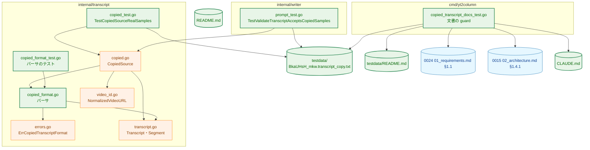
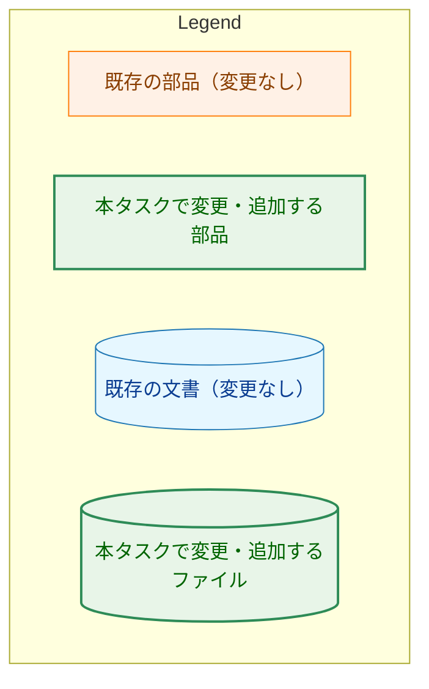
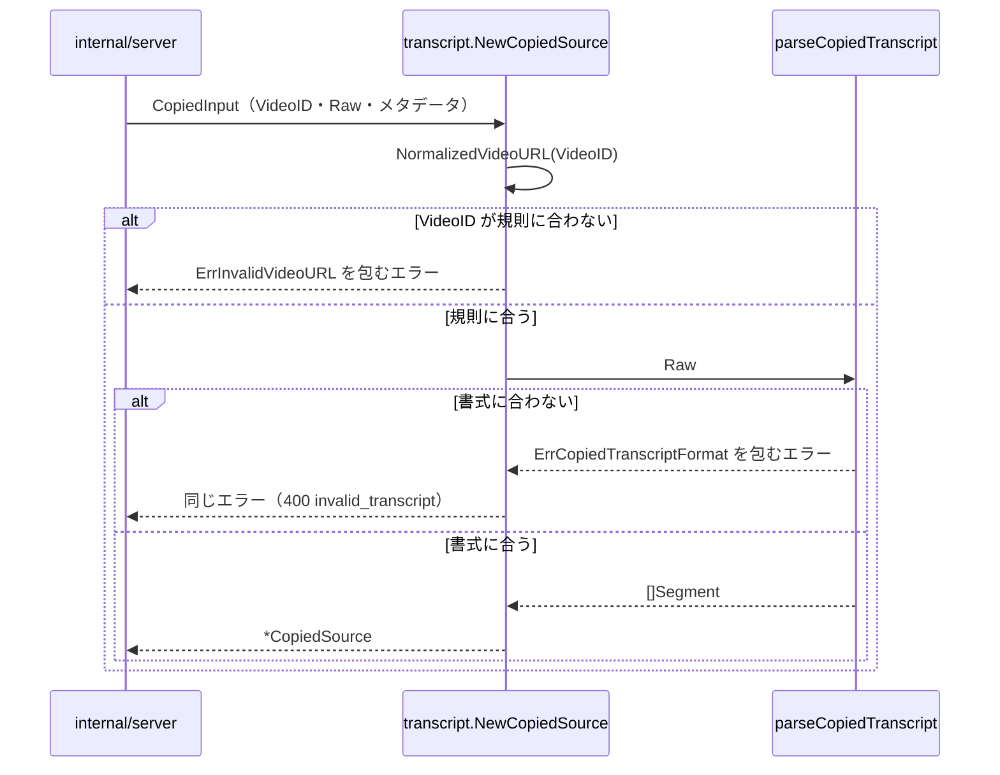
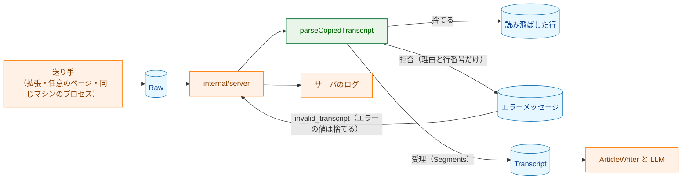
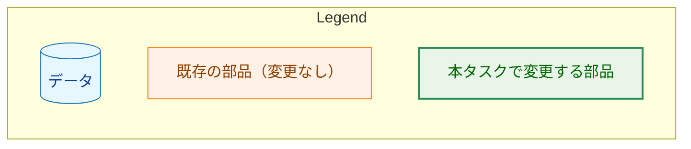
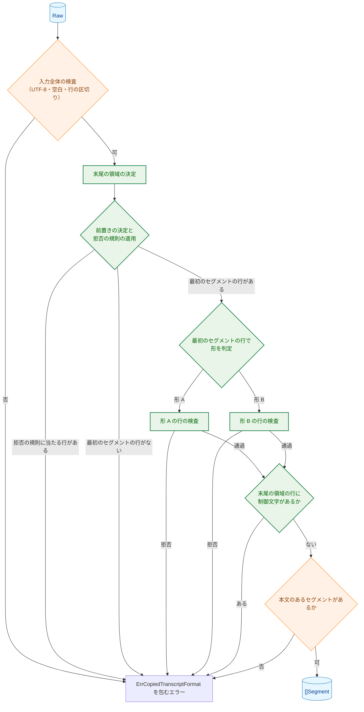
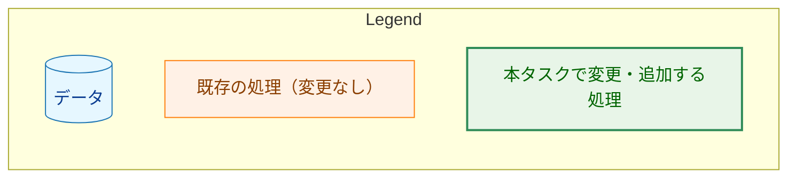
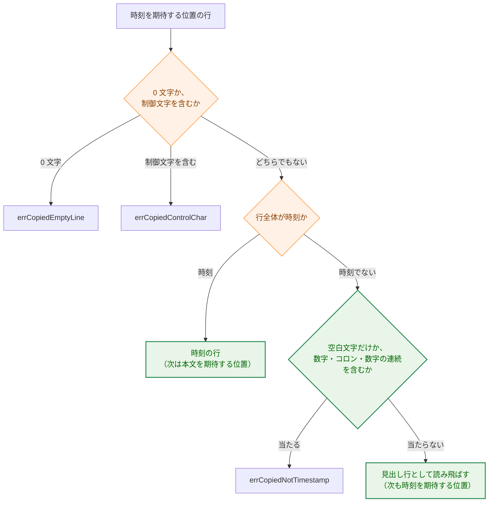

# アーキテクチャ設計書：コピーした字幕に混じるパネルの行（前置き・チャプター見出し・末尾の操作ラベル）を読み飛ばす

## Document Status

| Item | Value |
|---|---|
| Status | `approved` |
| Created | 2026-10-18 |
| Review date | 2026-10-18 |
| Reviewer | isseis |
| Comments | - |

## 1. 設計の全体像 (Design Overview)

本タスクは、`internal/transcript` のコピーした字幕のパーサ（`copied_format.go`）の受理の範囲を広げる。今のパーサは、パネル全体をコピーした入力に混じる行（最初のセグメントより前の行・チャプターの見出し行・入力の末尾の空白文字だけの行と操作ラベル行）があると、`ErrCopiedTranscriptFormat` を返す。本設計では、タスク `0015_copied_transcript_source` が定めた書式（形 A・形 B）と公開の契約を保ったまま、明示的に定義した行だけを読み飛ばす。コードの変更は `internal/transcript` の非公開の関数に限る。ほかに、実データのサンプルを 1 件加え、文書と、文書を検査する guard テストを変える。

本書で節番号だけを示す 0015 の参照（`0015 §3.2.1` など）は、`docs/tasks/0015_copied_transcript_source/02_architecture.md` の節を指す。「要件」は本タスクの `01_requirements.md` を指す。既存のコードの行番号は、コミット `cb4f268` の作業ツリーで確認した。

### 1.1. 設計原則

0015 §1.1 の設計原則を引き継ぎ、次の 5 点を加える。

1. **読み飛ばす行を明示的に定義し、それ以外のセグメントでない行は拒否する。** 読み飛ばすのは、前置き（F-007）、形 A のチャプターの見出し行（F-001）、形 B の時刻を期待する位置の見出し行（F-008）、末尾の領域（F-002・F-006）だけである。表記の揺れを吸収する規則は持たない（CLAUDE.md「Reject, don't normalize」）。
2. **読み飛ばす範囲は、時刻の文法で決まる位置で決める。** 前置きの範囲は、行の内容を一覧と照合して決めるのではなく、行の先頭から時刻を読める最初の行（**最初のセグメントの行**）の位置で決める。形 B の見出しも、内容ではなく、直前の行の種類で決まる位置（**時刻を期待する位置**）で特定する。行の内容は、読み飛ばす行の種類を特定するため（形 A の見出しの形と末尾の操作ラベルの一覧）と、読み飛ばさずに拒否する行を見分けるため（§3.3 の拒否の規則）にだけ使う。
3. **形の判定は最初のセグメントの行で行う。** 判定の規則そのもの（行全体が時刻の文法に一致すれば形 B）は 0015 §3.2.5 のままで、判定に使う行だけを変える。
4. **読み飛ばす前に、セグメントを黙って失う形の行を拒否する。** 前置きと形 B の見出しの位置では、制御文字を含む行と、ASCII の数字・`:`・ASCII の数字がこの順に連続する部分（以下「数字・`:`・数字の連続」）を含む行を拒否する。形 B の見出しの位置では、空白文字だけの行も拒否する。数字・`:`・数字の連続の判定は、この 2 つの位置で同じ関数を使う（§3.3）。形 B では、直前の行が時刻だけの行である操作ラベル行を末尾の領域に含めず、その時刻の本文とする。検出できない欠落は §5.4 の残余のリスクに記す。
5. **読み飛ばした行の内容はどこにも出力しない。** 読み飛ばした行は、`Segments`・エラーメッセージ・ログのいずれにも入らない。行の内容は、読み飛ばすかどうかを決めるためだけに使う。

0015 §1.1 の原則 2（境界は時刻から導く）・原則 3（解析は 1 回だけ）・原則 4（既存の型を変えない）・原則 5（エラーは理由と行番号だけ）・原則 6（時間とメモリは入力の長さに比例する）は、本設計でもそのまま成り立つ。

### 1.2. 概念モデル

入力の行を、先頭から **前置き**・**本体**（最初のセグメントの行から末尾の領域の直前まで）・**末尾の領域** の 3 つに分ける。前置きと末尾の領域は読み飛ばす。本体の行は形ごとの規則で検査し、セグメントを組み立てる。本体の中でも、形 A では見出しの形に一致する行を、形 B では時刻を期待する位置の見出し行を読み飛ばす。

矢印 A → B は「入力の中で、A の領域の次に B の領域が来る」を表す。


形 B の本体では、行の役割を直前の行の種類で決める。**本文を期待する位置**は直前の行が時刻だけの行である位置、**時刻を期待する位置**は直前の行が本文の行か読み飛ばした見出し行である位置である。最初のセグメントの行（時刻の行）の直後は本文を期待する位置である。矢印 A → B は「位置 A で、矢印に付けた種類の行を読むと、次の行は位置 B になる」を表す。


今のパーサにも、この 2 つの位置の区別がある（`copied_format.go:355` の `awaitingText`）。時刻を期待する位置の非時刻行を、今は `errCopiedNotTimestamp` で拒否している（`:370-372`）。本設計は、この位置の扱いだけを変える（§3.2.3）。本文を期待する位置の扱い（`:373-380`）は変えない。

### 1.3. 既存コードとの関係

| 既存のもの | 本設計での扱い |
|---|---|
| パーサ（`internal/transcript/copied_format.go`） | 変更する。`parseCopiedTranscript`（`:86-102`）に領域の決定を加え、形の判定（`:98-101`）を最初のセグメントの行で行う。`parseCopiedFormA`（`:304-343`）と `parseCopiedFormB`（`:351-386`）は本体の行だけを検査し、元の入力の行番号を報告する。時刻の文法（`parseTimestampPrefix`・`parseTimestampLine`。`:159-190`）・読み上げ用ラベルの導出と照合（`:207-276`）・`readableAsFormA`（`:391-398`）は変えない |
| `checkCopiedLine`・`hasCopiedControlChar`（`copied_format.go:280-297`） | 変更しない。本体の各行は今のまま `checkCopiedLine`（0 文字の行と制御文字の検査）を通る。前置きの行は 0 文字の行を読み飛ばすので、`checkCopiedLine` ではなく `hasCopiedControlChar` だけを使う |
| 拒否の理由の非公開の番兵（`copied_format.go:16-28`） | 変更しない。読み飛ばしの拒否は既存の `errCopiedControlChar`・`errCopiedNotTimestamp`・`errCopiedEmptyLine`・`errCopiedNoText` で表す |
| `CopiedInput`・`CopiedSource`・`NewCopiedSource`・`Fetch`（`internal/transcript/copied.go`） | 変更しない。`NewCopiedSource` は `NormalizedVideoURL` で `VideoID` を検査した後、`Raw` の解析を `parseCopiedTranscript` に委ねる（`copied.go:38-43`） |
| `ErrCopiedTranscriptFormat`（`internal/transcript/errors.go:18`） | 変更しない。公開の番兵は増やさない（F-004・AC-14） |
| `transcript.Transcript`・`Segment`・`TranscriptSource`（`transcript.go`） | 変更しない。`TestCommonTypesFieldSets`（`internal/pipeline/pipeline_test.go:432`）は変更なしで通る |
| `writer` の `validateTranscript`（`internal/writer/prompt.go:50`） | 変更しない。パーサは空白だけの `Text` と空の `Segments` を作らない（0015 §1.3）ので、この検査を通る |
| 拡張（`extension/`）とサーバ（`internal/server`） | 変更しない。拡張は選択範囲を補正せずに送る。サーバは `ErrCopiedTranscriptFormat` を `errors.Is` で判定して `invalid_transcript` にし、エラーの値そのもの（理由と行番号）はログにも応答にも出さない（`internal/server/request.go:96-98`、`handler.go:116-122`） |
| 利用者向けの案内（`README.md:513-515`） | 変更する。「字幕の行だけを選び、末尾の空行は拒否される」という案内を、本設計の受理の範囲に合わせる（§1.3.1 例外 5） |
| `TestValidateTranscriptAcceptsCopiedSamples`（`internal/writer/prompt_test.go:337-345`） | 変更する。`testdata/` のサンプルの数を `wantSamples = 3` で固定しているので、サンプルを加えると失敗する（§3.6） |
| 文書の guard（`cmd/yt2column/copied_transcript_docs_test.go`） | 変更する。`TestCopiedTranscriptSurveyRecords`（`:25-106`）が読む属性の表を一覧に広げ（F-005）、`TestClaudeMDCopiedTranscriptException`（`:166-186`）に例外の境界の確認を加える（AC-27） |

#### 1.3.1. 方針への例外（0015 の設計からの変更）

本設計は、0015 が定めた 5 つの規則を変える。例外 1〜4 は要件が定める変更である。例外 5 は要件が直接定めるものではなく、例外 1〜4 の結果として利用者への案内が事実と合わなくなるのを防ぐための変更である。各規則について、元の規則・例外とする理由・古い振る舞いを確かめている既存のテストを示す。書き換えるテストの一覧は §3.6 にある。

**例外 1: 入力の末尾の行の区切りの数（F-006）。**

-   **元の規則と出典:** 0015 §3.2.1 は「入力の末尾の行の区切りは 0 個か 1 個である。末尾に区切りが 2 個以上続く入力は、空の行を含むものとして拒否する」と定める。実装は `splitCopiedLines`（`copied_format.go:145-157`）と、空の行の検査（`:281-283`）である。
-   **例外とする理由:** 範囲の選び方によっては、コピーした文字列の末尾に空行や操作ラベル行（`動画の時間と同期`）が入る（要件 §1）。これを拒否すると `invalid_transcript` になる。本設計は、末尾の区切りの数に上限を設けず、末尾の領域を除く（§3.2.4）。
-   **古い振る舞いを確かめている既存のテスト:** `TestParseCopiedRejects` の `two trailing separators`・`three trailing separators`、`TestParseCopiedLineBreaks` の `trailingRejects` の 2 ケース。また、0015 §3.2.4 は、本文を期待する位置の空白文字だけの本文を `errCopiedBlankText` で、時刻を期待する位置の空白文字だけの行を `errCopiedNotTimestamp` で拒否する。入力の末尾にある空白文字だけの行は末尾の領域として読み飛ばすので、この規則は入力の末尾では当てはまらなくなる。これを確かめているテストは、`TestParseCopiedRejects` の `form B whitespace-only text` と `TestParseCopiedCheckOrder` の `line kind before blank text` である。

**例外 2: 形の判定に使う行（F-007）。**

-   **元の規則と出典:** 0015 §3.2.5 は「先頭の行が時刻の文法に行全体で一致すれば形 B、そうでなければ形 A として、入力全体を解析する」と定める（`copied_format.go:98-101`）。
-   **例外とする理由:** 前置きを除くので、先頭の行が時刻の行とは限らない。判定を最初のセグメントの行に移す。判定の規則そのものは変えない。
-   **古い振る舞いを確かめている既存のテスト:** `TestParseCopiedRejects` の `empty line at the start`・`leading display items`。先頭の行が時刻の行である入力のテスト（`form B text reads as form A` など）は結果を変えない。

**例外 3: 形 A のセグメントでない行の拒否（F-001・F-002・F-006・F-007）。**

-   **元の規則と出典:** 0015 §1.1 の原則 1 と §3.2.4・§3.2.5 は、時刻の行と本文の行以外の行（表示項目・チャプターの見出しなど）を `errCopiedNotTimestamp` で拒否する（形 A は `copied_format.go:313-316`）。CLAUDE.md「Declare, don't infer」の例外の境界（0015 §3.6）も、書式に合わない入力は「解釈を広げて受理せず、拒否する」とする。
-   **例外とする理由:** issue #301 の実入力は、パネルの前置き・チャプターの見出し行・末尾のボタンを含み、0015 の規則では拒否される。要件は、内容から特定できる行（見出しの形・操作ラベルの一覧）と、位置で決まる前置き・末尾の領域だけを読み飛ばし、それ以外のセグメントでない行は形 A では引き続き拒否すると定める（F-003）。
-   **古い振る舞いを確かめている既存のテスト:** 例外 2 の 2 ケースと、`TestParseCopiedErrorOmitsInput` の `not a timestamp omits the line`（前置きだけの入力になる）。

**例外 4: 形 B の見出しを位置で特定する（F-008）。**

-   **元の規則と出典:** 0015 §3.2.9 は、形 B の見出しを「位置から見出しを推測して無視する形にはしない」と定める。本文の行の直後の非時刻行は `errCopiedNotTimestamp` で拒否する（`copied_format.go:370-372`。関数のコメント `:347-348` も「a chapter heading there is rejected」と書く）。
-   **例外とする理由:** 形 B の見出しは `チャプター N: ` の接頭辞を持たない素のタイトルで、内容からは本文と区別できない。実データ（`BkaUHsH_mkw` の 3 行）では、見出しは時刻を期待する位置に現れる。要件 F-008 は、この位置の非時刻行を、拒否の規則に当たらない限り読み飛ばすと定める。0015 §3.2.9 の方針は、形 B の見出しに限って反転する。本文を期待する位置の見出しは、0015 §3.2.9 のとおり本文として受理する。
-   **古い振る舞いを確かめている既存のテスト:** `TestParseCopiedRejects` の `chapter heading after text`（受理に変わる）、`TestParseCopiedErrorOmitsInput` の `chapter heading omits the line`（受理に変わり、メッセージの確認ができなくなる）。`bad timestamp at a form B position`（`05:00`）と `form A line where form B wants a timestamp`（`1:0024 秒y`）は、§3.3 の拒否の規則に当たるので、理由と行番号を変えずに通る。

**例外 5: 利用者への案内（0015 §4.4）。**

-   **元の規則と出典:** 0015 §3.2.9・§4.4 は、チャプターの見出しなどを選択に含めないよう利用者に案内することを求める。`README.md:513-515` は「字幕の行だけを選ぶ。末尾の空行は受理する書式でなく、サーバが拒否する」と案内している。
-   **例外とする理由:** 本設計では、前置き・チャプターの見出し・末尾の空白文字だけの行と操作ラベル行を読み飛ばすので、この案内は事実と合わなくなる。README の案内（英語で書く。CLAUDE.md の README の言語の規則）を、パネル全体を選んでよいこと、それでも拒否される行（形 A の本体の未知の行、本体の 0 文字の行と空白文字だけの行、§3.3 の拒否の規則に当たる行）があることを述べる形に改める。
-   **古い振る舞いを確かめている既存のテスト:** なし。README の変更は、拡張のテスト（`serverReasons.test.ts` が README の拒否の理由の表を読む）を通すために `make ext-test` を要する（CLAUDE.md の Development Notes）。

**CLAUDE.md への記載（AC-27）。** 「Declare, don't infer」の例外の範囲に、前置きの読み飛ばし・形 A の見出し行の読み飛ばし・形 B の見出し行の位置による読み飛ばし・末尾の領域の読み飛ばしを加える。例外の境界との関係として、次の 3 点を記す: 前置きの範囲は時刻の文法で決まる位置で決めること、形 B の見出しは時刻を期待する位置で特定すること、最初のセグメントの行より後で読み飛ばすのは明示的に定義した行だけであること。`TestClaudeMDCopiedTranscriptException` に、この 3 点と 4 種類の読み飛ばしを表す英語の語（`first segment line`・`timestamp-expected position`・`chapter heading`・`trailing`・`explicitly defined`）の確認を加える。これらの読み飛ばしは、行の種類と位置を明示的に定義したうえで行うもので、既存の境界の文（形 A・形 B のどちらにも合わない入力は、解釈を広げて受理せずに拒否する）を変えない。最初のセグメントの行がない入力と、§3.3 の拒否の規則に当たる行は、今のとおり拒否する。

**0015 から変えないもの。** 時刻の文法、読み上げ用ラベル、形 A の本文の規則、形 B の本文を期待する位置の規則、入力全体の検査（UTF-8、空白だけの入力の拒否、行の区切りの統一）、本体の空行と制御文字の拒否、`Segments` の組み立て、エラーの契約、サイドエフェクト契約は、0015 のままとする。

## 2. システム構成 (System Structure)

### 2.1. パッケージ構成

新しいパッケージを作らない。変更するのは `internal/transcript` のパーサとそのテスト、実データのサンプル、文書、および文書を確かめる `cmd/yt2column` の guard テストである。

矢印 A → B は「A が B の関数を呼ぶ、または B の型・値を使う」を表す。





`GUARD → REQ` の矢印は本タスクで加える関係である（F-005）。`GUARD` から `SAMPLE`・`README`・`SURVEY`・`CLAUDEMD` への矢印は今もある（`copied_transcript_docs_test.go:25-106`・`:166-186`）。`SAMPLETEST → SAMPLE`・`PROMPTTEST → SAMPLE` も今もある関係で（`prompt_test.go:337-345` は `testdata/*.transcript_copy.txt` を読む）、本タスクはサンプルを 1 件加える。`README.md` はどの部品からも参照されない利用者向けの文書で、本タスクで案内を改める。

### 2.2. コンポーネント配置

| 部品 | 置き場所 | 公開/非公開 | 変更 |
|---|---|---|---|
| `CopiedInput`・`CopiedSource`・`NewCopiedSource`・`(*CopiedSource).Fetch` | `internal/transcript/copied.go` | 公開 | なし |
| `ErrCopiedTranscriptFormat` | `internal/transcript/errors.go` | 公開 | なし |
| パーサ（領域の決定、形の判定、形ごとの行の検査） | `internal/transcript/copied_format.go` | 非公開 | あり |
| 形 A の見出しの形と操作ラベルの一覧 | `internal/transcript/copied_format.go` | 非公開 | 新設 |
| 前置きと形 B の見出しの位置の拒否の規則（§3.3） | `internal/transcript/copied_format.go` | 非公開 | 新設 |
| 拒否の理由ごとの番兵 | `internal/transcript/copied_format.go` | 非公開 | なし |

読み飛ばす行の形・操作ラベルの一覧・形 B の見出しの位置の規則・前置きの拒否の規則は、`internal/transcript` の 1 か所に置く。呼び出し側（サーバ・拡張）に同じ規則を持たせない（要件 §4.5）。

### 2.3. データフロー

サーバがパーサを使うときの流れを示す。この流れは今のままで（`internal/server/request.go:89-99`）、本タスクは `parseCopiedTranscript` の中の判断だけを変える（中の処理は §6.1）。実線の矢印は呼び出し、点線の矢印は戻り値を表す。この図はノードを色で分類しないので、Legend を置かない。



## 3. コンポーネント設計 (Component Design)

### 3.1. 公開の型と関数

公開の型と関数は変更しない（要件 §4.4）。0015 §3.1 のとおりである。

```go
// CopiedInput is the input of NewCopiedSource.
type CopiedInput struct {
	VideoID     string
	Raw         string
	Title       string
	ChannelName string
	Description string
}

// NewCopiedSource validates in.VideoID, parses in.Raw, and returns a source
// that serves the result.
func NewCopiedSource(in CopiedInput) (*CopiedSource, error)

// ErrCopiedTranscriptFormat is wrapped by every error NewCopiedSource returns
// because the copied transcript does not match the defined format.
var ErrCopiedTranscriptFormat = errors.New("copied transcript does not match the expected format")
```

本設計が変えるのは、`Raw` を解析するときの受理と拒否の境界だけである。

### 3.2. 字幕書式の定義（0015 §3.2 への追加と変更）

本節は、本タスクで変える書式の規則を定める。本節で挙げない規則（時刻の文法・読み上げ用ラベル・本文の規則・入力全体の規則・`Segments` の組み立て）は 0015 のままとする。

#### 3.2.1. 前置き（F-007）

-   **最初のセグメントの行**は、入力の先頭から順に見て、行の先頭から時刻を読める最初の行である。読めるかどうかは既存の `parseTimestampPrefix`（`copied_format.go:174-190`）で判定する。時刻だけの行（形 B の時刻の行）でも、時刻の後に文字が続く行（形 A の行）でもよい。行の残りの内容（読み上げ用ラベルなど）は判定に使わない。
-   前置きの各行は、次の順で扱う。(1) 制御文字を含めば `errCopiedControlChar` で拒否する。(2) `parseTimestampPrefix` で行の先頭から時刻を読めれば、その行が最初のセグメントの行であり、前置きはその直前で終わる。(3) 数字・`:`・数字の連続を含めば `errCopiedNotTimestamp` で拒否する。(4) それ以外の行は読み飛ばす。(2) を (3) より先に置くのは、時刻を読める行は必ず数字・`:`・数字の連続を含むので、逆の順では正しい入力をすべて拒否してしまうためである。
-   最初のセグメントの行より前の行（前置き）は、§3.3 の拒否の規則に当たらない限り、内容にかかわらず読み飛ばす。前置きの行を一覧と照合しない。0 文字の行・空白文字だけの行・チャプターの見出し行（形 A・形 B のどちらの見出しでも）も読み飛ばす。
-   最初のセグメントの行がない入力は `errCopiedNoText` で拒否する（行番号なし）。
-   前置きの行は、読み上げ用ラベルの言語の固定（0015 §3.2.4）に影響しない。言語は最初のセグメントの行で固定する（今の `parseCopiedFormA` が本体の最初の行で固定するのと同じ）。
-   形は、最初のセグメントの行が `parseTimestampLine`（`:161-167`）で時刻だけの行と読めれば形 B、そうでなければ形 A とする。

#### 3.2.2. 形 A のチャプターの見出し行（F-001）

形 A の本体の行が**見出しの形**に一致すれば、その行を読み飛ばす。見出しの形は要件 F-001 の表のとおりで、行全体が次の並びであることを要する。

-   語（日本語 UI は `チャプター`、英語 UI は `Chapter`）、U+0020 が 1 つ、先頭に `0` を付けない ASCII の正の整数、ASCII の `:`、U+0020 が 1 つ、タイトル。
-   タイトルは 1 文字以上で、最後の文字は空白文字（`unicode.IsSpace`）ではない。タイトルの中の `:`・空白・`チャプター` などの語は許す。最後の文字の判定は、`regexp` の `\S` ではなく `unicode.IsSpace` で行う（`\S` は ASCII の空白しか除かないので、U+3000 で終わるタイトルを通してしまう）。

見出しの形は、`internal/transcript` に非公開の値として 1 か所に置く。新しい表記が観測されたら、その値に 1 つの形を加えるだけで対応できるようにする（要件 §4.5）。

-   見出しの判定は、本体の行ごとの検査の、空の行の検査と制御文字の検査（`checkCopiedLine`）の後、形 A の規則（時刻の接頭辞の読み取り）の前に置く。制御文字を含む見出し行は `errCopiedControlChar` で拒否される。
-   見出しの語の言語は、読み上げ用ラベルの言語の固定に影響しない。見出し行は言語の判定に使わない。
-   見出しの形に一致しない行は、形 A の規則により `errCopiedNotTimestamp` で拒否する（F-003・AC-04・AC-12・AC-13）。

#### 3.2.3. 形 B のチャプターの見出し行（F-008）

形 B の本体では、行を読むたびに、次の行が本文を期待する位置か、時刻を期待する位置かを決める（§1.2 の図）。時刻を期待する位置の行は、次の順で扱う。

1.  `checkCopiedLine` を適用する。0 文字の行は `errCopiedEmptyLine`、制御文字を含む行は `errCopiedControlChar` で拒否する（今と同じ）。
2.  行全体が時刻の文法に一致すれば、時刻の行として扱う（今と同じ）。次の行は本文を期待する位置になる。
3.  §3.3 の拒否の規則に当たる行（空白文字だけの行、ASCII の数字・`:`・ASCII の数字の連続を含む行）は、`errCopiedNotTimestamp` で拒否する。今のパーサはこの位置の非時刻行をすべて `errCopiedNotTimestamp` で拒否するので、これらの行の理由と行番号は変わらない。
4.  それ以外の行は見出し行として読み飛ばす。次の行も時刻を期待する位置のままである。

本文を期待する位置の行の扱い（時刻の行、`readableAsFormA` による `errCopiedMixedForms`、空白文字だけの本文の `errCopiedBlankText`、本文の受理）は変えない。したがって、本文のない時刻の行の直後の見出しは、その時刻の本文として受理される（AC-37）。

見出し行は、最後の本文の行の後（末尾の領域の前）にあってもよく、連続してもよい。見出し行は時刻の順序の検査（`errCopiedTimestampOrder`）に影響しない。

#### 3.2.4. 末尾の領域（F-002・F-006）

形 A・形 B のどちらでも、入力の最後の行から前に向かって、次のどちらかに当たる行が続く範囲を**末尾の領域**とし、読み飛ばす。2 種類の行は、どの順で何行混じってもよい。

-   0 文字の行、または空白文字だけからなる行。本書の**空白文字だけの行**は、1 文字以上で、すべての文字が `unicode.IsSpace` で真である行を指す（0 文字の行は別に数える）。末尾の領域と §3.3 の形 B の見出しの位置で同じ判定を使う。タブ（U+0009）は空白文字なので、タブを含む空白文字だけの行も末尾の領域に入る。
-   **操作ラベルの一覧**のどれかと行全体が完全に一致し、かつ直前の行が時刻だけの行でない行。

**操作ラベルの一覧**は、日本語 UI の `動画の時間と同期`（`testdata/2tcCWM-sRBw.transcript_panel.html:3206`・`:3211`、要件 §1 の観測）と、英語 UI の `Sync to video time`（要件 §1 の観測）の 2 つの文字列である。観測していないラベルは加えない。一覧は `internal/transcript` に非公開の値として 1 か所に置き、新しいラベルは 1 行を加えるだけで対応できるようにする。

-   **直前の行が時刻だけの行である操作ラベル行。** この行は末尾の領域に含めず、そこで末尾の領域を終える。形 B では、この行はその時刻の本文になる（AC-33）。この判定は直前の行の局所的な性質だけで決まるので、形の判定より前に行える。
-   **末尾の領域の制御文字。** 末尾の領域の各行に、制御文字の検査（`hasCopiedControlChar`）を適用する。制御文字を含む行（タブを含む空白文字だけの行）は、その行の行番号の `errCopiedControlChar` で拒否する（要件 F-006・AC-26）。例えば `0:000 秒はい\n\n\t\n` は行 3 の `errCopiedControlChar` になる。この検査は本体の行の検査の後に行う（§3.2.5）。末尾の領域は本体より後ろにあるので、行ごとの拒否のうち入力の先頭に最も近い誤りを報告する性質は保たれる。操作ラベルは制御文字を含まないので、制御文字を含む行は操作ラベル行として一致しない。
-   **末尾に限る。** 本体の中の空白文字だけの行は、今のまま形ごとの規則で拒否する。0 文字の行は `errCopiedEmptyLine`（AC-24）、空白文字だけの行は、形 A と形 B の時刻を期待する位置では `errCopiedNotTimestamp`、形 B の本文を期待する位置では `errCopiedBlankText` である。
-   **形 B の本文のないセグメント。** 形 B の最後の時刻の行の後の空白文字だけの行は、末尾の領域として読み飛ばす。その時刻は本文のないセグメントになり、`Segments` に含まれない（例: `0:00\nx\n0:05\n \n` を受理する）。
-   **末尾の行の区切り。** 末尾の領域を読み飛ばすので、末尾の区切りの数に上限を設けない。`splitCopiedLines` は、最後の区切りの後の空の要素を 1 つ取り除く今の振る舞いのままでよい。残る空の行は末尾の領域に入る。
-   末尾の領域の決定そのものは、範囲を決めるだけで拒否をしない。拒否は、上の制御文字の検査だけである。

#### 3.2.5. 行番号と検査の順序

-   本体の行の位置は、元の入力の行の並びの中の範囲で表し、行を詰め直さない。拒否のエラーの行番号は、前置き・末尾の領域を除く前の、元の入力の行番号である（AC-15）。
-   検査の順序は次のとおりである。最初に見つかった誤りで止めることは、0015 §4.3 と同じである。
    1.  入力全体が有効な UTF-8 か（`errCopiedInvalidUTF8`）。
    2.  空白文字以外の文字があるか（`errCopiedBlank`）。
    3.  入力全体の行の区切りがそろっているか（`errCopiedLineBreak`）。
    4.  末尾の領域を決める（拒否しない）。
    5.  先頭から前置きの行を見ていき、§3.3 の拒否の規則を適用する。最初のセグメントの行に達したら前置きを終える。達しなければ `errCopiedNoText`。
    6.  最初のセグメントの行で形を判定する。
    7.  本体の行に、形ごとの行の検査（0015 §4.3 の手順 4。§3.2.2・§3.2.3 の読み飛ばしを含む）を適用する。
    8.  末尾の領域の行に、制御文字の検査を適用する（`errCopiedControlChar`）。
    9.  本文のあるセグメントがあるか（`errCopiedNoText`）。
-   最初のセグメントの行がない入力は、手順 5 で `errCopiedNoText` になり、手順 8 は行わない。例えば `文字起こし\n\t\n` は、末尾の領域のタブの行より先に `errCopiedNoText` になる。どちらでも拒否されることは変わらない。
-   行ごとの拒否（手順 5・7・8）は、前置き・本体・末尾の領域の順、各領域の中では行の順に起こる。したがって、行ごとの拒否のうち報告するのは、入力の先頭から見て最初の誤りの行である。入力全体の検査（手順 1〜3）は、行ごとの拒否より先に報告される（0015 §4.3 と同じ）。
-   要件 F-006 は、末尾の領域の制御文字の検査を「除く前に」行うと定める。本設計はこれを、「末尾の領域の行を本体の検査の対象から外しても、その行の制御文字の検査は省かない」という意味に読む。検査は手順 8 で行う。本体の誤りより後ろにある行の誤りを、先に報告しないためである。

### 3.3. 前置きと形 B の見出しの位置の拒否の規則

前置き（F-007）と形 B の時刻を期待する位置（F-008）は、どちらも「内容にかかわらず読み飛ばすが、セグメントを黙って失う形の行は拒否する」位置である。この 2 か所の扱いを次の表に示す。

| 行 | 理由 | 前置き | 形 B の時刻を期待する位置 |
|---|---|---|---|
| 0 文字の行 | `errCopiedEmptyLine` | 拒否しない（読み飛ばす） | 拒否する（`checkCopiedLine`） |
| 制御文字を含む行 | `errCopiedControlChar` | 拒否する | 拒否する（`checkCopiedLine`） |
| 空白文字だけの行 | `errCopiedNotTimestamp` | 拒否しない（読み飛ばす） | 拒否する |
| ASCII の数字・`:`・ASCII の数字がこの順に連続する部分を含む行 | `errCopiedNotTimestamp` | 拒否する | 拒否する |

-   2 か所で共有するのは、表の最後の行の判定（数字・`:`・数字の連続を含むかを返す 1 つの非公開の述語）と、既存の制御文字の判定 `hasCopiedControlChar` である。0 文字の行と空白文字だけの行を拒否するかどうかは、位置ごとに異なる（要件 F-007・F-008 の表）。
-   数字・`:`・数字の連続の判定は、先頭に U+FEFF や空白が付いた時刻（`0:00`・` 0:00`）、時刻の文法に合わない時刻（`05:00`・`60:00`・`0:5`）、形 A の行（`1:0024 秒y`）を、どれも拒否する。今の時刻の文法の拒否のテスト（`leading BOM` など）は、先頭の行がこの判定に当たるので、理由と行番号を変えずに通る。
-   前置きの行の検査の順序は §3.2.1 のとおりである（制御文字、時刻を読めるか、数字・`:`・数字の連続の順）。

### 3.4. パーサの構造

パーサは `internal/transcript/copied_format.go` の非公開の関数のままである。入力は `string`、出力は `[]Segment` または `error` である。

-   **領域を決める部分と、行を検査する部分を分ける。** 末尾の領域と前置きを決める部分は、本体の範囲（元の行の並びの中の開始と終了の位置）を返す。形ごとの行の検査（`parseCopiedFormA`・`parseCopiedFormB`。今は `(lines []string)` を受け取る）は、行の並びと本体の範囲を受け取り、本体の範囲だけを検査して、元の行番号でエラーを報告する。
-   **形 B の位置の状態は、今の `awaitingText` の 1 つの真偽値のままでよい。** 時刻を期待する位置で見出しを読み飛ばしても、`awaitingText` は偽のままである。新しい状態は要らない。
-   **時刻の文法を再実装しない。** 前置きの判定に `parseTimestampPrefix`、形の判定と末尾の領域の「直前の行が時刻だけの行か」の判定に `parseTimestampLine` を使う。
-   **解析は入力の長さに比例する。** 末尾の領域の決定と前置きの決定は、それぞれ行を 1 回ずつ見る。各行の判定（見出しの形・操作ラベルの一致・数字・`:`・数字の走査）は行の長さに比例する。`Segment.Text` が `Raw` の部分文字列である性質（0015 §3.3）は変えない。

**既存の単純な扱いを採用しない理由。** 0015 の「セグメントでない行をすべて拒否する」扱い（`copied_format.go:313-316`・`:370-372`）では、issue #301 の実入力（パネル全体のコピー）と、形 B の見出しを含む `BkaUHsH_mkw` を受理できない（要件 F-001・F-007・F-008）。利用者に見出しを含めないよう案内する 0015 の方法も、パネルの前置きと末尾のボタンが選択から外しにくい（要件 §1）ので、要件を満たさない。

### 3.5. コンポーネント責務表

| ファイル | 新規/変更 | 責務 |
|---|---|---|
| `internal/transcript/copied_format.go` | 変更 | 末尾の領域と前置きの決定、形の判定に使う行の変更、形 A の見出し行の読み飛ばし、形 B の時刻を期待する位置の見出し行の読み飛ばし、§3.3 の拒否の規則。形 A の見出しの形と操作ラベルの一覧。`parseCopiedTranscript`（「decides which by the first line alone」）・`parseCopiedFormA`（「fixed by the first line」）・`parseCopiedFormB`（「a chapter heading there is rejected」）・`splitCopiedLines`（「caught by the empty-line check」）の関数のコメントを本設計に合わせる |
| `internal/transcript/copied_format_test.go` | 変更 | §3.6 の既存ケースの書き換えと、AC-01〜AC-15・AC-21〜AC-26・AC-28〜AC-33・AC-35〜AC-38 の新しいケース。`TestParseCopiedLargeInputs` に §7.3 の 4 MiB の入力を加え、関数のコメント（「three synthetic … inputs」）を改める（AC-20）。`FuzzNewCopiedSource` に §7.1 の性質を加える |
| `internal/transcript/copied_test.go` | 変更 | `copiedSampleFiles` に `BkaUHsH_mkw.transcript_copy.txt` を加え、`TestCopiedSourceRealSamples` にその期待値を加える。見出し 3 行を取り除いた入力との比較で AC-34 を確かめる |
| `internal/writer/prompt_test.go` | 変更 | `TestValidateTranscriptAcceptsCopiedSamples` の `wantSamples` を 3 から 4 にする（§3.6） |
| `README.md` | 変更 | 選択の範囲の案内（`:513-515`）を本設計の受理の範囲に合わせる（§1.3.1 例外 5）。変更後に `make ext-test` を実行する |
| `testdata/BkaUHsH_mkw.transcript_copy.txt` | 新規 | 形 B でチャプターの見出し 3 行を含む実データ（CC BY。AC-17）。加工しない |
| `testdata/README.md` | 変更 | コピーした字幕の節に、`BkaUHsH_mkw` の出典・ライセンス・取得日・取得方法・加工内容・見出し 3 行を含むこと・末尾の改行がないことを加える。「3 ファイルとも」の記述を改める（AC-17） |
| `cmd/yt2column/copied_transcript_docs_test.go` | 変更 | `TestCopiedTranscriptSurveyRecords` が、属性の表を 0015 §1.4.1 と 0024 要件 §1.1 の一覧から読む（F-005）。`TestClaudeMDCopiedTranscriptException` に、例外の境界の確認を加える（AC-27） |
| `CLAUDE.md` | 変更 | 「Declare, don't infer」の例外の範囲と境界に、本タスクの 4 種類の読み飛ばしを加える（AC-27） |
| `docs/tasks/0024_copied_transcript_panel_lines/02_architecture.md` | 新規 | 本書 |

`internal/transcript/copied.go`・`errors.go`・`internal/server`・`extension/`・`internal/pipeline` の guard は変更しない。

**`TestCopiedTranscriptSurveyRecords` の変更の範囲（F-005）。** 「保存する」の確認（`copied_transcript_docs_test.go:63-73`）だけを、一覧の表のどれかにその動画の行があり、その行の `testdata/` 列が「保存する」を含めば通る形に変える。0015 の表は「保存しない」のまま変えない。0015 の表の列（`:58-62`）、4 つの言語と種類の組み合わせ（`:74-80`）、観測した書式の表と h:mm:ss の観測（`:82-95`）、長い動画の選択（`:97-105`）の検査は、0015 の表だけに対して今のまま行う。0024 の §1.1 の表は、0015 の表と同じ列を持つ（要件 §1.1）。

### 3.6. 更新が必要な既存のテスト

`internal/transcript/copied_format_test.go` の次のケースは、0015 の振る舞いを確かめており、本設計で結果が変わる。本設計に合わせて書き換える（AC-18）。

| ケース（`copied_format_test.go`） | 今の期待 | 本設計での期待 | 理由 |
|---|---|---|---|
| `TestParseCopiedRejects` の `empty line at the start`（`:244`） | `errCopiedEmptyLine` 行 1 | 受理 | 先頭の空行は前置き |
| `TestParseCopiedRejects` の `two trailing separators`（`:245`） | `errCopiedEmptyLine` 行 3 | 受理 | 末尾の領域 |
| `TestParseCopiedRejects` の `three trailing separators`（`:246`） | `errCopiedEmptyLine` 行 3 | 受理 | 末尾の領域 |
| `TestParseCopiedRejects` の `leading display items`（`:249`） | `errCopiedNotTimestamp` 行 1 | `errCopiedNoText` | 前置きだけで最初のセグメントの行がない |
| `TestParseCopiedRejects` の `chapter heading after text`（`:250`） | `errCopiedNotTimestamp` 行 3 | 受理 | 形 B の時刻を期待する位置の見出し行 |
| `TestParseCopiedRejects` の `form B whitespace-only text`（`:264`） | `errCopiedBlankText` 行 2 | `errCopiedNoText` | 末尾の U+0020 だけの行が末尾の領域になり、本文のあるセグメントが残らない |
| `TestParseCopiedLineBreaks` の `trailingRejects` の 2 ケース（`:343-344`） | `errCopiedEmptyLine` 行 3 | 受理 | 末尾の領域 |

次のケースは、確かめている経路を本設計で通らなくなる。そのままでは、その理由で失敗しえないテストになる（CLAUDE.md「Testing Strategy」）ので、同じ経路を通る入力に書き換える。

| ケース | 今の入力と経路 | 本設計での入力と経路 |
|---|---|---|
| `TestParseCopiedCheckOrder` の `line kind before blank text`（`:394-398`） | `0:00\nx\n \n`。時刻を期待する位置の空白文字だけの行が、`errCopiedBlankText` でなく `errCopiedNotTimestamp` になる順序 | 今の入力は、末尾の空白文字だけの行が末尾の領域になるので受理に変わる。受理のケースとして残し、順序の確認は空白文字だけの行が本体の中にある入力（`0:00\nx\n \n0:05\ny\n`。`errCopiedNotTimestamp` 行 3）に移す |
| `TestParseCopiedRejects` の `form B whitespace-only text`（`:264`） | `0:00\n \n`。本文を期待する位置の空白文字だけの本文の `errCopiedBlankText`（`copied_format.go:376-378` の唯一の確認） | 上の表のとおり `errCopiedNoText` に変わる。`errCopiedBlankText` の確認は、空白文字だけの本文が本体の中にある入力（`0:00\n \n0:05\nx\n`。`errCopiedBlankText` 行 2）に移す |
| `TestParseCopiedErrorOmitsInput` の `not a timestamp omits the line`（`:425-428`） | `MARKER_LINE\n`。`errCopiedNotTimestamp` 行 1 のメッセージが行の文字列を含まない | 前置きだけの入力になり、行番号のない `errCopiedNoText` に変わる。行を形 A の本体に置く（`0:000 秒x\nMARKER_LINE\n`。`errCopiedNotTimestamp` 行 2）。形 B の本体に置くと見出しとして読み飛ばされるので、形 A を使う |
| `TestParseCopiedErrorOmitsInput` の `chapter heading omits the line`（`:440-443`） | `0:00\nTEXT_MARKER\nCHAPTER_MARKER\n`。形 B の見出しの拒否のメッセージが行の文字列を含まない | 受理に変わるので、受理のケースとして `Segments` に `CHAPTER_MARKER` が含まれないことを確かめる形に作り直す。拒否のメッセージの確認は、§3.3 の規則で拒否される形 B の見出しの位置の行（`0:00\nTEXT_MARKER\nCHAPTER_MARKER 1:00\n`。`errCopiedNotTimestamp` 行 3。目印は `CHAPTER_MARKER`・`TEXT_MARKER`・`1:00`）に移す |

上の表にない既存のケースは、変更なしで通ることを要する（AC-18）。特に、時刻の文法の拒否のケース（`leading BOM`・`minute leading zero`・`minute over 59`・`single-digit second`・`zero hour in h:mm:ss`・`three-digit hour`・`m:ss then colon and three digits`・`m:ss then colon and one-digit second`）は前置きの拒否の規則で、`bad timestamp at a form B position` と `form A line where form B wants a timestamp` は形 B の見出しの位置の拒否の規則で、理由と行番号を変えずに通る（§3.3）。書き換えたケースは 03 に記録する。

`internal/transcript/copied_test.go` の `copiedSampleFiles`（`:344-348`）は `testdata/` のサンプルの集合を固定しているので、サンプルを加えると `TestCopiedSourceRealSamples` が失敗する。この変更は AC-18 の例外 1 である。`internal/writer/prompt_test.go` の `TestValidateTranscriptAcceptsCopiedSamples`（`:337-345`）も、サンプルの数を `wantSamples = 3` で固定しているので、サンプルを加えると失敗する。この変更も、サンプルを加えるために必要な変更として AC-18 の例外 1 に含める（要件の Document Status の Comments に編集上の訂正として記録した）。`cmd/yt2column/copied_transcript_docs_test.go` の `TestCopiedTranscriptSurveyRecords` は、サンプルを加えると「保存する」の確認で失敗する（0015 の表の `BkaUHsH_mkw` の行が「保存しない」のため）。この変更は AC-18 の例外 2 である（§3.5）。

`TestParseCopiedErrorOmitsInput` の `not a timestamp omits the line` は、AC-18 の書き換えの一覧に当初含まれていなかった。今の入力のままでも通るが、確かめている経路（行番号のある拒否のメッセージ）を通らなくなるので、CLAUDE.md の「Every test must be able to fail for its stated reason」に従って書き換える。これも要件の AC-18 に編集上の訂正として加えた。

## 4. エラーハンドリング設計 (Error Handling Design)

### 4.1. エラー型

公開の番兵（`ErrCopiedTranscriptFormat`）と、拒否の理由の非公開の番兵（`copied_format.go:16-28`）を変えない。新しい理由は要らない。

```go
var (
	errCopiedEmptyLine    = errors.New("empty line")
	errCopiedControlChar  = errors.New("line contains a control character")
	errCopiedNotTimestamp = errors.New("line does not start with a timestamp where one is required")
	errCopiedNoText       = errors.New("no segment has text")
	// ...the other reasons are unchanged.
)
```

本設計の拒否と理由の対応は次のとおりである。

| 拒否する行・入力 | 理由 |
|---|---|
| 前置き・形 B の時刻を期待する位置の、制御文字を含む行 | `errCopiedControlChar`（行番号あり） |
| 前置き・形 B の時刻を期待する位置の、数字・`:`・数字の連続を含む行 | `errCopiedNotTimestamp`（行番号あり） |
| 形 B の時刻を期待する位置の、0 文字の行 | `errCopiedEmptyLine`（行番号あり） |
| 形 B の時刻を期待する位置の、空白文字だけの行 | `errCopiedNotTimestamp`（行番号あり） |
| 形 A の本体の、見出しの形に一致せず時刻で始まらない行 | `errCopiedNotTimestamp`（行番号あり） |
| 末尾の領域の、制御文字を含む行（タブを含む空白文字だけの行） | `errCopiedControlChar`（行番号あり） |
| 最初のセグメントの行がない入力、本文のあるセグメントがない入力 | `errCopiedNoText`（行番号なし） |

`ErrCopiedTranscriptFormat` を包む番兵のうち、`internal/transcript` の外から観測できる新しいものは追加しない（F-004・AC-14）。拒否したときは部分的な結果（`nil` でない `[]Segment`）を返さない。

### 4.2. エラーメッセージ設計パターン

0015 §4.2 のままとする。行の誤りは `copied transcript does not match the expected format: line <N>: <理由の文>`、入力全体の誤りは `line <N>` を付けない（`copiedLineError`・`copiedGlobalError`。`copied_format.go:104-114`）。行番号は、前置きと末尾の領域を除く前の入力の行番号である。メッセージは固定の文と行番号だけで作り、入力の文字列（前置きの行・見出しのタイトル・操作ラベル・本文・時刻）を含めない（AC-15）。

### 4.3. サイドエフェクト契約

0015 §4.5 のままとする。`NewCopiedSource` と `Fetch` は、ファイル・ネットワーク・外部コマンド・環境変数・ログのどれにも触れない。結果は引数だけで決まる。本設計は、副作用を切り替えるフラグやモードを持たない。

## 5. セキュリティ考慮事項 (Security Considerations)

### 5.1. 脅威モデル

コピーした字幕は信頼できない入力である（`docs/dev/security.md` §6）。サーバは、リクエストの本文を上限 4 MiB で読んでから（`internal/server/request.go:17`・`:34-39`）パーサを呼ぶ。本設計の読み飛ばしは拒否を減らす方向に働くが、読み飛ばした行は `Transcript` に入らないので、信頼できない値が `Transcript` に出る経路は増えない。

矢印 A → B は「A の値が B に渡る」を表す。





`読み飛ばした行` のノードからは矢印が出ない。読み飛ばした行が、`Transcript`・エラーメッセージ・ログのどこにも渡らないことを表す。サーバはエラーを `invalid_transcript` に変えるときにエラーの値を捨て、ログには固定の理由と詳細だけを残す（§5.4）。

### 5.2. 脅威と対策

0015 §5.2 の表を引き継ぎ、本設計で加わる脅威と対策を示す。

| 脅威 | 対策 | AC |
|---|---|---|
| 読み飛ばしで、本来のセグメントを黙って失う | 前置きと形 B の時刻を期待する位置で、数字・`:`・数字の連続を含む行を拒否する（§3.3）。形 B の時刻を期待する位置では空白文字だけの行も拒否する。直前の行が時刻だけの行である操作ラベル行は本文とする | AC-30・AC-33・AC-36 |
| 読み飛ばした行（前置き・見出しのタイトル・操作ラベル）が、`Segments`・プロンプト・記事・中間生成物・ログに漏れる | 読み飛ばした行はどこにも出力しない。拒否のエラーのメッセージにも含めない（§4.2） | AC-02・AC-07・AC-15・AC-28・AC-34・AC-35 |
| 大きな入力や病的な入力で、解析が時間やメモリを使い尽くす | 解析は入力の長さに比例する（§3.4）。入力の大きさはサーバの本文の上限 4 MiB で抑えられる。§7.3 で確かめる | AC-20 |
| 書式に合わない入力を補正して受理し、本文の分割が黙ってずれる | 補正の規則を持たない。形 A で読み飛ばす行は、見出しの形と操作ラベルの一覧に完全に一致する行だけである | AC-04・AC-09・AC-12・AC-13 |

0015 §5.2 の他の行（時刻の数字の桁あふれ、字幕の内容のログへの漏れ、パニックの防止、部分的な結果の不使用、プロンプトインジェクションと制御文字）は、本設計でも同じ対策のままである。

### 5.3. 信頼できない入力の境界

0015 §5.3 の表の `CopiedInput.Raw` の行を、次のとおり細かくする。他の行（`VideoID`・メタデータ・`Fetch` の `videoURL`）は 0015 のままとする。どの境界も、上限は入力全体の 4 MiB（サーバが適用する）だけである。

| 境界 | 受理する形 | 拒否 | AC |
|---|---|---|---|
| 前置き | 制御文字を含まず、数字・`:`・数字の連続を含まない任意の行（§3.2.1・§3.3） | `errCopiedControlChar`・`errCopiedNotTimestamp`。最初のセグメントの行がなければ `errCopiedNoText` | AC-28〜AC-32 |
| 形 A の見出し行 | §3.2.2 の見出しの形に完全に一致する行 | 一致しない行は `errCopiedNotTimestamp` | AC-01〜AC-06 |
| 形 B の見出し行 | 時刻を期待する位置の非時刻行のうち、0 文字でも空白文字だけでもなく、制御文字を含まず、数字・`:`・数字の連続を含まない行（§3.2.3・§3.3） | `errCopiedEmptyLine`・`errCopiedControlChar`・`errCopiedNotTimestamp` | AC-34〜AC-38 |
| 末尾の領域 | 0 文字の行と空白文字だけの行と、直前が時刻だけの行でない、一覧に完全に一致する操作ラベル行。どちらも制御文字を含まないもの（§3.2.4） | 拒否しない。末尾の領域に入らない行は本体として検査する | AC-07〜AC-11・AC-21〜AC-26・AC-33 |
| 形 A のその他のセグメントでない行 | 受理しない | `errCopiedNotTimestamp` | AC-12〜AC-15 |

標準ライブラリが黙って修復・正規化すれば受理できてしまう入力は、受理する形を明示的に定めたうえで、それ以外を受理しない。形 A の見出しの形・操作ラベルの一覧・前置きの範囲と拒否の規則・形 B の見出しの位置と拒否の規則が、その明示的な形である。

### 5.4. 残余のリスク

0015 §5.4 の残余のリスクを引き継ぎ、本設計で加わるものを示す。

-   **前置きの読み飛ばしによる欠落。** 利用者が選択範囲の先頭に字幕の行を含め、その行が時刻の文法に一致しない場合、その行は前置きとして読み飛ばされる。数字・`:`・数字の連続を含む行は拒否するので、先頭に文字が付いた時刻（`\u200B0:00` など）の欠落は防ぐ（AC-30）。一方、時刻の途中から選択を始めた行（`:011 秒はい`・`011 秒はい`）は数字・`:`・数字の連続を含まないので、前置きとして黙って読み飛ばされる。範囲の選び方として最も起こりやすい誤りだが、失うのは最初の 1 セグメントに限られる。
-   **前置きが早く終わりすぎる。** パネルより上の行に時刻だけの行（概要欄のチャプターの一覧が `タイトル\n0:00` の形で選択に入る場合など）があると、その行が最初のセグメントの行になり、形 B と判定される。その次の行は本文として `Segments` に入り、パネルの前置きの行（`文字起こし`・`動画内を検索`）は形 B の見出し行として読み飛ばされる。チャプターが 2 つ以上あれば、本来の `0:00` の行で `errCopiedTimestampOrder` になり拒否される。時刻が 1 つだけの場合は受理され、字幕でない行が記事の素材に入る。入る値は動画ページの表示項目で、メタデータとして既にプロンプトに入る概要欄と同じ信頼度なので、新しい信頼の境界は増えない。この拒否の経路を 1 つのテストで固定する（§7.1）。
-   **前置きと形 B の見出しの位置の拒否の規則による、正しい入力の拒否。** 前置きか形 B の時刻を期待する位置にある行が数字・`:`・数字の連続を含むと、`errCopiedNotTimestamp` でパネル全体が拒否される。例は、見出しのタイトル（`第3:2戦`）、動画の情報の行（`プレミア公開 10:00`、縦横比 `16:9`・`1:1`）である。前置きの行が `10:00 の話` のように先頭から時刻を読める場合は、その行が最初のセグメントの行と読まれ、形 A の `errCopiedLabelMismatch` で拒否される。セグメントの欠落を防ぐ規則の副作用として受け入れる。症状は「正しいパネルのコピーが書式の誤りで拒否される」である。実データで頻度が高ければ、§3.3 の規則を見直す。
-   **形 B の時刻の行の欠落。** 時刻を期待する位置で、拒否の規則に当たらない非時刻行を読み飛ばすので、時刻の行が 1 行欠けた入力では、そのセグメントの本文を黙って失う。本文が 2 行以上に分かれた入力でも、2 行目以降を黙って失う（0015 では拒否していた）。形 B では、未知の行を拒否して YouTube の UI の変更を検出する性質（F-003）が弱まる（要件 F-008 の決定）。
-   **形 B の本文を期待する位置の見出し。** 本文のない時刻の行の直後の見出しは、その時刻の本文として受理され、記事の素材に入る（AC-37）。その後に本来の本文の行が続く入力（`0:05\n見出し\n本文\n0:10\n…`）では、本来の本文の行は時刻を期待する位置にあるので、見出しとして黙って読み飛ばされる（要件 §4.3）。
-   **形 B の本文と操作ラベルの区別。** 直前が時刻だけの行である操作ラベル行は本文とする（§3.2.4）。本文の行の直後や空行の後の操作ラベル行は末尾の領域として読み飛ばす。本文の行の直後に、操作ラベルと一致しない行（`動画の時間と同期について話します` など）が続く形 B の入力では、その行は形 B の見出し行として読み飛ばされる（要件 AC-09）。
-   **拒否と読み飛ばしの観測。** 今のサーバは、`ErrCopiedTranscriptFormat` を `invalid_transcript` に変えるときにエラーの値を捨て（`internal/server/request.go:96-98`）、拒否のログには固定の理由と詳細だけを残す（`handler.go:116-122`）。受理のログ（`handler.go:111`）は、セグメントの数も最初と最後の `StartMs` も残さない。したがって、拒否の理由の番兵と行番号も、読み飛ばした行の数も、ログ・Slack の通知・応答のどこにも出ない。この節の「正しい入力の拒否」と「形 B の時刻の行の欠落」の 2 つのリスクは、運用中に気づく手段がない。たとえば YouTube の UI の変更で形 B の本文が 2 行ずつになると、2 行目がすべて見出しとして読み飛ばされ、半分の字幕から記事が作られる。
-   **観測の対処案。** 調べるには、利用者から同じ入力を受け取り、パーサのテストで再現する。要件は本タスクでサーバを変えない（要件 §2.3・§4.4）ので、本設計はログを加えない。加える場合は、拒否のログにエラーの文字列（固定の文と行番号だけで、字幕の内容を含まない。§4.2）を、受理のログにセグメントの数と読み飛ばした行の数を残すのがよい。読み飛ばした行の数は、パーサの 1 つの解析の経路から非公開の値として返し、別の解析の経路を作らない。
-   **選択の範囲の不足・YouTube の書式の変更・確かめていない条件。** 0015 §5.4 のとおり。英語 UI の形 A の見出し（`Chapter`）は観測していない（要件 §7）。
-   **パーサ自身に大きさの上限がない。** 0015 §5.4 のとおり。呼び出し側が入力の大きさを抑える。

## 6. 処理フロー詳細 (Processing Flow Details)

### 6.1. `parseCopiedTranscript`

この図は `parseCopiedTranscript`（`copied_format.go:86-102`）の処理を、§3.2.5 の順序で示す。矢印は処理の進む向きを表す。エラーのノードは色を付けない。





### 6.2. 形 B の時刻を期待する位置の行

この図は、§3.2.3 の、形 B の時刻を期待する位置にある 1 行の扱いを示す。矢印は判定の進む向きを表す。エラーのノードは色を付けない。




今のパーサでは、`GUARD` の位置で、時刻でない行がすべて `errCopiedNotTimestamp` になる（`copied_format.go:370-372`）。時刻の行の扱いは今と同じだが、本設計では見出しの読み飛ばしの後にも時刻の行が来ることがあるので、結果のノード `NEXTTEXT` も本タスクの流れの一部として示す。

## 7. テスト戦略 (Test Strategy)

### 7.1. ユニットテスト

0015 §7.1 の方針を引き継ぐ。ユニットテストは `yt-dlp`・ネットワーク・LLM・ブラウザに触れない。AC-34 を除くテストの入力は、`_test.go` の中の合成の文字列とし、見出しのタイトルとセグメントの本文は架空の文字列とする。前置き・末尾の操作ラベルの文字列はパネルの UI のラベルなので、合成の入力に使ってよい。報告された入力（動画 `dsuNgos_kxA`）と要件 §1 で観測した入力の全体は `testdata/` に保存しない（`docs/dev/security.md` §7。AC-16）。

各テストがその理由で失敗しうることは、実装時にコードを壊して確かめる（CLAUDE.md「Testing Strategy」）。読み飛ばしを確かめるテストは、「読み飛ばす行を取り除いた入力」と `Segments` を比べる形にする（要件の AC の書き方）。比較対象の入力は、各行が時刻の行か本文の行（0015 の書式の行）だけからなり、前置き・見出し・末尾の領域の行を含まないように作る。これにより、比較対象が読み飛ばしの経路を通らないことを保証する（CLAUDE.md「A layered path needs inputs only one layer can handle」）。

-   **前置き（AC-28〜AC-32）:** 観測した前置きの後に形 A が続く入力（AC-28）。前置きの後に形 B が続く入力が形 B として解析されること（AC-29）。前置きの数字・`:`・数字の連続を含む行・制御文字を含む行の拒否と行番号（AC-30）。最初のセグメントの行がない入力の `errCopiedNoText`（AC-31）。前置きが言語の固定に影響しないこと（AC-32）。
-   **形 A の見出し行（AC-01〜AC-06）:** 本体の見出し行の読み飛ばし（AC-01・AC-03）。タイトルが `Segments` に含まれないこと（AC-02）。見出しの形に一致しない行の拒否（AC-04）。見出し行だけの入力の `errCopiedNoText`（AC-05）。タイトルに `:`・空白・`チャプター` を含む見出し行（AC-06）。
-   **形 B の見出し行（AC-35〜AC-38）:** 本体の見出し行（セグメントの間・最後の本文の後・連続する 2 行）の読み飛ばし（AC-35）。時刻を期待する位置の拒否の規則（AC-36。§3.3 の表の 4 行それぞれ）。本文を期待する位置の見出しを本文とすること（AC-37）。前置きの見出し（AC-38）。AC-35 には、形 A では拒否される行（`タイムライン`・`チャプター: タイトル`・`動画の時間と同期について話します`）を形 B の時刻を期待する位置に置くケースを含める（AC-04・AC-09・AC-12 の形 B の側）。
-   **末尾の領域（AC-07〜AC-11・AC-21〜AC-26・AC-33）:** 末尾の空白文字だけの行・操作ラベル行の読み飛ばし（AC-07・AC-08・AC-21〜AC-23）。操作ラベルと同じ語を含むが一致しない形 A の行の拒否（AC-09）。本体の操作ラベル行・0 文字の行の拒否（AC-10・AC-24）。空白だけの入力（AC-25）。末尾の制御文字（AC-26）。直前が時刻だけの行である操作ラベル行を本文とすること（AC-33）。
-   **拒否の維持（AC-12・AC-13）:** 形 A の本体の、見出しの形にも末尾の領域にも当たらない行の拒否。
-   **エラーの契約（AC-14・AC-15）:** 拒否が `ErrCopiedTranscriptFormat` を包むこと、部分的な結果を返さないこと、入力の文字列を含めないこと、行番号が元の入力の行番号であること。行番号は、前置きのある入力で確かめる（前置きの行数だけずれていないこと）。部分的な結果を返さないことは、既存の `assertCopiedRejected`（`copied_format_test.go:463-476`）の `segments != nil` の検査で確かめる。新しい拒否の経路（前置き・形 B の見出しの位置・末尾の領域の制御文字）のテストもこの関数を通し、この検査を外さない。この検査がその理由で失敗しうることは、拒否のときに `nil` でない `[]Segment` を返すようにパーサを壊して確かめる。
-   **既存のテストの維持（AC-18）:** §3.6 の表以外の既存のケースがそのまま通ること。
-   **後方互換の性質:** 0015 のパーサが受理する入力は、先頭の行が時刻の行で、0 文字の行と空白文字だけの行を含まず、形 B の時刻を期待する位置に非時刻行を持たない。したがって前置き・末尾の領域・見出し行のどれにも当たる行がなく、本設計でも同じ `Segments` になる（形 B の最後の本文が操作ラベルと一致しても、直前の行が時刻だけの行なので本文のままである）。`FuzzNewCopiedSource`（`copied_format_test.go:559`）に次の性質を加えて確かめる: (a) 受理された入力の末尾に、0 文字の行か空白文字だけの行を 1 行以上足す。その後に操作ラベル行を足しても足さなくても、`Segments` は変わらない。ただし、操作ラベル行を時刻だけの行の直後に足すと、AC-33 によりその時刻の本文になるので、この場合は性質から除く。(b) 受理された入力の先頭に、§3.3 の拒否の規則に当たらず、先頭から時刻を読めない行からなる前置きを、入力と同じ行の区切りで足しても `Segments` が変わらない。種の入力に、前置き・見出し行・末尾の領域を含むものを加える。
-   **前置きの終わりの拒否の経路（§5.4）:** パネルより上に時刻だけの行がある入力（`タイトル\n0:30\n概要\n文字起こし\n0:00\nx\n`）が `errCopiedTimestampOrder` で拒否されることを確かめる。
-   **4 MiB の入力（AC-20）:** §7.3 の入力で確かめる。

### 7.2. 実データのテスト

`TestCopiedSourceRealSamples` に `BkaUHsH_mkw` を加える（AC-17・AC-34）。期待値は、要素の数（152）と、見出しの 3 行を取り除いた入力との `Segments` の一致である。見出しの直前・直後のセグメントの `StartMs` と `Text` も確かめる。サンプルは CC BY の動画のコピーで、加工せずに保存し、出典と取得の条件を `testdata/README.md` に記録する（`docs/dev/security.md` §7）。属性は要件 §1.1 の表に記録済みで、`TestCopiedTranscriptSurveyRecords` が読む（§3.5）。

### 7.3. 統合テストと性能

本タスク単体の統合テストはない。サーバからの呼び出しは、既存のサーバのテスト（`internal/server/request_test.go:180` の `TestRejectInvalidTranscript`）が `ErrCopiedTranscriptFormat` の扱いを確かめている。その入力は本設計でも拒否される（`not a transcript` は前置きだけの入力として `errCopiedNoText` になる）。

性能は 0015 §7.3 を引き継ぐ。末尾の領域と前置きの決定は行を 1 回ずつ見て、各行の判定は行の長さに比例するので、解析の時間とメモリは入力の長さに比例する（AC-20）。`TestParseCopiedLargeInputs` の 3 つの入力に、次の 4 MiB 以下の入力を加える。形 A と形 B の見出しは 1 つの入力に混在できないので、別の入力にする。

-   1 つのセグメントの後に、0 文字の行が約 4 MiB 続く入力（末尾の領域の後ろからの走査。1 行が 1 バイトなので行の数が最も多く、行の並びの大きさが最大になる）。
-   1 バイトの前置きの行が約 4 MiB 続き、最後にセグメントが 1 つある入力（前置きの走査）。
-   形 A の見出し行とセグメントの行が交互に約 4 MiB 続く入力。
-   形 B で、本文の行の後に 1 バイトの見出し行が約 4 MiB 続く入力（形 B の見出しの位置の走査）。

### 7.4. セキュリティのテスト

拒否のメッセージに入力の文字列を含めないことを、前置き・形 A の見出し・形 B の見出しの位置・本体の拒否のそれぞれについて、目印の文字列で確かめる（AC-15。§3.6 の `TestParseCopiedErrorOmitsInput` の書き換えを含む）。読み飛ばした行が `Segments` に入らないことを、目印の文字列で確かめる（AC-02・AC-07・AC-28・AC-35）。

### 7.5. 手動確認

報告された動画の入力（形 A・見出し 24 行）、要件 §1 の前置きから末尾の `動画の時間と同期` までを含むパネル全体の選択、`BkaUHsH_mkw` のサンプルを、実際のサーバと拡張に通し、`202` で受理されることを確かめる（AC-19）。結果は 03 に記録する。

### 7.6. 受け入れ基準と設計要素の対応

| AC | 設計要素 | 確かめ方 |
|---|---|---|
| AC-01〜AC-06 | §3.2.2 | テスト |
| AC-07〜AC-11・AC-33 | §3.2.4 | テスト |
| AC-12・AC-13 | §3.2.2（形 A の拒否）、§3.2.3（形 B の側） | テスト |
| AC-14・AC-15 | §4.1・§4.2 | テスト・静的な確認 |
| AC-16 | §7.1 | 静的な確認 |
| AC-17 | §3.5・§7.2 | テスト（`TestCopiedTranscriptSurveyRecords`）・静的な確認 |
| AC-18 | §3.6 | テスト |
| AC-19 | §7.5 | 手動 |
| AC-20 | §3.4・§7.3 | テスト |
| AC-21〜AC-26 | §3.2.4・§3.2.5 | テスト |
| AC-27 | §1.3.1（CLAUDE.md への記載）、§3.5 | テスト（`TestClaudeMDCopiedTranscriptException`） |
| AC-28〜AC-32 | §3.2.1・§3.3 | テスト |
| AC-34 | §7.2 | テスト |
| AC-35〜AC-38 | §3.2.3・§3.3 | テスト |

## 8. 実装優先順位 (Implementation Priorities)

| フェーズ | 内容 | 依存 |
|---|---|---|
| 1 | 末尾の領域と前置きの決定、形の判定に使う行の変更、元の行番号の報告（§3.2.1・§3.2.4・§3.2.5・§3.3）とそのテスト。§3.6 の書き換えのうち末尾の領域と前置きに関するもの | なし |
| 2 | 形 A の見出し行の読み飛ばし（§3.2.2）とそのテスト | フェーズ 1 |
| 3 | 形 B の見出し行の読み飛ばし（§3.2.3）とそのテスト。§3.6 の書き換えのうち形 B の見出しに関するもの | フェーズ 1 |
| 4 | 実データ `BkaUHsH_mkw` の保存、`testdata/README.md`、`copied_test.go`、`internal/writer/prompt_test.go`、`TestCopiedTranscriptSurveyRecords` の変更（§3.5・§7.2） | フェーズ 3 |
| 5 | 4 MiB の入力のテスト（§7.3） | フェーズ 2・フェーズ 3 |
| 6 | CLAUDE.md の例外の境界と `TestClaudeMDCopiedTranscriptException`（AC-27）、`README.md` の案内（§1.3.1 例外 5） | フェーズ 2・フェーズ 3 |

フェーズ 2 と 3 は互いに依存しない。

## 9. 将来の拡張性 (Future Extensibility)

-   **新しい末尾の操作ラベル・形 A の見出しの表記。** 一覧（§3.2.4）または見出しの形（§3.2.2）に 1 つを加えるだけで対応できる。
-   **末尾の領域を一覧の外に広げるか（形 A）。** 本設計の形 A の末尾の領域は、空白文字だけの行と一覧の操作ラベル行に限る（要件 §7）。広げる場合は、§3.2.4 の定義を改める。形 B では、最後の本文の行の後の非時刻行は §3.2.3 で読み飛ばす。
-   **拒否の理由と読み飛ばしの件数のログ。** §5.4 のとおり、サーバのログに加えられる。読み飛ばした行の数は、パーサの 1 つの解析の経路から返す。
-   **§3.3 の拒否の規則の見直し。** 数字・`:`・数字の連続を含む見出しによる誤った拒否（§5.4）が実データで多ければ、規則を見直す。数字・`:`・数字の連続の判定は 1 つの述語なので、それを変えると前置きと形 B の見出しの位置の両方が同時に変わる。
