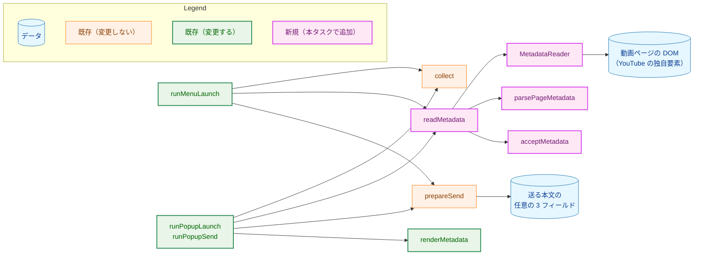
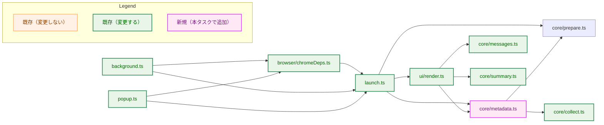
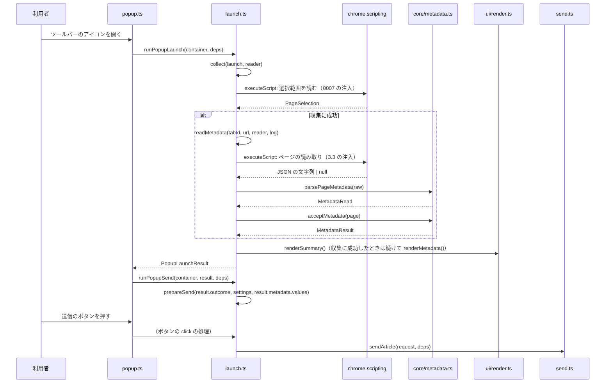
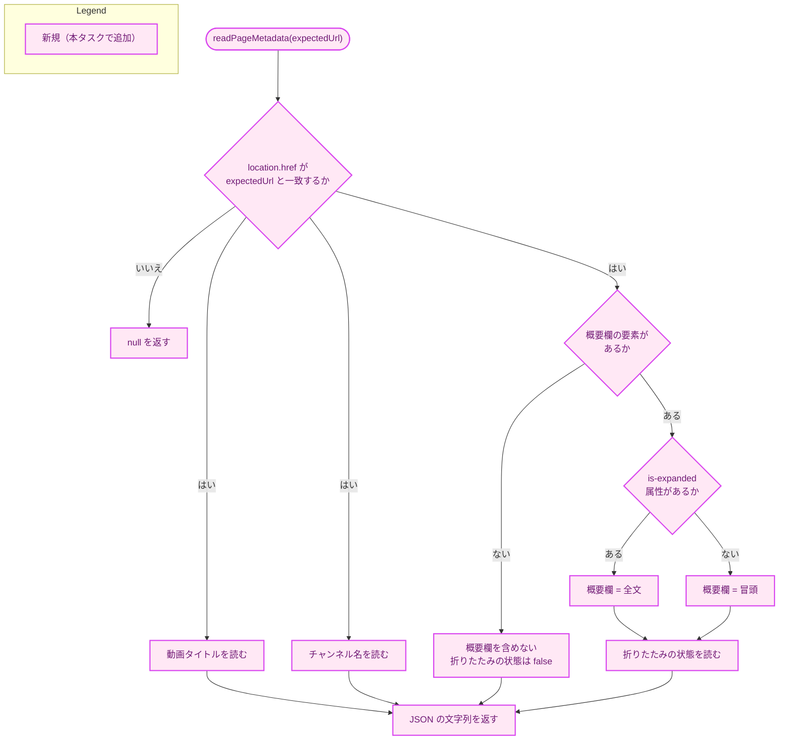
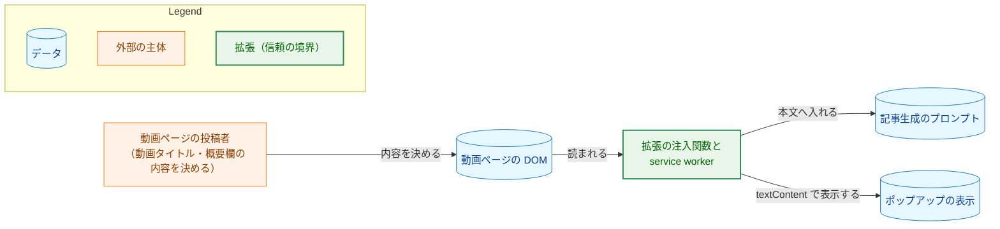
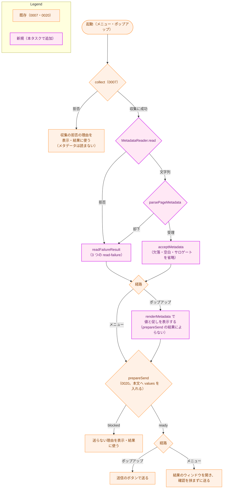

# アーキテクチャ設計書：ブラウザ拡張による動画タイトル・チャンネル名・概要欄の取得と送信

## Document Status

| Item | Value |
|---|---|
| Status | `approved` |
| Created | 2026-10-17 |
| Review date | 2026-10-18 |
| Reviewer | isseis |
| Comments | 実装計画の作成に合わせた編集上の訂正（判断は変えていない）。AC-18 の静的な確認を実行する拡張のテスト `extension/test/metadataDocs.test.ts` と、`whitespaceOnly` の再利用のための `core/collect.ts` の export、用語の追加のための `docs/translation_glossary.md` を 2.1・3.8・3.9・3.11 に加えた。AC-09・AC-10・AC-18・AC-19 の確かめ方を 7.4 と 3.9 で実行する検査に合わせた（AC-09 はタブのタイトルの結線を `launch.test.ts`、AC-10 は省略の理由のログを `launch.test.ts`、AC-18 は `metadataDocs.test.ts`、AC-19 は `chromeDeps.test.ts` の注入がページを操作しないこと）。いずれも設計の判断（何を確かめるか）を変えず、確かめる手段を実行される検査に定めるだけである。要件書の承認後の訂正（2026-10-18）に合わせた編集上の訂正（判断は変えていない）。新しい AC-04a（収集した URL との不一致による省略と、収集の拒否の後に読まないこと）を 3.3・3.5・3.9・5.2・7.4 の対応に加え、AC-11（表示だけの切り詰めと本文の値）と AC-14（bidi の手動確認）の確かめ方を 3.9・7.2・7.4 に合わせた。3.6 の表示の上限の理由を、要件書 F-002 の本文の大きさの理由と矛盾しない記述に改めた。レビューの指摘（2026-10-18）に合わせた編集上の訂正（判断は変えていない）。3.6 の表示の上限から再利用する関数の指定（`truncate` の export・`displayValue`）を除き、要約と同じ方法の既存の処理を再利用し同じ処理を書き直さないという設計のレベルの記述に改めた。2.1・3.8・3.11 の `core/summary.ts` の記述も同じレベルに揃えた。関数の選び方は [implementation_handoff.md](implementation_handoff.md) I-02 に申し送った。表示だけをコードポイントで切り詰めて `…` を付けること、送る値を切り詰めないこと、上限を実装で決める表示の固定値とすること、その理由は変えていない。表示での切り詰めの再利用による `ui/render.ts` → `core/summary.ts` の依存を 2.2 の図に加えた（2026-10-18 の編集上の訂正。`truncate` の再利用は既に 3.6 が定めており、図の記載漏れを補っただけで、判断は変えていない）。実装後のレビューで挙がった、ページの読み取りが返らない場合のリスクを 5.4 に加えた（2026-10-19。リスクを受け入れ、上限時間を設けないことを利用者が判断した。設計は変えていない）。5.4 のこのリスクの記述を訂正した（2026-10-19 の編集上の訂正）。メタデータの読み取りは選択範囲の読み取りとは別の注入で、それ自体が返らないことがあるため、新たに加わるリスクを 2 つの読み取りの間の短い時間に限るとした記述を改めた。リスクを受け入れ、上限時間を設けないという判断は変えていない 2026-10-24 (decision): タスク 0038 の F-005 により、AC-18 の検証方法を改めた（`metadataDocs.test.ts` の README と `security.md` §8.1 の語句の検査を削除したため）。決定はタスク 0038 の承認済みの要件で決めたので、`Status` は `approved` のままとする。 |

本書は [01_requirements.md](01_requirements.md)（要件定義書。以下、要件書）の設計である。既存のファイルに関する記述は、コミット `c93a87b` のファイルで確かめた。`file:line` はこのコミットの行番号を指す。F-NNN・AC-NN は要件書の項番を指す。要件のレビューで設計に申し送られた事項（[design_handoff.md](design_handoff.md) の H-01〜H-05）への対応は 3.10 にまとめる。レビューで実装の段階に申し送る事項は [implementation_handoff.md](implementation_handoff.md) が集め、`03_implementation_plan.md` が対応を記録する。

本書は次の文書を参照する。

-   **0007 の設計書:** [`docs/tasks/0007_browser_extension_skeleton/02_architecture.md`](../0007_browser_extension_skeleton/02_architecture.md)。拡張の骨格と収集の設計。「0007 §N」はその節を指す。
-   **0020 の設計書:** [`docs/tasks/0020_extension_send/02_architecture.md`](../0020_extension_send/02_architecture.md)。送信のクライアントの設計。「0020 §N」はその節を指す。
-   **API の設計書:** [`docs/tasks/0011_localhost_server/02_architecture.md`](../0011_localhost_server/02_architecture.md)。サーバと HTTP API の設計。「API の設計書 §N」はその節を指す。

本書では、0007・0020 の設計書の用語（拡張のディレクトリ、メニューの経路、ポップアップの経路、収集、収集の結果、表示用の要約、送信のクライアント、送る前の確認）をそのまま使い、次の用語を加える。

-   **動画メタデータ:** 動画ページの DOM から読む動画タイトル・チャンネル名・概要欄の 3 つ。API の任意フィールド `title`・`channelName`・`description` の値になる（要件書 6.、本書 3.2 の `VideoMetadata`）。
-   **ページの読み取り:** 注入した関数が動画ページの DOM を読み、3 つの値と折りたたみの状態を返すこと（3.3）。返す値は 3.2 の `PageMetadata` である。
-   **メタデータの結果:** 1 回のページの読み取りの後に得る、受け入れた値・促しの印・省略の理由（3.2 の `MetadataResult`）。表示と本文への受け渡しとログに使う。
-   **ページの読み取りの口:** 動画ページの読み取りを行う依存の interface（3.3 の `MetadataReader`）。テストでは fake に置き換える。
-   **促しのメッセージ:** 概要欄が折りたたまれているときに、ポップアップに表示する固定の文言（3.6 の `expandPromptMessage`。要件書 F-003）。

## 1. 設計の全体像 (Design Overview)

### 1.1. 設計原則

-   **0007・0020 の層の分け方をそのまま使う。** ページの読み取りの結果の解釈（受理する形の検査と、値の省略の判定）は、ブラウザの API も DOM も参照しない関数として `extension/src/core/` に置く。DOM の問い合わせと `chrome.scripting` は、経路の処理が受け取る依存の interface の向こうに置き、テストでは fake に置き換える（要件書 4.5、0007 §1.1、0020 §1.1）。
-   **メタデータは収集の結果に加えず、別の引数で送る前の確認へ渡す。** 0020 §9 が #170 の設計として定めたとおり、メタデータを `CollectedInput` に加えない。`collect`・`buildArticleBody`・`sendArticle`・`classifyResponse` と送信の表示を変更せずに済む（要件書 4.5、0020 §9）。
-   **DOM に依存する読み取りを、選択範囲の読み取りから分ける。** 選択範囲はブラウザの選択の API（`window.getSelection()`）から取り、DOM には依存しない（0007 §4.2）。DOM に依存するメタデータの読み取りは別の注入に分ける。こうすると、DOM の構造の変化による取得の失敗が、選択範囲の収集を失敗させない（要件書 F-001 AC-04）。
-   **ページの読み取りの結果を信頼できない入力として扱い、受理する形に合わなければ省略する。** 注入した関数が返す文字列を厳格に解析し、宣言したメンバの閉じた集合と値の型に合わなければ、すべての値を省略する（要件書 3.2・AC-20、CLAUDE.md 「Reject, don't normalize」）。値は補正しない。欠落した値、空白文字だけの値、対になっていないサロゲートを含む値は省略する（要件書 F-001・F-002）。
-   **取得の失敗は起動を止めない。** 読み取りの失敗も、値の省略も、拒否の理由にしない。省略したフィールドの名前と理由を開発者向けのログに残し、取得できた値だけで続ける（要件書 F-004）。記事の生成に必要な `videoUrl` と `transcript` の送信を止めない。
-   **ページを操作しない。** 拡張は起動したタブの DOM を読むだけである。概要欄の「…もっと見る」をクリックして開くことはしない。折りたたまれているときは、利用者に開くよう促す固定のメッセージをポップアップに表示するだけにする（要件書 F-003、§4.2）。
-   **untrusted テキストをテキストとして表示する。** 動画タイトル・チャンネル名・概要欄は untrusted な入力である。HTML やほかのマークアップとして解釈せず、`textContent` だけで表示し、本文へは JSON の文字列として入れる。値からコードを実行しない（要件書 §4.2、0020 §5.2）。

### 1.2. 概念モデル

矢印 A → B は「A が B を使う（呼び出す、または読み書きする）」を表す。



-   `readMetadata`（3.5）は、`MetadataReader` でページを読み、`parsePageMetadata` で受理する形を検査し、`acceptMetadata` で値を省略する。得たメタデータの結果を経路の処理へ返し、経路の処理が値だけを `prepareSend` の任意の 3 フィールドに渡す。
-   `collect` は 0007 のまま変更しない。メタデータの読み取りは、`collect` が収集に成功したときだけ行う。
-   ポップアップの経路だけが `renderMetadata` で値と促しのメッセージを表示する。メニューの経路は確認を挟まずに送るので表示しない（要件書 F-003）。

### 1.3. 既存のコードとの関係

本タスクは Go のソースを変更しない。拡張の `core/` の純粋な関数、注入の実装、経路の処理と表示、テスト、文書（README・security.md）だけを変更する。manifest と権限は変更しない（要件書 §4.2、AC-19）。

拡張の中で既存のものを変える箇所は次のとおりである。振る舞いを変えないものは 3.8 にまとめる。

-   ポップアップの経路は、収集した内容の表示に加えて動画メタデータと促しのメッセージを表示し、送信時には、メタデータを送る前の確認に渡す（3.5・3.6）。
-   メニューの経路は、送信の前に動画メタデータを読んで本文へ渡す（3.5）。
-   注入の interface（`ScriptingApi`）を、選択範囲を読む関数と ページの読み取りの関数の 2 つを受けられる形に広げる（3.3）。
-   `RejectionMessage` の形（文言と手順）を、拒否の理由に限らない `Message` として一般化する（振る舞いは変えない。3.8）。
-   経路の依存に `MetadataReader` を加える（3.5）。

## 2. システム構成 (System Structure)

### 2.1. ディレクトリ構成

本タスクで加える・変えるファイルだけを示す。ほかは 0007 §2.1・0020 §2.1 のとおりである。

```
extension/
  src/
    core/
      metadata.ts          # PageMetadata・VideoMetadata・MetadataResult・parsePageMetadata・acceptMetadata（新規。3.2）
      messages.ts          # Message と expandPromptMessage を加える（変更。3.8）
      collect.ts           # whitespaceOnly を export する（変更。振る舞いは変えない。3.8）
      summary.ts           # 表示の切り詰めに既存の切り詰めの処理を再利用できるようにする（変更。振る舞いは変えない。3.6）
    ui/
      render.ts            # renderMetadata を加える（変更。3.6）
    browser/
      chromeDeps.ts        # readPageMetadata・createMetadataReader を加える（変更。3.3）
    launch.ts              # MetadataReader と readMetadata の追加、runMenuLaunch・runPopupLaunch・runPopupSend の変更（変更。3.5）
    background.ts          # メニューの経路の依存に MetadataReader を加える（変更）
    popup.ts               # runPopupLaunch の結果を runPopupSend へ渡す（変更）
  static/
    style.css              # メタデータの表示の bidi（変更。3.6）
  test/
    metadata.test.ts       # 新規（3.9）
    renderMetadata.test.ts # 新規（3.9）
    metadataDocs.test.ts   # 新規。README・security.md の記載の静的な確認（AC-18。3.9・7.4）
    chromeDeps.test.ts     # 変更（3.9）
    launch.test.ts         # 変更（3.9）
    messages.test.ts       # 変更（3.9）
    prepare.test.ts        # 変更（3.9）
    render.test.ts         # 変更（3.9）
README.md                  # 変更（要件書 F-005）
docs/dev/security.md       # 変更（要件書 F-005）
docs/translation_glossary.md  # 変更（用語の追加。要件書 6.）
```

-   `metadata.ts` は `core/` に置く。DOM も `chrome.*` も参照せず、文字列だけを扱う。
-   `renderMetadata` は `render.ts` に置く。既存の `field`（`extension/src/ui/render.ts:19-38`）と `messageNodes`（`extension/src/ui/render.ts:69-88`）を再利用する（3.6）。
-   新しい権限も、manifest の項目も加えない。注入は、0007 が既に持つ `scripting` の権限と `activeTab` で起動したタブに対してだけ行う（要件書 §4.2）。

### 2.2. コンポーネントの依存関係

矢印 A → B は「A が B を import する（型だけの import を含む）」を表す。この図は、本タスクで加える・変える依存と、それによって新しく生じる依存だけを示す（既存の依存の網羅ではない）。



### 2.3. 実行時の配置

ポップアップの経路の流れを示す。メニューの経路は、促しのメッセージを表示しない点だけが異なり、収集の後にメタデータを読んで送信するところは同じである。

矢印 A → B は「A が B を呼び出す」を、点線の戻り矢印 A -->> B は「A が B へ値を返す」を表す。



-   ページの読み取りは、収集に成功したときだけ 1 回行う。収集が拒否ならば `runPopupLaunch` は `MetadataResult` を空の結果（値なし、促しなし、省略なし）として返す（3.5）。
-   `parsePageMetadata` と `acceptMetadata` は DOM も `chrome.*` も参照しないので、ブラウザなしでテストできる（3.9）。

## 3. コンポーネント設計 (Component Design)

### 3.1. 動画ページの観測（H-01）

0007 §3.12.2 はチャンネル名と概要欄のセレクタを記録したが、動画タイトルのセレクタは観測していない。本タスクは、macOS の Chrome 155.0.8059.40 と Brave 1.97.57（Chromium 155.0.8059.80）で、ログインしていない状態の動画ページを DevTools のコンソールで観測した（2026-10-17）。1 本目は直接開き、ページ内の関連動画のリンクから 2 本目に移動した後も観測した。

下表は両方のブラウザで共通の観測である。セレクタの一致数は、`document.querySelectorAll` の結果である。

| 項目 | セレクタ | 一致数 | 観測 |
|---|---|---|---|
| 動画タイトル | `ytd-watch-metadata #title h1` | 1 | 一致する `h1` の `textContent` は、前後に空白と改行を含む |
| 動画タイトル | `ytd-watch-metadata #title h1 yt-formatted-string` | 1 | 値は動画タイトルそのもの（前後の空白を含まない）。`document.title` は「動画タイトル + ` - YouTube`」になる |
| チャンネル名 | `ytd-channel-name a` | 41 | 単独では使えない（ページ内の別の要素にも一致する） |
| チャンネル名 | `#owner #channel-name #text` | 1 | 値はチャンネル名そのもの（前後の空白を含まない） |
| チャンネル名 | `ytd-video-owner-renderer #channel-name a` | 1 | 上のセレクタと同じ値 |
| 概要欄の要素 | `ytd-watch-metadata #description-inline-expander` | 1 | 本当の概要欄。`ytd-text-inline-expander` はページ内に 2 つあり、もう 1 つ（`#inline-expander`、watch メタデータの外）は隠れている |
| 概要欄（折りたたみ時） | `#attributed-snippet-text` | 1 | 動画によって中身が違う。1 本は 253 文字で全文と一致し、別の 1 本は 37 文字で冒頭のみ（全文は 1,295 文字）だった |
| 概要欄（開いた後） | `#expanded yt-attributed-string` | 1 | 全文が入る。折りたたみ時は空 |
| 折りたたみの状態（DOM） | `ytd-watch-metadata #description-inline-expander` の `is-expanded` 属性 | - | 折りたたみ時は属性がなく、開いた後に `is-expanded` が付く。ボタン（`#expand`・`#collapse`）の可視状態より確実だった |

-   **ページ内の移動:** 移動後は動画タイトル・チャンネル名・概要欄が移動先の値に変わり、概要欄は折りたたみに戻った（`is-expanded` が外れ、`#expanded` が空になった）。`window.ytInitialPlayerResponse` を使わない理由（0007 §3.12.2）は、この観測でも裏付けられた。
-   **短い概要欄の扱い:** 概要欄の領域には「文字起こし」「動画の詳細」などが自動的に付くため、概要欄が短くても「…もっと見る」が出る。**「概要欄が短く、ボタンも出ない」動画は見つからなかった。** そこで、促しのメッセージを出す条件は「概要欄の要素があり、折りたたまれている（`is-expanded` がない）」とし、概要欄の要素がないときと、開かれているときは出さない（3.2 の `showExpandPrompt`）。
-   これらのセレクタは YouTube が独自に定義した要素（カスタム要素）に依存する。この構造は公開の仕様ではなく、YouTube が予告なく変えうる。取得に失敗した場合を拒否の理由にしないこと（要件書 F-001・F-004）が要件である。

### 3.2. メタデータの型と、読み取りの結果の解釈（F-001・F-002・F-004・AC-01〜AC-02・AC-04a・AC-06〜AC-10・AC-20、H-02）

```typescript
// core/metadata.ts

import type { ArticleMetadata } from "./prepare.ts";

/** The video page values the injected reader returned, before acceptance. */
export interface PageMetadata {
  readonly title?: string | undefined;
  readonly channelName?: string | undefined;
  readonly description?: string | undefined;
  readonly descriptionCollapsed: boolean;
}

/** The accepted metadata; the same type as the request body's optional members. */
export type VideoMetadata = ArticleMetadata;

/** The fields of the metadata; the unit of an omission. */
export type MetadataField = "title" | "channelName" | "description";

/** Why one field was omitted; declared, never inferred from text. */
export type OmissionReason =
  | "absent" // the field was not in the read result
  | "blank" // the value is empty or whitespace only
  | "unpaired-surrogate" // the value has an unpaired surrogate
  | "read-failure"; // the whole read failed (injection error or a rejected shape)

export interface MetadataOmission {
  readonly field: MetadataField;
  readonly reason: OmissionReason;
}

/** Which check a rejected read failed; for the developer log only, never a page value. */
export type MetadataCheck =
  | "json"
  | "top-level"
  | "member-set"
  | "duplicate-member"
  | "value-type";

/** The result of parsing the read's JSON text. */
export type MetadataRead =
  | { readonly kind: "accepted"; readonly page: PageMetadata }
  | { readonly kind: "rejected"; readonly check: MetadataCheck };

/** The result of one page read: the accepted values, the prompt flag, and what to log. */
export interface MetadataResult {
  readonly values: VideoMetadata;
  readonly showExpandPrompt: boolean;
  readonly omissions: readonly MetadataOmission[];
  readonly check?: MetadataCheck;
}

/** Parses the injected reader's JSON text strictly; never throws. */
export function parsePageMetadata(text: string): MetadataRead;

/** Drops absent, blank, and ill-formed values. Never throws and never repairs. */
export function acceptMetadata(page: PageMetadata): MetadataResult;

/** The result of a read that failed; every field omitted with reason "read-failure". */
export function readFailureResult(check?: MetadataCheck): MetadataResult;

/** The empty result used when the collection was rejected: no read is attempted. */
export function emptyMetadataResult(): MetadataResult;
```

-   `VideoMetadata` は 0020 の `ArticleMetadata`（`extension/src/core/prepare.ts:12-17`）の別名である。同じ形を別に宣言しない。`ArticleMetadata` の 3 つのメンバは `exactOptionalPropertyTypes: true` の下で `string | undefined` と宣言されている。`readMetadata` は `result.values` をそのまま `prepareSend` の `metadata` 引数に渡せる（3.5）。

**`parsePageMetadata`（受理する形の検査。AC-20）:** 注入した関数は、値を JSON の文字列として返す（3.3）。`parsePageMetadata` は、0020 の `classifyResponse`（`extension/src/core/response.ts:145-215`）と同じ厳格さで次を確かめ、1 つでも合わなければ `{ kind: "rejected", check }` を返す（`check` は `MetadataCheck` の値。ページの値ではなく、開発者向けのログにだけ使う）。

1.  `JSON.parse` が成功すること。失敗すれば `check: "json"`。
2.  最上位がオブジェクト 1 つであること（`null` と配列を拒否する）。合わなければ `check: "top-level"`。
3.  メンバ名が、`title`・`channelName`・`description`・`descriptionCollapsed` の閉じた集合に含まれること。宣言していないメンバを拒否し、拡張可能と宣言しない。`descriptionCollapsed` は必須であり、欠けても拒否する。合わなければ `check: "member-set"`。
4.  メンバ名が重複しないこと。`JSON.parse` は重複したメンバを後の値で黙って上書きするので、解析した結果からは検出できない。0020 の `classifyResponse` は引用符の数で重複を検出するが、本タスクの値は任意のテキスト（`"` を含みうる）なので、同じ方法は使えない。文字列とエスケープを追いながらメンバ名を集める小さな走査で重複を検出する。重複すれば `check: "duplicate-member"`。
5.  `title`・`channelName`・`description` は、存在すれば文字列であること（`null`・数値・真偽値・オブジェクト・配列を拒否する）。`descriptionCollapsed` は真偽値であること。合わなければ `check: "value-type"`。

-   重複の検出は、この境界が値のテキストを扱うための理由の 1 つである（3.3 の H-02 の決定）。ページの DOM の値そのものは、上記の項目 3 と 5 の検査を通る。
-   注入した関数は自分で値を組み立てるので、この検査は防御の層である。それでも、DOM の値は untrusted であり、`chrome.scripting` の結果を信頼しないために、受理する形を 1 つの境界で厳格に検査する（0020 §5.2 と同じ方針）。
-   注入した関数は、読み取った時点の `location.href` が、収集した URL と一致しなければ `null` を返す（3.3）。`createMetadataReader` は文字列以外の結果を拒否するので、これは読み取りの失敗になる（別の動画の値を混ぜないため。3.3）。

**`acceptMetadata`（値の省略。AC-01〜AC-02・AC-06〜AC-08・AC-10）:** 受理した `PageMetadata` から、3 つのメンバを順に扱い、次に当てはまる値を省略する。省略したら、そのフィールドと理由を `omissions` に加える。

-   **欠落（`absent`）:** メンバがない。
-   **空白文字のみ（`blank`）:** 値が空文字列、または Unicode の `White_Space` の文字だけである（全角空白を含む）。判定は、0007 の `collect` の `whitespaceOnly`（`extension/src/core/collect.ts:43`）と同じ規則を使う。
-   **対になっていないサロゲート（`unpaired-surrogate`）:** 値が、対になっていないサロゲート（孤立した上位または下位のサロゲート）を含む。`JSON.stringify` はこれを `\ud800` などのエスケープにし、サーバは `invalid_body` で拒否する（API の設計書 §3.6 の (a)）。任意のメタデータが記事の生成そのものを失敗させないよう、その値を送らない（要件書 F-002）。対になったサロゲート（サロゲートペア）は保つ。

-   値を補正しない。値を切り詰めない。前後の空白を除かない。`metadata.ts` は値の大きさの独自の上限を持たない（本文の大きさの上限は 0020 の `body-too-large` が扱う。要件書 F-002）。
-   `showExpandPrompt` は、`page.descriptionCollapsed` が真で、かつ `description` の値を受け入れたときだけ真とする。概要欄がない（`description` を省略した）ときは促しを出さない（要件書 F-003、3.1）。
-   省略した値の集合は、`acceptMetadata` が返す `omissions` にだけ現れる。値そのものは `omissions` に含めない（要件書 F-004・AC-16a）。

**読み取りの失敗（AC-16・AC-20）:** `MetadataReader.read` が拒否した場合（注入の失敗、または収集した URL との不一致による `null`）は `readFailureResult()` を、`parsePageMetadata` が `{ kind: "rejected", check }` を返した場合（形の不一致）は `readFailureResult(check)` を使う。どちらも 3 つのフィールドを `read-failure` で省略した結果であり、値も促しもない。起動は続行する。

### 3.3. ページの読み取りの注入（F-001・AC-01〜AC-04a、H-01・H-02）

```typescript
// browser/chromeDeps.ts

/** The chrome.scripting surface used, for both injected functions. */
export interface ScriptingApi {
  executeScript<Args extends unknown[], Result>(injection: {
    readonly target: { readonly tabId: number };
    readonly func: (...args: Args) => Result;
    readonly args: Args;
  }): Promise<Array<{ readonly result?: unknown }>>;
}

export function createMetadataReader(scripting: ScriptingApi): MetadataReader;

/** Runs in the tab's top frame. Returns the metadata as JSON text, or null on a URL mismatch. */
function readPageMetadata(expectedUrl: string): string | null;

// launch.ts

/** The only browser capability the metadata read needs. Faked in unit tests. */
export interface MetadataReader {
  /** Reads the metadata of the tab's top frame as JSON text. Rejects on any failure. */
  read(tabId: number, expectedUrl: string): Promise<string>;
}
```

-   `ScriptingApi` は現在、`func: () => PageSelection` だけを受け取る（`extension/src/browser/chromeDeps.ts:7-12`）。選択範囲の注入とページの読み取りの注入の 2 つを受けられるよう、関数の型と `args` を総称型にする。`args` は、ページの読み取りが確認する収集した URL を注入へ渡すために要る（3.3 の URL の確認）。呼び出し側とテストの型（`extension/test/chromeDeps.test.ts:18`）を合わせて改める（3.8）。
-   `MetadataReader` は、ほかの依存の interface（`SelectionReader` は `core/collect.ts:36`、`Logger`・`ResultViewStore` は `extension/src/launch.ts:23-39`）と同じく、**使う側が持つ**。`launch.ts` が `MetadataReader` を宣言し、`browser/chromeDeps.ts` がその実装（`createMetadataReader`）を持つ。`chromeDeps.ts` は既に `launch.ts` の `Logger`・`ResultViewStore` を import している（`extension/src/browser/chromeDeps.ts:3`）ので、逆向きに `launch.ts` が `chromeDeps.ts` から型を import すると循環になる。`core/metadata.ts` に置くと、DOM を知らない `core/` の層にブラウザの依存の interface が混ざる。そこで `launch.ts` に置く。
-   `createMetadataReader` は、`createSelectionReader`（`extension/src/browser/chromeDeps.ts:78-94`）と同じく、注入の結果を実行時に検査する。結果が文字列でなければ拒否する（`read` の拒否）。

**注入する関数（`readPageMetadata`）:** 動画ページのトップフレームで実行し、3.1 の観測に基づいて次を読む。外の名前を参照しない（`chrome.scripting` がソースを直列化してページで実行するため。`extension/src/browser/chromeDeps.ts:50-61`）。

-   **URL の確認:** 引数で受け取った収集した URL と `location.href` を比べ、一致しなければ `null` を返す。収集の読み取りとメタデータの読み取りは別の注入なので、その間に YouTube のページ内の移動（SPA の遷移や自動再生）が起きると、別の動画の値を取ってしまう。選択範囲は 0007 の `collect` が `documentUrl` と起動の URL の一致で守っている（`extension/src/core/collect.ts:71-79`）。メタデータにも同じ守りを課し、不一致なら値を捨てる（`read` の拒否になる。要件書 F-001・AC-04a）。
-   動画タイトル: `ytd-watch-metadata #title h1 yt-formatted-string` の `textContent`。
-   チャンネル名: `#owner #channel-name #text` の `textContent`。
-   概要欄: `ytd-watch-metadata #description-inline-expander` を探し、その要素の中で読む。`is-expanded` 属性があれば `#expanded yt-attributed-string` の `textContent`（全文）を、なければ `#attributed-snippet-text` の `textContent`（冒頭）を使う。どちらを読むかは、折りたたみの状態と同じ `is-expanded` 属性だけで決め、`#expanded` の中身が空かどうかでは選ばない。2 つの信号で別々に決めると、`is-expanded` があるのに `#expanded` がまだ空の場合などに、冒頭だけを送りながら促しを出さない、という食い違いが起こるためである（CLAUDE.md「Declare, don't infer」）。選んだ要素がない場合は概要欄を含めない。
-   折りたたみの状態: 概要欄の要素があるとき、`is-expanded` 属性がなければ `descriptionCollapsed: true`。要素がなければ `false`。
-   値がないメンバは、結果のオブジェクトに含めない。結果を `JSON.stringify` した文字列を返す。

矢印 A → B は「A の手順の後に B へ進む、または A が B から値を取る」を表す。



-   概要欄の全文とスニペットは、要件書 F-001 のとおりに選ぶ。折りたたみ時にスニペットが全文と一致する動画（3.1）でも、値はそのままにする。補正しない。
-   注入は `activeTab` で起動したタブに対してだけ行う（0007 §3.6）。新しい権限は要らない（要件書 §4.2）。

**H-02 の決定（読み取りを分けるか、同じ注入に含めるか）:** 別の注入に分ける。理由は次の 3 つである。

1.  選択範囲の読み取りは DOM に依存せず、その interface（`PageSelection`）と失敗の扱いは 0007 のままにしたい。DOM に依存する値を同じ戻り値に混ぜると、`SelectionReader` の契約とテストを変え、DOM の変化が選択範囲の収集を失敗させうる。
2.  メタデータは JSON の文字列として別の境界で厳格に検査する。戻り値の型が選択範囲と異なるので、別の interface のほうが自然である。
3.  別の注入に分けると、選択範囲の読み取り（0007 の `collect` が `documentUrl` を確認する）とメタデータの読み取りの間で別の動画に移りうる。この間を、ページの読み取りの注入自身が `location.href` と収集した URL を比べて閉じる（不一致なら `null` を返す）。同じ注入に含める場合も、2 つの読み取りの間の遷移は同じように起こりうるので、この確認は分ける・分けないにかかわらず要る。

### 3.4. メタデータの本文への受け渡し（F-002・AC-06〜AC-10）

-   `prepareSend`（`extension/src/core/prepare.ts:95-124`）を変更しない。0020 の第 3 引数 `metadata` に `result.values` を渡すだけである。
-   `buildArticleBody`（`extension/src/core/prepare.ts:32-49`）は、`undefined` と空文字列のメンバを本文から省略する。`acceptMetadata` が既に欠落・空白のみの値を省略しているので、二重の安全になる。`buildArticleBody` は対になっていないサロゲートを検査しないが、`acceptMetadata` が既にその値を省略している（要件書 F-002・AC-10）。
-   本文の大きさの確認（0020 §3.4）は、メタデータを含めた本文に適用する。変更しない（要件書 F-002・AC-08）。
-   `CollectedInput.title`（タブのタイトル）は本文の `title` に入れない。`title` に入るのは動画タイトルである（要件書 F-001・F-002、0020 §3.4）。

### 3.5. 経路の処理（F-001・F-003・F-004・AC-04a・AC-11〜AC-17、H-03・H-05）

```typescript
// launch.ts

export interface MenuLaunchDeps {
  readonly reader: SelectionReader;
  readonly metadataReader: MetadataReader; // added
  readonly settings: SettingsReader;
  readonly send: SendDeps;
  readonly store: ResultViewStore;
  readonly newKey: () => string;
  readonly now: () => number;
  openResultWindow(key: string): Promise<void>;
  signalDisplayFailure(): Promise<void>;
  clearDisplayFailure(): Promise<void>;
  readonly log: Logger;
}

export interface PopupLaunchDeps {
  readonly reader: SelectionReader;
  readonly metadataReader: MetadataReader; // added
  activeTab(): Promise<chrome.tabs.Tab | undefined>;
  readonly log: Logger;
}

/** The popup launch's outcome and the metadata the send will carry. */
export interface PopupLaunchResult {
  readonly outcome: CollectOutcome;
  readonly metadata: MetadataResult;
}

export async function runPopupLaunch(
  container: HTMLElement,
  deps: PopupLaunchDeps,
): Promise<PopupLaunchResult>;

export async function runPopupSend(
  container: HTMLElement,
  result: PopupLaunchResult,
  deps: PopupSendDeps,
): Promise<void>;
```

**`readMetadata`（内部の補助関数）:** `readMetadata(tabId, expectedUrl, reader, log)` は `MetadataResult` を返し、例外を投げない。

-   `reader.read(tabId, expectedUrl)` を呼ぶ。拒否したら（注入の失敗、または収集した URL との不一致）、`readFailureResult()` を返す。
-   返った文字列を `parsePageMetadata` に渡す。`{ kind: "rejected", check }` なら `readFailureResult(check)` を返す。
-   それ以外は `acceptMetadata` の結果を返す。
-   ログは、読み取りが失敗したときと、値を省略したときに残す（3.7）。

**`runMenuLaunch`（変更。F-003・F-004）:**

-   現在 `collect` に渡す `launch`（`extension/src/launch.ts:167`）を変数に取り、収集に成功したときだけ `readMetadata` を呼ぶ。`prepareSend` の第 3 引数に `result.values` を渡す（現在は `{}`。`extension/src/launch.ts:181`）。
-   促しのメッセージは表示しない。メニューの経路は確認を挟まずに送る（要件書 F-003）。`showExpandPrompt` は使わない。
-   本文は、収集に成功して `prepareSend` が `ready` を返したときだけ送る。メタデータの省略は送信の判定に影響しない。

**`runPopupLaunch`（変更。F-003・AC-11〜AC-15）:**

-   現在の表示（`renderSummary(container, summarize(outcome))`。`extension/src/launch.ts:258`）を変えない。収集に成功したときは、その後に `renderMetadata(container, result)` を呼んで表示を追加する（3.6）。
-   収集に成功したときだけ `readMetadata` を呼び、`PopupLaunchResult` を返す。収集が拒否なら `metadata` は `emptyMetadataResult()` とし、ページの読み取りを行わない。

**`runPopupSend`（変更。F-003・AC-13）:**

-   第 2 引数を `PopupLaunchResult` に変え、`result.outcome` と `result.metadata.values` を使う。送信の前の確認（`prepareSend`。`extension/src/launch.ts:277`）に `metadata` を渡す。
-   促しのメッセージがあっても、送信のボタンの扱いを変えない。押せば DOM にある値だけで送る（要件書 F-003・AC-13）。
-   収集が拒否のときの表示と、収集の拒否の理由の扱い（`runPopupSend` の冒頭。`extension/src/launch.ts:272-276`）を変えない。

### 3.6. 表示（F-003・AC-11〜AC-14、H-04）

```typescript
// ui/render.ts

/** Appends the metadata section (and the expand prompt) below the summary. */
export function renderMetadata(
  container: HTMLElement,
  result: MetadataResult,
): void;
```

-   `renderMetadata` は、`container` の子を置き換えずに**追加**する。`renderSummary`（`extension/src/ui/render.ts:103-113`）が `replaceChildren` で置き換えるので、`runPopupLaunch` は `renderSummary` の後に `renderMetadata` を呼ぶ（3.5）。
-   値は、既存の `field`（`extension/src/ui/render.ts:19-38`）で作る。ラベルは `"Video title"`・`"Channel"`・`"Description"` とする。
-   **表示の上限:** 表示は、既存の `OutcomeSummary` の要約と同じ方法で、値をコードポイントで切り詰めて `…` を付ける（`extension/src/core/summary.ts:5-7`・`26-35`）。切り詰めと `…` の付加は、要約が使う既存の処理（`core/summary.ts`・`ui/render.ts`）を再利用し、同じ処理を重ねて書かない。再利用する関数の選び方は実装計画で記録する（[implementation_handoff.md](implementation_handoff.md) I-02）。上限は表示のための固定値（例: 200 コードポイント）とし、実装で決める。**送る値は切り詰めない**（本文には取得した値がそのまま入る）。概要欄は untrusted なテキストで、ポップアップの表示には長くなりうるので、表示の大きさを抑える（0007 §3.5 の要約の切り詰めと同じ理由）。値の大きさが本文の上限に比べて十分に小さいこと（要件書 F-002）とは別の、表示のための理由である。
-   **双方向テキスト（bidi）の分離:** 3 つの値は untrusted なテキストで、双方向の制御文字を含みうる。0007 の要約と同じく、`field` に `dirAuto: true`（`dir="auto"`）を渡し、3 つの値の新しいクラス名を `static/style.css` の `unicode-bidi: plaintext` の規則（`.summary-title, .summary-preview`）に加える。概要欄の値のクラスは、改行を保って表示するため `.summary-preview` と同じく `white-space: pre-wrap` の規則にも加える（加えないと概要欄の改行が空白 1 つに潰れて表示される）。こうすると、値の中の制御文字によって、周囲のラベルやほかの値の表示順が変わらない（0007 §3.7、`extension/src/ui/render.ts:13-34`・`extension/static/style.css:31-36`）。送る前の確認の画面（ポップアップ）の偽装を防ぐためのセキュリティの要件である。
-   値は `textContent` だけで設定し、HTML として解釈しない（要件書 §4.2・AC-14、0007 F-006）。
-   存在する値だけを表示する。`values` にないフィールドの行は作らない。
-   `result.showExpandPrompt` が真のとき、`messageNodes`（`extension/src/ui/render.ts:69-88`）で促しのメッセージを追加する。文言は `expandPromptMessage`（`extension/src/core/messages.ts`）で、固定であり、ページの文字列を含めない。

```typescript
// core/messages.ts

/** The shape of a message: a sentence and optional numbered steps. */
export interface Message {
  readonly text: string;
  readonly steps: readonly string[];
}

/** A rejection reason's message. The name is kept; the shape is Message. */
export type RejectionMessage = Message;

/** The prompt shown when the description is collapsed. Never holds page text. */
export const expandPromptMessage: Message;
```

-   `expandPromptMessage` は、「…もっと見る」を開いてからポップアップを開き直す手順を示す。正確な文言は実装で決める（README の手順と合わせる）。例: text `"The video description is collapsed."`、steps `["Click \"...more\" below the video to show the full description.", "Reopen this popup, then send."]`。
-   `RejectionMessage` を `Message` の別名にするのは、文言と手順の形が拒否の理由に限らないためである。`messageNodes` の引数は `Message` と書くが、`RejectionMessage` はその別名なので、実質の型は変わらない。`rejectionMessage` の戻り値の型も `RejectionMessage` のままである（振る舞いは変えない。3.8）。

### 3.7. ログ（F-004・AC-16・AC-16a、H-05）

ラベルは `metadataLogLabel = "yt2column video metadata"` を使う。値そのもの（動画タイトル・チャンネル名・概要欄）はログに残さない（要件書 F-004・AC-16a）。次を残す。

| 起きること | 残す内容 | レベル |
|---|---|---|
| 読み取りが失敗した（注入の失敗、URL の不一致） | `{ omissions: [3 つの read-failure] }` | `error` |
| 読み取りの結果が受理する形に合わない | `{ check, omissions: [3 つの read-failure] }` | `error` |
| 値が欠落・空白のみ・対になっていないサロゲートで省略された | `{ accepted, collapsed, omissions }`（`accepted` は受け入れたフィールドの名前だけ。`omissions` は `{ field, reason }` の一覧） | `info` |
| すべての値を受け入れた | `{ accepted, collapsed }` | `info` |

-   読み取りの失敗を `error` に、値の省略を `info` にするのは、セレクタの全体的な破損（サイトの変更）を、1 つのフィールドの省略と区別できるようにするためである。`check` は `MetadataCheck` の値で、ページの値ではない。
-   注入の拒否の値（`Error`）はログに出さない。ページ由来の文字列を含みうるためである。残すのは `check` と省略の理由だけにする。
-   既存のログ（`menuLogLabel`・`popupLogLabel`。`extension/src/launch.ts:168-172`・`255-257`）は変更しない。共有トークンをログに出さない規則（0020 §4.2）は変わらない。

### 3.8. 既存の設計からの変更と、更新するテスト

本タスクは、0007 の「利用者が起動するまでページを読まない」方針を保つ（起動したタブの DOM を読むだけ。ページを操作しない）。一方で、0007 が定めた interface を 3 つ広げる。

-   `runPopupLaunch` の戻り値（`extension/src/launch.ts:245-260`）を `CollectOutcome` から `PopupLaunchResult` にする。
-   `ScriptingApi` の関数の型（`extension/src/browser/chromeDeps.ts:7-12`）を、`args` 付きの総称型にする。
-   `messageNodes` の引数の型（`extension/src/ui/render.ts:69-88`）を `Message` にする。

いずれも振る舞いを変えない interface の拡張であり、0007 の設計書のこれらの interface の記述を置き換える。更新するテストを含めて次のとおりである。

| 変更 | 内容 | 更新するテスト |
|---|---|---|
| `core/messages.ts` | `Message` を加え、`RejectionMessage` をその別名にする。`expandPromptMessage` を加える。振る舞いは変えない | `messages.test.ts`（振る舞いは同じ。型の一般化だけ） |
| `core/collect.ts` | `whitespaceOnly` を export する（`metadata.ts` が空白のみの判定に再利用する。3.2）。振る舞いは変えない | `collect.test.ts`（既存は同じ） |
| `core/summary.ts` | 表示の切り詰めに既存の切り詰めの処理を再利用できるようにする。振る舞いは変えない | `summary.test.ts`（既存は同じ） |
| `ui/render.ts` | `messageNodes` の引数の型を `Message` にする。`renderMetadata` を加える | `render.test.ts`（既存は同じ）、`renderMetadata.test.ts`（新規） |
| `static/style.css` | メタデータの値の `unicode-bidi: plaintext` の規則を加える（3.6） | なし（手動の確認。7.2） |
| `browser/chromeDeps.ts` | `ScriptingApi` を総称型にする。`readPageMetadata`・`createMetadataReader` を加える（`MetadataReader` の型は `launch.ts` が持つ。3.3） | `chromeDeps.test.ts` |
| `launch.ts` | `MetadataReader` を宣言する。`MenuLaunchDeps`・`PopupLaunchDeps` に `metadataReader` を加える。`runMenuLaunch`・`runPopupLaunch`・`runPopupSend` を変更し、`PopupLaunchResult` と `readMetadata` を加える | `launch.test.ts` |
| `popup.ts` | `runPopupLaunch` の結果を `runPopupSend` へ渡す | `launch.test.ts` の経路の確認 |
| `background.ts` | メニューの経路の依存に `createMetadataReader(chrome.scripting)` を加える | なし（薄い配線） |
| manifest | 変更しない（権限を加えない） | `manifest.test.ts` を変更しない（AC-19） |

-   0007 の `collect`・`SelectionReader`・`CollectedInput`・`renderSummary` の振る舞いを変更しない（`collect.ts` は `whitespaceOnly` を export するだけで、振る舞いは変えない）。0007 と 0020 の文書のうち #170 で決めるとした記述は、それぞれの記録として残し、変更しない（要件書 F-005）。

### 3.9. テストの構成（AC-01〜AC-21）

テストは `node --test` で実行し、実際のブラウザを起動しない（要件書 5.）。DOM の注入は fake の `chrome.scripting` と jsdom で確かめる。

| テストのファイル | 対象 | 主な AC |
|---|---|---|
| `test/metadata.test.ts`（新規） | `parsePageMetadata`（受理する形。不正な JSON、配列、`null`、未知のメンバ、重複したメンバ、`descriptionCollapsed` の欠落、値の型の違い。返す `check`）と `acceptMetadata`（欠落・空白のみ・対になっていないサロゲートの省略、値の保持、`showExpandPrompt`、`readFailureResult`・`emptyMetadataResult`） | AC-01・AC-02・AC-03・AC-06〜AC-10・AC-20 |
| `test/renderMetadata.test.ts`（新規） | `renderMetadata` を jsdom で実行し、値が `textContent` で表示され要素にならないこと、`` が要素にならないこと、表示の切り詰め（コードポイントで切れ、サロゲートペアを割らない）、`dir` の指定、促しのメッセージが折りたたみ時だけ出ること、促しがページの文字列を含まないこと | AC-11・AC-12・AC-14 |
| `test/chromeDeps.test.ts`（変更） | `createMetadataReader`。fake の `executeScript` が文字列以外を返す（URL の不一致の `null` を含む）か例外を投げると `read` が失敗すること。注入する関数のソースを jsdom の `document` で実行し、3.1 のセレクタで値と折りたたみの状態を読み、URL が一致しなければ `null` を返し、注入がページを操作しないこと | AC-03・AC-04・AC-04a・AC-19 |
| `test/launch.test.ts`（変更） | `runPopupLaunch` が収集に成功したときだけメタデータを読み、`PopupLaunchResult` を返すこと。`runPopupSend` が `result.metadata.values` を `prepareSend` に渡すこと。`runMenuLaunch` が `readMetadata` の値を `prepareSend` に渡し、省略と読み取りの失敗をログに残すこと。読み取りの失敗でも送信に進むこと。ログに値が含まれないこと。本文の `title` が動画タイトルで、タブのタイトルが本文に現れないこと。収集した URL との不一致で 3 つの値が `read-failure` で省略され、送信に進むこと。収集が拒否されたときに `MetadataReader` を呼ばないこと。表示の上限を超える概要欄でも、本文には切り詰める前の値が入ること | AC-04・AC-04a・AC-05・AC-09・AC-10・AC-11・AC-13・AC-15・AC-16・AC-16a・AC-17 |
| `test/prepare.test.ts`（変更） | メタデータを渡した本文（`title`・`channelName`・`description` が入ること、空文字列が入らないこと、`input.title` が入らないこと、`` を含む値が JSON の文字列として入ること、メタデータを含めた大きさの上限） | AC-06〜AC-09・AC-21 |
| `test/messages.test.ts`・`test/render.test.ts`（変更） | `Message` の一般化と `messageNodes` の引数の変更で、既存のテストが通ること（振る舞いは同じ） | -（既存） |
| `test/metadataDocs.test.ts`（新規） | `readRepoFile` で README と `docs/dev/security.md` を読み、要件書 F-005 の記載（動画タイトル・チャンネル名・概要欄を収集して送ること、促しのメッセージの手順、取得できない値があること。DOM から読むこと、untrusted テキストの扱い、新しい権限を加えないこと、ページを操作しないこと、取得に失敗しても起動を失敗させないこと）を含むこと | AC-18 |
| `test/manifest.test.ts`（変更しない） | manifest の権限が変わらないこと | AC-19 |

-   3.1 の観測は手動で行い、結果を 3.1 の表に記す（7.2）。

### 3.10. design_handoff の各項目への対応

| 項目 | 採った方針 | 本書の節 |
|---|---|---|
| H-01 動画ページのセレクタと、概要欄の折りたたみの判定 | 動画タイトルは `ytd-watch-metadata #title h1 yt-formatted-string`、チャンネル名は `#owner #channel-name #text`、概要欄は `ytd-watch-metadata #description-inline-expander`。`ytd-channel-name a` は一致数が多く使わない。折りたたみは `is-expanded` 属性の有無で判定する。短い概要欄でも「…もっと見る」が出るので、促しの条件は「概要欄の要素があり、折りたたまれている」とする。観測は 3.1 に記す | 3.1・3.2・3.3 |
| H-02 読み取りを既存の注入に含めるか、別の読み取りにするか | 別の `MetadataReader` にする。選択範囲の読み取りの契約を変えず、DOM の変化が選択範囲の収集を失敗させないため。戻り値は厳格に検査する JSON の文字列とする。2 つの読み取りの間のページ内の移動に備え、注入が `location.href` と収集した URL を比べ、不一致なら `null` を返す | 3.2・3.3 |
| H-03 値を収集の結果に持たせるか、送信のときに渡すか | 0020 §9 のとおり、`CollectedInput` に加えず、`prepareSend` の `metadata` 引数に別に渡す。ポップアップの経路のために `PopupLaunchResult` が値を持つ | 3.2・3.4・3.5 |
| H-04 ポップアップの表示への統合 | `renderMetadata` を `renderSummary` の後に追加する。値は `field` で作り、促しは `messageNodes` で作る。`renderSummary` は変更しない。表示だけをコードポイントで切り詰め、`dirAuto` と `unicode-bidi: plaintext` で bidi を分離する | 3.6 |
| H-05 開発者向けのログに残す内容 | 省略を `{ accepted, collapsed, omissions }` の形で残し、読み取りの失敗を `error`、値の省略を `info` に残す。読み取った値そのものは残さない。形の不一致は `MetadataCheck` の値で残す | 3.7 |

### 3.11. コンポーネント責務表

| ファイル | 新規/変更 | 責務 |
|---|---|---|
| `extension/src/core/metadata.ts` | 新規 | `PageMetadata`・`VideoMetadata`・`MetadataField`・`OmissionReason`・`MetadataOmission`・`MetadataResult`・`parsePageMetadata`・`acceptMetadata`・`readFailureResult`・`emptyMetadataResult`（3.2） |
| `extension/src/core/messages.ts` | 変更 | `Message` を加え、`RejectionMessage` をその別名にする。`expandPromptMessage` を加える（3.6・3.8） |
| `extension/src/core/collect.ts` | 変更 | 空白のみの判定に再利用する `whitespaceOnly` を export する（振る舞いは変えない。3.8） |
| `extension/src/core/summary.ts` | 変更 | 既存の切り詰めの処理を表示の切り詰めに再利用できるようにする（振る舞いは変えない。3.6） |
| `extension/src/ui/render.ts` | 変更 | `messageNodes` の引数を `Message` にする。`renderMetadata` を加える（3.6） |
| `extension/src/browser/chromeDeps.ts` | 変更 | `ScriptingApi` を総称型にする。`readPageMetadata`・`createMetadataReader` を加える（3.3） |
| `extension/src/launch.ts` | 変更 | `MetadataReader` を宣言する。`MenuLaunchDeps`・`PopupLaunchDeps` に `metadataReader` を加える。`PopupLaunchResult` と `readMetadata` を加える。`runMenuLaunch`・`runPopupLaunch`・`runPopupSend` を変更する（3.5） |
| `extension/static/style.css` | 変更 | メタデータの値の `unicode-bidi: plaintext` の規則を加える（3.6） |
| `extension/src/background.ts` | 変更 | メニューの経路の依存に `createMetadataReader(chrome.scripting)` を加える |
| `extension/src/popup.ts` | 変更 | `runPopupLaunch` の結果を `runPopupSend` へ渡す |
| `extension/test/metadata.test.ts` | 新規 | 3.9 |
| `extension/test/renderMetadata.test.ts` | 新規 | 3.9 |
| `extension/test/metadataDocs.test.ts` | 新規 | README・`docs/dev/security.md` の記載の静的な確認（AC-18。3.9・7.4） |
| `extension/test/chromeDeps.test.ts` | 変更 | 3.9 |
| `extension/test/launch.test.ts` | 変更 | 3.9 |
| `extension/test/prepare.test.ts` | 変更 | 3.9 |
| `extension/test/messages.test.ts` | 変更 | 3.9 |
| `extension/test/render.test.ts` | 変更 | 3.9 |
| `README.md` | 変更 | F-005: 動画タイトル・チャンネル名・概要欄を収集して送ること、概要欄が折りたたまれているときの促しのメッセージ、取得できない値があることを記す（要件書 F-005） |
| `docs/dev/security.md` | 変更 | F-005: §8.1 に、拡張が動画ページの DOM から動画タイトル・チャンネル名・概要欄を読むこと、untrusted テキストとして扱い HTML として解釈せず本文へは JSON の文字列として入れること、新しい権限を加えず既存の `scripting` の注入で DOM を読むだけでページを操作しないこと、取得に失敗しても起動を失敗させないことを加える（要件書 F-005・§4.2） |
| `docs/translation_glossary.md` | 変更 | 動画タイトル・チャンネル名・概要欄・動画メタデータ・促しのメッセージの訳語を加える（要件書 6.） |

-   0007 の `collect`・`SelectionReader`・`CollectedInput`・`renderSummary` を変更しない（`collect.ts` は `whitespaceOnly` を export するだけ）。Go のソースを変更しない。manifest を変更しない。

## 4. エラーハンドリング設計 (Error Handling Design)

### 4.1. エラーの表し方

拡張の中のエラーは、例外のクラスを定義せず、0007・0020 と同じく値の和の型で表す。メタデータについては、エラーではなく `OmissionReason` の省略として表す。

| 起きること | 表し方 | 利用者に示すもの | 開発者向けのログ |
|---|---|---|---|
| 注入した読み取りが失敗した（`read` の拒否、URL の不一致） | 3 つの `read-failure` の省略 | 何も示さない（起動は続行する） | `log.error` に 3 つの省略（`read-failure`）。値も `cause` も出さない |
| 読み取りの結果が受理する形に合わない | 3 つの `read-failure` の省略 | 何も示さない | `log.error` に `check` と 3 つの省略（`read-failure`） |
| 値が欠落している | そのフィールドの `absent` の省略 | 何も示さない | `log.info` に省略（`absent`） |
| 値が空白文字のみ | そのフィールドの `blank` の省略 | 何も示さない | `log.info` に省略（`blank`） |
| 値が対になっていないサロゲートを含む | そのフィールドの `unpaired-surrogate` の省略 | 何も示さない | `log.info` に省略（`unpaired-surrogate`） |
| 概要欄が折りたたまれている | エラーではない | ポップアップに促しのメッセージ | 何も残さない |

-   メタデータの取得の失敗は、拒否の理由（`RejectionReason`）にも送らない理由（`BlockReason`）にもしない（要件書 F-004・AC-17）。収集の拒否（0007）と送る前の確認（0020）の扱いは変えない。

### 4.2. 失敗時の扱いの原則

-   `readMetadata`・`parsePageMetadata`・`acceptMetadata` と経路の処理は例外を投げない。メタデータの読み取りの失敗の後も、次の起動は通常どおり動作する（要件書 4.3、0007 §4.2）。
-   メタデータの取得の失敗は、記事の生成に必要な `videoUrl` と `transcript` の送信を止めない（要件書 F-004・4.3）。
-   値を省略するか迷う場合は、省略する側に倒す。空白のみの値と対になっていないサロゲートを含む値は送らない。
-   表示の文言は理由だけで決める。読み取った値は利用者への表示に使い、表示は `textContent` だけで行う。ログには値そのものを残さない（3.7）。

### 4.3. 副作用の契約

起動の手段ごとに、起こしうる外部への副作用を示す。表にない副作用は起こさない。

| 経路 | 注入 | ページの操作 | `chrome.storage.local` | ネットワーク |
|---|---|---|---|---|
| メニューの経路（収集の拒否） | 選択範囲の読み取りだけ | しない | 読まない | 送らない |
| メニューの経路（収集に成功） | 選択範囲とメタデータの読み取り | しない | 読む | 送る（0020 の `POST /articles` を 1 回） |
| ポップアップを開く（収集の拒否） | 選択範囲の読み取りだけ | しない | 読まない | 送らない |
| ポップアップを開く（収集に成功） | 選択範囲とメタデータの読み取り | しない | 収集に成功した場合だけ読む | 送らない |
| ポップアップの送信のボタン | なし（開いた時点の値を使う） | しない | 読まない | `POST /articles` を 1 回（0020） |

-   ページの読み取りは、`chrome.scripting.executeScript` による注入である。DOM を読むだけで、クリック・入力・送信を行わない。ページの状態を変えない（要件書 §4.2・「ページを操作しない」）。
-   メタデータの読み取りは、収集に成功したときだけ行う。収集が拒否なら、メタデータを読むための注入を行わない。

## 5. セキュリティ考慮事項 (Security Considerations)

### 5.1. 脅威モデル

矢印 A → B は「A が B に影響を与えうる経路」を表す。



-   動画タイトル・チャンネル名・概要欄は、動画ページの投稿者が内容を決められる untrusted なテキストである。記事生成のプロンプトに埋め込まれるため、プロンプトインジェクションによって生成記事の内容が操作されうる（`docs/dev/security.md` §6）。本タスクは値を渡すだけで、生成結果を他のコマンドやコードとして実行しない。
-   値は、表示では `textContent` だけで扱う。HTML やほかのマークアップとして解釈しない（0007 §4.2、0020 §5.2）。

### 5.2. 信頼できない入力の境界

| 境界 | 受理する形 | 上限 | 拒否時の扱い | 検査する箇所 |
|---|---|---|---|---|
| 注入した読み取りの結果（JSON の文字列） | ちょうど 1 つのオブジェクト。メンバ名は `title`・`channelName`・`description`・`descriptionCollapsed` の閉じた集合。重複なし。3 つの値は文字列、`descriptionCollapsed` は真偽値 | -（形で決まる） | 3 つの `read-failure` の省略 | `parsePageMetadata`（3.2） |
| 注入した読み取りの `location.href` | 収集した URL と完全一致 | -（形で決まる） | 3 つの `read-failure` の省略（`null` を返す。要件書 F-001・AC-04a） | 注入する関数（3.3） |
| 動画タイトル・チャンネル名・概要欄の値 | 文字列（UTF-16）。前後の空白・改行・全角空白・サロゲートペアは、あってもそのまま保つ | 本文の上限（0020 F-004 の 4 MiB）に含む | 欠落・空白のみ・対になっていないサロゲートは省略 | `acceptMetadata`（3.2） |

-   値は、本文へ入れるときは `JSON.stringify` を使い、エスケープを正しく行う。DOM の値を JSON の構文として解釈しない（0007 と同じ）。
-   注入した読み取りの結果は、数値・入れ子の値・未知のメンバ・重複したメンバを受理しない。`parsePageMetadata` の検査は 1 つの境界にまとめる（3.2）。
-   **大きさの上限:** 読み取りの結果と値に、独自の大きさの上限は設けない（要件書 §2.3「値の大きさの独自の上限」はスコープ外、§3.2 の値の上限は「本文の上限に含む」）。値の大きさは 0020 の本文の上限（4 MiB）に含め、本文が上限を超える場合は既存の `body-too-large` の扱い（要件書 F-002・AC-08）に委ねる。上限の判定はこの 1 か所だけに置く。観測できる振る舞いは、値が大きくても起動は成功し、本文の大きさの判定だけが働くことである。大きな読み取りの結果の扱いは実装計画で記録する（[implementation_handoff.md](implementation_handoff.md) I-01）。
-   表示される値は、表示のための上限でコードポイント単位に切り詰め、`dirAuto` と `unicode-bidi: plaintext` で bidi を分離する（3.6）。切り詰めと bidi の指定は表示だけに影響し、本文へ入る値は変えない。
-   既存の境界（選択範囲の文字列、タブの URL、タブのタイトル、サーバの応答）は、0007・0020 の境界をそのまま使う。変更しない。送る前に新たに確かめるのは、メタデータの値の省略と、0020 の本文の大きさだけである。

### 5.3. 権限

新しい権限を加えない。ページの読み取りは、0007 が既に持つ `scripting` の権限と `activeTab` で起動したタブに対してだけ行う。`permissions` と `host_permissions` は 0020 のままである（要件書 §4.2・AC-19）。

### 5.4. 残るリスク

-   **YouTube の DOM の構造の変化:** セレクタはカスタム要素に依存する。YouTube が構造を変えると、値の取得に失敗するか、別の文字列を取る。取得に失敗した場合を拒否の理由にしないので、記事は選択範囲だけで生成され続ける。別の文字列を取った場合は、本文に余分な値が入りうる。セレクタは観測の時点の構造であり、実装のときに実際のページで確かめる（3.1・7.2）。このリスクは受け入れる。
-   **ログイン状態での未確認:** 3.1 の観測はログインしていないページで行った。ログインしたページは、`#owner` の周りに登録・チャンネル・メンバーシップなどの要素が増えうる。7.2 の手動の確認でログイン状態でも確かめる。確かめられない場合は、この未確認をリスクとして残す。
-   **2 つの読み取りの間のページ内の移動:** 選択範囲の読み取りとメタデータの読み取りの間に YouTube が別の動画へ移ると、選択範囲とメタデータが別の動画のものになりうる。ページの読み取りの注入が `location.href` と収集した URL を比べ、不一致ならメタデータを捨てるので、メタデータが混ざることはない（3.3）。選択範囲そのものは 0007 の `collect` の確認で守られている。
-   **ページの読み取りが返らない場合:** メタデータの読み取り（`MetadataReader.read`、`chrome.scripting.executeScript`）には時間の上限がない。注入が成功も失敗もせずに返らないと、起動はそこで止まる。メニューの経路では結果のウィンドウもバッジも出ず、送信もしない。ポップアップの経路では要約は表示されるが、動画メタデータと送信のボタンが出ない（利用者は開き直して再試行できる）。読み取りが失敗した場合（例外・`null`）は 3 つの値を省略して進むが（3.5）、返らない場合は失敗にならないので、この扱いが働かない。0007 の選択範囲の読み取り（`collect`）も同じ注入を上限なしで待つので、同じ性質を持つ。ただしメタデータの読み取りは別の注入なので、選択範囲の読み取りが成功した後でも、それ自体が返らないことがある。新たに加わるリスクは、2 つの読み取りの間にタブが応答しなくなる場合に限らない。ページの移動でフレームがなくなる場合は、注入は例外で失敗し、省略として扱われる。返らないことは手動の確認（7.2）では起きておらず、起きる条件も確かめていない。上限を設けるなら選択範囲の読み取りと合わせて扱うのが筋なので、本タスクでは設けず、このリスクを受け入れる（2026-10-19）。
-   **促しのメッセージが不要に表示される:** 折りたたみ時にスニペットが全文と一致する動画（3.1）でも、促しのメッセージを表示する。利用者が開き直しても値は変わらない。害はないので受け入れる。
-   **プロンプトインジェクション:** メタデータは untrusted なテキストであり、記事生成のプロンプトに埋め込まれる。生成記事の内容が操作されうる。本タスクは新しい防御を加えず、既存の方針（`docs/dev/security.md` §6「生成結果を他のコマンドやコードとして実行しない」）に従う。
-   **読み取った値の扱い:** 読み取った値は、開発者向けのログには残さず、ポップアップの表示にだけ使う。表示は `textContent` だけで行い、双方向テキスト（bidi）を分離し、表示の上限で切り詰める（3.6）。

### 5.5. 対象クライアント環境の検証

`_context.md` の対象クライアント環境（Mattermost への Incoming Webhook）は、拡張が Webhook に送らないので該当しない。拡張が新たに使うブラウザの機能と、その確かめ方を示す。

| 機能 | 確かめた・確かめる内容 |
|---|---|
| `scripting.executeScript` で DOM を読むこと（新しい権限なし） | 0007 §3.6 の注入と同じ API。`activeTab` で起動したタブに対してだけ行う。7.2 の手動の確認で、macOS の Chrome と Brave の両方で確かめる |
| 3.1 のセレクタで値と折りたたみの状態を読めること | 2026-10-17 に macOS の Chrome 155.0.8059.40 と Brave 1.97.57 で、ログインしていないページで観測済み（3.1）。ログイン状態は 7.2 の手動の確認で確かめる（5.4） |
| `dir="auto"` と `unicode-bidi: plaintext` による bidi の分離 | 0007 の要約と同じ仕組み（`extension/static/style.css:31-36`）。7.2 の手動の確認で、値に双方向の制御文字を含む動画で確かめる |

## 6. 処理フロー詳細 (Processing Flow Details)

1 回の起動で、収集の後にメタデータを読み、送るまでの流れを示す。収集の判定（0007）と送る前の確認（0020）の順序は変えない。

矢印 A → B は「A の判定の後に B へ進む」を表す。



## 7. テスト戦略 (Test Strategy)

### 7.1. ユニットテスト

3.9 のとおり、`node --test` で fake の依存と jsdom を使う。テストは合成した値だけを使い、実際の YouTube のページの実データも、ページの HTML のスナップショットも加えない（要件書 5.）。注入する関数のテストは、関数のソースを `vm.runInNewContext` で実行する（0007 の `chromeDeps.test.ts:82-99` と同じ方法）。0007 のテストは `window` と `location` だけの素のオブジェクトを文脈に渡すが、本タスクはセレクタを確かめるため、jsdom で組み立てた最小の DOM の `document` を文脈に渡す。

### 7.2. 統合テスト（手動）

ブラウザを起動する自動テストは設けない（要件書 5.）。次の手動の確認を、macOS の Chrome と Brave の作業時点の安定版で行い、実装計画に結果を記録する。

| AC・項目 | 手動の確認 |
|---|---|
| AC-01・AC-03 | 概要欄が長く「…もっと見る」が出る動画で起動し、ポップアップに動画タイトル・チャンネル名・概要欄（冒頭）が表示される。概要欄を開いてから起動し直すと全文が表示される |
| AC-11・AC-12 | 概要欄が折りたたまれているとき促しのメッセージが出て、開いた後は出ない |
| AC-15 | メニューの経路では促しのメッセージを出さず、確認を挟まずに送る |
| AC-16a | 開発者向けのコンソールに、省略したフィールドの名前と理由が残り、値そのものは残らない |
| 3.1 のセレクタ | 実際の拡張から、動画タイトル・チャンネル名・概要欄と折りたたみの状態が読める（Chrome と Brave。ログイン状態を含む）。取得できない値を含むページでも起動が成功する（5.4） |
| AC-14: 双方向テキスト（bidi）の分離（3.6・5.5） | 動画タイトル・概要欄に双方向の制御文字（U+202E など）を含む動画で、ポップアップのラベルとほかの値の表示順が変わらない |

### 7.3. セキュリティテスト

-   AC-14・AC-21: `renderMetadata.test.ts`（jsdom。`` を値に含め、要素にならず `textContent` に現れること）。
-   AC-16a: `launch.test.ts`（識別できる文字列を値に使い、省略のログに現れないこと）。
-   AC-19: `manifest.test.ts`（変更しない。権限が 0020 のままであること）。

### 7.4. 受け入れ基準と設計の対応

| AC | 設計 | 確かめ方 |
|---|---|---|
| AC-01 | 3.2・3.3 | `metadata.test.ts`・`chromeDeps.test.ts`・手動（7.2） |
| AC-02 | 3.2 | `metadata.test.ts` |
| AC-03 | 3.2・3.3 | `metadata.test.ts`・`chromeDeps.test.ts`・手動（7.2） |
| AC-04 | 3.3・3.5 | `chromeDeps.test.ts`・`launch.test.ts` |
| AC-04a | 3.2・3.3・3.5 | `chromeDeps.test.ts`（URL の不一致で `null`、`null` の拒否）・`launch.test.ts`（3 つの `read-failure`、収集の拒否では読まない） |
| AC-05 | 3.4・3.5 | `launch.test.ts`・`prepare.test.ts` |
| AC-06 | 3.4 | `prepare.test.ts` |
| AC-07 | 3.2・3.4 | `metadata.test.ts`・`prepare.test.ts` |
| AC-08 | 3.4 | `prepare.test.ts` |
| AC-09 | 3.3・3.4・3.5 | `launch.test.ts`（タブのタイトルが本文に現れないこと）・`prepare.test.ts` |
| AC-10 | 3.2・3.4・3.7 | `metadata.test.ts`・`launch.test.ts`（省略の理由のログ） |
| AC-11 | 3.6 | `renderMetadata.test.ts`（表示と表示だけの切り詰め）・`launch.test.ts`（本文には切り詰める前の値）・手動（7.2） |
| AC-12 | 3.2・3.6 | `renderMetadata.test.ts`・手動（7.2） |
| AC-13 | 3.5・3.6 | `launch.test.ts` |
| AC-14 | 3.6 | `renderMetadata.test.ts`・手動（7.2 の bidi の分離） |
| AC-15 | 3.5・3.6 | `launch.test.ts`・手動（7.2） |
| AC-16 | 3.5・3.7 | `launch.test.ts` |
| AC-16a | 3.2・3.7 | `metadata.test.ts`・`launch.test.ts` |
| AC-17 | 3.5 | `launch.test.ts` |
| AC-18 | 3.11（README・security.md） | PR のレビューでの読み合わせ（タスク 0038 で `metadataDocs.test.ts` の README と security.md の語句の検査を削除した）・手動（7.2） |
| AC-19 | 3.8・5.3 | `manifest.test.ts`・`chromeDeps.test.ts`（静的な確認）・手動（7.2） |
| AC-20 | 3.2 | `metadata.test.ts` |
| AC-21 | 3.4・3.6 | `prepare.test.ts`（本文に文字列として入ること）・`renderMetadata.test.ts`（表示で要素にならないこと） |

## 8. 実装優先順位 (Implementation Priorities)

1.  **core:** `core/metadata.ts` と `core/messages.ts` の一般化、そのテスト（AC-01〜AC-03・AC-06〜AC-10・AC-20・AC-21）。ブラウザの API に依存しないので、最初に固める。
2.  **注入:** `browser/chromeDeps.ts` の `ScriptingApi` の一般化・`readPageMetadata`・`createMetadataReader` とそのテスト（AC-03・AC-04）。
3.  **経路と表示:** `launch.ts` の `readMetadata`・`runMenuLaunch`・`runPopupLaunch`・`runPopupSend`、`ui/render.ts` の `renderMetadata`、`popup.ts`・`background.ts` の配線とそのテスト（AC-04・AC-05・AC-13・AC-15〜AC-17）。
4.  **手動の確認と文書:** 7.2 の確認と、README・security.md の更新（AC-11・AC-12・AC-15・AC-16a・AC-18）。

## 9. 将来の拡張性 (Future Extensibility)

-   **概要欄の全文の取得:** 現在はページを操作せず、DOM にある値だけを送る。将来、拡張が「…もっと見る」を開くことを許すなら、注入した関数でクリックして `#expanded` の全文を取れる。その場合は、0007 の「ページを操作しない」方針の変更として扱う。
-   **表示の上限の調整:** 表示の切り詰めの上限は表示のための固定値である（3.6）。長い概要欄の見え方に応じて、値を調整できる。
-   **メタデータの他の項目:** 動画の長さ・投稿日など、DOM から読める別のメタデータを加えるなら、`PageMetadata` にメンバを加え、`acceptMetadata` と表示を広げる。本文のメンバは API の定義（#109）に従って加える。
-   **セレクタの複数候補:** YouTube が構造を変えた場合に備えて、セレクタの候補を順に試す形（`A, B` の結合セレクタなど）を採れる。3.1 の観測の範囲では 1 つのセレクタで足りるので、今は加えない（YAGNI）。
