# アーキテクチャ設計書：Native Messaging ホストを中継役にした Unix ドメインソケット経由の送信

## Document Status

| Item | Value |
|---|---|
| Status | `draft` |
| Created | 2026-10-18 |
| Review date | - |
| Reviewer | - |
| Comments | §3.10 の実機での確認（S-1〜S-8）は未実施。承認の前に行い、結果を §3.10 の表に記録する。要件書の F-004・AC-26 の改定（lastError を文字列で分けず、ホストの失敗として結果不明にまとめる）に合わせて §3.7.4・§3.7.5・§6.3 などを改めた。要件書の再承認が必要 |

本書の F-NNN・AC-NN は [01_requirements.md](01_requirements.md)（以下、要件書）の項番、H-NN は [design_handoff.md](design_handoff.md) の項目（対応は §3.11）を指す。既存のコードの行番号は、コミット `9e34229`（要件書の承認のコミット）で確かめたものである。

**用語。** 要件書の用語（ホスト、UDS、受付応答、`requestId`、stale socket、残余リスク、同一ユーザーのフル権限プロセスなど）に加えて、本書では次の語を使う。

-   **サーバ:** 実行ファイル `yt2column-server`（`cmd/yt2column-server`）と、その中心の `internal/server` を指す。
-   **ホスト:** 本タスクで作る実行ファイル `yt2column-nmhost`（`cmd/yt2column-nmhost`）と、その中心の `internal/nmhost` を指す。ブラウザが起動する Native Messaging ホストである。
-   **ホスト名:** ブラウザにホストを登録する名前 `io.github.isseis.yt2column`。ホストの manifest の `name` と、拡張が送信先に指定する値である。
-   **ソケットのディレクトリ:** UDS のソケットを置くディレクトリ（§3.1 の `run`）。ソケットとロックのファイルだけを置く。
-   **起動のロック:** ソケットのディレクトリのロックのファイルに対する排他の `flock`（§3.2）。サーバは、起動から終了まで（シャットダウン中のジョブの完了待ちを含む）これを持ち続ける。
-   **サーバの応答:** サーバが UDS 上の HTTP で返す状態コードと JSON の本文（`status`・`reason`・`requestId`）。
-   **ホストの応答:** ホストが Native Messaging のメッセージとして拡張へ返す、固定の形の JSON（§3.5.4）。サーバの応答を包む形と、ホストの固定のエラーの形の 2 つがある。
-   **ホストのエラー:** ホストが返す固定のエラー `server_unavailable`・`server_timeout`・`protocol_error`・`message_too_large`（要件書 F-003）。
-   **送信の結果:** 拡張が 1 回の送信について決める表示の分類（§3.7.4）。「受理」「拒否」「未送信」「結果不明」の 4 つに分かれる。
-   **lastError:** 拡張が `chrome.runtime.sendNativeMessage` を呼んだ結果、ブラウザが `chrome.runtime.lastError` に設定する失敗。文字列の `message` だけを持つ。
-   **0007・0011・0020・0021・0025:** 要件書 §6 の用語集のとおり。「0011 §3.5.2」は 0011 の設計書（`docs/tasks/0011_localhost_server/02_architecture.md`）の節を指す。0020 も同様である。

## 1. 設計の全体像 (Design Overview)

### 1.1. 設計原則

-   **境界だけを置き換え、ジョブには触れない。** 本文の検証（`internal/server/request.go`）、枠とジョブ（`internal/server/job.go`）、失敗の通知、パイプラインは変えない。置き換えるのは、ブラウザとサーバの間の通り道（TCP と共有トークン → Native Messaging と UDS）だけである（要件書 4.5）。
-   **UDS の上でも HTTP/1.1 を使う。** サーバの `http.Server` とハンドラをそのまま `UnixListener` の上で動かす。新しいフレームの形式を作らない（§3.4、H-06）。
-   **ホストは中継に徹する。** ホストは記事の JSON を解釈しない。拡張のメッセージのバイト列を HTTP の本文として流し込み、サーバの応答の状態コードと本文のバイト列を、解釈せずに固定の形で包んで返す。判断するのは、長さと時間と通信の失敗だけである（§3.5）。
-   **失敗は「どこで止まったか」で分類する。** 拡張の表示は、リクエストがサーバに届いていないと確定する場合（未送信）と、届いた可能性がある場合（結果不明）を分ける。ホストは、OS のエラーの種類ではなく、失敗した段階（接続の前か後か）で固定のエラーを選ぶ（§3.5.3、H-05）。分類が付かない失敗は、結果不明の側に倒す（fail-secure。再送による二重投稿を防ぐ側）。
-   **型で宣言し、文字列から推測しない。** ホストのエラー、送信の結果、拒否の理由は、列挙型と網羅的な `switch` で表す。ブラウザが文字列だけで返す lastError も、その中身で処理を分けず、あったかなかったかだけを見る（§3.7.5、CLAUDE.md「Declare, don't infer」）。
-   **修復せずに拒否する。** ソケットのディレクトリの権限、ソケットの種別と所有者、manifest の中身が受理する形でなければ、修復も削除もせずに中止する（CLAUDE.md「Reject, don't normalize」）。
-   **既存の部品を再利用する。** ロックは `internal/cachelock`、環境変数の読み取りは `internal/config`、ログの伏せ字は `internal/redact`、manifest の厳格な読み取りは `internal/strictjson`、拡張の応答の検査は `extension/src/core/response.ts` の `classifyResponse` を使う（§1.3）。

### 1.2. 概念モデル

矢印 A → B は「A が B へデータを渡す」ことを表す。点線の矢印 A → B は「A が B の場所を参照する（設定や登録を読む、待ち受ける、接続先として使う）」ことを表す。

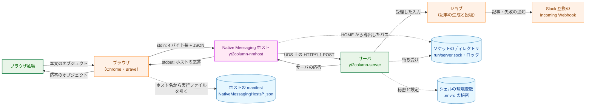

**Legend**

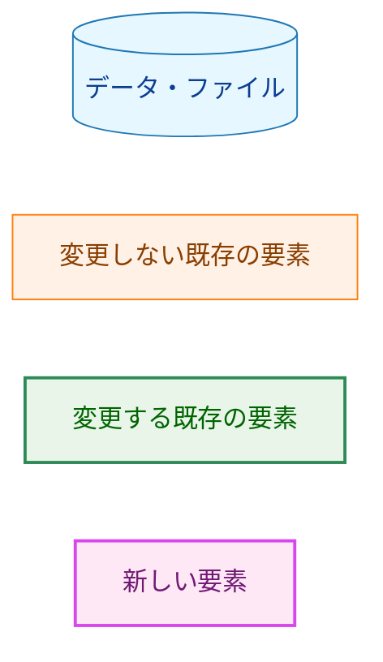

1 回の送信は、次の 3 つのやり取りが 1 つずつ入れ子になったものである。

| やり取り | 通り道 | 1 回の範囲 | 失敗の表れ方 |
|---|---|---|---|
| 拡張 ⇄ ホスト | `chrome.runtime.sendNativeMessage`（ブラウザが stdin/stdout を中継する） | ホストの 1 回の起動。1 メッセージを送り、1 メッセージを受け取る | lastError、またはホストの応答 |
| ホスト ⇄ サーバ | UDS 上の HTTP/1.1（1 接続 1 リクエスト） | `POST /articles` の 1 回 | ホストのエラー |
| サーバ ⇄ ジョブ | 既存のまま（`startJob`） | 受付応答の前にジョブを始め、応答はジョブの完了を待たない | Slack の失敗の通知（既存） |

### 1.3. 既存コードとの関係

| 既存の部品 | 本設計での扱い |
|---|---|
| `internal/server` の本文の検証・枠・ジョブ・失敗の通知（`request.go`・`job.go`） | 変えずに使う。ヘッダの検査のうち `Host`・`Content-Type`・`Origin`・`Authorization` だけを削る（§3.3） |
| `http.Server` の設定（`internal/server/server.go:114-123`） | 変えずに使う。`Serve` が受け取るリスナーを TCP の 2 つから UDS の 1 つに変える |
| `internal/cachelock`（`internal/cachelock/cachelock.go:71-102`） | 起動のロックに使う。ディレクトリに固定の名前のファイルを `O_NOFOLLOW`・`O_NONBLOCK` で開き、通常ファイルであることを確かめ、待たずに排他の `flock` を取る。この契約がそのまま起動のロックの要件（H-02）に合うので、新しいロックを書かない（§3.2.2） |
| `internal/config` の `LookupFunc` と `VarError`（`internal/config/config.go:86-115`） | ソケットのパスの導出を置く。サーバとホストの両方が同じ関数を通る（要件書 4.5「パスを二重に書かない」）。値を含まない `VarError` で失敗を返す既存の形を使う |
| `internal/config/envaccess_test.go` の環境変数の読み取りの制限（`:65-69`） | ホストの `main.go` を、`os.LookupEnv` を 1 回だけ参照してよい場所として加える |
| `internal/strictjson` | uninstall と install が既存の manifest を読むときに使う（§3.6） |
| `extension/src/core/response.ts` の `classifyResponse`（`:145-215`） | サーバの応答の本文の検査にそのまま使う。ホストの応答の外側の形の検査だけを新しく書く（§3.7.3） |
| `extension/src/core/sendMessages.ts` の網羅的な `switch` | 送信の結果ごとの文言に使う。削除する理由の分岐を除き、新しい分類の分岐を加える（§3.7.4） |
| `cmd/yt2column/extension_docs_test.go` の拡張 ID の導出（`extensionIDFromManifestKey`） | ホストの `allowed_origins` が拡張の manifest の `key` から導出した ID と一致することの確認に使う（§3.9） |

## 2. システム構成 (System Structure)

### 2.1. パッケージ構成

矢印 A → B は「A が B を import する（拡張では、A が B のモジュールを読み込む）」ことを表す。本タスクに関係する主な import だけを示し、変更する拡張のモジュールのうち `launch.ts`・`sendMessages.ts`・`resultView.ts`・`ui/renderSend.ts` は省く（§3.12）。削除するパッケージとモジュールには `problem` の色を使う。

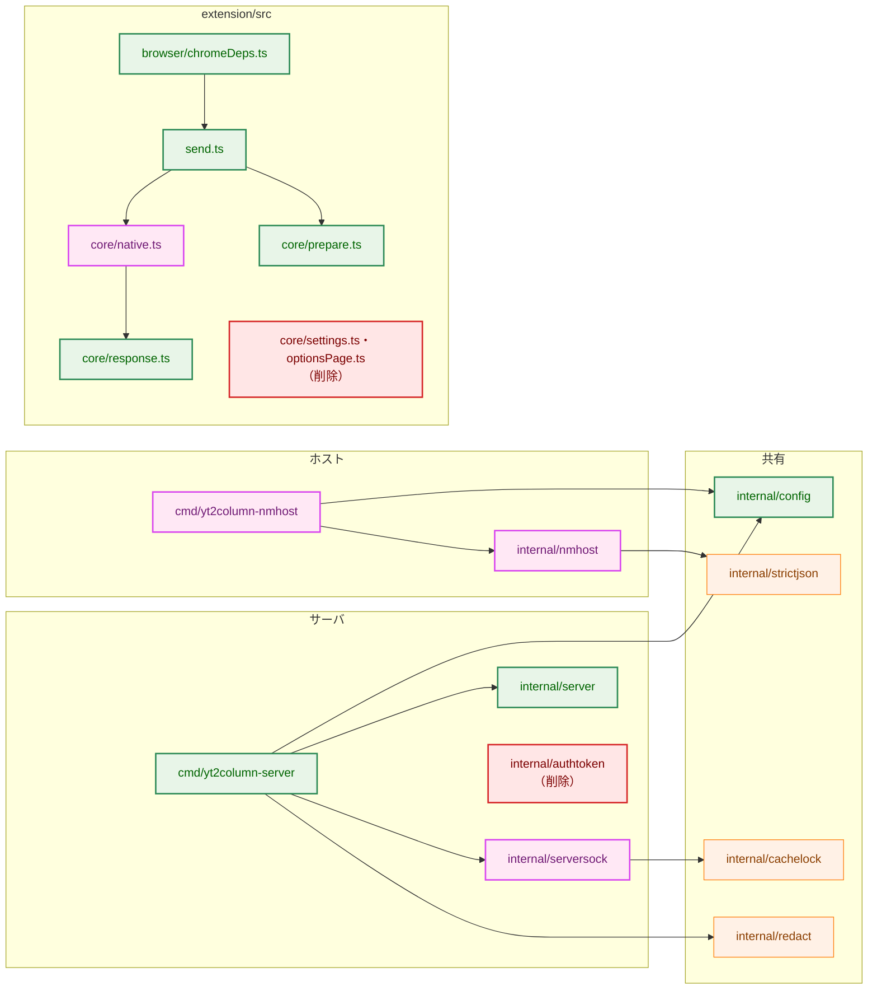

**Legend**

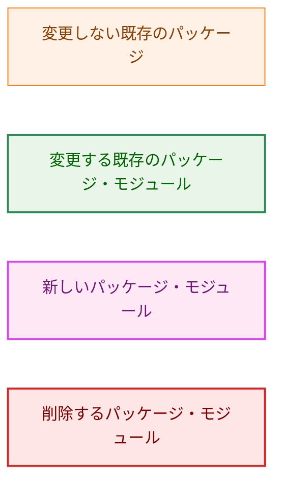

-   `internal/server` は `internal/serversock` を import しない。サーバは受け取った `net.Listener` の上で動くだけで、ソケットのファイルを知らない。テストは一時ディレクトリの UDS のリスナーを渡す。
-   `internal/nmhost` は `internal/server` を import しない。ホストはサーバの応答を解釈しないので、サーバの型を知る必要がない。ホストとサーバの間の契約（パス `/articles`、本文の上限 4 MiB）は、両者のテストと統合テスト（§7.2）で固定する。
-   `internal/nmhost` は `internal/config` を import しない。`cmd/yt2column-nmhost` が `config.LoadHost`・`config.LoadHostHome` で得た値（ソケットのパスと `HOME`）を渡す。
-   これらの境界と、`internal/nmhost`・`cmd/yt2column-nmhost` が `os/exec` を import しないことは、`.golangci.yml` の `depguard` の規則で強制する（既存の `publisher-no-server` と同じ形。§7.3）。

### 2.2. コンポーネント配置

| 実体 | 起動 | 置き場所（macOS） | 置き場所（他の Unix） |
|---|---|---|---|
| サーバ | 利用者がシェルから手動で起動する（既存のまま） | `build/yt2column-server` | 同左 |
| ホスト | ブラウザが、送信のたびに起動する。install/uninstall は利用者が実行する | `build/yt2column-nmhost`（任意の場所に置ける。TCC（macOS の、書類などのフォルダへのアクセスを制限する仕組み）で保護されたフォルダの外に置く。§3.10） | 同左 |
| ソケットのディレクトリ | サーバが起動時に作る | `$HOME/Library/Application Support/yt2column/run/` | `$HOME/.local/state/yt2column/run/` |
| ソケット | サーバが起動時に作り、正常終了で消す | ソケットのディレクトリの `server.sock` | 同左 |
| 起動のロックのファイル | サーバが起動時に作り、消さない | ソケットのディレクトリの `.yt2column.lock`（`internal/cachelock` の固定の名前） | 同左 |
| ホストの manifest（Chrome） | 利用者が install で作る | `$HOME/Library/Application Support/Google/Chrome/NativeMessagingHosts/io.github.isseis.yt2column.json` | `$HOME/.config/google-chrome/NativeMessagingHosts/` の同名のファイル |
| ホストの manifest（Brave） | 同上 | `$HOME/Library/Application Support/BraveSoftware/Brave-Browser/NativeMessagingHosts/io.github.isseis.yt2column.json` | `$HOME/.config/BraveSoftware/Brave-Browser/NativeMessagingHosts/` の同名のファイル |

-   macOS のソケットのパスは、`HOME` の長さを除いて 54 バイトである（`/Library/Application Support/yt2column/run/server.sock`）。macOS の上限（§3.1）の 103 バイトから、`HOME` は 49 バイトまで使える（`/Users/` を除くとユーザー名は 42 文字まで）。超える場合は起動を中止する（AC-04、H-04）。
-   ホストの manifest の置き場所のうち、他の Unix の値は Chrome のドキュメントの記載に従ったもので、本タスクでは手動で確かめない（要件書 2.3「Linux ではビルドとテスト」）。macOS の 2 つの置き場所は §3.10 の S-6 で確かめる。

### 2.3. データフロー（受理）

矢印は呼び出しまたはメッセージの送信を、点線の矢印はその応答を表す。

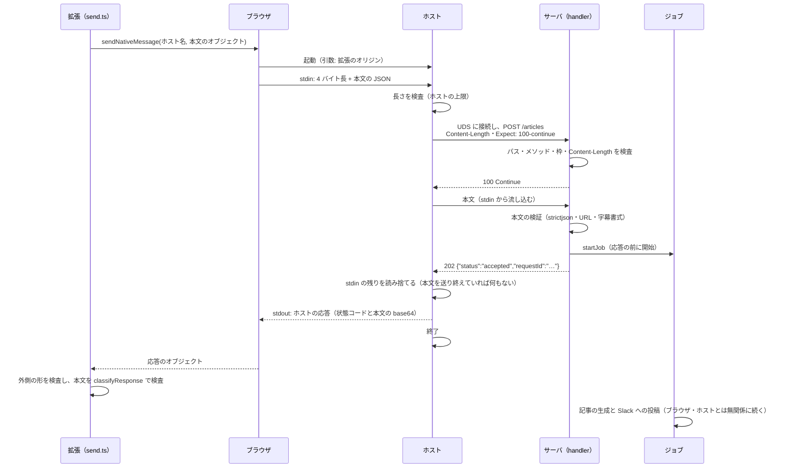

## 3. コンポーネント設計 (Component Design)

### 3.1. ソケットのパス（`internal/config`、F-001・AC-04・AC-18、H-04・H-10）

ソケットのパスは `HOME` だけから導出する。導出の関数は `internal/config` に 1 つだけ置き、サーバの `LoadServer` とホストの中継の `LoadHost` の両方がそれを呼ぶ。ホストの install/uninstall は、ソケットのパスを使わないので、`HOME` だけを読む `LoadHostHome` を使う（ソケットのパスが長すぎる利用者でも manifest を削除できるようにするため）。

| OS（`runtime.GOOS`） | パス |
|---|---|
| `darwin` | `$HOME/Library/Application Support/yt2column/run/server.sock` |
| `windows`・`plan9`・`js`・`wasip1` | 導出しない（`HOME` を名指す `VarError`） |
| それ以外の Unix | `$HOME/.local/state/yt2column/run/server.sock` |

-   **他の環境変数を読まない（AC-18）。** `XDG_CONFIG_HOME`・`XDG_STATE_HOME`・`XDG_RUNTIME_DIR`・`TMPDIR` を読まない。ブラウザが起動するホストは、利用者のシェルの環境変数を引き継がない。他の変数を読むと、シェルから起動したサーバとホストが別のパスを導出しうるためである（要件書 F-001）。この点で、キャッシュのディレクトリの導出（`internal/config/cachedir.go:74-97` の `userDirBase`、`XDG_CACHE_HOME` を優先する）とは規則が異なる。`userDirBase` は再利用しない。
-   **Linux の置き場所（H-10）。** 要件書の例の `$HOME/.config/...` ではなく、実行時の状態に向いた `$HOME/.local/state/...`（XDG Base Directory の `XDG_STATE_HOME` の既定値）を選ぶ。`XDG_STATE_HOME` 自体は読まない。
-   **`HOME` の検査。** `HOME` が未設定・空・相対パスなら、`HOME` を名指す `VarError`（`ErrMissing`）を返す。既存の `absoluteEnv`（`internal/config/cachedir.go:99-107`）を使う。
-   **長さの上限（AC-04、H-04）。** 導出したパスのバイト数が、OS の `sun_path` に収まる上限を超えれば、`HOME` を名指す `VarError`（`ErrInvalid`、理由は「導出したソケットのパスが OS の上限を超える」）を返す。上限は `darwin` で 103 バイト（`sun_path` は 104 バイト）、それ以外の Unix で 107 バイト（`sun_path` は 108 バイト）とし、終端の NUL の 1 バイトを残す。`internal/config` はビルドタグなしでどの OS でもビルドされる。テストは `runtime.GOOS` の値を引数に取り、OS ごとの規則を確かめる（既存の `userDirBase` と同じ形）。このため、上限は OS ごとの定数で持つ。`internal/serversock` の `//go:build unix` のテストでは、定数が `len(syscall.RawSockaddrUnix{}.Path) - 1` と一致することを確かめる。`VarError` は値を持たないので、エラーにパスも `HOME` の値も現れない（AC-04「値を含めずに」）。
-   **空白を含むパス（H-04）。** macOS のパスは `Application Support` の空白を含む。Go の `net` と `syscall` はパスをシェルに渡さないので、空白は問題にならない。README の `curl --unix-socket` の例では、パスを二重引用符で囲む（§3.9）。

```go
// internal/config

// ServerConfig: the port and the token path are removed; the socket path is added.
// SocketPath returns the absolute path of the server's Unix domain socket,
// derived from HOME alone. It is within the OS limit.
func (c ServerConfig) SocketPath() string

// HostConfig is the relay's configuration. Its field is unexported, so a
// non-zero HostConfig can only come from LoadHost.
type HostConfig struct {
	socketPath string // absolute, within the OS limit
}

// LoadHost reads HOME, and nothing else, through lookup. It derives the socket
// path with the same rule as LoadServer and returns a *VarError naming HOME
// when HOME is unusable or the derived path exceeds the OS limit.
func LoadHost(lookup LookupFunc) (HostConfig, error)

func (c HostConfig) SocketPath() string

// LoadHostHome reads HOME, and nothing else, through lookup, and returns it
// when it is set and absolute. install and uninstall derive the browsers'
// manifest directories from it (§3.6); it does not check the socket path.
func LoadHostHome(lookup LookupFunc) (string, error)
```

-   **削除するもの（AC-05）:** `ServerConfig` の `port`・`tokenPath` と `Port()`・`TokenPath()`、`loadServerPort`・`parseServerPort`・`isDecimalDigits`・`loadTokenPath`（`internal/config/config.go:304-353`）、定数 `serverPortEnv`・`defaultServerPort`・`minServerPort`・`maxServerPort`・`reasonServerPort`（`:44-55`・`:83`）、`tokenFileName`・`configDirOverride`・`defaultConfigDir`・`reasonConfigDirAbsent`（`internal/config/cachedir.go:9-11`・`:32-41`・`:56-66`、`config.go:82`）。`defaultConfigDir` の呼び出し元は `loadTokenPath` だけなので（`grep` で確かめた。コミット `9e34229`）、トークンのパスを消すと到達できなくなる。`isDecimalDigits` の呼び出し元も `parseServerPort` だけである。

### 3.2. 待ち受け（`internal/serversock`、F-001・AC-01〜AC-04・AC-06、H-01〜H-03）

新しいパッケージ `internal/serversock` が、ソケットのディレクトリの検査、起動のロック、stale の判定、bind、作成後の権限の検査を受け持つ。`//go:build unix` とする。

```go
// internal/serversock

// ErrAlreadyRunning reports that another server holds the start lock of the
// socket directory: it is running, or it is shutting down and waiting for its
// jobs.
var ErrAlreadyRunning = errors.New("another server holds the socket directory lock")

// ErrInUse reports that a process accepts connections on the socket path
// although no server holds the start lock. The path is left as it is.
var ErrInUse = errors.New("another process accepts connections on the socket path")

// ErrUnsafe reports that the socket directory, its parent, the lock file, or
// the name at the socket path does not meet the accepted form. Nothing is
// repaired or removed. *UnsafeError carries the path and the fixed reason.
var ErrUnsafe = errors.New("the socket directory or the socket path is not in the accepted form")

// UnsafeError names the path and one fixed reason. It wraps ErrUnsafe.
type UnsafeError struct {
	Path   string
	Reason UnsafeReason
}

// UnsafeReason is one fixed reason; its String is the text shown to the user.
type UnsafeReason int

func (e *UnsafeError) Error() string
func (e *UnsafeError) Unwrap() error

// Lock is the held start lock of one socket directory. Listen is a method of
// Lock, so the socket cannot be bound without holding the lock.
type Lock struct { /* unexported: the cachelock.Lock and the socket path */ }

// Acquire prepares the socket directory of socketPath (creating it with mode
// 0o700 when missing), checks the directory and its parent, and takes the
// start lock without waiting.
func Acquire(socketPath string) (*Lock, error)

// Listen removes a stale socket, binds the socket path, sets it to 0o600, and
// checks the result. Closing the returned listener removes the socket.
func (l *Lock) Listen() (net.Listener, error)

// Release releases the start lock. The caller calls it after every job and
// failure notice has finished, and keeps the *Lock reachable until then.
func (l *Lock) Release() error
```

#### 3.2.1. ソケットのディレクトリの検査（AC-02、H-01）

`Acquire` は次の順で検査する。どれかに合わなければ `*UnsafeError` を返し、権限の変更も削除もしない。

1.  ソケットのディレクトリの親（`.../yt2column`）がなければ、`os.MkdirAll` でモード `0o700` で作る。祖先（Linux の `$HOME/.local/state` など、新しい `HOME` にはないことがある）も同じ呼び出しで作られる。既存の祖先の権限は変えない。
    -   親が存在すれば `Lstat` で、symlink でないディレクトリであること、所有者が実効ユーザーであること、グループとその他の書き込みのビット（`0o022`）が立っていないことを確かめる。親に他人が書き込めると、検査の後に `run` の名前を入れ替えられるためである。
    -   親の権限が `0o700` であることまでは求めない。親は以前のトークンのディレクトリとして `0o700` で作られているが、利用者が権限を変えていてもソケットの安全には影響しないためである。
2.  ソケットのディレクトリ（`run`）がなければ、`os.Mkdir` でモード `0o700` で作る。umask によって `0o700` より狭くなった場合は、次の検査で中止する（補正しない）。
3.  ソケットのディレクトリを `Lstat` で、symlink でないディレクトリであること、所有者が実効ユーザーであること、権限がちょうど `0o700` であることを確かめる。

**防御の位置づけ（H-01）:** 他ユーザーを排除する主な防御は、ソケットのディレクトリの `0o700` である。`net.Listen("unix", ...)` は umask に従ってソケットを作るので、bind から `chmod` までの間、ソケットは `0o600` より広い権限で存在しうる。この間も、他ユーザーはディレクトリを検索できない（`x` のビットがない）ので、ソケットに接続できない。ソケットの `0o600` は、ディレクトリの権限が後から変えられた場合に備える 2 つ目の防御とする。プロセス全体の umask を一時的に変える方法は採らない。umask はプロセス全体の状態で、他の goroutine のファイルの作成と競合するためである。

**祖先のディレクトリ:** `HOME` と `Library/Application Support`（他の Unix では `.local/state`）は検査しない。macOS の既定では、利用者のホームの下は他ユーザーが書き込めない。これを前提とし、§5.4 に記す。

#### 3.2.2. 起動のロック（AC-03、H-02・H-03）

`Acquire` は、ディレクトリの検査の後、`cachelock.Acquire(ソケットのディレクトリ)` で起動のロックを取る。

-   **目的（H-02）:** stale の判定・`unlink`・bind を、サーバの間で直列化する。ロックがなければ、2 つのサーバが同時に同じソケットを stale と判定し、`unlink` と bind が入れ違って、片方が相手の新しいソケットを消しうる。
-   **再利用:** `internal/cachelock` の `Acquire` は、固定の名前（`.yt2column.lock`）のファイルを `O_NOFOLLOW`・`O_NONBLOCK` で開き、通常ファイルでなければ失敗し、`LOCK_EX|LOCK_NB` の `flock` を取る（`internal/cachelock/cachelock.go:71-102`）。ロックのファイルを消さない契約も同じである。パッケージの名前はキャッシュ向けだが、契約はディレクトリに依存しない。パッケージのコメントとエラーの文言（「the cache directory」など）を、ディレクトリを問わない言い方に改める（`internal/cachelock/cachelock.go:1-5`・`:73`。振る舞いは変えない）。`cachelock.Acquire` の `MkdirAll` は、`serversock` が先にディレクトリを作って検査しているので何もしない。`cachelock.ErrLocked` は `serversock.ErrAlreadyRunning` に読み替える。`cachelock.LockedError` の文言は `yt-dlp` に触れるので、利用者には見せない（`serversock` が自分のエラーで包み直し、`LockedError` を `%w` で包まない）。
-   **保持する期間（H-03）:** サーバは、起動のロックを、`Serve` が返った後（シャットダウン中のジョブと失敗の通知の完了を待った後）まで持ち、そこで `Release` する。Go の `UnixListener.Close` は、シャットダウンの始めにソケットを `unlink` する。ロックを持ち続けるので、この後に起動した次のサーバは `ErrAlreadyRunning` で中止する。したがって、2 つのサーバが同時にジョブを処理し、同時実行数の上限（2）がサーバ全体で効かなくなることはない。H-03 の問い（この期間を受け入れるか）には、受け入れず、防ぐと答える。
-   **ロックへの参照を保つ:** `*serversock.Lock` は `cachelock.Lock`（その中の `*os.File`）への参照を持ち、`run` は `Release` を呼ぶまでこれを変数として持ち続ける。参照が失われると、`*os.File` のファイナライザが記述子を閉じ、シャットダウンの待ち合わせの途中でロックが黙って外れうる。`run` の構造（`Release` の呼び出しが `Serve` の後にあること）がこの不変条件を保つ。
-   **プロセスの終了:** `flock` は、プロセスが終了すれば（`SIGKILL` を含む）解放される。異常終了で残るのはソケットだけで、ロックは残らない。2 回目のシグナルでの即時の終了（`internal/signalrun`）でも同じである。
-   **子プロセス:** サーバは子プロセスを起動しない。`os.OpenFile` は close-on-exec で開くので、仮に起動しても継承されない。

#### 3.2.3. stale の判定と bind（AC-03・AC-06）

`Listen` は、ソケットのパスを `Lstat` して次のように扱う。

| ソケットのパスの状態 | 扱い |
|---|---|
| 存在しない | bind する |
| ソケットで、所有者が実効ユーザーで、接続が拒否される（`ECONNREFUSED`） | stale として `unlink` し、bind する |
| ソケットで、接続できる | `ErrInUse` で中止する。削除しない |
| ソケットで、所有者が実効ユーザーでない | `*UnsafeError` で中止する |
| ソケットで、接続の試みが `ECONNREFUSED` 以外で失敗する | `*UnsafeError` で中止する（判定できないものを stale と見なさない） |
| 通常ファイル・ディレクトリ・symlink・FIFO・その他 | `*UnsafeError` で中止する。削除しない |

-   起動のロックを持っているので、本物のサーバが動いている可能性はない（§3.2.2）。それでも接続できるのは、同一ユーザーの別のプロセスがロックを取らずに同じパスで待ち受けている場合である。これを壊さずに中止する（要件書 4.3「既存のソケットを削除して置き換えることはない」）。
-   接続の試みには短い時間の上限（1 秒）を付ける。UDS の接続は、待ち受けがなければ即座に `ECONNREFUSED` になる。macOS では、待ち行列が満杯の稼働中の待ち受けへの接続も `ECONNREFUSED` になりうるので、ロックを取らない同一ユーザーの待ち受けを stale と見なして消すことがある（§5.4）。Linux では同じ状況は `EAGAIN` になり、`*UnsafeError` で中止する。
-   bind の後、`os.Chmod(パス, 0o600)` で権限を設定し、改めて `Lstat` で、ソケットであること、所有者が実効ユーザーであること、権限がちょうど `0o600` であることを確かめる（要件書 F-001「ソケットの作成後にも権限を確かめる」）。合わなければリスナーを閉じ（ソケットは消える）、`*UnsafeError` で中止する。
-   返すリスナーは `*net.UnixListener` で、`SetUnlinkOnClose` は既定の `true` のままとする。`http.Server.Shutdown` がリスナーを閉じると、ソケットは消える（AC-06「正常終了時にソケットを削除する」）。

### 3.3. サーバの変更（`internal/server`・`cmd/yt2column-server`、F-001・F-002）

#### 3.3.1. `internal/server`

```go
// internal/server

// Options configures a Server. Every field is required. Port and Token are removed.
type Options struct {
	Writer    writer.ArticleWriter
	Publisher publisher.Publisher
	Notifier  failure.Notifier
	LogOutput io.Writer // usually os.Stderr; New wraps it in redact.Writer
	Secrets   []string  // from redact.SecretStrings; redacted from every log line
}

func New(opts Options) (*Server, error)

// Serve serves on listener until ctx is canceled or the listener fails, then
// stops accepting connections, waits for in-flight requests, jobs, and failure
// notices, and returns. Listen is removed: the caller passes the listener.
func (s *Server) Serve(ctx context.Context, listener net.Listener) error
```

-   **削除する（AC-01・AC-05・AC-12）:** `Listen`（`internal/server/server.go:154-168`）、`Options.Port`・`Options.Token` とその検査（`:51-52`・`:142-147`）、`hostAllowed`（`handler.go:190-198`）、`checkAuthorization`（`:167-185`）、`Content-Type`・`Origin` の検査（`:143-160`）、定数 `extensionOrigin`・`jsonContentType`・`bearerPrefix`・`sharedTokenLength`（`:20-25`）、拒否の理由 `reasonForbiddenHost`・`reasonUnsupportedMediaType`・`reasonForbiddenOrigin`・`reasonUnauthorized` とその詳細（`response.go:21-26`・`:125-139`）、`WWW-Authenticate` の付与（`:192-193`）。`authtoken` の import も消える。
-   **残すヘッダの検査:** リクエストの宛先（`RequestURI` が `/articles`）とメソッド（`POST`）だけを残す。不一致は、これまでどおり `not_found`（`404`）・`method_not_allowed`（`405`）で拒否する。枠を取る前なので、Slack に通知せず、記事の生成を始めない（`handler.go:63-67` の経路）。拡張はこの 2 つの理由を表示の理由に持たないので、想定外の応答として表示する（AC-12、§3.4・§3.7.3）。サーバに残す理由は、ホストを通さずに `curl --unix-socket` で確かめる開発者に、宛先の誤りを固定の値で示すためである。
-   **`Serve` のリスナー:** 受け取るリスナーを 1 つにする。TCP の 2 つのリスナーを並行に回す処理（`server.go:175-207` の `serveErr` の数え上げ）は 1 つ分に単純になる。シャットダウンの手順と、ジョブと失敗の通知の完了を待つ処理（`:188-217`）は変えない。
-   **ログの `remoteAddr`:** 受理と拒否のログの `remoteAddr`（`handler.go:111`・`:118`）を削る。UDS の接続では、相手のアドレスは名前のないソケットで、識別の役に立たないためである。
-   **本文の上限と `Expect: 100-continue`:** `readRequest` は、`Content-Length` が 4 MiB を超えれば本文を 1 バイトも読まずに `body_too_large` を返す（`request.go:33-35`、既存）。ホストは `Expect: 100-continue` を付けて送る（§3.4）。Go の `net/http` のサーバは、ハンドラが本文を読み始めたときにだけ `100 Continue` を返す。したがって、`Content-Length` で拒否する場合、ホストは本文を送らず、サーバの応答（`413`）を確実に受け取れる。`http.MaxBytesReader`（`request.go:39`）は、`Content-Length` のない本文（`curl` の chunked など）のために残す。
-   **応答の形・リクエスト ID・枠・ジョブ・失敗の通知・ログの伏せ字:** 変えない（AC-07〜AC-11・AC-13・AC-14）。

拒否の理由の集合は次のとおりになる（AC-12）。

| `reason` | 状態コード | 拡張の表示 | Slack の通知 |
|---|---|---|---|
| `not_found` | 404 | 想定外の応答 | しない |
| `method_not_allowed` | 405 | 想定外の応答 | しない |
| `too_many_requests` | 429 | 固定の文言 | しない |
| `body_too_large` | 413 | 固定の文言 | する（枠の確保後） |
| `invalid_body` | 400 | 固定の文言 | する |
| `invalid_video_url` | 400 | 固定の文言 | する |
| `invalid_transcript` | 400 | 固定の文言 | する |
| `internal_error` | 500 | 固定の文言（`requestId` が空なら想定外の応答） | 枠の確保後ならする |

README の拒否の理由の表も、この 8 行に「拡張の表示」の列を加えた形にする。Go のガード（`cmd/yt2column-server/docs_test.go:122-148`）はこれまでどおり全行をサーバの理由の集合と照合し、拡張のガード（`extension/test/serverReasons.test.ts:36-44`）は「拡張の表示」の列が固定の文言である行だけを `serverRejectStatus` と照合するように改める（§3.9）。

#### 3.3.2. `cmd/yt2column-server`

`run` の手順を次のように改める。

| 手順 | 内容 | 失敗時の終了コード |
|---|---|---|
| 1 | 引数がないことを確かめる（既存） | `2` |
| 2 | `config.LoadServer`（LLM・Webhook URL・ソケットのパス。`HOME` の不備とパスの長さの超過もここで報告する） | `2` |
| 3 | 部品の構築（既存。`server.New` に `Port`・`Token` を渡さない） | `2` |
| 4 | `serversock.Acquire` と `Lock.Listen` | `1` |
| 5 | 起動のログ（ソケットのパス、モデル）を標準エラー出力に書く | - |
| 6 | `Serve`。返った後に `Lock.Release` | `Serve` の失敗は `1`、シグナルによる停止は `0` |

-   **終了コードの契約（要件書 F-001）:** 設定と構築の失敗は `2`、待ち受けと提供の失敗は `1`、シグナルによる停止は `0` のまま保つ。ソケットのディレクトリの不備・二重起動・既存の待ち受けは「待ち受けの失敗」なので `1` とする。これは、TCP のポートが使用中のときの `1`（`run.go:194-199`）と同じ分類である。
-   **標準出力をなくす（AC-05）:** トークンの表示（`run.go:161-185`）を削除する。`run` の引数から `stdout` を削り、サーバは標準出力に何も書かない。`main.go` の `signal.Ignore(syscall.SIGPIPE)`（`main.go:21-26`）は、標準エラー出力の読み手（`| tee` など）が先に終了した場合にもサーバを止めないために残し、コメントの理由を改める。
-   **起動のログ:** `listening` の行に `socket`（ソケットのパス）を記録し、`urls`・`tokenFile` を削る（AC-04）。ソケットのパスは秘密ではない（`HOME` の下のパスで、利用者名を含むのは既存のログの他のパスと同じ）。
-   **伏せ字の対象:** `redact.SecretStrings` からトークンを除く（`run.go:172`）。

### 3.4. UDS 上のプロトコル（F-002・F-003・AC-12、H-06）

UDS の上で HTTP/1.1 を使う。

| 項目 | 値 |
|---|---|
| リクエスト | `POST /articles HTTP/1.1`。1 接続で 1 リクエストだけを送り、接続を再利用しない |
| `Host` | 固定の値 `yt2column`。サーバは検査しない |
| `Content-Type` | `application/json`（情報として付ける。サーバは検査しない） |
| `Content-Length` | Native Messaging のメッセージの長さ（ヘッダの 4 バイトの値）そのもの |
| `Expect` | `100-continue` |
| 本文 | Native Messaging のメッセージの JSON のバイト列そのもの（ホストは変更しない） |
| 応答 | 既存のまま。状態コードと、`status`・`reason`・`requestId` の JSON |

-   **なぜ HTTP/1.1 か（H-06）:** 既存の `http.Server`（`MaxHeaderBytes`・`ReadHeaderTimeout`・`ReadTimeout`・`WriteTimeout`）、`MaxBytesReader`、ハンドラ、そのテストをそのまま使える。README の `curl --unix-socket` による手動の確認（要件書 F-005）もできる。4 バイト長 + JSON の独自のフレームにすると、これらの代わり（長さの上限、時間の上限、応答の形、テストの道具）を新しく書くことになり、要件はそれを求めていない（YAGNI）。
-   **`Host`・`Origin` の検査を残さない:** UDS では、ソケットに接続できる相手なら誰でもこれらのヘッダを偽れる。検査しても排除できる相手がいないので削除する。ホストに `Origin` を付けさせて検査を残す形も採らない（H-06）。
-   **`Expect: 100-continue` の理由:** サーバは、枠がない場合（`429`）と `Content-Length` が上限を超える場合（`413`）に、本文を読まずに応答して接続を閉じる。`Expect` を付けずに本文を送ると、ホストが本文を書いている途中でサーバが接続を閉じ、ホストの HTTP のクライアントが応答の代わりに書き込みのエラー（`EPIPE`）を返しうる（既存の `TestServerEndToEnd` の `cmd/yt2column-server/server_test.go:56-67` は、TCP でこの「切断か `401`」の揺れを観測し、両方を許している）。`Expect` を付ければ、ホストは `100 Continue` を受け取るまで本文を送らないので、サーバの拒否を応答として確実に受け取れる。Go の `http.Transport` の `ExpectContinueTimeout` は、ホストの時間の上限（§3.5.5）と同じ値にし、`100 Continue` が来ないまま本文を送り始めることがないようにする。
-   **フレームの不一致（要件書 F-002）:** HTTP として読めないリクエストには、`net/http` のサーバが自分で、JSON ではない本文の `400` を返し、ハンドラは呼ばれない。枠を取らず、Slack に通知せず、記事の生成も始めない。`internal_error` にもならない。拡張は、この応答を想定外の応答として表示する（§3.7.3）。

### 3.5. ホスト（`internal/nmhost`・`cmd/yt2column-nmhost`、F-003・AC-15〜AC-21）

#### 3.5.1. 起動の形

ホストは 1 つの実行ファイルで、引数で役割を決める。引数の解釈は完全一致だけを使う。

| 引数 | 役割 | 標準出力 |
|---|---|---|
| `chrome-extension://clfmbbcdpnjcefbdihdoahomaifbabkk/`（ちょうど 1 つ。ブラウザが渡す呼び出し元のオリジン） | 中継（§3.5.2） | Native Messaging のフレームを 1 つだけ |
| `install chrome` / `install brave` | manifest の install（§3.6） | 書かない |
| `uninstall chrome` / `uninstall brave` | manifest の uninstall（§3.6） | 書かない |
| それ以外 | 使い方の誤り。標準エラー出力に案内を書き、終了コード `2` | 書かない |

-   ブラウザは、ホストを起動するとき、呼び出し元の拡張のオリジンを最初の引数に渡す（Chrome のドキュメントの記載。§3.10 の S-1 で確かめる）。中継は、この引数が固定の拡張のオリジンと完全に一致する場合だけ行う。ブラウザは manifest の `allowed_origins` で既に制限しているので、これは 2 つ目の防御である。一致しない起動は使い方の誤りとして扱い、標準出力に何も書かない。拡張から見ると応答を返さずに終了したことになり、何も送っていないのに結果不明と表示される。ブラウザが `allowed_origins` で弾くので通常は起きない経路であり、この表示と実態のずれは受け入れる。
-   **環境変数（AC-18）:** `main.go` が `os.LookupEnv` を、中継では `config.LoadHost` に、install/uninstall では `config.LoadHostHome` に渡す。どちらも `HOME` だけを読む。HTTP のクライアントは環境変数のプロキシの設定を使わない（§3.5.2）。ホストは `.envrc` を読まず、API キーと Webhook URL の変数を参照しない。`internal/config/envaccess_test.go` の `allowedEnvRefs`（`:65-69`）に `cmd/yt2column-nmhost/main.go` の `value:os.LookupEnv` を 1 回だけ加え、秘密の変数名の参照がないことは既存の `secret` の検査が確かめる。
-   **シェルを使わない（AC-18）:** ホストは子プロセスを起動しない。`os/exec` を import しない（§7.3 の静的な確認）。

#### 3.5.2. 中継の手順

1.  stdin から 4 バイトの長さ（native endian。`encoding/binary.NativeEndian`）を読む。読めなければ（EOF を含む）、標準出力に何も書かずに終了コード `1` で終える（ブラウザは常に長さを送るので、通常は起きない）。
2.  長さがホストのリクエストの上限（§3.5.5）を超えれば、サーバに接続せずに `message_too_large` とする。長さが 0 なら、サーバに接続せずに `protocol_error` とする（ブラウザは空のメッセージを送らないので、通常は起きない。「大きすぎる」と表示しないため）。
3.  `net.Dialer`（接続の時間の上限 2 秒）で、`config.LoadHost` が導出したパスの UDS に自分で接続する。接続に失敗すれば `server_unavailable` とする（§3.5.3）。接続の段階は、この呼び出しが返したかどうかという制御の流れで決まり、エラーの値を調べて推測しない。
4.  接続した 1 本の `net.Conn` だけを使う、使い捨ての `http.Transport` で §3.4 のリクエストを送る。`Transport` の設定は次のとおりとする。
    -   `DialContext`: 手順 3 の接続を 1 回だけ返し、2 回目の呼び出しは失敗させる（再接続・再送をしないことを構造で保つ）。
    -   `Proxy`: `nil`。`HTTP_PROXY` などの環境変数を使わない。使うと、リクエストの宛先が絶対 URI の形になり、サーバが `not_found` を返す。
    -   `DisableKeepAlives`: `true`。`ForceAttemptHTTP2`: `false`。
    -   `ExpectContinueTimeout`: 中継の時間の上限。

    本文は、stdin から長さ分だけを読む `io.LimitReader` で、バッファに貯めずに流し込む。
5.  応答の本文を、サーバの応答の上限（64 KiB）+ 1 バイトまで読む。上限を超えれば `protocol_error` とする（途中までを転送しない。AC-16）。
6.  **stdin の残りを読み捨てる。** 手順 2〜5 のどこで終わった場合も、ホストの応答を書く前に、stdin をメッセージの長さに達するまで（ブラウザが閉じれば EOF まで）読み、捨てる。
    -   理由: ブラウザは stdin への書き込みを非同期に行う。ホストが本文を読まずに応答して終了すると、書きかけのブラウザが `EPIPE` を受け、応答の代わりに「ホストとの通信の失敗」を拡張に返しうる。macOS ではパイプの容量が 64 KiB であり、字幕の本文はこれより大きいことが多い。サーバが本文を読まずに拒否した場合（`413`・`429`・`server_unavailable`・`message_too_large`）にこれが起きると、未送信や拒否の表示が結果不明に変わってしまう。読み捨てにより、ブラウザの書き込みが終わってから応答を書く。
    -   メモリ: 上限を超えるメッセージ（最大でブラウザの上限の 64 MiB）も読み捨てるが、メモリには持たない（AC-16「全体をメモリに読み込まずに」）。
    -   時間: 読み捨ては中継の時間の上限の内で行う。上限は、応答を待つ間と読み捨ての間で共有する。上限に達した場合も、手順 2〜5 で決めた応答をそのまま書く。
    -   仕組み: stdin は時間の上限を設定できない記述子なので、本文の流し込みと読み捨ては別の goroutine で行う。時間の上限に達したら、待たずに応答を書いて終了する（プロセスの終了が goroutine を止める）。
    -   読み捨てで応答が確実に届くという前提は、§3.10 の S-8 で確かめる。
7.  状態コードと本文のバイト列、またはホストのエラーから、ホストの応答（§3.5.4）を作り、標準出力に 1 つのフレームとして書き、終了コード `0` で終える。

```go
// internal/nmhost

// Dialer opens the one connection to the server. Production passes a
// net.Dialer bound to the socket path from config.LoadHost; a test passes a
// fake or a temporary socket.
type Dialer func(ctx context.Context) (net.Conn, error)

// RelayTimeout bounds one relay, from the length read to the end of the drain.
const RelayTimeout = 20 * time.Second

// RelayOptions holds the relay's seams. Every field is required.
type RelayOptions struct {
	Dial    Dialer
	Log     io.Writer     // standard error in production
	Timeout time.Duration // RelayTimeout in production; a test passes a short value
}

// Relay reads one Native Messaging message from stdin, forwards it to the
// server, drains stdin to the message length, and writes exactly one reply
// frame to stdout. It returns a non-nil error only when no reply frame could
// be written (the length could not be read, or stdout failed); a host error is
// a reply, not a returned error.
func Relay(ctx context.Context, stdin io.Reader, stdout io.Writer, opts RelayOptions) error
```

-   ホストは、サーバの応答の状態コードや本文の中身を見て処理を変えない。HTTP として受け取れたものは、どの状態コードでもそのまま包む。
-   ホストは再送しない（要件書 F-003）。接続にも送信にも再試行を持たない（手順 4 の `DialContext` が構造で保つ）。
-   受付応答を書いた後、ホストはジョブの完了を待たずに終了する（AC-15）。

#### 3.5.3. ホストのエラーの選び方（AC-19、H-05）

ホストのエラーは、失敗した段階で選ぶ。OS のエラーの種類（`ENOENT`・`ECONNREFUSED`・`EACCES` など）は、選択に使わず、標準エラー出力のログにだけ書く。

| 段階 | 失敗 | ホストのエラー | 拡張の分類 |
|---|---|---|---|
| 接続の前 | 長さがホストの上限を超える | `message_too_large` | 未送信 |
| 接続の前 | 長さが 0 | `protocol_error` | 結果不明（通常は起きない） |
| 接続 | 接続できない（理由を問わない。時間の上限による失敗を含む） | `server_unavailable` | 未送信 |
| 接続の後 | 時間の上限までに応答（ヘッダと本文）を読み終えない | `server_timeout` | 結果不明 |
| 接続の後 | 上記以外の失敗（書き込みの失敗、HTTP として読めない応答、本文の途中の切断、上限を超える本文、stdin が長さに満たないうちに終わる） | `protocol_error` | 結果不明（想定外の応答） |

-   **接続の失敗をすべて未送信とする理由（H-05）:** `connect(2)` が失敗すれば、リクエストのバイトは 1 つもサーバに渡っていない。`ENOENT`（ソケットがない）、`ECONNREFUSED`（stale なソケット）、`EACCES`（別のユーザーで起動したサーバ、ディレクトリの権限）のどれでも、未送信であることは確定する。そこで `EACCES` も `server_unavailable` に含め、要件書の固定のエラーの集合を変えない。拡張の文言（§3.7.4）は、サーバが起動していない場合に加えて、別のユーザーで起動している場合と権限の問題を案内する。原因の区別は、ホストの標準エラー出力のログ（errno の名前）と、サーバの起動のログで行う。
-   **接続の後の失敗をすべて結果不明とする理由:** 接続の後は、サーバがヘッダや本文の一部を受け取っている。ハンドラは本文を読み終えて検証が通るまでジョブを始めないので、多くの場合ジョブは始まっていないが、ホストからはそれを確定できない（例えば、サーバが `202` を書いた直後に接続が切れた場合）。確定できないものは結果不明に倒す。
-   **時間の上限の優先:** 本文を書いている途中で時間の上限に達した場合のように、「時間の上限」と「書き込みの失敗」の両方に当てはまる失敗は、コンテキストの期限（`context.DeadlineExceeded`・`os.ErrDeadlineExceeded` を `errors.Is` で判定する）を優先して `server_timeout` とする。どちらも結果不明で、文言だけが異なる。
-   **シャットダウン中の接続:** サーバがシャットダウンを始めた瞬間に待ち行列に入っていた接続は、処理されずに切られる。ホストはこれを `protocol_error`（結果不明）とする。実態とは異なる分類だが、結果不明に倒すので安全側である。
-   **列挙型:** ホストのエラーは列挙型で持ち、ゼロ値を `protocol_error`（結果不明）とする。設定し忘れた値が「未送信」として表示され、再送を促すことを防ぐ。

```go
// internal/nmhost

// HostError is one of the host's fixed errors. The zero value is
// HostErrorProtocol, which the extension shows as "result unknown", so an unset
// value never tells the user the request was not sent.
type HostError int

const (
	HostErrorProtocol          HostError = iota // "protocol_error"
	HostErrorServerUnavailable                  // "server_unavailable"
	HostErrorServerTimeout                      // "server_timeout"
	HostErrorMessageTooLarge                    // "message_too_large"
)

// Value returns the fixed wire value. Every value outside the four constants
// returns "protocol_error".
func (e HostError) Value() string
```

#### 3.5.4. ホストの応答の形（AC-16・AC-26・AC-27、H-09）

ホストは、次の 2 つの形のどちらか 1 つを、`encoding/json` で固定の構造体から作って返す。

```json
{"v":1,"kind":"response","status":202,"body":"eyJzdGF0dXMiOiJhY2NlcHRlZCIsInJlcXVlc3RJZCI6IjAxMjM0NTY3ODlhYmNkZWYifQ=="}
{"v":1,"kind":"error","error":"server_unavailable"}
```

| メンバ | 形 | 意味 |
|---|---|---|
| `v` | 数値 `1` | ホストの応答の版。拡張は `1` 以外を想定外の応答とする |
| `kind` | `"response"` または `"error"` | どちらの形か |
| `status` | 100〜599 の整数（`kind` が `"response"` のときだけ） | サーバの応答の状態コード |
| `body` | 標準の base64（パディングあり。`kind` が `"response"` のときだけ） | サーバの応答の本文のバイト列 |
| `error` | ホストのエラーの 4 つの値のどれか（`kind` が `"error"` のときだけ） | ホストのエラー |

```go
// internal/nmhost

// The two shapes of the host's reply. Each is marshalled from its own struct,
// so a reply never carries a member of the other shape.
type responseReply struct {
	V      int    `json:"v"`      // always protocolVersion
	Kind   string `json:"kind"`   // always "response"
	Status int    `json:"status"` // the server's HTTP status code
	Body   string `json:"body"`   // the server's response body, standard base64
}

type errorReply struct {
	V     int    `json:"v"`     // always protocolVersion
	Kind  string `json:"kind"`  // always "error"
	Error string `json:"error"` // HostError.Value()
}
```

-   **本文を base64 にする理由:** ホストは本文を解釈しないので、本文が有効な UTF-8 である保証はない。Go の `encoding/json` は、無効な UTF-8 の文字列を U+FFFD に置き換えて書く。本文を JSON の文字列としてそのまま埋め込むと、ホストが黙って修復した本文を拡張が受理しうる。base64 にすれば、拡張はサーバが返したバイト列そのものを、既存の厳格な検査（`classifyResponse` の `TextDecoder` の `fatal`、バックスラッシュの拒否、引用符の数による重複の検出。`extension/src/core/response.ts:155-199`）にかけられる。64 KiB の本文は base64 で約 87 KiB になり、ブラウザがホストから受け取る 1 メッセージの上限（1 MiB）より十分小さい。
-   **版を持たせる理由（H-09）:** ホストは拡張と別にビルドしてインストールするので、拡張を更新した後に古いホストが残りうる。版が合わない応答を想定外の応答として表示すれば、利用者は「ホストを install し直す」案内に辿り着ける（§3.7.4）。
-   **外側のメンバの重複（AC-27）:** 要件書 AC-27 の「重複するメンバ」の検査は、サーバの応答の本文（base64 で包んだバイト列）に対して行う。外側のオブジェクトのメンバの重複は、拡張からは観測できないためである。ブラウザはホストの応答を JSON として解析してから拡張に渡すので、拡張が受け取る解析済みのオブジェクトには、重複したメンバの後の値だけが残る。一方、信頼できない相手が中身を決められるのは本文の側である。ソケットを奪った別のプロセス（§5.4）が決められるのは状態コードと本文だけで、外側のメンバは作れない。外側の形はホスト自身が固定の構造体から `encoding/json` で作るので、重複は生じない。外側のメンバを決められるのはホストのバイナリを置き換えた相手だけで、これは同一ユーザーの信頼の範囲の残余リスクである（要件書 4.2）。外側については、拡張は未知のメンバ・欠けたメンバ・型の不一致を拒否する（§3.7.3）。これは AC-27 を観測できる部分に当てはめた、本設計の解釈である。
-   **Go と TypeScript の同期:** 版の値 `1`、`kind` の 2 つの値、ホストのエラーの 4 つの値は、Go（`internal/nmhost`）と TypeScript（`extension/src/core/native.ts`）の両方に現れる。`cmd/yt2column/extension_docs_test.go` に、`native.ts` の `hostReplyVersion`・`hostReplyKinds`・`hostErrorValues` の宣言の行を読み、Go の定数と一致することを確かめるテストを加える（§3.9。既存の拡張 ID の照合と同じ流儀）。
-   **ブラウザの上限:** ホストの応答のうち最大のもの（64 KiB の本文の base64 と外側の形）は約 88 KiB で、ホストから拡張への 1 メッセージの上限（Chrome のドキュメントでは 1 MiB。§3.10 の S-4）に届かない。ホストは、書く前に 1 MiB を超えないことを確かめ、超える場合（到達しない）は `protocol_error` を書く。

#### 3.5.5. 上限と時間（AC-16・AC-19、H-08）

| 値 | 大きさ | 根拠 |
|---|---|---|
| ホストのリクエストの上限 | 32 MiB | 下記 |
| サーバの応答の上限 | 64 KiB | 要件書 F-003 |
| 接続の時間の上限 | 2 秒 | UDS の接続は、待ち受けがあれば即座に成り、なければ即座に失敗する。上限は、待ち行列の詰まりなどの異常に備えるだけである |
| 中継の時間の上限 | 20 秒 | stdin の長さを読んだ後から、stdin の読み捨てを終えるまで。接続の時間を含む |
| 拡張の待ち時間の上限 | 25 秒 | 既存の `sendTimeoutMs`（`extension/src/send.ts:12`）を流用する。ホストの 20 秒より長く、service worker が停止されうる 30 秒より短い（0020 §3.5 の理由） |

-   **ホストのリクエストの上限（H-08）:** 要件書 F-003 は、この値を「サーバの上限（4 MiB）より大きく、ブラウザがホストへ送れる 1 メッセージの上限以下」とする。拡張は `JSON.stringify` の UTF-8 のバイト数で 4 MiB を測る（`extension/src/core/prepare.ts:46-47`）が、ホストに届くのはブラウザが直列化したバイト列である。ブラウザが文字をエスケープすると、1 バイトの文字が最大 6 バイト（`<` など）に増えうる。最悪の場合、拡張の検査を通る本文は 4 MiB × 6 = 24 MiB に増える。これを上回る 32 MiB を上限とすれば、拡張の検査を通った本文が `message_too_large`（未送信）になることはなく、サーバの `body_too_large`（拒否）として一貫して表示される。ブラウザがホストへ送れる上限は、Chrome のドキュメントでは 64 MiB である。ブラウザの実際のエスケープの規則と上限は、§3.10 の S-3・S-4 で確かめる。確かめた結果、増え方が 8 倍を超える、またはブラウザの上限が 32 MiB を下回る場合は、本書の値を改める。
-   **ホストは本文を貯めない:** 本文は stdin からサーバへ流し込むか読み捨てるので、ホストのメモリに 32 MiB を持たない。`message_too_large` の判定は長さの 4 バイトだけで行い、本文を解釈しない（AC-16「全体をメモリに読み込まずに」）。ホストの上限以下でサーバの上限を超える本文は、サーバが `Content-Length` だけで `body_too_large` と判定し、`Expect: 100-continue` により本文はホストから送られない（§3.4）。
-   **中継の 20 秒の内訳:** サーバの応答は本文の検証が終わり次第返る。4 MiB の入力の解析は、`-race` 付きのビルドで約 3.2 秒と測定されている（0020 §3.5 の引用）。ホストの 20 秒は通常の応答より十分に長い。サーバの `ReadTimeout`（30 秒）より短いので、サーバが極端に遅い場合はホストが先に `server_timeout`（結果不明）を返す。この場合でも、サーバが受理していればジョブは続く。
-   **時間の順序:** ホストの 20 秒 < 拡張の 25 秒 < service worker の 30 秒、の順序を保つ。§3.9 の同期のテストで、Go の中継の時間の上限が `send.ts` の `sendTimeoutMs` より短いことを確かめる。
-   **ブラウザがホストを止める場合:** ポップアップを送信中に閉じると、ブラウザはホストとの接続を閉じ、ホストを終了させる（§3.10 の S-5 で確かめる）。受付応答の前なら、サーバは本文の読み込みの失敗として応答も通知もせず、ジョブを始めない。受付応答の後なら、ジョブは続く。どちらの場合も利用者は結果を見られないが、これは現行の `fetch` による送信の途中でポップアップを閉じた場合の振る舞いと同じ種類である。ホストは `SIGTERM` を無視しない。

#### 3.5.6. 標準出力と標準エラー出力（AC-17）

-   標準出力に書くのは、中継の手順 6 のフレーム 1 つだけである。フレームは、長さの 4 バイトと JSON を 1 回の `Write` にまとめて書く。中継の関数は標準出力を `io.Writer` として受け取り、他のコードは標準出力を参照しない（`fmt.Print*`・`os.Stdout` の参照は `cmd/yt2column-nmhost/main.go` の配線の 1 か所だけ。§7.3）。
-   ログは標準エラー出力に、`log/slog` のテキスト形式で書く。記録するのは、固定のイベント名、段階、ホストのエラー、状態コード、OS のエラーの errno の名前、経過時間、リクエストの長さ（バイト数）だけである。導出したソケットのパスも 1 行書く（秘密ではなく、サーバの起動のログが同じ種類のパスを書くのと同じ扱い）。ブラウザが渡した `HOME` がシェルの `HOME` と異なる場合に、サーバの起動のログのパスと見比べて原因を特定するためである。本文・サーバの応答の本文・環境変数の値（`HOME` の値そのもの）は書かない。
-   ブラウザが起動したホストの標準エラー出力は、ブラウザ自身の標準エラー出力に流れる。Dock から起動したブラウザでは利用者の目に触れない。README のトラブルシューティングに、ホストのログを見る手順（ブラウザを一度終了し、ターミナルからブラウザの実行ファイルを直接起動すると、ホストの標準エラー出力がそのターミナルに出る）を書く。その他に原因を調べる手がかりは、拡張の開発者向けのログ（ホストの応答の分類と lastError の文字列。§3.7.6）と、サーバのログ（`requestId`）である。

### 3.6. manifest の install/uninstall（F-003・AC-20、H-07）

```go
// internal/nmhost

// HostName is the Native Messaging host name: the manifest's "name", the
// manifest file's base name, and the name the extension sends to.
const HostName = "io.github.isseis.yt2column"

// ExtensionOrigin is the only origin in the manifest's "allowed_origins" and
// the only first argument the relay accepts.
const ExtensionOrigin = "chrome-extension://clfmbbcdpnjcefbdihdoahomaifbabkk/"

// Browser is the browser whose manifest is installed. The zero value is
// BrowserUnset, which every operation rejects.
type Browser int

const (
	BrowserUnset Browser = iota
	BrowserChrome
	BrowserBrave
)

// ParseBrowser accepts exactly "chrome" or "brave".
func ParseBrowser(name string) (Browser, error)

// ErrUnknownBrowser: the name is not one ParseBrowser accepts (a usage error).
// ErrBrowserNotFound: the browser's user data directory does not exist.
// ErrForeignManifest: a file at the manifest path is not one this host wrote.
// ErrUnstableExecutable: the executable is under the temporary directory (go run).
// Every error other than ErrUnknownBrowser is returned wrapped with %w together
// with the path it concerns.
var ErrUnknownBrowser, ErrBrowserNotFound, ErrForeignManifest, ErrUnstableExecutable error

// Install writes the manifest of browser, pointing at executable, under home,
// using the directory layout of runtime.GOOS. It returns the manifest path.
func Install(home string, browser Browser, executable string) (string, error)

// Uninstall removes the manifest of browser under home when it is one this
// host wrote. removed is false when there was no manifest.
func Uninstall(home string, browser Browser) (path string, removed bool, err error)
```

**manifest の中身（AC-20）:**

```json
{
  "name": "io.github.isseis.yt2column",
  "description": "yt2column: relays the extension's request to the local server",
  "path": "<ホストの実行ファイルの絶対パス>",
  "type": "stdio",
  "allowed_origins": ["chrome-extension://clfmbbcdpnjcefbdihdoahomaifbabkk/"]
}
```

-   **`path`:** `cmd/yt2column-nmhost` が `os.Executable` で得たパスを `filepath.EvalSymlinks` で解決した絶対パスを渡す。`Install` は、絶対パスでなければ拒否し、`os.TempDir()` の下（`go run` が作る一時的なバイナリ）なら `ErrUnstableExecutable` で拒否する（manifest が、すぐに消えるファイルを指さないようにするため）。TCC で保護されたフォルダの判定はしない（README で案内する。§3.10）。OS ごとの置き場所の選択は、`runtime.GOOS` を受け取る非公開の関数に置き、テストはその関数に OS の値を渡して確かめる（`internal/config` の `userDirBase` と同じ形）。バイナリを移動したら install をやり直す必要があることを README に書く（要件書 F-003）。
-   **書き込み:** 置き場所のディレクトリ（`NativeMessagingHosts`）がなければ `0o700` で作る。その親（ブラウザのユーザーデータのディレクトリ。§2.2）が存在しなければ `ErrBrowserNotFound` で拒否し、何も作らない。ブラウザを使っていない利用者のホームに、ブラウザのディレクトリを作らないためである。manifest は、同じディレクトリの一時ファイル（`0o600`）に書いて `fsync` した後、`rename` で置き、ディレクトリを `fsync` する。既存の `internal/publisher` の `atomicFile`（`link(2)` で既存の名前を上書きしない）は使わない。install は自分の manifest を置き換える必要があるためである。判定から `rename` までの間に別のファイルが置かれれば上書きされるが、そのディレクトリに書けるのは同一ユーザーだけで、残余リスクの範囲である。
-   **自分が作った manifest の判定:** 既存の manifest のパスについて、`Lstat` で symlink でない通常ファイルであること、64 KiB 以下であることを確かめ、`strictjson` で読み、メンバがちょうど上の 5 つで、`name`・`type`・`allowed_origins` が上の固定の値と一致し、`path` が絶対パスの文字列であることを確かめる。`description` と `path` の値は比べない（説明文の変更と、バイナリの移動の後の install し直しを許すため）。
-   **install:** manifest がなければ作る。自分が作ったものなら置き換える（バイナリの移動の後の install し直し）。それ以外のファイルがあれば `ErrForeignManifest` で拒否し、変更しない。
-   **uninstall:** 自分が作ったものだけを削除する。なければ何もせず成功とする（`removed` が `false`）。それ以外のファイルなら `ErrForeignManifest` で拒否し、削除しない。ディレクトリ（`NativeMessagingHosts`）は削除しない。他のホストの manifest が置かれうるためである。
-   **副作用の範囲:** §4.4 の表のとおり。install と uninstall は、選んだブラウザの manifest のファイル（と、なければ `NativeMessagingHosts` のディレクトリ）以外を変更しない。サーバの設定・ソケット・起動のロックに触れず、サーバを起動しない（要件書 F-003）。ビルド（`make build`）は install を実行しない。Makefile に install の目標を設けない（利用者が明示的にコマンドを実行する）。
-   **他のブラウザ:** manifest の置き場所を任意に指定する手段（`--manifest-dir`）は設けない（要件書 2.3 は検討してよいとするが、手動で確認していないブラウザ向けの手段を、確かめないまま提供しないため。YAGNI）。

### 3.7. 拡張の切り替え（F-004・AC-22〜AC-30）

#### 3.7.1. manifest

```json
{
  "permissions": ["activeTab", "contextMenus", "scripting", "storage", "nativeMessaging"]
}
```

-   `host_permissions` と `options_ui` を削除する（AC-22）。`storage` は `chrome.storage.session`（結果のウィンドウへの受け渡し）のために残す。
-   `minimum_chrome_version` は `"103"` のまま上げない（要件書 4.4）。`chrome.runtime.sendNativeMessage` のコールバックの形は Chrome 103 より前から使える。0020 で 103 にした理由の `AbortSignal.timeout` は、本設計では待ち時間の上限を `setTimeout` で実装するので使わなくなる（§3.7.2）。版を下げることもしない（下げる要件がない）。
-   **旧版の保存値の削除:** 0020 の版が `chrome.storage.local` に保存した共有トークンとポート（キー `sharedToken`・`serverPort`、`extension/src/browser/chromeDeps.ts:104-105`）は、拡張を更新しても残る。`background.ts` の `chrome.runtime.onInstalled` で、2 つのキーを `chrome.storage.local.remove` で削除する（読まない・書かない。削除だけを行う）。新規のインストールでは何もない。
-   削除するファイル: `extension/static/options.html`・`extension/src/options.ts`・`extension/src/optionsPage.ts`・`extension/src/core/settings.ts`。

#### 3.7.2. 送る前の確認と送信

```typescript
// core/prepare.ts

/** The request body as the object the browser serializes, and its measured UTF-8 size. */
export interface ArticleBody {
  readonly message: Readonly<Record<string, string>>;
  /** UTF-8 byte length of JSON.stringify(message): the extension's own 4 MiB check. */
  readonly byteLength: number;
}

/** A request that passed every check. Only prepareSend creates it. */
export interface PreparedRequest {
  readonly body: ArticleBody;
  readonly [preparedBrand]: true;
}

/** Why a collected input is not sent; only the size check is left. */
export type PreflightReason = "body-too-large";

/** Runtime set of the preflight reasons; a Record, so it stays in step with the union. */
export const preflightReasons: Record<PreflightReason, true>;

/** "blocked" no longer carries a cause: its only producer, the settings read, is removed. */
export type PrepareOutcome =
  | { readonly kind: "ready"; readonly request: PreparedRequest }
  | { readonly kind: "blocked"; readonly reason: BlockReason };

/** Checks the collected outcome and the body size, and builds the request. Synchronous; reads no storage. */
export function prepareSend(outcome: CollectOutcome, metadata: ArticleMetadata): PrepareOutcome;
```

```typescript
// core/native.ts

/** The host name the extension sends to; the same as the host's manifest "name". */
export const nativeHostName = "io.github.isseis.yt2column";

/** The host reply version and wire values; a Go guard compares these declarations with internal/nmhost. */
export const hostReplyVersion = 1;
export const hostReplyKinds: Record<"response" | "error", true>;
export type HostErrorValue = "server_unavailable" | "server_timeout" | "protocol_error" | "message_too_large";
export const hostErrorValues: Record<HostErrorValue, true>;

/** What one sendNativeMessage call delivered, before interpretation. */
export type NativeReply =
  | { readonly kind: "message"; readonly value: unknown }
  | { readonly kind: "failed"; readonly lastError: string | undefined }
  | { readonly kind: "timed-out" };

/** Interprets a reply in the fixed order of §3.7.3. Never throws. */
export function classifyNativeReply(reply: NativeReply): SendResult;

```

```typescript
// send.ts

export interface SendDeps {
  /** Calls chrome.runtime.sendNativeMessage(nativeHostName, message) once. Never rejects. */
  sendNative(message: Readonly<Record<string, string>>): Promise<NativeReply>;
  /** Runs callback once after ms milliseconds; returns a function that cancels it. */
  schedule(ms: number, callback: () => void): () => void;
}

/** Upper bound for one exchange, from the call until the reply. */
export const sendTimeoutMs = 25_000;

/** Calls deps.sendNative exactly once and classifies what came back. Never throws, never retries. */
export function sendArticle(request: PreparedRequest, deps: SendDeps): Promise<SendResult>;
```

-   **設定を読まない（AC-23）:** 共有トークンとポートを読む処理（`prepareSend` の `settings.load`、`extension/src/core/prepare.ts:103-112`）を削除する。`prepareSend` は同期の関数になり、収集の結果と本文の大きさだけを確かめる。拒否の理由と順序（`not-watch-page`・`collection-failed`・`empty-selection`・`empty-title`、その後に `body-too-large`）は変えない（AC-30）。
-   **本文はオブジェクトで渡す:** `sendNativeMessage` は JS のオブジェクトを受け取り、ブラウザが直列化する。拡張は、送るオブジェクトを `JSON.stringify` したバイト数で 4 MiB を測る（既存の測り方。AC-30）。測った値とホストに届くバイト数の違いは §3.5.5 のとおりサーバの `body_too_large` が受け持つ。
-   **送信（AC-24）:** `sendArticle` は `deps.sendNative` を 1 回だけ呼ぶ。`chromeDeps.ts` の実装は、コールバックの形の `chrome.runtime.sendNativeMessage(nativeHostName, message, callback)` を呼び、コールバックの中で `chrome.runtime.lastError` を読む。`lastError` があれば `{ kind: "failed", lastError: lastError.message }`、なければ `{ kind: "message", value }` を返す。ブラウザが送信先にするのは固定のホスト名だけで、ホスト名を引数に取らない（AC-29）。
-   **待ち時間の上限:** `sendArticle` は、`deps.schedule(sendTimeoutMs, ...)` で 25 秒の上限を設け、先に来た方を結果とする。上限が先なら `timed-out` とする。ホストは 20 秒で必ず応答して終了するので（§3.5.5）、上限は、ホストやブラウザが応答も lastError も返さない異常に備えるだけである。
-   **接続を開いたままにしない（AC-24）:** `connectNative` のような持続する接続を使わない。`sendNativeMessage` は 1 回の起動で 1 メッセージを送り、最初の応答で接続を閉じる。
-   **ポップアップとメニューの経路:** 両方の経路が同じ `prepareSend` と `sendArticle` を使う（既存の構成、`extension/src/launch.ts:181`・`:211`・`:277`・`:302`）。

#### 3.7.3. 応答の検査（AC-26〜AC-28）

ホストの応答の検査は、新しいモジュール `core/native.ts` の `classifyNativeReply` に置く。サーバの応答の本文の検査は、既存の `classifyResponse` をそのまま使う。

1.  `NativeReply` が `timed-out` なら、想定外の応答（`extension-timeout`）。
2.  `failed` なら、lastError の文字列を見ずに「ホストの失敗」（`host-failed`。結果不明）とする（§3.7.5）。
3.  `message` の値が、配列でない非 `null` のオブジェクトでなければ想定外の応答（`envelope-shape`）。
4.  `v` が数値の `1` でなければ想定外の応答（`envelope-version`）。`v` のないオブジェクトもここで落ちる。
5.  `kind` が `"error"` なら、メンバがちょうど `v`・`kind`・`error` であること（`hasExactKeys`）と、`error` が 4 つの値のどれかであることを確かめる。合わなければ `envelope-shape`。`server_unavailable`・`message_too_large` は未送信、`server_timeout` は応答なし（結果不明）、`protocol_error` は想定外の応答（`host-protocol-error`）。
6.  `kind` が `"response"` なら、メンバがちょうど `v`・`kind`・`status`・`body` であること、`status` が 100〜599 の整数であること、`body` が標準の base64 の文字列であることを確かめる。合わなければ `envelope-shape`。base64 は、復号して再び符号化した文字列が元と一致するものだけを受理する（余分なパディングや改行の混入を拒否する）。
7.  復号したバイト数が `maxResponseBytes`（1,024 バイト、既存）を超えれば `classifyResponse({ kind: "body-over-limit", status })` に、超えなければ `classifyResponse({ kind: "body", status, bytes })` に渡す。上限の判定は既存の `ReceivedResponse` の `body-over-limit` の形に任せ、新しい判定を書かない。既存の検査（UTF-8、バックスラッシュ、JSON の形、メンバの重複、メンバの集合、`requestId` の形、状態コードと `reason` の組）がそのまま働く（AC-27・AC-28）。
8.  `kind` がそれ以外なら `envelope-shape`。

-   **拒否の理由の集合:** `ServerRejectReason` と `serverRejectStatus`（`extension/src/core/response.ts:9-37`）から、`forbidden_host`・`not_found`・`method_not_allowed`・`unsupported_media_type`・`forbidden_origin`・`unauthorized` を削除する（AC-12）。サーバが `not_found`・`method_not_allowed` を返すと、`isServerRejectReason` が偽になり、既存の `status-pairing` の検査で想定外の応答になる。
-   **リダイレクト:** ホストはリダイレクトを辿らず、`3xx` もそのまま包む。`3xx` は `classifyResponse` の状態コードの組の検査で想定外の応答になる。`SendOutcome` の `redirected` と `ReceivedResponse` の `redirected` は削除する。
-   **値を表示に使わない:** 表示に使うのは、送信の結果の種類、拒否の理由（固定の文言に対応付ける）、`requestId`（16 進 16 文字に限る）だけである。lastError の文字列、base64 の本文、サーバの本文の文字列は表示しない（AC-27）。

#### 3.7.4. 送信の結果と文言（AC-25・AC-26）

```typescript
// core/response.ts

/** Why a request is known not to have reached the server. */
export type NotSentCause = "server-unavailable" | "message-too-large";

/** Which check an unexpected reply failed; for the developer log and the stored view. */
export type UnexpectedCheck =
  | "extension-timeout"   // the 25-second bound passed with no reply and no lastError
  | "envelope-shape"
  | "envelope-version"
  | "host-protocol-error"
  | "body-over-limit"
  | "encoding"
  | "escape"
  | "json-shape"
  | "duplicate-member"
  | "member-set"
  | "request-id"
  | "status-pairing"
  | "classification-error";

/** A send result as displayed and stored. "unknown" and "redirected" are removed. */
export type SendOutcome =
  | { readonly kind: "accepted"; readonly requestId: RequestId }
  | { readonly kind: "rejected"; readonly reason: ServerRejectReason; readonly requestId: RequestId }
  | { readonly kind: "not-sent"; readonly cause: NotSentCause }
  | { readonly kind: "no-response" }
  | { readonly kind: "host-failed" }   // any lastError: not started, or exited without a reply (§3.7.5)
  | { readonly kind: "unexpected"; readonly check: UnexpectedCheck };

/** What sendArticle returns: "unexpected" carries the status and "host-failed" the lastError text, for the developer log only. */
export type SendResult =
  | Exclude<SendOutcome, { kind: "unexpected" | "host-failed" }>
  | {
      readonly kind: "unexpected";
      readonly check: UnexpectedCheck;
      readonly status?: number;      // the server's status, when a response was wrapped
    }
  | {
      readonly kind: "host-failed";
      readonly lastError: string | undefined; // logged as is; never compared, displayed, or stored
    };

/** The server-body classifier keeps its role: it only ever returns these three kinds. */
export function classifyResponse(
  received: ReceivedResponse,
): Extract<SendResult, { kind: "accepted" | "rejected" | "unexpected" }>;
```

| 送信の結果 | 表示の分類 | 文言の要点（英語の固定の文言。正確な文は実装で決め、テストで固定する） | Slack の確認 |
|---|---|---|---|
| `accepted` | 受理 | 受け付けたこと、`requestId`、結果が Slack に届くこと | 求めない |
| `rejected` | 拒否 | 理由ごとの固定の文言と `requestId`（既存の `serverRejectMessage` から削除する理由を除く） | 既存の文言のとおり（枠の確保後の拒否は通知がありうることを示す） |
| `not-sent` / `server-unavailable` | 未送信 | サーバに接続できない。サーバを起動する（終了の途中でジョブを待っているサーバは、終わるまで次を起動できない）。別のユーザーで起動していないか、ソケットのディレクトリの権限を確かめる | 求めない |
| `not-sent` / `message-too-large` | 未送信 | 選択した文字列が大きすぎて送れない。行を減らす | 求めない |
| `no-response` | 結果不明 | サーバが時間内に応答しなかった。ジョブが走っている可能性がある | 再送する前に Slack を確かめる |
| `host-failed` | 結果不明 | ホストを起動できなかったか、応答の前に終了した。多くの場合、ホストがインストールされていないか、バイナリが移動されている（`yt2column-nmhost install <browser>` を実行する。移動したら install し直す）。送信済みの可能性もある | 再送する前に Slack を確かめる |
| `unexpected` | 結果不明 | 応答を解釈できなかった。ジョブが走っている可能性がある。ホストとサーバと拡張の版が揃っているか（ホストの install し直し）を確かめる | 再送する前に Slack を確かめる |

-   文言は、既存の `sendOutcomeMessage` の網羅的な `switch`（`extension/src/core/sendMessages.ts:162-201`）に置く。`NotSentCause` と `UnexpectedCheck` の分岐も網羅的な `switch` で書き、値を加えて文言を書き忘れると型検査が失敗する（要件書 4.5）。`unexpected` の文言は 1 つで、`check` は表示を変えない（開発者向けのログと保存した値にだけ使う）。
-   削除する文言: `blockMessage` の `settings-unreadable`・`token-missing`・`token-invalid`・`port-invalid`（`sendMessages.ts:18-51`）、`serverRejectMessage` の削除する 6 つの理由、`sendOutcomeMessage` の `unknown`・`redirected`。どの文言も、オプションページ・トークン・ポートに触れなくなる（AC-23）。
-   `requestId` の表示（AC-28）は既存の表示（`extension/src/ui/renderSend.ts:32-36`）を変えない。`unexpected` の状態コードの表示（`renderSend.ts:37-42` の `send-status`）は削除する。ホストの段階の想定外の応答には状態コードがなく、利用者の行動を変えない値だからである。状態コードは `SendResult` に残し、開発者向けのログにだけ出す。

#### 3.7.5. lastError の扱い（H-07）

ブラウザは、ホストを起動できなかった場合（manifest がない、`allowed_origins` が合わない、バイナリがないなど）と、ホストが起動した後に応答を返さずに終了した場合を、どちらも `chrome.runtime.lastError` の `message` の文字列だけで伝える。区別する API はない。

拡張は lastError の文字列で処理を分けない。lastError があれば、文字列を問わず「ホストの失敗」（`host-failed`）とし、結果不明として表示する（要件書 F-004・AC-26）。

-   **文字列を見ない理由:** 文言は Chromium の内部の定数で、公開された API の約束ではない。ブラウザの版の更新や、Brave の独自の変更で黙って変わりうる。文字列で分ければ、その変化を検出できないまま誤った分類が出る。CLAUDE.md「Declare, don't infer」にも反する。
-   **結果不明にまとめてよい理由:** ホストは、正常に動く限り必ずホストの応答を返す（§3.5.2）。lastError が出るのは、ホストが起動できない場合と、クラッシュやブラウザによる強制終了の場合だけである。前者は初回の設定時に集中し、後者は送信済みの可能性がある。結果不明にまとめれば、二重投稿の危険は構造的に生じない。
-   **表示:** よくある原因（ホストが未インストール、バイナリの移動）と install の手順を先に示し、送信済みの可能性があるので再送する前に Slack を確かめる手順も示す（§3.7.4）。未インストールの利用者は、対処にすぐ進める。不要な Slack の確認を一度求められることは受け入れる。
-   **診断:** lastError の文字列は、開発者向けのログにそのまま記録する（§3.7.6）。表示も保存もせず、比較もしない。
-   **未送信の区別:** 未送信と表示するのは、ホストが返す型付きの固定の値（`server_unavailable`・`message_too_large`）だけである。ホストが自分で段階から決める値なので、ブラウザの文言に依存しない（§3.5.3）。

**更新が必要な既存のテスト:** なし（新しい振る舞い）。`extension/test/send.test.ts` の「結果が分からない」の行（`fetch` の拒否）は、送信の仕組みの置き換え（§3.8）で書き直す。

#### 3.7.6. 開発者向けのログと保存する値

-   `logSend`（`extension/src/launch.ts:135-153`）の `port` を削除し、`host: nativeHostName` を記録する。`SendResult` の `unexpected` は状態コードを、`host-failed` は lastError の文字列を持ち（本文の文字列は含めない）、ログにだけ出す。`toSendOutcome` が表示と保存の前にこれらを落とす（既存の `unknown` の `cause` の扱いと同じ）。
-   結果のウィンドウへ渡す値の検査（`extension/src/core/resultView.ts:58-121` の `parseOutcome`）を、新しい `SendOutcome` の 6 つの形に合わせる。`not-sent` の `cause` と `unexpected` の `check` は、宣言した値の集合（`Record` の実行時の集合）に含まれるものだけを受理する。

### 3.8. 既存の設計からの変更と、更新するテスト

本タスクは、次の既存の方針を変更する。表には、元の方針とその場所、変更の内容と理由、元の振る舞いを確かめていて更新か削除が必要な既存のテストを示す。

| 元の方針（場所） | 本タスクでの変更 | 理由 | 更新が必要な既存のテスト |
|---|---|---|---|
| `127.0.0.1` と `::1` の TCP に bind する（0011 §3.5.1、`internal/server/server.go:154-168`） | UDS だけを待ち受ける（§3.2・§3.3） | 要件書 F-001 | `internal/server/server_test.go:95` `TestListenBindsLoopbackOnly`（削除し、`internal/serversock` のテストに置き換える）、`:120`・`:145`・`:210`（`Serve` に UDS のリスナーを 1 つ渡す形に改める）、`cmd/yt2column-server/test_helpers.go:143-216`・`:262-325`・`:612-663`（ポート・`freePort`・`requireIPv6Loopback`・`waitListening` を、`HOME` を短い一時ディレクトリにしてソケットのパスで待つ形に改める）、`:513-556`（`postArticle`・`mustPostArticle` を UDS のクライアントに改め、トークンの引数を削除する）、`:54`（重複した定数 `extensionOrigin` を削除する）、`cmd/yt2column-server/run.go:266-273`（`listenURLs` を削除する）、`cmd/yt2column-server/signal_test.go:50`・`:67`・`:92` |
| 検査の順序は `Host`・パス・メソッド・`Content-Type`・`Origin`・共有トークン（0011 §3.5.2、`internal/server/handler.go:128-185`） | パスとメソッドだけを残す（§3.3.1） | 要件書 F-002。UDS では `Host`・`Origin` は誰でも偽れ、トークンは同一ユーザーに効かない（要件書 4.2） | `internal/server/handler_test.go:21` `TestRejectHeaders`・`:147` `TestRejectStatusCodes`（削除した理由の行を除く）、`internal/server/request_test.go:207` `TestHeaderRejectionReadsNoBody`（パスとメソッドの行だけを残す）、`internal/server/test_helpers.go:250-254`（`ExtensionOriginForTest`・`JSONContentTypeForTest` を削除）とトークンの補助関数（`:156-`） |
| 待ち受けのポート `YT2COLUMN_SERVER_PORT`（0011 §3.2.2、`internal/config/config.go:304-341`） | 削除する | 要件書 F-001・AC-05 | `internal/config/config_test.go:878` `TestLoadServerValid`、`:912` `TestLoadServerDefaultPort`（削除）、`:999` `TestServerPort`（削除）、`:1050` `TestLoadServerPortRejected`（削除） |
| 共有トークンのファイルとパス（0011 §3.2.3・§3.3、`internal/authtoken`、`internal/config/config.go:344-353`） | `internal/authtoken` を削除し、パスの導出も削除する | 要件書 F-001・AC-05 | `internal/authtoken/authtoken_test.go`（パッケージごと削除）、`internal/config/config_test.go:980` `TestLoadServerTokenPathUnderivable`（ソケットのパスの導出の失敗のテストに置き換える）、`internal/config/cachedir_test.go:92` `TestDefaultConfigDir`（削除。`defaultConfigDir` が到達できなくなるため） |
| 起動のたびにトークンを標準出力に表示する（0021、`cmd/yt2column-server/run.go:161-185`） | 標準出力に何も書かない（§3.3.2） | 要件書 F-001・AC-05 | `cmd/yt2column-server/run_test.go:232` `TestDisplayFailureKeepsServing`・`:303` `TestTokenShownOnEveryStart`・`:361` `TestClosedStdoutPipeKeepsServing`（削除）、`:44` `TestStartupFailures`（トークンのファイルの行をソケットのディレクトリの行に置き換える）、`:409` `TestOutputsOmitSecrets`・`:512` `TestRunLogsListeningAndStop`（`stdout` の引数とトークンを除き、ソケットのパスのログを確かめる）、`cmd/yt2column-server/server_test.go:27` `TestServerEndToEnd`（UDS とトークンなしの形に書き直す） |
| ログに `remoteAddr` を記録する（0011 §3.10、`internal/server/handler.go:111`・`:118`） | 記録しない（§3.3.1） | UDS では相手のアドレスが識別の役に立たない | ログの属性を確かめるテストがあれば属性の一覧から除く（`internal/server/handler_test.go` の拒否のログの確認） |
| 拡張は `fetch` で `http://127.0.0.1:<port>/articles` へ送る（0020 §3.5、`extension/src/send.ts:98-141`） | `sendNativeMessage` で固定のホスト名へ送る（§3.7.2） | 要件書 F-004 | `extension/test/send.test.ts`（書き直す）、`extension/test/helpers/fetch.ts`（削除し、`sendNative` の fake に置き換える）、`extension/test/launch.test.ts`（`SendDeps` と `settings` を使う harness）、`extension/test/chromeDeps.test.ts`（`createSendDeps`・`createSettingsStore`） |
| 共有トークンとポートを `chrome.storage.local` に保存し、オプションページで設定する（0020 §3.3・§3.10） | 削除する（§3.7.1・§3.7.2） | 要件書 F-004・AC-23 | `extension/test/settings.test.ts`・`extension/test/optionsPage.test.ts`・`extension/test/helpers/settings.ts`（削除）、`extension/test/prepare.test.ts`（設定の行を削除）、`extension/test/checkDist.test.ts:135-157`（`options_ui.page` の参照の確認を削除）、`extension/scripts/check-dist.ts:117-133`、`extension/test/lintRules.test.ts`（`SharedToken`・`ServerPort` の型の表明の禁止の行を削除。`storage.sync` の禁止は残す） |
| `host_permissions: ["http://127.0.0.1/*"]` と `options_ui` を宣言する（0020 §3.1） | 削除し、`nativeMessaging` を加える（§3.7.1） | 要件書 F-004・AC-22 | `extension/test/manifest.test.ts:28-50`（権限とキーの集合）、`cmd/yt2column/extension_docs_test.go:86-110`（`TestExtensionDocumentation` の権限のサブテスト。manifest に追随するので変更は不要で、security.md §8.1 の一覧を改める）と `:168` `TestExtensionSendDocumentation`（§3.9 の表） |
| 送れなかった場合を区別せず「結果が分からない」にまとめる（0020 §3.5 H-02） | 未送信と結果不明を分ける（§3.5.3・§3.7.4） | 要件書 F-004。Native Messaging では接続の前後で失敗を区別できる | `extension/test/send.test.ts`・`extension/test/sendMessages.test.ts`・`extension/test/resultView.test.ts`（`unknown`・`redirected` の行を、新しい形の行に置き換える） |
| 拒否の理由は 12 個（0011 §3.4.3、`internal/server/response.go:19-32`） | 8 個（サーバ）、拡張の表示は 6 個（§3.3.1・§3.7.3） | 要件書 F-002・AC-12 | `internal/server/response_test.go`、`extension/test/serverReasons.test.ts`（README の表と照合する。README の表を改める）、`extension/test/response.test.ts` |
| 環境変数を読める場所は `cmd/yt2column/main.go` と `cmd/yt2column-server/main.go` と `internal/transcript/ytdlp.go`（`internal/config/envaccess_test.go:65-69`） | `cmd/yt2column-nmhost/main.go` を加える | ホストが `HOME` を読むため | `internal/config/envaccess_test.go:65-69`（表に 1 行を加える） |

### 3.9. 文書とガード（F-005・AC-31〜AC-34）

| 文書 | 変更 |
|---|---|
| `docs/dev/security.md` §8 | 冒頭の方針を、「loopback と共有トークン」から「UDS と Native Messaging」に書き換える。相手ごとの排除の根拠（他ユーザー・ウェブページ・サンドボックス化された Agent）と、同一ユーザーのフル権限プロセスを信頼することを書く（AC-31） |
| `docs/dev/security.md` §8.1 | 「**要求する権限**」の一覧を `activeTab`・`contextMenus`・`scripting`・`storage`・`nativeMessaging` にする。`host_permissions` とトークンの保存先の項目を削除し、`allowed_origins` と固定のホスト名、ホストの応答を信頼できない入力として検査することを書く |
| `docs/dev/security.md` §8.2 | 見出しを「### 8.2. localhost サーバ（#109）」のまま保ち（ガードの見出し）、bind・ヘッダの検査・トークンのファイルの項目を、ソケットのディレクトリ・起動のロック・stale の判定に書き換える。ホストの項目（標準出力が通信路であること、ログは標準エラー出力だけ、秘密を読まない、上限）を加える。残余リスク（§5.4）を書く |
| `README.md` | 「## Localhost server」の節からポートとトークンの記述を削除し、ソケットのパス、起動、ホストの install/uninstall（Chrome・Brave）、バイナリを移動したら install し直すこと、TCC で保護されたフォルダの外に置くこと、トラブルシューティング（ホストが見つからない、サーバが起動していない、ホストのログをターミナルから起動したブラウザで見る手順）、`curl --unix-socket "<パス>" ... http://localhost/articles` の例（パスを二重引用符で囲む）を書く。拒否の理由の表を §3.3.1 の 8 行にし、「拡張の表示」の列を加える。古い版からの更新の手順（古いサーバを止める。不要になったトークンのファイル `server-token` は削除してよい）を書く。トークンの節（`### The shared token`）を削除する（AC-32） |
| `docs/dev/project_overview.md` | 実行形式の記述（HTTP で受け取る → Native Messaging のホストを通して UDS で受け取る。ホストの manifest は `yt2column-nmhost install <browser>`・`uninstall <browser>` で登録・削除する）、ディレクトリ構成（`internal/authtoken` を削除し、`cmd/yt2column-nmhost`・`internal/nmhost`・`internal/serversock` を加える）（AC-33） |
| `docs/dev/developer_guide/package_reference.md` | `cmd/yt2column-server`・`internal/server`・`internal/config` の行を改め、`internal/authtoken` の行を削除し、`cmd/yt2column-nmhost`・`internal/nmhost`・`internal/serversock` の行を加える。`internal/cachelock` の行に、サーバの起動のロックにも使うことを加える（AC-33） |
| `CLAUDE.md` | Architecture Overview の localhost サーバの記述（`internal/authtoken` → `internal/serversock`・`internal/nmhost`、HTTP → UDS と Native Messaging）、Build Commands（`make build` が 3 つのバイナリを作る。ホストの登録と削除の `yt2column-nmhost install|uninstall <browser>`）（AC-33） |
| `Makefile` | `build` の目標に `build/yt2column-nmhost` を加える。install/uninstall の目標は設けない（§3.6）（AC-33） |
| `docs/translation_glossary.md` | ホスト・ホスト名・起動のロック・ホストの応答・未送信・結果不明の用語を加える |

**ガードの更新（AC-34）:**

`cmd/yt2column-server/docs_test.go` の `TestServerDocsContract`（`:31`）は、次のとおり改める。

| サブテスト（行） | 現在の確認 | 改めた後の確認 |
|---|---|---|
| `README.md`（`:44-120`） | ポートの環境変数、トークンのファイル名、`0600`、既定のポート、トークンの表示の文言、`cat` でトークンを読む手順、`Origin`・`Content-Type`・`Authorization` を含む `curl` の例、終了コードの表 | ソケットのパスの末尾（`config` のテスト用のアクセサから OS ごとに導出）、`yt2column-nmhost install`、`--unix-socket` と `/articles` を含む `curl` の例、終了コードの表（残す）。トークン・ポートの語がないこと |
| `rejection_reasons`（`:122-148`） | README の表がサーバの理由と行数まで一致 | 変えない（表の列の追加には影響されない） |
| `project_overview.md`（`:150-162`） | `portEnv` を含む | `portEnv` の代わりに `yt2column-nmhost` を含む。キャッシュと `yt-dlp` の変数を読まない旨の確認は残す |
| `security.md`（`:164-201`） | §8.2 がトークンのファイル名・`O_NOFOLLOW`・`link(2)`・`chrome.storage.local`・トークンの表示の文言を含む | §8.2 が `0700`・`0600`・起動のロック・stale・`nativeMessaging`・`allowed_origins`・標準出力が通信路であること・枠の数・本文の上限を含み、トークンの語を含まない |
| `CLAUDE.md`（`:203-216`） | `internal/authtoken` を含む | `internal/authtoken` の代わりに `internal/serversock`・`internal/nmhost` を含む |
| `translation_glossary.md`（`:218-237`） | 「共有トークン」の行 | 「共有トークン」の行を、ホスト・起動のロックの行に置き換える（用語集から共有トークンの行を削除する） |

`cmd/yt2column/extension_docs_test.go` は、次のとおり改める。

| テスト（行） | 現在の確認 | 改めた後の確認 |
|---|---|---|
| `TestExtensionDocumentation` の権限のサブテスト（`:86-110`） | manifest の `permissions` と security.md §8.1 の一覧の一致 | 変えない（manifest に合わせて自動で追随する。§8.1 の一覧に `nativeMessaging` を書く） |
| `TestExtensionSendDocumentation` の README のサブテスト（`:173-195`） | `shared token`・`Options`・`Site access`・`127.0.0.1` などを含む | `shared token`・`Options`・`Site access`・`127.0.0.1` の代わりに `yt2column-nmhost install` とホストが見つからない場合の案内を含む。`Context menu`・`Toolbar icon`・`check Slack`・`requestId` は残す |
| `TestExtensionSendDocumentation` のトークンの節のサブテスト（`:197-204`） | `### The shared token` の節がある | 削除する。代わりに、トークンを貼り付ける手順（`shared token`・`Options` の語）が README と security.md に残っていないことを確かめる |
| `TestExtensionSendDocumentation` の security.md のサブテスト（`:207-247`） | §8 の冒頭が `タイトルは送らない` を含み、§8.1 が `chrome.storage.local`・`開発者向けのログ`・`API キー`・`Webhook URL`・`再送しない`・`本文の文字列` を含む。§8.2 の見出しを読む | 変えない。§8.1 は、拡張が `chrome.storage.local` に何も保存せず、旧版のキーを `onInstalled` で削除することを書くので、この語は自然に残る。他の語の項目も残し、§8.2 の見出しも変えない |
| （新規）同期のテスト | - | `nmhost.ExtensionOrigin` が manifest の `key` から導出した拡張 ID（既存の `extensionIDFromManifestKey`）のオリジンと一致すること。`extension/src/core/native.ts` の `nativeHostName`・`hostReplyVersion`・`hostReplyKinds`・`hostErrorValues` の宣言の行の値が、`nmhost` の定数と一致すること。`extension/src/send.ts` の `sendTimeoutMs` が `nmhost` の中継の時間の上限より大きいこと（要件書 F-003「`allowed_origins` は拡張の manifest の `key` から導出した ID と一致する」、§3.5.4・§3.5.5） |

-   `extension/test/serverReasons.test.ts` は、README の表のうち「拡張の表示」の列が固定の文言である行だけを `serverRejectStatus` と照合するように改める（§3.3.1）。`extension/test/manifest.test.ts` は、権限とキーの集合と、security.md §8.1 の記述の確認を改める（CLAUDE.md の「README.md と security.md の変更は `make ext-test` を要する」のとおり）。
-   `0011`・`0020`・`0021` の文書は変更しない（要件書 F-005）。

### 3.10. 実機での確認（H-07）

次の事項は、本設計の前提であり、本書の承認の前に、macOS の Chrome と Brave の作業時点の安定版で、小さなホストと拡張を使って確かめる。結果は下の表の「結果」の列に記録する。本書の作成時点では、いずれも**未実施**である。

| 番号 | 確かめる事項 | 本書の前提 | 前提が崩れた場合の扱い |
|---|---|---|---|
| S-1 | ブラウザが `HOME` を設定してホストを起動し、最初の引数に拡張のオリジンを渡すこと。ホストが空白を含むパスの UDS に接続できること | §3.1・§3.5.1 | `HOME` が渡らない場合は、ソケットのパスの導出の規則を見直す（要件書の変更）。引数が渡らない場合は、§3.5.1 の引数の照合をやめる |
| S-2 | ホストの manifest がない場合、`allowed_origins` が合わない場合、`path` の実行ファイルがない場合、ホストが応答せずに終了した場合に、どれも lastError が設定され、拡張がホストの失敗（結果不明）を表示できること。lastError の文字列は記録だけする | §3.7.5 | lastError が設定されない経路があれば、拡張の待ち時間の上限（`extension-timeout`）で結果不明になることを確かめ、文言を見直す |
| S-3 | ブラウザが拡張のメッセージを直列化したバイト列と、`JSON.stringify` の結果の違い（`<`・`>`・`&`・U+2028・U+2029・制御文字・孤立したサロゲート） | §3.5.5 の最悪 6 倍。孤立したサロゲートはそのまま（`\uD800` の形で）ホストに届き、サーバが `invalid_body` で拒否すること | 8 倍を超えれば、ホストのリクエストの上限を改める。ブラウザが孤立したサロゲートを U+FFFD に置き換えて送る場合は、サーバの拒否（AC-08）が経路全体では働かない。拡張で送る前に拒否するか、置き換えを受け入れるかは、拒否の理由を変えることになるので要件書の変更として扱う（孤立したサロゲートは、置き換わると大きさが 6 バイトから 3 バイトに減る点にも注意する） |
| S-4 | 拡張からホストへの 1 メッセージの上限（64 MiB）と、ホストから拡張への上限（1 MiB） | §3.5.4・§3.5.5 | 32 MiB を下回れば、ホストの上限を改める |
| S-5 | 送信中にポップアップを閉じた場合に、ブラウザがホストを終了させるか、その時期 | §3.5.5 | ジョブを失う場合が増えるなら、§5.4 に書き足す |
| S-6 | Brave が `BraveSoftware/Brave-Browser/NativeMessagingHosts` の manifest を読むこと。Chrome の置き場所の manifest を読むかどうか | §2.2・§3.6 | 置き場所の表を改める |
| S-7 | メニューの経路（service worker）で、`sendNativeMessage` の応答を拡張の上限の 25 秒まで待っても service worker が止まらず、その後に結果を保存できること | §3.5.5 | 止まる場合は、待ち時間の上限を見直す |
| S-8 | ホストが stdin を読み終える前に応答を書いて終了した場合（1 MiB 以上の未読）に、拡張が応答を受け取るか、`Error when communicating with the native messaging host.` になるか。§3.5.2 の手順 6 の読み捨てをした場合に、応答を確実に受け取ること | §3.5.2 の手順 6 | 読み捨てでも応答を受け取れない場合は、未送信・拒否の分類を見直す |

-   S-2 で使う manifest を、TCC で保護されたフォルダ（`~/Documents`・`~/Desktop`・`~/Downloads` など）の中のバイナリに向けると、起動が失敗しうる。README には、ホストのバイナリをこれらの外に置くよう書く（H-07）。

| 番号 | 結果（Chrome） | 結果（Brave） |
|---|---|---|
| S-1 | 未実施 | 未実施 |
| S-2 | 未実施 | 未実施 |
| S-3 | 未実施 | 未実施 |
| S-4 | 未実施 | 未実施 |
| S-5 | 未実施 | 未実施 |
| S-6 | 未実施 | 未実施 |
| S-7 | 未実施 | 未実施 |
| S-8 | 未実施 | 未実施 |

### 3.11. design_handoff の各項目への対応

| 項目 | 対応 | 節 |
|---|---|---|
| H-01: ソケットの権限の位置づけ | ディレクトリの `0700`（と親の書き込みの不可）を主な防御、ソケットの `0600` を 2 つ目の防御とする。umask は変えず、bind の後に `chmod` と `Lstat` で確かめる | §3.2.1・§3.2.3 |
| H-02: stale の判定と bind を直列化するロック | ソケットのディレクトリで `internal/cachelock` の `flock` を取り、その後に stale の判定・`unlink`・bind を行う。目的を明記した | §3.2.2 |
| H-03: シャットダウン中に次のサーバを起動できる期間 | 受け入れない。起動のロックをジョブの完了まで持ち続け、次のサーバを `ErrAlreadyRunning` で中止させる | §3.2.2 |
| H-04: パスの長さと空白 | 長さの超過は `HOME` を名指す値のない `VarError` で起動を中止する（macOS では `HOME` は 49 バイトまで）。README の `curl` の例はパスを二重引用符で囲む | §2.2・§3.1・§3.9 |
| H-05: 接続のエラーと固定のエラーの対応 | errno ではなく段階で選ぶ。接続の失敗は `EACCES` を含めてすべて `server_unavailable`（未送信）。要件のエラーの集合は変えない | §3.5.3 |
| H-06: UDS 上のプロトコル | HTTP/1.1 を再利用する。`Host`・`Origin` の検査は削除する。`not_found`・`method_not_allowed` はサーバに残し、拡張では想定外の応答とする | §3.3.1・§3.4 |
| H-07: 実機での確認 | S-1〜S-8 として列挙し、承認の前に確かめる。本書の作成時点では未実施。崩れた場合の扱いを表にした。README に TCC の注意を書く | §3.10 |
| H-08: ホストのリクエストの上限と Chrome の直列化 | 32 MiB（最悪 6 倍の 24 MiB を上回り、Chrome の 64 MiB 以下）。ホストは `Content-Length` を付けて流し込み、サーバは `Content-Length` だけで `body_too_large` と判定する | §3.4・§3.5.5 |
| H-09: ホストの応答の形と版 | `v`・`kind` を持つ 2 つの形。版 `1` 以外を想定外の応答とする。本文は base64 で包み、既存の厳格な検査にかける | §3.5.4・§3.7.3 |
| H-10: Linux のソケットの置き場所 | `$HOME/.local/state/yt2column/run/server.sock`。`XDG_STATE_HOME` は読まない | §3.1 |

### 3.12. コンポーネント責務表

| ファイル | 新規/変更/削除 | 責務 |
|---|---|---|
| `internal/config/config.go` | 変更 | `ServerConfig` からポートとトークンのパスを削除し、`SocketPath` を加える。`HostConfig`・`LoadHost`・`LoadHostHome` を加える |
| `internal/config/socketpath.go` | 新規 | `HOME` だけからソケットのパスを導出し、OS の上限を確かめる |
| `internal/config/cachedir.go` | 変更 | `tokenFileName`・`configDirOverride`・`defaultConfigDir` を削除する |
| `internal/config/test_helpers.go` | 変更 | ポート・トークンのアクセサを削除し、ソケットのパスの規則のアクセサを加える |
| `internal/config/envaccess_test.go` | 変更 | `cmd/yt2column-nmhost/main.go` を許す |
| `internal/config/socketpath_test.go`・`config_test.go`・`cachedir_test.go` | 新規・変更 | ソケットのパスの導出のテスト。ポート・トークンのパスのテストを削除する（§3.8） |
| `internal/cachelock/cachelock.go` | 変更 | パッケージのコメントとエラーの文言を、ディレクトリを問わない言い方に改める（振る舞いは変えない） |
| `internal/serversock/serversock.go`・`serversock_test.go` | 新規 | ソケットのディレクトリの検査、起動のロック、stale の判定、bind、作成後の検査。そのテスト |
| `internal/server/server.go` | 変更 | `Listen`・`Port`・`Token` を削除し、`Serve` が 1 つのリスナーを受け取る |
| `internal/server/handler.go` | 変更 | `Host`・`Content-Type`・`Origin`・`Authorization` の検査と `remoteAddr` のログを削除する |
| `internal/server/response.go` | 変更 | 4 つの拒否の理由とその詳細、`WWW-Authenticate` を削除する |
| `internal/server/test_helpers.go` | 変更 | トークン・オリジン・`Content-Type` の補助を削除し、UDS のリスナーの補助を加える |
| `internal/authtoken/` | 削除 | - |
| `cmd/yt2column-server/run.go` | 変更 | トークンの表示と `stdout` と `listenURLs` を削除し、`serversock` で待ち受け、ロックをジョブの完了の後に解放する |
| `cmd/yt2column-server/main.go` | 変更 | `run` に `stdout` を渡さない。`SIGPIPE` の無視のコメントを改める |
| `cmd/yt2column-server/test_helpers.go` | 変更 | ポートの代わりにソケットのパスで起動と待ち受けを確かめる |
| `cmd/yt2column-server/relay_e2e_test.go` | 新規 | 実際のサーバと実際のホストのバイナリの統合テスト（§7.2） |
| `internal/nmhost/frame.go` | 新規 | Native Messaging の長さの読み取りとフレームの書き込み |
| `internal/nmhost/relay.go` | 新規 | 中継の手順、ホストのエラーの選択、ホストの応答の作成 |
| `internal/nmhost/manifest.go` | 新規 | ブラウザごとの manifest の置き場所、install/uninstall、自分が作った manifest の判定 |
| `internal/nmhost/*_test.go` | 新規 | §7.1 のホストのテスト |
| `cmd/yt2column-nmhost/main.go` | 新規 | 引数の解釈、`config.LoadHost`・`config.LoadHostHome`、`os.Executable`、stdin/stdout/stderr の配線、終了コード |
| `.golangci.yml` | 変更 | `depguard` の規則を加える（§7.3） |
| `extension/static/manifest.json` | 変更 | `nativeMessaging` を加え、`host_permissions`・`options_ui` を削除する |
| `extension/static/options.html`・`src/options.ts`・`src/optionsPage.ts`・`src/core/settings.ts` | 削除 | - |
| `extension/src/core/native.ts` | 新規 | ホスト名、`NativeReply`、ホストの応答の外側の検査、lastError をホストの失敗とする分類 |
| `extension/src/core/response.ts` | 変更 | 拒否の理由の削除、`SendOutcome`・`UnexpectedCheck` の改定、`redirected` の削除 |
| `extension/src/core/prepare.ts` | 変更 | 設定の読み取りを削除し、本文をオブジェクトで持つ |
| `extension/src/core/sendMessages.ts` | 変更 | 送信の結果ごとの文言を改める |
| `extension/src/core/resultView.ts` | 変更 | 保存する値の検査を新しい `SendOutcome` に合わせる |
| `extension/src/ui/renderSend.ts` | 変更 | `unexpected` の状態コードの表示を削除する（§3.7.4） |
| `extension/src/send.ts` | 変更 | `fetch` を `sendNative` に置き換え、待ち時間の上限を `schedule` で設ける |
| `extension/src/launch.ts` | 変更 | `settings` の依存を削除し、ログのポートをホスト名に置き換える |
| `extension/src/browser/chromeDeps.ts` | 変更 | `createSettingsStore` を削除し、`sendNativeMessage` の配線を加える |
| `extension/src/background.ts`・`src/popup.ts` | 変更 | `settings` を渡さない。`background.ts` は `onInstalled` で旧版の保存値を削除する（§3.7.1） |
| `extension/scripts/check-dist.ts` | 変更 | `options_ui.page` の参照の確認を削除する |
| `extension/eslint.config.js` | 変更 | `SharedToken`・`ServerPort` の規則を削除し、`fetch`・`XMLHttpRequest`・`WebSocket`・`EventSource`・`connectNative` の使用を禁止し、`sendNativeMessage` の参照を `browser/chromeDeps.ts` に限る（§7.3） |
| `extension/test/native.test.ts`・`extension/test/helpers/native.ts` | 新規 | `classifyNativeReply` のテストと、`sendNative` の fake |
| `extension/test/*`（その他） | 変更・削除 | §3.8 の表のとおり。`renderSend.test.ts` は状態コードの表示の行を削除する |
| `README.md`・`CLAUDE.md`・`Makefile`・`docs/dev/*`・`docs/translation_glossary.md` | 変更 | §3.9 |
| `cmd/yt2column-server/docs_test.go`・`cmd/yt2column/extension_docs_test.go` | 変更 | §3.9 |

## 4. エラーハンドリング設計 (Error Handling Design)

### 4.1. エラー型

| 場所 | エラー | 意味 | 値を含むか |
|---|---|---|---|
| `internal/config` | `*VarError`（既存。`HOME` を名指す） | `HOME` がない・相対・導出したパスが OS の上限を超える | 含まない（変数名と固定の理由だけ） |
| `internal/serversock` | `ErrAlreadyRunning` | 起動のロックが取れない（別のサーバが動いている、または終了の途中） | 番兵のエラー。ロックのファイルのパスとともに `%w` で包んで返す |
| `internal/serversock` | `ErrInUse` | ロックを持つサーバがいないのに、ソケットのパスで接続を受け付けるプロセスがある | 番兵のエラー。ソケットのパスとともに `%w` で包んで返す |
| `internal/serversock` | `*UnsafeError`（`ErrUnsafe` を包む） | ディレクトリ・親・ロックのファイル・ソケットのパスが受理する形でない | パスと固定の理由 |
| `internal/nmhost` | `HostError`（列挙型） | ホストのエラー。Go のエラーとしては返さず、ホストの応答に載せる | - |
| `internal/nmhost` | `ErrUnknownBrowser` | ブラウザ名が `chrome`・`brave` でない（使い方の誤り） | 含まない |
| `internal/nmhost` | `ErrBrowserNotFound`・`ErrForeignManifest`・`ErrUnstableExecutable` | install/uninstall の拒否 | 番兵のエラー。対象のパス（`HOME` の下のパスで秘密ではない）とともに `%w` で包んで返す |
| 拡張 | `SendOutcome`（判別共用体） | 送信の結果。例外を投げない | `requestId` だけ |

-   ソケットのパスとロックのファイルのパスは秘密ではない。エラーに含めるのは、利用者がどのファイルを確かめればよいかを示すためである。秘密情報（API キー・Webhook URL）は、これらのエラーの経路に一切現れない。
-   Go のエラーの判定は `errors.Is`・`errors.AsType` で行い、文字列を比べない（CLAUDE.md「Error Testing」）。

### 4.2. エラーメッセージの設計パターン

-   サーバの起動の失敗は、既存の `errOut.line("%s: %v", programName, err)`（`cmd/yt2column-server/run.go:189-198`）の形で 1 行にし、`redact.Line` を通す。エラーごとに次を書く。
    -   `ErrAlreadyRunning`: 別のサーバが動いているか、終了の途中でジョブを待っている。`lsof <ロックのファイル>` で持ち主を確かめられる。
    -   `ErrInUse`: 別のプロセスがソケットで待ち受けている。止めるか、パスのファイルを確かめる。
    -   `*UnsafeError`: 固定の理由（「権限が 0700 でない」「所有者が自分でない」「symlink」「ソケットでない」など）と、修復はしないので利用者が直すこと。
-   ホストの install/uninstall の失敗は、標準エラー出力に 1 行で書く。`ErrForeignManifest` には、自分が作ったものでない manifest があるので手で確かめることを書く。
-   ホストの中継の失敗は、拡張への固定のエラー（§3.5.3）と、標準エラー出力のログの 2 つに分かれる。拡張への値は 4 つの固定の値だけで、OS のエラーの文字列を含めない。

### 4.3. 終了コード

| 実行ファイル | 場合 | 終了コード |
|---|---|---|
| サーバ | 引数・設定（`HOME`・パスの長さを含む）・部品の構築の失敗 | `2` |
| サーバ | 待ち受けの失敗（ディレクトリ・ロック・stale の判定・bind・作成後の検査）、提供中のリスナーの失敗 | `1` |
| サーバ | シグナルによる停止 | `0` |
| ホスト（中継） | ホストの応答を書いた（ホストのエラーを含む） | `0` |
| ホスト（中継） | 長さが読めない、標準出力への書き込みに失敗した（ホストの応答を書けない） | `1` |
| ホスト | 引数の誤り（不明なブラウザ名を含む）、install/uninstall のときの `config.LoadHostHome` の失敗 | `2` |
| ホスト（install/uninstall） | 拒否・書き込みの失敗 | `1` |
| ホスト（install/uninstall） | 成功（uninstall で manifest がなかった場合を含む） | `0` |

-   中継のときに `config.LoadHost` が失敗した場合（ブラウザが `HOME` を渡さない、`HOME` が長すぎる）は、接続を試みる前の失敗で、リクエストは確実に送られていない。ホストは stdin を読み捨ててから（§3.5.2 の手順 6）`server_unavailable` を返して終了コード `0` で終える（拡張の未送信の表示が、サーバの起動とホストの環境を確かめるよう案内する）。原因は標準エラー出力のログに書く。

### 4.4. 副作用の契約

| 操作 | 書き込み・削除 | ネットワーク・プロセス間の送信 | 行わないこと |
|---|---|---|---|
| サーバの起動（手順 1〜3） | なし | なし | ファイルを作らない |
| サーバの起動（手順 4） | ソケットのディレクトリとその親を作る（なければ）。ロックのファイルを作る（なければ）。stale なソケットを削除する。ソケットを作る | stale の判定のための UDS への接続 1 回 | 権限の修復、ソケット以外のファイルの削除、接続できるソケットの削除 |
| サーバの正常終了 | ソケットを削除する（リスナーを閉じたとき） | 処理中のジョブと失敗の通知の完了（既存） | ロックのファイルを削除しない |
| ホストの中継 | なし | UDS への接続 1 回と HTTP のリクエスト 1 回 | 再送、サーバの起動、ファイルの書き込み、環境変数のプロキシの使用 |
| `install <browser>` | `NativeMessagingHosts` のディレクトリ（なければ）と、選んだブラウザの manifest（一時ファイルと `rename`） | なし | 他人の manifest の上書き、ブラウザのユーザーデータのディレクトリの作成、サーバの設定の変更、サーバの起動 |
| `uninstall <browser>` | 選んだブラウザの、自分が作った manifest の削除 | なし | ディレクトリの削除、他人の manifest の削除 |
| 拡張の送信 | `chrome.storage.session` の結果の値（既存） | `sendNativeMessage` 1 回 | `chrome.storage.local` への保存、再送、固定のホスト名以外への接続 |
| 拡張のインストール・更新（`onInstalled`） | `chrome.storage.local` の旧版の 2 つのキーの削除 | なし | 値の読み取り・保存 |

## 5. セキュリティ考慮事項 (Security Considerations)

### 5.1. 脅威モデル

矢印 A → B は「A が B に到達しようとする経路」を表す。ラベルのある矢印は排除したい相手の経路で、ラベルは「その経路を止めるもの」である。ラベルのない矢印は正規の経路（ホストからソケット、ソケットからサーバ）である。

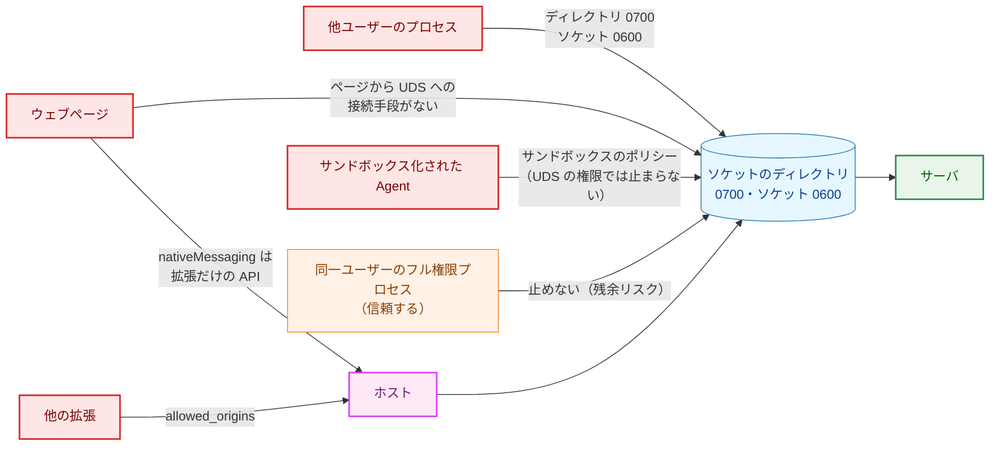

**Legend**

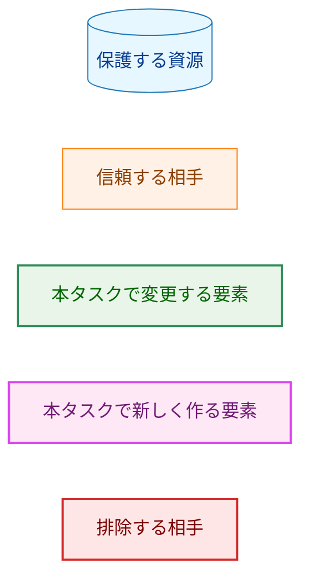

### 5.2. 脅威と対策

| 脅威 | 対策 | 確かめる AC |
|---|---|---|
| ウェブページが localhost のサーバへリクエストを送る（DNS rebinding、preflight が不要な `POST`） | TCP を待ち受けない。ページから UDS へ接続する手段はない | AC-01 |
| 他ユーザーがソケットに接続する | ソケットのディレクトリ `0700`（主）、ソケット `0600`（2 つ目）、所有者の検査 | AC-02 |
| 他ユーザーがサーバの停止中に同じ待ち受け先を奪う（現行の TCP の残余リスク） | ソケットのディレクトリは `0700` で、他ユーザーは中にソケットを作れない | AC-02 |
| 他ユーザーが検査の後にディレクトリの名前を入れ替える | 親のディレクトリに他人の書き込みのビットがないことを確かめる。祖先は §5.4 の前提 | AC-02 |
| 他の拡張がホストを起動する | `allowed_origins` を固定の拡張 ID だけにする。ホストは最初の引数のオリジンも照合する | AC-20 |
| ソケットのパスを奪った別のプロセスが、想定外の応答を返す | 拡張がホストの応答と、サーバの応答の本文（base64 のバイト列）を厳格に検査し、文字列を表示しない | AC-27 |
| ホストの標準出力に余計なバイトが混じり、フレームが壊れる | 標準出力に書くのは中継の手順 6 の 1 フレームだけ。ログは標準エラー出力だけ | AC-17 |
| ホストが秘密を漏らす | ホストは `HOME` 以外の環境変数を読まず、`.envrc` を読まない。秘密を持たない | AC-18 |
| 過大な入力でホストやサーバの資源を使い切らせる | ホストは長さだけで 32 MiB を超える入力を拒否し、本文を貯めない。サーバは `Content-Length` で 4 MiB を超える本文を読まずに拒否する | AC-09・AC-16 |
| 結果不明のまま再送して二重に投稿する | 未送信が確定しない失敗は、すべて結果不明に倒し、Slack の確認を案内する。自動で再送しない | AC-19・AC-24・AC-26 |
| 2 つのサーバが同時に動き、同時実行数の上限が効かない | 起動のロックをジョブの完了まで持ち続ける | AC-03・AC-10 |

### 5.3. 信頼できない入力の境界

要件書 §3.2 の表の各境界について、検出の方法を次のように定める。

| 境界 | 検出の方法 | 拒否時 |
|---|---|---|
| ブラウザ → ホスト（Native Messaging のメッセージ） | 長さの 4 バイトだけを読み、0 と 32 MiB を超える値を拒否する。中身は解釈しない | `message_too_large`（接続しない） |
| ホスト → サーバ（本文） | 既存のまま（`Content-Length` の事前検査、`MaxBytesReader`、`strictjson`、`ValidateVideoURL`、`NewCopiedSource`） | 既存の理由 |
| サーバ → ホスト（応答） | 本文を 64 KiB + 1 バイトまで読み、超えれば転送しない。HTTP として読めなければ転送しない | `protocol_error` |
| ホスト → 拡張（ホストの応答） | オブジェクトであること、`v`・`kind`、`kind` ごとのメンバの集合（`hasExactKeys`）、型、`status` の範囲、base64 の正規形、復号した長さ。その後に既存の `classifyResponse` | 想定外の応答 |
| ソケットのパスと権限 | `HOME` の絶対パス、パスの長さ、ディレクトリと親の `Lstat`（種別・所有者・権限）、ソケットの `Lstat` と接続の試み | 起動を中止する |
| install/uninstall の入力 | ブラウザ名の完全一致、`os.Executable` の絶対パス、既存の manifest の `Lstat` と `strictjson` の読み取り | 拒否し、書かない |
| 拡張が収集する値 | 既存のまま | 既存の理由 |

-   標準ライブラリが黙って修復しうる箇所: Go の `encoding/json` は無効な UTF-8 を U+FFFD に置き換えて書くので、ホストはサーバの本文を JSON の文字列にせず base64 で包む（§3.5.4）。ブラウザの `JSON.parse` は重複したメンバの後の値を残すので、重複の検査は base64 の中のバイト列に対して行う（§3.5.4）。`atob` は空白を無視しうるので、base64 は再符号化して比べる（§3.7.3）。manifest の読み取りは `strictjson` を使い、重複したメンバ・無効な UTF-8・末尾の余分な値を拒否する（§3.6）。
-   ホストの応答のオブジェクトは拡張可能と宣言しない。未知のメンバは拒否する。

### 5.4. 残余のリスク

要件書 4.2 の残余リスクを受け入れる。本設計に固有の点を加える。

-   同一ユーザーは、サーバの稼働中でもソケットを `unlink` して自分のソケットを同じパスに bind できる。起動のロックは、ロックを取らない相手を止めない（`flock` は助言的なロックである）。
-   同一ユーザーは、ホストのバイナリと manifest を置き換えられる。ホストの応答の外側のメンバの重複は拡張から検出できないが（§3.5.4）、外側を作れるのはホストを置き換えた相手だけで、このリスクに含まれる。
-   ソケットのディレクトリの祖先（`HOME`・`Library/Application Support`・`.local/state`）は検査しない。他ユーザーがこれらに書き込めないことを前提とする（macOS の既定）。
-   macOS の拡張 ACL（アクセス制御リスト）は、モードのビットと独立に他ユーザーに検索や追加を許しうる。継承される ACE（ACL の個々のエントリ）が祖先にある場合や、`chmod +a` で `run` に付けた場合、`Lstat` のモードは `0700` のままで検査を通る。標準ライブラリでは ACL を読めないので、ソケットのディレクトリとその親に他ユーザーを許す ACE がないことを、確かめていない前提として置き、security.md §8.2 にも書く。Linux では、モード `0700` のとき POSIX ACL のマスクが `---` になるので、この問題はない。
-   macOS では、待ち行列が満杯の稼働中の待ち受けへの接続が `ECONNREFUSED` になりうるので、ロックを取らずに同じパスで待ち受ける同一ユーザーのプロセスを、stale と見なして消すことがある（§3.2.3）。同一ユーザーの信頼の範囲に含める。
-   サーバがシャットダウンを始めた瞬間に待ち行列にあった接続は、処理されずに切られ、拡張では結果不明と表示される（§3.5.3）。
-   install の判定から `rename` までの間に、同一ユーザーが置いたファイルは上書きされる（§3.6）。
-   サーバの停止中に、同一ユーザーがソケットのパスを先に bind できる（現行の TCP の残余リスクと同じ種類。他ユーザーにはできなくなった）。
-   拡張は同じ `key` を使えば誰でも同じ ID を名乗れる。`allowed_origins` は、同じ ID の拡張を読み込める同一ユーザーを排除しない。
-   送信中にポップアップを閉じると、ブラウザがホストを終了させ、結果を表示できない（§3.5.5）。利用者は Slack で確かめる。
-   ホストが未インストールの場合も、lastError の文字列を見ないので結果不明と表示され、不要な Slack の確認を一度求める（§3.7.5）。二重投稿にはつながらない。

### 5.5. 対象クライアント環境の検証

本タスクは、Slack 互換の Incoming Webhook（Mattermost）の新しい機能を使わない。記事と失敗の通知の投稿は既存の `internal/publisher` のままである。したがって、Mattermost での新たな確認は N/A とする。ブラウザ（Chrome・Brave）の Native Messaging の前提は §3.10 で確かめる。

## 6. 処理フロー詳細 (Processing Flow Details)

### 6.1. サーバの起動と終了

矢印は処理の順序を表す。色のない端点は正常な終了である。

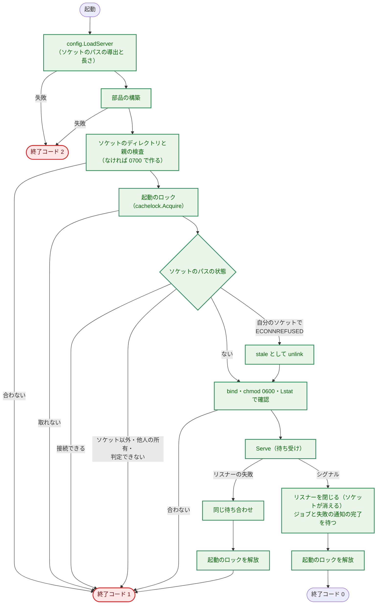

**Legend**

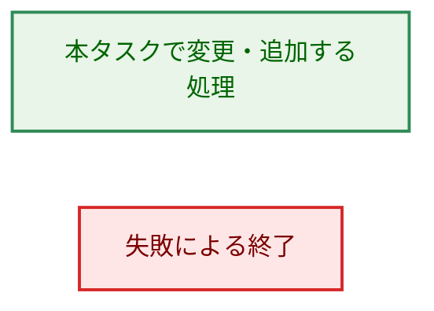

### 6.2. ホストの中継と失敗の分類

矢印は呼び出しまたは送信を、点線の矢印はその応答を表す。長さが 0 の場合（`protocol_error`、通常は起きない）は省く。

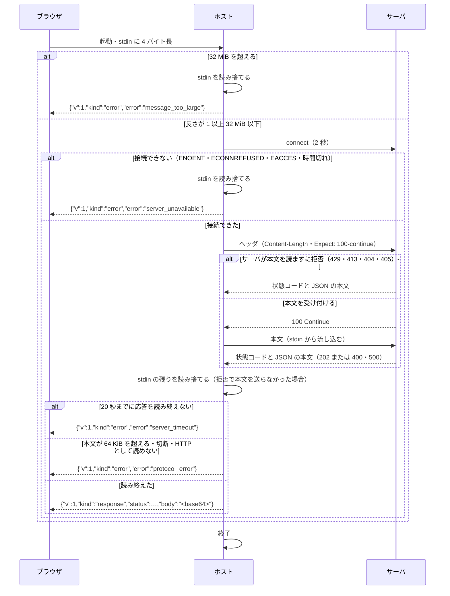

### 6.3. 拡張の送信の結果の分類

矢印は判定の順序を表す。

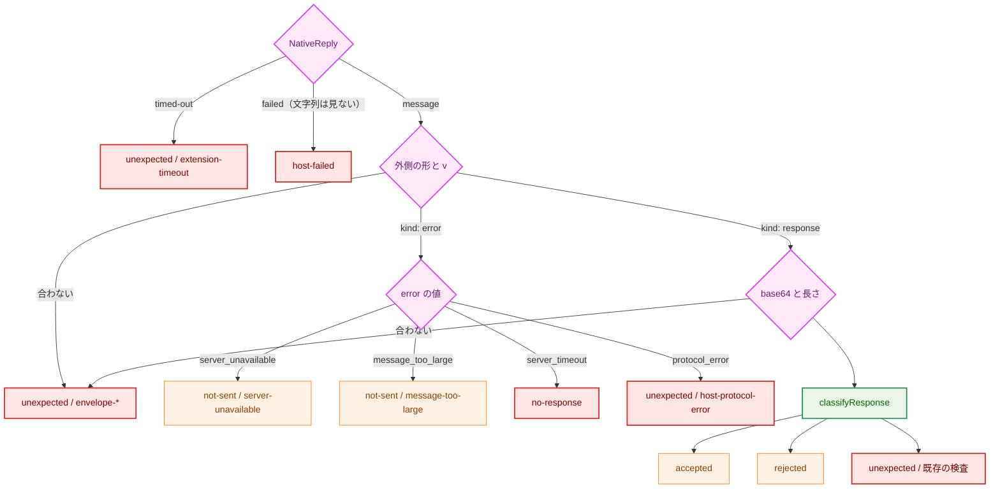

**Legend**

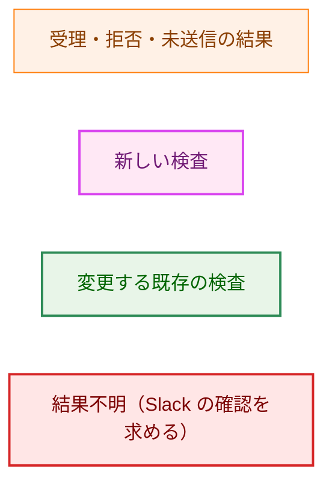

## 7. テスト戦略 (Test Strategy)

### 7.1. ユニットテスト

-   **`internal/config`:** OS ごとのパスの導出、`LoadHostHome` がソケットのパスの長さに関わらず `HOME` を返すこと、`HOME` の未設定・空・相対、パスの長さの境界（上限ちょうどと 1 バイト超）、`XDG_CONFIG_HOME`・`XDG_STATE_HOME`・`XDG_RUNTIME_DIR`・`TMPDIR` を設定しても結果が変わらないこと、`LoadHost` が `HOME` 以外を読まないこと（読んだ変数名を記録する `LookupFunc` で確かめる）、エラーに値が現れないこと。
-   **`internal/serversock`:**
    -   ディレクトリ: 作成と `0700`。既存のディレクトリが `0700` でない・他人の所有・symlink のときに中止して権限を変えないこと（他人の所有は root でない環境では作れないので、`Lstat` の結果を差し替えられる形で検査の関数を分けて確かめる）。親に他人の書き込みのビットがあるときの中止。
    -   ロック: ロックが取られているときの `ErrAlreadyRunning`。`Release` の後に再び `Acquire` できること。
    -   ソケット: stale なソケットの削除と bind。接続できるソケットでの `ErrInUse` と削除しないこと。通常ファイル・symlink・FIFO・ディレクトリでの中止と削除しないこと。作成後のソケットが `0600` であること。リスナーを閉じるとソケットが消えること。
-   **`internal/server`:** 既存のテストのうち、削除した検査の行を除く。パスとメソッドの不一致が通知されず生成されないこと（AC-12）。UDS のリスナーで `Serve` が動き、シャットダウンでジョブを待つこと（AC-06）。遅い writer で応答が先に返ること（AC-07、既存の確かめ方を UDS に移す）。`Content-Length` が 4 MiB を超え `Expect: 100-continue` を付けたリクエストで、本文を読まずに `413` が返り、クライアントが本文を送らないこと（AC-09）。
-   **`cmd/yt2column-server`:** 起動の失敗ごとの終了コード（`HOME` なし・パス長超過は `2`、ディレクトリの権限・二重起動・既存の待ち受けは `1`）、標準出力に何も書かれないこと、起動のログにソケットのパスがあること、シグナルでジョブを待ってからソケットが消えて終了すること、シャットダウン中の 2 つ目の起動が `ErrAlreadyRunning` で `1` になること（H-03）、出力に秘密が現れないこと。
-   **`internal/nmhost`:**
    -   長さと上限: 長さの読み取り（native endian）。上限超過での `message_too_large` と長さ 0 での `protocol_error`、どちらも接続しないこと（`Dial` の fake が呼ばれないことを確かめる）。本文を貯めないこと（stdin に上限超過の長さだけを書き、本文を書かずに結果が返ること）。
    -   接続と通信の失敗: `server_unavailable`（ソケットなし・stale・権限のないディレクトリ）。`server_timeout`（応答しないサーバ）。`protocol_error`（64 KiB 超の本文、途中の切断、HTTP として読めない応答、stdin が長さに満たない）。時間の上限と書き込みの失敗が重なったときに `server_timeout` になること。
    -   接続の回数とプロキシ: どれも 1 回しか接続しないこと（`Dial` と `Transport` の `DialContext` の呼び出しを数える。AC-19）。`HTTP_PROXY` を設定してもリクエストの行が `POST /articles` の形のままであること。
    -   読み捨て: どの経路でも stdin がメッセージの長さまで読まれてから応答が書かれること（stdin の fake が読まれたバイト数と、標準出力への書き込みの順序を記録する。§3.5.2 の手順 6）。
    -   応答の形: 2 つの形のメンバの集合。base64 で本文のバイト列が変わらないこと（無効な UTF-8 の本文でも変わらないこと）。`HostError` のゼロ値が `protocol_error` になること。
    -   出力: 標準出力が 1 フレームだけで、標準エラー出力に識別できる値（本文に入れた目印）が現れないこと（AC-17）。
    -   manifest: install/uninstall の中身、`0600`、一時ファイルが残らないこと、ブラウザのディレクトリがないときに何も作らないこと、他人の manifest を上書きも削除もしないこと、自分の manifest の置き換えと削除、`path` が相対のときと一時ディレクトリの下のときの拒否、ブラウザ名の完全一致。
    -   root: 所有者や権限に依存するテスト（他人の所有、権限のないディレクトリ）は、root では成り立たないので `os.Geteuid() == 0` のときは飛ばす（`internal/cachelock/test_helpers.go:13` の `requireNonRoot` と同じ扱い）。
-   **拡張:** `classifyNativeReply` の各分岐（§6.3 の葉のすべて）、外側のメンバの未知・欠落・型の不一致、`v` の不一致、base64 の非正規形、復号後の長さ超過、本文の既存の検査（AC-27）、lastError がどの文字列でも（`undefined` を含む）ホストの失敗になり、文言が install の手順と Slack の確認の両方を含むこと、待ち時間の上限、`sendNative` が 1 回しか呼ばれないこと（AC-24）、2 つの経路が同じ本文を送ること、送信の結果ごとの文言が互いに異なり、未送信の文言が Slack に触れず、結果不明の文言が Slack の確認を含むこと（AC-26）、`requestId` の表示（AC-28）、`prepareSend` の拒否の理由と順序（AC-30）、保存する値の検査。

### 7.2. 統合テスト

`cmd/yt2column-server/relay_e2e_test.go`（ビルドタグ `test`、`make test` で実行する）で、実際のサーバと実際のホストのバイナリを UDS でつなぐ（AC-35）。

-   テストの中で `go build` によりホスト（`./cmd/yt2column-nmhost`）を一時ディレクトリにビルドする。ビルドの環境では `GOOS`・`GOARCH` を実行中の値に固定し、`GOFLAGS` を空にして、利用者の環境変数でビルドが変わらないようにする。サーバは、既存の `run` を fake の LLM（`testDeps`）と loopback の Webhook（`loopbackDeps`）で起動する。実際の LLM API と Slack Webhook は呼ばない。既存のビルドタグ `integration`（実際の外部サービスを使うテストの方針）には入れない。外部サービスを使わないので `make test` で実行でき、既存の `TestServerEndToEnd` と同じ扱いである。`cmd/yt2column-server` の文書のガードを実行する CI の `doc-guard` のジョブ（`go test -tags test ./cmd/yt2column-server ...`）でも、このテストとホストのビルドが実行される。数秒の増加であり、受け入れる。
-   `HOME` は短い一時ディレクトリにする。macOS の `t.TempDir()` のパス（`/var/folders/...`）にソケットのパスの 54 バイトを足すと 103 バイトを超えうるので、`/tmp` の下に短い名前のディレクトリを作り、`t.Cleanup` で消す補助関数を使う（`internal/serversock` と `cmd/yt2column-server` のテストも同じ）。
-   シナリオ: (1) ホストの stdin にフレームを書き、受付応答が返り、ホストが終了し、その後で fake の遅い LLM を解放してから記事が Webhook に届く（応答の後にホストが終了してもジョブが続く。AC-14・AC-15）。(2) 字幕書式の誤りで `invalid_transcript` の応答と失敗の通知が届く（AC-13）。(3) サーバを止めた状態で `server_unavailable` が返る。(4) 4 MiB を超えホストの上限以下の本文で、`body_too_large` の応答が返る（AC-16）。(5) ホストの標準出力がフレーム 1 つだけである。
-   AC-14 の手動の確認と、§3.10 の S-1〜S-8 とは別に、`03_implementation_plan.md` の手動の確認の表（AC-36）で、Chrome と Brave のそれぞれについて、ホスト未インストール、サーバ停止、サーバ起動中、入力の拒否、同時の送信、応答の後のブラウザの終了、4 MiB を超える本文、ホストの再インストールを確かめる。

### 7.3. セキュリティテスト

-   **静的な確認:** TCP のリスナーを作るコードが残っていないこと（`cmd/`・`internal/` の本番のコードに `net.Listen("tcp"`・`"127.0.0.1"`・`"[::1]"` がない。AC-01）。`internal/authtoken`・`YT2COLUMN_SERVER_PORT`・トークンのファイル名がコードと現在の文書にないこと（AC-05）。`.golangci.yml` の `depguard` に、`internal/server` が `internal/serversock` を、`internal/nmhost` が `internal/server`・`internal/config` を、`internal/nmhost` と `cmd/yt2column-nmhost` が `os/exec` を import しないことの規則を加える（AC-18、`make lint`）。ホストのコードが `os.Stdout`・`fmt.Print*` を `cmd/yt2column-nmhost/main.go` の外で参照しないことは、`internal/config/envaccess_test.go` と同じ構文木の走査で確かめる（AC-17）。
-   **拡張の lint（AC-29）:** `fetch`・`XMLHttpRequest`・`WebSocket`・`EventSource` の使用と `connectNative` の参照を禁止し、`sendNativeMessage` の参照を `browser/chromeDeps.ts` に限る。`lintRules.test.ts` で、規則が違反を検出することを確かめる。
-   **秘密の値:** サーバの応答・ログ・失敗の通知に、識別できる API キー・Webhook URL・字幕・メタデータが現れないこと（AC-11・AC-13、既存のテストを UDS に移す）。ホストの標準出力と標準エラー出力に識別できる字幕が現れないこと（AC-17）。拡張の保存する値・ログ・表示にトークンが現れないこと（AC-23、`secretsAbsent.test.ts`）。
-   **権限:** §7.1 の `internal/serversock` のテスト（AC-02・AC-03）。

### 7.4. 受け入れ基準と設計要素の対応

| AC | 設計 | 主なテスト |
|---|---|---|
| AC-01 | §3.3.1・§3.2 | `internal/server` の UDS の `Serve`、静的な確認（§7.3）、手動 |
| AC-02 | §3.2.1・§3.2.3 | `internal/serversock` |
| AC-03 | §3.2.2・§3.2.3 | `internal/serversock` |
| AC-04 | §3.1・§3.3.2 | `internal/config`、`cmd/yt2column-server` の起動の失敗とログ |
| AC-05 | §3.1・§3.3 | 静的な確認、`cmd/yt2column-server`（標準出力が空）、`internal/config`（エラーに値がない） |
| AC-06 | §3.2.2・§3.2.3・§3.3.2 | `cmd/yt2column-server` のシグナルのテスト、`internal/serversock` |
| AC-07 | §3.3.1（既存） | `internal/server`（遅い writer）、§7.2 (1) |
| AC-08 | §3.3.1（既存） | `internal/server/request_test.go`（既存） |
| AC-09 | §3.3.1・§3.4 | `internal/server`（`Expect` 付きの `413`） |
| AC-10 | §3.3.1（既存）・§3.2.2 | `internal/server/job_test.go`（既存） |
| AC-11 | §3.3（既存） | `internal/server`・`cmd/yt2column-server`（既存を UDS に移す） |
| AC-12 | §3.3.1・§3.4・§3.7.3 | `internal/server/handler_test.go`、`extension/test/response.test.ts`・`serverReasons.test.ts` |
| AC-13 | §3.3.1（既存） | `internal/server/job_test.go`（既存）、§7.2 (2) |
| AC-14 | §1.2・§3.5.2 | §7.2 (1)、手動 |
| AC-15 | §3.5.2 | `internal/nmhost`、§7.2 (1) |
| AC-16 | §3.5.2・§3.5.5・§3.4 | `internal/nmhost`、§7.2 (4) |
| AC-17 | §3.5.6 | `internal/nmhost`、静的な確認 |
| AC-18 | §3.1・§3.5.1 | `internal/config`、`internal/config/envaccess_test.go`、静的な確認 |
| AC-19 | §3.5.3 | `internal/nmhost` |
| AC-20 | §3.6 | `internal/nmhost`、手動 |
| AC-21 | §3.5・§3.9 | `make build`、`.golangci.yml` の `depguard`（既存） |
| AC-22 | §3.7.1 | `extension/test/manifest.test.ts`、`cmd/yt2column/extension_docs_test.go` |
| AC-23 | §3.7.2・§3.7.4 | `extension/test/prepare.test.ts`・`secretsAbsent.test.ts`、静的な確認 |
| AC-24 | §3.7.2 | `extension/test/send.test.ts`・`launch.test.ts`、手動 |
| AC-25 | §3.7.4 | `extension/test/sendMessages.test.ts` |
| AC-26 | §3.5.3・§3.7.4・§3.7.5 | `extension/test/native.test.ts`・`sendMessages.test.ts`、手動 |
| AC-27 | §3.5.4・§3.7.3 | `extension/test/native.test.ts`・`response.test.ts` |
| AC-28 | §3.7.4（既存の表示） | `extension/test/renderSend.test.ts`、手動 |
| AC-29 | §3.7.2・§7.3 | `extension/test/lintRules.test.ts`、静的な確認 |
| AC-30 | §3.7.2 | `extension/test/prepare.test.ts`・`collect.test.ts`（既存） |
| AC-31 | §3.9 | `cmd/yt2column-server/docs_test.go`・`cmd/yt2column/extension_docs_test.go` |
| AC-32 | §3.9 | `cmd/yt2column-server/docs_test.go` |
| AC-33 | §3.9 | `cmd/yt2column-server/docs_test.go`、`cmd/yt2column/makefile_test.go` の流儀の確認 |
| AC-34 | §3.9 | `make test` |
| AC-35 | §7.2 | `cmd/yt2column-server/relay_e2e_test.go` |
| AC-36 | §7.2 | `03_implementation_plan.md` の手動の確認の表 |
| AC-37 | - | `make test`・`make lint`・`make ext-check` |

## 8. 実装優先順位 (Implementation Priorities)

要件書 §5 のとおり、3 つのフェーズを `03_implementation_plan.md` の PR の境界に対応させる。各フェーズの終わりで `make test`・`make lint`（フェーズ 3 では `make ext-check` も）が通る状態にする。

| フェーズ | 内容 | 終わった時点の状態 |
|---|---|---|
| 0 | §3.10 の S-1〜S-8 の実機での確認（本書の承認の前） | 前提が確かめられ、本書の値が確定する |
| 1: サーバの UDS 化 | §3.1（`ServerConfig` の部分）、§3.2、§3.3、`internal/authtoken` の削除、サーバのテストとガードの更新 | サーバは UDS だけで待ち受ける。この時点の拡張はサーバに届かない（要件書 4.4「互換性はない」）ので、フェーズ 1〜3 は同じ版で利用者に渡す。README と security.md のサーバの節はフェーズ 1 で改める |
| 2: ホスト | §3.1（`LoadHost`）、§3.4、§3.5、§3.6、§7.2 の統合テスト、Makefile | `curl` の代わりにホストでサーバに送れる。install/uninstall が使える |
| 3: 拡張 | §3.7、拡張のテスト、README と security.md の拡張の節、CLAUDE.md の例外、ガード | 拡張からホストを通して送れる。手動の確認（AC-36） |

-   フェーズ 1 の中では、`internal/config` → `internal/serversock` → `internal/server` → `cmd/yt2column-server` → 文書とガードの順に進める。`internal/serversock` は他に依存しないので、最初に書いて単独で確かめられる。
-   フェーズ 3 は、0025（拡張の動画メタデータ）が変更する `extension/src/core/prepare.ts`・`launch.ts` と重なる。0025 の設計は作り直しの途中なので、どちらを先に入れるかは `03_implementation_plan.md` で決め、後に入れる方が `ArticleMetadata` の受け渡しを合わせる。

## 9. 将来の拡張性 (Future Extensibility)

-   **フル移行（要件書 2.3）:** ホストにジョブを持たせる場合も、`internal/nmhost` のフレームの読み書きと manifest の install/uninstall はそのまま使える。中継の手順だけを置き換える。
-   **サーバの自動起動:** launchd でサーバを起動する場合、ソケットのパスと起動のロックの規則は変わらない。launchd のソケットの受け渡し（`launch_activate_socket`）は標準ライブラリで呼べないので、使うなら依存の方針の見直しが要る。
-   **相手の資格情報の確認:** UDS の接続相手の uid（macOS の `LOCAL_PEERCRED`、Linux の `SO_PEERCRED`）を確かめれば、ディレクトリの権限に加えた防御になる。同一ユーザーを信頼する方針の下では他ユーザーの排除しか増えず、ディレクトリの `0700` と重なるので、本タスクでは行わない。
-   **他のブラウザ:** install の対象を増やす場合は、`Browser` に値を加え、置き場所の表を広げる。網羅的な `switch` が、置き場所の書き忘れを検出する。
-   **ホストの応答の版:** 形を変える場合は `v` を上げる。拡張は知らない版を想定外の応答とし、install し直しを案内する。

## 付録 A. 決定の記録

本設計の検討で採らなかった案と、その理由を記録する。

-   **UDS 上の独自のフレーム（4 バイト長 + JSON）:** HTTP/1.1 の再利用で要件を満たせ、`http.Server` の上限と時間の設定、既存のテスト、`curl` による確認を捨てる理由がない（§3.4）。
-   **ホストの応答の外側を配列にする案:** 配列にすればメンバの名前がなく、重複の問題が起きない。しかし外側を作るのはホスト自身で、重複を作るのはホストを置き換えた相手だけであり（§3.5.4）、読みにくさに見合わない。
-   **サーバの本文を JSON の文字列として埋め込む案:** Go の `encoding/json` が無効な UTF-8 を黙って置き換えるので採らない（§3.5.4）。
-   **ホストが本文をすべて読み込んでから送る案:** 本文を貯めても、サーバが本文を読まずに拒否したときの書き込みのエラーは防げない。`Expect: 100-continue` で防ぐ（§3.4）。流し込めばメモリも使わない。
-   **`EACCES` を別の固定のエラーにする案:** 要件のエラーの集合を変えることになる（H-05）。どれも未送信が確定する点で同じなので、`server_unavailable` に含め、文言で案内する（§3.5.3）。
-   **プロセスの umask を変えてから bind する案:** umask はプロセス全体の状態で、他の goroutine と競合する。ディレクトリの `0700` が主な防御なので必要がない（§3.2.1）。
-   **起動のロックのための新しいパッケージ:** `internal/cachelock` の契約がそのまま合う（§3.2.2）。パッケージの名前を一般的なものに変えることは、本タスクの範囲外とする。
-   **lastError の文字列で未インストールを未送信と表示する案:** ブラウザの文言は公開された API の約束ではなく、版や Brave の変更で黙って変わりうる。CLAUDE.md「Declare, don't infer」の例外も要る。区別して得られるのは初回の設定時の案内の正確さだけで、要件書 F-004 を改めて結果不明にまとめた（§3.7.5）。
