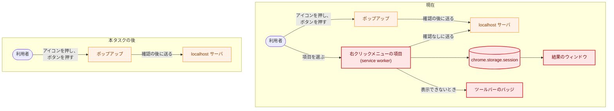
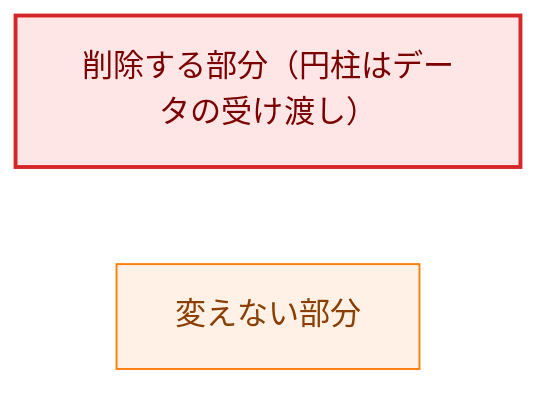
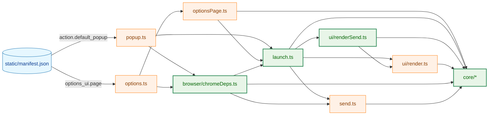
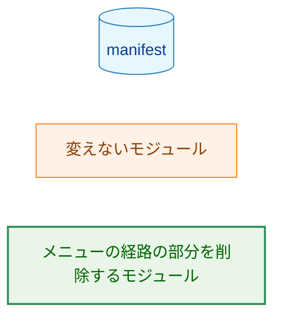
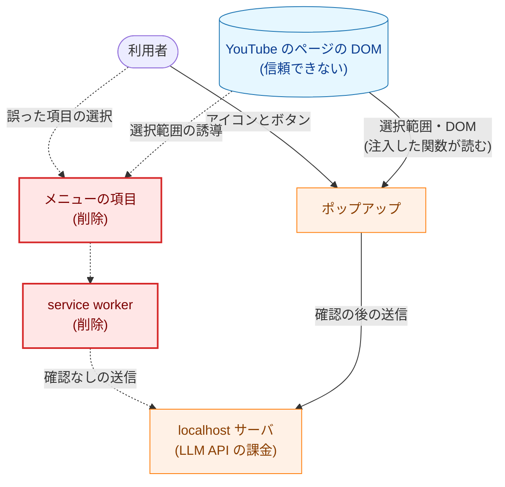
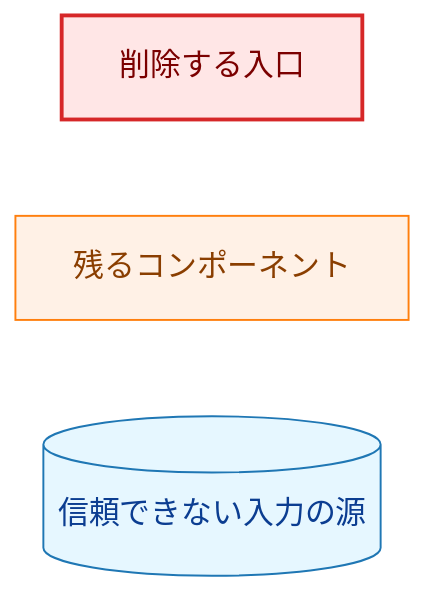
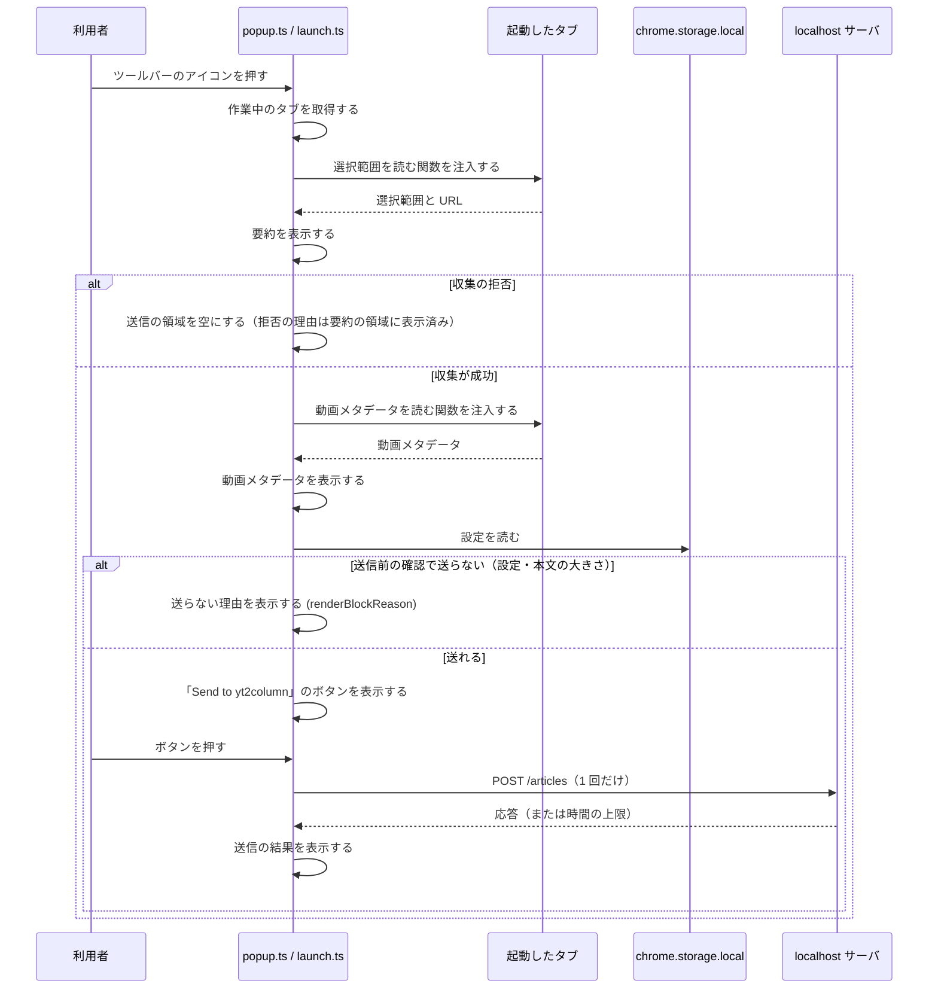

# アーキテクチャ設計書：ブラウザ拡張の右クリックメニューの経路の削除

## Document Status

| Item | Value |
|---|---|
| Status | `approved` |
| Created | 2026-10-19 |
| Review date | 2026-10-19 |
| Reviewer | isseis |
| Comments | 編集上の訂正（2026-10-19。判断は変えていない）。8 章の優先順位 3 に、`docs/dev/security.md` §8.1 の「要求する権限」の改めを加え、優先順位 5 から除いた。3.9.3 の manifest の権限と §8.1 の一覧の一致の検査（既存の `TestExtensionDocumentation`）は両方向を確かめるので、manifest から `contextMenus` を除く段階で §8.1 の一覧も改めなければ `make test` が通らない。何を改めるか（3.9.2）は変えず、改める段階だけを合わせた（実装計画のレビューで見つかった）。判断の変更と見る場合は `draft` に戻してほしい |

本書は [01_requirements.md](01_requirements.md)（要件定義書。以下、要件書）の設計である。既存のファイルに関する記述は、コミット `81cb30d` のファイルで確かめた。`file:line` はこのコミットの行番号を指す。F-NNN・AC-NN は要件書の項番を指す。要件のレビューで設計に申し送られた事項（[design_handoff.md](design_handoff.md) の H-01〜H-05）への対応は 3.12 にまとめる。0007・0020・0025・0026 などの 4 桁の番号は `docs/tasks/` の同じ番号のタスクを、#330 などは GitHub の issue の番号を指す。

本書は次の用語を要件書 §6 と同じ意味で使う: メニューの経路、ポップアップの経路、結果のウィンドウ。ほかに次の用語を使う。

-   **入口のモジュール:** ブラウザが拡張のページやスクリプトとして直接読み込むモジュール。現在は `background.ts`（service worker）・`popup.ts`・`options.ts`・`result.ts` の 4 つで、本タスクの後は `popup.ts`・`options.ts` の 2 つになる。
-   **本番の参照元:** あるシンボルを参照する、`extension/src/` の中のほかのモジュール、または同じモジュールの中の処理。テスト（`extension/test/`）とビルドの検査（`extension/scripts/`）は数えない。

## 1. 設計の全体像 (Design Overview)

### 1.1. 設計原則

-   **削除だけを行う。** 本タスクは拡張に新しい振る舞いを加えない。ポップアップの経路の振る舞い（収集・要約・動画メタデータ・送信前の確認・送信・結果の表示・文言）は変えない（F-002）。
-   **削除の範囲は、本タスクが最後の本番の参照元を取り除くシンボルに限る。** 判断の基準は 3.2.1 に 1 つだけ定める。本タスクの前からテストだけが使っていた export や、どこからも使われていなかった export は、本タスクの対象にしない。
-   **既存の検査を流用し、ファイル名を列挙する検査を加えない。** 成果物のファイルの集合の検査（`scripts/check-dist.ts`）、manifest のテスト、lint の規則、文書の一致のテストを、ポップアップだけの構成の期待値に改める（H-02）。
-   **依存パッケージを加えない**（要件書 §5）。

### 1.2. 概念モデル

拡張の起動経路は、現在の 2 つから、ポップアップの経路の 1 つになる。図の矢印 A → B は「A が B を起動する、または B へ値を渡す」を表す。



**Legend:**



### 1.3. 既存のコードとの関係

-   メニューの経路の処理は `extension/src/launch.ts` の `runMenuLaunch`（`launch.ts:228-301`）と `openResultWindow`（`launch.ts:304-317`）、結果のウィンドウの処理は `runResultWindow`（`launch.ts:413-514`）にある。ポップアップの経路の処理 `runPopupLaunch`（`launch.ts:325-351`）・`runPopupSend`（`launch.ts:359-405`）も同じファイルにある。
-   ブラウザの API に依存する部分は `extension/src/browser/chromeDeps.ts` に集まっている。両方の経路が使うもの（選択範囲・動画メタデータの読み取り、設定、送信）と、メニューの経路だけが使うもの（`chrome.storage.session`・`chrome.windows`・`chrome.action` の薄いラッパー）が同じファイルにある。
-   サーバ（Go）は拡張の起動経路を区別しないので、変更しない（要件書 §2.3）。Go の変更は、文書を検査するテスト（3.9）だけである。

## 2. システム構成 (System Structure)

### 2.1. ファイル構成

`extension/` の下のファイルを、削除・変更・変更なしに分ける。変更なしのファイルは、本タスクに関係するものだけを挙げる。

| ファイル | 扱い | 内容 |
|---|---|---|
| `src/background.ts` | 削除 | service worker。メニューの項目の登録と `runMenuLaunch` の呼び出し |
| `src/result.ts` | 削除 | 結果のウィンドウの入口のモジュール |
| `static/result.html` | 削除 | 結果のウィンドウのページ |
| `src/core/resultView.ts` | 削除 | `ResultView` 型・`CollectedSummary` 型・`parseResultView`（3.2） |
| `test/resultView.test.ts` | 削除 | `parseResultView` のテスト |
| `static/manifest.json` | 変更 | `background` のメンバと `contextMenus` の権限を削除する（3.3） |
| `src/launch.ts` | 変更 | メニューの経路と結果のウィンドウの処理・型・定数を削除する。ポップアップの送らない理由の表示を、`renderBlockReason` の呼び出しに改める（3.2・3.4） |
| `src/browser/chromeDeps.ts` | 変更 | メニューの経路だけが使うラッパーと型、`schedule` を削除する（3.2） |
| `src/ui/renderSend.ts` | 変更 | `renderResultView` を `renderBlockReason` に置き換え、`summaryNode` を削除する（3.2.2） |
| `src/core/summary.ts` | 変更 | `parseSummary` と、それだけが使う定数・`isRejectionReason` を削除し、`hasExactKeys` を `core/response.ts` へ移す（3.2） |
| `src/core/response.ts` | 変更 | `unexpectedChecks` を削除し、`hasExactKeys` を export しない関数として持つ（3.2） |
| `src/core/sendMessages.ts` | 変更 | `unreadableResultMessage` を削除する（3.2） |
| `src/core/types.ts` | 変更 | 結果のウィンドウに触れるコメントを改める（3.2.6） |
| `static/style.css` | 変更 | 結果のウィンドウの要約にだけ使う `.send-summary` を削除する（3.2） |
| `scripts/check-dist.ts` | 変更 | `background.service_worker` の参照の検査を削除し、`manifest.json` の複製の同一性の検査を加える。冒頭のコメントを改める（3.3） |
| `eslint.config.js` | 変更 | メニューの経路が使っていた API の再導入を禁止する規則を加え、動的な `import()` の禁止の理由のコメントを改める（3.5.2・3.8） |
| `test/launch.test.ts` | 変更 | メニューの経路と結果のウィンドウのテストを削除し、両方の経路を比べるテストはポップアップの経路のテストに改め、メニューの経路のテストだけが確かめていた振る舞いのテストをポップアップの経路に加える（3.10） |
| `test/chromeDeps.test.ts` | 変更 | 「result view store」のテストを削除する |
| `test/renderSend.test.ts` | 変更 | `renderResultView` の「sending」「sent」のテストを削除し、「blocked」のテストを `renderBlockReason` のテストに改める |
| `test/summary.test.ts` | 変更 | `parseSummary` のテストを削除する |
| `test/sendMessages.test.ts` | 変更 | `unreadableResultMessage` のテストを削除する |
| `test/manifest.test.ts` | 変更 | 権限・キーの集合の期待値とテストの名前を改め、service worker のテストを削除する（3.3） |
| `test/checkDist.test.ts` | 変更 | service worker の参照の場合を削除し、`manifest.json` の同一性の検査のテストを加える（3.3） |
| `test/lintRules.test.ts` | 変更 | 追加する lint の規則のテストを加える（3.5.2） |
| `test/repository.test.ts` | 変更 | 無視されるビルドの成果物の例 `extension/dist/background.js` を、残る成果物の名前に改める（3.10） |
| `src/popup.ts`・`src/options.ts`・`src/optionsPage.ts`・`src/send.ts`・`src/core/prepare.ts` ほか | 変更なし | ポップアップの経路とオプションページ |

リポジトリの直下のファイル:

| ファイル | 扱い | 内容 |
|---|---|---|
| `README.md` | 変更 | 「Browser extension」節を、ポップアップだけの起動として書き改める（3.9） |
| `docs/dev/security.md` | 変更 | §8.1 の「要求する権限」と、結果のウィンドウへの言及を改める（3.9） |
| `cmd/yt2column/extension_docs_test.go` | 変更 | README と security.md §8.1 に、メニューの経路への言及がないことの検査を加える（3.9） |

### 2.2. モジュールの依存関係

本タスクの後の拡張のモジュールの依存関係を示す。図の矢印 A → B は「A が B を import する」を表す（型だけの import を含む）。`core/` の下のモジュールどうしの依存は省き、`core/` を 1 つのノードで表す。



**Legend:**



manifest からの 2 本の矢印は、import ではなく「manifest がそのページを宣言し、ページがそのモジュールを読み込む」を表す（ページの HTML は図から省く）。manifest は `background` と `content_scripts` を宣言しないので、図の 2 つのほかに入口のモジュールはない。`chromeDeps.ts` → `launch.ts`・`send.ts` は型だけの import で、オプションページは実行時に `send.ts` を読み込まない。

### 2.3. 実行時の配置

| 実行の場所 | 現在 | 本タスクの後 |
|---|---|---|
| service worker | `background.js`（メニューの項目の登録、メニューの経路の送信） | なし |
| ポップアップ（`popup.html`） | 収集・要約・動画メタデータの表示・送信 | 変えない |
| オプションページ（`options.html`） | 共有トークンとポートの設定 | 変えない |
| 結果のウィンドウ（`result.html`） | メニューの経路の送信中と結果の表示 | なし |
| 起動したタブのページ | `chrome.scripting` で注入した、選択範囲と動画メタデータを読む関数 | 変えない（ポップアップからだけ注入する） |

## 3. コンポーネント設計 (Component Design)

### 3.1. 削除する部分（F-001・AC-01〜AC-05）

次をまとめて削除する。いずれも、メニューの経路か結果のウィンドウだけが使う。

-   service worker（`background.ts`）。メニューの項目の登録（`contextMenus.removeAll`・`contextMenus.create`、`background.ts:54-86`）と、項目の選択の処理（`contextMenus.onClicked`、`background.ts:95-97`）を含む。
-   結果のウィンドウ（`result.html`・`result.ts`）と、その処理 `runResultWindow`。
-   メニューの経路の処理 `runMenuLaunch`・`openResultWindow` と、その依存の型 `MenuLaunchDeps`・`ResultWindowDeps`・`ResultViewStore`。
-   `chrome.storage.session` に表示内容を置く `createResultViewStore`、結果のウィンドウを開く `createResultWindowOpener`、ツールバーのバッジ `createBadge`。

拡張の読み込み直しや更新の後に、以前の版が登録したメニューの項目が残るかは、ブラウザの振る舞いであり、拡張のコードでは確かめられない。Chrome と Brave の手動確認で、読み込み直しの後とブラウザの再起動の後に確かめる（7.2）。仮に項目が表示されても、本タスクの版は `contextMenus` の権限も `onClicked` の処理も持たないので、項目を選んで送信が始まることはない（3.5）。

### 3.2. 共有しているコードの切り分け（F-001・F-002・§4.5、H-01）

#### 3.2.1. 判断の基準

要件書 §4.5 の「メニューの経路でだけ使う型・関数・定数は残さない」を、次の 1 つの基準で適用する。

-   **対象:** 本タスクの削除によって、最後の本番の参照元がなくなるシンボル、または本番の参照元が同じモジュールの中だけになる export。
-   **最後の本番の参照元がなくなるシンボル:** 削除する。ただし、本番のコードの振る舞いを確かめるためにテストが使っているシンボルは、理由を 1 つずつ記録したうえで残してよい（3.2.3）。
-   **本番の参照元が同じモジュールの中だけになる export:** テストが直接使っていれば export を残し、使っていなければ export を外す。
-   **対象外:** 本タスクの前から、テストだけが使っていた export や、どこからも使われていなかった export（`81cb30d` で、たとえば `OptionsPageDeps`・`TabsApi`・`buildArticleBody`・`serverRejectStatus`）。本タスクの前から、export された関数の引数や戻り値の型として使われているだけだった型も、同じく対象外とする。

参照は `81cb30d` で `grep -rnw` によって確かめた。

| シンボル | 場所 | 本タスクの後の本番の参照元 | テストの利用 | 扱い |
|---|---|---|---|---|
| `launchContextFromTab` | `launch.ts:114` | `runPopupLaunch`（`launch.ts:336`、同じモジュール） | `launch.test.ts:395` | export を残す |
| `Logger` | `launch.ts:30` | ポップアップの経路・`optionsPage.ts:9`・`chromeDeps.ts:3` | あり | 残す |
| `MetadataReader` | `launch.ts:49` | ポップアップの経路・`chromeDeps.ts:3` | あり | 残す |
| `readMetadata`・`logBlocked`・`logSend` | `launch.ts:143`・`:188`・`:202` | `runPopupLaunch`・`runPopupSend` | — | 残す |
| `attempt` | `launch.ts:124` | なし（`runMenuLaunch`・`openResultWindow` だけが呼ぶ） | — | 削除 |
| `resultWaitMs` | `launch.ts:111` | なし（`runResultWindow` だけが使う） | `launch.test.ts:28` | 削除 |
| ログのラベルの定数 `menuLogLabel`・`resultLogLabel`・`clearBadgeLabel`・`putLabel`・`openWindowLabel`・`removeLabel`・`badgeLabel`・`keyLabel` | `launch.ts:96-106` | なし | — | 削除 |
| `sendTimeoutMs` | `send.ts:12` | `sendArticle`（`send.ts:114`、同じモジュール）。`launch.ts:20` の import は `resultWaitMs` のためだけで、削除する | `send.test.ts` | export を残す（0026 の同期のテストも参照する予定。3.6） |
| `renderResultView` | `ui/renderSend.ts:56` | `runPopupSend`（`launch.ts:377`）が `blocked` の場合だけで使う | `renderSend.test.ts` | `renderBlockReason` に置き換える（3.2.2） |
| `ResultView`・`CollectedSummary` | `core/resultView.ts:20`・`:17` | `renderResultView` の引数と、その `sending`・`sent` の場合だけ | `renderSend.test.ts`・`launch.test.ts` | 削除（3.2.2） |
| `parseResultView` | `core/resultView.ts:125` | なし | `resultView.test.ts` | 削除 |
| `sendingMessage` | `ui/renderSend.ts:12` | `runPopupSend`（`launch.ts:397`） | あり | 残す |
| `unreadableResultMessage` | `core/sendMessages.ts:204` | なし | `sendMessages.test.ts:120`・`launch.test.ts` | 削除 |
| `parseSummary` と、それだけが使う `collectedKeys`・`rejectedKeys` | `core/summary.ts:9-20`・`:94` | なし（`parseResultView` だけが呼ぶ） | `summary.test.ts:105-176` | 削除 |
| `isRejectionReason` | `core/summary.ts:83` | なし（`parseSummary` と `core/resultView.ts:39` だけが呼ぶ） | — | 削除 |
| `rejectionReasons` | `core/types.ts:13` | なし（`isRejectionReason` だけが使う） | `messages.test.ts:5`・`sendMessages.test.ts:20`（本タスクの後は `summary.test.ts` の `summarize` の拒否の検査も使う。実装計画のステップ 4-8） | 残す（3.2.3） |
| `hasExactKeys` | `core/summary.ts:71` | `core/response.ts:190`・`:194` だけ | — | `core/response.ts` の export しない関数に移す（3.2.5） |
| `unexpectedChecks` | `core/response.ts:90` | なし（`parseResultView` だけが使う） | なし | 削除 |
| `isServerRejectReason`・`parseRequestId` | `core/response.ts:40`・`:57` | `classifyResponse`（`core/response.ts:200`・`:211`、同じモジュール）。ほかのモジュールからの import は `core/resultView.ts:7-11` だけで、削除する | `response.test.ts` | export を残す |
| `preflightReasons` | `core/prepare.ts:70` | なし（`core/resultView.ts:33` だけが使う） | `sendMessages.test.ts:35-37`・`resultView.test.ts` | 残す（3.2.3） |
| `StorageChangeEvents`・`StorageChangeListener`・`WindowsApi`・`ActionApi`・`Badge` | `chromeDeps.ts:23-42`・`:251` | なし | `chromeDeps.test.ts` | 削除 |
| `createResultViewStore`・`createResultWindowOpener`・`createBadge` | `chromeDeps.ts:206`・`:242`・`:257` | なし | `chromeDeps.test.ts:436-` | 削除 |
| `schedule` | `chromeDeps.ts:289` | なし（`result.ts` だけが使う） | なし | 削除（3.2.4） |
| `.send-summary`（CSS） | `static/style.css:85` | なし（`summaryNode`、`ui/renderSend.ts:23` だけが使う） | — | 削除 |

`StorageArea`（`chromeDeps.ts:16-20`）は、本タスクの後も `createSettingsStore` が使い続ける。`get` が 1 つのキーの形を受け付けるのは `createResultViewStore` のためだったが、型の引数の幅を狭めても振る舞いは変わらない。一方で、テストの補助（`chromeDeps.test.ts:309-365`）を書き換えることになるので、型は変えない。

#### 3.2.2. 送らない理由の表示を置き換える

ポップアップは `renderResultView` を `{ kind: "blocked", reason }` だけで呼ぶ（`launch.ts:377`）。`sending` と `sent` の場合は結果のウィンドウだけが使う。`ResultView` を残すと、本番では使われない 2 つの場合と、そのための `CollectedSummary`・`summaryNode`・`.send-summary` が残る。そこで、`renderResultView` を、送らない理由だけを受け取る次の関数に置き換え、`ResultView` 型と `core/resultView.ts` を削除する。

```ts
// ui/renderSend.ts
/** Replaces the children of container with the text-only message for a block reason. */
export function renderBlockReason(container: HTMLElement, reason: BlockReason): void;
```

-   表示は、現在の `renderResultView` の `blocked` の場合（`ui/renderSend.ts:62-66`）と同じで、`blockMessage(reason)` を `messageNodes` で描く。ポップアップの表示は変わらない（F-002）。
-   関数の名前は、受け取るもの（送らない理由）で付ける。`ResultView` は「結果のウィンドウに表示するもの」を表す名前で、結果のウィンドウがなくなると意味を失う（H-01 の「`ResultView` の型の名前と置き場所」への対応）。
-   引数の型は `BlockReason` のままにする。現在のポップアップでは、収集の拒否は設定を読む前に返り（`launch.ts:365-368`）、拒否の理由は要約の領域に表示される。このため、`renderBlockReason` に渡るのは実際には送信前の確認の理由（`PreflightReason`）だけである。それでも、`prepareSend` の戻り値の `reason` は `BlockReason` と宣言されており（`core/prepare.ts:80-89`）、型を狭めるには `prepare.ts` の型を変えることになるので、本タスクでは変えない。

#### 3.2.3. テストからだけ使う値の集合を残す理由

`preflightReasons`（`core/prepare.ts:70-76`）と `rejectionReasons`（`core/types.ts:13`）は、理由の型の値を並べた実行時の集合である。`Record<理由の型, true>` で宣言するので、理由の型（ユニオン型）と集合の要素が食い違うと、型の検査で失敗する。本タスクの後は、本番のコードからは使われない。テスト（`sendMessages.test.ts:35-37`・`messages.test.ts`）は、ポップアップが表示する `blockMessage` などの文言を、この集合のすべての理由について確かめる。

-   **残す理由:** 集合は理由の型の定義の隣にあり、理由を加えると、集合の定義が型の検査で失敗する。テストはこの集合をたどるので、理由を加えたときに文言のテストの漏れが生じない。
-   **より簡単な代わりを採らない理由:** 同じ `Record` をテストのファイルの中に書いても、型の検査による網羅は得られる。ただし、同じ理由の一覧を 2 つのテストのファイル（`messages.test.ts`・`sendMessages.test.ts`）に重ねて書くことになり、本番のコードの集合を削除する利点（数行の削除）より、重複の不利益が大きい。

#### 3.2.4. `schedule` を削除する

`schedule`（`chromeDeps.ts:289-292`）は結果のウィンドウの待ち時間の上限にだけ使う。本タスクで削除する。

-   残すと、本タスクの後の拡張に、本番の参照元がない export が残り、要件書 §4.5 に反する。
-   0026 の設計は、`SendDeps` に新しいメンバとして `schedule` を加える（0026 `02_architecture.md` §3.7.2）。加え直す量は数行で、残しておく利点が小さい。
-   0026 の実装計画は、本タスクが `schedule` を削除した場合に、ステップ 3-7 で加え直すとしている（0026 `03_implementation_plan.md` §1.3「0027 との順序」。9 章）。

#### 3.2.5. `hasExactKeys` を移す

`hasExactKeys`（`core/summary.ts:71-79`）は、本タスクの後、`core/response.ts` の応答の検査（`:190`・`:194`）だけが使う。`core/summary.ts` は表示用の要約を作るモジュールで、応答の検査が要約のモジュールに依存する理由がなくなるので、`core/response.ts` の export しない関数に移す。テストは直接使っていない（`81cb30d` で `test/` を検索して確かめた）。

#### 3.2.6. 結果のウィンドウに触れるコメント

次のコメントは、結果のウィンドウや保存する値に触れており、本タスクの後に当てはまらない。振る舞いは変えず、コメントだけを改める。

-   `core/types.ts:27`（`OutcomeSummary`: 「what the result window receives」）
-   `core/response.ts:102`（`SendOutcome`: 「what is displayed and stored」）・`:123`（`toSendOutcome`: 「a stored or displayed value」）
-   `ui/renderSend.ts:1-3`（「a result-view value」）・`:11`（`sendingMessage`: 「the result window」）
-   `browser/chromeDeps.ts:15`（`StorageArea`: 「session for result views」）
-   `scripts/check-dist.ts:1-7`・`:116-118`（manifest が service worker を指す、という記述。3.3.2）

#### 3.2.7. 削除漏れの確かめ方

-   **既存の設定で検出できるもの:** `typescript-eslint` の推奨の設定（`eslint.config.js:160`）の `@typescript-eslint/no-unused-vars` は、使われない import と、export していない関数・定数を検出する。lint はテストのファイルにもかかるので、`launch.ts` の `attempt` やラベルの定数の削除漏れも、テストの補助（`menuHarness`・`fakeSchedule` など）の削除漏れも、`make ext-lint` が失敗して見つかる。
-   **既存の設定で検出できないもの:** export したシンボルは、どこからも import されなくても、`tsc` も ESLint の既存の規則も検出しない。依存パッケージを加えない（要件書 §5）ので、専用のプラグインも入れない。
-   **そのための手順:** 削除の後に、3.2.1 の「対象」に当たる export（本タスクが本番の参照元を変えたモジュールの export）について、本番の参照元とテストの利用を一度だけ確かめ、3.2.1 の表と一致することを実装計画に記録する。手順は一度きりなので、Makefile の対象やテストにはしない。

### 3.3. manifest とビルドの検査（AC-01・AC-02、H-02）

#### 3.3.1. manifest

`static/manifest.json` から `background` のメンバを削除し、`permissions` を `["activeTab", "scripting", "storage"]` にする。`host_permissions`・`minimum_chrome_version`・`action`・`options_ui`・`key`・`version` は変えない（要件書 §4.4）。

`test/manifest.test.ts` の期待値を次のように改める。

-   「permissions」（`manifest.test.ts:18-26`）: 3 つの権限の配列と完全に一致する。テストの名前「declares exactly the four permissions」を 3 つに改める。
-   「undeclared keys」（`manifest.test.ts:29-43`）: キーの集合から `background` を除く。`content_scripts` も現在と同じくこの集合にないので、宣言されれば失敗する。
-   「loads the service worker as a module」（`manifest.test.ts:87-92`）は、確かめる対象がなくなるので削除する。`background` がないことは「undeclared keys」が確かめる。

#### 3.3.2. ビルドの成果物の検査

`scripts/check-dist.ts` は、`dist/` のファイルの集合が、`src/` の `.ts` と `static/` のファイルから導いた集合と一致することを確かめる（`check-dist.ts:50-62` の `expectedFiles` と、`check-dist.ts:178-191` の比較）。`make ext-build` は `dist/` を作り直す（`package.json` の `build` が `rm -rf dist` から始まる）。このため、`background.ts`・`result.ts`・`result.html` を削除すれば、`background.js`・`result.js`・`result.html` が成果物にないことは、既存の集合の比較で確かめられる（AC-02）。ファイル名を列挙する検査は加えない。

AC-01 は `dist/manifest.json` の内容もビルドの検査で確かめることを求める。そのため、`check-dist.ts` に次の検査を加える。

-   **manifest の複製の同一性:** `static/manifest.json` と `dist/manifest.json` の両方がある場合に、2 つが同じバイト列であることを確かめる。どちらかがない場合は、既存の「missing」「not built from」の検査が報告するので、この検査は何も報告しない。

この検査が通れば、`static/manifest.json` に対する `manifest.test.ts` の期待値が、`dist/manifest.json` にもそのまま当てはまる。manifest の個々のメンバを `check-dist.ts` で確かめると、`manifest.test.ts` の期待値の重複になるので、同一性だけを確かめる。

-   **対象を manifest に限る理由:** `static/` のすべてのファイルを比べると、`test/checkDist.test.ts` の多くのテスト（`:195-298` の HTML の参照のテスト）が、前提としている、`dist/` の側にだけ別の内容の HTML を書く操作と両立しなくなる。AC-01 が求めるのは manifest だけである。
-   **この検査が失敗する場合:** 現在のビルドは `rm -rf dist` の後に `static/` を複製する（`scripts/copy-static.ts`）ので、通常のビルドではこの検査は失敗しない。検査は、manifest を書き換えるビルドの段階が将来加わった場合や、`dist/` を手で書き換えた場合に失敗する。検査が失敗しうることは、`checkDist.test.ts` に、`dist/manifest.json` だけを書き換えたテスト用のディレクトリで違反が報告されるテストを加えて確かめる。既存のテストの補助 `writeManifest`（`checkDist.test.ts:26-40`）は、同じ内容を `static/` と `dist/` に書くので、既存の manifest のテストは影響を受けない。

`check-dist.ts` の、manifest が指すファイルの存在の検査（`check-dist.ts:120-142`）から、`background.service_worker` の項目（`check-dist.ts:131`）を削除する。`manifest.test.ts` が `background` の宣言を許さないので、この項目が働く manifest はもう作られない。`action.default_popup` と `options_ui.page` の項目は残す。`test/checkDist.test.ts` の manifest の参照の検査のテスト（`checkDist.test.ts:137-193`）から service worker の参照の場合（`name: "service worker"` の行）を削除し、`writeManifest` から service worker の引数と `background` のメンバを除く。

### 3.4. ポップアップの経路の維持（F-002・AC-06〜AC-08）

-   `runPopupLaunch`・`runPopupSend` の処理は変えない。変えるのは、送らない理由の表示を `renderBlockReason` の呼び出しに改める 1 か所（`launch.ts:377`）だけである。
-   送信中の表示の文言 `sendingMessage`（`ui/renderSend.ts:12-18`）は変えない（AC-08）。
-   **AC-08 の文言の検査:** 送信中の表示の文言を、定数と独立に確かめるテストは、現在は 1 つしかない。それは、結果のウィンドウの `renderResultView` の `sending` の場合のテスト（`test/renderSend.test.ts:113-123`）である。このテストも、部分の文字列 `close`・`Slack` を含むことしか確かめない。ポップアップの送信中のテスト（`test/launch.test.ts:922-938`）は、定数 `sendingMessage` と比べるだけで、定数の文言が変わっても失敗しない。そこで、`sending` の場合のテストの削除に合わせて、ポップアップの送信中のテストに、2 つの文（`Do not close this window until the result appears.`・`If you close it, check Slack before sending again.`）が表示されることを、文字列の全体で確かめる検査を加える。

### 3.5. 送信を始める入口の限定（AC-05a・AC-03・§4.2）

#### 3.5.1. 送信を始める箇所

本タスクの後、拡張がサーバへの送信を始める箇所は、`runPopupSend` の「Send to yt2column」のボタンの `click` の処理の中の `sendArticle` の呼び出し（`launch.ts:390-404`）の 1 つだけになる。これは次の構造で保たれる。

| 入口になりうるもの | 本タスクの後 |
|---|---|
| service worker（`background`） | 宣言しない（3.3.1 の「undeclared keys」が確かめる） |
| ページへの自動の注入（`content_scripts`） | 宣言しない（同上） |
| ポップアップ（`popup.ts`） | 開いたときに収集と設定の確認をするが、送信はボタンの `click` の処理の中でだけ始める |
| オプションページ（`options.ts`） | 実行時に `send.ts` を読み込まない。`options.ts:3-4` は `chromeDeps.ts` から `createLogger`・`createSettingsStore` だけを使い、`optionsPage.ts:7-9` は `core/settings.ts` と `launch.ts` の型だけを import する。`chromeDeps.ts` は `createSendDeps` を持つが、オプションページはそれを呼ばない |
| 注入する関数（`readSelection`・`readPageMetadata`） | ページの DOM を読んで値を返すだけで、拡張の API もネットワークも使わない（`chromeDeps.ts:57-62`・`:105-142`） |
| ほかの拡張・ウェブページからのメッセージ | `externally_connectable` を宣言せず、`runtime.onMessage` を使わない（0007 `02_architecture.md` §5.1 を保つ） |

AC-05a は次の 2 つで確かめる。

-   **ユニットテスト:** ポップアップを開いた時点では送らず、ボタンを押したときだけ 1 回送る（既存の `test/launch.test.ts:889-920` の「does not send until it is clicked」「sends once」「sends only once」）。
-   **静的な確認:** `extension/src/` で、`sendArticle` を呼ぶ箇所が `runPopupSend` の `click` の処理の中の 1 か所だけであること、`createSendDeps` を呼ぶ入口のモジュールが `popup.ts` だけであること、ネットワークを使う API（`fetch`・`XMLHttpRequest`・`sendBeacon`・`WebSocket`・`EventSource`）を使う箇所が `createSendDeps` の中の `fetch` の 1 か所（`chromeDeps.ts:281`）だけであることを確かめ、実装計画に記録する。manifest の側は 3.3.1 のテストが確かめる。

#### 3.5.2. 削除した API の再導入を lint で禁止する（AC-03）

AC-03 は、拡張のソースに `chrome.contextMenus`・`chrome.storage.session`・`chrome.action.setBadgeText`・`chrome.windows` を使うコードがないことを求める。一度の検索で確かめるだけでは、将来の変更で再び使われても気付かない。`contextMenus` は権限がなくなるので実行時に失敗するが、`storage.session`・`windows`・`action` は残る権限や既定の API で使えてしまう。

そこで、既存の `chrome.storage.sync` の禁止（`eslint.config.js:21-25`・`:121-139` の 4 つの参照の形）と同じ形で、`contextMenus`・`session`・`windows`・`setBadgeText` という名前のメンバの参照を禁止する規則を加える。既存の規則と同じく、名前だけで判定するので、無関係のオブジェクトの同名のメンバも禁止する（本タスクの後のソースに該当はない）。`test/lintRules.test.ts` に、4 つの名前のそれぞれについて規則が違反を報告するテストを加える。規則は値としての参照（メンバの参照とオブジェクトのキー）を対象にし、型の位置の参照（`chrome.windows.Window` など）は対象にしない。型だけの参照は API を呼ばないので、AC-03 の「使うコード」に当たらない。これで AC-03 は、`make ext-lint` が通ることで確かめられる。

### 3.6. 送信の時間の上限（H-04）

`sendTimeoutMs`（`send.ts:12`、25 秒）の値は変えない（要件書 §2.3）。`send.ts:11` のコメントは上限の意味だけを述べ、30 秒に触れていないので、コードの変更は要らない。本タスクの後に 25 秒を保つ理由は次のとおりである。

-   **通常の応答より十分に長い。** サーバは本文の検査が終わり次第応答し、記事の生成を待たない。4 MiB の入力の解析は `-race` 付きのビルドで約 3.2 秒と測られている（0020 `02_architecture.md` §3.5 の引用）。
-   **サーバの本文の読み込みの上限より短い。** サーバの `ReadTimeout` は 30 秒（`internal/server/server.go:33`）なので、サーバが本文を読み終えられないほど遅い場合は、拡張が先に「結果が分からない」と表示し、送り直す前に Slack を確かめるよう案内する。0020 の設計（`02_architecture.md` §3.5）が受け入れた振る舞いのままである。
-   **0026 の時間の順序の前提である。** 0026 は「ホストの 20 秒 < 拡張の 25 秒」の順序をこの値に依存させ、同期のテストで確かめる（0026 `02_architecture.md` §3.5.5）。
-   **待つ時間が長いほど、送信の途中でポップアップを閉じてしまう機会が増える。** 結果が表示されるまで閉じないよう案内しているので、上限を長くする理由はない。

> **決定の経緯:** 0020 の設計（`0020_extension_send/02_architecture.md:614`）は、上限を 30 秒より短くした理由を「メニューの経路は service worker から送り、service worker が `fetch()` の応答を 30 秒を超えて待つと停止されうる」としていた。本タスクの後は service worker がないので、この理由は当てはまらない。完了したタスクの文書は書き換えない（要件書 §2.3）。0026 の設計（§3.5.5）も、[#338](https://github.com/isseis/yt2column/pull/338) で時間の順序から service worker の 30 秒を外した。

### 3.7. 以前の版が残した状態（H-05）

本タスクの版は、`chrome.storage.session` を読みも書きもせず、ツールバーのバッジにも触れない。以前の版が残した状態を消す処理は加えない。

-   **`chrome.storage.session` の値:** Chrome の拡張のドキュメントは、`storage.session` の値をメモリにだけ保持し、拡張を再読み込み・更新・無効化すると消えると記している（`https://developer.chrome.com/docs/extensions/reference/api/storage#property-session`）。値は表示用の要約と送信の結果で、共有トークンを含まない（`ResultView` の型、`core/resultView.ts:20-27`）。
-   **バッジ:** 以前の版は、結果のウィンドウを表示できなかった場合にバッジ「!」を出す（`chromeDeps.ts:257-262`）。本タスクの版はバッジを消すコードを持たないので、再読み込みの後に残るかを確かめる。

どちらも、以前の版で状態を手で作ってから本タスクの版に読み込み直し、消えていることを Chrome と Brave で確かめる（7.2）。状態が残る場合は、消す処理を加えるかをその時点で判断する。

### 3.8. 動的な `import()` の禁止（3.1 の削除に伴う整理）

ESLint の規則（`eslint.config.js:115-120`）と `check-dist.ts` の検査（`check-dist.ts:198-200`）は、動的な `import()` を禁止している。この禁止は残し、理由のコメントを次の理由に改める。

-   `check-dist.ts` は、`dist/` の `.js` のすべてのモジュールの指定が相対パスで、指す先が `dist/` にあることを静的に確かめる（`check-dist.ts:201-218`）。この検査は静的な import だけを読む。動的な `import()` の指定は実行時に決まりうるので、この検査で確かめられない。禁止を残せば、成果物の検査が、拡張が読み込むすべてのモジュールを確かめる、という性質が保たれる。

規則・`check-dist.ts`・`test/lintRules.test.ts`・`test/checkDist.test.ts` の動的な `import()` に関する振る舞いは変えない。

> **決定の経緯:** 現在のコメント（`eslint.config.js:116-117`）と 0007 の設計（`0007_browser_extension_skeleton/02_architecture.md:708`）は、禁止の理由を「Manifest V3 の service worker は動的な `import()` を受け付けない」としていた。service worker がなくなると、この理由は当てはまらない。

### 3.9. 文書と文書の検査（F-004・AC-11〜AC-13）

#### 3.9.1. README.md の「Browser extension」節（AC-11）

-   「There are two ways to launch the extension」の段落と、「Context menu」「Toolbar icon」の 2 項目（`README.md:573-583`）を、ポップアップだけの起動を述べる段落に改める。ツールバーのアイコンを押してポップアップを開き、「Send to yt2column」を押して送る、というポップアップの振る舞いの記述は変えない。
-   「The context menu does not show this message and sends what the page shows.」（`README.md:594`）を削除する。
-   「Do not close the popup or the result window while it is sending」（`README.md:615-617`）から、結果のウィンドウを除く。
-   ログの見方（`README.md:623-625`）から service worker のコンソールを除き、ポップアップのコンソールを、開いた時点から見る方法（ツールバーのアイコンの右クリックの「Inspect popup」）を案内する。ポップアップを閉じるとログも消えること、閉じた後の送信の結果は Slack とサーバのログで時刻から確かめることを記す。
-   **更新の手順:** 以前のビルドから更新する場合は、`make ext-build` で `dist/` を作り直してから、`chrome://extensions/` で拡張を読み込み直すことを記す。`dist/` は git の管理外なので、作り直さずに読み込み直すと、以前の版の manifest と service worker がそのまま動き、確認なしに送るメニューの経路が残る。README の記述は、3.9.3 の検査が禁止する語（`context menu`・`service worker` など）を使わずに書く（たとえば「an earlier build」）。

`extension/test/metadataDocs.test.ts` が README から求める語句（動画メタデータの説明と展開の案内）は、ポップアップの記述に含まれ、変えない。`extension/test/serverReasons.test.ts` が読む拒否の理由の表も変えない。

#### 3.9.2. docs/dev/security.md §8.1（AC-12）

-   「要求する権限」（`security.md:102`）から `contextMenus` を除き、`storage` の用途を「オプションページで設定（共有トークンとポート）を `chrome.storage.local` に保存する」だけにする。
-   「共有トークンをログ・表示・本文に出さない」（`security.md:104`）から「結果のウィンドウへ渡す値」を除く。

#### 3.9.3. 文書の検査（AC-11〜AC-13）

`cmd/yt2column/extension_docs_test.go` を次のように改める。

-   **README:** `TestExtensionSendDocumentation` の「README describes sending from the browser extension」（`extension_docs_test.go:173-194`）は、「Browser extension」節に `Context menu` と `Toolbar icon` があることを求めている（`:184`・`:185`）。この 2 つを求める語句から除き、代わりに `Send to yt2column` を求める。さらに、節を小文字にした文字列に、`context menu`・`choose the extension's item`・`result window`・`service worker` が含まれないことを確かめる検査を加える。大文字と小文字を区別しないので、文頭の表記の違いでも見逃さない。`right-click` だけを禁止しないのは、オプションページを開く手順（`README.md:561`）が正当に使っているためである。
-   **security.md §8.1:** `TestExtensionDocumentation` の、manifest の権限と §8.1 の一覧が一致することの検査（`extension_docs_test.go:86-110`）は、期待値を変えずに、改めた manifest と §8.1 で通る。これに加えて、§8.1 に `結果のウィンドウ`・`chrome.storage.session`・`contextMenus` が含まれないことを確かめる検査を加える。AC-12 の「§8.1 のほかの記述にも、結果のウィンドウへの言及がない」を、README と同じく文書のテストとして固定するためである。
-   `TestDeclaredPermissions` の入力の例 `chrome.storage.session`（`extension_docs_test.go:353`）は、解析の関数のテストの入力で、文書の内容ではないので変えない。

これらの検査は、`doc-guard` の CI ジョブが実行する Go のテストに含まれる（AC-13）。

### 3.10. 既存の設計からの変更と、テストの扱い

#### 3.10.1. 取り消す方針

本タスクは、完了したタスクの設計が定めた次の方針を、意図して取り消す。完了したタスクの文書は書き換えない（要件書 §2.3）。

| 元の方針 | 場所 | 取り消す理由 | その方針を確かめる既存のテスト |
|---|---|---|---|
| 拡張の起動経路は、ポップアップと右クリックメニューの 2 つ | 0007 `02_architecture.md`（manifest の `contextMenus`・`background`）、0020 `02_architecture.md`（メニューの経路の送信） | 要件書 §1 の背景。確認なしの送信をなくす | `test/manifest.test.ts:18-43`・`:87-92` |
| メニューの経路の送信中と結果を、結果のウィンドウに表示する。表示できない場合はバッジを出す | 0020 `02_architecture.md` §3.8 | メニューの経路とともに不要になる | `test/launch.test.ts` の「menu send」「result window」と、「launch paths」のバッジ・ウィンドウのテスト、`test/chromeDeps.test.ts` の「result view store」、`test/resultView.test.ts`、`test/renderSend.test.ts` の `sending`・`sent` |
| 両方の経路が同じ値を収集し、同じ本文を送る | 0020 `02_architecture.md` | 経路が 1 つになり、比べる対象がない | `test/launch.test.ts` の「launch paths」の両方の経路を比べるテスト（`:417`・`:442`・`:515`・`:548`・`:599`・`:635`・`:678`）、「video metadata log」（`:1034`）、「token never leaks」（`:1317`） |
| 動的な `import()` を禁止する理由は service worker | 0007 `02_architecture.md:708` | 3.8 のとおり、禁止は残し、理由を改める | 振る舞いは変えないので、更新するテストはない |
| README の「Browser extension」節に `Context menu` を記す | 0020 の文書の検査 | AC-11 | `cmd/yt2column/extension_docs_test.go:184` |

0026 の文書は、本タスクが要件書のとおりに完了することを前提に、[#338](https://github.com/isseis/yt2column/pull/338) で改められた。0026 が本タスクに頼る事項は 9 章にまとめる。

#### 3.10.2. テストの扱い

-   **削除するテスト:** メニューの経路か結果のウィンドウだけを確かめるテスト。
-   **改めるテスト:** 両方の経路を同じテストで確かめるテストは、ポップアップの経路のテストに改める。「期待値を変えない」（AC-06）は次の意味とする。ポップアップの経路の検査は、期待値をそのまま残す。ポップアップの経路の値をメニューの経路の値と比べていた検査は、メニューの経路の検査が使っていた期待値（本文のリテラルなど）を、ポップアップの経路の値に直接当てる形に改める。どちらの場合も、確かめる値は変わらない。
-   **加えるテスト:** メニューの経路のテストだけが確かめていて、ポップアップの経路にも当てはまる振る舞いは、ポップアップの経路のテストを加えて確かめ続ける。`81cb30d` で読んで見つかったものは次のとおりである。

| 振る舞い | 現在確かめているテスト | 本タスクの後 |
|---|---|---|
| 送る本文の値（動画タイトルが、タブのタイトルではなく本文に入ること） | 「sends the same body and classification through both paths」（`launch.test.ts:442-497`）。リテラルの期待値はメニューの経路の本文にだけ当てる | ポップアップの経路の本文に、同じリテラルの期待値を当てる |
| 動画メタデータを読めなかったときに、メタデータなしで送ること | 「sends without metadata and logs an error when …」（`launch.test.ts:599-634`）。送った本文はメニューの経路でだけ確かめる | ポップアップから送り、送った本文にメタデータがないことを確かめる |
| 送信と送らない理由のログに共有トークンが出ないこと | 「token never leaks」（`launch.test.ts:1317-1345`）。ポップアップの送信のログ（`:1327`）は記録するが、検査の対象にしない | ポップアップの起動・送信・送らない理由のログを記録して、検査の対象にする |
| 送らない理由のログのレベルの振り分け（設定を読めない場合は error、それ以外は info） | 「menu send」の `blocks ${reason}`（`launch.test.ts:792-809`） | ポップアップの経路で、同じ振り分けを確かめる |
| 本文が大きすぎる場合（選択範囲による場合と、動画メタデータによる場合）に送らないこと | 「menu send」（`launch.test.ts:833-846`） | ポップアップの経路で、送らずに送らない理由を表示することを確かめる |
| 送信の結果が失敗のとき、ログに error で残すこと | 「stores an unknown result without its cause」（`launch.test.ts:756`） | ポップアップの経路で、送信が失敗したときに error で記録することを確かめる |

-   **確かめ方:** 上の表は、`81cb30d` で読んで見つけたものであり、漏れがないことの主張ではない。実装計画で、削除・改めるテストのすべての検査（`assert` の 1 つずつ）について、本タスクの後に同じ値を確かめるテスト（既存のテストの名前、または加えるテスト）を対応づけた表を作り、記録する。カバレッジの比較（3.11）は、この対応の表の漏れを、到達しなくなった行と分岐として見つけるための補助である。カバレッジは、コードが実行されたことを示すだけで、何を確かめたかは示さないので、対応の表の代わりにはならない。
-   `test/repository.test.ts:60` の `extension/dist/background.js` は、`.gitignore` が `dist/` の成果物を無視することの例で、ファイルが実際にあるかは問わない。本タスクの後は存在しないファイルの名前になるので、`extension/dist/popup.js` に改める。

### 3.11. テストの削除の前後のカバレッジ（F-003・AC-09・AC-10、H-03）

-   **比べるもの:** 削除の後に残るコードの、行の到達（lcov の `DA`）と分岐の到達（lcov の `BRDA`）、および関数の到達（lcov の `FN`・`FNDA`）。ファイルごとの割合は、`launch.ts`・`chromeDeps.ts` のように行を削除するファイルで分母が変わるので比べない（要件書 AC-09）。関数の到達だけでは、残る関数の一部の分岐が到達しなくなっても検出できない（たとえば `logSend` の error の分岐、`launch.ts:217-219` は、いまはメニューの経路のテストだけが到達させる）ので、行と分岐も比べる。
-   **AC-09 との関係:** AC-09 は関数ごとの比較を求める。本設計は上の理由で、それより厳しい行と分岐の比較を加える。
-   **取り方:** node に組み込まれたテストランナーのカバレッジ機能（`node --test --experimental-test-coverage --test-reporter=lcov`）で、削除の前（`81cb30d`）と後の lcov の報告を取る。node は `extension/.node-version` の版（`24.21.0`）を使う。作業を複数の PR に分けても、削除の前の報告は `81cb30d` で取る。依存パッケージは加えない。
-   **行の対応:** 削除で行番号が変わるので、削除の前と後の行を、ソースの差分（`git diff`）で対応づけてから比べる。比べるのは、本タスクの後も残るコードを持つファイル（`launch.ts`・`chromeDeps.ts`・`ui/renderSend.ts`・`core/summary.ts`・`core/response.ts`・`core/sendMessages.ts`・`scripts/check-dist.ts`）である。node の lcov は名前のない関数を、ファイルの中の出現の順の番号（`anonymous_<番号>`）で名付けるので、関数も名前ではなくソースの範囲で対応づける。名前のない関数も対象から除かない（ポップアップのボタンの `click` の処理、`launch.ts:390-391` を含む）。名前を変える関数（`renderResultView` → `renderBlockReason`）と、移す関数（`hasExactKeys`）は、対応を明示する。
-   **判定:** 削除の前に到達していた、残る行・分岐・関数が、削除の後も到達している。到達しなくなったものは、3.10.2 のとおりポップアップの経路のテストを加えて到達させる。削除の前から到達していないものは、その旨を記録する。
-   **記録:** 実行したコマンド、node の版、比べた 2 つのコミット、比べた結果を実装計画に記録する。比べる手順は一度きりなので、Makefile の対象にしない（H-03 の候補の方針のとおり）。
-   **Go のテスト（AC-10）:** 本タスクは Go のテストを削除しない。`extension_docs_test.go` の検査を改め、加えるだけである。その旨を実装計画に記録する。

### 3.12. design_handoff の各項目への対応

| 項目 | 採った方針 | 本書の節 |
|---|---|---|
| H-01 共有しているコードの切り分け | 本タスクが最後の本番の参照元を取り除くシンボルを、3.2.1 の 1 つの基準で削除する。`renderResultView` を `renderBlockReason` に置き換え、`ResultView` と `core/resultView.ts` を削除する。`schedule` は削除し、0026 のステップ 3-7 で加え直す。未使用の export は既存の lint では検出できないので、対象の export の参照を削除の後に一度だけ確かめて記録する | 3.2 |
| H-02 ビルドの検査と manifest のテスト | `manifest.test.ts` の権限とキーの集合の期待値を改める。成果物にないことは既存のファイルの集合の比較で確かめ、ファイル名を列挙しない。`dist/manifest.json` の内容は、manifest の複製の同一性の検査を `check-dist.ts` に加えて確かめる。`background.service_worker` の参照の検査は削除する | 3.3 |
| H-03 テストの削除の前後のカバレッジの比べ方 | 候補の方針（lcov の関数ごとの到達の比較）を広げ、行と分岐の到達も、ソースの差分で対応づけて比べる。カバレッジの比較は、検査ごとの対応の表（3.10.2）の補助とする | 3.10.2・3.11 |
| H-04 `sendTimeoutMs` の理由の記述 | 値もコードも変えない。本タスクの後に当てはまる理由を 3.6 に記録する。0026 の設計（§3.5.5）の時間の順序と整合する | 3.6・9 章 |
| H-05 既存の `chrome.storage.session` の値 | 消す処理を加えない。以前の版で値とバッジを手で作り、再読み込みの後に消えることを手動で確かめる | 3.7・7.2 |

### 3.13. コンポーネント責務表

| コンポーネント | 責務（本タスクの後） | 本タスクでの変更 |
|---|---|---|
| `src/popup.ts` | ポップアップの入口。実際の依存を作り、`runPopupLaunch`・`runPopupSend` を呼ぶ | なし |
| `src/options.ts`・`src/optionsPage.ts` | オプションページ | なし |
| `src/launch.ts` | ポップアップの経路の処理（収集・動画メタデータの読み取り・要約の表示・送信前の確認・送信・結果の表示）とログ | メニューの経路と結果のウィンドウの処理・型・定数を削除。送らない理由の表示を `renderBlockReason` に改める |
| `src/browser/chromeDeps.ts` | ブラウザの API のラッパー（選択範囲と動画メタデータの読み取り、ログ、設定、作業中のタブの取得、送信） | `chrome.storage.session`・`chrome.windows`・`chrome.action` のラッパーと型、`schedule` を削除 |
| `src/ui/renderSend.ts` | 送信の結果と送らない理由のテキストだけの描画、送信中の文言 | `renderResultView` を `renderBlockReason` に置き換え、`summaryNode` を削除 |
| `src/core/summary.ts` | 収集の結果から表示用の要約を作る | `parseSummary` と関連の定数・関数を削除し、`hasExactKeys` を移す |
| `src/core/response.ts` | サーバの応答の分類 | `unexpectedChecks` を削除し、`hasExactKeys` を持つ |
| `src/core/sendMessages.ts` | 送らない理由と送信の結果の文言 | `unreadableResultMessage` を削除 |
| `src/core/types.ts` | 収集と表示の型 | コメントを改める |
| `static/manifest.json` | 拡張の宣言 | `background` と `contextMenus` を削除 |
| `static/style.css` | ポップアップとオプションページの見た目 | `.send-summary` を削除 |
| `scripts/check-dist.ts` | ビルドの成果物の検査 | `background.service_worker` の参照の検査を削除し、manifest の複製の同一性の検査を追加 |
| `eslint.config.js` | lint の規則 | 削除した API の再導入を禁止する規則を追加し、動的な `import()` の禁止の理由のコメントを改める |
| `README.md`・`docs/dev/security.md` | 利用者と開発者向けの文書 | ポップアップだけの構成に改め、更新の手順を加える |
| `cmd/yt2column/extension_docs_test.go` | 文書の一致の検査 | メニューの経路への言及がないことの検査を README と security.md §8.1 に加える |

削除するファイル（`background.ts`・`result.ts`・`result.html`・`core/resultView.ts`・`test/resultView.test.ts`）と、変更するテストのファイルは 2.1 の表のとおりである。

## 4. エラーハンドリング設計 (Error Handling Design)

### 4.1. エラーの表し方

新しいエラーの型・失敗の種類は加えない。ポップアップの経路の失敗の表し方（`PrepareOutcome` の `blocked`、`SendResult` の各場合、`Logger` への記録）は変えない。

### 4.2. なくなる失敗の扱い

メニューの経路とともに、次の失敗の扱いがなくなる。いずれも、ポップアップの経路では起きない失敗である。

| 失敗 | 現在の扱い | 本タスクの後 |
|---|---|---|
| 結果のウィンドウを開けない | 値を削除し、バッジを出す（`launch.ts:304-317`） | 結果のウィンドウがない |
| `chrome.storage.session` に書けない・読めない | バッジを出す、または「結果を読めない」を表示する | `chrome.storage.session` を使わない |
| 結果のウィンドウの待ち時間の上限を過ぎる | 「結果が分からない」を表示する | 結果のウィンドウがない |
| メニューの項目を登録できない | コンソールに記録する（`background.ts:80-91`） | 項目を登録しない |

ポップアップの経路で送信の結果が分からない場合の表示（「結果が分からない」と、送り直す前に Slack を確かめる案内）は変えない。

### 4.3. 副作用の契約

本タスクは、副作用の有無を切り替えるフラグ・モード・設定を加えない。本タスクの後の拡張の外部への副作用は次のとおりで、いずれもポップアップの経路とオプションページの既存の副作用である。

| 副作用 | 起こす条件 |
|---|---|
| サーバへの送信（`POST /articles`） | 利用者がポップアップで「Send to yt2column」を押し、送信前の確認を通ったとき。ポップアップごとに 1 回まで（3.5） |
| 起動したタブへの関数の注入 | 利用者がポップアップを開いたとき（収集と、収集が成功した場合の動画メタデータの読み取り） |
| `chrome.storage.local` の読み書き | ポップアップを開いたときの設定の読み込みと、オプションページでの保存・削除 |

本タスクで、`chrome.storage.session` への書き込み、ウィンドウを開くこと、バッジの表示、メニューの項目の登録の 4 つの副作用がなくなる。

## 5. セキュリティ考慮事項 (Security Considerations)

### 5.1. 脅威モデル

本タスクは新しい攻撃面を加えず、送信を始める入口と権限を減らす。図の矢印 A → B は「A が B に働きかけうる」を表し、点線は本タスクで削除する働きかけを表す。



**Legend:**



| 脅威 | 現在 | 本タスクの後 |
|---|---|---|
| 誤った項目の選択や、字幕ではない場所の選択で、確認なしに送信され LLM API の課金が生じる | メニューの経路で起こりうる | 送信の前に必ずポップアップで内容を表示し、ボタンを押したときだけ送る（3.5） |
| 作り直していない `dist/` を読み込み直し、メニューの経路が残る | — | README の更新の手順（3.9.1）で、作り直してから読み込み直すことを案内する。手動確認でも作り直しを手順に含める（7.2） |
| ページの選択範囲や DOM が信頼できない入力として読まれる | 両方の経路で読む | ポップアップの経路だけで読む。検査は変えない（要件書 §3.2） |
| `chrome.storage.session` の値を、結果のウィンドウが信頼できない値として読む | `parseResultView` で受理する形だけを読む | 値を読まないので、この境界がなくなる |
| 共有トークンの漏れ | ログ・表示・本文・結果のウィンドウへ渡す値に入れない | ログ・表示・本文に入れない。結果のウィンドウへ渡す値がなくなる。ポップアップのログの検査を強める（3.10.2） |
| 削除した API が将来の変更で再び使われる | — | lint の規則で禁止する（3.5.2） |

### 5.2. 信頼できない入力の境界

新しい境界を加えない。`chrome.storage.session` から読む値の境界（`parseResultView`）は、結果のウィンドウとともになくなる（要件書 §3.2）。ポップアップの経路の既存の境界（選択範囲の文字列、タブの URL・タイトル、動画メタデータ、サーバの応答）とその検査は変えない。

### 5.3. 権限

`contextMenus` を削除し、`activeTab`・`scripting`・`storage` の 3 つにする。`storage` は `chrome.storage.local` だけに使う。`host_permissions` は変えない（要件書 §4.2）。権限は減るだけなので、利用者が拡張を読み込み直したときに、追加の権限の確認は出ない（AC-05 の確認の対象にしない）。

### 5.4. 残るリスク

-   **送信の途中でポップアップを閉じると、結果が表示されない。** 0020 の設計（`02_architecture.md` §3.8 H-01）が受け入れたリスクで、新しく加わるものではない。メニューの経路では、ポップアップと関係なく開く結果のウィンドウで結果を見られたが、その手段もなくなる。送信中の表示は、閉じないことと、閉じた場合は送り直す前に Slack を確かめることを案内する（AC-08）。
-   **ポップアップを閉じると、拡張のログが残らない。** service worker のコンソールがなくなり、拡張のログはポップアップのコンソールにだけ出る。閉じた後の送信は、Slack とサーバのログで時刻から確かめる（3.9.1）。
-   **以前の版が残した状態。** 3.7 のとおり、再読み込みで消えると見込み、手動で確かめる。値には共有トークンが含まれない。

### 5.5. 対象クライアント環境の検証

本タスクは、新しい外部の API の機能を使わない。Slack・Mattermost への投稿はサーバの既存の処理で、拡張の起動経路に依存しないので変わらない。ブラウザの側の振る舞い（読み込み直しと再起動の後にメニューの項目が残らないこと、`chrome.storage.session` とバッジが消えること）は、Chrome と Brave の手動確認で確かめる（7.2）。

## 6. 処理フロー詳細 (Processing Flow Details)

本タスクの後の唯一の起動経路の流れを示す。処理そのものは変えず、メニューの経路を削除した後にこの流れだけが残ることを示すための図である。



## 7. テスト戦略 (Test Strategy)

### 7.1. ユニットテスト

-   **ポップアップの経路:** 既存のテストが、期待値を変えずに通る（AC-06）。両方の経路を比べるテストはポップアップの経路のテストに改め、メニューの経路のテストだけが確かめていた振る舞いはポップアップの経路のテストを加える（3.10.2）。送信中の表示の 2 つの文を文字列の全体で確かめる検査を、ポップアップの送信中のテストに加える（AC-08、3.4）。
-   **manifest:** 権限が 3 つで、キーの集合に `background` がない（AC-01、3.3.1）。
-   **成果物の検査:** `dist/manifest.json` だけを書き換えたテスト用のディレクトリで、manifest の複製の同一性の検査が違反を報告するテストを `test/checkDist.test.ts` に加える（3.3.2）。
-   **lint の規則:** 加える規則が、4 つの名前のそれぞれで違反を報告するテストを `test/lintRules.test.ts` に加える（AC-03、3.5.2）。
-   **文書:** README の「Browser extension」節と security.md §8.1 に、メニューの経路・結果のウィンドウ・service worker への言及がないことを Go のテストで確かめる（AC-11・AC-12、3.9.3）。
-   **テストの有効性:** 加える・改める検査は、CLAUDE.md の「Every test must be able to fail for its stated reason」に従い、対象を壊して失敗することを確かめ、コミットのメッセージに記す。たとえば、`static/manifest.json` に `contextMenus` を戻すと manifest のテストと security.md の一致の検査が失敗すること、README に `Context menu` の項目を戻すと Go の文書のテストが失敗すること、ポップアップのログにトークンを入れると「token never leaks」が失敗することを確かめる。

### 7.2. 統合テスト（手動）

Chrome と Brave のそれぞれで、次を確かめる（AC-04・AC-05・AC-07、H-05）。手順 1〜6 では送信しない。

1.  `81cb30d` を別の作業ツリー（`git worktree add`）に取り出し、その `extension/` で `make ext-build` を実行して、作った `dist/` を読み込む。文字起こしパネルの行を選択して右クリックし、拡張の項目があることを確かめる。
2.  以前の版の service worker のコンソールで、`chrome.storage.session` に値を書き、バッジ「!」を出す。値とバッジがあることを確かめる。結果のウィンドウは表示を終えると値を削除する（`launch.ts:428-440`）ので、通常の送信では値が残らない。そのため、送信ではなく手で状態を作る。
3.  本タスクの版を `make ext-build` で作り、`chrome://extensions/` で読み込み直す。拡張の詳細に service worker の検証のリンクがないことで、本タスクの版が読み込まれたことを確かめる。
4.  文字起こしパネルの行を選択して右クリックし、拡張の項目がないことを確かめる（AC-04・AC-05）。
5.  ポップアップの検証のコンソールで `chrome.storage.session` が空であること、バッジがないことを確かめる（H-05、3.7）。
6.  ブラウザを再起動し、手順 4 をもう一度確かめる。
7.  `main` のサーバが HTTP で待ち受けている間（0026 の PR-2 のマージの前。要件書 §5）に、ポップアップから送信し、受付（`202`）の表示を確かめる。共有トークンを削除し、送らない理由の表示を確かめる（AC-07）。この手順はサーバが LLM API を呼び、Webhook に投稿するので、実行の前に利用者の承認を得る（CLAUDE.md「Tool Execution Safety」）。

### 7.3. セキュリティテスト

-   要求する権限が減ったことを、manifest のテストと security.md の一致の検査で確かめる（AC-01・AC-12）。
-   送信を始める箇所が 1 つだけであることを、ユニットテストと静的な確認で確かめる（AC-05a、3.5.1）。
-   削除した API が再び使われないことを、lint の規則で確かめ続ける（AC-03、3.5.2）。
-   共有トークンがポップアップのログと表示に出ないことを、改めた「token never leaks」で確かめる（3.10.2）。

### 7.4. 受け入れ基準と設計の対応

| AC | 設計の節 | 確かめ方 |
|---|---|---|
| AC-01 | 3.3.1・3.3.2 | `test/manifest.test.ts`（`static/manifest.json`）と、`check-dist.ts` の manifest の複製の同一性の検査（`dist/manifest.json`） |
| AC-02 | 3.3.2 | `check-dist.ts` の既存のファイルの集合の比較（`make ext-build`） |
| AC-03 | 3.5.2 | 加える lint の規則（`make ext-lint`）と `test/lintRules.test.ts` |
| AC-04 | 3.1 | 手動確認（7.2 の 4・6） |
| AC-05 | 3.1 | 手動確認（7.2 の 1〜4） |
| AC-05a | 3.5.1 | `test/launch.test.ts` の「popup send」の既存のテストと、送信とネットワークの API の呼び出し箇所の静的な確認 |
| AC-06 | 3.4・3.10.2 | ポップアップの経路の既存のユニットテストが期待値を変えずに通る。検査ごとの対応の表を実装計画に記録する |
| AC-07 | 3.4 | 手動確認（7.2 の 7） |
| AC-08 | 3.4 | ポップアップの送信中のテストに加える、2 つの文の検査 |
| AC-09 | 3.11 | 行・分岐・関数の到達の比較を実装計画に記録する |
| AC-10 | 3.11 | Go のテストを削除しないことを実装計画に記録する |
| AC-11 | 3.9.1・3.9.3 | `cmd/yt2column/extension_docs_test.go` の README の検査 |
| AC-12 | 3.9.2・3.9.3 | `extension_docs_test.go` の権限の一致の既存の検査と、§8.1 の言及がないことの検査 |
| AC-13 | 3.9 | `make ext-check`・`make test`・`make lint` と、`doc-guard` の CI ジョブ |

## 8. 実装優先順位 (Implementation Priorities)

削除は、参照する側から順に行う。参照される側を先に削除すると、途中の段階で型の検査が通らないためである。各段階の終わりで `make ext-check` が通る状態にする。

1.  **カバレッジの基準の取得:** `81cb30d` で lcov の報告を取る（3.11）。
2.  **ポップアップの経路のテストの補強:** 3.10.2 の表の「加えるテスト」と、AC-08 の文言の検査を、削除の前に加える。削除の前に加えれば、加えたテストが現在のコードで通ることを確かめてから削除に進める。
3.  **入口と経路の削除:** `background.ts`・`result.ts`・`result.html` と、`launch.ts` のメニューの経路と結果のウィンドウの処理、それらのテストを削除する。manifest とそのテスト、`check-dist.ts` とそのテストを改める（3.1・3.3）。`docs/dev/security.md` §8.1 の「要求する権限」（3.9.2 の 1 つ目の項目）も、この段階で改める。manifest の権限と §8.1 の一覧の一致の検査（3.9.3）が、manifest から `contextMenus` を除いた段階で通るようにするためである。
4.  **共有コードの整理:** `renderBlockReason` に置き換え、`core/resultView.ts` を削除し、3.2.1 の表で削除とした残りのシンボルとそのテストを削除する。`hasExactKeys` を移し、3.2.6 のコメントを改める（3.2・3.4）。
5.  **lint の規則と文書:** 削除した API の再導入を禁止する規則、README・security.md（優先順位 3 で改めた「要求する権限」のほか）・`eslint.config.js` のコメント、Go の文書の検査を改める（3.5.2・3.8・3.9）。
6.  **整理の確認:** 対象の export の参照の確認（3.2.7）、カバレッジの比較（3.11）、AC-05a の静的な確認を行い、記録する。
7.  **手動確認:** 7.2 を行う。

## 9. 将来の拡張性 (Future Extensibility)

-   **#330（DOM からの文字起こしの読み取り）:** 本タスクの後、起動経路はポップアップだけなので、#330 はポップアップの経路の収集（`runPopupLaunch` と、注入する関数）だけを変えればよい。
-   **新しい起動経路を加える場合:** 送信を始める入口を加える変更は、AC-05a と要件書 §4.2 の方針を変える判断なので、要件の段階から扱う。manifest の「undeclared keys」のテストが `background`・`content_scripts` の追加で失敗し、lint の規則が `contextMenus` などの使用で失敗するので、気付かずに加わることはない。
-   **0026 との関係:** 0026 の要件・設計・実装計画は、本タスクが要件書のとおりに完了することを前提に、[#338](https://github.com/isseis/yt2column/pull/338) で改められた（0026 `01_requirements.md` §1 の「0027 との関係」、`02_architecture.md` 8 章）。0026 が本タスクに頼る事項と、本書の対応は次のとおりである。

| 0026 が頼る事項 | 0026 の場所 | 本書の対応 |
|---|---|---|
| 本タスクのすべての PR が、0026 の PR-2（サーバを UDS に移す変更）より前にマージされる | 実装計画 §1.3「0027 との順序」、要件書 §5 | 7.2 の手順 7（AC-07 の受付の表示）は、`main` のサーバが HTTP で待ち受けている間に行う。PR-2 のマージの後は、フェーズ 3 の前の拡張がサーバに届かない |
| 送信はポップアップの経路だけから始まり、service worker・結果のウィンドウ・`chrome.storage.session`・`contextMenus` の権限がない | 要件書 F-004・AC-22・AC-24、設計 §3.7 | 3.1・3.3・3.5 のとおり削除する |
| 以前の版が保存した共有トークンとポート（`sharedToken`・`serverPort`）を削除する処理を置かない。service worker がなく `onInstalled` を受け取れないため | 設計 §3.7.1 | 本書は `chrome.storage.local` の設定の保存を変えない（要件書 F-001）。削除の処理も加えない |
| `chromeDeps.ts` の `schedule` が削除されていれば、ステップ 3-7 で `SendDeps` のために加え直す | 実装計画 §1.3「0027 との順序」・ステップ 3-7、設計 §3.7.2 | 3.2.4 のとおり削除する |
| フェーズ 3 の前に、本タスクの後に残った名前（`schedule`・`ResultView` の扱い、`runPopupSend`・`logSend` の行番号）を確かめる | 実装計画 §1.3「0027 との順序」 | `ResultView` と `core/resultView.ts` は削除し、送らない理由の表示は `renderBlockReason` になる（3.2.2） |
| 時間の順序は「ホストの 20 秒 < 拡張の 25 秒」で、拡張の 25 秒は変えない | 設計 §3.5.5 | 3.6 のとおり値を変えない |
| ステップ 3-13 で、`chrome.storage.sync` の lint の規則を、`chrome.storage` の参照の禁止に置き換える | 実装計画 ステップ 3-13 | 本書が加える `contextMenus`・`session`・`windows`・`setBadgeText` の規則（3.5.2）は、`chrome.storage.sync` の規則とは別の項目として加える。0026 のステップ 3-13 は `sync` の項目を置き換え、本書の項目は残る（`session` の項目は `chrome.storage` の参照の禁止と重なるが、矛盾しない） |
| `storage` の権限は、本タスクの後も残る（`chrome.storage.local` の設定のため）。0026 のフェーズ 3 がそれを削除する | 要件書 AC-22 | 3.3.1 のとおり `storage` を残す。2 つのタスクは順に行うので食い違わない |
