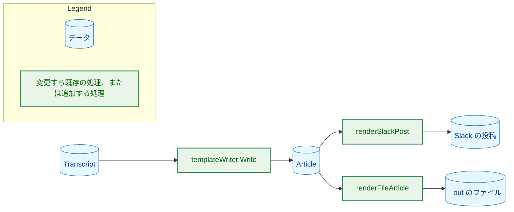
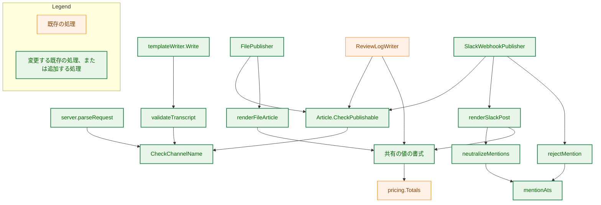
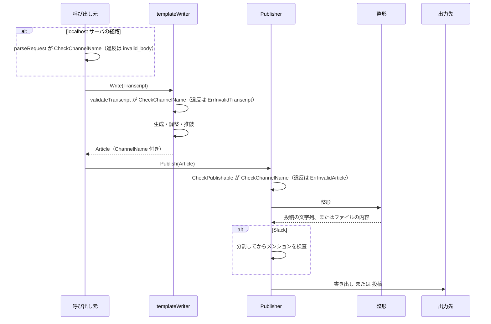
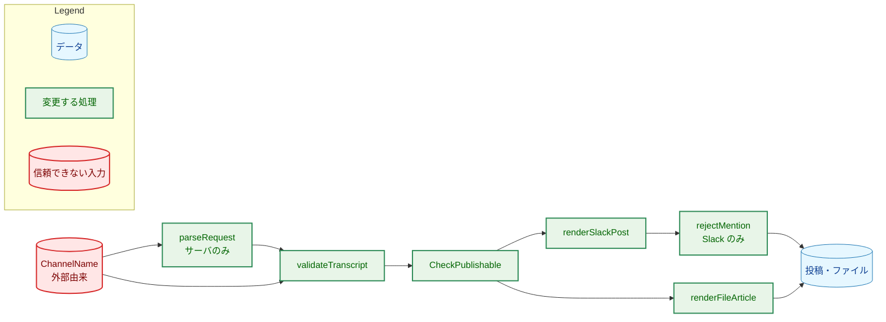
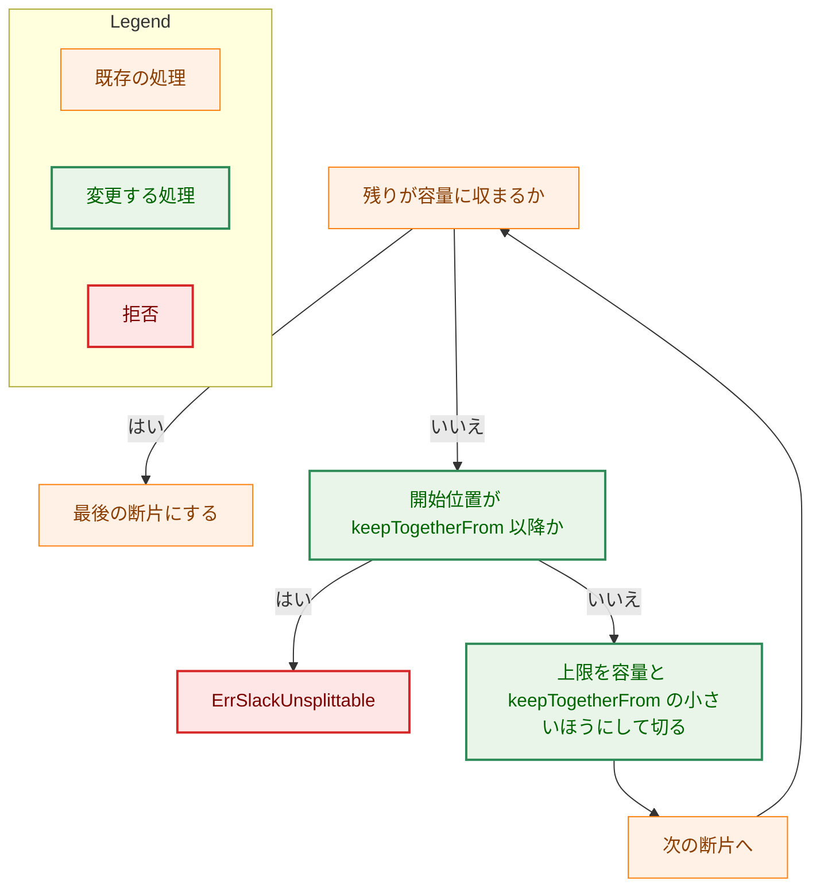

# アーキテクチャ設計書：出力の構成の見直し

## Document Status

| Item | Value |
|---|---|
| Status | `draft` |
| Created | 2026-10-19 |
| Review date | - |
| Reviewer | - |
| Comments | - |

本書の「現在の実装」への言及は、コミット `7dd5e04`（`main` の `c0099c7` に要件の承認を重ねたもの）を読んで確かめた。行番号は `file:line` で示す。`H-nn` は `design_handoff.md` の項目、`R-n` は 10 章（未決）と付録 B（決定済み）の項目、`AC-nn` と `F-nnn` は要件定義書の項目を指す。

## 1. 設計の全体像 (Design Overview)

### 1.1. 設計原則

-   **整形は出力先ごとに持つ。** 現在はファイルと Slack の投稿が 1 つの `renderArticle`（`internal/publisher/file.go:211`）を共有している。出力の形が出力先ごとに違うので、整形を 2 つに分ける。共有するのは、両方が実際に使う値の組み立てだけにする。
-   **外部由来の値は、出力の構造に入る前に検査する。** チャンネル名は外部由来の表示用の文字列である。要求の入口（サーバ）、LLM を呼ぶ前（`validateTranscript`）、公開の直前（`CheckPublishable`）の 3 か所で同じ規則を適用し、出力の中では引用符で囲むか、エスケープする。Slack の投稿では、メンションになりうる `@` を無効化する（3.7）。
-   **Slack が描画する記法は、確かめられたものだけを使う。** 見出し（`# `）は実機で描画されることを確かめた（要件 §1）。Slack の投稿は、確かめた記法（見出しと平文の行）だけで組み立て、強調（`**`・`_`）など未確認の記法を加えない。
-   **既存の保証を保つ。** ファイルの書き出し（一時ファイル、`link(2)`、上書きしない）、Slack の分割と上限、メンションの拒否（M1・M3・M4）と `silent` は変えない。M2 は 3.7 のとおり変える。

### 1.2. なぜ既存の方式（共有の `renderArticle`）では足りないか

要件 F-002 と F-003 は、Slack の投稿を「先頭に見出し行、末尾に 1 行の脚注」、ファイルを「先頭にフロントマター」とする。2 つの形は、行の並びも、モデルの版の有無も、料金の表記も異なる。1 つの関数に出力先の引数を渡して分岐させると、関数の中に 2 つの整形が混ざり、片方の変更が他方のテストを壊す。整形を 2 つに分けると、各整形が短くなり、独立にテストできる。

### 1.3. 概念モデル

チャンネル名は `Transcript` から `Article` に届き、2 つの整形が、それぞれ自分の形に並べる。



矢印 A → B は、「A の値が B に渡り、B がそれを加工する」データの流れを表す。`Article` は、`Transcript` の `ChannelName` を新しく持つ。

## 2. システム構成 (System Structure)

### 2.1. 全体構成

変更はパイプラインの末尾（`writer` から `publisher`）に閉じる。取得（`transcript`）、LLM、料金（`pricing`）は変えない。



矢印 A → B は、「A が B を呼ぶ」ことを表す。「共有の値の書式」は `format.go` の `articleCost` などである（3.2）。呼び出し元（`cmd/yt2column` と `internal/job`）が `Write` の結果の `Article` を `Publisher` に渡す流れは、データの流れなので図に描かない（1.3）。

### 2.2. コンポーネントの配置

| 場所 | 役割 | 区分 |
|---|---|---|
| `internal/writer` | チャンネル名の規則（`CheckChannelName`）、`Article` への受け渡し | 変更・追加 |
| `internal/server`（`request.go`） | 要求のチャンネル名を入口で検査する | 変更 |
| `internal/publisher`（`format.go`・`slack_render.go`・`file_render.go`） | 出力先ごとの整形と、共有の値の書式 | 追加 |
| `internal/writer`（`markdown.go`） | 本文のコードの外の範囲を返す `ProseRanges` | 追加 |
| `internal/failure`・`internal/server`（`job.go`）・`internal/publisher`（`slack_failure.go`）・`cmd/yt2column`（`run.go`） | メンションの拒否の失敗の種類と文面、CLI の案内 | 変更 |
| `internal/publisher`（`file.go`・`slack_message.go`） | 整形の呼び出しの差し替え、分割の変更 | 変更 |

### 2.3. 処理の流れ



実線の矢印は呼び出し、破線の矢印は戻り値を表す。図は、メンションの無効化（3.7）と分割の位置の調整（3.7(3)）を省略している。CLI の経路には入口の検査がなく、`validateTranscript` が最初の検査である。

## 3. コンポーネント設計 (Component Design)

### 3.1. `Article` とチャンネル名の規則（F-001）

`Article` に `ChannelName string`（空文字は「チャンネル名なし」）を加える。`Article` は `==` で比較できる構造のままである（`writer.go:16-17`）。

```go
// ErrInvalidChannelName is wrapped by CheckChannelName.
var ErrInvalidChannelName = errors.New("invalid channel name")

// CheckChannelName returns nil for the empty name ("no channel name") and for
// a name that passes the display-string rules: valid UTF-8, not whitespace
// only, no control character, no bidirectional control character (U+202A to
// U+202E, U+2066 to U+2069), and at most maxChannelNameRunes code points.
// Otherwise it wraps ErrInvalidChannelName,
// names the broken rule only, and never puts the value in the error.
func CheckChannelName(name string) error
```

呼び出し元は、この 1 つの関数を呼び、結果をそれぞれの文脈のエラーに対応づける。複数の `%w` で包む書き方は、`article.go:37` に前例がある。

| 呼び出し元 | 対応するエラー | 位置 |
|---|---|---|
| `Article.CheckPublishable`（`article.go:15`） | `ErrInvalidArticle` | 公開の直前（AC-03、AC-04） |
| `validateTranscript`（`prompt.go:50`） | `ErrInvalidTranscript` | LLM を呼ぶ前（CLI と、入口を通ったサーバ） |
| `server.parseRequest`（`request.go:76`） | 既存の理由 `invalid_body`（HTTP 400） | 要求の入口（localhost サーバ） |

-   **双方向の制御文字（U+202A〜U+202E、U+2066〜U+2069）を拒否する。** 含まれると、表示の順序を入れ替えて、チャンネル名を偽って見せることができる。ZWJ（U+200D）やゼロ幅の非接合子（U+200C）、左右のマーク（U+200E・U+200F）は、絵文字や右から左に書く言語の名前に正当に使われるので、拒否しない。
-   **長さの上限は 200 コードポイントとする**（`maxChannelNameRunes`）。YouTube の公式ヘルプには、チャンネル名の長さの規定がない（2026-10-19 に確認）。二次情報は 100 文字としている（[Sortlist](https://www.sortlist.co.uk/blog/youtube-channel-name/)、[Tunepocket](https://www.tunepocket.com/youtube-channel-name-length/)）。上限を実際の値より小さくすると、正当な名前の記事を出せなくなるので、その 2 倍にする。数えるのはコードポイントで、書記素ではない。上限を超える名前は切り詰めず、拒否する。
-   **規則の置き場所。** `CheckChannelName` は `displayStringProblem`（`output.go:166`）と同じファイルに置き、その規則を共有する。`displayStringProblem` に有効な UTF-8 の検査を加える（3.5 のとおり、`CheckPublishable` が UTF-8 を検査していないため）。既存の呼び出し元は 4 つある。`checkModelString` と `checkGeneratedText`（`output.go:57`）は UTF-8 の検査の後に呼ぶので、振る舞いは変わらない。`ReviewResult.Check`（`revision.go:28`）と `CheckPublishable` は、無効な UTF-8 のモデル名などを新しく拒否する。実際の応答は先に UTF-8 の検査を通るので、この拒否が実害を生むことはない。
-   **検査の重複を作らない。** `validateTranscript` の UTF-8 の検査（`prompt.go:62-74`）から `ChannelName` の項目を外し、`CheckChannelName` に任せる。`Title` と `Description` の検査は残す。
-   **なぜ入口に置くか。** `ErrInvalidTranscript` は、サーバの失敗の通知では `failure.KindInternal` に写る（`job.go:143`）。そのコメントは、「検査済みの Transcript では起こらない」と述べている。入口（`parseRequest`）で先に拒否すれば、サーバの利用者に内部エラーとして見えない。
-   **なぜ Transcript の生成の場所で検査しないか。** `transcript` パッケージは `writer` を import できない（`writer` が `transcript` を import している）。検査を `transcript` に置くと、表示用の文字列の規則（`displayStringProblem`）を複製することになる。そのため、`writer` に規則を 1 つ置き、入口から呼ぶ。
-   **`newArticle`**（`output.go:181`）は、`Write` が受け取った `Transcript` の `ChannelName` を `Article` に写す。`Write` は、生成の実行でも `--after` の再開でも `t` を受け取る（`writer.go:328-332`）ので、再開の経路でも同じ値が使われる（AC-01）。中間生成物の来歴（`artifact.go:150`）はすでにチャンネル名をダイジェストに含めており、形式は変わらない。

### 3.2. 共有の値の書式（`format.go`）

```go
// articleCost returns the article's total cost and whether it is known; it
// uses pricing.Totals as articleCostLine does today (file.go:229).
func articleCost(runUsage writer.RunUsage) (pricing.Amount, bool)

func modelVersionOrNone(version string) string // 既存（file.go:241）を移す

const articleCostDecimals = 4 // 既存（file.go:39）を移す
```

-   `articleCost` を使うのは、Slack の脚注とファイルの `estimated_cost_usd` の 2 つである。値の算出と丸め（`Amount.Format(articleCostDecimals)`）は変えない。Slack は `Estimated cost: <amount> USD` または `Estimated cost: unknown`、ファイルは `"<amount>"` または `"unknown"` を、それぞれの整形で組み立てる。
-   `modelVersionOrNone` を使うのは、ファイルの整形と `ReviewLogWriter`（`reviewlog.go:77`）である。Slack の脚注は版を出さない（AC-08）。
-   段階ごとのモデルの一覧（`stageModels`）は Slack の脚注だけが使うので、`format.go` ではなく `slack_render.go` に置く。

### 3.3. Slack の投稿（F-002、`slack_render.go`）

```go
// slackPost is the full text of a post.
type slackPost struct {
    text string
    // keepTogetherFrom is the rune index in text from which the post must not
    // be cut: the last line of the body and the footer stay in one message.
    keepTogetherFrom int
}

func renderSlackPost(a writer.Article) slackPost

// stageModel is one model name and the stages that used it.
type stageModel struct {
    Model  string
    Stages []writer.Stage // StageGeneration, StageShorten, StageReview, in this order
}

func stageModels(a writer.Article) []stageModel
```

投稿の並びは次のとおりである。

```text
# <title>（<channel>）        ← チャンネル名がないときは "# <title>"
                             ← 空行
<body>                       ← Article.Body（末尾は出典のブロック）
                             ← 空行
Models: <model> (<stages>) · <model> (<stages>) · Estimated cost: <amount> USD
```

-   **見出し行は `# ` の見出しとする**（H-02）。今の出力の `# タイトル` が実機で見出しとして描画されることを確かめている（要件 §1、2026-10-19）。新しく採る記法は、タイトルの後ろに全角の括弧で囲んだチャンネル名を続けることだけで、平文である。**チャンネル名を括弧で終わらせる理由。** Mattermost は見出し行の末尾の `#` を、空白がなくても取り除き、バックスラッシュでエスケープしても `#` が消えて `\` だけが残る（6.5 の実機の確認）。`C#` のようなチャンネル名が末尾にあると、`C` と表示される。括弧で閉じれば、名前の末尾の `#` が残る。強調（`**`・`_`）は未確認の記法なので採らない。
-   **見出し行に入る記号の扱い。** `<!`・`<@`、文字参照、`<a|b>` の並びは、既存の `rejectMention` が投稿の全体に対して拒否する（AC-14c）。対象の `@` は、3.7 の `neutralizeMentions` が無効化する（AC-14）。それ以外の記号（`*`・`_`・`[`）による強調やリンクの描画は、見出し行のタイトルが今も受けているのと同じ扱いであり、拒否もエスケープもしない（描画が崩れるだけで、通知や構造の破壊にはならない）。
-   **見出し行のタイトルとチャンネル名、脚注のモデル名、本文のコードの外は、`neutralizeMentions` を通してから並べる**（3.7）。`Article` の値は変えない。
-   **脚注は平文の 1 行**とし、記法の記号を加えない。モデル名の中の `_` や `*` が描画を変えうることは残る。モデル名は、設定とプロバイダの応答から来る表示用の文字列で、利用者が指定する外部のテキストではない。実在のモデル名（`deepseek-flash`、`claude-haiku-5-5`）は記号を含まない。
-   **脚注の語は英語**（`Models:`、`Estimated cost:`、`generation`・`shorten`・`review`（`Stage.String()`、`artifact.go:36`）、`unknown`）。要件 F-002 のとおり、開発者向けの情報なので英語とする。
-   **`stageModels`** は、生成、字数の調整（`Article.Shorten` が nil でないとき）、推敲（`Article.Review` が nil でないとき）の順に、モデル名ごとにまとめる。順序は、モデル名の最初の出現順で、各モデルの段階の並びは生成、字数の調整、推敲の順である（AC-09、AC-10）。モデルの版の違いは区別しない。
-   **`keepTogetherFrom`** は、`Article.Body` の最後の行の先頭の位置である。`Body` の末尾の改行を除いて、最後の改行の後ろを最後の行とする（改行がなければ `Body` の先頭）。これは、自分で組み立てた本文の中の位置を求める計算で、本文の内容によって処理を選ぶものではない。`Body` は通常、出典のブロック（`出典: <URL>`）で終わる（`output.go:202`）ので、最後の行は出典の行である。

### 3.4. ファイルの出力（F-003、`file_render.go`）

```go
func renderFileArticle(a writer.Article) string

// escapeLeadingMarkdown returns line such that a Markdown renderer cannot read
// it as a block-level construct (heading, list, quote, code block, rule).
func escapeLeadingMarkdown(line string) string
```

出力は次のとおりである。

```text
---
channel: "<channel>"                    ← チャンネル名があるときだけ
source: "<source URL>"
model: "<model>"
model_version: "<version or (none)>"
shorten_model: "<model>"                ← Article.Shorten があるときだけ
shorten_model_version: "<version or (none)>"
review_model: "<model>"                 ← Article.Review があるときだけ
review_model_version: "<version or (none)>"
estimated_cost_usd: "<amount or unknown>"
---

# <title>

<channel line>                          ← チャンネル名があるときだけ

<body>
```

-   **値の書き出しは `strconv.Quote` とする**（H-04）。検査済みの値（有効な UTF-8 で制御文字を含まない）に対して、`strconv.Quote` の出力は YAML の二重引用符の文字列として読み戻せる。確かめた内容は 6.3 に記録する。
-   **値の検査。** `CheckPublishable` が、引用符で囲む値のすべて（チャンネル名、モデル名、モデルの版、`SourceURL`）の UTF-8 の有効性を検査する（3.5）。無効な UTF-8 は `strconv.Quote` が `\xNN` に変換し、YAML がそれを別の文字として読むので、検査を通った値だけを渡す。
-   **チャンネル名の行は `escapeLeadingMarkdown` を通す**（H-02）。何も囲まない 1 行は、先頭の文字によって Markdown のブロックの記法（見出し、箇条書き、引用、コードブロックなど）として解釈されうる。エスケープは行頭の 1 文字だけに適用し、描画した結果の文字列がチャンネル名と一致するようにする。要件 AC-15 の「チャンネル名だけの行」は、「描画した行がチャンネル名と一致する」と読む。ファイルの生の行は、ブロックの記法で始まる名前に限り、エスケープの分だけチャンネル名と異なる（確認済み。付録 B）。文字ごとの規則は実装計画で決める。
    -   **エスケープを選ぶ理由。** 先頭が記号の名前を拒否すると、その名前のチャンネルの記事を、ファイルにも書けなくなる。エスケープなら記事を出せる。
-   `source` は `Article.SourceURL` である。`estimated_cost_usd` は、算出できないとき `"unknown"` である。
-   フロントマターの後の `# <title>` の行以降は、従来の本文と同じである。本文の末尾の出典のブロックは、`Article.Body` に含まれる。

### 3.5. 検査と分割の変更（`article.go`・`slack_message.go`）

**UTF-8 の検査の持ち主を `CheckPublishable` に一本化する。**

-   `displayStringProblem` に UTF-8 の検査を加えたので、`CheckPublishable` が検査するタイトル、モデル名、モデルの版、段階のモデル名、チャンネル名は UTF-8 も検査される。`CheckPublishable` は `SourceURL` にも UTF-8 の検査を加える。
-   `prepareSlackMessages`（`slack_message.go:25`）の UTF-8 の検査（`slack_message.go:29-41`）は、`Body` だけを対象にする。`CheckPublishable` がタイトル、モデル名、`SourceURL` などを検査するようになり、`Body` だけが `CheckPublishable` の検査に含まれないためである。

**投稿の組み立て。** `prepareSlackMessages` は、`renderArticle(article)` を `renderSlackPost(article)` に置き換える。分割（`splitSlackText`）の後にメンションを検査する順序（`slack_message.go:42-50`）は変えない。

**分割は `slackPost` を受け取る。**

```go
func splitSlackText(post slackPost) ([]string, error)
```

`splitSlackText`（`slack_message.go:75`）は、投稿の文字列を断片（Slack に送る 1 通のメッセージ）に分ける。この動作に、次の規則を加える。

-   **不変条件。** 各断片は空でなく、1 通の容量を超えない。最後以外の断片は、`keepTogetherFrom` 以前で切る。従来の拒否の条件（空白だけの断片、メッセージ数の上限）は、そのまま適用される。
-   最後の領域（`keepTogetherFrom` 以降）が 1 通に収まらないときは、`ErrSlackUnsplittable` で拒否する（fail-secure）。切る位置の探索の手順は [implementation_handoff.md](implementation_handoff.md) の I-04 に置く。
-   これにより、最後のメッセージは、本文の最後の行と脚注を必ず含み、脚注だけのメッセージは作られない（AC-12）。
-   **受理される記事の集合は、わずかに狭まる。** 切る位置が `keepTogetherFrom` 以前に制限されるので、従来はちょうど 10 通に収まった記事が、11 通になって拒否されることがありうる。10 通の上限は約 16 万字で、字数の調整が有効な既定の実行では本文が 4,000 字以内（`maxBodyChars`）に収まるので、実際には起こらない見込みである。字数の調整を無効にした実行で本文が極端に長い場合に限り、従来から 10 通を超えて拒否される。
-   見出し行と脚注の文字数は、`text` の一部なので、1 通の上限とメッセージ数の上限の計算に含まれる（AC-13）。`SlackMessageCount`（`slack_message.go:59`）は `prepareSlackMessages` を呼ぶので、実際に送る数と一致する。

### 3.6. 変更するファイルとテスト

| ファイル | 変更 | 対応する AC |
|---|---|---|
| `internal/writer/writer.go` | `Article` に `ChannelName` を加える | AC-01、AC-02 |
| `internal/writer/errors.go` | `ErrInvalidChannelName` を加える | AC-03 |
| `internal/writer/output.go` | `newArticle` が `ChannelName` を受け取る。`CheckChannelName` を置く。`displayStringProblem` に UTF-8 の検査を加える | AC-01、AC-03 |
| `internal/writer/article.go` | `CheckPublishable` が `CheckChannelName` と `SourceURL` の UTF-8 を検査する | AC-03、AC-04 |
| `internal/writer/markdown.go` | `ProseRanges` を加える（既存の `proseLines`・`codeSpans` を使う） | AC-14、AC-14b |
| `internal/failure/failure.go` | `KindPublishMention` を加える | AC-14f |
| `internal/publisher/slack_failure.go` | `KindPublishMention` の文面を加える | AC-14f |
| `internal/server/job.go` | `classify` が `ErrSlackMention` を `KindPublishMention` に分類する | AC-14f |
| `cmd/yt2column/run.go` | `ErrSlackMention` の案内を詳しくする（`run.go:1031`） | AC-14e |
| `internal/writer/prompt.go` | `validateTranscript` が `CheckChannelName` を呼ぶ（`fields` の `ChannelName` を外す） | AC-03 |
| `internal/server/request.go` | `channelName` を `CheckChannelName` で検査する。拒否の理由は `invalid_body` | AC-03 |
| `internal/publisher/format.go`（新規） | `articleCost`、`modelVersionOrNone`、`articleCostDecimals` | AC-11、AC-18、AC-19 |
| `internal/publisher/slack_render.go`（新規） | `renderSlackPost`、`stageModels`、`slackPost`、`neutralizeMentions` | AC-05〜AC-11、AC-14 |
| `internal/publisher/file_render.go`（新規） | `renderFileArticle`、`escapeLeadingMarkdown` | AC-15〜AC-20、AC-22 |
| `internal/publisher/file.go` | `renderArticle`・`articleCostLine`・`modelVersionOrNone`・`articleCostDecimals` を削除し、`renderFileArticle` を呼ぶ | AC-15、AC-21 |
| `internal/publisher/slack_message.go` | `renderSlackPost` を呼ぶ。UTF-8 の検査を `Body` に絞る。`splitSlackText` が `slackPost` を受け取る。M2 の判定を `mentionAts` に置き換える（3.7） | AC-12、AC-13、AC-14〜AC-14d |
| `internal/publisher/reviewlog.go` | `modelVersionOrNone` の移動に追従する（出力は変えない） | - |
| `internal/publisher/testutil/integration.go` | `integrationHeader` が Slack の新しい投稿の並びを写す | AC-05〜AC-07 |
| `docs/tasks/0008_column_prompt/check_article.py` | `HEADER_RE` をフロントマターの形に合わせる（0022 のステップ 3-2 の前例） | - |
| `README.md`、`docs/dev/project_overview.md`、`docs/dev/security.md`、`docs/dev/developer_guide/package_reference.md` | 出力の説明の更新 | AC-23〜AC-25 |

更新が要る既存のテストは、次のとおりである（`renderArticle` などの旧い形を `grep` で列挙した。`slack_articles_test.go` には旧い形の期待値はない）。

| テスト | 確かめている旧い振る舞い |
|---|---|
| `internal/publisher/file_test.go:92,122,136,142-162` | ファイルのタイトル行の下のモデルの行、`- Estimated cost:`、`renderArticle` |
| `internal/publisher/slack_test.go:469,487,519-565` | `renderArticle` と同じ投稿、`- Estimated cost:` の行が 1 回だけ現れること |
| `internal/publisher/slack_message_test.go`（`renderArticle` を使う各テスト） | 旧い投稿の見出しのメタデータを含む文字数、分割 |
| `internal/publisher/slack_message_test.go` の `TestSlackMentionRejected`・`TestSlackMentionAccepted`・`TestSlackMentionPosition`・`TestSlackMentionMessagesFollowPosted` | 旧い M2（`@` の直前を見ずに拒否）の期待値。語の途中の `@` の拒否、書式文字を除く検査用の文字列 |
| `internal/publisher/testutil/integration.go:166-171` | `integrationHeader`（`TestIntegrationArticles` が `renderArticle` との一致を確かめる） |
| `cmd/yt2column/run_test.go:1489` | `ErrSlackMention` の案内の文面 |
| `internal/server/job_test.go`（`TestFailureClassification`）、`internal/failure/failure_test.go`（`TestKindConstants`）、`internal/publisher/slack_failure_test.go` | 失敗の種類の一覧と分類、文面 |
| `cmd/yt2column/run_test.go:1622,2150` | ファイルの見出しとモデルの行 |
| `cmd/yt2column/cost_test.go:165` | ファイルの `- Estimated cost: 0.0011 USD` |
| `cmd/yt2column/integration_test.go:248` | `--out` のファイルの最初の段落をタイトル、次の段落をモデルの行として読む |
| `cmd/yt2column/docs_test.go:784-850`（`TestCostDocsContract`） | README の「Estimated cost」節の語。文書の更新に合わせて確認する |

### 3.7. メンションの扱い（AC-14〜AC-14f）

Slack の投稿のメンションの扱いを 3 つ変える。どれも、Mattermost の語の分け方を踏まえ、通知を起こしうる側に倒した保守的な規則にする（根拠は 6.5）。

```go
// mentionAts returns the rune indices of the '@' characters that may start a
// mention: a name character follows the '@', and the rune before it is not a
// letter or a digit. text is the V3-replaced form of the checked string.
func mentionAts(text []rune) []int

// neutralizeMentions returns value with U+200B inserted after each '@' that
// mentionAts reports for the V3-replaced value, except an '@' that directly
// follows '/'. It is applied to the title, the channel name and the model
// names.
func neutralizeMentions(value string) string

// neutralizeProse does the same for a body, but only for the '@' characters
// inside prose, the byte ranges of body outside code. It converts each rune
// index of mentionAts to a byte offset of the original body before comparing.
func neutralizeProse(body string, prose []writer.ByteRange) string
```

```go
// ProseRanges (in internal/writer) returns the byte ranges of body outside
// fenced code blocks and code spans, and true. It returns false when the
// body cannot be judged. An empty slice with true means that the whole body
// is code.
func ProseRanges(body string) ([]ByteRange, bool)
```

以下、「対象の `@`」は、`mentionAts` が報告する `@` を指す。

**(1) 規則 M2 の判定を、`mentionAts` に置き換える。**

-   `@` の直後に名前の文字（文字・数字・`_`）が続き、`@` の直前の文字が「文字でも数字でもない」（または先頭である）とき、その `@` を対象とする。直前が文字または数字の `@`（`Tech@Work`、`user@example.com`、`さん@xxx`）は、語の途中の `@` で、対象としない。
-   この規則は、Mattermost の `ProcessText` の語の分け方より広く対象とする。`foo_@bar`・`x@@y` のように、直前が `_` や `@` の `@` も対象とする。Mattermost の語の分け方を正確に写すと、`_a_@here` のように、Markdown の強調がテキストのノードを分ける形（強調の直後の `@here` が語の先頭になる）を見逃すので、`@` の直前だけを見る。
-   `@` の直後が U+200B・空白・記号のときは、名前の文字が続かないので、対象としない。`a`・U+200B・`@here` の順に並ぶ形は、`@` の直前が U+200B（文字でも数字でもない）なので、対象とする。
-   見た目の似た文字（`＠` など）は `@` と同じに扱う。書式文字とバックスラッシュは、語の区切りとして扱い、取り除いたり戻したりしない。M1・M3・M4 の判定は変えない。検査用の文字列の作り方は I-05 に置く。
-   `rejectMention` の M2 は、本文を含む投稿の全体に適用する。

**(2) 対象の `@` を無効化する。** 無効化は、投稿の次の部分に適用する。

-   **見出し行のタイトルとチャンネル名、脚注のモデル名。** `renderSlackPost` が、値を `neutralizeMentions` に通してから並べる。
-   **本文のうち、コードスパンとコードブロックの外。** `ProseRanges` が返す範囲の中の対象の `@` だけを無効化する。コードの中身を U+200B で書き換えるとコードが変わるので、変えない。コードの中の対象の `@` は、従来どおり M2 で拒否する（AC-14b）。本文のそれ以外の中身は変えない。
-   **直前が `/` の `@`**（`youtube.com/@name` のような URL の一部の可能性がある）は、無効化しない。U+200B が URL を壊すためである。この `@` は M2 で拒否する（AC-14b）。URL のような文字列は、生成の指示でも本文に書かせない（0008 の AC-13）。
-   `ProseRanges` は、`writer` の本文の Markdown の検査（`markdown.go`）を使って、コードの外を判定する。判定できない本文（コードの対応を信頼できないもの）では、本文に何も無効化せず、対象の `@` は拒否される。インデントのコードブロックは散文として扱い、その中の対象の `@` に U+200B が入りうることは、受け入れる限界である。実装の手順は I-01 に置く。
-   `Article` の値とファイルの出力は変えない。
-   `neutralizeMentions` と `neutralizeProse` は、`mentionAts` と同じ V3 の置き換えをした文字列で対象を求め、元の文字列の同じ位置の `@`（`＠` を含む）の直後に U+200B を入れる。無効化した値には、直前が `/` の `@` と、範囲の外の `@` を除いて、対象の `@` が残らない。位置の変換は I-02 に置く。
-   `@` の直後の U+200B は、表示されない文字で、コピーした文字列に混ざる。
-   `keepTogetherFrom`（3.3）と、`rejectMention` が示すエラーの位置（行と列）は、Slack に送る形（無効化の後）の投稿の文字列で数える。`--out` のファイルには見出し行がなく、無効化もないので、行がずれる。

**(3) 分割が、語の途中の `@` を断片の先頭にしないようにする。** 従来の M2 は、`@name` をすべて拒否していたので、分割の位置は影響しなかった。新しい M2 は、`Tech@Work` のような語の途中の `@` を受理するので、分割が `x` と `@` の間で切ると、次のメッセージの先頭（位置の記号 `(n/m)` と空行の後）が `@here...` になり、対象の `@` が生まれる。

-   **切る位置の規則。** 分割は、語の途中の `@` を断片の先頭にしない位置で切る。そのような位置を選べない場合は、`ErrSlackUnsplittable` で拒否する。改行の後で切る場合は、`@` は元から行頭にあり、投稿の全体で検査済みである。手順は I-03 に置く。
-   **確認の層。** 分割した後、各メッセージの先頭で、投稿の全体では語の途中だった `@` が対象になっていないかを確かめる。見つかれば `ErrSlackUnsplittable` で拒否する。切る位置の規則が正しければ、この層は働かない。
-   M1・M3・M4 の前提（各メッセージで見つかる並びは全体でも見つかる。`slack_message.go:47-49`）は、そのまま成り立つ。M2 だけが成り立たなくなるので、このコメントを書き換える。

**(4) 拒否の理由を示す（AC-14e、AC-14f）。**

-   **CLI。** `ErrSlackMention` の案内（`cmd/yt2column/run.go:1031`）に、`@` の直後に名前の文字が続く並びが原因であること、エラーが示す位置（行と列。1 行目は見出し行）、再実行すると別の記事が生成されること、`--out` で記事を確かめられることを加える。`@` の後の文字列は示さない。
-   **サーバ。** `failure.KindPublishMention`（`KindPublish` の次）を加える。`classify`（`job.go:107`）は、公開段階の失敗が `ErrSlackMention` を包むとき、これを返す。失敗の通知（`slack_failure.go:113` の写像）は、固定の文面（「記事の一部がメンションとして扱われうる形だったので投稿しなかった。送り直すと別の記事が生成される」）を示す。`Notice` の値は、サーバが選んだ固定の値のままである。

**なぜ M1・M3・M4 は変えないか。** M1（`<!`・`<@`）と M4（`<a|b>`）は、サーバが投稿の文字列を書き換える記法で、通知だけの問題ではない。M3（文字参照）は、表示の途中の変形を戻す検査である。これらは語の分け方と関係がないので、従来どおり拒否する。

**M2 の変更が及ぶ範囲。** タイトルと本文に、語の途中の `@`（メールアドレスなど）を含む記事が、従来は拒否されていたが、受理される。本文の対象の `@` も、コードの外なら拒否されず、無効化される。これは 0006 の方針の変更であり、6.2 に記録する。README（317〜319 行）と `docs/dev/security.md`（74 行）の M2 の説明も更新する（AC-23、AC-25）。

## 4. エラーハンドリング設計 (Error Handling Design)

| 場面 | エラー | 備考 |
|---|---|---|
| 公開の直前に、チャンネル名が規則に違反する | `ErrInvalidArticle`（`ErrInvalidChannelName` も包む） | 規則の名前だけを含み、値を含めない（AC-03） |
| LLM を呼ぶ前に、チャンネル名が規則に違反する（CLI） | `ErrInvalidTranscript`（`ErrInvalidChannelName` も包む） | 同上 |
| 要求のチャンネル名が規則に違反する（サーバ） | 拒否の理由 `invalid_body`、HTTP 400 | 既存の理由を使う。README の拒否の理由の表は変えない |
| Slack の投稿に、拒否する並び（本文のコードの中と直前が `/` の対象の `@`、`<!`・`<@`、文字参照、`<a\|b>`）が含まれる | `ErrSlackMention` | 既存。判定の対象が見出し行と脚注を含む投稿の全体になる（AC-14b、AC-14c）。エラーは規則と位置（行と列）を示す。位置は無効化の後の投稿の文字列で数え、その 1 行目が見出し行である。見出し行・脚注・本文のコードの外の対象の `@` は、拒否せず無効化する（AC-14）。CLI とサーバの失敗の通知は、この拒否の理由を示す（AC-14e、AC-14f） |
| 最後の領域が 1 通に収まらない、切る位置を動かすと断片が空になる、または確認の層が分割で生じた対象の `@` を見つけた | `ErrSlackUnsplittable` | 既存。後の 2 つは 3.7(3) で加える |

**サーバの失敗の分類との整合。** 3 つの呼び出し元は同じ関数 `CheckChannelName` を呼ぶので、入口を通った値が `validateTranscript` で拒否されることはない。この一致は、3 つの呼び出し元に同じ入力の表を通すテストで保つ（§7）。

**キャッシュの `info.json`（CLI）。** `yt-dlp` の `channel` は、現在は UTF-8 の検査しかない（`info.go:65`）。保存済みの `info.json` を読む実行で、制御文字や空白だけのチャンネル名があれば、この変更の後は LLM を呼ぶ前に `ErrInvalidTranscript` で拒否される。従来は通っていた入力が拒否されるので、互換性の変化として README に書く。エラーは規則の名前だけを示すので、利用者は動画のキャッシュを消して取得し直す。

## 5. セキュリティ考慮事項 (Security Considerations)

チャンネル名は、拡張が YouTube のページから読む値（localhost サーバ）または `yt-dlp` が出す値（CLI）で、外部由来の信頼できない文字列である。



矢印 A → B は、「A を通った値が B に渡る」ことを表す。`validateTranscript` へは、サーバの経路は `parseRequest` を通った後、CLI の経路は直接届く。

-   **構造を壊されない。** 検査を通った値は、制御文字（改行を含む）を含まないので、フロントマターの行や Slack の見出し行の行数を増やせない。フロントマターでは `strconv.Quote` が引用符とバックスラッシュをエスケープし、`---` や `:` を含む値でも 1 行に収まる。チャンネル名の行は、`escapeLeadingMarkdown` でブロックの記法を避ける。
-   **メンションの通知を起こせない。** 見出し行・脚注・本文のコードの外の対象の `@` は、`neutralizeMentions` が U+200B で無効化する（3.7）。残る並びは、既存の `rejectMention`（定義 `slack_message.go:142`、呼び出し `slack_message.go:50`）が投稿の全体に対して拒否する。`silent` は変えない（`slack.go:70`、`slack.go:202`）。無効化は Mattermost の `master` のソースの読解（6.5）に基づくので、R-4 の実機の確認が済むまでは、どの版でも通知を防ぐとは保証しない。保証する版は、R-4 で確認した版を記録して決める。`silent` に対応する版では、`silent` も通知を防ぐ。`silent` に対応しない版では、拒否の層と無効化だけが通知を防ぐ。
-   **秘密を出力に出さない。** 出力に入る値は、記事の値だけで、API キー・Webhook URL・共有トークンを含まない。拒否のエラーは規則の名前だけを含み、値を含めない。
-   **出典のブロックは変わらない。** 出典は、検証済みの動画 ID から `newArticle` が組み立てる（`output.go:202`）。チャンネル名にも、生成テキストにも依存しない。
-   **残るリスク（拒否もエスケープもしない）。**
    -   `displayStringProblem` は、書式制御文字（双方向の制御文字、ゼロ幅文字）を通す。チャンネル名は 3.1 で双方向の制御文字を拒否する。タイトルとモデル名は、従来どおり拒否しない（タイトルが今も受けているのと同じリスクで、本タスクでは広げない）。ゼロ幅文字は、絵文字の連なりに正当に使われるので、拒否しない。
    -   チャンネル名の行の途中の記法（`*強調*`、`www.` の自動リンク、インライン HTML）は、描画するビューアで有効になる。見出し行のタイトルと同じリスクである。

`docs/dev/security.md` に、次を加える（AC-25）。チャンネル名が外部由来の表示用の文字列であること、入口・公開の直前・Slack の投稿での検査、ファイルでの引用符とエスケープ、上の残るリスク。

## 6. 処理の詳細 (Processing Flow Details)

### 6.1. 判断の記録（H-01〜H-06）

`design_handoff.md` の各項目への対応を、次の表にまとめる。

| 項目 | 方針 |
|---|---|
| H-01 整形の分担と共通部分 | 整形を `slack_render.go`・`file_render.go` に分ける。共有は `format.go` の `articleCost`・`modelVersionOrNone`・`articleCostDecimals` に限る。`stageModels` は Slack だけが使うので `slack_render.go` に置く。`reviewlog.go` は `modelVersionOrNone` の移動に追従するだけで、出力は変えない（3.2、3.6）。 |
| H-02 記法 | Slack の見出し行は確かめた `# ` の見出しとし、タイトルの後ろに全角の括弧で囲んだチャンネル名を続ける（見出し行の末尾の `#` が取り除かれるため。3.3）。脚注は平文。強調（`**`・`_`）は採らない。対象の `@` は、`neutralizeMentions` で U+200B を入れて無効化する（3.7）。ファイルのチャンネル名の行は `escapeLeadingMarkdown` を通す（3.4）。 |
| H-03 チャンネル名の検査の位置 | 3 か所（入口、`validateTranscript`、`CheckPublishable`）で同じ関数 `CheckChannelName` を呼ぶ。LLM を呼ぶ前に拒否できる（3.1）。 |
| H-04 フロントマターの書き出し | `strconv.Quote` を使い、独自のエスケープ関数は作らない。確かめた内容は 6.3 に記録する。 |
| H-05 分割と脚注 | `splitSlackText` に `slackPost` を渡し、切る位置の上限 `keepTogetherFrom` で、最後のメッセージが本文の最後の行と脚注を必ず含むようにする（3.5）。 |
| H-06 古い文書とガード | 3.6 の表に、更新するテストと文書を列挙した。完了したタスクの文書は書き換えない（6.2）。ただし、実行できるスクリプト `check_article.py` は、0022 の前例に従って更新する。 |

### 6.2. 既存の方針との関係

| 項目 | 内容 |
|---|---|
| 変更される方針 | `0022_cost_estimate` の F-006（`docs/tasks/0022_cost_estimate/01_requirements.md:192-193`）。`--out` のファイルと Slack の投稿の「見出しのメタデータ」に、記事 1 本の料金の行を 1 行加える（0022 の AC-23・AC-24）。 |
| 例外とする理由 | 本タスクが出力の構成を見直し、メタデータをファイルのフロントマターと Slack の脚注に移すため。料金の値、4 桁の丸め、`unknown` の扱いは引き継ぐ（要件 §4.4）。 |
| 旧い振る舞いを確かめているテスト | 3.6 の表の各テスト。 |

0006 の規則 M2 も変更する。

| 項目 | 内容 |
|---|---|
| 変更される方針 | `0006_slack_webhook_publisher` の `02_architecture.md` の規則 M2（`docs/tasks/0006_slack_webhook_publisher/02_architecture.md:401,406`）。`@` の直後に名前の文字が続く並びを、直前の文字によらずすべて拒否する。 |
| 例外とする理由 | Mattermost の語の分け方のソースを読むと、語の途中の `@` はメンションにならない（6.5）。拒否する根拠がなく、`Tech@Work` のようなチャンネル名の記事を出せなくなる。対象の `@` は、見出し行・脚注・本文のコードの外では、拒否せず、U+200B で無効化して投稿できる。コードの中と直前が `/` の対象の `@` は、拒否のままである。 |
| 旧い振る舞いを確かめているテスト | `slack_message_test.go` の `TestSlackMentionRejected`・`TestSlackMentionAccepted`・`TestSlackMentionPosition`・`TestSlackMentionMessagesFollowPosted`。 |
| 更新する文書 | `README.md`（317〜319 行）と `docs/dev/security.md`（74 行）の M2 の説明。0006 の `02_architecture.md` の M2 に関する記述（388、401、406、407 行ほか。M2 を「すべての `@name`」とする記述）は、まとめて本タスクの規則に置き換わる。0006 の文書は書き換えない。 |

0022 と 0006 の文書は、当時の決定の記録として書き換えない。

### 6.3. `strconv.Quote` の確認（H-04）

2026-10-19 に、次の値を `strconv.Quote` で二重引用符の文字列にし、Ruby 2.6.10 の `YAML`（Psych）で読み戻して、元の値に戻ることを確かめた。引用符・バックスラッシュ、`:`・`#`・`---`、日本語と非 BMP の文字（`😀`）、U+2028・U+2029・U+FEFF、U+00A0、DEL、U+0085、タブ、ベル。Psych は YAML 1.1 のパーサである。`strconv.Quote` は、有効な UTF-8 の入力に対して、`\a \b \f \n \r \t \v \\ \"` と `\xNN`・`\uNNNN`・`\UNNNNNNNN` だけを出す。これらは YAML 1.1 と 1.2 の両方の二重引用符の文字列で定義されたエスケープシーケンスである。

この確認は 1 回限りで、リポジトリのテストは YAML のパーサを持たない（ライブラリを追加しない。CLAUDE.md「Dependencies」）。リポジトリのテストは、次の 2 点で保つ（§7）。(1) `strconv.Unquote` による Go 側の往復。これは YAML の読み戻しの証拠ではない。(2) 出力に出るエスケープシーケンスの種類が上の集合に含まれることの検査。YAML への適合を保つのは (2) である。

### 6.4. Slack の分割の流れ



矢印は処理の進む順序を表し、ラベル付きの矢印は条件の分岐を表す。図は `keepTogetherFrom` の判断だけを示し、3.7(3) の切る位置の規則と確認の層は省略している。断片の数が上限（10 通）を超えたときの拒否は、現行のとおりである。

### 6.5. Mattermost のメンションの判定の確認（R-2）

2026-10-19 に、Mattermost の `master` のソースを読んで確かめた。次の 4 点は、WebFetch による取得と GitHub API による取得で確認した読解であり、実機での確認ではない。

-   **語の分け方**（[`mention_parser_standard.go`](https://github.com/mattermost/mattermost/blob/master/server/channels/app/mention_parser_standard.go) の `ProcessText`）。文字・数字・`:`・`.`・`-`・`_`・`@` 以外の文字を区切りとして語に分ける。語の先頭の `:.-_` を取り除き、語が `@` で始まるときだけメンションの候補とする。`.`・`-`・`:` を含む語は、それらで分けた部分が `@` で始まるときも候補とする。このため、`Tech@Work`・`user@example.com` は 1 語で、`@` で始まらないので候補にならない。U+200B は区切りなので、`@` の直後に置くと、語が `@` と名前に分かれ、候補にならない。本設計は、この分け方を正確には写さず、`@` の直前が文字または数字のときだけを語の途中として受理する（3.7）。Markdown の強調がテキストのノードを分ける形（`_a_@here`）を見逃さないためである。
-   **Markdown の解釈**（[`notification.go`](https://github.com/mattermost/mattermost/blob/master/server/channels/app/notification.go) の `getExplicitMentions`、[`inspect.go`](https://github.com/mattermost/mattermost/blob/master/server/public/shared/markdown/inspect.go)、[`inlines.go`](https://github.com/mattermost/mattermost/blob/master/server/public/shared/markdown/inlines.go)）。段落のインラインのテキストのノードだけを語の分割に渡す。コードスパンの中身は文字列として保持され、テキストのノードにならない。コードブロックは段落ではない。本設計は、この性質（コードスパンの除外）に依存しない。
-   **添付**。添付のフィールドの値の `@` も通知の対象である（[PR #28018](https://github.com/mattermost/mattermost/pull/28018)）。メンションの回避には使えない。
-   **見出し行の末尾の `#`（実機）。** 2026-10-19 に、テスト用の Webhook に `# タイトル — C#`・`# タイトル — Top #`・`# タイトル — Top \#` を投稿し、ブラウザで描画した結果を確かめた。見出しの内容は、順に `タイトル — C`・`タイトル — Top`・`タイトル — Top \` だった。Mattermost は、見出し行の末尾の `#` を（直前の空白がなくても）取り除く。`\#` のエスケープは、`#` を残さず、`\` だけが残る。全角の括弧で閉じた `# タイトル（C#）`・`# タイトル（Top #）` は、`タイトル（C#）`・`タイトル（Top #）` と、末尾の `#` を残して描画された（同日に確認）。
-   **公式文書**（[Incoming Webhooks](https://docs.mattermost.com/developers/integrate/webhooks/incoming)）。メンションの抑止は `silent` だけを述べ、エスケープやコードの扱いは述べない。

限界。確認したのは `master` の読解である。無効化が通知を防ぐと保証するのは、実機で確認した版に限る（10 章の R-4）。Mattermost はユーザー名が `.` や `-` で始まる場合も語の全体で照合するが、`mentionAts` は `@` の直後に名前の文字（文字・数字・`_`）を求める（従来の M2 と同じ。回帰ではなく、受け入れる限界である）。語の分け方は 2023 年の整理（`a78710c2`）より前から続いている見込みだが、使っているサーバの版では確かめていない。前の版で語の分け方が異なれば、無効化が効かないことがある。`silent` に対応する版（2026-07-09 にマージ）では、`silent` が通知を防ぐ。

## 7. テスト戦略 (Test Strategy)

ユニットテストは、`yt-dlp`・LLM の API・Webhook を呼ばない（CLAUDE.md「Testing Strategy」）。

### 7.1. ユニットテスト

| 対象 | 内容 | AC |
|---|---|---|
| `CheckChannelName` | 空文字、通常の名前、空白だけ、制御文字（タブ・改行・ESC）、不正な UTF-8、双方向の制御文字（U+202A〜U+202E・U+2066〜U+2069）、ZWJ を含む絵文字の名前（受理）、200 コードポイントちょうどと 201 コードポイント（日本語と非 BMP の文字を含む） | AC-02、AC-03 |
| 3 つの呼び出し元の一致 | 同じ入力の表を、`CheckPublishable`・`validateTranscript`・`parseRequest` に通し、受理と拒否が一致する | AC-03 |
| `newArticle` と `Write` | 生成の実行と、`--after generation`・`--after shorten`・`--after review` の再開で、`Article.ChannelName` が入力と同じ | AC-01 |
| `CheckPublishable` | 違反したチャンネル名を `ErrInvalidArticle` で拒否し、エラーに値を含めない。`SourceURL` を含む各値の不正な UTF-8 を拒否する | AC-03 |
| `FilePublisher`・Slack の投稿 | 違反したチャンネル名の記事が、書き出し・通信の前に失敗し、一時ファイルを残さない | AC-04 |
| `renderSlackPost` | 先頭行（チャンネル名の有無）、本文の前の行、最終行が脚注、版が出ない、同一モデルの統合、異なるモデルの併記と順序、料金の 2 つの形、`keepTogetherFrom` が本文の最後の行を指す | AC-05〜AC-11 |
| 分割 | 16,383 文字を超える記事で、見出し行は先頭のメッセージだけ、脚注は最後のメッセージだけに 1 回現れ、脚注だけのメッセージがない。入力は、本文の最後の改行の直後で切れる場合、`keepTogetherFrom` の手前が容量にちょうど収まる場合、10 通に脚注が加わる場合、容量を超える見出し行を含む。`SlackMessageCount` が送る数と一致する | AC-12、AC-13 |
| `mentionAts` | `@` の直前が文字・数字でないもの（行頭、空白・括弧・バックスラッシュ・U+200B・全角の記号・`_`・`.`・`-`・`:`・`@` の後、`_a_@here`）が対象になり、直前が文字・数字のもの（`Tech@Work`、`user@example.com`、`さん@xxx`）と、`@` の直後が U+200B・空白・記号のものが対象にならない | AC-14、AC-14a |
| `neutralizeMentions` | 対象の `@` の直後にだけ U+200B が入る。入れた後の値が `mentionAts` に対象を返さない（直前が `/` の `@` と、`neutralizeProse` の範囲の外を除く）。対象のない値は変わらない。`＠everyone` を、タイトル・脚注・本文のコードの外では無効化し、本文のコードの中では拒否する。`＠`（3 バイト）がコードスパンの中と外にある本文で、位置の変換が正しい | AC-14、AC-14b |
| 分割と `@` | 改行のない長い本文で、切る位置が `x` と `@` の間に来る入力（`...x@here...`）で、`@` が断片の先頭にならない。切る位置の規則を外すと失敗し、確認の層が `ErrSlackUnsplittable` を返すことを確かめる。見出し行が分割されるほど長い `Tech@Work` のタイトルも含む | AC-14a、AC-14d |
| メンションの拒否と無効化 | 本文のコードの外の対象の `@name` は無効化されて拒否されない。コードスパン・コードブロックの中と、直前が `/` の対象の `@` は `ErrSlackMention` で拒否される。見出し行と脚注の対象の `@name` は無効化される。語の途中の `@` を含む記事（タイトル・本文・チャンネル名）は変更も拒否もされない。`<!`・`<@`、文字参照、`<a\|b>` を見出し行・脚注・本文のどこに含んでも拒否される | AC-14〜AC-14c |
| `ProseRanges` | フェンス付きコードブロック、コードスパン（複数のバッククォート）、判定できない本文（閉じていないフェンス、フェンスらしい行、対にならないバッククォート、`codeSpansExempt` が偽）で false を返す、インデントのコードブロック（散文として扱う）、全体がコードの本文（空の範囲と true） | AC-14、AC-14b |
| 失敗の理由 | `ErrSlackMention` が `KindPublishMention` に分類され、失敗の通知の文面が固定の値だけで組み立てられる。CLI の案内が、原因・位置・対処を示し、`@` の後の文字列を含まない | AC-14e、AC-14f |
| `renderFileArticle` | 先頭が `---`、キーの名前と順序、条件付きのキーの有無、`(none)`、`estimated_cost_usd` の 2 つの形、見出しの下にメタデータの行がないこと、チャンネル名の行の有無 | AC-15〜AC-20 |
| フロントマターの値 | 引用符・バックスラッシュ・`:`・`#`・`---`・日本語を含む値で、行数とキーの並びが変わらず、`strconv.Unquote` で元の値に戻る。出力に出るエスケープシーケンスが、6.3 の集合に含まれることを、`\a \b \f \v`・DEL・U+0085・U+2028・U+2029・U+FEFF・非 BMP の非印字文字を入れた値で確かめる | AC-17 |
| `escapeLeadingMarkdown` | 先頭がブロックの記法になる各場合と、ならない場合を表で確かめる | AC-15 |
| `FilePublisher` の従来の保証 | 上書きしない、一時ファイル、書く前の検査 | AC-21、AC-22 |

各テストは、検査の対象を無効にして（呼び出しを外す、規則を緩める）失敗することを確かめ、その結果をコミットメッセージに記録する（CLAUDE.md「Every test must be able to fail for its stated reason」）。具体的な手順は `03_implementation_plan.md` に置く。

### 7.2. 統合テストと手動の確認

-   実際の Webhook に投稿するテスト（`internal/publisher/slack_integration_test.go`）は、`integrationHeader` の更新に合わせる。見出し行と脚注の実機での見え方は、手動で確かめる（AC-05〜AC-07）。
-   LLM の API を呼ぶ統合テスト（`cmd/yt2column/integration_test.go`）は、新しい `--out` の形を読むように直す。
-   `README.md` と `docs/dev/security.md` を変えるので、`make ext-test` も実行する（`serverReasons.test.ts`・`metadataDocs.test.ts`・`manifest.test.ts` が読む。CLAUDE.md「Development Notes」）（AC-26）。
-   **`@` の無効化の確認（実機）。** `@` と `name` の間に U+200B を入れた投稿（`@`・U+200B・`name`）が通知にならないことを、実際の Mattermost で確かめる（10 章の R-4）。
-   **実装の前の確認（実機）。** 拡張が読む `channelName` の `textContent`（`extension/src/browser/chromeDeps.ts:123`）に、制御文字や前後の空白が含まれないことを、実際の YouTube の動画ページで確かめる。含まれるなら、拡張の取り込みの不具合として拡張側で直す（チャンネル名に制御文字を含む正統な場合はないので、サーバの拒否は変えない）。

### 7.3. セキュリティのテスト

-   メンションの並びを含むチャンネル名とモデル名の無効化と、本文・`<!` などの拒否（AC-14〜AC-14c）。
-   制御文字・改行を含むチャンネル名の拒否（AC-03）。
-   フロントマターの値に改行・引用符を入れても、構造が変わらないこと（AC-17）。

## 8. 実装の優先順位 (Implementation Priorities)

各段階は、それぞれ `make test`・`make lint` が通る状態で終える（旧い形と新しい形が混ざった状態を残さない）。

1.  **チャンネル名の受け渡しと検査（F-001）**: `Article`、`CheckChannelName`、`displayStringProblem` の UTF-8、3 か所の呼び出し。出力はまだ変えない。この段階の前に、7.2 の実機の確認（拡張が送る `channelName` の値）を済ませる。
2.  **共有の値の書式**: `format.go` を作り、`renderArticle` を新しい関数を使う形に直す（出力は変えない）。
3.  **ファイルの出力（F-003）**: `renderFileArticle` を加え、`FilePublisher` を切り替える。ファイルの旧い形を確かめているテストと `check_article.py` を直す。
4.  **Slack の投稿（F-002）**: `renderSlackPost` と分割の変更を加え、`SlackWebhookPublisher` を切り替える。メンションの扱いの変更（`mentionAts`、`neutralizeMentions`、`neutralizeProse`、`ProseRanges`、`KindPublishMention`、CLI の案内。3.7）もここに入れる。`integrationHeader` と、Slack の旧い形を確かめているテストを直す。
5.  **文書（F-004）**: `README.md`・`project_overview.md`・`security.md`・`package_reference.md` を更新する。

各段階の分割と、PR の境界は `03_implementation_plan.md` で決める。

## 9. 将来の拡張 (Future Extensibility)

-   Slack の Block Kit への移行（`context` ブロックでの脚注を目立たなくする表示）は、分割の作り直しを伴うので、本タスクでは扱わない。整形が `slack_render.go` に閉じているので、後から差し替えやすい。
-   フロントマターのキーを増やすときは、`renderFileArticle` に加える。キーの追加は、値が検査済みの表示用の文字列であることを条件とする。

## 10. レビューで確認してほしい事項

-   **R-4 `@` の無効化の実機の確認。** `@` と `name` の間に U+200B を入れた投稿が、通知にならないことを実機で確かめる（6.5 は `master` のソースの読解である）。確認した Mattermost の版と結果は、ここに記録し、保証する版を決める。実在するユーザー名を使うと通知が飛びうるので、`silent` に対応した版か、通知を受けないテスト用のアカウントで確かめる。

## 付録 A: 要件との対応 (AC Traceability)

| AC | 設計の箇所 |
|---|---|
| AC-01、AC-02 | 3.1 |
| AC-03、AC-04 | 3.1、3.5、4、5 |
| AC-05〜AC-08 | 3.3 |
| AC-09〜AC-11 | 3.2、3.3 |
| AC-12、AC-13 | 3.5、6.4 |
| AC-14〜AC-14d | 3.3、3.7、5、6.5 |
| AC-14e、AC-14f | 3.7(4)、4 |
| AC-15〜AC-20 | 3.4 |
| AC-21、AC-22 | 3.4、5（従来の保証を保つ） |
| AC-23〜AC-25 | 3.6、5 |
| AC-26 | 7.2 |

## 付録 B: 判断の履歴

-   Slack の見出しを強調（`**`）にする案は、Slack での描画が未確認のため採らなかった。確認できれば、`slack_render.go` の定数だけを変えて切り替えられる。
-   チャンネル名の行に固定の接頭辞（例: `Channel:`）を付ける案は、描画した行がチャンネル名と一致しなくなるため採らなかった。行頭のエスケープは、描画した行がチャンネル名と一致するので採った。
-   フロントマターの独自のエスケープ関数は、`strconv.Quote` で足りるため作らない（6.3）。
-   チャンネル名の検査を、文字列を返す関数（`displayStringProblem` の形）で公開する案は、複数の呼び出し元がそれぞれのエラーに写す必要があり、検査関数はエラーを返すという方針に合わないため、番兵エラーを返す形にした。
-   **R-1（チャンネル名の制御文字・改行）。** 正統な名前に制御文字や改行を含むものはない。サーバの拒否は意図どおりとし、実機で拡張が読む値に混ざる場合は、拡張側で直す（7.2）。
-   **R-2（`@` を含む名前）。** バックスラッシュのエスケープは語の先頭では効かないが、語の途中の `@` は最初からメンションにならない。対象の `@` は U+200B で無効化する（3.7、6.5）。拒否のままにする案と、コードスパンにする案は採らなかった。コードスパンは、見た目が変わり、`rejectMention` に範囲の例外が要る。
-   **R-3（長さの上限）。** 公式の規定がないので、二次情報の 100 文字の 2 倍である 200 コードポイントとした（3.1）。
-   **R-5（チャンネル名の行）。** 要件 AC-15 の「チャンネル名だけの行」を「描画した行がチャンネル名と一致する」と読む。ブロックの記法で始まる名前に限り、生の行にエスケープが入る（3.4）。
-   **R-6（本文の `@`）。** 本文の対象の `@` を拒否すると、利用者が失敗の理由を理解できず、回避策もない。そのため、コードの外を無効化し、拒否は稀な場合（コードの中、直前が `/`）に限り、理由を示す（3.7）。プロンプトで `@` の使用を避けさせる案は、拒否の頻度を測ってから判断する。
-   **R-4a（見出し行の末尾の `#`）。** 実機で、Mattermost が末尾の `#` を取り除き、`\#` も効かないと分かった。チャンネル名を見出し行の末尾に置く案（` — ` 区切り）は採らず、全角の括弧で閉じる（3.3）。名前を見出し行の先頭に置く案は、要件 F-002（タイトルの後ろにチャンネル名）に反するため採らなかった。
