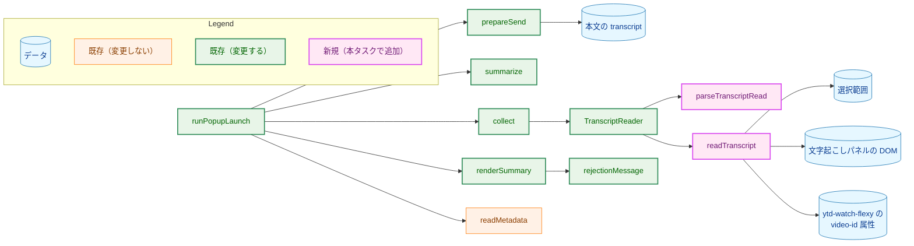
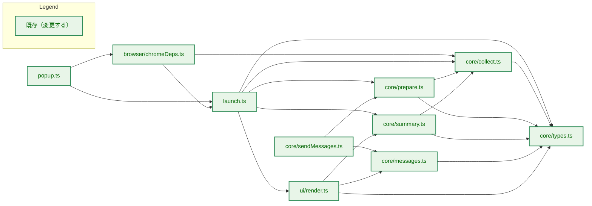
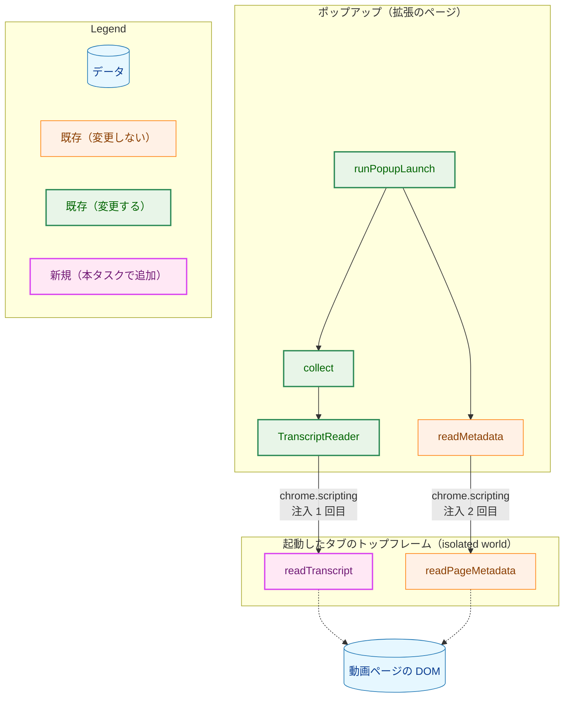
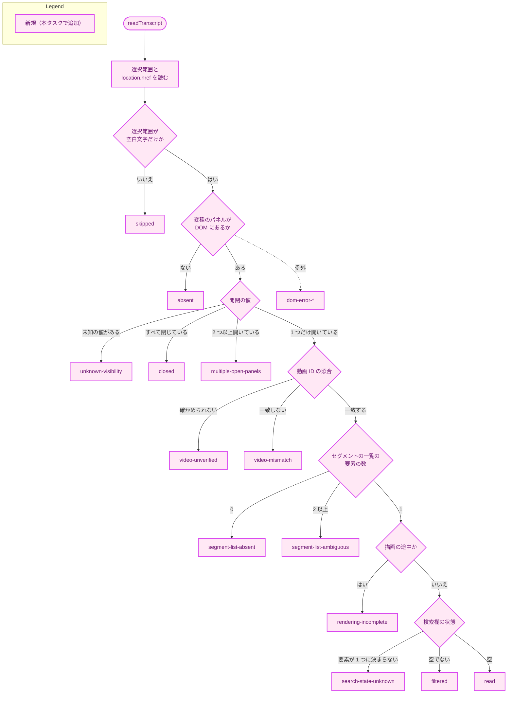
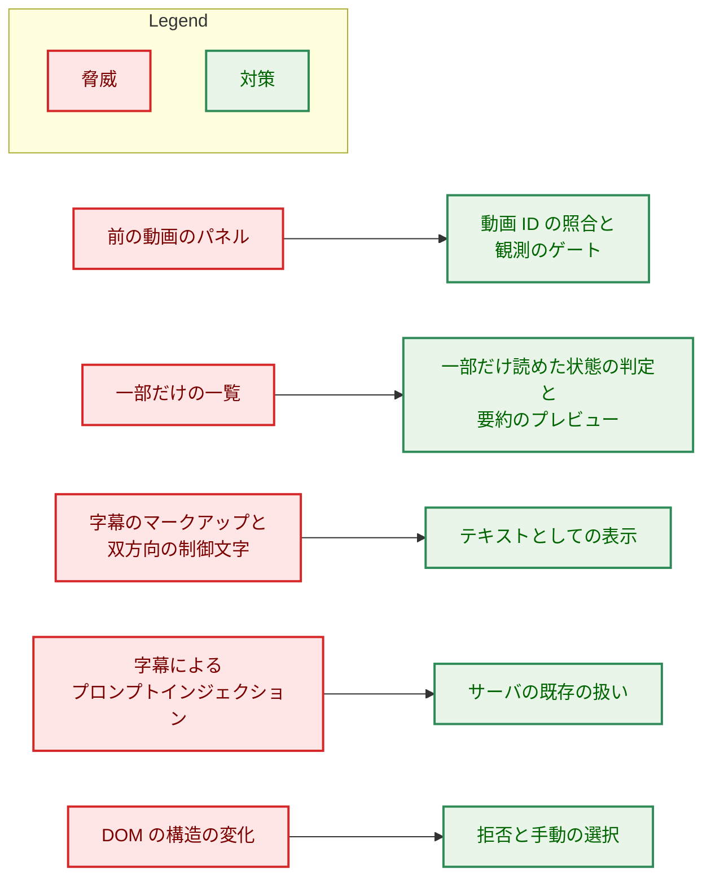
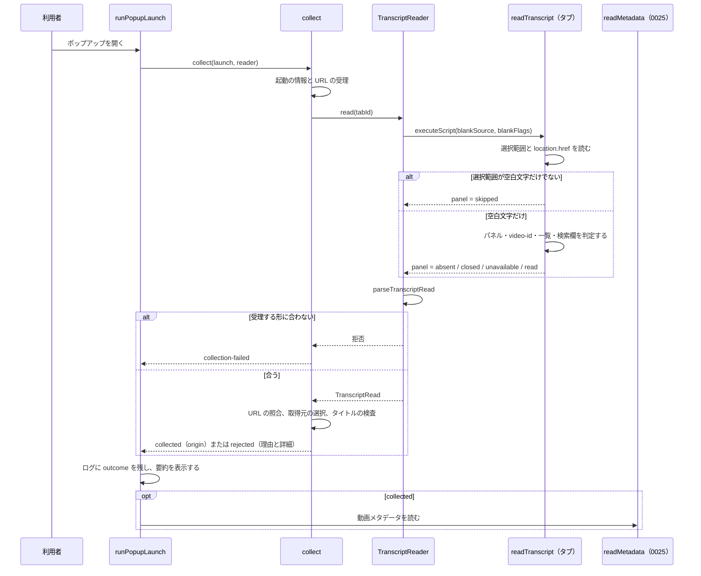

# アーキテクチャ設計書：テキストが選択されていないとき、文字起こしパネルの DOM から字幕を読み取る

## Document Status

| Item | Value |
|---|---|
| Status | `approved` |
| Created | 2026-10-19 |
| Review date | 2026-10-20 |
| Reviewer | isseis |
| Comments | - |

本書は [01_requirements.md](01_requirements.md)（要件定義書。以下、要件書）の設計である。既存のファイルに関する記述は、コミット `9698b97` のファイルで確かめた。`file:line` はこのコミットの行番号を指す。F-NNN・AC-NN は要件書の項番を指す。要件のレビューで設計に申し送られた事項（[design_handoff.md](design_handoff.md) の H-01〜H-08）への対応は 3.11 にまとめる。

本書は次の文書を参照する。

-   **0007 の設計書:** [`docs/tasks/0007_browser_extension_skeleton/02_architecture.md`](../0007_browser_extension_skeleton/02_architecture.md)。拡張の骨格と収集の設計。
-   **0020 の設計書:** [`docs/tasks/0020_extension_send/02_architecture.md`](../0020_extension_send/02_architecture.md)。送信のクライアントの設計。
-   **0025 の設計書:** [`docs/tasks/0025_extension_video_metadata/02_architecture.md`](../0025_extension_video_metadata/02_architecture.md)。動画メタデータの読み取りの設計。「0025 §N」はその節を指す。

本書では、0007・0020・0025 の設計書の用語（収集、収集の結果、表示用の要約、送る前の確認、ページの読み取り、動画メタデータ）と、要件書 6. の用語（文字起こしパネル、セグメントの一覧、パネルから読んだ字幕、取得元、一部だけ読めた状態、末尾のプレビュー）をそのまま使い、次の用語を加える。

-   **字幕の読み取り:** ポップアップを開いたときに、起動したタブへ 1 回だけ注入する関数が、選択範囲・文書の URL・パネルの読み取りの結果をまとめて返すこと（3.3）。既存の「選択範囲の読み取り」（0007）を広げたものである。
-   **パネルの読み取りの結果:** 字幕の読み取りのうち、文字起こしパネルについての結果（3.2 の `PanelRead`）。読まなかった・パネルがない・閉じている・使えない（理由つき）・読めた（字幕の文字列つき）のどれかである。
-   **パネルの変種:** DOM の版によって異なる、文字起こしパネルの要素の組（パネルの要素、セグメントの一覧、検索欄、読み込み中を示す要素）の定義（3.1.3）。
-   **拒否の詳細:** `empty-selection` と `transcript-unavailable` で拒否したときに、拒否の理由に添える列挙の値（3.5 の `detail`）。開発者向けのログに残し、要約に理由のコードとして表示する。
-   **観測のゲート:** 実装の最初に行う、実際の YouTube の動画ページでの観測（8.1）。本書が観測できなかった事項を確かめ、結果によって本書を `draft` に戻すか、要件のレビューに諮る。

## 1. 設計の全体像 (Design Overview)

### 1.1. 設計原則

-   **選択範囲を優先し、空のときだけパネルを読む。** 注入する関数は、選択範囲が空白文字だけでないときはパネルの DOM に触れない。空白文字の判定は既存の `whitespaceOnly`（`extension/src/core/collect.ts:45`）と同じ規則を使い、その正規表現の定義を注入へ**引数として渡す**ことで、規則を複製しない（3.3、H-08）。
-   **注入は 1 つのまま、URL の照合も 1 回のまま。** パネルの読み取りは、選択範囲を読む既存の注入の中で行う。選択範囲・`location.href`・パネルの読み取りは 1 回の同期的な実行で得るので、3 つは同じ時点の DOM を表す。`collect` は既存のとおり、読んだ文書の URL と起動の URL を 1 回だけ照合する（要件書 F-002・AC-05）。
-   **DOM の知識は注入の中に、結果の解釈は `core/` に。** セレクタ、パネルの開閉の判定、一部だけ読めた状態の判定、今の動画のものかの判定は、注入する関数の中に閉じ込める（要件書 4.5）。注入は判定の結果を列挙の値で返す。結果の形の検査と、取得元・拒否の理由への対応づけは、0025 §1.1 の 1 つ目の原則のとおり、ブラウザの API も DOM も参照しない関数として `core/` に置く（3.4・3.5）。
-   **取得元と理由を型で表す。** 取得元（`TranscriptOrigin`）、拒否の理由（`RejectionReason`）、拒否の詳細は、読み取りの段階で列挙として決める。表示・送信・ログは型で振る舞いを選び、字幕の文字列の内容から推し量らない（CLAUDE.md「Declare, don't infer」）。
-   **判定できない状態は使わない側に倒す。** 開閉の値が未知、パネルが複数開いている、セグメントの一覧の要素が一意に決まらない、検索欄の状態がわからない、描画が終わったと確かめられない、動画 ID を確かめられない、のいずれでも字幕を使わず `transcript-unavailable` で拒否する（fail closed）。拒否された利用者は、今までどおり手で選択して送れる。拒否のメッセージは、この手動の選択に戻る手順を必ず含む（3.7）。
-   **ページを操作しない。** 注入は DOM の読み取りだけを行う（要件書 F-002・AC-10）。
-   **送信とサーバは変えない。** パネルから読んだ字幕は、選択範囲と同じ `transcript` の文字列として送る。取得元は本文に入れない（要件書 F-005）。

**DOM の値による判定と「Declare, don't infer」:** 注入は、YouTube の DOM の属性の値（`visibility`・`aria-busy`・`video-id`）と検索欄の値を見て振る舞いを選ぶ。これらは呼び出し側が型で表せない、YouTube の UI の契約に属する外部の値であり、0025 が概要欄の `is-expanded` 属性で折りたたみを判定するのと同じ扱いである（0025 §3.3）。本書はこの判定を次の形に限る。既知の値の閉じた集合と完全に一致するかだけを比べ（部分一致を使わない）、どれとも一致しない値は字幕を使わない側に倒す。判定の結果はその場で列挙の値にし、以降の処理はその値だけで振る舞いを選ぶ。字幕の文字列の内容では何も選ばない。この形は CLAUDE.md の「既知の値の `switch` と、安全側に倒す `default`」に従うので、CLAUDE.md の例外（Go のコピーした字幕のパーサ）を広げる必要はなく、CLAUDE.md は変更しない。

### 1.2. 概念モデル

矢印 A → B は「A が B を使う（呼び出す、または読む・書く）」を表す。



-   `readTranscript`（注入する関数）は、既存の `readSelection`（`extension/src/browser/chromeDeps.ts:35-40`）に代わる新しい関数である。選択範囲が空白文字だけのときだけ、パネルとその所属する `ytd-watch-flexy` を読む。
-   `parseTranscriptRead` は、注入の結果を受理する形に照らして検査する（3.4）。`TranscriptReader` の実装がこれを呼ぶ。
-   `collect` は、検査を通った結果から取得元を選び、`CollectedInput` に取得元を持たせる。拒否するときは、拒否の理由に拒否の詳細を添える（3.5）。
-   `prepareSend` は、`CollectedInput` のフィールド名の変更に合わせるだけで、振る舞いを変えない（3.8）。`readMetadata`（0025）は変更しない。

### 1.3. 既存のコードとの関係と、既存の方針からの例外

本タスクは Go のソースとサーバの API を変更しない（文書の検査をする Go のテストを除く。3.12）。拡張の `core/` の純粋な関数、注入の実装、表示、テスト、文書だけを変更する。manifest と権限は変更しない（要件書 §4.2・AC-23）。

**既存の方針からの例外（選択範囲の読み取りの注入が DOM を読むようになる）:**

1.  **元の方針と場所:** 0025 §1.1 の 3 つ目の原則「DOM に依存する読み取りを、選択範囲の読み取りから分ける」（`docs/tasks/0025_extension_video_metadata/02_architecture.md:35`）と、0025 §3.3「H-02 の決定」の理由 1（同 `:434-436`）。選択範囲の注入は DOM に依存せず、DOM の構造の変化が選択範囲の収集を失敗させないようにする、という方針である。`docs/dev/security.md:109` も「選択範囲はページの DOM の構造に依存せず」と記す。
2.  **例外とする理由:** 要件書 §1「読み取りの場所」で、パネルの読み取りを選択範囲の既存の注入の中で行うと決めた。`location.href` の照合を 1 か所に保ち、上限時間なしで待つ注入（0025 §5.4 のリスク）を増やさないためである。例外の範囲を次の 2 点で狭め、元の方針の目的（DOM の変化が選択範囲の収集を失敗させない）を保つ。
    -   選択範囲が空白文字だけでないときは、注入はパネルの DOM に触れない（3.3）。選択範囲から送る経路の振る舞いは、DOM の構造に依存しない。
    -   パネルの読み取りの中で例外が起きても、注入全体を失敗させず、使えない理由 `dom-error-*`（3.2）として返す。この例外で拒否になるのは選択範囲が空のときだけで、その拒否は `transcript-unavailable` であり、`collection-failed` にはならない。
3.  **古い振る舞いを確かめる既存のテスト:** `extension/test/chromeDeps.test.ts:89-111`「reads only window.getSelection and location」は、注入する関数が `window.getSelection` と `location` だけで動くことを確かめている（文脈に `document` を渡していない）。本タスクで、選択範囲が空でない場合にこの性質が保たれることを確かめるテストと、空の場合にパネルを読むテストに分けて書き直す（3.10）。

このほかに既存のものを変える箇所は次のとおりである。一覧と更新するテストは 3.10 にまとめる。

-   収集の結果 `CollectedInput` に取得元を加え、字幕の文字列のフィールド名を `selection` から `transcript` に改める（3.5）。
-   拒否の理由に `transcript-unavailable` を加え、`empty-selection` の文言を改める。拒否の要約に拒否の詳細を持たせ、理由のコードとして表示する（3.6・3.7）。
-   表示用の要約に取得元と末尾のプレビューを加える（3.6）。
-   選択範囲を前提にした既存の文言（`collection-failed`、`body-too-large`、サーバの `body_too_large`・`invalid_transcript`）を、取得元によらない文言に改める（3.7）。

## 2. システム構成 (System Structure)

### 2.1. ディレクトリ構成

```
extension/
├── src/
│   ├── core/
│   │   ├── types.ts          # 変更: TranscriptOrigin、RejectionReason に transcript-unavailable、要約の型
│   │   ├── collect.ts        # 変更: 字幕の読み取りの型、parseTranscriptRead、取得元の選択、拒否の詳細
│   │   ├── messages.ts       # 変更: empty-selection・collection-failed の文言、transcript-unavailable の文言
│   │   ├── sendMessages.ts   # 変更: transcript-unavailable の委譲、取得元によらない文言
│   │   ├── summary.ts        # 変更: 取得元・末尾のプレビュー・拒否の詳細の要約、truncateEnd
│   │   └── prepare.ts        # 変更: CollectedInput のフィールド名の変更に合わせる（振る舞いは変えない）
│   ├── browser/
│   │   └── chromeDeps.ts     # 変更: readTranscript（注入する関数）、createTranscriptReader
│   ├── ui/
│   │   └── render.ts         # 変更: Source と End の欄、理由のコード
│   ├── launch.ts             # 変更: PopupLaunchDeps の reader の型
│   └── popup.ts              # 変更: createTranscriptReader の配線
├── static/
│   └── style.css             # 変更: End の欄に Preview と同じ規則
└── test/                     # 変更・新規（3.10・7.1）
cmd/yt2column/docs_test.go    # 変更: project_overview.md の記載の検査（AC-21）
README.md                     # 変更（F-007）
docs/dev/security.md          # 変更（F-007）
docs/dev/project_overview.md  # 変更（F-007）
docs/translation_glossary.md  # 変更（用語の追加）
```

### 2.2. コンポーネントの依存関係

矢印 A → B は「A が B を import する」を表す。図は本タスクで変更する拡張のモジュールと、それらの間の import だけを示す。変更しないモジュール（`core/settings.ts`・`core/response.ts`・`core/metadata.ts`・`send.ts`・`ui/renderSend.ts`）への import は省く。



-   import の辺は増えも減りもしない。`browser/chromeDeps.ts` → `core/collect.ts` の import は、現在は型だけである（`extension/src/browser/chromeDeps.ts:1`）。本タスクで `whitespaceOnly`（注入の引数）と `parseTranscriptRead` の値の import になる。新しいモジュールは加えない。
-   `TranscriptOrigin` は `core/types.ts` に置き、`core/collect.ts`（`CollectedInput`）と `core/types.ts`（`OutcomeSummary`）が同じ型を参照する。

### 2.3. 実行時の配置

矢印 A → B は「A が B を呼び出す」を、点線の矢印 A -.-> B は「A が B を読む」を表す。



-   注入の数は 2 つのまま変わらない（字幕の読み取りと、0025 の動画メタデータの読み取り）。

## 3. コンポーネント設計 (Component Design)

### 3.1. 文字起こしパネルの観測（H-01〜H-04）

#### 3.1.1. 観測の条件

| 資料 | 内容 | 取得の条件 |
|---|---|---|
| `testdata/2tcCWM-sRBw.transcript_panel.html` | 開いた直後のパネルの要素（`visibility="ENGAGEMENT_PANEL_VISIBILITY_EXPANDED"`）の outerHTML | 2026-10-07、ログインしていない状態、表示言語は日本語（`testdata/README.md`「文字起こしパネルの HTML の抜粋」）。ブラウザの版は記録されていない |
| `testdata/2tcCWM-sRBw.transcript_panel_hidden.html` | 開く前のパネルの要素（`visibility="ENGAGEMENT_PANEL_VISIBILITY_HIDDEN"`） | 同上 |
| リポジトリの外のスナップショット `2tcCWM-sRBw.0.html`・`2tcCWM-sRBw.1.html` | 上の 2 つを切り出す前のページ全体（パネルを開く前と後） | 同上。`${YT2COLUMN_SNAPSHOT_DIR:-...}` にある（`testdata/README.md`） |

いずれも同じ動画（`2tcCWM-sRBw`。24 分 22 秒。チャプターなし）を、同じ条件（ログインしていない、日本語の表示）で 1 回取得したものである。パネルの字幕は形 A（画面読み上げ用のラベル `4 秒` を含む）である。形 B の DOM、長い動画、チャプターのある動画、検索で絞り込んだ状態、SPA の画面遷移の後の状態、ログインした状態、英語の表示、表示のレイアウトの違い（シアターモード・狭いウィンドウ）は観測していない。これらは観測のゲート（8.1）で確かめる。

#### 3.1.2. 観測した事実

| 事項 | 観測 | 根拠 |
|---|---|---|
| パネルの要素 | `ytd-engagement-panel-section-list-renderer[target-id="PAmodern_transcript_view"]`。開く前のページにも閉じた状態で存在する | `transcript_panel.html:1`、`transcript_panel_hidden.html:1-3`、スナップショット 0・1 |
| 開閉の値 | 開いた状態は `visibility="ENGAGEMENT_PANEL_VISIBILITY_EXPANDED"`、閉じた状態は `"ENGAGEMENT_PANEL_VISIBILITY_HIDDEN"` | 同上 |
| もう 1 つの文字起こしパネル | `target-id="engagement-panel-searchable-transcript"` のパネルが、2 つのスナップショットの両方で閉じた状態（HIDDEN）で存在する。開いた状態の中身は観測していない | スナップショット 0・1 |
| 閉じたパネルの中身 | 開く前は `yt-content-loading-renderer`（スピナー）だけで、セグメントはない | `transcript_panel_hidden.html:4-8` |
| パネルの構成 | `#content > yt-section-list-renderer` の中に、検索欄を持つ `div.ytSectionListRendererHeader`、セグメントを持つ `div.ytSectionListRendererContents`、「動画の時間と同期」ボタンを持つ `div.ytSectionListRendererSyncContainer` の 3 つが兄弟として並ぶ。パネルの見出し（「文字起こし」「閉じる」）は `#header` にある | `transcript_panel.html:111-133`・`:3201-3202` |
| セグメントの一覧 | `div.ytSectionListRendererContents` の中に `yt-item-section-renderer`（`aria-busy="false"`）が 1 つあり、その `#contents` の子孫に `transcript-segment-view-model` が 153 個ある（各セグメントは `div > macro-markers-panel-item-view-model > timeline-item-view-model > div` に包まれる）。各セグメントは時刻（`aria-hidden="true"`）、画面読み上げ用のラベル、本文の 3 つの要素を持つ。最初のセグメントの本文は空白 1 つである | `transcript_panel.html:133-160` |
| 全行の描画 | 24 分の動画で、最後のセグメントの時刻は 24:13 で、セグメントは 153 個すべて DOM にある。続きを読み込む要素（`continuation` を名前に含む要素）はない | `transcript_panel.html` 全体、`testdata/README.md` |
| 検索欄 | `div.ytSectionListRendererHeader` の中に `textarea`（`aria-label="文字音声変換を検索"`）が 1 つある | `transcript_panel.html:115-131` |
| 動画 ID | パネルの要素とその子孫は動画 ID を持たない。パネルの親の `ytd-watch-flexy` が `video-id="2tcCWM-sRBw"` を持ち、パネルはその子孫である | スナップショット 0・1、`transcript_panel.html:1`（`class="style-scope ytd-watch-flexy"`） |

#### 3.1.3. 観測から決めたこと

-   **パネルの変種:** 注入する関数の中に、次の閉じた定義として持つ。

    | 変種 | パネルの要素 | セグメントの一覧 | 検索欄 | 読み込み中を示す要素 |
    |---|---|---|---|---|
    | 新しい版（観測済み。形 A） | `ytd-engagement-panel-section-list-renderer[target-id="PAmodern_transcript_view"]` | パネルの中の `div.ytSectionListRendererContents` | パネルの中の `div.ytSectionListRendererHeader textarea` | 一覧の中の `yt-item-section-renderer` の `aria-busy` が `"false"` でないもの、および `yt-content-loading-renderer`・`tp-yt-paper-spinner`・`ytd-continuation-item-renderer` の要素 |
    | 古い版（要素の存在だけを観測済み） | `ytd-engagement-panel-section-list-renderer[target-id="engagement-panel-searchable-transcript"]` | 定義しない | 定義しない | 定義しない |

    -   古い版は、開閉の判定（パネルがない・閉じている・未知の値・複数開いている）だけに使う。開いていれば `segment-list-absent` で拒否し、読まない。古い版の DOM で一部だけ読めた状態を判定できるかを観測していないので、新しい版の判定をそのまま当てはめると、字幕を使う側に倒れうるためである。古い版の利用者は、手で選択して送れる。
    -   形 B を出すのが古い版のパネルかどうかは仮説である。観測のゲートで、形 B のページのパネルの要素を確かめる（8.1）。古い版の行の定義を加えることは、本書の判断の変更として扱い、本書を `draft` に戻す（8.1）。
-   **読む範囲（H-01）:** セグメントの一覧として `div.ytSectionListRendererContents` を読む。パネルの見出し（`#header`）、検索欄（`ytSectionListRendererHeader`）、「動画の時間と同期」（`ytSectionListRendererSyncContainer`）は兄弟の要素なので含まれない。`yt-item-section-renderer` の `#contents` ではなくその外側を読むのは、チャプターのある動画で `yt-item-section-renderer` が複数になる場合にも、一覧の全体を読むためである。外側に含まれる `yt-item-section-renderer` の `#header` の行は、サーバのパーサが前置き・チャプターの見出しとして読み飛ばすことを期待する（0024 F-007・F-001・F-008）。チャプターのある動画は観測していないので、観測のゲートで確かめる。読み飛ばせない行が混じる場合は、サーバが `invalid_transcript` で拒否する（字幕は送られるが記事は生成されない）。
-   **開閉の判定（H-02）:** `visibility` 属性の値が `ENGAGEMENT_PANEL_VISIBILITY_EXPANDED` と完全に一致すれば開いている、`ENGAGEMENT_PANEL_VISIBILITY_HIDDEN` と完全に一致すれば閉じている、それ以外（属性がない場合を含む）は未知とする。計算済みのスタイルは使わない。属性は YouTube がパネルの開閉に使う宣言的な値で、計算済みのスタイルは CSS の変更や表示のアニメーションの途中で変わりうるためである。
-   **一部だけ読めた状態（H-03）:**
    -   **検索による絞り込み:** 検索欄の `textarea` の `value` が空文字列でなければ、絞り込まれているとみなす（`filtered`）。検索欄の要素が 1 つに決まらない場合は、絞り込まれていないと確かめられないので `search-state-unknown` とする。
    -   **描画の途中:** セグメントの一覧の中に、変種の表の「読み込み中を示す要素」に当たるものがあれば `rendering-incomplete` とする。`aria-busy` は `"false"` と完全に一致するときだけ描画が終わったとみなす（属性がない場合も終わったとはみなさない）。観測した完全な一覧では `aria-busy="false"` で、読み込み中を示す要素はなかった（3.1.2）。
    -   長い動画での遅延描画の有無は観測していない。観測のゲートで、読み込み中を示す要素なしに一部の行だけを描画する状態が見つかった場合は、本書を `draft` に戻す（8.1）。末尾のプレビューだけに頼って防ぐことはしない。
-   **今の動画のものかの判定（H-04）:** 文書の中の `ytd-watch-flexy` がちょうど 1 つで、その `video-id` 属性の値が、`location.href` の `v` パラメータの値と一致し、読むパネルがその `ytd-watch-flexy` の子孫であることを確かめる。一致しなければ `video-mismatch`、`ytd-watch-flexy` が 1 つに決まらないか `video-id` 属性がないか、パネルが子孫でない場合は `video-unverified` とする。
    -   この判定が確かめるのは「パネルを持つページの枠が、今の URL の動画を表示している」ことであり、パネルの**中身**が今の動画のものかを直接は確かめない。パネルの要素は動画 ID を持たないためである（3.1.2）。
    -   SPA の画面遷移では、URL と `video-id` は遷移の初めに変わりうる。パネルの中身が作り直される前に、開いた状態のまま前の動画のセグメントを持ち、描画の途中を示す要素もない時間があれば、上の判定はすべて通り、前の動画の字幕が今の動画の URL と組で送られる。これは要件書 F-002 が禁じる失敗である。
    -   本書は、この時間がないことを、観測のゲートの定めた手順（8.1）で確かめることを実装の前提とする。手順では、中身と動画を結びつける信号（パネルの子孫の要素の属性やリンクに含まれる動画 ID など）も探す。この失敗を「残るリスク」として受け入れない。
    -   信号が見つかった場合は、本書を `draft` に戻し、その照合を判定に加える。
    -   信号が見つからない場合は、試行の結果によらず、本書を `draft` に戻して要件のレビューに諮る（design_handoff H-04 の候補の方針）。試行で失敗が起きなくても、時間に依存する失敗が起きないことは試行では証明できず、送る前に拒否する手段がないまま要件書 F-002 の「必須」を満たしたことにはならないためである。どれかの試行で前の動画の字幕を収集した場合は、F-002 を満たせないことを示す結果として、あわせて諮る。結びつける信号による照合が本書に加わるか、要件のレビューが判断を示すまで、実装に進まない。

### 3.2. 字幕の読み取りの型（H-07・H-08）

```typescript
// core/types.ts

/** Where the transcript to send was collected from. Declared, never inferred from text. */
export type TranscriptOrigin = "selection" | "panel";

// core/collect.ts

/** Which step of the panel read threw; the exception itself is not returned. */
export type PanelReadStep = "visibility" | "video" | "list" | "rendering" | "search" | "text";

/** Why the injected function did not return an open panel's text. For the developer log and the reason code. */
export type PanelDomReason =
  | "unknown-visibility" // a transcript panel's visibility is not a known value
  | "multiple-open-panels" // more than one transcript panel is open
  | "video-unverified" // ytd-watch-flexy or its video-id is missing or not unique, or the panel is outside it
  | "video-mismatch" // ytd-watch-flexy's video-id differs from the URL's v
  | "segment-list-absent" // no segment list in the open panel (including the spinner only, and the old variant)
  | "segment-list-ambiguous" // more than one element matches the segment list
  | "rendering-incomplete" // the list holds a loading element or is not marked not-busy
  | "filtered" // the panel's search box is not empty
  | "search-state-unknown" // the search box is absent or not unique
  | `dom-error-${PanelReadStep}`; // the named step threw

/** Every reason an open panel's text is not used; collect() adds the blank check. */
export type PanelUnavailableReason = PanelDomReason | "segment-list-blank";

/** What the injected function observed about the transcript panel. */
export type PanelRead =
  | { readonly kind: "skipped" } // the selection is not blank, so the panel was not read
  | { readonly kind: "absent" } // no transcript panel in the DOM
  | { readonly kind: "closed" } // at least one transcript panel, every one with the known closed value
  | { readonly kind: "unavailable"; readonly reason: PanelDomReason }
  | { readonly kind: "read"; readonly text: string }; // the segment list's innerText, unmodified

/** What the injected function observed in the tab's top frame, at one moment. */
export interface TranscriptRead {
  readonly selection: string; // window.getSelection().toString(), unmodified
  readonly documentUrl: string; // location.href at the moment of reading
  readonly panel: PanelRead;
}

/** Checks an injected result against the accepted form; undefined when it does not match. */
export function parseTranscriptRead(value: unknown): TranscriptRead | undefined;

/** The only browser capability collect() needs. Faked in unit tests. */
export interface TranscriptReader {
  /**
   * Reads the selection and, when it is blank, the transcript panel.
   * Rejects if the injection fails or the result does not match the accepted form (3.4).
   * A DOM error while reading the panel resolves with panel.kind "unavailable" (dom-error-*), not a rejection.
   */
  read(tabId: number): Promise<TranscriptRead>;
}
```

-   既存の `PageSelection` と `SelectionReader`（`extension/src/core/collect.ts:30-39`）を、それぞれ `TranscriptRead` と `TranscriptReader` に改める。読む対象が選択範囲だけでなくなるので、型の名前を中身に合わせ、選択範囲の文字列のメンバは `text` から `selection` に改める。取得元の型を `TranscriptSource` としないのは、その名前が既に Go のパイプラインの段階の interface を指すためである（`docs/translation_glossary.md:39`）。
-   **H-08 の決定（選択範囲が空かの判定の場所）:** 注入の中で判定する。ただし規則は複製せず、`whitespaceOnly` の `source` と `flags` を注入の引数として渡し、注入の中で同じ正規表現を組み立てる（3.3）。こうすると、要件書 F-001 の「選択範囲が空白文字だけでない場合はパネルを読まない」をそのまま満たし、判定の規則の定義は `core/collect.ts` の 1 か所に残る。
    -   注入の中で規則を複製する案は採らない。H-08 の理由（`\s` と `White_Space` の違いのような食い違い）のとおり、2 つの定義の一致をテストで固定し続ける必要が生じるためである。
    -   注入が常にパネルを読み、取得元の選択を `collect` だけで行う案も採らない。要件書 F-001 の「パネルを読まない」を「使わない」と読み替える必要があり、選択範囲から送る経路が DOM に依存するようになる（1.3 の例外の範囲が広がる）ためである。
    -   注入が返す `panel.kind` が `skipped` であることと、選択範囲が空白文字だけでないことは、同じ条件を表す。この対応は受理する形の一部として `parseTranscriptRead` が確かめる（3.4）。`collect` は、検査を通った結果の `panel.kind` で取得元を選び、同じ判定をもう一度は行わない。
-   **H-07 の決定（結果の形）:** 注入は、既存の選択範囲の読み取りと同じく**オブジェクト**を返す。0025 のメタデータの読み取り（JSON の文字列を返し、受け取った側で厳格に解析する。0025 §3.3）の形にはそろえない。
    -   `chrome.scripting.executeScript` の結果は、構造化された値として拡張へ渡る。JavaScript のオブジェクトは同じ名前のメンバを 2 つ持てないので、この境界では「メンバが重複する結果」が表現できない（要件書 §3.2・AC-22 の「結果の表現が重複を許す場合」に当たらない）。JSON の文字列にすると、0025 が `hasDuplicateTopLevelMember`（`extension/src/core/metadata.ts:118-149`）で行っている重複の検出を、入れ子のオブジェクト（`panel`）まで広げて行う必要が生じる。
    -   未知のメンバと形の不一致は、`parseTranscriptRead` で拒否する（3.4）。

### 3.3. 字幕の読み取りの注入（F-001・F-002・AC-02・AC-04〜AC-10）

```typescript
// browser/chromeDeps.ts

/** Runs in the tab's top frame. Reads the panel only when the selection matches the blank pattern. */
function readTranscript(blankSource: string, blankFlags: string): TranscriptRead;

/** The TranscriptReader backed by chrome.scripting; passes whitespaceOnly's source and flags. */
export function createTranscriptReader(scripting: ScriptingApi): TranscriptReader;
```

-   `ScriptingApi`（`extension/src/browser/chromeDeps.ts:7-13`）は総称型のまま変えない。
-   `createTranscriptReader` は、`createSelectionReader`（`extension/src/browser/chromeDeps.ts:57-74`）を置き換える。注入の引数は `[whitespaceOnly.source, whitespaceOnly.flags]` である。結果を `parseTranscriptRead` に渡し、`undefined` なら `read` を拒否する。拒否の `Error` の文言は固定で、ページの値を含めない。
-   `readTranscript` は、既存の `readSelection` と同じく外の名前を参照しない（`chrome.scripting` がソースを直列化してページで実行するため。`extension/src/browser/chromeDeps.ts:29-34`）。パネルの変種の定義（3.1.3）は関数の中に置く。
-   引数から作る正規表現は、拡張が定義した定数の `source` と `flags` だけから作る。ページの文字列を正規表現にしない。`RegExp` の構築はコードの実行ではなく、`eval`・`new Function` を使わないという既存の制約（要件書 §4.2）に触れない。

**判定の流れ:** 関数の実行は同期的で、途中でページのスクリプトは動かない。したがって、関数が読む値はすべて同じ時点の DOM を表す。

矢印 A → B は「A の判定の後に B へ進む」を表す。



-   `U1`〜`U9` と `UE` は、`panel = { kind: "unavailable", reason }` の `reason` の値である。`AB`・`CL`・`SK`・`RD` は、それぞれ `panel.kind` の値である。`RD` の `text` は、セグメントの一覧の要素の `innerText` を補正せずに返す（要件書 F-002・AC-04）。空白文字だけかの判定は `collect` が行う（3.5）。
-   点線の矢印は、パネルの処理（図の「変種のパネルが DOM にあるか」以降）のどこかで例外が起きた場合を表す。そのときは、例外が起きた段階を `PanelReadStep` の値として `dom-error-<段階>` を返し、選択範囲の文字列と `location.href` はそのまま返す。例外の値（ページの文字列を含みうる）は返さない。選択範囲と `location.href` の読み取りで例外が起きた場合は、既存のとおり注入全体が失敗し、`collection-failed` になる。
-   開閉の判定は、未知の値があればほかのパネルの開閉によらず `unknown-visibility` とする。動画 ID の照合は、読むパネルが 1 つに決まってからでないと「パネルがその `ytd-watch-flexy` の子孫か」を確かめられないので、開閉の判定の後に置く。開閉の判定の後は、影響の大きい失敗（別の動画の字幕を使うこと）につながる判定を先に置く。どの順でも字幕を使わないことは同じで、順序はログと理由のコードに残る値だけを決める。
-   **ページを操作しない（AC-10）:** 関数は DOM・選択範囲・`location`・入力欄の値を読むだけで、ページを操作する API（クリック・フォーカス・スクロール・イベントの発行・選択範囲の変更・値の代入）を呼ばない。`innerText` の読み取りはレイアウトの計算を起こしうるが、DOM・選択範囲・スクロールの位置を変えない。

### 3.4. 受理する形（§3.2・AC-22）

`parseTranscriptRead` は、注入の結果が次の形と完全に合うときだけ値を返す。合わなければ `undefined` を返し、`TranscriptReader` の `read` の拒否を経て `collect` が `collection-failed` にする。既存の `isPageSelection`（`extension/src/browser/chromeDeps.ts:43-51`）は未知のメンバを拒否しないので、置き換える。

| 部分 | 受理する形 |
|---|---|
| トップレベル | 配列でないオブジェクト。自分のメンバの名前の集合が、ちょうど `selection`・`documentUrl`・`panel` である。`selection` と `documentUrl` は文字列 |
| `panel` | 配列でないオブジェクト。`kind` が `PanelRead` の 5 つの値のどれか。自分のメンバの名前の集合が、`kind` ごとに決まった集合とちょうど一致する（`skipped`・`absent`・`closed` は `kind` だけ、`unavailable` は `kind` と `reason`、`read` は `kind` と `text`） |
| `panel.reason` | `PanelDomReason` の値のどれか（`segment-list-blank` は注入が返す値ではないので受理しない） |
| `panel.text` | 文字列 |
| `selection` と `panel.kind` の対応 | `selection` が `whitespaceOnly` に一致しないときは `kind` が `skipped`、一致するときは `skipped` 以外（3.2 の H-08 の決定） |

-   許可する値の集合は、`rejectionReasons`（`extension/src/core/types.ts:13-18`）と同じく `Record<..., true>` で持ち、和の型と実行時の集合がずれると型の検査が失敗するようにする。`PanelDomReason` の `Record` は、`dom-error-<段階>` の 6 つの値も 1 つずつ列挙する（テンプレートリテラルの型が展開する値と一致しなければ型の検査が失敗する）。
-   値は補正しない。受理した値をそのまま返す。
-   この検査は 0025 §1.1 の 1 つ目の原則のとおり `core/collect.ts` に置き、ブラウザなしでテストする。

### 3.5. 取得元の選択と拒否の理由（F-001・F-003・AC-01〜AC-03・AC-05〜AC-09・AC-11・AC-13・AC-14）

```typescript
// core/types.ts

export type RejectionReason =
  | "not-watch-page"
  | "collection-failed"
  | "empty-selection" // the selection is blank and no open transcript panel was found
  | "transcript-unavailable" // the selection is blank and the open panel's text cannot be used
  | "empty-title";

/** The detail of an empty-selection rejection; "panel-absent" also covers a renamed panel. */
export type EmptySelectionDetail = "panel-absent" | "panel-closed";

// core/collect.ts

/** The collected input, exactly as obtained; nothing is trimmed or rewritten. Only collect() creates it. */
export interface CollectedInput {
  readonly transcript: string; // the selection or the panel's text, unmodified
  readonly origin: TranscriptOrigin;
  readonly url: string;
  readonly title: string;
  readonly [collectedBrand]: true;
}

export type CollectOutcome =
  | { readonly kind: "collected"; readonly input: CollectedInput }
  | {
      readonly kind: "rejected";
      readonly reason: Exclude<
        RejectionReason,
        "collection-failed" | "empty-selection" | "transcript-unavailable"
      >;
    }
  | { readonly kind: "rejected"; readonly reason: "empty-selection"; readonly detail: EmptySelectionDetail }
  | {
      readonly kind: "rejected";
      readonly reason: "transcript-unavailable";
      readonly detail: PanelUnavailableReason;
    }
  | { readonly kind: "rejected"; readonly reason: "collection-failed"; readonly cause: unknown };

export async function collect(
  launch: LaunchContext | undefined,
  reader: TranscriptReader,
): Promise<CollectOutcome>;
```

-   `CollectedInput` の `selection` を `transcript` に改める。取得元がパネルのときに `selection` という名前は中身と合わないためである。
-   拒否の変種は既存と同じく `Exclude<RejectionReason, ...>` を使うので、`RejectionReason` に理由を加えると、どれかの変種に入れるまで型の検査が失敗する。
-   `collect` の判定の順序は、既存の順序（`extension/src/core/collect.ts:53-94`）の「選択範囲が空」の段を、次の表の判定に置き換えたものである（AC-03）。

| 順 | 条件 | 結果 |
|---|---|---|
| 1 | 起動の情報がない | `collection-failed`（既存） |
| 2 | URL が受け入れる動画ページの URL でない | `not-watch-page`（既存） |
| 3 | `reader.read` が失敗した（注入の失敗、3.4 の形の不一致） | `collection-failed`（既存） |
| 4 | `documentUrl` が起動の URL と一致しない | `collection-failed`（既存。パネルの結果によらない。AC-05） |
| 5 | `panel` が `skipped` | 取得元は `selection`、字幕は選択範囲の文字列（AC-01） |
| 6 | `panel` が `absent` または `closed` | `empty-selection`。詳細は `panel-absent` か `panel-closed`（AC-06） |
| 7 | `panel` が `unavailable` | `transcript-unavailable`。詳細は注入の理由（AC-07〜AC-09） |
| 8 | `panel` が `read` で、`text` が空白文字だけ | `transcript-unavailable`。詳細は `segment-list-blank`（AC-07） |
| 9 | `panel` が `read` で、`text` が空白文字だけでない | 取得元は `panel`、字幕は `text`（AC-02） |
| 10 | 5 または 9 の後、タブのタイトルが空白文字だけ、または取得できない | `empty-title`（既存） |
| 11 | ほか | `collected` |

-   空白文字の判定は、すべて既存の `whitespaceOnly` で行う（要件書 F-001）。
-   取得元によらず、`documentUrl` の照合は 1 回だけである（順 4）。
-   開閉の値が未知の場合は、順 7 の `transcript-unavailable`（`unknown-visibility`）になり、`empty-selection` にならない（要件書 F-003・AC-13）。

### 3.6. 要約と表示（F-004・AC-14〜AC-16、H-06）

```typescript
// core/types.ts

/** The origin part of a collected summary; only the panel origin has an end preview. */
export type OriginSummary =
  | { readonly origin: Extract<TranscriptOrigin, "selection"> }
  | {
      readonly origin: Extract<TranscriptOrigin, "panel">;
      readonly endPreview: string; // the last code points of the transcript
      readonly endPreviewTruncated: boolean;
    };

export type OutcomeSummary =
  | ({
      readonly kind: "collected";
      readonly title: string;
      readonly titleTruncated: boolean;
      readonly url: string;
      readonly urlTruncated: boolean;
      readonly characterCount: number;
      readonly lineCount: number;
      readonly preview: string;
      readonly previewTruncated: boolean;
    } & OriginSummary)
  | {
      readonly kind: "rejected";
      readonly reason: RejectionReason;
      readonly detail?: EmptySelectionDetail | PanelUnavailableReason; // shown as the reason code
    };

// core/summary.ts

/** Keeps at most limit code points from the end of text; never splits a surrogate pair. */
export function truncateEnd(text: string, limit: number): { value: string; truncated: boolean };
```

-   `summarize`（`extension/src/core/summary.ts:35-54`）は、`input.origin` で `OriginSummary` を選ぶ。取得元が `selection` の要約は末尾のプレビューの値を持たないので、表示しようがない。これを型で表す。
-   **末尾の切り出し:** `truncateEnd` で、字幕の末尾から 200 コードポイントを切り出す。既存の先頭のプレビュー（`previewLimit = 200`。`extension/src/core/summary.ts:6`）と同じ上限である。既存の `truncate`（`extension/src/core/summary.ts:13-22`）と同じくコードポイントの単位で数え、サロゲートペアの途中で切らない。字幕の内容（時刻・行）は解析しない（要件書 F-004）。
-   **末尾のプレビューに見えるもの（H-06）:** 読む範囲は `ytSectionListRendererContents` で、「動画の時間と同期」のボタンは兄弟の `ytSectionListRendererSyncContainer` にある（3.1.2）。したがって、観測した版では、送る文字列の末尾は最後のセグメントの本文（とその後の空白）であり、末尾のプレビューに字幕の最後の行が見える。
-   **表示の順序とラベル:** 収集した内容の欄を、Title・URL・**Source**・Characters・Lines・Preview・**End** の順に並べる。Source の値は、`render.ts` の `Record<TranscriptOrigin, string>` で選ぶ（`selection` は `Selected text`、`panel` は `Transcript panel`）。取得元を加えると、表示のラベルを加えるまで型の検査が失敗する。End は取得元が `panel` のときだけ表示し、切り詰めたときは値の**先頭**に `…` を付ける（先頭のプレビューは末尾に付ける。`extension/src/ui/render.ts:11-13`）。
-   値は既存の `field`（`extension/src/ui/render.ts:21-40`）で作り、`textContent` だけで設定する（AC-16）。End の値の要素のクラスは `summary-end-preview` とし、Preview と同じく `dir="auto"` を付ける。`extension/static/style.css` の Preview の規則（`unicode-bidi: plaintext` と `white-space: pre-wrap`。`style.css:31-39`・`:41-44`）を `summary-end-preview` にも適用する。字幕に双方向の制御文字が含まれていても、ラベルとほかの欄の表示順は変わらない（AC-16 の手動確認は 7.2）。
-   文字数と行数は、取得元によらず `transcript` から既存の方法で数える（要件書 F-004）。
-   **理由のコード:** `CollectOutcome` の拒否のうち `detail` を持つもの（`empty-selection`・`transcript-unavailable`）は、要約にもその `detail` を持たせ、メッセージの下に `Reason code: <値>` を表示する。値は列挙の値で、ページの文字列を含まない（要件書 F-003 の「固定の文言」を保つ）。理由のコードを表示するのは、開発者向けのログがポップアップを閉じると失われ、利用者が報告するときに拒否の詳細を伝える手段がなくなるためである。

### 3.7. メッセージ（F-003・F-005・AC-11・AC-12・AC-18、H-06）

文言は英語の固定の文字列とし、ページの文字列を含めない。形は既存の `Message`（文と番号付きの手順。`extension/src/core/messages.ts:4-9`）に従う。

| 拒否の理由・送信の結果 | 文 | 手順 |
|---|---|---|
| `empty-selection`（変更。既存の手順を残し、パネルの手順を加える） | `No text is selected, and no open transcript panel was found.` | 1. `Open the transcript panel with "Show transcript".` 2. `Launch yt2column again. With the panel open, you do not need to select caption lines.` 3. `If this message appears again, select the caption lines in the panel and launch yt2column again.` |
| `transcript-unavailable`（新規） | `The captions could not be read from the transcript panel.` | 1. `If the panel is still loading, wait until the caption lines appear, then launch yt2column again.` 2. `If the panel's search box has text, clear it, then launch yt2column again.` 3. `Otherwise, open the transcript panel with "Show transcript", select the caption lines, and launch yt2column again.` |
| `collection-failed`（文言の変更） | `The page could not be read from this tab (the page may have changed).` | なし（変えない） |
| `body-too-large`（文言の変更） | `The text to send is too large (over 4 MiB).` | 1. `Select fewer caption lines in the transcript panel and try again.` |
| サーバの `body_too_large`（文言の変更） | 文は変えない | 1. `Select fewer caption lines in the transcript panel and try again.` 2. 既存の 2 つ目の手順（変えない） |
| サーバの `invalid_transcript`（文言の変更） | `The text sent is not in the transcript panel's caption format.` | 変えない |

-   `rejectionMessage`（`extension/src/core/messages.ts:31-63`）に `transcript-unavailable` の分岐を加える。`default` の分岐が `never` を受けるので、分岐がなければ型の検査が失敗する（AC-11）。`blockMessage`（`extension/src/core/sendMessages.ts:11-62`）も同じく、`transcript-unavailable` を `rejectionMessage` に委ねる分岐を加える。
-   `empty-selection` の文は「パネルが開いていない」と言い切らない。YouTube がパネルの `target-id` を変えた場合、開いたパネルも `panel-absent` になるので、そのときも偽にならない文にする。3 つ目の手順で、手動の選択に戻る道を残す（要件書 F-003 の「既存の文言を元にし」、2.1 の「読み取れない場合は手動の選択に戻し」）。
-   `transcript-unavailable` は、読み込み中、検索の絞り込み、別の動画のパネル、DOM の構造の変化をまとめて 1 つの文言で示し、どの理由かは理由のコード（3.6）で示す。理由ごとに拒否の理由（`RejectionReason`）を分けると、要件書 F-003 の 2 分類（`empty-selection` と `transcript-unavailable`）を超えるためである。最後の手順が要件書 AC-12 の手順（パネルを開き、行を選択して、開き直す）である。
-   `collection-failed`・`body-too-large`・サーバの `body_too_large`・`invalid_transcript` の既存の文言は、利用者が選択したことを前提にしている（`extension/src/core/messages.ts:53-57`、`extension/src/core/sendMessages.ts:52-56`・`:99-105`・`:117-124`）。取得元がパネルのときは利用者は何も選択していないので、取得元によらない文言に改める。取得元で文言を選ぶ案は採らない。`prepareSend` の結果と送信の結果に取得元を通す必要が生じ、送信のクライアント（0020）を変えないという要件書 4.5 に反するためである。上限を超える場合の手順（行を絞って選択する）は、取得元によらず利用者がとれる行動なので残す。
-   `not-watch-page` の手順（`Open the transcript panel and select caption lines.`）は変えない。動画ページを開いた後に `empty-selection` の手順が案内するためである。

### 3.8. 送信（F-005・AC-17・AC-18）

-   `buildArticleBody`（`extension/src/core/prepare.ts:32-49`）は、`input.selection` を `input.transcript` に読み替えるだけで、本文の形を変えない。本文のメンバは `videoUrl`・`transcript` と動画メタデータの 3 つのままで、取得元を含めない（AC-17）。
-   本文の大きさの確認（`maxBodyBytes`。`extension/src/core/prepare.ts:52`・`:113-116`）は、取得元によらず同じく適用する（AC-18）。
-   動画メタデータの読み取り（0025）は、収集が成功したときに今までどおり行う（`extension/src/launch.ts:181-190`）。取得元によらない。

### 3.9. ログ（F-003・AC-13、H-07）

-   拒否のログは、既存の `popupLogLabel` のログ（`extension/src/launch.ts:179`。`{ outcome }` を `log.info` に残す）をそのまま使う。3.5 の拒否は、`empty-selection` と `transcript-unavailable` で `detail` を持つので、ログに理由と詳細が残る。どちらも列挙の値で、パネルから読んだ文字列を持たない（AC-13）。
-   ログの詳細の読み方: `panel-closed` は、利用者がパネルを開いていない状態である。`panel-absent` は、新しい版のパネルが開く前から閉じた状態で DOM にある（3.1.2）ので、動画ページで起きた場合は、パネルの `target-id` かセレクタが変わった（DOM の変化）ことを最初に疑う。`unknown-visibility`・`segment-list-absent`・`segment-list-ambiguous`・`search-state-unknown`・`dom-error-*` も DOM の変化を示す。`rendering-incomplete` が読み込みを待っても続く場合は、`aria-busy` の扱いが変わったことを疑う。
-   `collection-failed` の `cause` は、3.4 の検査では固定の文言の `Error` であり、ページの値を含まない。`documentUrl` の不一致の `cause` は、既存のとおり 2 つの URL を含む（`extension/src/core/collect.ts:77-79`）。URL は字幕ではない。
-   収集に成功したときの `{ outcome }` のログは、既存のとおり `CollectedInput` を含み、字幕の文字列と取得元がログに残る。選択範囲から収集した場合も現在と同じである（`extension/src/launch.ts:179`）。パネルから読む場合は動画の字幕の全体がログに残り、長い動画では数百 KB になりうる。開発者向けのログはポップアップの DevTools にだけ出て、ポップアップを閉じると消えるので、この量を受け入れ、本タスクでは変えない。要件書 AC-13 が字幕を含めないことを求めるのは拒否のログである。
-   サーバは取得元を受け取らない（要件書 F-005）ので、サーバの `invalid_transcript` が、パネルから読んだ字幕とコピーした字幕のどちらで起きたかは、サーバの側では区別できない。区別には利用者のポップアップのログが要る。サーバが取得元を受け取らないという要件書 F-005 の決定に伴う制約であり、本書はこれを受け入れる。

### 3.10. 既存の設計からの変更と、更新するテスト

| 変更 | 内容 | 更新するテスト |
|---|---|---|
| `core/types.ts` | `TranscriptOrigin`・`EmptySelectionDetail` を加える。`RejectionReason` と `rejectionReasons` に `transcript-unavailable` を加える。`OutcomeSummary` に `OriginSummary` と拒否の詳細を加える | `summary.test.ts`・`render.test.ts`（収集した要約の組み立てに `origin` が要る） |
| `core/collect.ts` | `PanelReadStep`・`PanelDomReason`・`PanelUnavailableReason`・`PanelRead`・`parseTranscriptRead` を加える。`PageSelection`→`TranscriptRead`（`text`→`selection`）、`SelectionReader`→`TranscriptReader` に改める。`CollectedInput` の `selection` を `transcript` に改め、`origin` を加える。`CollectOutcome` の拒否を 3.5 の形にする。`collect` の判定を 3.5 の表にする | `collect.test.ts`（`page()` の組み立て、`outcome.input.selection` の参照（`:121`）、`deepEqual(outcome.input, { selection, url, title })`（`:194`）を改める。選択範囲の空の拒否（`:104-116`・`:161`）は、パネルが `absent` のときの `empty-selection` として残す） |
| `core/messages.ts` | `empty-selection`・`collection-failed` の文言を改め、`transcript-unavailable` を加える | `messages.test.ts:19-25`「gives steps only to not-watch-page and empty-selection」は、`transcript-unavailable` も手順を持つので書き直す |
| `core/sendMessages.ts` | `transcript-unavailable` の委譲を加える。`body-too-large`・`body_too_large`・`invalid_transcript` の文言を改める | `sendMessages.test.ts`（拒否の理由の一覧は `rejectionReasons` から作るので自動で加わる。文言そのものを確かめる行があれば改める） |
| `core/summary.ts` | 取得元・末尾のプレビュー・拒否の詳細を要約する。`truncateEnd` を加える | `summary.test.ts` |
| `core/prepare.ts` | `input.transcript` を読む（振る舞いは変えない） | `prepare.test.ts`（`collectedInput` の組み立て（`:23-27`）と、`empty-selection` の拒否の組み立て（`:147-150`。`detail` が要る）を改める） |
| `browser/chromeDeps.ts` | `readSelection`・`isPageSelection`・`createSelectionReader` を、`readTranscript`・`createTranscriptReader` に置き換える | `chromeDeps.test.ts:48-112`（選択範囲の読み取りの節）を書き直す。`:89-111` は 1.3 の例外のとおり分けて書き直す |
| `ui/render.ts` | Source・End の欄と、理由のコードを加える | `render.test.ts` |
| `static/style.css` | `summary-end-preview` に Preview と同じ規則を適用する | なし（手動の確認。7.2） |
| `launch.ts` | `PopupLaunchDeps.reader` の型を `TranscriptReader` にする | `launch.test.ts`（`page()`（`:69-71`）、`readerReturning`、`outcome.input.selection`（`:250`）、拒否の一覧（`:315-327`）を改め、`transcript-unavailable` の行を加える） |
| `popup.ts` | `createTranscriptReader(chrome.scripting)` を渡す | なし（薄い配線） |
| （テストだけ） | - | `send.test.ts:35`（`{ selection: "hello", ... } as CollectedInput` を新しいフィールドに改める） |
| README の「Browser extension」節 | F-007 の内容。「the selection was read」「The extension still sends the selection and the URL」（`README.md:597-601`）を取得元によらない文に改める | `metadataDocs.test.ts:34` がこの文を検査しているので、新しい文に合わせて改める |
| manifest | 変更しない | `manifest.test.ts` を変更しない（AC-23） |

-   0007・0020・0025・0027 の文書のうち、字幕の取得を選択範囲に限るとした記述は、それぞれのタスクの記録として残し、変更しない（要件書 F-007）。本書 1.3 の例外は、0025 の設計書を書き換えずに本書で記録する。

### 3.11. design_handoff の各項目への対応

| 項目 | 採った方針 | 本書の節 |
|---|---|---|
| H-01 パネルとセグメントの一覧のセレクタ、読む範囲 | 新しい版は `PAmodern_transcript_view` のパネルの `div.ytSectionListRendererContents` を読む。見出し・検索欄・「動画の時間と同期」は兄弟の要素なので含まれない。古い版（`engagement-panel-searchable-transcript`）は開閉の判定だけに使い、開いていれば `segment-list-absent` で拒否する。古い版を読めるようにするには、観測の後に本書を改めて承認する | 3.1.2・3.1.3・8.1 |
| H-02 パネルが開いているかの判定 | `visibility` 属性の値で判定する。EXPANDED は開いている、HIDDEN は閉じている、それ以外は未知で `transcript-unavailable`（`unknown-visibility`）。`empty-selection` の詳細に `panel-absent` と `panel-closed` を区別して残す | 3.1.3・3.3・3.5・3.9 |
| H-03 一部だけ読めた状態の観測と判定 | 検索欄の `value` が空でなければ `filtered`、検索欄が 1 つに決まらなければ `search-state-unknown`、`aria-busy` が `"false"` でないか読み込み中を示す要素があれば `rendering-incomplete`。読み込み中を示す要素なしの遅延描画が観測された場合は、本書を `draft` に戻す | 3.1.3・3.3・8.1 |
| H-04 パネルが今の動画のものかの判定 | `ytd-watch-flexy` の `video-id` と URL の `v` の一致、およびパネルがその子孫であることを確かめる。パネルの中身と動画を結びつける信号を観測のゲートで探し、見つかれば照合を加える。見つからなければ、要件のレビューに諮るまで実装に進まない | 3.1.3・3.3・8.1 |
| H-05 `innerText` のユニットテストの手段 | jsdom は `innerText` を実装しないので、テストではセグメントの一覧の要素に固定の値を返す `innerText` を定義し、その値が補正されずに `CollectedInput.transcript` と本文の `transcript` になることを確かめる。実際の文字列の一致は手動で確かめる（AC-19） | 7.1 |
| H-06 メッセージの文言と、要約の配置 | 文言は 3.7 の表のとおり。末尾のプレビューは 200 コードポイントで、取得元がパネルのときだけ Preview の後に表示する。読み込み中の手順を `transcript-unavailable` に含める。選択を前提にした既存の文言は、取得元によらない文言に改める | 3.6・3.7 |
| H-07 注入の結果の形と、ログの内容 | 結果はオブジェクトで返し、`core/` の `parseTranscriptRead` がメンバの閉じた集合と値を検査する（重複は表現できない）。拒否のログは列挙の値（`detail`）だけを持ち、字幕を含めない | 3.2・3.4・3.9 |
| H-08 選択範囲が空かの判定の場所 | 注入の中で判定する。`whitespaceOnly` の `source` と `flags` を注入の引数として渡し、規則を複製しない。注入の判定と選択範囲の対応は `parseTranscriptRead` が受理する形として確かめる | 3.2・3.3・3.4 |

### 3.12. コンポーネント責務表

| ファイル | 新規/変更 | 責務 |
|---|---|---|
| `extension/src/core/types.ts` | 変更 | `TranscriptOrigin`・`EmptySelectionDetail`。`RejectionReason`・`rejectionReasons` への `transcript-unavailable` の追加。`OriginSummary` と `OutcomeSummary` の変更（3.5・3.6） |
| `extension/src/core/collect.ts` | 変更 | 字幕の読み取りの型、`parseTranscriptRead`、`TranscriptReader`、`collect` での取得元の選択と拒否の理由・詳細への対応づけ（3.2・3.4・3.5） |
| `extension/src/core/messages.ts` | 変更 | `empty-selection`・`collection-failed` の文言の変更、`transcript-unavailable` の文言（3.7） |
| `extension/src/core/sendMessages.ts` | 変更 | `transcript-unavailable` の委譲。`body-too-large`・`body_too_large`・`invalid_transcript` の文言の変更（3.7） |
| `extension/src/core/summary.ts` | 変更 | 取得元・末尾のプレビュー・拒否の詳細の要約、`truncateEnd`（3.6） |
| `extension/src/core/prepare.ts` | 変更 | `CollectedInput.transcript` の読み替え（振る舞いは変えない。3.8） |
| `extension/src/browser/chromeDeps.ts` | 変更 | 注入する関数 `readTranscript`（パネルの変種の定義を含む）と `createTranscriptReader`（3.3） |
| `extension/src/ui/render.ts` | 変更 | Source・End の欄と、理由のコードの表示（3.6） |
| `extension/static/style.css` | 変更 | `summary-end-preview` への Preview と同じ規則の適用（3.6） |
| `extension/src/launch.ts` | 変更 | `PopupLaunchDeps.reader` の型（3.10） |
| `extension/src/popup.ts` | 変更 | `createTranscriptReader` の配線 |
| `extension/test/collect.test.ts` | 変更 | 7.1 |
| `extension/test/chromeDeps.test.ts` | 変更 | 7.1 |
| `extension/test/summary.test.ts` | 変更 | 7.1 |
| `extension/test/render.test.ts` | 変更 | 7.1 |
| `extension/test/messages.test.ts` | 変更 | 7.1 |
| `extension/test/sendMessages.test.ts` | 変更 | 7.1 |
| `extension/test/prepare.test.ts` | 変更 | 7.1 |
| `extension/test/send.test.ts` | 変更 | `CollectedInput` のフィールド名の変更（3.10） |
| `extension/test/launch.test.ts` | 変更 | 7.1 |
| `extension/test/metadataDocs.test.ts` | 変更 | README の改めた文に合わせる（3.10） |
| `extension/test/transcriptDocs.test.ts` | 新規 | README の「Browser extension」節と `security.md` §8.1 の記載の静的な確認（AC-21。7.1） |
| `cmd/yt2column/docs_test.go` | 変更 | `project_overview.md` の記載の静的な確認（AC-21）。`project_overview.md` を読む検査は既にここにあり（`docs_test.go:29`・`:98`）、`doc-guard` の CI のジョブが文書だけの変更でも実行する |
| `README.md` | 変更 | 「Browser extension」節に F-007 の内容を加える。パネルから読むこと、選択範囲を優先すること（パネル全体を送るつもりで Source が `Selected text` なら、ページをクリックして選択を外してから開き直すこと）、パネルを開くのは利用者であること、読めないときは手動の選択に戻ること、送る前に Title と先頭・末尾のプレビューを見て、今の動画の字幕が最初（0:00 付近）から最後（動画の長さ付近）まであることを確かめること、拒否のときの理由のコード。送る手順の段落（`README.md:580-584`）、取得できない値の段落（`:597-601`）、送る文字列の段落（`:619-`）を改める |
| `docs/dev/security.md` | 変更 | §8・§8.1 に F-007 の内容を加える。「選択範囲はページの DOM の構造に依存せず」（`security.md:109`）を、選択範囲が空のときだけパネルの DOM を読むことに合わせて改める |
| `docs/dev/project_overview.md` | 変更 | 「字幕の取得は利用者に任せる」の方針を一部変えることと、その理由・手動の選択に戻ること（F-007） |
| `docs/translation_glossary.md` | 変更 | 取得元・末尾のプレビュー・拒否の詳細・理由のコードの訳語を加える |

-   拡張のノードのテストが読む文書は、README と `security.md` のままである。CLAUDE.md の「Development Notes」の一覧と、拡張の CI の変更の判定（`extension/scripts/has-extension-changes.sh`）は変えない。
-   Go の本体のソースと manifest は変更しない。

## 4. エラーハンドリング設計 (Error Handling Design)

### 4.1. エラーの表し方

拡張の中のエラーは、例外のクラスを定義せず、0007・0020・0025 と同じく値の和の型で表す。新しい型は 3.2・3.5 のとおりである。

| 起きること | 表し方 | 利用者に示すもの | 開発者向けのログ |
|---|---|---|---|
| 注入が失敗した、または結果が受理する形に合わない | `collection-failed`（`cause` は固定の文言の `Error`） | `collection-failed` の文言 | `{ outcome }`（`info`） |
| 読んだ文書の URL が起動の URL と一致しない | `collection-failed`（既存） | 同上 | 同上 |
| 選択範囲が空で、パネルがない、または閉じている | `empty-selection`（`detail`） | `empty-selection` の文言と理由のコード | `{ outcome }` に `detail` |
| 選択範囲が空で、開いたパネルを使えない | `transcript-unavailable`（`detail`） | `transcript-unavailable` の文言と理由のコード | `{ outcome }` に `detail` |
| パネルの処理の中で例外が起きた | `transcript-unavailable`（`detail: "dom-error-<段階>"`） | 同上 | 同上。例外の値は返さない |

### 4.2. 失敗時の扱いの原則

-   判定できない状態は字幕を使わない側に倒す（1.1）。パネルを使えないときは、手で選択して送る経路に戻す。どの拒否のメッセージにも、その手順がある（3.7）。
-   パネルの処理の例外は、選択範囲から送る経路を失敗させない（1.3）。
-   拒否の後も、次の起動は通常どおり動作する（要件書 4.3）。拡張は状態を保存しない。
-   **判定が誤って拒否し続ける場合:** YouTube が属性を変えると（例: `aria-busy` をなくす）、新しい版のパネルが常に拒否されうる。この失敗は字幕を送らない側にあり、利用者は手で選択して送れる。理由のコードとログの `detail` で原因を特定し、変種の定義を改める（本書を `draft` に戻す変更である。8.1）。

### 4.3. 副作用の契約

| 処理 | 許す副作用 | 行わない副作用 |
|---|---|---|
| `readTranscript`（注入） | なし（DOM・選択範囲・`location`・入力欄の値を読むだけ。`innerText` によるレイアウトの計算） | クリック、スクロール、フォーカスの移動、入力欄への代入、選択範囲の変更、DOM の変更、ネットワークへの送信 |
| `collect`・`summarize`・`renderSummary` | ポップアップの DOM の書き換え（既存） | ページへの書き込み、送信 |
| 送信（0020） | 利用者がボタンを押したときの localhost への POST（既存） | 取得元の送信 |

## 5. セキュリティ考慮事項 (Security Considerations)

### 5.1. 脅威モデル

矢印 A → B は「脅威 A を対策 B が防ぐ」を表す。



-   **前の動画のパネル（T1）:** 3.1.3 の動画 ID の照合と開閉の判定で防ぐ。照合が確かめるのはページの枠と URL の一致であり、パネルの中身と動画の結びつきは、観測のゲートの決まった手順で確かめる（3.1.3・8.1）。利用者が確かめる手段として、要約の Title（タブのタイトル）と先頭・末尾のプレビュー（パネルの字幕）を見比べるよう README で案内する（3.12）。
-   **一部だけの一覧（T2）:** 判定できる状態は拒否する（3.1.3）。判定できない欠けは、要約の先頭と末尾のプレビュー、文字数・行数で利用者が気づけるようにする。README で、先頭が動画の最初（0:00 付近）、末尾が動画の最後に当たることを確かめるよう案内する。
-   **マークアップ・制御文字（T3）:** 末尾のプレビューも `textContent` だけで表示し、`dir="auto"` と `unicode-bidi: plaintext` で周囲から分離する（3.6）。
-   **プロンプトインジェクション（T4）:** 選択範囲から送る場合と変わらない。サーバの既存の扱い（`docs/dev/security.md` §6）に任せる（要件書 §4.2）。
-   **DOM の構造の変化（T5）:** 読めなければ拒否し、手で選択して送る経路に戻す。選択範囲から送る経路は DOM に依存しない（1.3）。
-   **ページのスクリプトによる DOM の偽装:** 注入は isolated world で実行されるが、DOM はページと共有する。YouTube のページが偽の値を置けば、注入はそれを読む。これは選択範囲・動画メタデータと同じで、YouTube のページを字幕の出所として信頼する前提は変わらない。読んだ値は信頼できないテキストとして扱う。

### 5.2. 信頼できない入力の境界

| 境界 | 受理する形 | 検査の手段 | 拒否時の扱い | AC |
|---|---|---|---|---|
| 注入の結果 | 3.4 の受理する形。メンバの閉じた集合、`panel` の `kind` ごとのメンバの閉じた集合、列挙の値、選択範囲と `kind` の対応 | `parseTranscriptRead`。重複したメンバは構造化された値では表現できない（3.2） | `collection-failed` | AC-05・AC-22 |
| 読んだ文書の URL | 起動の URL と一致する | 文字列の一致（既存） | `collection-failed` | AC-05 |
| パネルから読んだ字幕 | 開いた、今の動画の、一部だけでないと判定したパネルのセグメントの一覧の `innerText`。補正しない | 3.3 の判定と 3.5 の空白の判定 | `transcript-unavailable` または `empty-selection` | AC-06〜AC-09 |
| 本文 | 4 MiB 以下（既存） | `maxBodyBytes`（既存） | 「送る内容が大きすぎる」 | AC-18 |

-   字幕の書式（形 A・形 B）は拡張で検査しない。サーバの `CopiedSource` が `invalid_transcript` で拒否する（要件書 §3.2）。
-   対になっていないサロゲートを含む字幕の扱いは、選択範囲の場合と同じで変えない（要件書 §3.2）。

### 5.3. 権限

新しい権限を加えない。既存の `scripting` の注入を、`activeTab` で起動したタブに 1 回行うだけである（要件書 §4.2・AC-23）。`content_scripts` を宣言しない、利用者が起動するまでページを読まない、という既存の制約は変わらない。

### 5.4. 残るリスク

次のリスクを、残るリスクとして受け入れる。ただし、前の動画の字幕を送る失敗と、読み込み中を示す要素なしの遅延描画（いずれも 3.1.3）は受け入れない。この 2 つは、観測のゲートの結果によって本書を `draft` に戻すか、要件のレビューに諮る。

-   **観測していない環境:** 観測のゲートで、ログインした状態・英語の表示・チャプターのある動画・表示のレイアウトの違いを確かめる（8.1）が、YouTube の A/B テストのすべての組み合わせは試せない。試していない組み合わせで DOM が異なれば、多くは拒否（fail closed）になる。字幕を使う側に倒れる組み合わせは、上の 2 つの失敗の形をとる場合に限られる。
-   **`innerText` とコピーの違い:** パネルから読んだ `innerText` が、手でコピーした文字列と異なる書式になる可能性がある（ブロック要素の改行の扱い、画面読み上げ用のラベルの扱い、空白だけの本文（3.1.2）の扱い）。書式が崩れればサーバが `invalid_transcript` で拒否する（fail closed）。一致は手動で確かめ（AC-19）、差があれば記録する。開いた状態の属性を持ちながら描画されていない要素の `innerText` は改行を含まない形になりうる（表示のレイアウトの違いで観測する。8.1）。
-   **古い版のパネル:** 古い版のパネルを開いた利用者は `transcript-unavailable`（`segment-list-absent`）で拒否され、手で選択して送る。
-   **前の選択範囲が残っている場合:** 利用者がパネルの一部を選択したままポップアップを開くと、選択範囲が優先され（要件書 F-001）、末尾のプレビューも表示されない（要件書 AC-15）。要約の Source が `Selected text` であることで気づく。README で、パネル全体を送るつもりなら選択を外して開き直すよう案内する。
-   **注入が返らない:** 0025 §5.4 のリスク（上限時間なしで待つ注入）は、注入の数が変わらないので増えない。パネルの読み取りによって注入の実行時間が延びるが、DOM の読み取りと `innerText` だけで、待つ処理を含まない。

### 5.5. 対象クライアント環境の検証

N/A。本タスクは Webhook に送る記事の形と、サーバの API を変えない。新しい外部サービスの機能を使わない。拡張が使うブラウザの API（`querySelectorAll`・`getAttribute`・`innerText`・`HTMLTextAreaElement.value`・Unicode プロパティのエスケープを含む `RegExp`）は、対象の Chrome と Brave の安定版が既に提供している標準の API である。

## 6. 処理フロー詳細 (Processing Flow Details)

ポップアップを開いてから要約を表示するまでの流れを示す。実線の矢印は呼び出しを、点線の矢印は戻り値を表す。



## 7. テスト戦略 (Test Strategy)

### 7.1. ユニットテスト

テストは `node --test` で実行し、実際のブラウザを起動しない（要件書 5.）。注入する関数は、既存のテストと同じく、記録した関数のソースを `vm.runInNewContext` で jsdom の `document`・`window`・`location` を渡して実行する（`extension/test/chromeDeps.test.ts:183-197`）。

-   **`innerText` の扱い（H-05）:** jsdom は `innerText` を実装しない。テストでは、組み立てた DOM のセグメントの一覧の要素に、固定の文字列を返す `innerText` を定義する。固定の文字列には、前後の空白・改行・全角空白・サロゲートペアの文字・識別できる印を含め、それが補正されずに `PanelRead.text`、`CollectedInput.transcript`、本文の `transcript` になることを確かめる（AC-04・AC-17）。セグメントの一覧以外の要素（見出し・検索欄・同期のボタン）にも別の印を持つ `innerText` を定義し、読まれないことを確かめる。
-   **組み立てる DOM:** 3.1.2 の観測の形を最小限に抜き出した HTML の断片を、テストの中で組み立てる。閉じた状態は `testdata/2tcCWM-sRBw.transcript_panel_hidden.html` の形と、閉じた状態の属性のままセグメントを持つ形の両方を使う（AC-06）。スピナーだけの開いた状態は、`transcript_panel_hidden.html` の `visibility` を EXPANDED に替えた形を使う（AC-07）。

| テストのファイル | 対象 | 主な AC |
|---|---|---|
| `test/collect.test.ts` | `parseTranscriptRead` の受理する形（未知のメンバ、欠けたメンバ、`kind` の未知の値、`kind` ごとのメンバの過不足、`segment-list-blank` を含む未知の `reason`、型の違い、選択範囲と `skipped` の対応の食い違い）（AC-22）。`collect` の 3.5 の表の各行。`skipped` なら取得元は `selection`（AC-01）。`read` なら取得元は `panel`（AC-02）。拒否の順序（AC-03）。URL の不一致はパネルが `read` でも `collection-failed`（AC-05）。`absent`・`closed` は `empty-selection` で詳細を持つ（AC-06・AC-13）。`unavailable`（`unknown-visibility` を含む）と空白だけの `read` は `transcript-unavailable` で詳細を持つ（AC-07〜AC-09・AC-13）。`origin` の値（AC-14） | AC-01〜AC-03・AC-05〜AC-09・AC-13・AC-14・AC-22 |
| `test/chromeDeps.test.ts` | `createTranscriptReader` の引数が `whitespaceOnly` の `source` と `flags` であること、受理する形に合わない結果で `read` が拒否されること。注入する関数を jsdom で実行し、3.3 の図の各分岐（パネルなし、閉じている、閉じた状態のままセグメントを持つ、未知の開閉の値（閉じたパネルと混在する場合を含む）、2 つ開いている、古い版が開いている、`video-id` の欠落・不一致・パネルが外にある、一覧なし・スピナーだけ・複数、`aria-busy` が `"true"`・欠落、読み込み中を示す要素、検索欄の値・欠落、読めた場合）の結果。選択範囲が空でない場合は `document` を渡さなくても動き、パネルを読まないこと（1.3）。パネルの処理で例外が起きた場合に `dom-error-<段階>` を返し、選択範囲と URL は返すこと。注入の前後で jsdom の `Selection` の範囲の数と各範囲の境界、および直列化した DOM が変わらないこと、ページを操作する呼び出しを関数のソースが含まないこと（AC-10） | AC-04・AC-06〜AC-10・AC-13 |
| `test/summary.test.ts` | 取得元ごとの要約。`panel` のときの末尾のプレビューが字幕の末尾と一致し、200 コードポイントで切り出し、サロゲートペアの途中で切れないこと。`selection` のときに末尾のプレビューの値がなく、ほかの値は今までと同じこと。拒否の要約が詳細を持つこと | AC-14・AC-15 |
| `test/render.test.ts` | Source の表示、`panel` のときだけ End を表示すること、切り詰めたときの先頭の `…`、`` を含む字幕で Preview と End が要素にならず `textContent` に元の文字列が含まれること、End の `dir="auto"`、理由のコードの表示 | AC-14〜AC-16 |
| `test/messages.test.ts` | `transcript-unavailable` と `empty-selection` が異なる文言を持つこと（既存の網羅の検査）。`empty-selection` の手順にパネルを開けば選択が要らないことと、手で選択する手順が含まれること。`transcript-unavailable` の手順にパネルを開き、行を選択して、開き直す手順が含まれること | AC-11・AC-12 |
| `test/sendMessages.test.ts` | `blockMessage` が `transcript-unavailable` を `rejectionMessage` に委ねること。改めた文言がほかと区別できること | AC-11・AC-18 |
| `test/prepare.test.ts` | 取得元が `panel` の `CollectedInput` から作る本文が、`transcript` の値を持ち、メンバが選択範囲の場合と同じで取得元を含まないこと。4,194,304 バイトを超える場合は `body-too-large` | AC-17・AC-18 |
| `test/launch.test.ts` | ポップアップの経路で、パネルから収集した場合に要約が Source と End を表示し、送信の本文の `transcript` がパネルの字幕であること。`transcript-unavailable` で拒否した場合のメッセージと理由のコード、ログに `detail` が残り、パネルの字幕に入れた識別できる印がログに現れないこと。`empty-selection` のログに `detail` が残ること。拒否した場合に動画メタデータを読まないこと | AC-13・AC-17・AC-18 |
| `test/transcriptDocs.test.ts`（新規） | README の「Browser extension」節と `security.md` §8.1 に F-007 の記載があること（`metadataDocs.test.ts` と同じ方法で読む） | AC-21 |
| `cmd/yt2column/docs_test.go`（変更） | `project_overview.md` に F-007 の記載があること | AC-21 |
| `test/manifest.test.ts`（変更しない） | 権限が変わらないこと | AC-23 |

-   **注入の数（AC-05 の静的な確認）:** `extension/src/` のソースで `executeScript(` を呼ぶ箇所が 2 つ（字幕の読み取りと動画メタデータの読み取り）であることを、`readRepoFile` で確かめるテストを `chromeDeps.test.ts` に加える。
-   各テストは、対象の振る舞いを壊したときに失敗することを、実装時に確かめる（CLAUDE.md「Every test must be able to fail for its stated reason」）。

### 7.2. 統合テスト（手動）

実際の YouTube の動画ページで、Chrome と Brave の安定版で確かめる。結果は実装計画に記録する（要件書 F-006）。記録には、動画 ID、ブラウザとその版、観測した日付、ログインの状態を含める。

-   **AC-19:** 形 A と形 B の両方の版のページで、パネルから読んだ文字列と、パネルの全行を手で選択してコピーした文字列が一致すること。差がある場合は、その差と扱いを記録する。形 B の版のパネルが古い版で読まない（3.1.3）場合は、拒否されて手で選択して送れることを記録する。
-   **AC-20:** 2 時間を超える動画での描画、パネル内の検索による絞り込み、SPA の画面遷移の後のパネルの 3 つのそれぞれで、前の動画の字幕や一部だけの字幕が送られないこと。拒否されるか、そもそもその状態が起きないかのどちらかであればよい。SPA の画面遷移は、8.1 の手順で行う。
-   **AC-16（手動の部分）:** 字幕の先頭と末尾に双方向の制御文字（U+202E など）を含む動画で、要約のラベルとほかの値の表示順が変わらないこと。

### 7.3. セキュリティテスト

-   字幕のマークアップが要素にならないこと（AC-16。7.1 の `render.test.ts`）。
-   注入がページを操作しないこと（AC-10。7.1 の `chromeDeps.test.ts`）。
-   拒否のログに字幕が含まれないこと（AC-13。7.1 の `launch.test.ts`）。
-   注入の結果の未知のメンバと形の不一致を拒否すること（AC-22。7.1 の `collect.test.ts`）。
-   権限が変わらないこと（AC-23）。

### 7.4. 受け入れ基準と設計の対応

| AC | 設計 | 確かめ方 |
|---|---|---|
| AC-01 | 3.5 の順 5 | `collect.test.ts` |
| AC-02 | 3.3・3.5 の順 9 | `collect.test.ts`・`chromeDeps.test.ts` |
| AC-03 | 3.5 の表 | `collect.test.ts` |
| AC-04 | 3.3・7.1 の `innerText` の扱い | `chromeDeps.test.ts`・`launch.test.ts` |
| AC-05 | 3.5 の順 4、注入の数 | `collect.test.ts`・`chromeDeps.test.ts`（静的） |
| AC-06 | 3.1.3 の開閉の判定、3.5 の順 6 | `chromeDeps.test.ts`・`collect.test.ts` |
| AC-07 | 3.3 の `segment-list-absent`、3.5 の順 8 | 同上 |
| AC-08 | 3.1.3 の `filtered`・`rendering-incomplete` | 同上 |
| AC-09 | 3.1.3 の `video-mismatch`・`video-unverified` | 同上。実際のページは 7.2 の AC-20 |
| AC-10 | 3.3 のページを操作しないこと | `chromeDeps.test.ts` |
| AC-11 | 3.7 | `messages.test.ts`・`sendMessages.test.ts` |
| AC-12 | 3.7 | `messages.test.ts` |
| AC-13 | 3.3・3.5・3.9 | `chromeDeps.test.ts`・`collect.test.ts`・`launch.test.ts` |
| AC-14 | 3.5・3.6 | `collect.test.ts`・`summary.test.ts`・`render.test.ts` |
| AC-15 | 3.6 | `summary.test.ts`・`render.test.ts` |
| AC-16 | 3.6 | `render.test.ts`、7.2（手動） |
| AC-17 | 3.8 | `prepare.test.ts`・`launch.test.ts` |
| AC-18 | 3.7・3.8 | `prepare.test.ts`・`sendMessages.test.ts` |
| AC-19 | 3.1・5.4 | 7.2（手動） |
| AC-20 | 3.1.3・8.1 | 7.2（手動） |
| AC-21 | 3.12 の文書 | `transcriptDocs.test.ts`・`cmd/yt2column/docs_test.go` |
| AC-22 | 3.4 | `collect.test.ts` |
| AC-23 | 5.3 | `manifest.test.ts`（変更しない） |

## 8. 実装優先順位 (Implementation Priorities)

### 8.1. 観測のゲート（コードを書く前）

Chrome と Brave の安定版で次を観測し、結果を本書の 3.1 に記録する。各記録に、動画 ID、ブラウザとその版、観測した日付、ログインの状態、表示言語を含める。

| 観測 | 手順 | 本書を `draft` に戻す条件 |
|---|---|---|
| 形 B の版のパネル | 形 B のページ（例: `Yoboo9g7saY`）でパネルを開き、パネルの `target-id`、セグメントの一覧・検索欄・読み込み中を示す要素を記録する | 古い版を読めるようにする（変種の表に行を加える）場合 |
| 検索による絞り込み | 検索欄に文字を入れ、`textarea` の `value` と一覧の変化を記録する | `value` で絞り込みを判定できない場合 |
| 長い動画の描画 | 2 時間を超える動画でパネルを開き、DOM のセグメントの数と最後の時刻を、動画の長さと比べる。パネルをスクロールする前と後で比べる | 読み込み中を示す要素なしに一部の行だけを描画する場合。読み込み中を示す要素の一覧を変える場合 |
| SPA の画面遷移 | 観測用のスクリプトで、遷移の直後のパネルの判定を時刻ごとに記録する（表の後の手順） | 結びつける信号が見つかった場合（注入の中で、その信号の動画 ID と URL の `v` を比べ、一致しなければ `video-mismatch` とする照合を加える）。信号が見つからない場合（試行の結果によらず、要件のレビューに諮る） |
| 環境の違い | ログインした状態としていない状態、日本語と英語の表示、チャプターのある動画、シアターモード・狭いウィンドウ（パネルが動画の下に移る）で、パネルの要素の構成と読んだ文字列を記録する | パネルの構成が 3.1.2 と異なる場合 |

**SPA の画面遷移の手順:**

-   **道具:** 遷移の途中の決まった時刻に手でポップアップを開くことはできないので、観測用の使い捨てのスクリプトを DevTools のコンソールで動かす（リポジトリに入れない）。スクリプトは、パネルを開いた状態で遷移を始めてから 5 秒の間、50 ms ごとに、3.1.3 の判定と同じ規則（開閉・`video-id` と URL の `v`・一覧・描画の途中・検索欄）で判定した結果と、一覧の最初と最後のセグメントの時刻・本文の先頭を記録する。
-   **試行の条件:** 遷移の方法 5 種（関連動画のクリック、自動再生、再生リストの次の動画、ブラウザの戻る・進む、終了画面の動画）× 回線 2 種（制限なし、DevTools の「Slow 4G」）× 各 3 回 = 各ブラウザ 30 回。
-   **失敗の定義:** 判定が「読める」なのに、記録したセグメントが遷移の前の動画のものである時点が 1 つでもあること。
-   **あわせて記録するもの:** パネルの子孫の要素に、中身と動画を結びつける信号（動画 ID を含む属性やリンク）があるか。
-   **実際のポップアップの経路:** 遷移の方法ごとに数回、手で開いて確かめる。

-   観測の結果が本書の前提（3.1.3）と合う場合は、観測の記録を 3.1 に加えるだけで、編集上の訂正として扱う（判断は変えない）。変種の表・読み込み中を示す要素の一覧・判定の規則のどれかを変える場合は、判断の変更として本書を `draft` に戻す。

### 8.2. 実装の順序

1.  **`core/` の型と判定:** `types.ts`・`collect.ts`（`parseTranscriptRead` を含む）・`messages.ts`・`sendMessages.ts`・`summary.ts`・`prepare.ts` と、そのテスト。
2.  **注入:** `chromeDeps.ts` の `readTranscript`・`createTranscriptReader` と、そのテスト。`launch.ts`・`popup.ts` の配線。
3.  **表示:** `render.ts`・`style.css` と、そのテスト。
4.  **文書:** README・`security.md`・`project_overview.md`・用語集と、`transcriptDocs.test.ts`・`metadataDocs.test.ts`・`cmd/yt2column/docs_test.go`。`make ext-check` に加えて `make ext-test` と `make test` を実行する（README と `security.md` を読む拡張のテスト、`project_overview.md` を読む Go のテストがあるため）。
5.  **手動の確認:** 7.2 の AC-16・AC-19・AC-20。

## 9. 将来の拡張性 (Future Extensibility)

-   **構造化したセグメントの送信（#331）:** 本書はパネルを `innerText` の文字列として読み、サーバのパーサに書式の解釈を任せる。セグメントを時刻と本文の組として送る場合は、注入がセグメントの要素ごとに値を読み、API に新しいメンバを加えることになる。`PanelRead` の `read` に別の形を加える変更で、取得元の選択（3.5）は変えずに済む。
-   **パネルの変種の追加:** YouTube が DOM の版を変えた場合は、注入する関数の中の変種の定義（3.1.3 の表）に行を加える。判定の順序と使えない理由の列挙は変えない。
-   **理由ごとの案内:** 現在は `transcript-unavailable` の 1 つの文言と理由のコードで示す。理由ごとの案内が要るようになった場合は、要約が既に持つ `detail` で文言を選べ、拒否の理由の 2 分類を変えずに済む。
