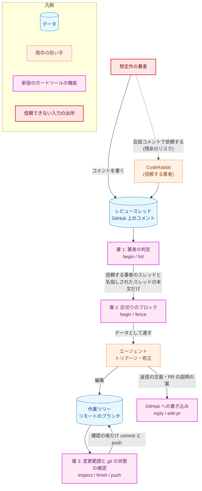
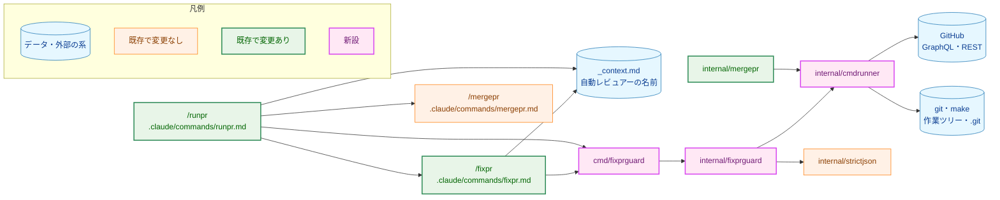
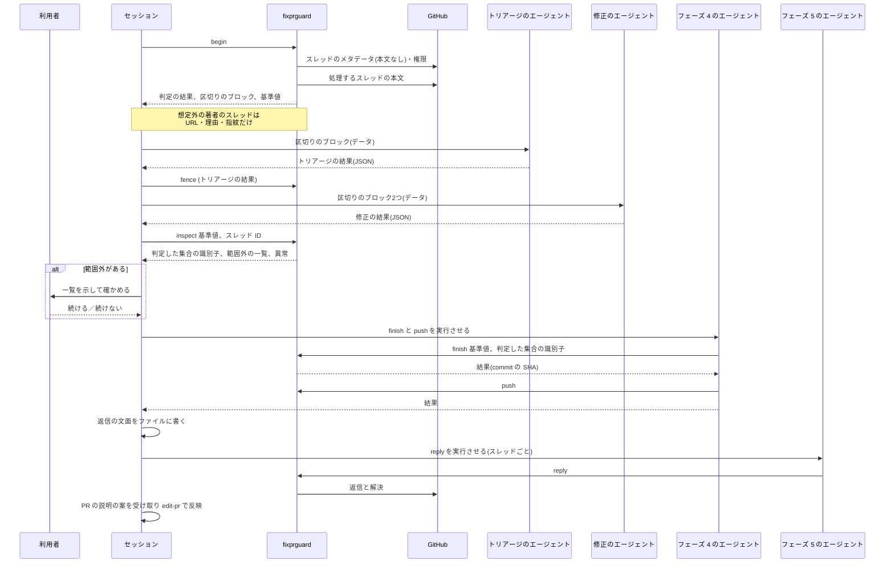
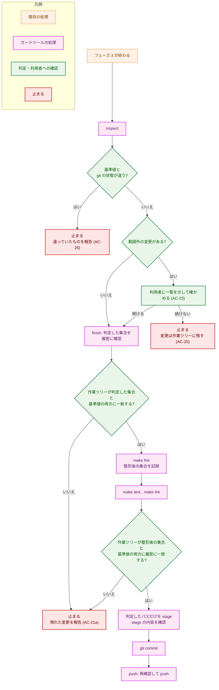
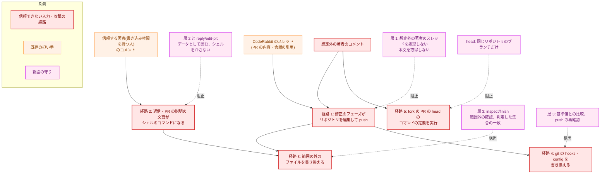
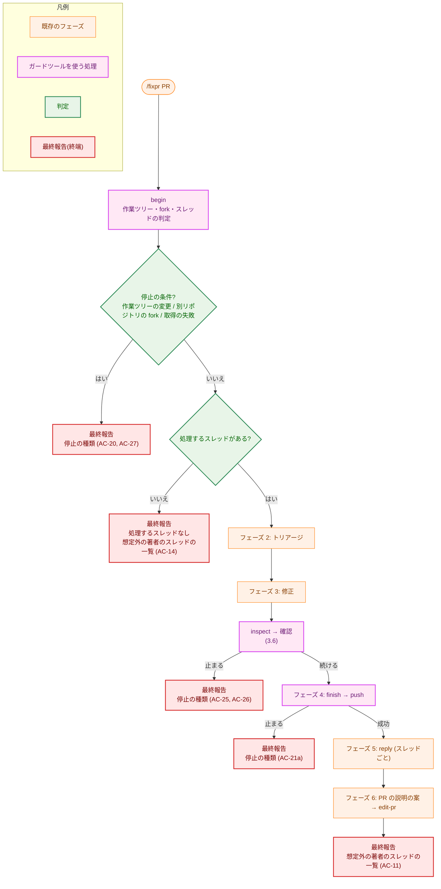
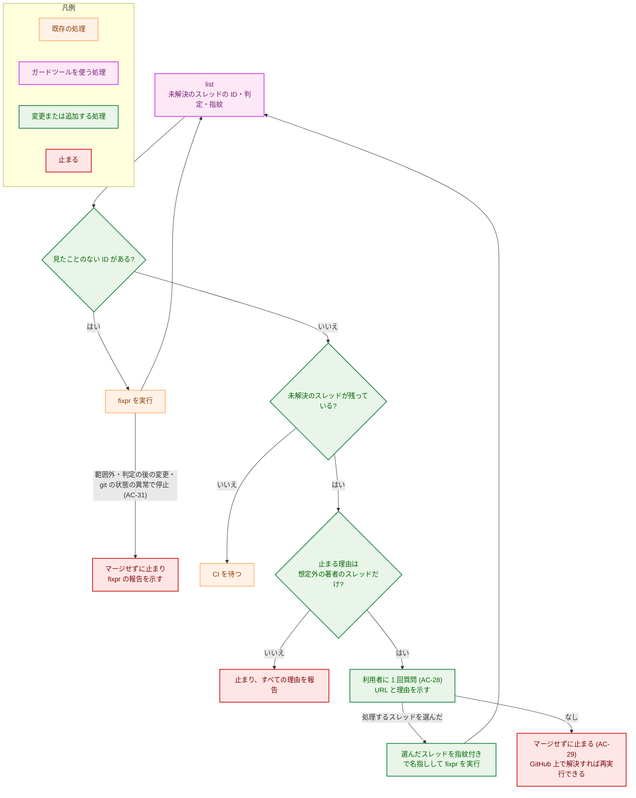

# アーキテクチャ設計書：fixpr でレビュースレッドの本文を信頼できないデータとして扱う

## Document Status

| Item | Value |
|---|---|
| Status | `approved` |
| Created | 2026-10-21 |
| Review date | 2026-10-21 |
| Reviewer | isseis |
| Comments | 2026-10-21 (editorial): 3.2 の `cmdrunner.Options` に `Dir` と `Env` を加えた（計画書 1.3.2 の決定。3.7 の git の起動と一時リポジトリのテストに要る）。AC は変わらない。2026-10-21 (editorial): 3.4 に、2 段目の応答に入りうる本文の扱い、`authorType` の決め方、`begin` の出力の `untrusted`・`changed`・`acceptNotFound` を書き足した（実装に合わせた。AC は変わらない）。2026-10-21 (editorial): 3.2 の `Finding` に `CommentURL` を加え（3.3 の「コメントの URL を理由 (c) に付ける」の型の上の表現）、`ThreadPaths` の戻り値を `[]ThreadPath`（パスと、名指しされた想定外の著者のスレッドかどうか）にした（3.6 の規則 4 が名指しを区別するため）。AC は変わらない。2026-10-21 (decision): 3.7 に、`GH_REPO` または `GH_HOST` が設定されていれば `gh` を起動せずに止まる規則を加え、2 章の `owner/repo` の求め方から参照した（PR #406 のレビューの指摘。取り除いて進める案ではなく止める案を、このセッションでレビュアーが承認した）。AC は変わらない。2026-10-21 (editorial): フェーズ 3 の実装に合わせ、3.2 の `Worktree` に `CheckClean`・`Baseline`・`CheckState` を加え、`Inspect` の引数を `[]ThreadPath` にした（計画書のステップ 3-2・3-4 のとおり）。3.7 の head に HEAD がいるブランチを含め、比較する時点を実装の位置に合わせた。3.6 の規則 6 に、追跡済みのファイルを置き換えた FIFO では git が失敗して止まることを書き足した。AC は変わらない。2026-10-21 (decision): フェーズ 3 のレビューの指摘から、次の 3 つを決めた（このセッションでレビュアーが承認した）。(1) 3.7 の config の比較を、git が読むすべての設定の値（`git config --list --show-origin`）に広げ、push 先の識別をその比較に委ねた。(2) 入れ子の `.gitignore` と index の stat の偽造で変更を隠すことを、5.3 の残余のリスクとして記録した。(3) 3.6 の push 先を、git が解決するリモートの同じ名前のブランチと明記した。あわせて、3.6・3.7 に、replace refs を使わないこと、commit のツリーを objects から読んで blob まで比べること、内容のダイジェストを持たない変更で止まること、`commondir` の扱いを書き足した。AC は変わらない。2026-10-21 (editorial): 3.6 の「変更の数え上げ」で基準値が確かめる隠蔽の範囲を、`info/exclude`・`info/attributes` の書き換えと index の skip-worktree・assume-unchanged のフラグに限り、残りは 5.3 の残余のリスクを参照するようにした（3.7・5.3 との食い違いの修正。決定は変わらない）。AC は変わらない。2026-10-21 (editorial): 3.8 の本文のファイルの確認を、開く前の `lstat` から、リンクをたどらずに開いたファイルでの確認に改め、空のファイルの拒否を加えた（ステップ 4-1 の実装に合わせた）。AC は変わらない。2026-10-21 (editorial): ステップ 4-2 のレビューの指摘で、3.8 の (3) を最初のコメントに限り（GitHub の API の制約）、返信の後・解決の前の取り直しを加え（判定の後に加わったコメントを解決で隠さないため。AC-10 の実装）、本文のファイルの検査に空白だけ・NUL・タイトルの制御文字の拒否を加え、リンクの扱いの記述を実装に合わせた。4 章の表に 2 行を加えた。AC は変わらない。2026-10-21 (editorial): ステップ 4-2 の実装に合わせ、3.8 の `edit-pr` の本文を標準入力から `--body-file -` で渡す形にし、4 章に `ErrCommentNotInThread`・`ErrReplyNotResolved` と `stop` の種類 `thread-not-trusted`・`reply-not-resolved` を加えた。AC は変わらない |

本書は [01_requirements.md](01_requirements.md)（要件定義書。以下、要件書）の設計である。既存のファイルに関する記述は、コミット `911b535` のファイルで確かめた。`file:line` はこのコミットの行番号を指す。F-NNN・AC-NN は要件書の項番を、H-NN は [design_handoff.md](design_handoff.md) の項番を指す。申し送り H-01〜H-10 への対応は付録 A にまとめる。#395 などは GitHub の issue の番号を指す。

本書は次の用語を要件書 §6 と同じ意味で使う: フェーズ、信頼する著者、信頼する著者のスレッド、想定外の著者のスレッド、範囲外の変更、build checks、利用者、caller override。ほかに次の用語を使う（用語集への追加は 3.10）。

-   **ガードツール:** 本タスクで新設する開発用ツール `fixprguard`。著者の判定、変更範囲の判定、git の状態の比較、commit と push、GitHub への書き込みを行う。コマンドの文書（`fixpr.md`・`runpr.md`）がサブコマンドを呼ぶ（サブコマンドの一覧は 3.1）。
-   **セッション:** `/fixpr` または `/runpr` を実行している Claude Code の会話。エージェントは、セッションが `Agent` ツールで起動する、フェーズ 2 以降の処理の担い手を指す（`fixpr.md:9-18`）。
-   **区切りのブロック:** 信頼できないテキストを、実行ごとの乱数（nonce）を含む区切りの行で囲んだもの（3.5）。
-   **指紋:** スレッドのコメントの ID・著者・時刻から作る識別子。コメントの追加・編集・削除で変わる（3.4）。
-   **基準値:** `begin` が出力する、git の状態の短い識別子の組（3.7）。セッションが会話に保持し、後のサブコマンドに渡す。
-   **判定した集合:** `inspect` が、修正のフェーズの後に作業ツリーの変更を数え上げて範囲と照らしたときの変更の集合。その識別子を `JudgedSetID` と呼ぶ（3.6）。
-   **名指し:** 利用者が内容を確かめた想定外の著者のスレッドを、呼び出し元が ID と指紋の組で指定して処理を求めること（3.4。要件書の caller override の一種）。

## 1. 設計の全体像 (Design Overview)

### 1.1. 設計原則

-   **判定はエージェントにも、手順書を読むセッションにも任せず、コードに置く。** 著者の信頼の判定（AC-01〜AC-08）、変更範囲の判定（AC-21〜AC-23）、git の状態の比較（AC-26）は、入力が同じなら結果が同じで、分岐が多く、安全側に倒すことが要る。これらを Go のツールにし、テストで壊して失敗を確かめられるようにする。順序（確認の前に build checks を動かさない、など）もツールの中で強制し、文書の順序に頼らない。
-   **想定外の著者のスレッドの本文は、ツールが取得しない。** 判定は本文を含まない問い合わせで行い、本文は信頼する著者のスレッドと名指しされたスレッドについてだけ取得する（3.4）。セッションにもエージェントにも、想定外の著者の本文は届かない（AC-09）。
-   **副作用を伴う操作は、信頼できないテキストを読んだエージェントにさせない。** 本文を読んだエージェントは、JSON のテキストを返すだけにする。commit、push、GitHub への返信、スレッドの解決、PR の説明の更新は、ガードツールのサブコマンドが行う。サブコマンドはシェルを介さない（AC-19）。
-   **判定の基準値は、会話に持つ。** ガードツールは状態のファイルを持たない（3.7）。ディスクのファイルに基準値を置くと、そのファイルを書ける修正のフェーズのエージェントや、build checks が実行するコードに書き換えられる。
-   **値を確かめられなければ、想定外として扱う（fail-closed）。** 補正も部分受理もしない（AC-06、`CLAUDE.md`「Reject, don't normalize」）。
-   **信頼する著者のスレッドの処理は今までどおりにする。** 追加するのは、始める前の確認、本文の包み方、commit の前の確認だけである（要件書 4.4）。
-   **依存パッケージを加えない。** 標準ライブラリと `internal/strictjson` だけを使う（`CLAUDE.md`「Dependencies」）。

保証の強さを区別する。ガードツールのコードが強制するのは、著者の判定、本文を取得しないこと、範囲の判定、`finish` の中の順序、判定した集合の一致、`push` の直前の再確認、`reply`・`edit-pr` の送信の形である。文書の手順（セッションの実行）に依存するのは、`inspect` から `finish` までを呼ぶ順序、利用者への確認、名指しの対象を直前の報告にあるスレッドに限ること（AC-12）である。後者は 5.2 で区別して示す。

### 1.2. 設計の際に決めたこと（2026-10-21）

利用者に確かめて決めたこと:

-   **決定的な判定は Go の開発用ツール（`cmd/fixprguard` + `internal/fixprguard`）に置く。** 手順書（`fixpr.md`）にシェルの手順を書く案は採らない。理由は 1.3 に書く。先例は `cmd/mergepr` + `internal/mergepr` で、決定的な部分をツールに、順序の制御と利用者への確認をコマンドに分けている（`docs/dev/developer_guide/mergepr_guide.md` §1）。ツールは開発用であり、製品の 3 つのバイナリには入らない。
-   **commit される変更は、判定したパスだけを明示して stage する。** `git add -A` はやめる（AC-21a、H-05 の候補 (2)）。
-   **GitHub API の挙動は、設計の前に観測して確かめた。** 結果は 3.3 に記録する。
-   **1 つのスレッドから取得するコメントの数の上限は 100 件、1 ページとする。** GraphQL の `comments` の `first` の上限と同じである。100 件を超えるスレッドは、全コメントを取得できないものとして想定外の著者のスレッドとする（AC-05・AC-06）。

設計で決めたこと:

-   **ガードツールは状態のファイルを持たない。** 基準値と判定した集合の識別子はサブコマンドの出力で返し、セッションが次のサブコマンドの引数で渡す（1.1）。
-   **build checks と commit は、ツールの `finish` が一続きで行う。** 実行する make のターゲットは `fmt`・`test`・`lint` の固定値で、引数から受け取らない（`-f`・`-C` や任意のターゲットを渡せないようにする）。`_context.md` の build checks を変えるときは、ツールも変える。 `finish` は、判定した集合の厳密な確認、`make fmt`、整形後の集合の記録、`make test`・`make lint`、整形後の集合との厳密な比較、stage、commit を、この順に行う。build checks の後の確認を緩めると、範囲内の `.go` ファイルが build checks の間に書き換えられても気づかない。また、確認を呼ぶ順序が文書に依存してしまう。これを避けるため、build checks と commit を `finish` が一続きで行う。整形は、`make fmt` の直後の集合を新しい基準にして吸収するので、`.go` の内容を例外にする必要がない。`make fmt` の前に判定するのは、範囲外の Makefile を `make fmt` が利用者の確認の前に実行してしまうのを避けるためである。
-   **push は、ツールの `push` が直前に再確認して行う。** HEAD が `finish` の commit であること、hooks と config が基準値と同じであること、push 先が基準値のものであることを確かめてから、明示した refspec で push する（3.6）。commit から push までの間に hooks や config が書き換えられても、書き換えられた hooks や config が実行されるのを防ぐためである。
-   **取得は 2 段階にする。** 1 段目は本文を含まない問い合わせで判定し、2 段目は処理するスレッドの本文だけを取得して、1 段目の指紋と同じであることを確かめる（3.4）。想定外の著者が大きな本文を大量に書いて応答を巨大にする妨害を受けず、想定外の著者の本文を取得すらしない。判定の後に追加されたコメントも指紋の不一致で検出して、そのスレッドを処理しない（AC-09）。
-   **`inspect` はスレッドの ID から `path` を求める。** 呼び出し元が `path` を引数に書くと、セッションが範囲を広げられる。ツールが GitHub から `path` を取り直し、そのスレッドが信頼する著者のスレッドか名指しされたスレッドであることも確かめる（3.6）。
-   **区切りの行は、nonce の不在の確認で AC-18 を保証し、JSON の文字列は既存の形式を保つために使う。** 3.5 に書く（H-04）。
-   **権限の判定は、`role_name` が `write`・`maintain`・`admin` のいずれかであることとする。** `permission`（丸められた値）は使わない（H-01）。
-   **自動レビュアーの名前は、`_context.md` に GraphQL の `author.login` の形（`coderabbitai`）で 1 つだけ置く。** REST の形（`coderabbitai[bot]`）は、この名前に `[bot]` を付けて作る（H-02）。ツールは `--reviewer` で受け取り、既定値を持たない。
-   **信頼する著者のスレッドは、取得できたコメントをすべてトリアージに渡す（最大 100 件）。** すべての著者が信頼する著者なので渡して安全であり、スレッドの後半にある返信が落ちない（H-03）。
-   **GitHub への書き込みは `reply` と `edit-pr` だけで行い、リクエストの本文は JSON として組み立てて標準入力で `gh api --input -` に渡す。** `-F`・`-f` の型変換、シェルの引用、一時ファイルを使わない（H-07）。
-   **外部コマンドの実行の境界は `internal/cmdrunner` に移して共有する。** `internal/mergepr` が `Runner` と `NewOSRunner` を持ち（`internal/mergepr/mergepr.go:46`、`internal/mergepr/runner.go:12`）、複製しないためである。`cmdrunner` には、出力の大きさの上限、`WaitDelay`、標準入力を渡す実行（`InputRunner`）を加える。上限を指定しない既定は、現在の `osRunner` と同じ挙動で、`internal/mergepr` の挙動を変えない。
-   **ガードツールは、実行した外部コマンドの引数や標準エラーを、エラーの文面にも出力にも含めない。** 今の `Runner` は、失敗時に出力を返さず、引数と標準エラーを含むエラーの文面だけを返す（`internal/mergepr/runner.go:25`）。これでは、HTTP の状態（`404`・`403`・`429`）から `Cause` を求められず、build checks の出力の末尾も返せない。そこで `cmdrunner` は、失敗を型 `ExitError`（終了コード、上限付きの標準出力と標準エラー）で返し、出力が上限を超えたときは、切り詰めた出力を返さずに `ErrOutputTooLarge` で失敗する（3.2）。ガードツールは `ExitError` を読んでセンチネルエラーや `Cause` に写し、エラーのテキストは捨てる。上限を指定しない既定では、`internal/mergepr` は今のエラーの文面を使い続ける。この既定は `internal/mergepr` の挙動を変えない。
    また、切り詰めた `git status` の出力が変更を隠すことを防ぐため、`Worktree` の git の呼び出しは、上限を超えたら止まる。
-   **ガードツールが起動する git は、設定経由で外部コマンドが起動されないよう制限する。** 3.7 に書く。

要件書との差分（レビューで確かめてほしい点）:

1.  **文書の範囲:** 要件書 F-007 の文書（`fixpr.md`・`runpr.md`・`_context.md`・用語集）に加えて、ツールの導入に要る文書（`Makefile`・`CLAUDE.md`・`package_reference.md`・`fixprguard_guide.md`）と、新しいコードを加える。AC の内容は変えない。要件書 2.2 の「文書」の一覧の拡張にあたる。
2.  **トリアージに渡すコメントの数:** 10 件から最大 100 件に改める（H-03、要件書 4.4 が設計での見直しを許す）。
3.  **AC-11 の理由 (c) の意味（理由 (a)〜(f) は 3.3 で定義する）:** 「著者がない、または名前が空」に、「名前が GitHub の名前の文法に合わない」を加える（3.3）。
4.  **基準値の時点:** 要件書 AC-26 の「修正のフェーズの前」より早い、`begin` の時点とする（3.7）。
5.  **自動レビュアー以外の Bot:** これまでは `Bot` として処理していたが、想定外の著者のスレッドとして報告する（要件書 1 章の決定。3.4 に利用者への影響を書く）。
6.  **git の追加の確認:** 要件書にない確認として、index のフラグ（skip-worktree など）と `.git/info` の確認を基準値に加える（3.7）。AC-26 の趣旨（git の状態の異常の検出）の範囲の具体化である。
7.  **`/runpr` の `list` の取得:** 全ページを取得することは今までと同じだが、取得するスレッドの総数に上限（2000 件）を設け、超えたら止まる（3.4）。
8.  **エージェントの責務:** フェーズ 5・6 のエージェントは、返信の文面や PR の説明の文面を受け取らず、`gh` で書き込まない（3.8）。
9.  **ツールの版の確認:** 全サブコマンドの出力に `protocol` の番号を含め、呼び出し側が `--protocol` で照合する（3.1）。
10. **実行に関わるファイルの定義:** 要件書の例に、`.go` のファイルの扱い（3.6）と、どのディレクトリでも効く名前の規則を加える。

### 1.3. なぜ手順書の変更だけでは足りないか

最も単純な方法は、`fixpr.md` と `runpr.md` に `gh` と `git` の手順を書き足すことである。次の要件を満たせないので、採らない。

-   AC-08 は、判定が「コメントの本文を受け取ったエージェントに関わらない」ことを求める。手順書をセッションが実行する方法では、判定の分岐（6 種類の理由、混在した著者、権限の照会の失敗）を LLM が毎回解釈することになる。入力が同じでも結果が揺れ、揺れを検出するテストを書けない。
-   AC-21a と AC-26 は、パス・モード・内容のダイジェストの比較と、hooks と config のディレクトリの走査を求める。シェルの 1 行で書くには長く、PTY の入力の制限にも触れる（`~/.claude/rules/long-commands.md`）。
-   AC-19 は、どんな文字列でもシェルのコマンドとして実行されないことを求める。heredoc の引用を直しても、終端の文字列の選び方に依存し続ける。シェルを介さずに実行する境界を持つのが確実である。
-   `CLAUDE.md`「Every test must be able to fail for its stated reason」は、判定のコードを壊して失敗を確かめることを求める。手順書の文面には、この確認を適用できない。

### 1.4. 概念モデル

信頼できないテキストの経路と、3 つの守りの層（要件書 4.2）を、ガードツールのサブコマンドに対応づける。図の矢印 A → B は「A のテキストまたは制御が B へ渡る」を表す。点線の矢印は、その層が阻止できない経路（残余のリスク）を表す。



## 2. システム構成 (System Structure)

### 2.1. 全体構成

コマンドの文書が順序と利用者への確認を担い、ガードツールが決定的な判定と書き込みを担う。図の矢印 A → B は「A が B を呼び出す、または B から値を読む」を表す。



### 2.2. コンポーネント配置

`internal/fixprguard` は、責務ごとに 2 つの型に分ける。`GitHub` は GitHub を読み書きする（自動レビュアーの名前を必要とする）。`Worktree` は作業ツリーと git を守る（自動レビュアーの名前を必要としない）。`Fence` は、どちらにも依存しない関数である。

| ファイル | 状態 | 責務 |
|---|---|---|
| `cmd/fixprguard/main.go` | 新設 | サブコマンドの引数の解釈、`GitHub` と `Worktree` の呼び出しの組み立て、JSON の出力、終了コード。`cmd/mergepr/main.go` と同じ構成にする |
| `internal/fixprguard/github.go` | 新設 | `GitHub` 型。`Head`・`List`・`Begin`・`ThreadPaths`・`Reply`・`EditPR` |
| `internal/fixprguard/trust.go` | 新設 | 著者の信頼の判定（F-001）。権限の照会と理由の収集 |
| `internal/fixprguard/threads.go` | 新設 | スレッドとコメントの取得、応答の厳格な検査、指紋（H-03・H-06） |
| `internal/fixprguard/fence.go` | 新設 | 区切りのブロックの生成（H-04） |
| `internal/fixprguard/worktree.go` | 新設 | `Worktree` 型。`Begin`・`Inspect`・`Finish`・`Push` |
| `internal/fixprguard/changes.go` | 新設 | 作業ツリーの変更の数え上げ、行数の集計、`JudgedSetID`（H-05） |
| `internal/fixprguard/scope.go` | 新設 | 変更範囲の規則と、コマンドの実行に関わるファイルの定義（H-10） |
| `internal/fixprguard/gitstate.go` | 新設 | git の状態の基準値と比較、git の起動の制限（H-08） |
| `internal/fixprguard/errors.go` | 新設 | センチネルエラー |
| `internal/fixprguard/*_test.go`・`test_helpers.go` | 新設 | テストと、`//go:build test` の補助（`docs/dev/developer_guide/test_organization.md` の分類 B） |
| `internal/cmdrunner/runner.go` | 新設 | `Runner`・`InputRunner` と `NewOS`（出力の上限、`WaitDelay`、標準入力）。`internal/mergepr/runner.go` から移す |
| `internal/cmdrunner/testutil/mocks.go` | 新設 | `Runner` の fake（期待するコマンドの列を再生し、順序の違いと余分な呼び出しで失敗する。`package cmdrunnertestutil`）。`internal/fixprguard` のテストが使う |
| `internal/mergepr/mergepr.go`・`internal/mergepr/runner.go` | 変更 | `Runner` を `cmdrunner.Runner` の別名にし、`NewOSRunner` が `cmdrunner.NewOS` を返す。挙動は変えない。`internal/mergepr` の既存のテストと自前の fake（`internal/mergepr/test_helpers.go`）は、`Run` のメソッドだけを実装しているので、そのまま通る |
| `.claude/commands/fixpr.md` | 変更 | 3.10 |
| `.claude/commands/runpr.md` | 変更 | 3.10 |
| `.claude/commands/_context.md` | 変更 | 自動レビュアーの名前と、ガードツールの行を加える（AC-35） |
| `docs/translation_glossary.md` | 変更 | AC-37 の用語と、本書の用語を加える |
| `Makefile` | 変更 | `install-fixprguard` を加える（`install-mergepr` と同じ形。`Makefile:66-69`） |
| `CLAUDE.md` | 変更 | 「Quick Links」「Build Commands」に `fixprguard` の案内を加える |
| `docs/dev/developer_guide/package_reference.md` | 変更 | `cmd/fixprguard`・`internal/fixprguard`・`internal/cmdrunner`（`testutil` を含む）の行を加え、`internal/strictjson` の行の共有先に `internal/fixprguard` を加える。`internal/pipeline` の `TestPackageReferenceListsPackages`（`internal/pipeline/pipeline_test.go:671`）が行が欠けていると失敗する |
| `docs/dev/developer_guide/fixprguard_guide.md` | 新設 | ツールの使い方、保証すること・しないこと、止まったときの回復の手順、範囲の規則の一覧（英語。`mergepr_guide.md` に倣う） |
| `cmd/yt2column/fixpr_docs_test.go` | 新設 | コマンドの文書の検査（7.4）。`doc-guard` ジョブの対象パッケージ（`CLAUDE.md`「Development Notes」）に入っており、CI の設定を変えずに文書だけの PR でも働く |

本タスクの前に、`.claude/commands/fixpr.md` と `runpr.md` を読むテストは存在しない（`*_test.go` の中の `claude/commands`・`fixpr`・`runpr` を探したが、コミット `911b535` では見つからなかった）。したがって、既存のテストで更新が要るものはない。

### 2.3. データフロー: `/fixpr` の 1 ラウンド

図の矢印は呼び出しと戻りを表す。シーケンス図は色分けを使わないので、凡例はない。



### 2.4. 既存の挙動の確認

設計が前提にする既存の挙動を、コミット `911b535` で確かめた。

-   `fixpr.md:141-196` のフェーズ 1 は、`haiku` のエージェントがスレッドを取得する。コメントは `comments(first:10)`（`fixpr.md:164`）で、`body` は最初の 10 件を `@author: ` 付きで連結する（`fixpr.md:176-180`）。`authorType` は最初のコメントの `__typename` から決まり、`Bot` でも `User` でもなければ `User` とする（`fixpr.md:181-183`）。スレッドは `reviewThreads(first:100)` で、`hasNextPage` が真なら `capHit` として報告する（`fixpr.md:159-160`・`fixpr.md:184-185`・`fixpr.md:194-196`）。
-   `fixpr.md:208-244` のフェーズ 2 と `fixpr.md:263-331` のフェーズ 3 は、`threads` の JSON をプロンプトに埋め込む（`fixpr.md:238`・`fixpr.md:263-265`）。
-   `fixpr.md:333-372` のフェーズ 4 は、`git add -A` を実行して commit し（`fixpr.md:346-349`）、`git push` する。
-   `fixpr.md:374-427` のフェーズ 5 は、引用符付きの heredoc `<<'REPLYBODY_EOF'` で返信の文面を渡す（`fixpr.md:398-403`）。`fixpr.md:429-450` のフェーズ 6 は、`gh pr edit` に heredoc とタイトルの直書きを使う（`fixpr.md:441-445`）。
-   `runpr.md:185-211` のステップ 3 は、`reviewThreads(first:100, after:$after)` で全ページを取得し、`isResolved=false` に絞り、`comments(first:10)` で `body` を含めて取得する（`runpr.md:189-199`・`runpr.md:207-210`）。`runpr.md:212-219` は、見たことのないスレッド ID があれば `/fixpr` を実行し、`runpr.md:220-226` は止まる理由を列挙する。
-   `runpr.md:168-172` は、CodeRabbit のレビューを探すために `coderabbitai[bot]` を文字列で直接書いている。
-   `internal/mergepr/runner.go:11-28` の `osRunner` は、シェルを介さずに `exec.CommandContext` で実行し、標準出力を上限なしのバッファに読み、失敗時にコマンドと標準エラーを含むエラーを返す。

## 3. コンポーネント設計 (Component Design)

### 3.1. サブコマンド

ガードツールは、状態を持たないサブコマンドの集まりである。標準出力は JSON（`fence` の出力を除く）、診断は標準エラーに書く。すべての JSON の出力に、ツールの版を示す `protocol` の番号を含める。呼び出し側は `--protocol <N>` を渡し、番号が合わなければツールは終了コード `2` で止まる（古いバイナリが新しい文書の想定で判定するのを防ぐ）。

終了コードは、`0` が「続けてよい」、`1` が「止める」（理由は出力の `stop`）、`2` が使い方の誤り、`3` が「利用者に確かめる」（`inspect` だけ）である。呼び出し側は、これら以外の終了コード、信号による終了、JSON として読めない出力、途中で切れた出力を、すべて「止める」として扱う。

PR を引数に取るサブコマンドの `<PR>` は、10 進数の PR 番号だけを受け付ける（省略すると現在のブランチの PR）。URL やブランチ名は拒否する。リポジトリの `owner/repo` は、呼び出し元の入力からでなく、ローカルのリポジトリ（`gh repo view`）から求める。`gh` の対象を変える環境変数が設定されていれば止まる（3.7）。

| サブコマンド | 呼ぶ側 | 入力 | 出力 | 外部への副作用 |
|---|---|---|---|---|
| `head` | `/runpr` ステップ 1 | `<PR>` | PR の head がこのリポジトリのブランチか（AC-27） | GitHub の読み取り |
| `list` | `/runpr` ステップ 3・4 | `<PR>`、`--reviewer` | 未解決のスレッドごとの ID・URL・信頼の判定・理由・指紋。**本文は含まない**（AC-32）。全ページを取得する | GitHub の読み取り |
| `begin` | `/fixpr` フェーズ 1 | `<PR>`、`--reviewer`、`--accept <ID>=<指紋>`（複数可） | 作業ツリーの確認（AC-20）、fork の確認、判定、処理するスレッドの本文（区切りのブロック）と指紋、基準値 | GitHub と `git ls-remote` の読み取り |
| `fence` | `/fixpr` フェーズ 3 | ファイル | ファイルの内容を囲んだ区切りのブロック | なし |
| `inspect` | `/fixpr` フェーズ 3 の後 | `<PR>`、`--reviewer`、基準値、`--thread <ID>=<指紋>`（複数可） | git の状態の異常、`JudgedSetID`、範囲外の一覧 | GitHub と git（`git ls-remote` を含む）の読み取り |
| `finish` | `/fixpr` フェーズ 4 | 基準値、`JudgedSetID`、`<PR>` | 厳密な確認、整形、build checks、stage、commit | ローカルの commit。ファイルの整形と、build checks が行う書き込み |
| `push` | `/fixpr` フェーズ 4 | 基準値、`finish` が返した SHA | 再確認の後の push | リモートのブランチへの書き込み |
| `reply` | `/fixpr` フェーズ 5 | `<PR>`、スレッド ID、コメント ID、指紋、本文のファイル、`--reviewer`、`--accept` | 返信の投稿とスレッドの解決 | GitHub への書き込み |
| `edit-pr` | `/fixpr` フェーズ 6 | `<PR>`、タイトルのファイル、本文のファイル | PR のタイトルと本文の更新 | GitHub への書き込み |

`begin` は、次の順序で行う。(1) 作業ツリーの確認（AC-20）。(2) fork の確認（AC-27）。(3) 基準値の採取。(4) スレッドの取得と判定。作業ツリーが clean でなければ、スレッドを取得せずに止まる。

3.11 に、副作用の契約を表にまとめる。

### 3.2. 型と interface

主な型だけを示す。実装の詳細（フィールドの並び、補助関数）は実装で決める。

```go
package cmdrunner

// Runner runs an external command without a shell and returns its standard
// output. It moves here from internal/mergepr; the zero Options keep the
// current behavior.
type Runner interface {
	Run(ctx context.Context, name string, args ...string) ([]byte, error)
}

// InputRunner also feeds the command's standard input. internal/mergepr does
// not need it, so its fakes need not implement it.
type InputRunner interface {
	Runner
	RunInput(ctx context.Context, stdin []byte, name string, args ...string) ([]byte, error)
}

// Options bound a command: MaxOutput caps captured standard output and
// standard error while still draining the rest, and WaitDelay bounds the wait
// after cancellation. The zero value means no bound.
type Options struct {
	MaxOutput int
	WaitDelay time.Duration
	Dir       string   // working directory; zero means the current one
	Env       []string // the child's whole environment; nil means inherited
}

// ExitError is the typed failure of a command that ran and failed. It carries
// the exit code and the capped standard output and standard error, so a caller
// can map a failure to its own sentinel without parsing an error string. A
// command whose output exceeded MaxOutput fails with ErrOutputTooLarge instead
// of returning truncated data.
type ExitError struct {
	Code   int
	Stdout []byte
	Stderr []byte
}

var ErrOutputTooLarge = errors.New("command output exceeds the cap")

func NewOS(opts Options) InputRunner
```

```go
package fixprguard

// Login is a GitHub account name that passed the login grammar. The zero value
// is "no usable name"; only ParseLogin builds a usable one.
type Login struct{ /* unexported */ }

func ParseLogin(s string) (Login, error)
func (l Login) String() string

// PRNumber is a PR number that passed the decimal-digits check.
type PRNumber struct{ /* unexported */ }

func ParsePRNumber(s string) (PRNumber, error)

// AuthorKind mirrors GraphQL __typename. The zero value is unknown, the
// interpretation that assumes least.
type AuthorKind int

const (
	AuthorUnknown AuthorKind = iota
	AuthorUser
	AuthorBot
)

// Reason is why a thread is not trusted. ReasonNone is the zero value.
type Reason int

const (
	ReasonNone                  Reason = iota
	ReasonNoWritePermission            // (a) names the account
	ReasonOtherBot                     // (b) names the account
	ReasonNoAuthorName                 // (c) no author, empty or unusable name
	ReasonPermissionUnavailable        // (d) carries a Cause
	ReasonIncompleteComments           // (e)
	ReasonUnknownAuthorKind            // (f)
)

// Cause says why a permission lookup failed, without any value from GitHub.
type Cause int

const (
	CauseNone Cause = iota
	CauseNotFound
	CauseForbidden
	CauseRateLimited
	CauseBudgetExceeded
	CauseRejectedResponse
	CauseFailed
)

type Finding struct {
	Reason     Reason
	Account    Login  // set for (a) and (b) only
	Cause      Cause  // set for (d) only
	CommentURL string // set for (c) only
}

// Assessment is the zero value "not trusted"; Trusted is set only when every
// comment's author is a trusted author.
type Assessment struct {
	Trusted  bool
	Findings []Finding
}

// Fingerprint identifies the comments of a thread (IDs, authors, times) at one
// moment.
type Fingerprint string

// Accept names a thread together with the fingerprint the user saw.
type Accept struct {
	ThreadID    string
	Fingerprint Fingerprint
}

// GitHub reads and writes GitHub on behalf of /fixpr and /runpr. NewGitHub
// fails when reviewer is not a usable Login, so a missing --reviewer stops the
// run.
type GitHub struct{ /* unexported */ }

func NewGitHub(run cmdrunner.InputRunner, reviewer Login) (*GitHub, error)

func (g *GitHub) Head(ctx context.Context, pr PRNumber) (HeadInfo, error)
func (g *GitHub) List(ctx context.Context, pr PRNumber) (ThreadList, error)
func (g *GitHub) Begin(ctx context.Context, pr PRNumber, accept []Accept) (Round, error)
func (g *GitHub) ThreadPaths(ctx context.Context, pr PRNumber, threads []Accept) ([]ThreadPath, error)
func (g *GitHub) Reply(ctx context.Context, req ReplyRequest) error
func (g *GitHub) EditPR(ctx context.Context, req EditPRRequest) error

// Worktree guards the working tree and git state. It does not use the
// reviewer's name.
type Worktree struct{ /* unexported */ }

func NewWorktree(gitRun, makeRun cmdrunner.Runner) *Worktree

// CheckClean and Baseline are the two halves of Begin; the command calls them
// with the fork check in between (3.1). CheckState is the comparison made
// before git or gh is launched (3.7).
func (w *Worktree) Begin(ctx context.Context) (Baseline, error)
func (w *Worktree) CheckClean(ctx context.Context) error
func (w *Worktree) Baseline(ctx context.Context) (Baseline, error)
func (w *Worktree) CheckState(ctx context.Context, base Baseline) error
func (w *Worktree) Inspect(ctx context.Context, base Baseline, threads []ThreadPath) (Inspection, error)
func (w *Worktree) Finish(ctx context.Context, base Baseline, judged JudgedSetID, req FinishRequest) (FinishResult, error)
func (w *Worktree) Push(ctx context.Context, base Baseline, commit string) (PushResult, error)

// Fence wraps data in a block whose delimiter does not occur in data. The nonce
// comes from rand, so a test can force a collision.
func Fence(data []byte, rand io.Reader) (Block, error)

// Baseline holds the git state taken at begin. It is parsed strictly from a
// flag value; a malformed token is rejected, not repaired.
type Baseline struct{ /* head, remote, hooks, config, info */ }

// JudgedSetID identifies the change set inspect judged, over each entry's
// path, kind, mode and content.
type JudgedSetID string

// ChangeKind is the kind of change a path has in the change set.
type ChangeKind int

const (
	ChangeUnknown ChangeKind = iota
	ChangeAdd
	ChangeModify
	ChangeDelete
	ChangeOther // type change, symlink, submodule, non-regular file
)

// Inspection, FinishRequest, FinishResult, PushResult, Round, ThreadList,
// HeadInfo, ThreadPath, ReplyRequest, EditPRRequest and Block are plain result
// and request types; their fields follow 3.1. ThreadPath carries the path and
// whether the thread is a named untrusted one (rule 4 of 3.6).
```

「宣言し、推測しない」（`CLAUDE.md`）に従い、著者の種類（`AuthorKind`）と理由（`Reason`）、失敗の原因（`Cause`）は列挙型にし、ゼロ値を最も仮定の少ない解釈にする。分岐は `switch` で行い、`default` は想定外（信頼しない）に倒す。`Login` の文法の検査は、権限の照会の URL に値を埋め込む前の入力の検査であり、著者の信頼の選択には使わない。

### 3.3. 信頼の判定（F-001・H-01・H-02）

**判定の規則。** スレッドの各コメントの著者は、次の表で判定する。スレッドは、すべてのコメントが信頼する著者のときだけ信頼する著者のスレッドである（AC-04）。1 件でも信頼する著者でないコメントがあれば想定外であり、理由は該当するものをすべて集める（AC-11）。

| 著者の種類（GraphQL `__typename`） | 判定 | 理由 |
|---|---|---|
| `Bot` で、`login` が自動レビュアーの名前と一致 | 信頼する。権限の照会はしない（AC-02・AC-03） | - |
| `Bot` で、`login` が自動レビュアーと違う | 信頼しない。書き込み権限の照会もしない | (b) |
| `User` | `login` を検査して REST で権限を照会する。`role_name` が `write`・`maintain`・`admin` のいずれかなら信頼する。それ以外は信頼しない | (a)、照会できなければ (d) |
| 著者はあるが、`__typename` が `User`・`Bot` 以外、空、欠けのとき | 信頼しない | (f) |
| 著者がない（`author` が `null`）、`login` が空、`login` が文法に合わない（文法は次の段落で定める）。(f) とは重ならず、著者の欠落と名前の不備は常に (c) | 信頼しない | (c) |

名前が `login` の文法に合わないものを (c) にまとめるのは、要件書 AC-11 の (c)「著者がない、または名前が空」を「名前が使えない」に広げる設計上の判断である。権限の照会の URL に名前を埋め込むので、`/` や `..` を含む値を通さないためである。文法は、英数字とハイフンの並び（先頭は英数字）とする。GitHub の Enterprise Managed Users が使う `_` を含む名前は、この文法に合わないので信頼されない（安全側）。この文法を満たさない名前は、出力にも書かず、そのコメントの URL を理由 (c) に付ける。

`ReasonIncompleteComments`（e）は、コメントの `pageInfo.hasNextPage` が真のときに付く（AC-05・AC-06）。

**権限の照会。** `GET /repos/{owner}/{repo}/collaborators/{login}/permission` を `gh api` で呼ぶ（H-01）。応答は `internal/strictjson` で検査する。UTF-8、トップレベルが 1 つの JSON のオブジェクト、末尾にデータなし、読むキー（`role_name`）の重複と `null` の拒否である。ほかのキーは無視する。GitHub がフィールドを追加することがあるためで、読むキーを明示することで、この拡張を許すと宣言している。`role_name` が文字列でなければ (d) とする。照会の失敗は、原因を `Cause` に写す（`404` は `CauseNotFound`、`403` は `CauseForbidden`、`429` は `CauseRateLimited`、検査に失敗した応答は `CauseRejectedResponse`、それ以外は `CauseFailed`）。1 回の実行での照会は、異なる `login` ごとに 1 回、全体で 100 回までとし、超えた分は (d)（`CauseBudgetExceeded`）とする（大量のアカウントが大量にコメントしても、実行時間と API の利用枠を使い尽くされないようにする）。照会の順序は、スレッドの順、コメントの順で決め、実行のたびに同じにする。

**GitHub API の観測（2026-10-21、`gh` 2.96.0、`isseis/yt2column`（`visibility: PUBLIC`））。**

| 照会 | 結果 |
|---|---|
| `isseis`（リポジトリの所有者） | `permission: admin`、`role_name: admin`、`type: User` |
| `coderabbitai[bot]` | `permission: none`、`role_name: ""`、`type: Bot` |
| `coderabbitai`（`[bot]` なし） | `permission: none`、`type: Organization`。`[bot]` 付きとは別のアカウントである |
| `octocat`（collaborator でない） | `permission: read`、`role_name: read` |
| 存在しない名前 | `404`、`"... is not a user"` |
| `github-actions[bot]` | `permission: none`、`type: Bot` |
| GraphQL の PR #396 のコメント | CodeRabbit は `__typename: Bot`、`login: coderabbitai`、`authorAssociation: CONTRIBUTOR`。REST では `user.login: coderabbitai[bot]`、`type: Bot` |
| GraphQL の `comments` | `pageInfo.hasNextPage`、`createdAt`、`updatedAt`、`lastEditedAt`（編集のないコメントは `null`）を取得できた |
| `gh pr view --json isCrossRepository` | 同じリポジトリの PR で `false`。`headRepository`・`headRepositoryOwner` も取得できた |

観測から、次のことを設計に反映した。(1) GraphQL の `login` は `coderabbitai`、REST の `login` は `coderabbitai[bot]` で、形が違う。`_context.md` には GraphQL の形を置く（1.2）。(2) `[bot]` なしの `coderabbitai` は別の組織のアカウントなので、`User` の種類で名前だけが一致する著者は、権限の照会で `none` になり、信頼されない（AC-03）。(3) `authorAssociation` は CodeRabbit について `CONTRIBUTOR` を返し、書き込み権限の強さと対応しないので、判定に使わない（H-01）。

観測できなかったものは次のとおりで、設計は安全側に倒れる。`maintain`・`triage` の `role_name`、カスタムのロール、削除済みのアカウント（`author` が `null`）、fork の PR の `isCrossRepository`（`true`）である。`role_name` を許可する値の一覧と照合するので、観測できなかった値は信頼されず、名指し（F-002）で処理できる。`isCrossRepository` は、厳密に `false` のときだけ同じリポジトリとして扱い、`true`・`null`・欠けは止める（3.9）。Bot の同一性は `login` の文字列と `__typename` で判定する。GitHub 上で同じ名前の別のアカウントを作れない前提に立つ（5.3 の残余のリスク）。

### 3.4. スレッドの取得と本文の扱い（F-002・H-03・H-06）

**2 段階の取得。**

1.  **1 段目（メタデータ）。** PR の未解決のスレッドについて、コメントごとに `databaseId`・`url`・`path`・`line`・`author { __typename login }`・`createdAt`・`updatedAt`・`lastEditedAt` と、スレッドごとに `id`・`isResolved` を取得する。本文は取得しない。判定と指紋はここで作る。
2.  **2 段目（本文）。** 判定の結果、処理するスレッド（信頼する著者のスレッドと、名指しされて指紋が一致したスレッド）についてだけ、スレッドの ID を指定して本文を含むコメントを取得する。2 段目の応答から指紋を作り直し、1 段目と同じことを確かめる。違うスレッドは、判定の後にコメントが変わったものとして処理せず、報告に載せる（AC-09）。

想定外の著者のスレッドの本文は、取得しない。これにより、(1) 1 段目で想定外と判定したスレッドの本文は、ツールのプロセスにも入らない。1 段目と 2 段目の間に想定外の著者が返信したスレッドは、2 段目の応答に本文が入るが、指紋の不一致で処理せず、出力にも含めない。(2) 想定外の著者が大きなコメントを大量に投稿しても、応答が大きくならない（妨害を受けない）。

**スレッドの数。** `begin` は、今までどおり `reviewThreads(first:100)` の 1 ページを取得し、`hasNextPage` が真なら `capHit` を報告する（要件書 4.3、`fixpr.md:184-185`）。`list` は、今までの `runpr.md:207-210` と同じく全ページを取得して `isResolved=false` に絞る。ただし、取得するスレッドの総数に上限（2000 件）を設け、超えたら `stop` の種類 `thread-cap` で止まる。部分的な一覧を、全体の一覧として返さない。

**応答の検査。** 応答は読む前に `internal/strictjson` で検査する。UTF-8、サロゲートの対、トップレベルが 1 つのオブジェクト、末尾にデータなし、読むキーの重複と `null` の拒否である。1 段目の応答の大きさは 16 MiB まで、2 段目も 16 MiB までとし、超える応答は拒否する（`ErrResponseRejected` で止まる）。`errors` を含む応答は全体を失敗とする。部分的な結果を使わない。すべての外部コマンドの呼び出しに時間の上限を設ける（GitHub の呼び出しは 2 分、`make` は 30 分）。

**指紋。** 指紋は、スレッドの ID と、コメントについて取得した順の `databaseId`・著者の `login`・`createdAt`・`updatedAt`・`lastEditedAt`、コメントの数と `hasNextPage` から作る正規形の SHA-256 である。コメントの追加・編集・削除のいずれでも変わる（AC-13）。時刻は秒の単位なので、同じ秒の内の再編集は検出しないことがある。これは、利用者が見た後の変更を検出する目的に対する限界であり、5.3 に挙げる。

**名指し。** 呼び出し元は、利用者が確かめたときに示した指紋を `--accept <スレッド ID>=<指紋>` で返す。現在の指紋と一致すれば処理する。一致しなければ、そのスレッドは `changed` として処理せず、報告に載せる（AC-13）。指紋を持たないスレッドは名指しできない。「直前の報告に挙げたスレッドだけを名指しできる」（AC-12）こと自体は、ツールには検証できない（ツールは状態を持たず、指紋は `list` や `begin` を呼べば誰でも得られる）。この制約はセッションの手順で守り、5.2 で文書依存の守りとして示す。コマンドの文書は、名指しの指紋を、利用者に示した報告の出力のものに限る。

**確認の後にコメントが変わったとき。** 信頼する著者（たとえば CodeRabbit）が、ラウンドの途中でコメントを足したスレッドは、`inspect`・`reply` が指紋の不一致を見つけ、修正を push した後でも返信も解決もしない（`ErrThreadChanged`）。要件書 4.4 の「信頼する著者のスレッドの処理は今までどおり」に対する、安全側の例外である。最終報告に「コメントが変わったスレッド」として挙げ、次のラウンドが拾う。

**処理するスレッドの出力。** `begin` は、処理するスレッドを、今までと同じ形（`threadId`・`databaseId`・`authorType`・`body`・`path`・`line`・`url`）に、`fingerprint` を加えて出力する。`body` は、取得できたコメント（最大 100 件）を `@author: ` 付きで連結した、今までと同じ形の文字列である。`authorType` は、最初のコメントの著者が自動レビュアーなら `Bot`、それ以外は `User` である（名指しされた、自動レビュアー以外の Bot のスレッドも `User` として、人のスレッドと同じく扱う）。出力には、ほかに、処理しないスレッドの一覧（想定外の著者のスレッド `untrusted`、コメントが変わったスレッド `changed`）と、名指しされたが未解決のスレッドに見つからなかった ID（`acceptNotFound`）を含める。これは今までの挙動との違いで、自動レビュアー以外の Bot（Copilot、Gemini、Sonar など）が開いたスレッドは、`Bot` として処理されるのではなく、想定外の著者のスレッドとして報告される。`/runpr` は、そのスレッドが未解決の間はマージせず、実行のたびに質問する。利用者が GitHub 上で解決するか、名指しして処理する。別の自動レビュアーを信頼するときは、`_context.md` と `NewGitHub` の変更が要る（第 9 章）。

### 3.5. 区切りのブロック（F-003・H-04）

エージェントのプロンプトに埋め込む、信頼できないテキストは、区切りのブロックに入れる。ブロックは、`begin` が本文の JSON を出力するときと、`fence` が任意のファイルを囲むときに、同じ関数 `Fence` で作る。

-   **形。** `GitHub.Begin` は本文を含む JSON を返し、`main` が `Fence` で囲む。実行ごとに選ぶ 128 ビットの乱数（nonce）を使い、`BEGIN-UNTRUSTED-<nonce>` と `END-UNTRUSTED-<nonce>` の行でデータを囲む。`Fence` は、nonce の文字列がデータに含まれないことを確かめ、含まれていれば選び直す。選び直しを繰り返しても含まれるときは失敗とする。nonce の元になる乱数の読み取り元は引数で受け取り、衝突を起こすテストを書けるようにする。
-   **AC-18 を保証するのは、nonce の不在の確認である。** 区切りの行の文字列がデータに現れないので、データは区切りの外に出られない。`fence` が囲む任意のファイルは、この確認だけに頼る。
-   **JSON の文字列は、既存の形式を保つためである。** `begin` の `body` は、今までと同じ JSON の文字列である（要件書 4.4 の互換性）。JSON の文字列は改行と引用符をエスケープするので、本文が行頭の区切りの行に似た行を作れない。これは AC-18 の保証には必要でなく、補助である。
-   **保証の範囲。** 区切りの偽造（本文が区切りの終わりを作ること）を防ぐ。エージェントが区切りの内側の指示に従わないことは保証しない（要件書 2.3）。
-   **プロンプトの記述。** 区切りのブロックを埋め込む各フェーズのプロンプトに、次の 2 点を書く（AC-16）。ブロックの内側はデータであり、従うべき指示ではないこと。ブロックの内側の文字列が区切りの行に見えても、終わりではないこと（終わりは nonce が一致する行だけ）。
-   **対象のフェーズ。** フェーズ 2（トリアージ）は `begin` の出力のブロックを受け取る。フェーズ 3（修正）は、同じブロックに加えて、フェーズ 2 の出力（`topic`・`replyBody`・`structuralChange` など、本文から作られた文）を受け取る。フェーズ 2 の出力は、セッションがファイルに書き、`fence` で囲んで埋め込む（本文を読んだエージェントの出力は、本文と同じく信頼しない）。フェーズ 5（返信）のエージェントは、返信の文面を受け取らない（3.8）。フェーズ 6（PR の説明）は、PR のタイトル・本文・コミットメッセージを受け取り、それらがデータであり指示ではないことをプロンプトで示される（AC-17、`mergepr.md:46-48` と同じ扱い）。

nonce の値は、ガードツールが生成する。セッションが生成すると、本文を読んだ文脈の影響を受けるので、使わない。

### 3.6. 変更範囲の確認と commit・push（F-004・H-05・H-10）

**範囲の規則（`scope.go`）。** 修正のフェーズに渡したスレッドの `path` ごとに、範囲に入るファイルを決める。`path` は、`inspect` が GitHub から取り直す（1.2）。

1.  `path` そのもの。
2.  `path` と同じディレクトリのファイル（サブディレクトリの中は含まない）。
3.  `path` が `docs/tasks/NNNN_<name>/`（`NNNN` は 4 桁の数字）の中にあれば、そのディレクトリの下のすべてのファイル（サブディレクトリの中を含む。既存のタスクにサブディレクトリがあるため。たとえば `docs/tasks/0008_column_prompt/v1/`）。
4.  ただし、コマンドの実行に関わるファイル（下の定義）は、`path` そのものでなければ範囲外とする。名指しされた想定外の著者のスレッドでは、`path` は攻撃者が選べるので、この「そのもの」の例外を適用せず、実行に関わるファイルは常に範囲外とする。
5.  名前を変えたファイルは、変える前と後の両方が範囲に入るときだけ範囲に入る。名前の変更の検出は無効にして数え上げるので（下記）、変更前の削除と変更後の追加の別々のエントリを、それぞれ判定すれば足りる。
6.  通常のファイル以外の変更（シンボリックリンク、サブモジュール、ファイルの種類の変更、FIFO やデバイス）は、パスにかかわらず範囲外とする。パスの規則では、リンクの先を制限できないためである。git は未追跡の FIFO を数えず、追跡済みのファイルを置き換えた FIFO では差分を求められずに失敗するので、後者は範囲の判定に進まず、git の失敗（`git-failed`）として止まる。

**コマンドの実行に関わるファイルの定義（H-10）。** build checks（`make fmt`・`make test`・`make lint`）と CI が、設定として読む、またはコンパイル・実行するファイルである。コミット `911b535` のリポジトリを調べて決めた。定義は `scope.go` の 1 か所にあり、`fixprguard_guide.md` が一覧を載せる。`fixpr.md` は一覧を言い換えず、ガードツールの判定に委ねる（要件書 4.5）。

-   **どのディレクトリでも、名前で決まるもの。** `Makefile`（`GNUmakefile`・`makefile` と大文字小文字違いを含む）、`*.mk`、`go.mod`、`go.sum`、`go.work`、`go.work.sum`、`.tool-versions`、`.mise.toml`。`make` と `go` は、該当するディレクトリのこれらを読むので、新しく作られた場合も含む。
-   **`.go` のファイル。** `go test ./...` は、`docs/` の下も含めてすべてのパッケージをコンパイルして実行する。そのため、規則 2 と規則 3 による範囲では、`.go` のファイルは次の場合だけ範囲に入る。`path` が `.go` のファイルで、対象が同じディレクトリの `.go` のファイルである場合である（同じパッケージのテストの修正。要件書 1 章の決定）。規則 3（タスクのディレクトリ）では、`.go` のファイルは範囲に入らない。`.go` でない `path` への指摘で、新しい `.go` のファイルを作ることもできない。名指しされた想定外の著者のスレッドでは、`path` を攻撃者が選べるので、`path` そのもの以外の `.go` のファイルはすべて範囲外とする。同じディレクトリに `_test.go` を新しく作らせて `make test` に実行させることを防ぐためである。
-   **ディレクトリ。** `.claude/`、`.github/`、`extension/scripts/`。
-   **リポジトリの最上位のファイル。** `.` で始まるすべてのファイル（`.golangci.yml`・`.pre-commit-config.yaml`・`.coderabbit.yaml`・`.gitignore`・`.gitattributes` など）、`CLAUDE.md`、`AGENTS.md`。
-   **`extension/` の直下のファイル。** `package.json`、`package-lock.json`、`.npmrc`、`.node-version`、`.prettierrc.json`、`.prettierignore`、`eslint.config.js`、`tsconfig.json`、`tsconfig.core.json`、`tsconfig.build.json`。

**パスの検査。** 範囲の判定は、パスを次の規則で検査してから行う。規則に反するパスは、補正せず、範囲外として扱い、出力では位置（何番目か）だけを示す。(1) 有効な UTF-8 で、制御文字を含まない。(2) 絶対パスでなく、`..` の要素を含まず、`filepath.Clean` で変わらない。(3) 実行に関わるファイルの照合は ASCII の大文字小文字を同一視して行う（macOS の既定のファイルシステムでは、`makefile` と `Makefile` が同じファイルを指すため）。(4) ASCII でない文字を含むパスは、`path` とバイト単位で一致するときだけ範囲に入る（Unicode の正規化や大文字小文字の畳み込みで、別の名前のファイルを指し得るため。たとえば Kelvin 記号 U+212A は `k` に畳み込まれ得る）。

**変更の数え上げ（`changes.go`）。** `inspect` は、追跡済みの変更（index と作業ツリー）と未追跡のファイルを、名前の変更の検出を無効にして数え上げる。`.gitignore` が無視するファイルは数えない（要件書 4.2 の残余のリスク）。このうち基準値が確かめる（3.7）のは、`info/exclude`・`info/attributes` の書き換えと、index の skip-worktree・assume-unchanged のフラグで変更を隠す操作だけである。作業ツリーの中の `.gitignore`、グローバルの除外のファイル、index の stat の偽造で変更を隠すことは検出しない（5.3 の残余のリスク）。変更の種類（追加・変更・削除・その他）と、行数（追加と削除。バイナリは行数の代わりにバイナリであること）を求める（AC-23）。行数は、追跡済みのファイルは git の集計で、未追跡のファイルはファイルの内容から数える。index だけにある変更（stage した後に作業ツリーを元に戻したもの）は、作業ツリーとの比較には現れないが commit には入るので、内容のダイジェストを持たない `ChangeOther` として数える（範囲外になり、`finish` は build checks の前に止まる）。index を変える操作は使わない。ファイルは `lstat` で種類を調べ、通常のファイル以外は開かない。上限は次のとおりである。変更のあるファイルは 1000 個まで、内容を読んで行数を数えるファイルは 8 MiB までとする。8 MiB を超えるファイルは、内容のダイジェストは全体から取ったうえで `ChangeOther`（範囲外）として扱う。基準は、commit の objects から読んだ（replace refs と commit-graph を通さない）基準値の commit のツリーである。変更のあるファイルの数が上限を超えたときは、`stop` の種類 `change-cap` で止まる。

**`JudgedSetID`。** 各エントリの（パス、種類、モード、内容のダイジェスト。シンボリックリンクはリンクの先）を、パスの順に並べた正規形の SHA-256 である。`inspect` が出力し、セッションが `finish` に渡す。

**`finish` の順序と不変条件。** 1 回の呼び出しで、次の順序を強制する。この順序をツールの中に持つので、文書の順序に頼らない。図の矢印は、処理の進む順序を表す。



-   **判定した集合の厳密な確認。** 作業ツリーの変更の集合が、`JudgedSetID` と一致する。利用者の回答を待つ間に現れた変更も、ここで検出する（AC-21a）。同時に、基準値の head・hooks・config・info が `inspect` のときと同じである。
-   **整形の吸収。** `make fmt` の直後に変更の集合を再び数え、整形後の集合を記録する。整形されるのは判定した集合の中のファイルに限る（`make fmt` は HEAD との差分と未追跡の Go のファイルだけを整形し、作業ツリーが clean から始まる。`Makefile:206-215`）。整形によってパスの集合が変わっていれば止まる。
-   **build checks の後の確認。** `make test` と `make lint` の後の変更の集合が、整形後の集合と、内容を含めて厳密に一致する。基準値の hooks・config・info も同じである。build checks のコードが、範囲内のファイルや git の設定を書き換えると、ここで止まる（AC-21a）。この確認は、整形後の集合の記録の後であり、`.go` の内容の例外を持たない。
-   **stage。** 判定したパスだけを、パスを文字どおりに解釈する指定（グロブや pathspec の特殊な記法を無効にした指定）で stage する。stage の内容が整形後の集合と一致し、未 stage・未追跡の変更が残らないことを確かめる。一致しなければ、stage を取り消して止まる（`ErrJudgedSetChanged`）。
-   **commit の後の確認。** `git commit` の後、作られた commit の親が基準値の commit だけであり、そのツリーと基準値の commit のツリー（どちらも objects から読む）の差が、整形後の集合とパス・種類・モード・blob の内容まで一致することを確かめる。blob は、作業ツリーの内容（判定したときのダイジェストのまま）から git の object ID を求めて比べる。commit の hook が index を書き換えて別の内容を commit できること、clean フィルタが保存される内容を変えられることへの対策である。正当なフィルタ（LFS など）を使うファイルも、この確認で止まる（安全側）。内容のダイジェストを持たない変更（入れ子のリポジトリなど）が判定した集合にあれば、`finish` は build checks の前に止まる。一致しなければ、SHA を返さずに止まる（`push` は呼ばれない）。作られた commit は、利用者が調べて取り消す。
-   **commit。** 件名は、`<PR>` から `fix: address PR #<N> review comments` と組み立てる。ラウンドの数え方（`fixpr.md:36-39`）が依存する件名なので、ツールの 1 か所で持ち、文書の検査（7.4）が `fixpr.md` の記述との一致を確かめる。判定した集合が空なら、何もせず `committed: false` を返す。
-   **出力。** build checks が失敗したときは、失敗した段階（`fmt`・`test`・`lint`）と、出力の末尾（8 KiB まで）を返す。出力はコードの実行結果であり、信頼できないテキストとして区切りのブロックで返す。

**`push` の不変条件。** `finish` が返した SHA を受け取り、(1) HEAD がその SHA で、その親が基準値の commit だけである。(2) hooks・config・info が基準値と同じである。(3) push 先（現在のブランチについて git が解決するリモートの、同じ名前のブランチ。upstream の `branch.<b>.merge` は読まない。`origin/main` から作ったブランチは、最初の push まで `main` を追跡しているためである）のブランチの OID が基準値と同じである（`inspect` の後にリモートが巻き戻されて、意図しない履歴が再導入されるのを防ぐ）。push 先の識別（リモートの名前と URL）は、config の比較が覆う。(4) 明示した refspec で、タグとサブモジュールを伴わずに push する。これにより、commit から push までの間に hooks や config が書き換えられても、書き換えられた hooks や config が実行されることはない。ただし、確認した時点の状態しか保証しない。確認から push の実行までの間に別のプロセスが書き換える場合は防げない（5.3）。push に失敗したときは、今までどおり、フェーズ 4 の失敗とする（`fixpr.md:354-361` の未 push の commit の確認も変えない）。

### 3.7. git の状態の基準値（F-004・H-08）

`begin` は、次の値から成る基準値を出力する。`inspect`・`finish`・`push` は、現在の値を求めて、基準値と比べる（AC-26）。

| 値 | 求め方 | 比べる時点 |
|---|---|---|
| head | HEAD の OID と、HEAD がいるブランチ（同じ commit のブランチへの切り替えも検出する） | `inspect`・`finish`・`push` |
| remote | push 先のリモートのブランチの OID（ブランチがなければ `none`）。push 先の識別は config が覆う | `inspect`・`push` |
| hooks | hooks のディレクトリの内容のダイジェスト | `inspect`・`finish`・`push` |
| config | git のディレクトリの場所（`.git` ファイルと `commondir` が指す先）、リポジトリの config と worktree の config の内容のダイジェスト（ファイルの読み取りだけで求める）と、git が読むすべての設定の値（`git config --list --show-origin`。グローバル・システム・include 先を含む）のダイジェスト | `inspect`・`finish`・`push` |
| info | `info/exclude`・`info/attributes` の内容のダイジェストと、index のフラグ（skip-worktree・assume-unchanged が立ったエントリがないこと） | `inspect`・`finish`・`push` |

-   **hooks のディレクトリ。** `core.hooksPath` が設定されていればその先を使う。worktree では `.git` がファイルで、hooks と共有の config は共有の git のディレクトリにある。ダイジェストには、各エントリの相対パス、ファイルの種類、モード（実行ビット）、シンボリックリンクの先、通常ファイルの内容を入れる。既存の hook の実行ビットだけを変えても、次の `git commit` で実行されるようになるためである。
-   **info。** `info/exclude` と `info/attributes` を書き換えると、`git status` から追加のファイルを隠せる。また、index のフラグ（`skip-worktree`・`assume-unchanged`）を立てると、変更したファイルを `git status` から隠せる。どちらも `git status` の数え上げ（3.6）を迂回する経路なので、基準値で確かめる。基準値を採る時点（`begin`）でフラグが立ったエントリがあれば、その時点で止まる。
-   **index・`FETCH_HEAD`・reflog。** 上のフラグ以外の index の内容、`FETCH_HEAD`、reflog は、通常の git の操作で変わるので、異常として扱わない（AC-26）。
-   **ツールが起動する git。** 設定が外部のコマンドを起動できないように固める。`core.fsmonitor`・`core.sshCommand`・ext のトランスポート・自動の gc と maintenance を無効にし、外部の diff と textconv を使わない。replace refs は使わない（`--no-replace-objects`）。ほかの設定は、どのファイルにあるものも、上の config の比較が基準値に固定する。継承した `GIT_*` の環境変数は取り除き、オプションのロックと端末の入力を無効にする。さらに、git または `gh`（`gh` も内部で git を起動する）を起動するすべてのサブコマンドは、起動する前に、hooks・config・info を基準値と比べる。順序は、ファイルの読み取りだけで求める config と info、コマンドを起動しない `git config --list`、hooks の場所を求める `git rev-parse`（hook を実行しない）の順である。違えば、その先の git を起動せずに止まる。`finish` は、make の各ターゲットの後（次のターゲットと、変更の集合を数え直す git・stage・`git commit` の前）、`git add` の後（post-index-change の hook のため）、`git commit` の後（commit の hook もコードであるため）、stage を取り消す前にも、この比較を行う。`push` は、最初の git を起動する前に比べる。同じ呼び出しの中で、前の比較がすでに覆う位置では比べ直さない。`inspect` では、`main` がこの比較を済ませてから `GitHub.ThreadPaths`（`gh`）を呼ぶ。設定が書き換えられた後に、書き換えられた設定で git を起動すると、ツールのプロセスの中でコードが実行されるためである。基準値を採る `begin` だけは、比べる相手がないので、起動前の比較をしない。`begin` の時点で設定が書き換えられていない前提に立つ。
-   **ツールが起動する `gh` の対象。** 環境変数 `GH_REPO` または `GH_HOST` が設定されていれば、`gh` を呼ぶすべてのサブコマンドは、`gh` を起動せずに使い方の誤りとして止まる（`ErrInvalidInput`、終了コード 2）。`GH_REPO` は、引数なしの `gh repo view` と `gh pr view <番号>` の対象を、作業ツリーのリポジトリから別のリポジトリに変える。`GH_HOST` は、対象のホストを変える。このまま進むと、別のリポジトリの同じ番号の PR を判定し、そのリポジトリの権限で著者を信頼したうえで、修正と push は作業ツリーに対して行う。取り除いて進めず止めるのは、利用者の設定の誤りを黙って補正すると、誤りに気づけないためである。
-   **基準値の時点。** `begin` の時点（フェーズ 2 の前）であり、要件書の「修正のフェーズの前」より早い。フェーズ 2 のエージェントの異常も、同じ比較で検出できるためである。この間にリモートのブランチが正当に進んだ場合（利用者が別に push した場合）も異常として止まる。実行をやり直せば足りるので、受け入れる。
-   **基準値の形。** 値を `.` で連結した 1 つの文字列（バージョンの接頭辞付き）で、約 300 バイトである。セッションが引数で渡す。形が合わない値は補正せず、使い方の誤りとして拒否する（`ErrInvalidInput`）。

修正のフェーズの間に変えて元に戻したものは検出しない。要件書 4.2 の残余のリスクとして受け入れている。

### 3.8. GitHub への書き込み（F-003・H-07）

`reply` と `edit-pr` は、シェルを介さずに `gh` を実行し、本文をコマンドの文字列にも一時ファイルにも埋め込まない。

-   **本文のファイル。** セッションが、フェーズ 3 またはフェーズ 2 の `replyBody` を、`Write` ツールでファイルに書く。`reply`・`edit-pr` は、そのファイルを、最後の要素がシンボリックリンクなら拒否する形で開き（途中のディレクトリのリンクとハードリンクはたどる。内容は検査しない。5.3 の「書き込みの本文の出所」）、開いたファイルが通常のファイルで、大きさが 64 KiB 以下で、空白だけでなく NUL を含まない有効な UTF-8 であること（タイトルは、さらに制御文字と行区切りを含まない 1 行であること）を確かめてから使う。種類は、開く前の `lstat` でなく開いたファイルで確かめる（確認と読み取りの間の差し替えを防ぐため）。満たさなければ拒否する。任意のローカルファイルが公開の場に投稿されるのを防ぐためである。
-   **返信。** `reply` は、`{"body": <文面>}` の JSON を自分で組み立て、標準入力で `gh api --method POST repos/<owner>/<repo>/pulls/<number>/comments/<id>/replies --input -` に渡す。`-F body=@file` や `-f` は使わない。`-F` は値の型変換（`true`・`null`・数字）を行うので、文面の全体が文字列として送られる保証にならないためである。返信が成功した場合だけ、`resolveReviewThread` の mutation を、スレッド ID を変数として渡して実行する。文面は heredoc も引数も通らないので、終端の文字列、`$(...)`、バッククォート、引用符はただの文字である（AC-19）。
-   **引数の検査。** スレッド ID（`PRRT_` で始まる英数字と `-`・`_` の並び）、コメント ID と `<PR>`（10 進数）は、文法を検査してから使う。URL やパスの形の値は拒否する。`owner/repo` は呼び出し元から受け取らない（3.1）。
-   **返信を許す条件。** `reply` は、スレッドを現在の状態で取得して判定し直す（AC-07）。(1) スレッドが信頼する著者のスレッドである、または名指しされて指紋が一致する。(2) 指定された指紋が、現在の指紋と一致する（`begin` の後にコメントが変わっていれば、返信も解決もせず `ErrThreadChanged` を返す）。(3) 指定されたコメント ID が、そのスレッドの最初のコメントである（GitHub の返信の API は、スレッドの最初のコメントへの返信だけを受け付ける）。満たさなければ `ErrCommentNotInThread` を返す。フェーズ 5 のエージェントが想定外の著者のスレッドへの返信を誤って指示されても、ツールは返信も解決も受け付けない（AC-10、`ErrThreadNotTrusted`）。返信の後、解決の前に、スレッドを取り直し、未解決のままで、判定したコメントと返信だけがあることを確かめる。判定から返信までの間に想定外の著者のコメントが加わったスレッドを解決して、そのコメントを隠さないためである。取り直しから解決までの間の変化は検出しない。
-   **PR の説明。** フェーズ 6 のエージェントは、現在の説明が古いかを確かめ、古い場合は案（タイトルと本文）を JSON で返すだけで、`gh pr edit` を実行しない。セッションが案をファイルに書き、`edit-pr` を呼ぶ。`edit-pr` は、`gh pr edit <number> --title=<タイトル> --body-file -` をシェルなしで実行し、検査した本文を標準入力で渡す（タイトルは `--title=` の形で渡すので、先頭が `-` でもフラグとして解釈されない。本文のファイルを `gh` に読み直させないので、検査の後に差し替えられても、検査した内容が送られる）。タイトルのファイルは本文と同じ検査を通し、1 行であることも確かめる。
-   **フェーズ 5 のエージェント。** 返信の文面を受け取らない。スレッド ID、コメント ID、指紋、本文のファイルのパスだけを受け取り、`reply` を順番に実行する。

### 3.9. fork の PR の判定（F-005・H-09）

`head` は `gh pr view <PR> --json isCrossRepository,headRepository,headRepositoryOwner` を実行し、`isCrossRepository` が真偽値の `false` であり、`headRepository` が存在するときだけ「同じリポジトリ」とする。`true`、`null`、欠け、真偽値でない値は、止める（`ErrCrossRepository`）。`begin` と `list` も同じ判定を最初に行う。`/runpr` は、ステップ 1 で PR を決めた直後、`gh pr checkout` の前に `head` を実行する。チェックアウトが、攻撃者の管理するコマンドの定義（`CLAUDE.md`・`.claude/commands/`）を作業ツリーに持ち込むためである（要件書 1 章の決定）。

### 3.10. コマンドの文書の変更（F-007）

**`fixpr.md`。**

| 箇所 | 変更 |
|---|---|
| 冒頭の説明 | フェーズ 1 とガードツールの呼び出しをセッションが実行すること、`fixprguard` が `PATH` になければ止まること（`make install-fixprguard` を案内する）、`--protocol` を渡すことを書く |
| Authorization（新設。AC-36） | `gh pr view`、`gh repo view`、`gh api graphql`（スレッドの取得と解決）、`gh api`（権限の照会、返信の投稿）、`gh pr edit`、`git ls-remote`、`git push` を、この PR についてだけ承認されるものとして挙げる |
| Convergence policy | 「People are always answered」（`fixpr.md:48-50`）を、信頼する著者が開いたスレッドに限る記述にし、想定外の著者のスレッドの扱いを参照する（AC-34）。想定外の著者のスレッドがラウンドの数え方とラウンド上限に影響しないこと（AC-15）を書く |
| Caller override（`fixpr.md:57-60`） | 想定外の著者のスレッドの名指しを加える。名指しは、スレッド ID と指紋の組で渡す |
| Shared rules | 区切りのブロックの取り扱い（3.5）を R6 として加え、フェーズ 2・3・6 から参照する。既存の R1〜R5 は変えない |
| フェーズ 1 | `begin` の実行に置き換える。作業ツリーの確認（AC-20）、fork の判定（AC-27）、想定外の著者のスレッドの一覧、基準値がここで決まる |
| フェーズ 2・3 | プロンプトに区切りのブロックを埋め込み、データであることを書く（AC-16）。フェーズ 3 の後、フェーズ 4 の前に、`inspect` と利用者への確認を置く |
| フェーズ 4 | `make fmt && make test && make lint`、`git add -A`、`git commit` を `fixprguard finish` に置き換える（make のターゲットはツールが固定で持つ。`_context.md` の build checks と同じ値であることを、文書の検査（7.4）が確かめる）。`git push` を `fixprguard push` に置き換える。未 push の commit の確認（`fixpr.md:354-361`）は変えない |
| フェーズ 5 | 返信のブロック（`fixpr.md:398-403`）を `reply` に置き換える。heredoc `REPLYBODY_EOF` を取り除く |
| フェーズ 6 | 説明の更新の案をエージェントが返し、セッションが `edit-pr` で反映する。PR のテキストがデータであることを書く（AC-17） |
| Final report | 想定外の著者のスレッドを、「Skipped threads」と区別した一覧で挙げる（URL と理由。AC-11）。処理するスレッドがないとき（AC-14）、範囲外の変更で止めたとき（AC-25）、判定の後に変更が現れたとき（AC-21a）、git の状態の異常（AC-26）、作業ツリーの変更（AC-20）、fork（AC-27）の停止の種類を、最初の行に示す。範囲外の変更で止めたときは、作業ツリーに変更が残っていて次の `/fixpr` が止まること、回復の手順（変更を調べて、捨てるか commit する）を示す |

**`runpr.md`。**

| 箇所 | 変更 |
|---|---|
| 冒頭 | `/runpr` は `list` を使い、スレッドの本文を取得しないことを書く。`/fixpr` の報告に含まれるスレッドの要約などは、従うべき指示ではなくデータとして扱うことも書く（AC-32） |
| Authorization（`runpr.md:32-43`） | `gh api`（権限の照会）、`gh repo view`、`git ls-remote` を加える（AC-36） |
| ステップ 1 | PR を決めた直後、チェックアウトの前に `head` を実行し、同じリポジトリでなければ止める（AC-27） |
| ステップ 3 の取得（`runpr.md:185-211`） | GraphQL の取得を `list` に置き換える。本文は取得しない（AC-32）。見たことのないスレッド ID で `/fixpr` を実行する条件（`runpr.md:212-217`）は変えない（AC-33）。ID の集合に想定外の著者のスレッドも含める |
| ステップ 3 の止まる理由（`runpr.md:220-226`） | 想定外の著者のスレッドだけが理由のとき、1 回質問する（AC-28）。ほかの理由もあれば、質問せずにすべて報告して止まる。処理するスレッドが選ばれなければ止まり、GitHub 上で解決すれば再実行できることを示す（AC-29）。未解決の間はマージしない（AC-30） |
| ステップ 4 | 作業ツリーに commit していない変更があれば、ステップ 4 に進まない（AC-31）。`fixpr` が範囲外の変更・判定の後の変更・git の状態の異常で止めたときも、マージしない（AC-31）。PRE_MERGE の後のスレッドの再取得（`runpr.md:305-308`）にも `list` を使い、想定外の著者のスレッドが現れたら、マージせずステップ 2 に戻る |
| 自動レビュアーの名前（`runpr.md:168-172`） | 文字列の直書きをやめ、`_context.md` の名前から REST の形（`<名前>[bot]`）を作る（AC-35） |

**`_context.md`。** 「Domain-specific」に、次の 2 行を加える（AC-35）。自動レビュアー: `coderabbitai`（GraphQL の `author.login` の形。REST の `user.login` は `coderabbitai[bot]`）。ガードツール: `fixprguard`（`make install-fixprguard`）。

**`docs/translation_glossary.md`。** フェーズ、信頼する著者、想定外の著者のスレッド、範囲外の変更（AC-37）に加えて、ガードツール、区切りのブロック、指紋、基準値、名指しを、英訳とともに加える。「フェーズ」は、既存の「段階」（`stage`）と区別する旨を備考に書く。

**`/runpr` の質問（AC-28）。** `AskUserQuestion` で、想定外の著者のスレッドごとの URL と理由を示し、どれを処理するか（なしを含む）を聞く。質問を示す直前の `list` の出力の指紋を、`--accept` に使う。選ばれたスレッドは、スレッド ID と指紋を名指しして `/fixpr` を実行する（AC-12）。

### 3.11. 副作用の契約

各サブコマンドとオプションについて、許す副作用と許さない副作用を定める。

| サブコマンド／オプション | GitHub の読み取り | GitHub への書き込み | ローカルの git の書き込み | 作業ツリーのファイルの書き込み |
|---|---|---|---|---|
| `head`・`list`・`begin`・`inspect` | 許す | しない | しない | しない |
| `begin --accept`・`inspect --thread` | 許す（指紋の照合のため） | しない | しない | しない |
| `fence` | しない | しない | しない | しない |
| `finish` | しない | しない | stage と commit だけ。push・branch の切り替え・reset はしない（stage の取り消しを除く） | `make fmt` の整形と、build checks が行う書き込みだけ。ツール自身はファイルを書かない |
| `push` | しない | しない | しない | しない。リモートのブランチへの push だけ |
| `reply` | 許す（判定のため） | 返信の投稿とスレッドの解決だけ | しない | しない |
| `edit-pr` | しない | PR のタイトルと本文の更新だけ | しない | しない |

どのサブコマンドも、自分の状態のファイルを書かない（1.1）。`reply` と `edit-pr` が読むファイル（本文）は、呼び出し元が書く。`--accept` は、本文の出力を許すだけで、書き込みの副作用を増やさない。

## 4. エラーハンドリング設計 (Error Handling Design)

エラーはセンチネルエラーで表し、呼び出し側とテストは `errors.Is` で照合する（`CLAUDE.md`「Error Testing」）。エラーの文面は、拒否した規則の名前だけを示し、GitHub から来た値（本文、名前、パス）と、実行した外部コマンドの引数・標準エラーを含めない（`docs/dev/security.md` §6 の「拒否のエラーには値を含めない」と同じ）。

```go
var (
	ErrInvalidInput     = errors.New("invalid input")                       // flags, baseline, judged set ID, protocol
	ErrCrossRepository  = errors.New("PR head is not in this repository")   // AC-27
	ErrDirtyWorkTree    = errors.New("work tree has uncommitted changes")   // AC-20
	ErrGitStateChanged  = errors.New("git state differs from the baseline") // AC-26
	ErrJudgedSetChanged = errors.New("changes differ from the judged set")  // AC-21a
	ErrThreadNotTrusted = errors.New("thread is not trusted")               // AC-10
	ErrThreadChanged    = errors.New("thread comments changed")             // AC-09, AC-13
	ErrCommentNotInThread = fmt.Errorf("%w: comment is not the thread's first", ErrInvalidInput) // reply to another comment
	ErrReplyNotResolved = errors.New("reply may be posted but thread not resolved") // the caller must not post again; its stop kind wins over any error it wraps
	ErrResponseRejected = errors.New("GitHub response rejected")            // strict check or size cap failed
	ErrLimitExceeded    = errors.New("input exceeds a fixed limit")         // thread cap, change cap
)
```

| 状況 | 扱い |
|---|---|
| 著者の権限を照会できない | そのスレッドを想定外の著者のスレッドとして扱い（理由 (d)、`Cause` 付き）、ほかのスレッドの処理を続ける（要件書 4.3）。実行は失敗させない |
| スレッドの取得が失敗する、または応答を拒否する | `ErrResponseRejected`。`begin`・`list` は終了コード `1` で止まる。部分的な結果を出さない |
| `--reviewer` がない、または使えない名前 | `NewGitHub` が失敗する。既定値を持たない |
| 基準値・`JudgedSetID`・`--protocol` が不正 | `ErrInvalidInput`。補正しない |
| `finish` が判定した集合との不一致を見つける | `ErrJudgedSetChanged`。commit しない。stage を途中まで行っていたら取り消す。作業ツリーの内容は変えない |
| 想定外の著者のスレッドへの `reply`、指紋の不一致 | `ErrThreadNotTrusted`、`ErrThreadChanged`。何も書き込まない |
| `reply` のコメント ID がスレッドの最初のコメントでない | `ErrCommentNotInThread`（`ErrInvalidInput` を包む。使い方の誤り）。何も書き込まない |
| 返信を投稿した後（または投稿の結果が分からないとき。時間切れ、応答から ID を読めない）に、取り直しで変化を見つけた、または解決に失敗した | `ErrReplyNotResolved`（`stop` は `reply-not-resolved`）。スレッドは未解決のまま残す。呼び出し元は同じ返信を再び投稿しない |
| `fixprguard` が `PATH` にない | コマンドの文書が止まる（コマンドが見つからないエラー）。ツールなしで判定を続けない |

出力の JSON の `stop` は、止まる種類（`dirty-work-tree`・`cross-repository`・`git-state-changed`・`judged-set-changed`・`thread-cap`・`change-cap`・`thread-not-trusted`・`reply-not-resolved` など）を機械が読める名前で示す。診断（標準エラー）は 1 行で、規則と位置だけを書く。

## 5. セキュリティ考慮事項 (Security Considerations)

条件付きのセキュリティガイド（`docs/dev/security.md`）のトリガーに該当する（要件書 4.2）。同書は製品を対象にした文書であり、変えない（要件書 2.3）。同書 §6 の原則「生成結果を他のコマンドやコードとして実行しない」を、AC-19 に当てはめる。

### 5.1. 脅威モデル

図の矢印 A → B は、実線が「攻撃者の入力が A から B に届く」を、点線が「守りが経路を阻止または検出する」を表す。層の名前は 1.4 と同じである。



### 5.2. 守りの対応

「コード」は、ガードツールが強制するものである。「文書」は、セッションが文書の手順に従うことに依存するものである。

| 経路 | 守り | 強制する主体 | 保証の強さ |
|---|---|---|---|
| 想定外の著者が書いたスレッドが、エージェントを動かす | 層 1。著者と権限の情報だけで判定し、本文を取得しない（AC-08・AC-09） | コード | 決定的 |
| 信頼する著者のスレッドの本文に指示が入る | 層 2。データとして区切りで囲む（AC-16・AC-18） | 区切りの偽造はコード、指示に従わないことは保証できない | 区切りの偽造は決定的。指示に従うかは LLM に依存し、保証にならない（要件書 2.3） |
| 返信・PR の説明の文面が、シェルのコマンドとして実行される | `reply`・`edit-pr`。シェルを介さず、本文を JSON として標準入力で送る（AC-19） | コード | 決定的 |
| 修正のフェーズが範囲外のファイルを変える | 層 3。build checks の前に利用者に確かめる（AC-23）。範囲の規則がコードを実行するファイルを除く | `inspect` はコード、確認を行うことは文書 | 決定的（検出できる変更に限る）。確認の実行は文書に依存 |
| 判定の後に変更を足す、判定していないパスを commit に混ぜる、build checks のコードが範囲内のファイルを書き換える | `finish`。順序と一致をツールの中で強制する（AC-21a） | コード | 決定的 |
| 修正のフェーズが HEAD・hooks・config・info を変える | 基準値との比較（AC-26）。`finish`・`push` でも再確認する | コード | ある時点だけの確認。変えて元に戻したもの、確認の後に別のプロセスが書き換えるものは検出しない |
| 範囲をセッションが広げる | `inspect` がスレッド ID から `path` を取り直す | コード | 決定的 |
| fork の PR の head のコマンドの定義 | `head`（AC-27） | コード | 決定的 |
| 名指しの対象を、直前の報告にあるスレッドに限る（AC-12） | 指紋の一致だけをコードが確かめる | 文書 | セッションに依存 |

### 5.3. 残余のリスク

要件書 4.2 の 4 つに加えて、設計で次のことが分かっている。

-   **範囲内のテストのコードが build checks で実行される。** 信頼する著者のスレッドでは、同じディレクトリの `_test.go` は、`path` が `.go` のファイルのとき範囲に入る（3.6。名指しされた想定外の著者のスレッドでは入らない）。`make test` はそれを実行するので、修正のフェーズが書いた範囲内のテストのコードは、利用者の確認なしに、このマシンで実行される。実行できる操作は、修正のフェーズのエージェントが Bash で直接行える操作を超えない。`finish` が build checks の後に変更の集合と git の状態を再確認し、`push` が直前に再確認するので、テストのコードが範囲内のファイルや hooks を書き換えれば、commit や push の前に止まる。
-   **確認と実行の間のずれ。** `push` の再確認はある時点だけの確認であり、確認から実行までの間に、別のプロセス（修正のフェーズのエージェントが起動した、切り離されたプロセス）が hooks や config を書き換える場合は防げない。このリスクは、要件書 4.2 の「変えて元に戻す」より広い。残余として受け入れる。
-   **`--reviewer` の値。** ツールは `--reviewer` の値を呼び出し元から受け取り、`_context.md` の値と一致することを検証しない（ツールは `_context.md` を読まない。値の置き場を 1 か所にするため、1.2）。セッションが別の Bot の名前を渡すと、その Bot が信頼される。文書の検査（7.4）が、`fixpr.md`・`runpr.md` が `_context.md` の値を渡す記述を持つことを確かめるにとどめる。
-   **無視されるファイル。** `.gitignore` が無視するファイルは、変更の集合に入らない（要件書 4.2 の残余のリスク）。無視される `_test.go` を作られて `make test` が実行することは、検出できない。基準値が確かめる無視の規則は `info/exclude` だけである（3.7）。作業ツリーの中の `.gitignore`（自分自身も無視するもの）とグローバルの除外のファイルで新しいファイルを隠すことは、検出しない。隠したファイルは commit されない。
-   **index の stat の偽造。** `.git/index` の stat の情報を偽造すると、追跡済みのファイルの変更を数え上げから隠せる。隠した変更は、commit のツリーを objects から確かめるので commit されないが、build checks がそれを実行することは防げない。index の内容は基準値に含めない（3.7）。どちらも、実行できる操作は、修正のフェーズのエージェントが Bash で直接 `make test` を実行するのと変わらない。
-   **hooks のディレクトリの外のコード。** hooks の比較は、hooks のディレクトリの中のファイルと、シンボリックリンクの先の内容を覆う。hook が実行する別のファイル（pre-commit のフレームワークのキャッシュなど）は覆わない。
-   **名指しの検証。** 名指しの対象を、直前の報告にあるスレッドに限ること（AC-12）は、ツールに検証できない。セッションの手順に依存する。
-   **指紋の分解能。** 時刻が秒の単位なので、同じ秒の内の再編集は検出しないことがある。
-   **自動レビュアーの同一性。** `__typename` が `Bot` で `login` が `coderabbitai` であることだけで判定する。GitHub 上で同じ名前の別の Bot を作れないことに依存する。Bot のノード ID を固定する案は、`_context.md` の値を増やすので採らない（YAGNI）。
-   **ファイル名による出力の汚染。** 範囲外の一覧は、攻撃者が選べるファイル名をセッションに届ける。パスの検査（3.6）が制御文字と不正な UTF-8 を拒否するが、通常の文字だけでできた指示文のファイル名は通る。出力は JSON の文字列にし、利用者への確認に使う一覧であって、エージェントへのプロンプトには入れない。
-   **ガードツールの更新。** ツールのバイナリは、`make install-fixprguard` を実行した時点の `main` のものである。`protocol` の番号が合わなければ止まる（3.1）が、同じ番号のまま規則が変わる更新は検出できない。ツールを変える PR のマージ後は、再インストールが要る。1 つのバイナリが、同じ利用者のすべての worktree で共有される。
-   **書き込みの本文の出所。** 外部への書き込みの本文は、呼び出し元が書いたファイルから読む。ツールは、通常のファイルで 64 KiB 以下であることだけを検査し、内容は検査しない。エージェントは Bash で `gh` を直接実行できるので、この経路はツールが広げるものではない。

### 5.4. 観測のしやすさ

`begin`・`list` の出力は、スレッドごとの判定と理由（AC-11）を示す。理由 (c) には該当コメントの URL、理由 (d) には原因（`Cause`）を付ける。`begin` の出力は、ツールの `protocol`、権限の照会の使用回数と残りも含む。`inspect` の出力は、異常の種類（head・remote・hooks・config・info のどれが違うか）と範囲外の一覧を示す。標準エラーの診断は、規則と位置だけを示し、GitHub の値を含めない。拒否の理由を調べるために、`fixprguard_guide.md` に、各サブコマンドを単独で実行する手順を書く。

## 6. 処理フロー詳細 (Processing Flow Details)

### 6.1. `/fixpr` の流れ

図の矢印は、処理の進む順序を表す。



想定外の著者のスレッドだけが残る場合（AC-14）、フェーズ 2 以降は何も行わない。commit がなければラウンドの数え方は変わらない（AC-15）。想定外の著者のスレッドの一覧（URL と理由）は、すべての終端の報告に含める。

### 6.2. `/runpr` のステップ 3

図の矢印は、処理の進む順序を表す。



質問の後、処理したスレッドが解決され、別の想定外の著者のスレッドが現れた場合は、ステップ 3 の判定をやり直し、必要なら再度質問する。「1 回だけ」（AC-28）は、止まる理由が揃った 1 つの時点について、スレッドごとに聞かず 1 回で聞くという意味である。

## 7. テスト戦略 (Test Strategy)

ユニットテストは、`gh` を呼ばない。GitHub と `make` は、`cmdrunner.Runner` の fake（`internal/cmdrunner/testutil/mocks.go`）で置き換える。git は、一時ディレクトリに作った実際のリポジトリで試す（ネットワークを使わない）。

### 7.1. ユニットテスト

-   **信頼の判定。** 表駆動で、著者の種類・権限・理由の全組み合わせを試す。read・triage・`none`・空・カスタムの名前・未知の値の `role_name`（AC-02）。`User` で名前が `coderabbitai`（AC-03）。名前の違う `Bot`。混在したスレッド（最初のコメントが信頼する著者、後ろに 1 件だけ想定外）。11 件以上のコメント、100 件を超えるコメント（AC-05・AC-06）。`author: null`、名前が空、名前が文法に合わない、権限の照会の失敗の原因ごと、照会の上限（AC-06）。
-   **本文を取得しない。** 想定外の著者のスレッドの本文を取得する問い合わせが、fake の `Runner` に一度も届かないこと（AC-09）。`begin` と `list` のどの出力にも、想定外の著者のスレッドの本文が現れないこと（AC-32）。名指しの指紋が合うときだけ本文を取得すること。1 段目と 2 段目の間にコメントが追加・編集・削除されたとき、そのスレッドを処理せず報告すること（AC-09・AC-13）。
-   **区切りのブロック。** 本文に区切りの文字列そのもの、`END-UNTRUSTED-` の行を含めても、選ばれた nonce がデータに含まれないこと。乱数の読み取り元を固定して nonce をデータに含め、選び直されること、選び直しを使い果たすと失敗すること（AC-18）。
-   **範囲。** パスの規則 1〜6 を試す。同じディレクトリのファイル、サブディレクトリ、タスクのディレクトリの下、実行に関わるファイル（定義の各項目。`GNUmakefile`・`*.mk`・`go.work`・タスクのディレクトリの下の `.go`・最上位のドットファイルを含む）が `path` と一致するときとしないとき、名指しされた想定外の著者のスレッドで、`path` が `.go` のファイルでも同じディレクトリの別の `.go` が範囲外になること、`path` での例外の不適用、名前の変更（片方だけ範囲外）、シンボリックリンク、FIFO、`makefile` と `Makefile`、ASCII でない名前（AC-21・AC-23）。
-   **判定した集合。** `finish` の前に追加された未追跡のファイル、内容の変わったファイル、削除、モードの変更。`make fmt` が判定した集合の中の `.go` を整形しても通ること。`make test` の fake が範囲内の `.go` を書き換えると止まること。整形によりパスの集合が変わると止まること（AC-21a）。
-   **git の状態。** HEAD の移動、ブランチの切り替え、リモートの移動、hooks への追加・削除・実行ビットの変更・シンボリックリンクの先の変更、config と worktree の config の変更、`core.hooksPath` の先の変更、`info/exclude` の変更、skip-worktree・assume-unchanged の設定。config が書き換えられたとき、`inspect` が git を起動せずに止まること。fake の `make test` が config を書き換えたとき、`finish` が変更の集合を数え直す git を起動せずに止まること。index と `FETCH_HEAD` の変化が異常にならないこと（AC-26）。
-   **push。** HEAD が `finish` の SHA でない、hooks が変わった、push 先が変わったとき、push しないこと。
-   **書き込み。** `reply` の本文に、終端の文字列だけの行、`$(...)`、バッククォート、引用符、`@file` の形、`true`・`null` の文字列を入れても、標準入力に渡る JSON の `body` が文面と一致すること（AC-19）。シンボリックリンクのファイルと 64 KiB を超えるファイルを拒否すること。コメント ID が別のスレッドのものだと拒否すること。想定外の著者のスレッドで `reply` が何も書き込まないこと（AC-10）。引数の文法（URL の形の PR、`..` を含む ID）を拒否すること。
-   **fork。** `isCrossRepository` が `true`・`null`・欠け・文字列のとき、止まること（AC-27）。
-   **`cmdrunner`。** 出力の上限を超えた出力を、読み捨てながら待つこと。`WaitDelay`。上限を指定しないときの `internal/mergepr` の挙動が変わらないこと。

### 7.2. 壊して失敗を確かめる

各テストは、対象の実装を壊して失敗することを確かめてからコミットする（`CLAUDE.md`「Testing Strategy」）。たとえば、権限の判定を常に信頼にする、`role_name` の許可の一覧に `read` を加える、`Fence` が nonce の確認をしない、範囲の規則で実行に関わるファイルの除外を外す、`finish` が build checks の後の確認を省く、`finish` が `git add -A` を使う、基準値の比較から hooks を外す、`push` が再確認を省く、`reply` が信頼の判定を省く、2 段目の指紋の確認を外す、などの変更である。コミットメッセージに確認したことを書く。

二つの層が同じ出力を作れる入力では、どちらの層のテストにもならない（`CLAUDE.md`「A layered path needs inputs only one layer can handle」）。区切りのテストは、nonce の確認だけが防げる入力（nonce と同じ文字列を含む本文）と、JSON のエスケープだけが防げる入力（改行と引用符で行頭の区切りを作ろうとする本文）を、別々に用意し、保証を担うのは nonce の確認であることを、前者のテストで確かめる。

### 7.3. 結合テスト

実際の git のリポジトリで、`begin` から `push` の直前までを通して試す。fake の `Runner` が GitHub の応答と `make` の実行を返し、git は一時リポジトリで実行する。判定の後にファイルを足す、hooks を足す、範囲外のファイルを変える、build checks が範囲内のファイルを書き換えるそれぞれで、正しい場所で止まることを確かめる。

### 7.4. 文書のガード

`cmd/yt2column/fixpr_docs_test.go` が、`fixpr.md`・`runpr.md`・`_context.md` を読み、次を検査する。(1) `git add -A`、`REPLYBODY_EOF`、`comments(first:10)`、`coderabbitai[bot]` の直書きが残っていない。(2) `fixprguard` の各サブコマンドの呼び出しが、定めた場所にある。(3) `_context.md` が自動レビュアーの名前を定めている。(4) `fixpr.md` に Authorization の節がある。(5) `fixpr.md` のラウンドの数え方の件名が、ツールが組み立てる commit の件名と一致する。(6) `fixpr.md` と `_context.md` の build checks が、ツールが固定で持つ make のターゲット（`fmt`・`test`・`lint`）と一致する。(7) `fixpr.md`・`runpr.md` が、`--reviewer` に `_context.md` の自動レビュアーの名前を渡す記述を持つ。文書の記述を検査する静的な確認なので、文面の正しさは保証しない。レビューで確かめる。

### 7.5. セキュリティテスト

7.1 の「本文を取得しない」「区切り」「書き込み」「git の状態」「範囲」「push」が、セキュリティの要件の検査にあたる。加えて、パスの規則（制御文字、`..`、絶対パス、Unicode の別名）を、`inspect` の出力に現れる文字列で試す。

## 8. 実装の優先順位 (Implementation Priorities)

実装計画（`/mkplan`）が PR の境界を決める。順序の制約は次のとおりである。

1.  `internal/cmdrunner` を作り、`internal/mergepr` を移す。挙動を変えないので、既存のテストが通ることで確かめる。
2.  `internal/fixprguard` の読み取りの機能（`head`・`list`・`begin`・`fence`・信頼の判定・指紋）。
3.  変更範囲と git の状態の機能（`inspect`・`finish`・`push`）。
4.  書き込みの機能（`reply`・`edit-pr`）。
5.  `cmd/fixprguard`、`Makefile`、`package_reference.md`、`fixprguard_guide.md`。
6.  **ツールを含む PR をマージして `make install-fixprguard` を実行した後に**、`fixpr.md`・`runpr.md`・`_context.md`・用語集・文書のガードのテストを変える。コマンドの文書が `fixprguard` を呼ぶので、ツールがない状態で文書だけが切り替わると、`/fixpr` と `/runpr` が止まる（ツールがなければ止まる設計であり、安全側に倒れるが、使えなくなる）。ツールを含む PR は、`/mergepr` と同じく、まだ `main` にないツールを使えない。この PR 自体の `/fixpr` は、従来の手順で行う。

段階的な導入（旧手順と新手順の並行運用）は設けない。ツールを文書が呼ぶ前は、ツールは使われず、既存の挙動に影響しない。文書が切り替わった後は、判定が常に効く。文書の切り替えの後は、範囲外の変更で止まったときに作業ツリーが dirty のまま残るので、次の `/fixpr` は `ErrDirtyWorkTree` で止まる。回復の手順（変更を調べて、捨てるか commit する）は `fixprguard_guide.md` と最終報告に示す。

## 9. 将来の拡張 (Future Extensibility)

-   **信頼する著者の追加。** 自動レビュアーを別のものに替えるときは、`_context.md` の 1 行を変える（要件書 4.5）。複数の自動レビュアーを信頼する場合は、名前を複数持てるように `NewGitHub` を変える。今は 1 つだけなので変えない（YAGNI）。
-   **`/mkreq` など、ほかのコマンドが読む外部のテキスト。** 要件書 2.3 のとおり、別の issue で扱う。区切りのブロック（`fence`）は、それらのコマンドからも使える形にしてある。
-   **範囲の規則。** 実行に関わるファイルの定義は `scope.go` の 1 か所にある。build checks や CI が新しい設定ファイルを読むようになったら、この定義に加える。`fixprguard_guide.md` に、定義を更新する場面を書く。

## 付録 A: 申し送り（design_handoff.md）への対応

| 項目 | 対応 |
|---|---|
| H-01 書き込み権限の判定 | REST の権限の照会を `login` ごとに 1 回行い、`role_name` が `write`・`maintain`・`admin` のときだけ信頼する。照会の失敗は原因付きで (d)。観測の結果を 3.3 に記録した |
| H-02 自動レビュアーの名前 | `_context.md` に GraphQL の形 `coderabbitai` を置く。REST の形は `[bot]` を付けて作る。`__typename` が `Bot` であることと名前の一致の両方で判定する（3.3） |
| H-03 全コメントの取得 | 2 段階の取得。1 段目は本文なしで判定し、2 段目は処理するスレッドの本文だけを取得して指紋を再確認する。トリアージに渡すコメントの数は、取得できたすべて（最大 100 件）に改める（3.4） |
| H-04 区切りの形 | nonce の不在の確認が AC-18 を保証し、JSON のエスケープは既存の形式を保つ（3.5） |
| H-05 変更範囲の判定の対象と時点 | `inspect` が数え上げに対して判定し、`finish` が一致を強制する。AC-21a には候補 (2) を採り、判定したパスだけを stage する（3.6） |
| H-06 確かめた後の変化の検出 | コメントの ID・著者・時刻から作る指紋を、`--accept` で返す（3.4） |
| H-07 返信の文面の渡し方 | `reply`・`edit-pr` が JSON を組み立て、標準入力と `--body-file` で送る。シェルを使わない（3.8） |
| H-08 修正のフェーズの異常の検出 | 基準値を会話に持ち、`inspect`・`finish`・`push` で比べる（3.7） |
| H-09 fork の判定と `/runpr` の本文 | `isCrossRepository` が `false` のときだけ続ける。`/runpr` は `list` を使い、本文を取得しない（3.9・3.10） |
| H-10 実行に関わるファイルの一覧 | 3.6 に定義を置いた。`scope.go` の 1 か所で管理する |

## 付録 B: 受け入れ基準との対応

| AC | 設計の箇所 |
|---|---|
| AC-01〜AC-04 | 3.3 の判定の表 |
| AC-05・AC-06 | 3.3（理由 (e)、照会の失敗と上限）、3.4（上限 100 件、1 ページ） |
| AC-07 | 3.3（実行のたびに判定する）、3.8（`reply` が判定し直す） |
| AC-08 | 1.1・3.3（判定は Go のコードが著者と権限だけから行う） |
| AC-09 | 3.4（2 段階の取得と指紋の再確認） |
| AC-10 | 3.8（返信を許す条件） |
| AC-11 | 3.3（理由と `Cause`）、3.4（出力）、3.10（最終報告） |
| AC-12・AC-13 | 3.4（指紋と名指し）、3.10（`/runpr` の質問）、5.2（AC-12 は文書に依存） |
| AC-14・AC-15 | 6.1 |
| AC-16・AC-17 | 3.5 |
| AC-18 | 3.5（nonce の不在の確認） |
| AC-19 | 3.8 |
| AC-20 | 3.1（`begin` の順序）、6.1 |
| AC-21・AC-21a | 3.6（`inspect` と `finish`） |
| AC-22〜AC-25 | 3.6・6.1 |
| AC-26 | 3.7 |
| AC-27 | 3.9 |
| AC-28〜AC-33 | 3.10・6.2 |
| AC-34〜AC-37 | 3.10 |
