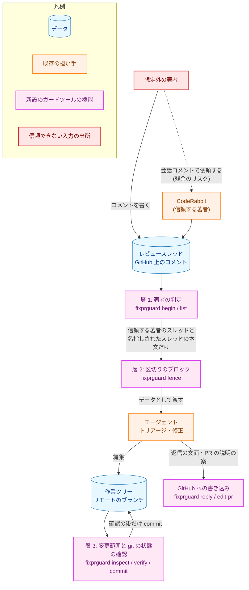
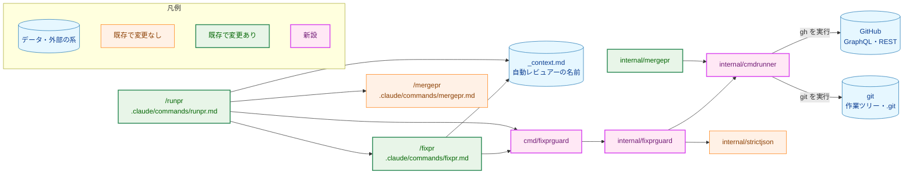
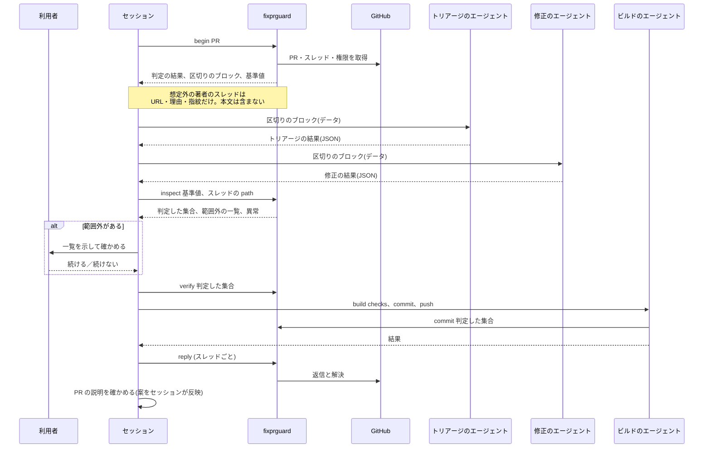
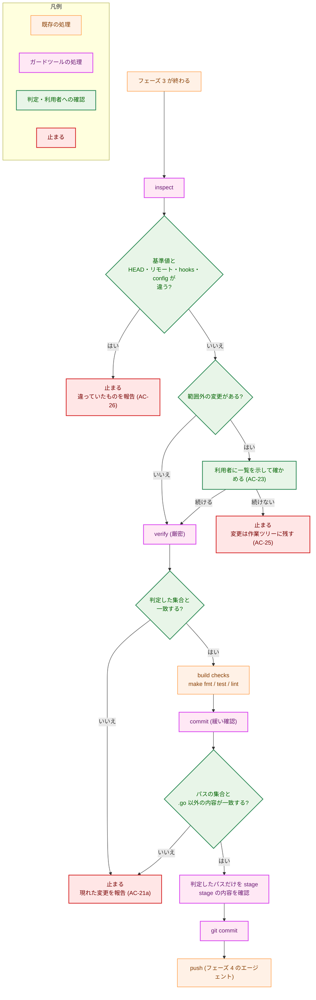
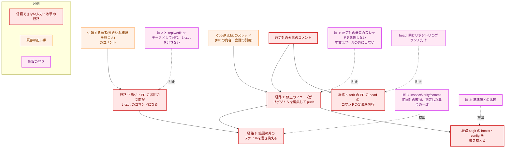
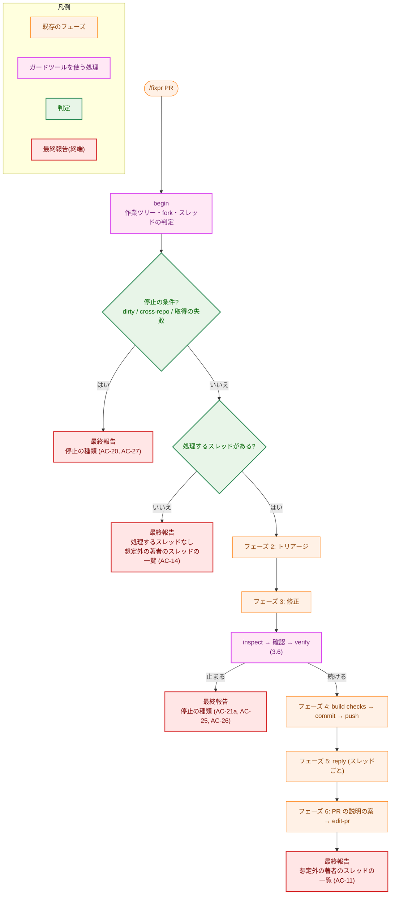
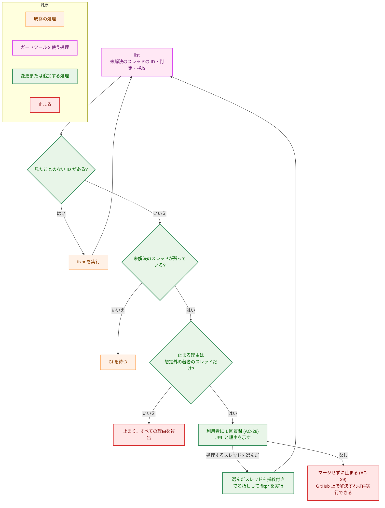

# アーキテクチャ設計書：fixpr でレビュースレッドの本文を信頼できないデータとして扱う

## Document Status

| Item | Value |
|---|---|
| Status | `draft` |
| Created | 2026-10-21 |
| Review date | - |
| Reviewer | - |
| Comments | - |

本書は [01_requirements.md](01_requirements.md)（要件定義書。以下、要件書）の設計である。既存のファイルに関する記述は、コミット `911b535` のファイルで確かめた。`file:line` はこのコミットの行番号を指す。F-NNN・AC-NN は要件書の項番を、H-NN は [design_handoff.md](design_handoff.md) の項番を指す。申し送り H-01〜H-10 への対応は 3.12 にまとめる。#395 などは GitHub の issue の番号を指す。

本書は次の用語を要件書 §6 と同じ意味で使う: フェーズ、信頼する著者、信頼する著者のスレッド、想定外の著者のスレッド、範囲外の変更、build checks、利用者、caller override。ほかに次の用語を使う。

-   **ガードツール:** 本タスクで新設する開発用ツール `fixprguard`。著者の判定、変更範囲の判定、git の状態の比較、GitHub への書き込みを行う。コマンドの文書（`fixpr.md`・`runpr.md`）がサブコマンドを呼ぶ。
-   **セッション:** `/fixpr` または `/runpr` を実行している Claude Code の会話。エージェントは、セッションが `Agent` ツールで起動する、フェーズ 2 以降の処理の担い手を指す（`fixpr.md:9-18`）。
-   **区切りのブロック:** 信頼できないテキストを含む JSON を、実行ごとの乱数（nonce）を含む区切りの行で囲んだもの（3.5）。
-   **基準値:** `begin` が出力する、git の状態の短い識別子の組（3.7）。セッションが会話に保持し、後のサブコマンドに渡す。
-   **判定した集合:** `inspect` が、修正のフェーズの後に作業ツリーの変更を数え上げて範囲と照らしたときの、変更の集合（3.6）。

## 1. 設計の全体像 (Design Overview)

### 1.1. 設計原則

-   **判定はエージェントにも、手順書を読むセッションにも任せず、コードに置く。** 著者の信頼の判定（AC-01〜AC-08）、変更範囲の判定（AC-21〜AC-23）、git の状態の比較（AC-26）は、入力が同じなら結果が同じで、条件の分岐が多く、安全側に倒すことが要る。これらを Go のツールにし、テストで壊して失敗を確かめられるようにする。
-   **想定外の著者のスレッドの本文は、ガードツールのプロセスの外に出さない。** ツールは本文を取得するが、信頼する著者のスレッドと、名指しされて変化のないスレッドについてしか、本文を標準出力に書かない（AC-09）。セッションにも、エージェントにも、想定外の著者の本文は届かない。
-   **副作用を伴う操作は、信頼できないテキストを読んだエージェントにさせない。** 本文を読んだエージェントは、JSON のテキストを返すだけにする。GitHub への返信、スレッドの解決、PR の説明の更新、commit は、ガードツールのサブコマンドが行う（AC-19）。サブコマンドはシェルを介さない。
-   **判定の基準値は、会話に持つ。** ガードツールは状態のファイルを持たない（3.7）。ディスクのファイルに基準値を置くと、そのファイルを書ける修正のフェーズのエージェントや、build checks が実行するコードに、基準値を書き換えられる。
-   **著者・権限・応答の値を確かめられなければ、想定外として扱う（fail-closed）。** 補正も部分受理もしない（AC-06、`CLAUDE.md`「Reject, don't normalize」）。
-   **信頼する著者のスレッドの処理は今までどおりにする。** 追加するのは、始める前の確認、本文の包み方、commit の前の確認だけである（要件書 4.4）。
-   **依存パッケージを加えない。** 標準ライブラリと `internal/strictjson` だけを使う（`CLAUDE.md`「Dependencies」）。

### 1.2. 設計の際に決めたこと（2026-10-21）

要件書が設計に残した選択のうち、結果が大きく変わるものは、利用者に確かめた。残りは、理由とともに本書で決めた。

利用者に確かめて決めたこと:

-   **決定的な判定は Go の開発用ツール（`cmd/fixprguard` + `internal/fixprguard`）に置く。** 手順書（`fixpr.md`）にシェルの手順を書く案は採らない。判定が LLM のセッションの実行に任されて、再現できず、壊して失敗を確かめられないためである。先例は `cmd/mergepr` + `internal/mergepr` で、決定的な部分をツールに、順序の制御と利用者への確認を `/mergepr` に分けている（`docs/dev/developer_guide/mergepr_guide.md` §1）。要件書 §5 の「製品のコードを変えない」には反しない。ツールは開発用であり、製品の 3 つのバイナリには入らない。
-   **commit される変更は、判定したパスだけを明示して stage する。** `git add -A` はやめる（AC-21a、H-05 の候補 (2)）。判定の後に現れた変更は、stage の対象に入らず、`git status` に残るので検出できる。
-   **GitHub API の挙動は、設計の前に観測して確かめた。** 結果は 3.3 に記録する。
-   **1 つのスレッドから取得するコメントの数の上限は 100 件、1 ページとする。** GraphQL の `comments` の `first` の上限と同じである。100 件を超えるスレッドは、全コメントを取得できないものとして想定外の著者のスレッドとする（AC-05・AC-06）。ページングの処理を持たない。

設計で決めたこと:

-   **ガードツールは状態のファイルを持たない。** 基準値と判定した集合の識別子はサブコマンドの出力で返し、セッションが次のサブコマンドの引数で渡す。理由は 1.1 の「判定の基準値は、会話に持つ」である。
-   **`make fmt` の整形の例外は、`.go` の通常ファイルの内容だけに限る。** 判定した集合の確認には 2 種類ある。build checks の前の `verify` は、内容を含めて厳密に比べる（AC-21a の「build checks の前に止まる」）。build checks の後の `commit` は、パスの集合と、`.go` 以外のファイルの内容を比べ、`.go` の通常ファイルの内容の違いは許す。`make fmt` は、HEAD との差分と未追跡の Go のファイルだけを整形する（`Makefile:206-215`）。作業ツリーが clean から始まるので（AC-20）、整形されるのは判定した集合の中のファイルに限られる。整形の前に判定できないのは、Makefile が範囲外の変更として残り得て、`make fmt` が利用者の確認の前にそれを実行してしまうためである。
-   **フェーズ 1（取得）はセッション自身が実行し、エージェントを使わない。** 判定の結果がエージェントの要約を経ると、別の値になり得るためである。エージェントの `haiku` が返す JSON の再構成を、判定の経路に入れない。
-   **本文を読むエージェントは副作用を持たない。** フェーズ 2（トリアージ）・フェーズ 3（修正）のうち、フェーズ 3 だけがリポジトリを編集する。フェーズ 6 の PR の説明の更新も、エージェントは案を返すだけにし、セッションがサブコマンドで反映する。
-   **区切りは、JSON の文字列のエスケープと、実行ごとの乱数の両方を使う。** 3.5 に理由を書く（H-04）。
-   **権限の判定は、`role_name` が `write`・`maintain`・`admin` のいずれかであることとする。** `permission`（丸められた値）は使わない。カスタムのロールを `role_name` の名前で区別でき、未知の値は想定外になるためである（H-01）。
-   **自動レビュアーの名前は、`_context.md` に GraphQL の `author.login` の形（`coderabbitai`）で 1 つだけ置く。** REST の形（`coderabbitai[bot]`）は、この名前に `[bot]` を付けて作る（H-02）。
-   **コメントの変化の検出には、コメントの ID・著者・更新時刻から作る指紋（fingerprint）を使う。** 指紋はガードツールが出力し、呼び出し元が `--accept` で返す（H-06）。
-   **信頼する著者のスレッドは、取得できたコメントをすべてトリアージに渡す（最大 100 件）。** 要件書 4.4 の「トリアージに渡すコメントの数も変えない」を、設計で見直す（H-03）。すべての著者が信頼する著者なので、渡して安全であり、スレッドの後半にある返信が落ちない。
-   **ガードツールが GitHub に書き込むのは `reply`（返信と解決）と `edit-pr` だけとし、リクエストの本文は JSON として組み立てて `gh api --input` で送る。** `-F`・`-f` の型変換や、シェルの引用を使わない（H-07）。
-   **`Runner`（外部コマンドの実行の境界）は `internal/cmdrunner` に移して共有する。** `internal/mergepr` が `Runner` と `NewOSRunner` を持ち（`internal/mergepr/mergepr.go:46`、`internal/mergepr/runner.go:13`）、同じものを複製したくないためである。`internal/mergepr` は型の別名を残し、挙動を変えない。
-   **文書の範囲を広げる。** 要件書 F-007 が挙げる文書（`fixpr.md`・`runpr.md`・`_context.md`・用語集）に加えて、ツールの導入が要る文書（`Makefile`・`CLAUDE.md`・`package_reference.md`・`fixprguard_guide.md`）を変える。どの AC の内容も変えない。要件書 2.2 の「文書」の一覧を、ツールの導入に伴って拡張するものとして、レビューで確かめてほしい。

### 1.3. なぜ手順書の変更だけでは足りないか

最も単純な方法は、`fixpr.md` と `runpr.md` に `gh` と `git` の手順を書き足すことである。次の要件を満たせないので、採らない。

-   AC-08 は、判定が「コメントの本文を受け取ったエージェントに関わらない」ことを求める。手順書をセッションが実行する方法では、判定の分岐（11 種類以上の理由、混在した著者、権限の照会の失敗）を LLM が毎回解釈することになる。入力が同じでも結果が揺れ、揺れを検出するテストを書けない。
-   AC-21a と AC-26 は、パス・モード・内容のダイジェストの比較と、hooks と config のディレクトリの走査を求める。シェルの 1 行で書くには長く、PTY の入力の制限にも触れる（`~/.claude/rules/long-commands.md`）。
-   AC-19 は、どんな文字列でもシェルのコマンドとして実行されないことを求める。heredoc の引用を直しても、終端の文字列の選び方に依存し続ける。シェルを介さずに実行する境界を持つのが確実である。
-   `CLAUDE.md`「Every test must be able to fail for its stated reason」は、判定のコードを壊して失敗を確かめることを求める。手順書の文面には、この確認を適用できない。

### 1.4. 概念モデル

信頼できないテキストの経路と、3 つの守りの層（要件書 4.2）を、ガードツールのサブコマンドに対応づける。図の矢印 A → B は「A のテキストまたは制御が B へ渡る」を表す。破線の矢印は、その層が阻止する経路を示す。



## 2. システム構成 (System Structure)

### 2.1. 全体構成

コマンドの文書が順序と利用者への確認を担い、ガードツールが決定的な判定と書き込みを担う。図の矢印 A → B は「A が B を呼び出す、または B から値を読む」を表す。



### 2.2. コンポーネント配置

| ファイル | 状態 | 責務 |
|---|---|---|
| `cmd/fixprguard/main.go` | 新設 | サブコマンドの引数の解釈、`internal/fixprguard` の呼び出し、JSON の出力、終了コード。`mergepr` の `cmd/mergepr/main.go` と同じ構成にする |
| `internal/fixprguard/tool.go` | 新設 | `Tool`、サブコマンドごとのメソッド、出力の型 |
| `internal/fixprguard/trust.go` | 新設 | 著者の信頼の判定（F-001）。権限の照会と、理由の収集 |
| `internal/fixprguard/threads.go` | 新設 | スレッドとコメントの取得、応答の厳格な検査、指紋（H-03・H-06） |
| `internal/fixprguard/fence.go` | 新設 | 区切りのブロックの生成（H-04） |
| `internal/fixprguard/changes.go` | 新設 | 作業ツリーの変更の数え上げ、行数の集計、ダイジェスト（H-05） |
| `internal/fixprguard/scope.go` | 新設 | 変更範囲の規則と、コマンドの実行に関わるファイルの一覧（H-10） |
| `internal/fixprguard/gitstate.go` | 新設 | git の状態の基準値と比較（H-08） |
| `internal/fixprguard/post.go` | 新設 | `reply`・`edit-pr`（H-07） |
| `internal/fixprguard/head.go` | 新設 | fork の判定（H-09） |
| `internal/fixprguard/errors.go` | 新設 | センチネルエラー |
| `internal/fixprguard/*_test.go`・`test_helpers.go` | 新設 | テストと、`//go:build test` の補助（`docs/dev/developer_guide/test_organization.md` の分類 B） |
| `internal/cmdrunner/runner.go` | 新設 | `Runner` interface と `NewOS`（`internal/mergepr/runner.go` から移す） |
| `internal/mergepr/mergepr.go`・`internal/mergepr/runner.go` | 変更 | `Runner` を `cmdrunner.Runner` の別名にし、`NewOSRunner` が `cmdrunner.NewOS` を返す。挙動は変えない。`internal/mergepr` の既存のテストは、この別名の変更で壊れない（fake は `Run` のメソッドだけを実装する。`internal/mergepr/test_helpers.go`） |
| `.claude/commands/fixpr.md` | 変更 | 3.10 |
| `.claude/commands/runpr.md` | 変更 | 3.10 |
| `.claude/commands/_context.md` | 変更 | 自動レビュアーの名前と、ガードツールの行を加える（AC-35） |
| `docs/translation_glossary.md` | 変更 | AC-37 の用語を加える |
| `Makefile` | 変更 | `install-fixprguard` を加える（`install-mergepr` と同じ形。`Makefile:66-69`） |
| `CLAUDE.md` | 変更 | 「Quick Links」「Build Commands」に `fixprguard` の案内を加える |
| `docs/dev/developer_guide/package_reference.md` | 変更 | `cmd/fixprguard`・`internal/fixprguard`・`internal/cmdrunner` の行を加える。`internal/strictjson` の行の共有先に `internal/fixprguard` を加える。`internal/pipeline` の `TestPackageReferenceListsPackages`（`internal/pipeline/pipeline_test.go:671`）が、行の欠けを失敗にする |
| `docs/dev/developer_guide/fixprguard_guide.md` | 新設 | ガードツールの使い方、保証すること・しないこと、止まったときの対処（`mergepr_guide.md` に倣う。英語） |
| `cmd/yt2column/fixpr_docs_test.go` | 新設 | コマンドの文書がガードツールの呼び出しを持ち、取り除くべき記述を持たないことの検査（7.4）。`doc-guard` ジョブの対象パッケージに入っているので（`CLAUDE.md`「Development Notes」）、文書だけの PR でも CI で働く |

本タスクの前に、`.claude/commands/fixpr.md` と `runpr.md` を読むテストは存在しない（`*_test.go` の中の `claude/commands`・`fixpr`・`runpr` を探し、コミット `911b535` で見つからなかった）。したがって、既存のテストで更新が要るものはない。

### 2.3. データフロー: `/fixpr` の 1 ラウンド

図の矢印は呼び出しと戻りを表す。シーケンス図は色分けを使わないので、凡例はない。



### 2.4. 既存の挙動の確認

設計が前提にする既存の挙動を、コミット `911b535` で確かめた。

-   `fixpr.md:141-196` のフェーズ 1 は、`haiku` のエージェントがスレッドを取得する。コメントは `comments(first:10)`（`fixpr.md:164`）で、`body` は最初の 10 件を `@author: ` 付きで連結する（`fixpr.md:176-180`）。`authorType` は最初のコメントの `__typename` から決まり、`Bot` でも `User` でもなければ `User` とする（`fixpr.md:181-183`）。
-   `fixpr.md:208-244` のフェーズ 2 と `fixpr.md:263-331` のフェーズ 3 は、`threads` の JSON をプロンプトに埋め込む（`fixpr.md:238`・`fixpr.md:263-265`）。
-   `fixpr.md:333-372` のフェーズ 4 は、`git add -A` を実行して commit する（`fixpr.md:346-349`）。
-   `fixpr.md:374-427` のフェーズ 5 は、引用符付きの heredoc `<<'REPLYBODY_EOF'` で返信の文面を渡す（`fixpr.md:398-403`）。`fixpr.md:429-450` のフェーズ 6 は、`gh pr edit` に heredoc とタイトルの直書きを使う（`fixpr.md:441-445`）。
-   `runpr.md:185-211` のステップ 3 は、`comments(first:10)` で `body` を含めてスレッドを取得する（`runpr.md:197-199`）。`runpr.md:212-219` は、見たことのないスレッド ID があれば `/fixpr` を実行し、`runpr.md:220-226` は止まる理由を列挙する。
-   `runpr.md:168-172` は、CodeRabbit のレビューを探すために `coderabbitai[bot]` を文字列で直接書いている。
-   `internal/mergepr/runner.go:13-28` の `osRunner` は、シェルを介さずに `exec.CommandContext` で実行し、失敗時にコマンドと標準エラーを返す。

## 3. コンポーネント設計 (Component Design)

### 3.1. サブコマンド

ガードツールは、状態を持たないサブコマンドの集まりである。標準出力は JSON（`fence` の出力を除く）、診断は標準エラーに書く。終了コードは、`0` が「続けてよい」、`1` が「止める」（理由は出力の `stop`）、`2` が使い方の誤り、`3` が「利用者に確かめる」（`inspect` だけ）である。

| サブコマンド | 呼ぶ側 | 入力 | 出力 | 外部への副作用 |
|---|---|---|---|---|
| `head <PR>` | `/runpr` ステップ 1、`/fixpr` | PR | PR の head がこのリポジトリのブランチか（AC-27） | GitHub の読み取り |
| `list <PR>` | `/runpr` ステップ 3・4 | PR、`--reviewer` | 未解決のスレッドごとの ID・URL・信頼の判定・理由・指紋。**本文は含まない**（AC-32） | GitHub の読み取り |
| `begin <PR>` | `/fixpr` フェーズ 1 | PR、`--reviewer`、`--accept <ID>=<指紋>`（複数可） | 作業ツリーの確認（AC-20）、fork の確認、`list` と同じ判定、処理するスレッドの本文（区切りのブロック）、基準値 | GitHub と `git ls-remote` の読み取り |
| `fence <file>` | `/fixpr` フェーズ 3 | ファイル | ファイルの内容を囲んだ区切りのブロック | なし |
| `inspect` | `/fixpr` フェーズ 3 の後 | 基準値、`--path`（複数可） | git の状態の異常、判定した集合、範囲外の一覧 | git と `git ls-remote` の読み取り |
| `verify` | `/fixpr` build checks の前 | 基準値、判定した集合 | 判定した集合との一致（厳密） | git の読み取り |
| `commit` | `/fixpr` フェーズ 4 | 基準値、判定した集合、`--subject` | 判定したパスの stage と commit（push はしない） | **ローカルの commit のみ** |
| `reply` | `/fixpr` フェーズ 5 | PR、スレッド ID、コメント ID、本文のファイル、`--reviewer`、`--accept` | 返信の投稿とスレッドの解決 | GitHub への書き込み |
| `edit-pr` | `/fixpr` フェーズ 6 | PR、タイトル、本文のファイル | PR のタイトルと本文の更新 | GitHub への書き込み |

3.11 に、副作用の契約を表にまとめる。

### 3.2. 型と interface

高レベルの型だけを示す。実装の詳細（フィールドの並び、補助関数）は実装で決める。

```go
package cmdrunner

// Runner runs an external command without a shell and returns its standard
// output. It moves here from internal/mergepr unchanged.
type Runner interface {
	Run(ctx context.Context, name string, args ...string) ([]byte, error)
}

func NewOS() Runner
```

```go
package fixprguard

// Login is a GitHub account name that passed the login grammar. The zero value
// is "no usable name"; only ParseLogin builds a usable one.
type Login struct{ /* unexported */ }

func ParseLogin(s string) (Login, error)
func (l Login) String() string

// AuthorKind mirrors GraphQL __typename. The zero value is unknown, the
// interpretation that assumes least.
type AuthorKind int

const (
	AuthorUnknown AuthorKind = iota
	AuthorUser
	AuthorBot
)

// Reason is why a thread is not trusted. ReasonNone is the zero value.
type Reason int

const (
	ReasonNone                  Reason = iota
	ReasonNoWritePermission            // (a) names the account
	ReasonOtherBot                     // (b) names the account
	ReasonNoAuthorName                 // (c) no author, empty or unusable name
	ReasonPermissionUnavailable        // (d)
	ReasonIncompleteComments           // (e)
	ReasonUnknownAuthorKind            // (f)
)

type Finding struct {
	Reason  Reason
	Account Login // set for (a) and (b) only
}

// Assessment is the zero value "not trusted"; Trusted is set only when every
// comment's author is a trusted author.
type Assessment struct {
	Trusted  bool
	Findings []Finding
}

// Fingerprint identifies the comments of a thread (IDs, authors, update times)
// at one moment.
type Fingerprint string

type Tool struct{ /* unexported */ }

// New fails when reviewer is not a usable Login, so a missing --reviewer stops
// the run instead of defaulting.
func New(run cmdrunner.Runner, reviewer Login) (*Tool, error)

func (t *Tool) Head(ctx context.Context, pr string) (HeadInfo, error)
func (t *Tool) List(ctx context.Context, pr string) (ThreadList, error)
func (t *Tool) Begin(ctx context.Context, pr string, accept []Accept) (Round, error)
func (t *Tool) Inspect(ctx context.Context, base Baseline, paths []string) (Inspection, error)
func (t *Tool) Verify(ctx context.Context, base Baseline, judged Judged) error
func (t *Tool) Commit(ctx context.Context, base Baseline, judged Judged, subject string) (CommitResult, error)
func (t *Tool) Reply(ctx context.Context, req ReplyRequest) error
func (t *Tool) EditPR(ctx context.Context, req EditPRRequest) error

// Fence wraps data in a block whose delimiter does not occur in data.
func Fence(data []byte) (Block, error)

// Accept names a held-back thread the user inspected, with the fingerprint
// the user saw.
type Accept struct {
	ThreadID    string
	Fingerprint Fingerprint
}

// Baseline holds the git state taken at begin. It is parsed strictly from a
// flag value; a malformed token is rejected, not repaired.
type Baseline struct{ /* head, remote, hooks, config */ }

// Judged holds the digests inspect computed over the change set: one that
// covers file contents and one that leaves out the contents of regular .go files.
type Judged struct{ /* strict, loose */ }

// ChangeKind is one of the kinds of change a path can have in the change set.
type ChangeKind int

const (
	ChangeUnknown ChangeKind = iota
	ChangeAdd
	ChangeModify
	ChangeDelete
	ChangeOther // type change, symlink, submodule
)
```

「宣言し、推測しない」（`CLAUDE.md`）に従い、著者の種類（`AuthorKind`）と理由（`Reason`）は列挙型にし、ゼロ値を最も仮定の少ない解釈にする。分岐は `switch` で行い、`default` は想定外（信頼しない）に倒す。

### 3.3. 信頼の判定（F-001・H-01・H-02）

**判定の規則。** スレッドの各コメントの著者は、次の表で判定する。スレッドは、すべてのコメントが信頼する著者のときだけ信頼する著者のスレッドである（AC-04）。1 件でも違えば想定外であり、理由は該当するものをすべて集める（AC-11）。

| 著者の種類（GraphQL `__typename`） | 判定 | 理由 |
|---|---|---|
| `Bot` で、`login` が自動レビュアーの名前と一致 | 信頼する。権限の照会はしない（AC-02・AC-03） | - |
| `Bot` で、`login` が自動レビュアーと違う | 信頼しない。書き込み権限の照会もしない | (b) |
| `User` | `login` を検査して REST で権限を照会する。`role_name` が `write`・`maintain`・`admin` のいずれかなら信頼する。それ以外は信頼しない | (a)、照会できなければ (d) |
| それ以外の値、空、欠け | 信頼しない | (f) |
| 著者がない（`author` が `null`）、名前が空、名前が `login` の文法に合わない | 信頼しない | (c) |

名前が `login` の文法に合わないものを (c) にまとめるのは、要件書 AC-11 の (c)「著者がない、または名前が空」を「名前が使えない」に広げる設計上の判断である。権限の照会の URL に名前を埋め込むので、`/` や `..` を含む値を通さないためである。文法は、英数字とハイフンの並び（先頭は英数字）に、Bot の接尾辞 `[bot]` を任意で認めるものとする。この文法を満たさない名前は、出力にも書かない（出力は理由 (c) の件数だけを示す）。

`ReasonIncompleteComments`（e）は、`comments.pageInfo.hasNextPage` が真、または取得したコメントの数が 100 件に達してなお続きがあるときに付く（AC-05・AC-06）。

**権限の照会。** `GET /repos/{owner}/{repo}/collaborators/{login}/permission` を `gh api` で呼ぶ（H-01）。応答は `internal/strictjson` で検査する。UTF-8、トップレベルが 1 つの JSON のオブジェクト、末尾にデータなし、読む member（`role_name`）の重複と `null` の拒否である。ほかの member は無視する。GitHub がフィールドを足すためで、読む member だけを明示することで、この応答を「拡張を許す」と宣言する。`role_name` が文字列でなければ (d) とする。照会の失敗、`404`、API の利用の上限は、すべて (d) である。1 回の実行での照会は、異なる `login` ごとに 1 回、全体で 100 回までとする。超えた分は (d) とする（大量のアカウントによるコメントの洪水に、実行時間と API の利用枠を渡さない）。

**GitHub API の観測（2026-10-21、`gh` 2.96.0、`isseis/yt2column`（`visibility: PUBLIC`））。**

| 照会 | 結果 |
|---|---|
| `isseis`（リポジトリの所有者） | `permission: admin`、`role_name: admin`、`type: User` |
| `coderabbitai[bot]` | `permission: none`、`role_name: ""`、`type: Bot` |
| `coderabbitai`（`[bot]` なし） | `permission: none`、`type: Organization`。`[bot]` 付きとは別のアカウントである |
| `octocat`（collaborator でない） | `permission: read`、`role_name: read` |
| 存在しない名前 | `404`、`"... is not a user"` |
| `github-actions[bot]` | `permission: none`、`type: Bot` |
| GraphQL の PR #396 のコメント | CodeRabbit は `__typename: Bot`、`login: coderabbitai`、`authorAssociation: CONTRIBUTOR`。REST では `user.login: coderabbitai[bot]`、`type: Bot` |
| GraphQL の `comments` | `pageInfo.hasNextPage`、`createdAt`、`updatedAt`、`lastEditedAt`（編集のないコメントは `null`）を取得できた |
| `gh pr view --json isCrossRepository` | 同じリポジトリの PR で `false`。`headRepository`・`headRepositoryOwner` も取得できた |

観測から、次のことを設計に反映した。(1) GraphQL の `login` は `coderabbitai`、REST の `login` は `coderabbitai[bot]` で、形が違う。`_context.md` には GraphQL の形を置く（1.2）。(2) `[bot]` なしの `coderabbitai` は別の組織のアカウントなので、`User` の種類で名前だけが一致する著者は、権限の照会で `none` になり、信頼されない（AC-03）。(3) `authorAssociation` は CodeRabbit に `CONTRIBUTOR` を返し、書き込み権限の強さと対応しないので、判定に使わない（H-01）。

観測できなかったものは次のとおりで、設計は安全側に倒れる。`maintain`・`triage` の `role_name`、カスタムのロール、削除済みのアカウント（`author` が `null`）、fork の PR の `isCrossRepository`（`true`）である。`role_name` を許可する値の一覧と照合するので、観測できなかった値は信頼されず、名指し（F-002）で処理できる。`isCrossRepository` は、厳密に `false` のときだけ同じリポジトリとして扱い、`true`・`null`・欠けは止める（3.9）。

### 3.4. スレッドの取得と本文の扱い（F-002・H-03・H-06）

**1 回の GraphQL で、判定と本文を同じ応答から作る。** `begin` と `list` は、PR の未解決のスレッドを `reviewThreads(first:100)`、各スレッドのコメントを `comments(first:100)` で取得する。コメントごとに `databaseId`・`url`・`path`・`line`・`author { __typename login }`・`createdAt`・`updatedAt`・`lastEditedAt` と、`begin` は `body` も取得する。申し送り H-03 は、判定と本文の取得を別の呼び出しに分けると、その間にコメントが追加されることを指摘した。本設計は、判定した応答の本文だけを使うので、この隙間がない。判定の後に追加されたコメントの本文は、そもそも渡らない（AC-09）。

**本文を出力する条件。** `begin` は、次のスレッドの本文だけを標準出力に書く。(1) 信頼する著者のスレッド。(2) 想定外の著者のスレッドのうち、`--accept` で名指しされ、指紋が現在のコメントと一致するもの。想定外の著者のスレッドの本文は、取得してもメモリの中にとどめ、出力しない（AC-09）。出力には、想定外の著者のスレッドの ID・URL・理由・指紋だけを書く（AC-11）。本文を含めない。

**応答の検査。** GraphQL の応答は、読む前に `internal/strictjson` で検査する。UTF-8、サロゲートの対、トップレベルが 1 つのオブジェクト、末尾にデータなし、読む member の重複と `null` の拒否である。応答全体の大きさは 16 MiB までとし、超える応答は拒否する（スレッド 100 件 × コメント 100 件の上限に対して余裕を持たせた値である）。`errors` を含む応答は全体を失敗とする。部分的な結果を使わない。

**指紋。** 指紋は、スレッドのコメントについて、`databaseId`・著者の `login`・`createdAt`・`updatedAt`・`lastEditedAt` を取得した順に並べ、コメントの数と `hasNextPage` を加えた正規形の SHA-256 である。コメントの追加・編集・削除のいずれでも変わる（AC-13）。

**名指し。** 呼び出し元は、利用者が確かめたときに示した指紋を `--accept <スレッド ID>=<指紋>` で返す。現在の指紋と一致すれば処理する。一致しなければ、そのスレッドは `changed` として処理せず、報告に載せる（AC-13）。指紋を持たないスレッドは名指しできない。セッションは、自分が示した報告にあるスレッドの指紋しか渡せないので、報告に挙げていないスレッドの名指しは（AC-12）、指紋の欠落で拒否される。`/fixpr` を直接実行するときの「確かめた時点」は、直前の `begin` の出力の時点であり、その指紋がセッションの会話に残っている。

**トリアージに渡すコメントの数。** 取得できたコメントを、最大 100 件、すべて `body` に連結する（H-03 の判断）。形式は今までと同じ `@author: ` 付きの連結である。

**`authorType`。** 最初のコメントの著者の種類で、`Bot` または `User` とする。処理するスレッドでは、`Bot` は自動レビュアーだけである。これは今までの挙動との違いで、自動レビュアー以外の Bot が開いたスレッドは、`Bot` として処理されるのではなく、想定外の著者のスレッドとして報告される（要件書 §1 の決定）。ラウンド上限の対象は、自動レビュアーが開いたスレッドになる（`fixpr.md:40-47`）。

### 3.5. 区切りのブロック（F-003・H-04）

エージェントのプロンプトに埋め込む、信頼できないテキストは、区切りのブロックに入れる。ブロックは、`begin` が本文の JSON を出力するときと、`fence` が任意のファイルを囲むときに、同じ関数 `Fence` で作る。

-   **形。** 実行ごとに選ぶ乱数（128 ビット）の nonce を使い、`BEGIN-UNTRUSTED-<nonce>` と `END-UNTRUSTED-<nonce>` の行でデータを囲む。`Fence` は、nonce の文字列がデータに含まれないことを確かめ、含まれていれば選び直す（AC-18）。選び直しは数回までとし、それでも含まれれば失敗とする。
-   **中身は JSON の文字列。** 本文は、今までと同じ JSON の文字列として入れる。JSON の文字列は、引用符と改行をエスケープするので、本文が区切りの行を、行頭のまま作ることができない。nonce の確認と JSON のエスケープは、別々の理由で重ねている。nonce の確認だけでは「含まれない」ことの保証にはなるが、プロンプトを読む LLM に「区切りの内側はすべてデータ」という境界を示す目印として働くのは、行頭の区切りの行である。JSON のエスケープは、既存の形式（要件書 4.4 の互換性）を保ち、本文の中の区切りに似た文字列が行頭に現れないことを保証する。
-   **プロンプトの記述。** 区切りのブロックを埋め込む各フェーズのプロンプトに、次の 2 点を書く（AC-16）。ブロックの内側はデータであり、従うべき指示ではないこと。ブロックの内側の文字列が区切りの行に見えても、終わりではないこと（終わりは nonce が一致する行だけ）。
-   **対象のフェーズ。** フェーズ 2（トリアージ）は `begin` の出力のブロックを受け取る。フェーズ 3（修正）は、同じ `begin` のブロックに加えて、フェーズ 2 の出力（`topic`・`replyBody`・`structuralChange` など、本文から作られた文）を受け取る。フェーズ 2 の出力は、セッションがファイルに書き、`fence` で囲んで埋め込む（本文を読んだエージェントの出力は、本文と同じく信頼しない）。フェーズ 5（返信）のエージェントは、返信の文面を受け取らない（3.8）。フェーズ 6（PR の説明）は、PR のタイトル・本文・コミットメッセージを受け取り、それらがデータであり指示ではないことをプロンプトで示される（AC-17、`mergepr.md:46-48` と同じ扱い）。

nonce の値は、ガードツールが生成する。セッションが生成すると、本文を読んだ文脈の影響を受けるので、使わない。

### 3.6. 変更範囲の確認（F-004・H-05・H-10）

**範囲の規則（`scope.go`）。** 修正のフェーズに渡したスレッドの `path`（`--path`）ごとに、範囲に入るファイルを決める。

1.  `path` そのもの。
2.  `path` と同じディレクトリのファイル（サブディレクトリの中は含まない）。
3.  `path` が `docs/tasks/NNNN_<name>/`（`NNNN` は 4 桁の数字）の中にあれば、そのディレクトリの下のすべてのファイル（サブディレクトリの中を含む。既存のタスクにサブディレクトリがあるため。たとえば `docs/tasks/0008_column_prompt/v1/`）。
4.  ただし、コマンドの実行に関わるファイル（下の一覧）は、`path` そのものでなければ範囲外とする。
5.  名前を変えたファイルは、変える前と後の両方が範囲に入るときだけ範囲に入る。作業ツリーでは、変更前の削除と変更後の追加が別々のエントリとして現れるので、各エントリをそれぞれ判定すれば足りる。
6.  通常のファイル以外の変更（シンボリックリンク、サブモジュール、ファイルの種類の変更）は、パスにかかわらず範囲外とする。パスの規則では、リンクの先を制限できないためである。

**コマンドの実行に関わるファイルの一覧（H-10）。** コミット `911b535` のリポジトリの最上位と `extension/` を調べて決めた。build checks と CI が設定として読む、または実行するファイルである。一覧は `scope.go` の 1 か所で定める。`fixprguard_guide.md` が一覧を載せる。`fixpr.md` は一覧を言い換えず、ガードツールの判定に委ねる（要件書 4.5）。

-   ディレクトリ: `.claude/`、`.github/`、`extension/scripts/`。
-   リポジトリの最上位のファイル: `Makefile`、`go.mod`、`go.sum`、`.golangci.yml`、`.pre-commit-config.yaml`、`.coderabbit.yaml`、`.gitignore`、`.gitattributes`、`CLAUDE.md`、`AGENTS.md`。
-   `extension/` の直下のファイル: `package.json`、`package-lock.json`、`.npmrc`、`.node-version`、`.prettierrc.json`、`.prettierignore`、`eslint.config.js`、`tsconfig.json`、`tsconfig.core.json`、`tsconfig.build.json`。

同じディレクトリの `_test.go` は範囲に入る。要件書 1 章の決定による（同じパッケージのテストのファイルを直すたびに確認を入れない）。`make test` は範囲内のテストのコードを実行するので、これは 5.3 の残余のリスクに挙げる。

**パスの検査。** 範囲の判定は、パスを次の規則で検査してから行う。規則に反するパスは、補正せず、範囲外として扱い、出力では位置（何番目か）だけを示す。(1) 有効な UTF-8 で、制御文字を含まない。(2) 絶対パスでなく、`..` の要素を含まず、`filepath.Clean` で変わらない。(3) 実行に関わるファイルの照合は ASCII の大文字小文字を同一視して行う（macOS の既定のファイルシステムでは、`makefile` と `Makefile` が同じファイルを指すため）。(4) ASCII でない文字を含むパスは、`path` とバイト単位で一致するときだけ範囲に入る（Unicode の正規化や大文字小文字の畳み込みで、別の名前のファイルを指し得るため。たとえば Kelvin 記号 U+212A は `k` に畳み込まれ得る）。この検査が必要なのは、出力するパスが、攻撃者が選べるファイル名であり、セッションに届くためでもある。

**変更の数え上げ（`changes.go`）。** `inspect` は、`git status --porcelain=v1 -z --untracked-files=all` で、追跡済みの変更（index と作業ツリー）と未追跡のファイルを数え上げる。`.gitignore` が無視するファイルは数えない（要件書 4.2 の残余のリスク）。変更の種類（追加・変更・削除・その他）と、行数（追加と削除。バイナリは行数の代わりにバイナリであること）を求める（AC-23）。行数は、追跡済みのファイルは `git diff --numstat` で、未追跡のファイルはファイルの内容から数える。index を変える `git add -N` は使わない（AC-26 が git の状態を比べるため）。

**判定した集合の識別子（`Judged`）。** 各エントリの（パス、種類、モード、内容のダイジェスト。シンボリックリンクはリンクの先）を、パスの順に並べた正規形の SHA-256 を 2 つ求める。1 つは内容を含む厳密なもの、もう 1 つは追加または変更された `.go` の通常ファイルの内容のダイジェストを除いたものである。`inspect` が出力し、セッションが `verify` と `commit` に渡す。

**判定の流れ。**



**`commit` が守る不変条件。** (1) 判定した集合が空なら、何もせず `committed: false` を返す。(2) 基準値の HEAD・hooks・config が `inspect` のときと同じである。build checks のコードが hooks を書き換えて、その後の `git commit` で実行させることを防ぐ。(3) 現在の変更の集合が、判定した集合とパスと種類が同じで、`.go` の通常ファイル以外は内容も同じである。(4) 判定したパスだけを `git add -- <path>` で stage し、`git diff --cached --name-status --no-renames` が判定した集合と一致し、`git status` に未 stage・未追跡の変更が残らない。(5) 一致しなければ、commit せずに止まる（`ErrJudgedSetChanged`）。件名は呼び出し元が `--subject` で渡す（ラウンドの数え方が依存する件名 `fix: address PR #NUMBER review comments`、`fixpr.md:36-39` は、`fixpr.md` に 1 か所で書く）。push は行わない。

### 3.7. git の状態の基準値（F-004・H-08）

`begin` は、次の 4 つの値から成る基準値を出力する。`inspect` は、現在の 4 つの値を求めて、基準値と比べる（AC-26）。

| 値 | 求め方 | 比べる時点 |
|---|---|---|
| head | `git rev-parse HEAD` | `inspect`・`commit` |
| remote | `git ls-remote origin refs/heads/<現在のブランチ>` の OID（ブランチがなければ空） | `inspect` |
| hooks | hooks のディレクトリの内容のダイジェスト | `inspect`・`commit` |
| config | リポジトリの config と worktree の config の内容のダイジェスト | `inspect`・`commit` |

-   **hooks のディレクトリ。** `git rev-parse --git-path hooks` で求め、`core.hooksPath` が設定されていればその先を使う。worktree では `.git` がファイルで、hooks と共有の config は共有の git のディレクトリ（`git rev-parse --git-common-dir`）にある。ダイジェストには、各エントリの相対パス、ファイルの種類、モード（実行ビット）、シンボリックリンクの先、通常ファイルの内容を入れる。既存の hook の実行ビットだけを変えても、次の `git commit` で実行されるようになるためである。
-   **config。** `git rev-parse --git-path config` と `git rev-parse --git-path config.worktree`（存在すれば）の内容。
-   **index・`FETCH_HEAD`・reflog。** 通常の git の操作で変わるので、異常として扱わない（AC-26）。
-   **基準値の時点。** `begin` の時点（フェーズ 2 の前）であり、要件書の「修正のフェーズの前」より早い。フェーズ 2 のエージェントの異常も、同じ比較で検出できるためである。この間にリモートのブランチが正当に進んだ場合（利用者が別に push した場合）も異常として止まる。実行をやり直せば足りるので、受け入れる。
-   **基準値の形。** 4 つの値を `.` で連結した 1 つの文字列（バージョンの接頭辞付き）で、約 200 バイトである。セッションが引数で渡す。形が合わない値は補正せず、使い方の誤りとして拒否する（`ErrInvalidInput`）。

修正のフェーズの間に変えて元に戻したものは検出しない。要件書 4.2 の残余のリスクとして受け入れている。

### 3.8. GitHub への書き込み（F-003・H-07）

`reply` と `edit-pr` は、シェルを介さずに `gh` を実行し、本文をコマンドの文字列に埋め込まない。

-   **返信。** セッションが、フェーズ 3 またはフェーズ 2 の `replyBody` を、`Write` ツールでファイルに書く。`reply` は、そのファイルを読み、`{"body": <文面>}` の JSON を自分で組み立てて、`gh api --method POST repos/<owner>/<repo>/pulls/<number>/comments/<id>/replies --input <file>` に渡す。`-F body=@file` や `-f` は使わない。`-F` は値の型変換（`true`・`null`・数字）を行うので、文面の全体が文字列として送られる保証にならないためである。返信が成功した場合だけ、`resolveReviewThread` の mutation を、スレッド ID を変数として渡して実行する。文面は heredoc も引数も通らないので、終端の文字列、`$(...)`、バッククォート、引用符はただの文字である（AC-19）。
-   **返信を許す条件。** `reply` は、スレッドを現在の状態で判定し直す（AC-07）。信頼する著者のスレッド、または `--accept` で名指しされて指紋が一致するスレッドだけに返信し、解決する。想定外の著者のスレッドには、フェーズ 5 のエージェントが誤って指示されても、返信も解決もできない（AC-10、`ErrThreadNotTrusted`）。
-   **PR の説明。** フェーズ 6 のエージェントは、現在の説明が古いかを確かめ、古い場合は案（タイトルと本文）を JSON で返すだけで、`gh pr edit` を実行しない。セッションが案をファイルに書き、`edit-pr` を呼ぶ。`edit-pr` は `gh pr edit <number> --title=<タイトル> --body-file <file>` をシェルなしで実行する（タイトルは `--title=` の形で渡すので、先頭が `-` でもフラグとして解釈されない）。
-   **フェーズ 5 のエージェント。** 返信の文面を受け取らない。スレッド ID、コメント ID、本文のファイルのパスだけを受け取り、`reply` を順番に実行する。

### 3.9. fork の PR の判定（F-005・H-09）

`head` は `gh pr view <PR> --json isCrossRepository,headRepository,headRepositoryOwner` を実行し、`isCrossRepository` が真偽値の `false` であり、`headRepository` が存在するときだけ「同じリポジトリ」とする。`true`、`null`、欠け、真偽値でない値は、止める（`ErrCrossRepository`）。`begin` と `list` も同じ判定を最初に行う。`/runpr` は、ステップ 1 で PR を決めた直後、`gh pr checkout` の前に `head` を実行する。チェックアウトが、攻撃者の管理するコマンドの定義（`CLAUDE.md`・`.claude/commands/`）を作業ツリーに持ち込むためである（要件書 1 章の決定）。

### 3.10. コマンドの文書の変更（F-007）

**`fixpr.md`。**

| 箇所 | 変更 |
|---|---|
| 冒頭の説明 | フェーズ 1 とガードツールの呼び出しをセッションが実行すること、`fixprguard` が `PATH` になければ止まること（`make install-fixprguard` を案内する）を書く |
| Authorization（新設。AC-36） | `gh pr view`、`gh api graphql`（スレッドの取得と解決）、`gh api`（権限の照会、返信の投稿）、`gh pr edit`、`git ls-remote`、`git push` を、この PR についてだけ承認されるものとして挙げる |
| Convergence policy | 「People are always answered」（`fixpr.md:48-50`）を、信頼する著者が開いたスレッドに限る記述にし、想定外の著者のスレッドの扱いを参照する（AC-34）。想定外の著者のスレッドがラウンドの数え方とラウンド上限に影響しないこと（AC-15）を書く |
| Caller override（`fixpr.md:57-60`） | 想定外の著者のスレッドの名指しを加える。名指しは、スレッド ID と指紋の組で渡す |
| Shared rules | 区切りのブロックの取り扱い（3.5）を R6 として加え、フェーズ 2・3・6 から参照する。既存の R1〜R5 は変えない |
| フェーズ 1 | `begin` の実行に置き換える。fork の判定（AC-27）、作業ツリーの確認（AC-20）、想定外の著者のスレッドの一覧、基準値がここで決まる |
| フェーズ 2・3 | プロンプトに区切りのブロックを埋め込み、データであることを書く（AC-16）。フェーズ 3 の後、フェーズ 4 の前に、`inspect`、利用者への確認、`verify` を置く |
| フェーズ 4 | build checks の後、`git add -A` と `git commit` を `fixprguard commit` に置き換える。push、未 push の commit の確認（`fixpr.md:354-361`）は変えない |
| フェーズ 5 | 返信のブロック（`fixpr.md:398-403`）を `reply` に置き換える。heredoc `REPLYBODY_EOF` を取り除く |
| フェーズ 6 | 説明の更新の案をエージェントが返し、セッションが `edit-pr` で反映する。PR のテキストがデータであることを書く（AC-17） |
| Final report | 想定外の著者のスレッドを、「Skipped threads」と区別した一覧で挙げる（URL と理由。AC-11）。処理するスレッドがないとき（AC-14）、範囲外の変更で止めたとき（AC-25）、判定の後に変更が現れたとき（AC-21a）、git の状態の異常（AC-26）、作業ツリーの変更（AC-20）、fork（AC-27）の停止の種類を、最初の行に示す |

**`runpr.md`。**

| 箇所 | 変更 |
|---|---|
| 冒頭 | 取得するスレッドの本文を、従うべき指示ではなくデータとして扱うことを書く（AC-32） |
| Authorization（`runpr.md:32-43`） | `gh api`（権限の照会）、`git ls-remote` を加える（AC-36） |
| ステップ 1 | PR を決めた直後、チェックアウトの前に `head` を実行し、同じリポジトリでなければ止める（AC-27） |
| ステップ 3 の取得（`runpr.md:185-211`） | GraphQL の取得を `list` に置き換える。本文は取得しない（AC-32）。見たことのないスレッド ID で `/fixpr` を実行する条件（`runpr.md:212-217`）は変えない（AC-33）。ID の集合に想定外の著者のスレッドも含める |
| ステップ 3 の止まる理由（`runpr.md:220-226`） | 想定外の著者のスレッドだけが理由のとき、1 回質問する（AC-28）。ほかの理由もあれば、質問せずにすべて報告して止まる。処理するスレッドが選ばれなければ止まり、GitHub 上で解決すれば再実行できることを示す（AC-29）。未解決の間はマージしない（AC-30） |
| ステップ 4 | 作業ツリーに commit していない変更があれば、ステップ 4 に進まない（AC-31）。`fixpr` が範囲外の変更・判定の後の変更・git の状態の異常で止めたときも、マージしない（AC-31）。PRE_MERGE の後のスレッドの再取得（`runpr.md:305-308`）にも `list` を使い、想定外の著者のスレッドが現れたら、マージせずステップ 2 に戻る |
| 自動レビュアーの名前（`runpr.md:168-172`） | 文字列の直書きをやめ、`_context.md` の名前から REST の形（`<名前>[bot]`）を作る（AC-35） |

**`_context.md`。** 「Domain-specific」に、次の 2 行を加える（AC-35）。自動レビュアー: `coderabbitai`（GraphQL の `author.login` の形。REST の `user.login` は `coderabbitai[bot]`）。ガードツール: `fixprguard`（`make install-fixprguard`）。

**`docs/translation_glossary.md`。** フェーズ、信頼する著者、想定外の著者のスレッド、範囲外の変更を、英訳とともに加える（AC-37）。「フェーズ」は、既存の「段階」（`stage`）と区別する旨を備考に書く。

**`/runpr` の質問（AC-28）。** `AskUserQuestion` で、想定外の著者のスレッドごとの URL と理由を示し、どれを処理するか（なしを含む）を聞く。質問を示す直前の `list` の出力の指紋を、`--accept` に使う。選ばれたスレッドは、スレッド ID と指紋を名指しして `/fixpr` を実行する（AC-12）。

### 3.11. 副作用の契約

サブコマンドとオプションが、どの外部の副作用を抑え、許すかを定める。

| サブコマンド／オプション | GitHub の読み取り | GitHub への書き込み | ローカルの git の書き込み | 作業ツリーのファイルの書き込み |
|---|---|---|---|---|
| `head`・`list`・`begin`・`inspect`・`verify` | 許す | しない | しない | しない |
| `begin --accept` | 許す（指紋の照合のため） | しない | しない | しない |
| `fence` | しない | しない | しない | しない |
| `commit` | しない | しない | stage と commit だけ。push・branch の切り替え・reset はしない | しない（ファイルの内容は変えない） |
| `reply` | 許す（判定のため） | 返信の投稿とスレッドの解決だけ | しない | しない |
| `edit-pr` | しない | PR のタイトルと本文の更新だけ | しない | しない |

どのサブコマンドも、自分の状態のファイルを書かない（1.1）。`reply` と `edit-pr` が読むファイル（本文）は、呼び出し元が書く。`--accept` は、本文の出力を許すだけで、書き込みの副作用を増やさない。

## 4. エラーハンドリング設計 (Error Handling Design)

エラーはセンチネルエラーで表し、呼び出し側とテストは `errors.Is` で照合する（`CLAUDE.md`「Error Testing」）。エラーの文面は、拒否した規則の名前だけを示し、GitHub から来た値（本文、名前、パス）を含めない（`docs/dev/security.md` §6 の「拒否のエラーには値を含めない」と同じ）。

```go
var (
	ErrInvalidInput      = errors.New("invalid input")                        // flags, baseline, judged token
	ErrCrossRepository   = errors.New("PR head is not in this repository")    // AC-27
	ErrDirtyWorkTree     = errors.New("work tree has uncommitted changes")    // AC-20
	ErrGitStateChanged   = errors.New("git state differs from the baseline")  // AC-26
	ErrJudgedSetChanged  = errors.New("changes differ from the judged set")   // AC-21a
	ErrThreadNotTrusted  = errors.New("thread is not trusted")                // AC-10
	ErrThreadChanged     = errors.New("thread comments changed")              // AC-13
	ErrResponseRejected  = errors.New("GitHub response rejected")             // strict check failed
)
```

| 状況 | 扱い |
|---|---|
| 著者の権限を照会できない | そのスレッドを想定外にし（理由 (d)）、ほかのスレッドの処理を続ける（要件書 4.3）。実行は失敗させない |
| スレッドの取得が失敗する、または応答を拒否する | `ErrResponseRejected`。`begin`・`list` は終了コード `1` で止まる。部分的な結果を出さない |
| `--reviewer` がない、または使えない名前 | `New` が失敗する。既定値を持たない |
| 基準値・判定した集合の形が不正 | `ErrInvalidInput`。補正しない |
| `commit` が判定した集合との不一致を見つける | `ErrJudgedSetChanged`。commit しない。stage を途中まで行っていたら、stage を取り消す（`git reset -q -- <path>`）。作業ツリーの内容は変えない |
| 想定外の著者のスレッドへの `reply` | `ErrThreadNotTrusted`。何も書き込まない |
| `fixprguard` が `PATH` にない | コマンドの文書が止まる（コマンドが見つからないエラー）。ツールなしで判定を続けない |

出力の JSON の `stop` は、止まる種類（`dirty-work-tree`・`cross-repository`・`git-state-changed`・`judged-set-changed` など）を機械が読める名前で示す。診断（標準エラー）は 1 行で、規則と位置だけを書く。

## 5. セキュリティ考慮事項 (Security Considerations)

条件付きのセキュリティガイド（`docs/dev/security.md`）のトリガーに該当する（要件書 4.2）。同書は製品を対象にした文書であり、変えない（要件書 2.3）。同書 §6 の原則「生成結果を他のコマンドやコードとして実行しない」を、AC-19 に当てはめる。

### 5.1. 脅威モデル

図の矢印 A → B は「攻撃者の入力が A から B に届く」を表す。層の名前は 1.4 と同じである。



### 5.2. 守りの対応

| 経路 | 守り | 保証の強さ |
|---|---|---|
| 想定外の著者が書いたスレッドが、エージェントを動かす | 層 1。著者と権限の情報だけで判定し、本文をツールの外に出さない（AC-08・AC-09）。コード（Go）で判定し、テストで壊して確かめる | 決定的 |
| 信頼する著者のスレッドの本文に指示が入る | 層 2。データとして区切りで囲む（AC-16・AC-18） | LLM の振る舞いに依存し、保証にならない（要件書 2.3） |
| 返信の文面・PR のタイトルと本文が、シェルのコマンドとして実行される | `reply`・`edit-pr`。シェルを介さず、本文を JSON として送る（AC-19） | 決定的 |
| 修正のフェーズが範囲外のファイルを変える | 層 3。build checks の前に利用者に確かめる（AC-23） | 決定的（検出できる変更に限る） |
| 判定の後に変更を足す、判定していないパスを commit に混ぜる | `verify`・`commit`。判定したパスだけを stage する（AC-21a） | 決定的 |
| 修正のフェーズが HEAD・hooks・config を変える | 基準値との比較（AC-26） | 決定的（変えて元に戻したものは検出しない） |
| fork の PR の head のコマンドの定義 | `head`（AC-27） | 決定的 |

### 5.3. 残余のリスク

要件書 4.2 の 4 つに加えて、設計で次のことが分かっている。

-   **範囲内のテストのコードが build checks で実行される。** 同じディレクトリの `_test.go` は範囲に入る（3.6）。`make test` はそれを実行するので、修正のフェーズが書いた範囲内のテストのコードは、利用者の確認なしに、このマシンで実行される。実行できる操作は、修正のフェーズのエージェントが Bash で直接行える操作を超えない。`commit` が hooks と config を再確認する（3.6 の不変条件 (2)）ので、build checks が hooks を書き換えても、次の `git commit` の前に止まる。
-   **`.go` の通常ファイルの内容の例外。** `commit` の確認は、`.go` の通常ファイルの内容の違いを許す（1.2、`make fmt` の整形のため）。範囲内の `.go` ファイルの内容は、build checks の間に変わり得る。パスの集合は固定なので、範囲外のファイルが増えることはない。
-   **ガードツールを指す `PATH` と、ツールの更新。** ツールのバイナリは、`make install-fixprguard` を実行した時点の `main` のものである。古いバイナリがコマンドの文書の想定と違う使い方の誤り（終了コード `2`）になれば、止まる。誤りが起きないまま、古い規則で判定することは、PR で規則を変えた場合に起こり得る。ツールを変える PR のマージ後は、再インストールが要る（`mergepr_guide.md` §3 と同じ）。
-   **権限の照会の対象になる名前。** 照会は GraphQL が返した `login` に対して行う。`login` は GitHub が発行した値なので、攻撃者が任意の文字列を指定することはできない。それでも URL に埋め込む前に文法を検査する（3.3）。
-   **ファイル名による出力の汚染。** 範囲外の一覧は、攻撃者が選べるファイル名をセッションに届ける。パスの検査（3.6）が制御文字と不正な UTF-8 を拒否するが、通常の文字だけでできた指示文のファイル名は通る。出力は JSON の文字列にし、利用者への確認に使う一覧であって、エージェントへのプロンプトには入れない。

### 5.4. 観測のしやすさ

`begin`・`list` の出力は、スレッドごとの判定と理由（AC-11）を示す。一覧から、なぜ処理されなかったかを説明できる。`inspect` の出力は、異常の種類（head・remote・hooks・config のどれが違うか）と範囲外の一覧を示す。標準エラーの診断は、規則と位置だけを示し、GitHub の値を含めない。

## 6. 処理フロー詳細 (Processing Flow Details)

### 6.1. `/fixpr` の流れ



想定外の著者のスレッドだけが残る場合（AC-14）、フェーズ 2 以降は何も行わない。commit がなければラウンドの数え方は変わらない（AC-15）。最終報告の終端は、図のとおり複数あるが、想定外の著者のスレッドの一覧（URL と理由）は、すべての終端の報告に含める。

### 6.2. `/runpr` のステップ 3



質問の後に処理したスレッドが解決され、また想定外の著者のスレッドが現れた場合は、ステップ 3 の判定をやり直し、必要なら再度質問する。「1 回だけ」（AC-28）は、止まる理由が揃った 1 つの時点について、スレッドごとに聞かず 1 回で聞くという意味である。

## 7. テスト戦略 (Test Strategy)

ユニットテストは、`gh` を呼ばない。GitHub は、`cmdrunner.Runner` の fake（`internal/mergepr/test_helpers.go` の `fakeRunner` と同じく、期待するコマンドの列を再生し、順序の違いと余分な呼び出しで失敗させるもの）で置き換える。git は、一時ディレクトリに作った実際のリポジトリで試す（ネットワークを使わない）。

### 7.1. ユニットテスト

-   **信頼の判定。** 表駆動で、著者の種類・権限・理由の全組み合わせを試す。read・triage・`none`・空・カスタムの名前・未知の値の `role_name`（AC-02）。`User` で名前が `coderabbitai`（AC-03）。名前の違う `Bot`。混在したスレッド（最初のコメントが信頼する著者、後ろに 1 件だけ想定外）。11 件以上のコメント、100 件を超えるコメント（AC-05・AC-06）。`author: null`、名前が空、名前が文法に合わない、権限の照会の失敗（AC-06）。
-   **本文を出力しない。** 想定外の著者のスレッドの本文の文字列が、`begin` と `list` のどの出力にも現れないこと（AC-09・AC-32）。名指しの指紋が合うときだけ現れること。コメントの追加・編集・削除のそれぞれで指紋が変わること（AC-13）。
-   **区切り。** 本文に区切りの文字列そのもの、`END-UNTRUSTED-` の行、nonce の候補を含めても、選ばれた nonce がデータに含まれないこと（AC-18）。
-   **範囲。** パスの規則 1〜6 を試す。同じディレクトリのファイル、サブディレクトリ、タスクのディレクトリの下、実行に関わるファイル（一覧の各項目）が `path` と一致するときとしないとき、名前の変更（片方だけ範囲外）、シンボリックリンク、`makefile` と `Makefile`、ASCII でない名前（AC-21・AC-23）。
-   **判定した集合。** 判定の後に追加された未追跡のファイル、内容の変わったファイル、削除、モードの変更（`verify` と `commit` の両方）。`.go` の通常ファイルの内容だけが変わった場合に `commit` が通り、`verify` が止まること（AC-21a）。
-   **git の状態。** HEAD の移動、ブランチの切り替え、リモートの移動、hooks への追加・削除・実行ビットの変更・シンボリックリンクの先の変更、config と worktree の config の変更、`core.hooksPath` の先の変更。index と `FETCH_HEAD` の変化が異常にならないこと（AC-26）。
-   **書き込み。** `reply` の本文に、終端の文字列だけの行、`$(...)`、バッククォート、引用符、`@file` の形、`true`・`null` の文字列を入れても、送られる JSON の `body` が文面と一致すること（AC-19）。想定外の著者のスレッドで `reply` が何も書き込まないこと（AC-10）。
-   **fork。** `isCrossRepository` が `true`・`null`・欠け・文字列のとき、止まること（AC-27）。

### 7.2. 壊して失敗を確かめる

各テストは、対象の実装を壊して失敗することを確かめてからコミットする（`CLAUDE.md`「Testing Strategy」）。たとえば、権限の判定を常に信頼にする、`role_name` の許可の一覧に `read` を加える、`Fence` が nonce の確認をしない、範囲の規則で実行に関わるファイルの除外を外す、`commit` が `git add -A` を使う、基準値の比較から hooks を外す、`reply` が信頼の判定を省く、である。コミットメッセージに確認したことを書く。

二つの層が同じ出力を作れる入力では、どちらの層のテストにもならない（`CLAUDE.md`「A layered path needs inputs only one layer can handle」）。区切りのテストは、JSON のエスケープだけでは防げず nonce の確認だけが防ぐ入力（nonce の文字列が、エスケープで変わらない ASCII の文字だけでできた本文に含まれる場合）と、nonce の確認だけでは防げず JSON のエスケープだけが防ぐ入力（本文の改行と引用符で行頭の区切りを作ろうとする場合）を、別々に用意する。

### 7.3. 結合テスト

実際の git のリポジトリで、`begin` から `commit` までを通して試す。fake の `Runner` が GitHub の応答を返し、git は一時リポジトリで実行する。判定の後にファイルを足す、hooks を足す、範囲外のファイルを変えるそれぞれで、正しい場所で止まることを確かめる。

### 7.4. 文書のガード

`cmd/yt2column/fixpr_docs_test.go` が、`fixpr.md`・`runpr.md`・`_context.md` を読み、次を検査する。(1) `git add -A`、`REPLYBODY_EOF`、`comments(first:10)`、`coderabbitai[bot]` の直書きが残っていない。(2) `fixprguard` の各サブコマンドの呼び出しが、定めた場所にある。(3) `_context.md` が自動レビュアーの名前を定めている。(4) `fixpr.md` に Authorization の節がある。文書の記述を検査する静的な確認なので、文面の正しさは保証しない。レビューで確かめる。

### 7.5. セキュリティテスト

7.1 の「本文を出力しない」「区切り」「書き込み」「git の状態」「範囲」が、セキュリティの要件の検査にあたる。加えて、パスの規則（制御文字、`..`、絶対パス、Unicode の別名）を、`inspect` の出力に現れる文字列で試す。

## 8. 実装の優先順位 (Implementation Priorities)

実装計画（`/mkplan`）が PR の境界を決める。順序の制約は次のとおりである。

1.  `internal/cmdrunner` を作り、`internal/mergepr` を移す。挙動を変えないので、既存のテストが通ることで確かめる。
2.  `internal/fixprguard` の読み取りの機能（`head`・`list`・`begin`・`fence`・信頼の判定・指紋）。
3.  変更範囲と git の状態の機能（`inspect`・`verify`・`commit`）。
4.  書き込みの機能（`reply`・`edit-pr`）。
5.  `cmd/fixprguard`、`Makefile`、`package_reference.md`、`fixprguard_guide.md`。
6.  **ツールを含む PR をマージして `make install-fixprguard` を実行した後に**、`fixpr.md`・`runpr.md`・`_context.md`・用語集・文書のガードのテストを変える。コマンドの文書が `fixprguard` を呼ぶので、ツールがない状態で文書だけが切り替わると、`/fixpr` と `/runpr` が止まる（ツールがなければ止まる設計であり、安全側に倒れるが、使えなくなる）。ツールを含む PR は、`/mergepr` と同じく、まだ `main` にないツールを使えない。この PR 自体の `/fixpr` は、従来の手順で行う。

段階的な導入（影の運用）は設けない。ツールを文書が呼ぶ前は、ツールは使われず、既存の挙動に影響しない。文書が切り替わった後は、判定が常に効く。

## 9. 将来の拡張 (Future Extensibility)

-   **信頼する著者の追加。** 自動レビュアーを別のものに替えるときは、`_context.md` の 1 行を変える（要件書 4.5）。複数の自動レビュアーを信頼する場合は、名前を複数持てるように `New` を変える。今は 1 つだけなので変えない（YAGNI）。
-   **`/mkreq` など、ほかのコマンドが読む外部のテキスト。** 要件書 2.3 のとおり、別の issue で扱う。区切りのブロック（`fence`）は、それらのコマンドからも使える形にしてある。
-   **範囲の規則。** 実行に関わるファイルの一覧は `scope.go` の 1 か所にある。build checks や CI が新しい設定ファイルを読むようになったら、この一覧に加える。`fixprguard_guide.md` に、一覧を更新する場面を書く。

## 付録 A: 申し送り（design_handoff.md）への対応

| 項目 | 対応 |
|---|---|
| H-01 書き込み権限の判定 | REST の権限の照会を `login` ごとに 1 回行い、`role_name` が `write`・`maintain`・`admin` のときだけ信頼する。照会の失敗と `404` は (d)。観測の結果を 3.3 に記録した |
| H-02 自動レビュアーの名前 | `_context.md` に GraphQL の形 `coderabbitai` を置く。REST の形は `[bot]` を付けて作る。`__typename` が `Bot` であることと名前の一致の両方で判定する（3.3） |
| H-03 全コメントの取得 | 1 回の GraphQL で、`comments(first:100)` と本文を取得し、同じ応答から判定と出力を作る。判定と本文の取得の隙間がない。トリアージに渡すコメントの数は、取得できたすべて（最大 100 件）に改める（3.4） |
| H-04 区切りの形 | nonce と JSON のエスケープの両方を使う（3.5） |
| H-05 変更範囲の判定の対象と時点 | `inspect` が `git status` の数え上げに対して判定する。セッションが利用者に確かめる。AC-21a には候補 (2) を採り、判定したパスだけを stage する（3.6） |
| H-06 確かめた後の変化の検出 | コメントの ID・著者・更新時刻から作る指紋を、`--accept` で返す（3.4） |
| H-07 返信の文面の渡し方 | `reply`・`edit-pr` が JSON を組み立て、`gh api --input` と `--body-file` で送る。シェルを使わない（3.8） |
| H-08 修正のフェーズの異常の検出 | 4 つの値の基準値を会話に持ち、`inspect` と `commit` で比べる（3.7） |
| H-09 fork の判定と `/runpr` の本文 | `isCrossRepository` が `false` のときだけ続ける。`/runpr` は `list` を使い、本文を取得しない（3.9・3.10） |
| H-10 実行に関わるファイルの一覧 | 3.6 に一覧を定めた。`scope.go` の 1 か所で管理する |

## 付録 B: 受け入れ基準との対応

| AC | 設計の箇所 |
|---|---|
| AC-01〜AC-04 | 3.3 |
| AC-05・AC-06 | 3.3・3.4（上限 100 件、1 ページ） |
| AC-07 | 3.1（実行のたびに判定）、3.8（`reply` が判定し直す） |
| AC-08 | 1.1・3.3（判定は Go のコードが著者と権限だけから行う） |
| AC-09 | 3.4 |
| AC-10 | 3.8 |
| AC-11 | 3.1・3.3（理由）、3.10（最終報告） |
| AC-12・AC-13 | 3.4（指紋と名指し）、3.10（`/runpr` の質問） |
| AC-14・AC-15 | 6.1 |
| AC-16・AC-17 | 3.5 |
| AC-18 | 3.5 |
| AC-19 | 3.8 |
| AC-20 | 3.1（`begin`）、6.1 |
| AC-21・AC-21a | 3.6 |
| AC-22〜AC-25 | 3.6・6.1 |
| AC-26 | 3.7 |
| AC-27 | 3.9 |
| AC-28〜AC-33 | 3.10・6.2 |
| AC-34〜AC-37 | 3.10 |
