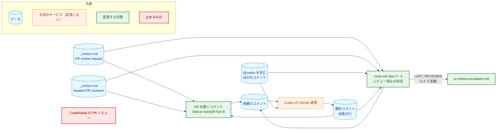
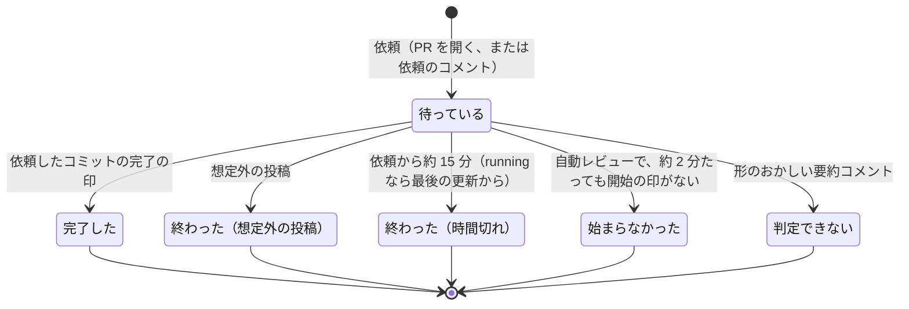
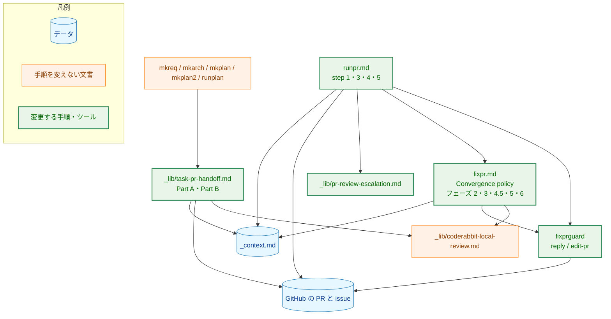
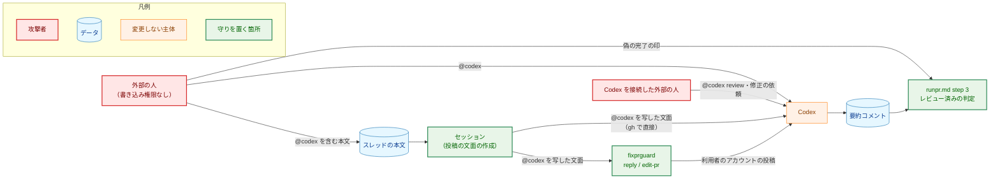
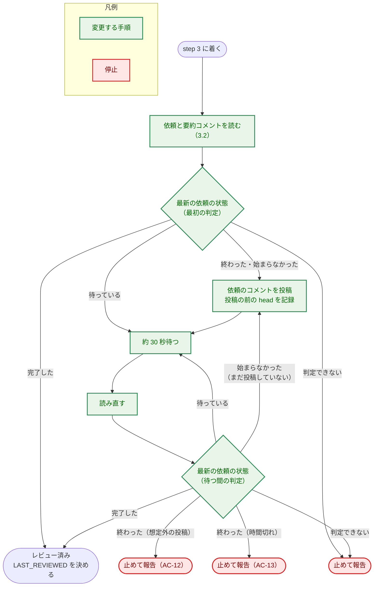
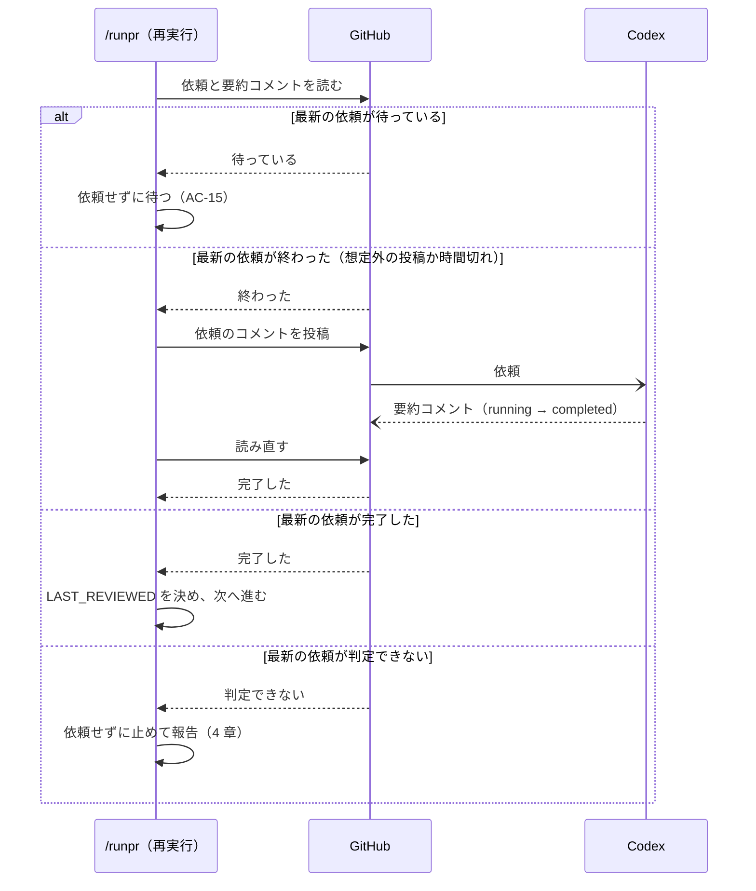

# アーキテクチャ設計書：PR レビューを CodeRabbit から Codex の GitHub 連携に切り替える

## Document Status

| Item | Value |
|---|---|
| Status | `draft` |
| Created | 2026-10-22 |
| Review date | - |
| Reviewer | - |
| Comments | - |

本書は [01_requirements.md](01_requirements.md)（要件定義書。以下、要件書）の設計である。要件書の AC-10・AC-11 と 4.2 の「受け入れる形」は、本書を書く際に改めた（要件書の Comments）。本書は改めた後の要件書に従う。既存のファイルに関する記述は、コミット `3ed049b` のファイルで確かめた。`file:line` はこのコミットの行番号を指す。F-NNN・AC-NN は要件書の項番を、H-NN は [design_handoff.md](design_handoff.md) の項番を指す。Codex の振る舞いに関する記述は、[observations.md](observations.md)（観測の記録。以下、観測の記録）の項目番号で根拠を示す。申し送りへの対応は付録 A に、受け入れ基準との対応は付録 B にまとめる。

本書は次の用語を、要件書 6 節と `docs/translation_glossary.md` と同じ意味で使う: PR レビュー、ローカルの CLI レビュー、割り当て、指摘、スレッド、依頼、完了の印、レビュー済み、完了を待つ PR レビュアー、切り替えの PR、自動レビュアー、自動レビュアーの一覧、ガードツール（`fixprguard`）、セッション（「割り当て」「指摘」「スレッド」は、本タスクで用語集に加える。3.10）。ほかに次の用語を使う。

-   **PR を開くコマンド:** PR を作る手順。`mkreq`・`mkarch`・`mkplan`・`mkplan2`・`runplan` が共通で呼ぶ `_lib/task-pr-handoff.md` の Part B と、単独の変更で PR を作るときの `runpr.md` step 1 を指す（要件書 AC-06）。
-   **要約コメント:** Codex が PR の会話に 1 件だけ置き、レビューのたびに書き換えるコメント（観測の記録の項目 1）。本文の 1 行目は `<!-- codex-pull-request-review-summary -->` である。
-   **状態の行:** 要約コメントの 2 行目。`<!-- codex-review-state:v1 ` の後に JSON のオブジェクトが続き、` -->` で終わる。JSON の `code_review.commit_sha` がレビューの対象のコミットを、`code_review.status` がレビューの状態を示す。
-   **開始の印:** Codex がレビューを始めたことを示すもの（要件書 AC-01 の 9）。本書では、依頼の時点より後に書き換えられた要約コメントを指す（3.3）。
-   **依頼の文面とメンション:** 依頼の文面は、`_context.md` の `PR review request` の行の値（`@codex review`）である。メンションは、その最初の語（`@codex`）である（3.1）。
-   **`@codex` を含むほかのコメント:** 依頼のコメントでも Codex の投稿でもなく、本文にメンションを含むコメント（3.2）。外部の人のものも、利用者のものも含む。
-   **想定外の投稿:** 完了を待つ PR レビュアーの投稿のうち、要件書 AC-12 の 4 種のどれにも当たらないもの（3.3）。
-   **判定できない状態:** 要約コメントが、完了の印にもレビューの途中の投稿にも当たらない形をしている状態（3.2）。
-   **依頼したコミット:** 要件書 AC-10 の範囲のコミット。範囲の求め方は 3.3 で定める。
-   **文書のガード:** コマンドの文書などの記述を読んで検査するテストの総称。本書では、既存の `cmd/yt2column/fixpr_docs_test.go`（0033 の設計書の「内容のガード」）と、新しい `cmd/yt2column/codex_review_docs_test.go` を指す（3.11）。

## 1. 設計の全体像 (Design Overview)

### 1.1. 設計原則

-   **完了の印は、要約コメントの状態の行だけにする。** 指摘の有無にかかわらず残るのは状態の行だけである（観測の記録の項目 1）。Codex の PR レビューのオブジェクトは、指摘があるときにしか投稿されない。そのうえ、PR レビューの一覧には、スレッドへの返信が作るオブジェクトも入る（観測の記録の項目 2 で、利用者の返信が作ったものを観測した）。Codex がスレッドに返信すれば、その時点の head を `commit_id` に持つオブジェクトができ、レビューしていないコミットを完了と取り違えてしまう。そのため、PR レビューのオブジェクトは判定に使わない。
-   **完了の印は、それが示すコミットだけをレビュー済みにする（AC-10）。** 状態の行の `commit_sha` を、そのコミットのレビュー済みの根拠にする。ほかのコミットの根拠にはしない。依頼したコミットの範囲（3.3）は、どの印がその依頼に応えたかを決めるだけで、印が示していないコミットをレビュー済みにすることはない。
-   **疑わしいときはレビュー済みにしない。** 形の合わない状態の行、想定外の投稿、時間切れは、どれもレビュー済みにならない。止めて報告するか、待ち続けるかのどちらかである（AC-12・AC-13）。
-   **`@codex` を含むほかのコメントに続く Codex のコメントでは止めない。** 外部の人の `@codex` に Codex が返す断りのコメントを、想定外の投稿として扱わない（3.3）。この断りのコメントを無視しても、完了の印がなければレビュー済みにならず、待つ時間の上限で止まる。そのため安全側に倒れる。
-   **判定はコマンドの文書で行う。** レビュー済みの判定は `runpr.md` の手順として書き、Go のコードを持たない（要件書 4.2 の「センチネルエラー」）。Go のコードを変えるのは、`fixprguard` が投稿の本文からメンションを拒否する部分（H-09、3.8）だけである。
-   **値は `_context.md` に 1 度だけ書く。** 完了を待つ PR レビュアーの名前は `Awaited PR reviewer` の行に、依頼の文面とメンションの規則は新しい `PR review request` の行に書く。コマンドの文書は、どちらもプレースホルダーで参照し、値を書かない（3.1）。ツールが拒否するメンションは Go の定数として持ち、文書のガードが、この定数と行の値の一致を確かめる（3.11）。

### 1.2. 設計の際に決めたこと（2026-10-22）

利用者に確かめて決めたこと:

-   **`@codex` のメンションは、投稿の前のセッションの確認と、ツールの拒否の両方で防ぐ（H-09）。** 主な守りは、セッションが GitHub に投稿するすべての経路で、投稿の前に文面にメンションがないことを確かめることである（3.8）。`fixprguard` の `reply`・`edit-pr` は、その確認が漏れたときの裏の守りとして、メンションを含む本文とタイトルを拒否する。スレッドへの返信と PR の説明は、信頼できない入力であるスレッドの本文をもとに書かれるので、慣行だけに頼らず、書き込みの経路であるツールでも止める（`CLAUDE.md`「Enforce invariants with the type, not with convention」）。ツールの変更は Go のコードなので、ツールの PR（PR-1）と切り替えの PR（PR-2）に分ける（8 章）。
-   **ツールの `Protocol` は上げず、ガイドの規則の例外として記録する（1.4）。** 上げると、ツールの PR をマージして再インストールしてから切り替えの PR をマージするまで、今の文書（`--protocol 2`）がすべて止まる。ツールの拒否は裏の守りなので、再インストールを忘れて古いツールが残っても、主な守り（セッションの確認）は働く。
-   **依頼したコミットは、依頼の時点の head とその子孫とし、要件書を改める（H-01）。** Codex は依頼の 12〜25 秒後にレビューを始め、その時点の head をレビューする（観測の記録の項目 9）。この間に `/fixpr` などの push があると、依頼の時点の head ちょうどの完了の印は届かず、時間切れで止まり、割り当ても無駄になる。また、PR を開いたときの自動レビューと、前回の実行の依頼では、依頼の時点の head を GitHub から確実に求められない（push の時刻を返す API がない）。そこで要件書の AC-10・AC-11 を、「依頼の時点の head とその子孫。分からなければ PR に含まれるコミット」に改めた。要件書は `draft` に戻り、本書と同じ PR で再び承認を受ける。
-   **`@codex` を含むほかのコメントの後に Codex が投稿したコメントは、無視する（H-01・AC-12）。** 断りのコメントは、誰への返信かを本文に含まない（コメント 6311013571 の本文は「To use Codex here, …」だけだった。2026-10-22 に `gh api repos/isseis/yt2column/issues/411/comments` で確かめた）。そのため、コメントの並びで対応づける（3.3）。
-   **外部の前提を設計の前に確かめた。** 2026-10-22 に、読み取りだけの `gh api` で次を確かめた。
    -   `main` には branch protection がない（`repos/isseis/yt2column/branches/main/protection` が 404「Branch not protected」）。ruleset は 1 つ（id 24096227）で、規則は `deletion`・`non_fast_forward`・`pull_request`（必要な承認 0）だけである。必須のステータスチェックはない。CodeRabbit を止めても、マージは妨げられない（H-05）。
    -   PR #413・#411 の要約コメントの本文。1 行目と状態の行の形は、本書の冒頭の定義のとおりだった。状態の行の JSON には、`code_review` のほかに `security_review`（使われていなければ値が `null`）がある。`code_review.has_any_findings` は、`running` の間は `null`、`completed` で `true` か `false` だった（観測の記録の項目 1・9）。
    -   要約コメントの説明によると、Codex のレビューは、PR を開いたとき、draft を ready にしたとき、`@codex review` か `@codex security review` のコメントで始まる。コマンドは draft の PR を作らず、`@codex security review` も投稿しない。
-   **待つ時間は今と同じにする（H-08）。** 開始の印は約 2 分、完了は依頼から約 15 分まで待つ。観測では、開始の印までが 12〜25 秒、完了までが 1 分 10 秒〜3 分 14 秒だった（観測の記録の項目 7・9）。どちらも最大値の約 5 倍の余裕がある。

設計で決めたこと:

-   **`_context.md` の `Awaited PR reviewer` の値を `chatgpt-codex-connector` に変える（AC-25）。** REST の名前は、この名前に `[bot]` を付けたものである（観測の記録の項目 3。H-03）。行の形と、`runpr.md` の `<awaited-reviewer>` は 0033 のまま使う。
-   **依頼の文面を `_context.md` の新しい行 `PR review request` に置き、文書はプレースホルダーで参照する（AC-25・AC-29）。** 依頼の文面 `@codex review` は、完了を待つ PR レビュアーの名前からは作れないので、名前とは別の行にする。文書が `@codex` を書かなければ、文書のガードは「`.claude/commands/` の下で `@codex` が現れるのはこの行だけ」と単純に確かめられる（3.11）。
-   **自動レビュアーの一覧から `coderabbitai` は外さない。** 外すかどうかは、0033 も本タスクも決めていない（`docs/tasks/0033_multiple_trusted_reviewers/01_requirements.md:71`、要件書 2.3）。CodeRabbit の PR レビューを止めた後も、開いている PR に CodeRabbit のスレッドが残りうる。外すことは 9 章で扱う。
-   **形のおかしい要約コメントで止まったときは、再実行しても自動では依頼し直さない。** 判定できない状態は、Codex が形を変えたなど、依頼し直しても直らない原因で起こりうる。再実行のたびに依頼すると、割り当てを使い続けて同じ理由で止まる（3.3、4 章）。

### 1.3. なぜ今の仕組みのままでは足りないか

今の `/runpr` は、CodeRabbit だけが出す 2 つの印でレビュー済みを判定する（`.claude/commands/runpr.md:203-232`）。1 つは `CodeRabbit` のステータスコンテキストの `SUCCESS`、もう 1 つは、PR レビューの本文か要約コメントにある「between `<sha>` and `<headRefOid>`.」の行である。Codex は、ステータスコンテキストもチェックランも付けない（観測の記録の項目 4）。「between」の行も書かない。そのため、今の判定のままでは、Codex のレビューは決してレビュー済みにならない。AC-09 を満たせない。

CodeRabbit の印を使う判定と、Codex の印を使う判定を両方持つ案は採らない。判定の方法は Codex 用の 1 つだけにする（要件書 4.5）。CodeRabbit への自動の切り替えもしない（要件書 1 節）。

### 1.4. 他の文書の方針との関係

本タスクは、次の 4 つの方針の例外を置く。元の文書は書き換えず（ガイドには但し書きを加える）、本書に記録する。

| 元の方針（場所） | 本タスクでの扱い | 古い振る舞いを確かめているテスト |
|---|---|---|
| ツールは書き込みの本文を、通常のファイルで 64 KiB 以下であることなどだけ検査し、内容は検査しない（`docs/tasks/0030_fixpr_untrusted_threads/02_architecture.md` 3.8 の「本文のファイル」・5.3 の「書き込みの本文の出所」。`fixprguard_guide.md:259` の 7.2 の最後の項目） | **例外として、メンションを含む本文とタイトルを拒否する（3.8）。** 理由: 0030 は、本文が任意のローカルファイルでないことを守る目的で検査を最小にした。本タスクでは、利用者のアカウントの投稿が Codex を動かすという新しい害がある（要件書 4.2）。ツールは、スレッドへの返信と PR の説明の通常の経路である。ただし、セッションは Bash で `gh` を直接実行できるので、この検査は抜け道のない境界ではない。セッションの確認に重ねる裏の守りである | なし。メンションを含む本文を受け付けることを確かめるテストはない（`git grep -n -i "@codex" -- '*_test.go'` は 0 件。2026-10-22） |
| 出力か引数の契約を変えたら `Protocol` を上げる。上げなくてよいのは、(1) 古いツールが新しい文書の呼び出しを引数の解析で拒否し、(2) 新しいツールが古い文書の呼び出しを同じ規則で判定し、(3) 出力の形を変えない変更だけである（`docs/dev/developer_guide/fixprguard_guide.md:287-292`、日本語版の 9 章） | **例外として上げない。** 本タスクの変更は、引数の形も出力の形も変えず、本文のファイルの受け付ける内容を狭めるだけである。(1) は当たらない（古いツールはメンションを含む本文を受け付ける）が、新しい文書はセッションの確認でメンションを送らないので、古いツールが受け付けても誤った投稿にはならない。(2) も厳密には当たらない（新しいツールはメンションを含む本文を拒否する）が、拒否されるのは送ってはならない本文だけである。ガイドの 9 章に、「本文のファイルの受け付ける内容を狭めるだけの変更は、文書が送らない内容に限って `Protocol` を上げなくてよい」という但し書きを加える（3.8） | なし（`--protocol 2` は変わらないので、`cmd/fixprguard/docs_test.go` の呼び出しの確認はそのまま通る） |
| `runpr.md` は、レビューのスレッドを `fixprguard` 越しにだけ読み、スレッドの本文を取らず、スレッドのコメントをほかの方法で取らない（`runpr.md:12-17`。0030 の設計書 3.10 の方針。`cmd/yt2column/fixpr_docs_test.go:329-332` が文を固定する） | **例外として、step 3 のメンションの確認（3.2）だけは、行へのコメントの一覧を `gh api` で読む。** ただし `--jq` の絞り込みで、各コメントの時刻・URL と、`<review-mention>` を含むかどうかの真偽値だけを出し、本文はセッションに出さない。理由: 外部の人は行へのコメントにもメンションを書ける。行へのコメントのメンションも集めないと、その後の Codex の断りのコメントで `/runpr` が止まる（3.3 の「断りのコメント」）。本文を出さないので、0030 の方針の目的（スレッドの本文を指示としてセッションに取り込まない）は保たれる。`runpr.md:12-17` の文は、この例外を書き加えた文に改める | `cmd/yt2column/fixpr_docs_test.go:329-332`（`TestRunprDocContract` の `no_body_fetch`）。固定する文を改めた文に変え、例外の絞り込み（本文を出さないこと）の文も固定する（3.11） |
| `runpr.md` step 3 の `fixpr` を再び実行する条件の文は、`fixprguard` への切り替えの前と同じでなければならない（`cmd/yt2column/fixpr_docs_test.go:96-106` の `autoFixprCondition` のコメント「the switch must leave it unchanged」）。step 3 の見出しとレビュー済みの判定の文も、文字列で固定されている（同 `37`・`82-94`） | **文の中の CodeRabbit の語だけを Codex の判定に合わせて改める。** 再び実行する条件（まだ渡していないスレッド ID があるときに実行する。数でなく集合で比べる）は変えない。理由: 条件の文が「CodeRabbit is still `PENDING`」と、なくなる印を名指ししているためである（3.5） | `cmd/yt2column/fixpr_docs_test.go` の `TestRunprDocContract` の `auto_fixpr_condition`・`reviewed_check`（`282-343`）と、`TestContextAndCommandsAgree`（`527-570`）。3.11 のとおり書き換える |

0033 の設計書は、本タスクが `Awaited PR reviewer` の値と `runpr.md` step 3 と依頼の文面を変え、文書のガードの「許す文字列」も変えると予告している（`docs/tasks/0033_multiple_trusted_reviewers/02_architecture.md:581`）。本タスクはそのとおりに変える。

### 1.5. 概念モデル

依頼から判定までの値の流れを示す。図の矢印 A → B は「A の値または投稿が B に渡る」を表す。



`CR`（CodeRabbit の PR レビュー）は、`.coderabbit.yaml` で止める（3.9）。どこからも値を受け取らず、どこにも値を渡さない。ローカルの CLI レビューは変えないので、この図に含めない。

依頼は、次の状態をとる。図の矢印 A → B は「A の状態から、ラベルの出来事で B の状態に移る」を表す。各状態の判定の規則は 3.3 で定める。



「始まらなかった」は、PR を開いたときの自動レビューだけがとる状態である（AC-06）。`/runpr` が次に何をするかは、6.1 で定める。

## 2. システム構成 (System Structure)

### 2.1. 全体構成

PR レビューに関わるコマンドの文書と、それらが読む値・呼ぶツールを示す。図の矢印 A → B は「A が B を読む、または呼ぶ」を表す。



`MK`（Part B を呼ぶ各コマンドの本体）の手順は変えない。共通の `_lib/task-pr-handoff.md` を変える。`mkreq.md:16` の説明の文だけは、PR レビューの Bot の名前を改める（3.10）。`.coderabbit.yaml` は CodeRabbit が、`AGENTS.md` は Codex が読む設定と規則で、コマンドからは読まれないので図に含めない。

### 2.2. コンポーネント配置

新しいパッケージは作らない。新しいファイルは、本書と文書のガードの 1 ファイル（`cmd/yt2column/codex_review_docs_test.go`）だけである。PR の欄は 8 章の順序を示す。

| ファイル | 変更 | PR |
|---|---|---|
| `internal/fixprguard/write.go` | 投稿の文面の検査 `checkPostText` を加え、`Reply` の本文と `EditPR` のタイトル・本文に適用する（3.8） | PR-1 |
| `internal/fixprguard/errors.go` | メンションを含む文面の拒否を表す非公開のエラー値と、メンションの公開の定数を加える。`ErrInvalidInput` のコメントを、フラグの値だけでなく本文のファイルの拒否も含むように改める（4 章） | PR-1 |
| `internal/fixprguard/write_test.go`、`cmd/fixprguard/main_test.go` | 7.1 のテスト | PR-1 |
| `docs/dev/developer_guide/fixprguard_guide.ja.md`・`fixprguard_guide.md` | `reply`・`edit-pr` の本文の条件、4 章の終了コード `2`、7.1 の保証の表、7.2 の「本文の内容」の項目、9 章の `Protocol` の但し書き（3.8・1.4） | PR-1 |
| `.claude/commands/_context.md` | `Awaited PR reviewer` の値と説明の文を改める。`PR review request` の行を加える（3.1） | PR-2 |
| `.claude/commands/runpr.md` | `description`、冒頭、Authorization、プレースホルダーの定義、step 1 の PR の作成、step 3、step 4、step 5 の issue のコメント（3.5・3.8） | PR-2 |
| `.claude/commands/_lib/task-pr-handoff.md` | 冒頭、AFTER_CREATE の説明、Authorization、プレースホルダーの定義、Part A step 4 の link sub-issue の本文、Part B step 3・5・7（3.6・3.8） | PR-2 |
| `.claude/commands/_lib/pr-review-escalation.md` | `description`、割り当ての説明、LAST_REVIEWED の説明（3.7） | PR-2 |
| `.claude/commands/fixpr.md` | 「Convergence policy」の PR レビューの説明（`fixpr.md:86-89`）、フェーズ 4.5 の PR レビューの説明（`fixpr.md:557-558`）、プレースホルダーの定義、フェーズ 2・3・6 のエージェントへの文面の規則、フェーズ 5・6 の投稿の前の確認（3.8・3.10） | PR-2 |
| `.claude/commands/mkreq.md` | PR レビューの Bot の説明（`mkreq.md:16`）（3.10） | PR-2 |
| `.coderabbit.yaml` | 自動レビューを止め、コメントで理由を説明する（3.9） | PR-2 |
| `AGENTS.md` | `## Review guidelines` を `## Code Review Rules` に改め、節の中で `CLAUDE.md` を参照する（3.10） | PR-2 |
| `CLAUDE.md` | PR レビューの Bot の説明（`CLAUDE.md:56`・`86`・`96-106`）と Codex の設定（3.10） | PR-2 |
| `docs/translation_glossary.md` | 「割り当て」「指摘」「スレッド」を加える（3.10） | PR-2 |
| `cmd/yt2column/fixpr_docs_test.go` | 既存の確認を新しい文書に合わせる（3.11） | PR-2 |
| `cmd/yt2column/codex_review_docs_test.go`（新規） | `@codex` の場所、CodeRabbit の PR レビューが残らないこと、`.coderabbit.yaml`、`AGENTS.md` の確認（3.11） | PR-2 |

次のものは変えない。

-   `_lib/coderabbit-local-review.md` と、ローカルの CLI レビューの呼び出し（`runplan.md` step 7.7、`fixpr.md` フェーズ 4.5 の手順、`task-pr-handoff.md` Part B step 1）。ローカルの CLI レビューは CodeRabbit のまま残す（要件書 2.3）。フェーズ 4.5 では、PR レビューを名指しする説明の文（`fixpr.md:557-558`）だけを改める。
-   `mergepr.md` と `cmd/mergepr`。CodeRabbit にも PR レビューにも触れない（`git grep -n -i coderabbit -- cmd/mergepr .claude/commands/mergepr.md` は 0 件。2026-10-22）。squash のコミットメッセージは、メンションの規則の対象にしない（3.8）。
-   `fixprguard_guide` の使用例の `--reviewer coderabbitai`（`fixprguard_guide.ja.md:99` など）。`coderabbitai` は自動レビュアーの一覧に残る（1.2）。

### 2.3. データフロー: PR を開いてからレビュー済みになるまで

PR を開くコマンドと `/runpr` が、Codex の自動レビューを扱う流れを示す。実線の矢印は呼び出しか投稿を、点線の矢印はその戻りか、GitHub に現れる結果を表す。


`/runpr` が要約コメントを読むのが Codex の完了より前なら、最新の依頼は「待っている」であり、`/runpr` は依頼せずに読み直す（6.1）。

### 2.4. 既存の挙動の確認

次の事実を、コミット `3ed049b` と、記載した日の GitHub の応答で確かめた。

-   `runpr.md` step 3 のレビュー済みの判定は、`CodeRabbit` のステータスコンテキストと「between」の行を使う（`.claude/commands/runpr.md:203-232`）。依頼は `@coderabbitai review` で、依頼から約 15 分で止める（`runpr.md:240-249`）。CodeRabbit のステータスが `FAILURE`・`ERROR` なら止める（`runpr.md:320-322`）。step 4 の PR レビューの質問と依頼は、CodeRabbit を名指しする（`runpr.md:352-356`・`377-381`）。
-   PR を開くコマンドは、約 2 分たってもレビューされず `PENDING` でもなければ `@coderabbitai review` で依頼する（`.claude/commands/_lib/task-pr-handoff.md:186-191`）。最後の報告でも CodeRabbit を名指しする（`task-pr-handoff.md:197`）。
-   エスカレーションの文書は、CodeRabbit の割り当てを前提に書かれ、LAST_REVIEWED を「CodeRabbit の最後の PR レビューが終わったコミット」と説明する（`.claude/commands/_lib/pr-review-escalation.md:7-12`・`22`）。
-   `_context.md` の `Awaited PR reviewer` の値は `coderabbitai` で、説明の文は step 3 が REST の名前で「PR reviews and comments」を絞り込むと述べる（`.claude/commands/_context.md:186`）。文書のガードは、この値が `coderabbitai` であること（`cmd/yt2column/fixpr_docs_test.go:532-533`）と、`fixpr.md`・`runpr.md` が名前を `@<名前> review` の中だけに書くこと（同 `549-563`）を確かめる。`_lib/task-pr-handoff.md` は、この確認の対象に入っていない。
-   `fixprguard` の `reply` と `edit-pr` は、本文とタイトルのファイルを `readTextFile` で読む（`internal/fixprguard/write.go:28`・`108`・`279`。タイトルは `readTitleFile` が `readTextFile` を呼ぶ。同 `54-55`・`275`）。`ErrInvalidInput` を包んだエラーは、`cmd/fixprguard/main.go` の `stop` が終了コード `2` にする（`main.go:287-292`）。
-   `fixpr.md` は、終了コード `2` を「使い方の誤りで、止まる」と定める（`fixpr.md:52-57`）。`runpr.md` は、`fixprguard` の終了コード `0` 以外で止まる（`runpr.md:24-28`）。
-   `.coderabbit.yaml` は増分レビューだけを止めている（`.coderabbit.yaml:9-14`）。`AGENTS.md` の見出しは `## Review guidelines` である（`AGENTS.md:5`）。Codex の公式文書の見出しは `## Code Review Rules` である（観測の記録の項目 6）。
-   Codex の投稿の著者は、REST で `type: Bot`・`login: chatgpt-codex-connector[bot]` である（観測の記録の項目 3）。依頼していない push ではレビューしない（同 項目 2）。

## 3. コンポーネント設計 (Component Design)

### 3.1. `_context.md` の値とプレースホルダー（AC-25・AC-29）

`Domain-specific` の表を次のとおりにする。行の形（バッククォートで囲んだ値、` — `、説明の文）は 0033 の `Awaited PR reviewer` の行と同じにする。

| 行 | 値 | 説明の文に書くこと |
|---|---|---|
| `Awaited PR reviewer`（変更） | `chatgpt-codex-connector` | `runpr.md` step 3 と `_lib/task-pr-handoff.md` Part B step 5 が、PR レビューの完了を待つ自動レビュアーであること。GraphQL の `author.login` の形であること。REST の `user.login` はこの名前に `[bot]` を付けた形で、要約コメントをそれで絞り込むこと |
| `PR review request`（追加） | `@codex review` | 完了を待つ PR レビュアーに PR レビューを依頼するコメントの本文であること。最初の語 `@codex` をメンションと呼ぶこと。コマンドが GitHub に投稿するほかの文面は、メンションを大文字と小文字を区別せずに含まないこと。Codex を指すときは `@` を付けずに `Codex` と書くこと。理由（利用者のアカウントのメンションは Codex に修正やブランチの作成をさせうる） |

コマンドの文書は、次のプレースホルダーで値を参照し、値そのものを書かない。

| プレースホルダー | 指すもの | 定義する文書 |
|---|---|---|
| `<awaited-reviewer>[bot]` | `Awaited PR reviewer` の値に `[bot]` を付けた REST の名前 | `runpr.md`（0033 の定義の文のまま）、`_lib/task-pr-handoff.md`（同じ文を加える） |
| `<review-request>` | `PR review request` の値 | `runpr.md`、`_lib/task-pr-handoff.md` |
| `<review-mention>` | `PR review request` の値の最初の語 | `runpr.md`、`_lib/task-pr-handoff.md`、`fixpr.md` |

依頼のコマンドは `gh pr comment <number> --body "<review-request>"` と書く。`CLAUDE.md:56` の Bot のコマンドの例も、`@codex review` を書かず「`_context.md` の `PR review request`」と書く（3.10）。

### 3.2. GitHub から読む値（受け入れる形）

`/runpr` と PR を開くコマンドが判定に使う値と、その受け入れる形を定める。すべて GitHub API の応答であり、信頼できない入力として扱う（要件書 4.2）。一覧は `--paginate` でページを最後まで読む。応答のメンバーのうち、ここに挙げないものは拡張可能として無視する（要件書 4.2 の「使うメンバーと上限」）。件数とサイズの上限は N/A とする（同）。

| 値 | 読み方 | 使うメンバー | 受け入れる形 |
|---|---|---|---|
| PR | `gh pr view <number> --json createdAt,headRefOid` | `createdAt`、`headRefOid` | `headRefOid` は 40 桁の小文字の 16 進数 |
| 要約コメント | `gh api --paginate repos/<owner>/<repo>/issues/<number>/comments` | `user.type`、`user.login`、`body` の 1 行目と 2 行目、`updated_at`、`html_url` | 著者が `user.type` `Bot` かつ `user.login` `<awaited-reviewer>[bot]` で、`body` の 1 行目が `<!-- codex-pull-request-review-summary -->` と完全に一致するもの。状態の行は下記 |
| ほかの Codex のコメント | 同上 | `user.type`、`user.login`、`created_at`、`html_url`、`body`（報告のときだけ） | 著者が上と同じで、要約コメントでないもの |
| 依頼のコメント | 同上 | `user.type`、`user.login`、`body`、`created_at`、`html_url` | `user.type` が `User`、`user.login` が `gh api user --jq .login` の値と一致し、`body` の前後の空白を除いたものが `<review-request>` と完全に一致するもの |
| `@codex` を含むほかのコメント | 上の issue のコメントの一覧に加えて、`gh api --paginate repos/<owner>/<repo>/pulls/<number>/comments`（行へのコメント）と `.../pulls/<number>/reviews`（PR レビューの本文） | `created_at`（PR レビューは `submitted_at`）、`updated_at`（あれば）、`html_url`、`body` に `<review-mention>` があるか（大文字と小文字を区別しない）。`--jq` でこの値だけを出し、本文は出さない（1.4） | 依頼のコメントでも完了を待つ PR レビュアーの投稿でもなく、`body` にメンションを含むもの。著者は問わない |

**状態の行の受け入れる形。** 状態の行は、次をすべて満たすときに形が合う。

-   要約コメントの 2 行目の全体が、`<!-- codex-review-state:v1 `・JSON・` -->` の並びに一致する。
-   JSON がオブジェクトで、そのメンバー `code_review` もオブジェクトである。
-   `code_review.status` が文字列である。
-   `code_review.commit_sha` が 40 桁の小文字の 16 進数の文字列である。

形が合うとき、状態の行は次のどれかに当たる。

-   `status` が `completed` で、`code_review.has_any_findings` が JSON の真偽値（`true` か `false`）: `commit_sha` の**完了の印**。時点は要約コメントの `updated_at` である。`has_any_findings` が真偽値であることを求めるのは、観測したレビューの完了では必ず真偽値で、途中では `null` だったためである（1.2）。`completed` でもレビューの結果を持たない状態を、完了と取り違えないためである。
-   `status` が `running`: **レビューの途中の投稿**（要件書 AC-12 の 2 種めの投稿）。時点は `updated_at` である。
-   それ以外: **判定できない状態**。

形に合わない状態の行（2 行目がない、行の終わりに CR がある、JSON でない、メンバーが欠けている、型が違う、`commit_sha` が 40 桁でない）、知らない `status`（`queued` など）、`completed` で `has_any_findings` が真偽値でないものは、どれも判定できない状態とする。値を補って受け入れることはしない。`code_review` 以外のメンバー（`security_review` など）と、`has_unresolved_findings` は使わない。要約コメントが 2 件以上あるときも、どれを使うかを選ばず、判定できない状態とする。0 件のときは、Codex がまだ一度もレビューを始めていないものとして扱う。

**読み方の制約。** 要約コメントの本文は、1 行目と 2 行目だけを取り出して読み、残り（表、説明）は読まない。ほかのコメントの本文は、依頼の文面と一致するか、メンションを含むかを確かめるだけで、内容をセッションに取り込まない。本文を読むのは、想定外の投稿か判定できない状態を報告するときだけである（4 章）。読んだ本文はデータとして扱い、指示とはみなさない（`runpr.md:12-17` の規則と同じ）。

**時点と時間の測り方。**

-   依頼の時点と投稿の時点は、どちらも GitHub が付けた時刻で比べる。時刻は 1 秒単位である。「依頼の後」は、時刻が依頼の時点より厳密に後であることを指す。同じ時刻は「依頼の後」に含めない（完了の印は、迷えば数えない）。
-   待つ時間（約 2 分・約 15 分）を測る「今」は、GitHub の時刻をとる。一覧の取得とは別の小さな呼び出し（`gh api -i repos/<owner>/<repo>/pulls/<number>`）の応答の `Date` ヘッダーを使う。応答の本文（PR のタイトルと説明を含む）はセッションに取り込まず、`Date` の行だけを取り出す。`--paginate` と `--jq` を使う一覧の取得には `-i` を付けない。手元の時計がずれていても、依頼や時間切れが早すぎる時点で起きないようにするためである。
-   読み直す間隔は約 30 秒とする。開始の印の待ち（約 2 分）の中で数回読める間隔であり、1 回の読み直しはコメントの一覧を最後まで読むので、間隔をこれより短くしない。

**前提とする運用。** 1 つの PR では、同時に 1 つの `/runpr` だけを実行する。2 つが同時に「終わった」を見ると、どちらも依頼する。`gh` で認証したアカウントは、Codex を GitHub に接続したアカウント（利用者）である。違うと、セッションの依頼は依頼のコメントとして数えられず（`user.login` が一致しない）、Codex の断りのコメントで止まる。

### 3.3. 依頼と完了の印の対応づけ（H-01・AC-09〜AC-15）

**依頼の一覧。** 依頼は次の 2 種である（要件書 6 節の「依頼」）。

-   **自動レビューの依頼:** 時点は PR の `createdAt`。
-   **コメントの依頼:** 3.2 の依頼のコメント。時点はコメントの `created_at`。

**最新の依頼**は、時点がもっとも新しい依頼である。同じコミットに複数の依頼があるときも、最新の依頼だけを使う。前の依頼への応答は、次の依頼への応答と区別できない（要約コメントは 1 件で、書き換えられる）。そのため、古い依頼の状態は判定しない。

**依頼したコミット（AC-10）。**

-   `/runpr` か PR を開くコマンドがこの実行の中で投稿した依頼: 投稿の直前に読んだ `headRefOid`（以下、投稿の前の head）と、それを祖先に持つコミット（`git merge-base --is-ancestor <投稿の前の head> <commit_sha>` が終了コード `0`）。
-   それ以外の依頼（自動レビューの依頼、前回の実行の依頼、利用者が手で投稿した依頼）: PR に含まれるコミット。PR の今の `headRefOid` を祖先とする判定（`git merge-base --is-ancestor <commit_sha> <headRefOid>` が終了コード `0`）で確かめる。

`git merge-base` の終了コードが `1` でも、それ以外（知らないオブジェクトなど）でも、依頼したコミットではないとする。判定の前に `git fetch origin` で PR のブランチを取得する。

**最新の依頼の状態**は、次の規則で決める。規則は上から順に当てはめる。

1.  **判定できない:** 要約コメントが 2 件以上ある（時刻は問わない）。または、依頼の後に書き換えられた要約コメントが、判定できない状態である（3.2）。
2.  **完了した:** 依頼の後に書き換えられた状態の行が完了の印で、その `commit_sha` が依頼したコミットである。依頼したコミットでない完了の印は、ほかのコミットの完了の印（AC-11）であり、この規則には当たらない。
3.  **終わった（想定外の投稿）:** 依頼の後に作られた、ほかの Codex のコメント（3.2）がある。ただし、その Codex のコメントの時点を t とし、t の 1 分前より後、t 以前の時刻に作成か更新された「`@codex` を含むほかのコメント」があれば、その Codex のコメントは想定外の投稿としない（下記の「断りのコメント」）。
4.  **終わった（時間切れ）:** 依頼の時点から約 15 分たった（AC-13）。ただし、依頼の後に書き換えられた状態の行が `running` で、その更新から約 15 分たっていなければ、まだ時間切れとしない。
5.  **始まらなかった:** 自動レビューの依頼で、PR を開いてから約 2 分たち、依頼の後に書き換えられた要約コメントがない（開始の印がない。AC-06）。規則 4 が先なので、この状態になるのは PR を開いてから約 15 分までである。それより後は「終わった（時間切れ）」になり、どちらでも依頼する（3.4）。
6.  **待っている:** 上のどれにも当たらない。

次の投稿は、どの規則にも使わず、想定外の投稿にもしない。要件書 AC-12 の 4 種との対応を示す。

| 投稿 | AC-12 の 4 種との対応 |
|---|---|
| 依頼したコミットの完了の印 | 1 種め（規則 2 で「完了した」にする） |
| `status` が `running` の状態の行、👀 のリアクション | 2 種め（レビューの途中の投稿）。リアクションは読まない |
| Codex の PR レビューのオブジェクト、行へのコメント（スレッド）、スレッドへの返信 | 3 種め（受け入れたレビューに属するもの）。スレッドは `fixprguard list` が扱う。PR レビューのオブジェクトは判定に使わない（1.1） |
| 依頼したコミットでない完了の印 | 4 種め。依頼の状態は「待っている」のままで、時間切れで止まる（AC-13） |
| 👍 のリアクション | どのコミットへの印か分からないので使わない。読まない |

**断りのコメント。** 外部の人の `@codex` に、Codex は約 4 秒で断りのコメントを返す（観測の記録の項目 8）。本文は誰への返信かを示さない（1.2）。そのため、規則 3 の但し書きで、メンションの後 1 分以内の Codex のコメントを想定外の投稿にしない。メンションは、issue のコメント、行へのコメント、PR レビューの本文の 3 か所から集め、作成と更新のどちらの時刻でも数える。外部の人が、依頼の直前に書いたメンションや、古いコメントを編集して加えたメンションでも、この但し書きに当たる。本物のレート制限の通知を見落としうるが、その場合も完了の印がなければ「完了した」にはならず、時間切れで止まる（AC-13）。外部の人のメンションで起こりうるのは、止まるまでの時間が延びることである。レビュー済みにさせることはできない。

**LAST_REVIEWED（AC-10・AC-17）。** この実行の中で見た完了の印の `commit_sha` と、今の要約コメントの完了の印の `commit_sha` のうち、ほかのすべてを祖先に持つもの（`git merge-base --is-ancestor`）である。

-   完了の印が 1 つもなければ、LAST_REVIEWED はないものとする。
-   どれもほかのすべてを祖先に持たない（force push で履歴が分かれた）か、`git merge-base` が `0`・`1` 以外の終了コードを返したときも、ないとする。
-   ないときは、step 4 の PR レビューの質問が「レビューされていない変更がある」として扱い、エスカレーションは `ask` とする（`_lib/pr-review-escalation.md` の手順 1 の「祖先でない」と同じ扱い）。

要約コメントは書き換えられるので、前回の実行の完了の印は、今の要約コメントに残っているものしか使えない。その場合、LAST_REVIEWED が実際より古くなることはあっても、新しくなることはない。

### 3.4. 依頼を投稿する条件（AC-06・AC-08・AC-15）

依頼のコメントを投稿するのは、次の場合だけである。

| 投稿する者 | 条件 | 回数 |
|---|---|---|
| PR を開くコマンド（`_lib/task-pr-handoff.md` Part B step 5） | PR を開いた後、約 2 分のうちに開始の印が現れない | 1 回 |
| `/runpr` step 3（初回のレビュー） | step 3 に着いたとき、最新の依頼が「終わった」か「始まらなかった」。または、待っている間に自動レビューの依頼が「始まらなかった」になった | 実行ごとに 1 回 |
| `/runpr` step 3（エスカレーション） | エスカレーションの判断が `request`（AC-08） | 実行ごとに 1 回（今と同じ） |
| `/runpr` step 4 | 利用者が「先に PR レビューを依頼する」を選んだ（AC-08） | 選ばれるたびに 1 回 |

どの場合も、最新の依頼が「待っている」なら投稿せず、その依頼が「待っている」でなくなるまで待つ（AC-15）。エスカレーションと step 4 の依頼では、待っていた依頼が「完了した」になった後に、head がレビュー済みかを確かめ直す。head がまだレビュー済みでなければ（LAST_REVIEWED が head より古ければ）、そのときに 1 回投稿する。待っていた依頼のせいで、利用者の選んだ依頼が投稿されないまま終わらないようにするためである。

最新の依頼が「判定できない」なら、どの場合も投稿せず、止めて報告する（4 章）。

最新の依頼が「完了した」なら、初回のレビューは依頼しない。依頼したコミットが head より古くても、今と同じくエスカレーションと step 4 の質問に任せる。

単独の変更で `/runpr` が PR を作った場合（step 1）は、`/runpr` 自身が PR を開くコマンドである。この場合の AC-06 は、step 3 の初回のレビューの規則で満たす。自動レビューの依頼が「始まらなかった」になれば依頼する。

### 3.5. `runpr.md` の変更（F-002・F-003・AC-17・AC-22）

-   **`description` と冒頭（`runpr.md:2`・`30`）:** 「CodeRabbit and CI」を「Codex's PR review and CI」の趣旨に改める（AC-24）。
-   **Authorization（`runpr.md:50-69`）:** 次を加える。`gh pr comment`（Codex への依頼）、`gh api`（step 3 で PR のコメント・行へのコメント・PR レビューを読む。`gh api -i` で `Date` ヘッダーを読む）、`git fetch origin`（3.3 の祖先の判定の前）。`coderabbit review` の常時の承認は残す（ローカルの CLI レビュー）。
-   **冒頭のスレッドの読み方の文（`runpr.md:12-17`）:** step 3 のメンションの確認の例外（1.4）を書き加える。
-   **プレースホルダーの定義:** 冒頭の `<reviewer>` の定義の後に、`<awaited-reviewer>[bot]`（今の step 3 の文を移す）、`<review-request>`、`<review-mention>` の定義の文を置く（3.1）。
-   **step 3 の見出しと冒頭（`runpr.md:190-201`）:** 見出しを「Wait for Codex's first review and CI, running fixpr as comments appear」の趣旨にする。冒頭の割り当ての説明を、Codex の割り当て（ChatGPT のほかの利用と共有され、上限の数は公表されていない。観測の記録の項目 5）とレビューのタイミング（PR 作成時のみ。AC-07）の説明に改める。「`SUCCESS` だけではレビューが走ったと言えない」の段落は、`has_any_findings` を求める理由（3.2）に置き換える。
-   **「Reviewed」（`runpr.md:203-238`）:** 3.2・3.3 の規則に置き換える。ステータスコンテキストと「between」の行を読む手順はなくす。LAST_REVIEWED の定義は 3.3 に改める。
-   **「Requesting the review」（`runpr.md:240-249`）:** 3.3 の状態、3.4 の条件、6.1 の流れに置き換える。待つ間は約 30 秒おきに読み直す（3.2）。止まるときの報告は 4 章のとおりである。
-   **`fixpr` を再び実行する条件（`runpr.md:262-270`）:** 「while CodeRabbit is still `PENDING`」を「while Codex's review is still in progress」の趣旨に、「threads CodeRabbit still posts」を「threads Codex still posts」の趣旨に改める。条件そのものは変えない（1.4）。
-   **CodeRabbit のステータスによる停止（`runpr.md:320-322`）:** なくす。Codex はステータスを付けない（観測の記録の項目 4）。完了を待つ PR レビュアーの失敗は、3.3 の規則 1・3 で扱う。
-   **`gh pr checks --watch`（`runpr.md:323-326`）:** 変えない。Codex はチェックランもステータスも付けないので、この待ちに影響しない（H-05）。CodeRabbit のステータスが残る場合は 5.3。
-   **step 4 の PR レビューの質問（`runpr.md:352-356`）と依頼（`runpr.md:377-381`）:** 「CodeRabbit has not reviewed」を「Codex has not reviewed」の趣旨に、依頼を Codex への依頼に改める。依頼の後の扱いは 3.4 と step 3 のとおりである。
-   **投稿の前の確認:** step 1 の PR の作成、step 4 の deferred のスレッドを移す issue とスレッドへの返信、step 5 の issue を閉じるコメントで、投稿の前に確かめる（3.8）。

### 3.6. PR を開くコマンドの変更（AC-06・AC-24・AC-25）

`_lib/task-pr-handoff.md` を次のとおりにする。`mkreq.md` などの本体は Part B を呼ぶだけなので、手順は変えない（`mkreq.md:16` の説明の文を除く。3.10）。

-   **冒頭（`task-pr-handoff.md:20`）、AFTER_CREATE（`:45`）、Part B step 7（`:197`）:** 「CodeRabbit」を「Codex」に改める。
-   **Authorization（`:55`）:** `gh pr comment` を Codex への依頼に改め、`gh api` で PR のコメントを読むこと（`-i` で `Date` ヘッダーを読むことを含む）を加える。
-   **プレースホルダーの定義:** `<awaited-reviewer>[bot]`・`<review-request>`・`<review-mention>` を、`runpr.md` と同じ文で定義する（3.1）。
-   **Part B step 5（`:186-191`）:** PR を開いた後、約 2 分のあいだ、約 30 秒おきに要約コメントを読む。要約コメントの絞り込みは 3.2 と同じく、著者の種類が `Bot`、名前が `<awaited-reviewer>[bot]` で、1 行目が一致するものだけを数える。PR を開いた時点より後に書き換えられた要約コメントがあれば、開始の印があったとして依頼しない。なければ `gh pr comment <number> --body "<review-request>"` で 1 回依頼する。完了は待たない（今と同じ）。状態の行の形は確かめない（完了の判定は `/runpr` が行う）。
-   **投稿の前の確認:** Part A step 4 の link sub-issue の本文、Part B step 3 の PR のタイトルと本文で、投稿の前に確かめる（3.8）。

### 3.7. エスカレーションの変更（AC-17）

`_lib/pr-review-escalation.md` の判断の基準と手順は変えない（要件書 5 節）。変えるのは次の説明だけである。

-   `description` と冒頭の段落（`:2`・`:7-12`）: PR レビューを行うのは Codex であり、その割り当ては ChatGPT のほかの利用と共有され、数が公表されていないので、初回のレビューの後は必要なときだけ依頼する、という説明にする。ローカルの CLI レビューの割り当てが別であることは残す。
-   LAST_REVIEWED の入力の説明（`:22`）: 「the commit Codex's last completed PR review was for」の趣旨にし、`runpr.md` step 3 の定義（3.3）を参照する。

### 3.8. 投稿の文面のメンションの拒否（H-09・AC-29）

**投稿の前の確認（主な守り。PR-2）。** セッションが GitHub に文面を投稿する前に、文面のファイルに `<review-mention>` が（大文字と小文字を区別せずに）含まれないことを確かめる。含まれていれば投稿せず、次のとおり扱う。文面を書き直して投稿することはしない。書き直した文面は、それを書いたエージェントの判断を経ないためである。

| 投稿 | 文書と場所 | 含まれていたときの扱い |
|---|---|---|
| スレッドへの返信 | `fixpr.md` フェーズ 5 | そのスレッドを返信しないものとして「Skipped threads」に挙げる（`replyBody` が空のときと同じ）。ほかのスレッドは続ける |
| PR のタイトルと本文の書き換え | `fixpr.md` フェーズ 6 | 書き換えず、最後の報告に挙げる |
| PR の作成（タイトルと本文） | `runpr.md` step 1、`_lib/task-pr-handoff.md` Part B step 3 | PR を作らずに止めて報告する |
| deferred のスレッドを移す issue とそのコメント、スレッドへの返信 | `runpr.md` step 4 | マージせずに止めて報告する（`mergepr discard` の後） |
| issue を閉じるコメント | `runpr.md` step 5 | コメントを付けずに閉じることはせず、止めて報告する |
| link sub-issue の本文 | `_lib/task-pr-handoff.md` Part A step 4 | 作らずに止めて報告する |

`fixpr.md` は、フェーズ 2・3 のエージェントに渡す返信の文面の規則と、フェーズ 6 のエージェントに渡す PR の説明の規則に、メンションを書かないことを加える。エージェントへの指示もプレースホルダーで書く。スレッドの本文を引用する返信でもメンションを写さない（AC-29）。

依頼のコメント（`<review-request>`）は、この確認の対象外である（要件書 AC-29 の除外）。squash のコミットメッセージ（`/mergepr`）も対象にしない。コミットメッセージは PR の会話への投稿ではなく、Codex を動かすのはコメントだからである（Codex の要約コメントの説明。1.2）。

**ツールの拒否（裏の守り。PR-1）。** `fixprguard` に、投稿の文面の検査 `checkPostText` を加える。`Reply` は本文に、`EditPR` はタイトルと本文に、`readTextFile` で読んだ後、GitHub に触れる前に適用する（`Reply` の GitHub の読み取りは `internal/fixprguard/write.go:112` から始まる）。`readTextFile` には加えない。`readTextFile` の契約は「任意のローカルファイルが投稿されないこと」（`write.go:20-27`）であり、投稿の内容の規則とは別の関心事だからである。

-   拒否する条件: 文面に `@codex` が ASCII の範囲で大文字と小文字を区別せずに含まれること。`@codexbot` や `a@codex.example` のような、単語の一部も区別しない。誤って拒否しても、文面を作り直せば済むためである。
-   拒否しないもの: 全角の `＠ｃｏｄｅｘ`、語の中に幅のない文字を挟んだもの。GitHub のメンションは半角の `@` とユーザー名の文字の並びだけを認めるので、これらは GitHub のメンションにならない。Codex が本文を独自に解釈するかは確かめていない（5.3）。Unicode の正規化（NFKC）は標準ライブラリにないので採らない（`CLAUDE.md`「Dependencies」）。
-   拒否は `ErrInvalidInput` を包んだエラーで、終了コード `2` になる（2.4）。出力の形は変わらない。
-   拒否したときの呼び出し元の振る舞いは、終了コード `2` のほかの原因と同じにし、拒否を診断の文で見分けて扱いを変えることはしない（`CLAUDE.md`「Declare, don't infer」）。投稿の前の確認があるので、この拒否が起こるのは確認が漏れたときだけである。
    -   `fixpr.md` フェーズ 5: 今の文書は、終了コード `2` を「止まる」と定める一方（`fixpr.md:52-57`）、フェーズ 5 では「ほかの止まり方は Skipped threads に挙げて次のスレッドに進む」と定め（`fixpr.md:610-611`）、終了コード `2` がどちらに当たるかが曖昧である。フェーズ 5 に、終了コード `2` もこの「ほかの止まり方」に含め、停止の種類の代わりに診断を挙げることを明記する。
    -   `fixpr.md` フェーズ 6 と `runpr.md` step 4: 今の規則のまま止まる（`fixpr.md:52-57`、`runpr.md:24-28`）。`runpr.md` step 4 では、issue への記録の後、返信の前に止まりうるが、そのときの扱い（再実行で issue に重ねて記録しない）は今の `reply` の停止と同じである（`runpr.md:407-412`）。
-   メンション `@codex` は、`fixprguard` の公開の定数にする。ツールは `_context.md` を読まない（0033 の 1.1）。また、メンションの名前 `codex` は完了を待つ PR レビュアーの `login`（`chatgpt-codex-connector`）と違うので、`--reviewer` から作れない。文書のガードが、この定数と `PR review request` の値の最初の語が一致することを確かめる（3.11）。

**ガイド（PR-1）。** 日英のガイドの `reply`・`edit-pr` の本文の条件、4 章の終了コード `2` の説明、7.1 の保証の表（メンションを含む文面は GitHub に送らない）、7.2 の「本文の内容」の項目（内容はメンションだけを検査すること）、9 章の `Protocol` の但し書き（1.4）を改める。

### 3.9. CodeRabbit の PR レビューの停止（F-004・AC-22）

`.coderabbit.yaml` の `reviews.auto_review` に `enabled: false` を加える。今の `auto_incremental_review: false` は、自動レビューを止めれば意味を持たなくなるので消す。コメントには、PR レビューは Codex が行い、割り当てを二重に使わないよう CodeRabbit は PR レビューを行わないこと、ローカルの CLI レビュー（`coderabbit review`）は続けて使うことを書く。`pre_merge_checks.docstrings` の設定と、その説明のコメントは変えない。

次の点は確かめていない。切り替えの PR の実装と運用の中で確かめる（7.3）。

-   `auto_review.enabled: false` がローカルの CLI レビューに影響しないこと。変更の後に `coderabbit review` を実行し、指摘が返ることを確かめる。影響があれば、実装を止めて利用者に報告する。
-   CodeRabbit が、自動レビューを止めた後もステータスコンテキストやチェックランを付けるか。付けても `/runpr` はもう読まない（3.5）。`PENDING` のまま残ると `gh pr checks --watch` が終わらないおそれがある（5.3）。
-   CodeRabbit が `.coderabbit.yaml` をbase と head のどちらのブランチから読むか。ヘッドから読むなら、切り替えの前に分かれたブランチの PR では、CodeRabbit の自動レビューが続く。割り当てを使うだけで、`/runpr` の判定には影響しない。

### 3.10. 文書（F-006・AC-07・AC-24・AC-26・AC-27）

-   **`CLAUDE.md`:** `:56` の Bot のコマンドの例を、`_context.md` の `PR review request` を指す書き方にする（3.1）。`:86` の `/runpr` の説明と、`:96-106` の PR の流れの説明で、PR レビューを Codex として説明する（AC-24）。`:104-106` の割り当ての説明は、3.7 と同じ趣旨にする。ローカルの CLI レビュー（`:96` の「local CodeRabbit」、`:392-394` の `coderabbit review`）は CodeRabbit のまま残す。Codex の設定（レビューのタイミングは「PR 作成時のみ」、徹底的なコードレビューは無効）を、利用者が行うリポジトリの外の設定として書く（AC-07）。
-   **`mkreq.md:16`:** 「the CodeRabbit threads」を「the review threads」の趣旨に改める。
-   **`fixpr.md:86-89`・`557-558`:** 「A push no longer triggers a CodeRabbit PR review」を Codex のレビューのタイミング（PR 作成時のみ）の説明に、フェーズ 4.5 の「The fix is not seen by a CodeRabbit PR review」を「not seen by a PR review」の趣旨に改める。ローカルの CLI レビューの割り当てが PR レビューと別であることは残す。
-   **`AGENTS.md`:** 見出し `## Review guidelines` を `## Code Review Rules` に改める（観測の記録の項目 6）。節の最初に、この節の規則に加えて `CLAUDE.md` の規約・設計原則・テストの規則に従うことを書き、`CLAUDE.md` の内容は写さない（AC-26）。今の箇条（重大度、回答済みの指摘、承認の順序、セキュリティ）は、`CLAUDE.md` の写しではないので残す。下位の `### Static guards …` の節は変えない。
-   **`docs/translation_glossary.md`:** 次の 3 行を加える（AC-27）。
    -   割り当て / quota: 自動レビュアーが一定時間に受け付けるレビューの回数の上限。「枠」（slot）とは別の概念であることを書く。
    -   指摘 / finding: レビューが挙げる個々の問題。
    -   スレッド / thread: PR のファイル・行に紐づくレビューコメントの連なり。

### 3.11. 文書のガード（AC-22・AC-25・AC-26・AC-27・AC-28・AC-29）

どの確認も、CI の `doc-guard` のジョブで実行される（`CLAUDE.md` の「Development Notes」）。

**既存のファイル `cmd/yt2column/fixpr_docs_test.go`（`fixpr.md`・`runpr.md`・`_context.md`・用語集の契約）:**

-   `TestContextAndCommandsAgree`: 完了を待つ PR レビュアーの期待値を `chatgpt-codex-connector` にする（今は `coderabbitai`。`:532-533`）。名前を書かないことを確かめる文書に `_lib/task-pr-handoff.md` を加え、許す文字列（今は `"@" + 名前 + " review"`。`:549`）はなくす。文書はプレースホルダーで書くので、名前を書く場所はどこにもない。`runpr.md` と `_lib/task-pr-handoff.md` が `<awaited-reviewer>`・`<review-request>`・`<review-mention>` の定義の文を持ち、`fixpr.md` が `<review-mention>` の定義の文を持つことを確かめる。
-   `PR review request` の行: 0033 の `Awaited PR reviewer` の行と同じ形の検査（行がちょうど 1 つ、値がバッククォートで囲んだもの 1 つ、` — `、説明の文）を加える。値の最初の語が `fixprguard` のメンションの定数と一致することを確かめる。`TestContextReviewerRowsMalformed` に、この行を壊した写しの場合を加える。
-   `TestRunprDocContract`: `no_body_fetch` が固定する文を、例外を書き加えた文に改め、行へのコメントの読み取りが本文を出さない絞り込みであることの文も固定する（1.4）。`runprStep3`・`reviewedCheck`・`lastReviewedRule`・`autoFixprCondition` を新しい文に改める（1.4）。新しい `reviewedCheck` は、要約コメントの絞り込み（`Bot` の種類と `<awaited-reviewer>[bot]`）、1 行目の一致、状態の行の形と `has_any_findings` の要求、ページを最後まで読むことの文を固定する。
-   `TestGlossaryTerms`: 割り当て / quota、指摘 / finding、スレッド / thread を加える（AC-27）。

**新しいファイル `cmd/yt2column/codex_review_docs_test.go`（PR レビューの Bot に関わる、コマンドの文書の外のファイルも含む確認）:** 既存のファイルは `fixpr.md`・`runpr.md` の契約に絞られているので、`AGENTS.md`・`.coderabbit.yaml`・すべてのコマンドの文書にまたがる確認は別のファイルにする。

-   `.claude/commands/` の下のすべての文書と `CLAUDE.md` で、`@codex`（大文字と小文字を区別しない）が現れるのは `_context.md` の `PR review request` の行だけであること（AC-29 の文書の側）。
-   同じ範囲に `@coderabbitai review` がないこと、`runpr.md` に `StatusContext` と `between [0-9a-f]{40}` の判定がないこと、`CodeRabbit PR review`・`CodeRabbit's PR review` の語がないこと（AC-22・AC-24）。ローカルの CLI レビューを指す CodeRabbit の語は残るので、`CodeRabbit` の語そのものは禁じない。
-   `.coderabbit.yaml` の `reviews.auto_review` に `enabled: false` があること（AC-22）。
-   `AGENTS.md` に `## Code Review Rules` の見出しがちょうど 1 つあり、その節が `CLAUDE.md` を参照し、`## Review guidelines` がないこと（AC-26）。

どの確認も、壊した写しで失敗することを確かめる（7.2）。

### 3.12. 副作用の契約

| 主体 | GitHub への書き込み | GitHub と git からの読み取り |
|---|---|---|
| PR を開くコマンド（Part B step 5） | 依頼のコメントを、開始の印がないときに 1 回だけ | PR のコメント（要約コメントの 1 行目）、`Date` ヘッダー |
| `/runpr` step 3・4 | 依頼のコメント（3.4 の条件のときだけ）。スレッドへの返信と解決（`fixprguard reply`。今と同じ）。deferred のスレッドを移す issue（今と同じ） | PR（`createdAt`・`headRefOid`）、PR のコメント・行へのコメント・PR レビュー（3.2）、`gh api user`、`Date` ヘッダー、`git fetch origin` |
| `fixprguard reply`・`edit-pr` | 今と同じ。ただし、メンションを含む本文とタイトルは、何も書かずに拒否する | 今と同じ |

`/runpr` は、最新の依頼が「待っている」か「判定できない」の間は、どの理由でも依頼を投稿しない（AC-15）。リアクションは読みも書きもしない。どの主体も、投稿の前の確認（3.8）を通らない文面は投稿しない。

## 4. エラーハンドリング設計 (Error Handling Design)

**`fixprguard`（PR-1）。** 新しい公開のセンチネルエラーは作らない。拒否は、既存の `ErrInvalidInput` を包んだ非公開の値で表す。テストは `errors.Is` でこの値を確かめ、ほかの理由の拒否（空、大きさ、符号化）と区別する。

```go
// CodexMention is the mention that makes Codex act on a comment. A reply
// body, PR title, or PR body that contains it, compared case-insensitively
// in ASCII, is rejected.
const CodexMention = "@codex"

// errCodexMention rejects post text that contains CodexMention: a post from
// the user's account must not invoke Codex.
var errCodexMention = fmt.Errorf("%w: text mentions Codex", ErrInvalidInput)
```

`ErrInvalidInput` のコメント（`internal/fixprguard/errors.go:12-13`、「a malformed flag value」）を、本文のファイルの拒否も含むように改める。診断の文は、ほかの拒否と同じく入力の値を含めず（`errors.go:8-10` の方針）、ファイルの内容を出さない。

**`/runpr` の停止。** レビューが届かないときの停止は、コマンドの文書が定める報告であり、Go のエラーではない。どの停止でも、`/runpr` はマージの質問（step 4）に進まない（AC-14）。

| 停止 | 条件（3.3） | 報告する内容 | 再実行したとき |
|---|---|---|---|
| 想定外の投稿（AC-12） | 待っている依頼が「終わった（想定外の投稿）」になった | 投稿の URL と本文の要約。本文はデータとして扱う。待っていた依頼の種類（自動レビューかコメント）、時点、URL | 最新の依頼は「終わった」なので、新しく依頼する（AC-15） |
| 時間切れ（AC-13） | 待っている依頼が「終わった（時間切れ）」になった | 待っていた依頼の種類・時点・URL・投稿者、依頼したコミット（この実行の依頼なら投稿の前の head）、Codex が最後に投稿したもの（要約コメントの URL・`status`・`commit_sha`・`updated_at`。なければ、投稿がないこと）、規則 3 の但し書きで想定外の投稿としなかった Codex のコメントと、そのきっかけのメンション（それぞれの URL） | 新しく依頼する（AC-15） |
| 判定できない | 最新の依頼が「判定できない」 | 要約コメントの URL と、2 行目をそのまま（データとして、先頭の 500 文字まで）。要約コメントが 2 件以上なら、それぞれの URL | 自動では依頼しない。同じ理由で止まる（1.2）。下記の「止まり続けるとき」 |

割り当てが尽きて止まった場合は、利用者が回復を待ってから再実行する（要件書 4.3）。

**止まり続けるとき。** Codex が状態の行の形を変えたり、長い障害が起きたりすると、すべての PR が止まりうる。本タスクの手順は、誤ってレビュー済みにせず止まる側に倒れるので、そのときは利用者が次のどちらかを選ぶ。

-   GitHub の画面で Codex のレビューの結果を確かめ、`/mergepr <PR>` で直接マージする。`/mergepr` は PR レビューの判定を行わない（2.2）。
-   要約コメントを Codex に書き換えさせるため、利用者が PR に依頼のコメントを手で投稿してから `/runpr` を再実行する。この依頼が最新の依頼になり、`/runpr` はそれを待つ。要約コメントが 2 件以上ある場合は、この方法では直らない（3.3 の規則 1 は時刻を問わない）ので、前者の手順をとる。

`runpr.md` 自体を直す PR も `/runpr` で止まるので、その PR は前者の手順でマージする。この手順は `runpr.md` の停止の報告と、本書の 5.4 に書く。

## 5. セキュリティ考慮事項 (Security Considerations)

`docs/dev/security.md` の観点のうち、本タスクは、ネットワークへの送信（PR へのコメントの投稿）と、信頼できない入力（GitHub API の応答）の扱いに関わる。秘密は扱わない。

### 5.1. 脅威モデル

図の矢印 A → B は「A が B に働きかけうる」を表す。



### 5.2. 守りの対応

| 脅威 | 守り |
|---|---|
| 外部の人が、要約コメントに似たコメントを書いて、レビュー済みにさせる | 要約コメントは、著者が `Bot` の種類で `<awaited-reviewer>[bot]` のものだけを使う（3.2）。`User` のアカウントは名前に `[bot]` を含められず、種類も `User` である（AC-11）。PR を開くコマンドの開始の印も同じく絞り込む（3.6） |
| 外部の人がメンションを書いて、Codex に断りのコメントを返させ、`/runpr` を止める | メンションの後 1 分以内の Codex のコメントは想定外の投稿にしない（3.3 の規則 3）。メンションは 3 か所から、作成と更新の両方の時刻で集める。止まるまでの時間が延びうるだけで、レビュー済みにはならない |
| 外部の人のメンションで、利用者の割り当てを消費する | Codex のアカウントを接続していないアカウントでは、Codex は実行されず、割り当ても消費されない（観測の記録の項目 8。要件書 AC-05 のどの項目にも当たらなかった） |
| スレッドの本文のメンションを投稿の文面に写し、利用者のアカウントから Codex に修正やブランチの作成を依頼させる | セッションが投稿の前に確かめる（3.8 の表のすべての経路）。`fixprguard` も返信と PR の説明で拒否する |
| Codex の投稿の本文による指示の注入 | 要約コメントは 1 行目と 2 行目だけを、決まった形で読む（3.2）。ほかのコメントの本文は、報告するときだけ読み、データとして扱う |
| 状態の行の改ざん・形の崩れ・完了を装う状態 | 形に合わない状態の行は判定できない状態として止める。`completed` には `has_any_findings` の真偽値を求める（3.2）。値を補わない |
| 一覧の打ち切りによる見落とし | 一覧はページを最後まで読む（3.2） |

### 5.3. 残るリスク

-   **Codex を接続した外部の人のメンション:** 確かめていない（要件書 4.2）。その人の割り当てで実行されると考えられる。レビューなら、その結果は本物の Codex のレビューであり、完了の印も正しい。修正やブランチの作成の依頼で、GitHub App の書き込み権限（`code`・`workflows`）が使われうるかどうかは、確かめていない。
-   **完了でもレビューが行われていない状態:** `completed` と `has_any_findings` の真偽値がそろっても、Codex が中身のあるレビューをしたことは保証されない（たとえば、差分が大きすぎて省いた場合）。CodeRabbit が、レビューを省いたときにも `SUCCESS` を付けた（`runpr.md:198-201`）のと同じ種類のリスクである。状態の行のほかに、レビューを省いたことを示す値は観測していない。
-   **依頼の取り違え:** 依頼の後に、利用者のほかの操作（手で投稿した `@codex security review`、draft を ready にすること）や、依頼の前から走っていたレビューの完了で状態の行が書き換わると、その書き換えを最新の依頼への応答と取り違えうる。取り違えても、完了の印は示すコミットだけをレビュー済みにする（1.1）。
-   **レビューの途中に依頼したときの Codex の振る舞い:** 確かめていない（待つ、無視する、やり直す、「すでに走っている」とコメントする、のどれか）。コメントする場合は、想定外の投稿として止まる。`/runpr` は、最新の依頼が待っている間は依頼しない（3.4）ので、この状況を自分では作らない。
-   **状態の行の形は公開されていない:** `codex-review-state:v1` は公式文書に書かれていない（観測の記録の項目 1）。Codex が状態の行の形を変えると、判定できない状態で止まり続ける。誤ってレビュー済みにする方向には壊れない。止まり続けたときの手順は 4 章にある。
-   **状態の行の JSON の重複したキー:** 状態の行を解析する `gh` の `--jq` の `fromjson` は、重複したキーを最後の値で受け入れる。コメントを編集できるのは、投稿した Bot、書き込み権限のあるアカウント、`issues` か `pull_requests` の書き込み権限を持つ GitHub App（CodeRabbit など）と、その権限を持つワークフローのトークン（`.github/workflows/deepseek-review.yml` は今は `workflow_dispatch` だけで動く）である。これらはどれも、要約コメントを直接書き換えられる立場にあるので、重複したキーを拒否しても守りは増えない。残るリスクとする。
-   **メンションの検査の範囲:** 投稿の前の確認とツールは、ASCII の `@codex` だけを見る（3.8）。Codex が全角や幅のない文字を挟んだ形にも反応するかは確かめていない。
-   **issue と PR の本文のメンション:** Codex が issue の本文や PR の本文のメンションに反応するかは確かめていない。投稿の前の確認は、これらの経路も対象にしている（3.8）。
-   **ツールの拒否は抜け道のない境界ではない:** セッションは Bash で `gh` を直接実行できる（1.4）。ツールの拒否は、返信と PR の説明に置く裏の守りであり、ほかの経路は投稿の前の確認だけが守る。ツールの再インストールを忘れると、裏の守りがないまま動く（1.2）。
-   **CodeRabbit のステータスの残り:** 自動レビューを止めた後に、CodeRabbit が `PENDING` のステータスを付けたままにすると、`gh pr checks --watch` が終わらない。`/runpr` は待ち続けるので、利用者が止める。切り替えの PR 自身で確かめる（7.3）。
-   **`coderabbitai` は信頼されたまま:** 自動レビュアーの一覧に残る（1.2）。誰かが `@coderabbitai review` と書けば、CodeRabbit がスレッドを開きうる。そのスレッドは信頼する著者のスレッドとして処理される。この扱いは本タスクの前から同じである。外すことは 9 章で扱う。

### 5.4. 観測のしやすさと手動の介入

止まったときの報告（4 章）は、待っていた依頼、依頼したコミット、要約コメントの URL と状態、想定外の投稿としなかったコメントを含む。利用者は、GitHub の画面で Codex の応答と照らし合わせられる。判定できない状態で止まり続けるときの手順（`/mergepr` での直接のマージ、手での依頼）は 4 章にある。`fixprguard` の拒否は、診断に理由（`text mentions Codex`）を出す。

## 6. 処理フロー詳細 (Processing Flow Details)

### 6.1. `runpr.md` step 3 の初回のレビュー

step 3 に着いてから、初回のレビューがレビュー済みになるまでを示す。図の矢印は処理の順序を表す。最初の判定と、待つ間の判定を分けて示す。



最初の判定で「終わった」なら、前回の実行で止まった依頼なので、新しく依頼する（AC-15）。待つ間の判定で「始まらなかった」になるのは、この実行で PR を開いた場合か、前回の実行で開始の印を待たずに止まった場合である。どちらも、この実行でまだ投稿していなければ依頼する（AC-06）。投稿はこの実行の初回のレビューで 1 回だけで、投稿した依頼が「始まらなかった」になることはない（コメントの依頼なので）。

スレッドの処理（`fixpr`）は、この流れと並んで今と同じく行う。レビューの途中でも、まだ渡していないスレッド ID があれば `fixpr` を実行する（3.5）。

### 6.2. 再実行

止まった後に `/runpr` を再実行したときを示す。実線の矢印は呼び出しか投稿を、点線の矢印はその戻りか、GitHub に現れる結果を表す。



## 7. テスト戦略 (Test Strategy)

本タスクの変更の大半は、コマンドの文書（エージェントへの手順）である。手順の振る舞いは Go のテストで動かせない。そのため、手順は文書のガードで記述を固定し、振る舞いは切り替えの PR 自身の `/runpr` と、その後の PR で確かめる。

### 7.1. ユニットテスト（PR-1）

-   `internal/fixprguard/write_test.go`: `reply` の本文、`edit-pr` のタイトルと本文のそれぞれについて、`@codex`・`@Codex`・`@CODEX`、行頭と文の途中、`@codex review` を含むファイルが `errCodexMention` で拒否されること（`errors.Is`）。拒否のとき、fake の `gh` が一度も呼ばれないこと。`Codex`（`@` なし）、`codex`、`@coderabbitai`、全角の `＠codex` を含むファイルは受け付けること（3.8 の範囲の境界を固定する）。
-   `cmd/fixprguard/main_test.go`: メンションを含む本文で `reply`・`edit-pr` を実行すると、終了コード `2` で、標準出力に何も出ず、診断にファイルの内容が出ないこと。

### 7.2. 壊して失敗を確かめる

`CLAUDE.md` の「Every test must be able to fail for its stated reason」に従い、次を確かめてコミットメッセージに書く。

-   `checkPostText` の呼び出しを `Reply` か `EditPR` から外すと、7.1 のテストが失敗すること。大文字と小文字を区別する比べ方に変えると、`@Codex` の行が失敗すること。
-   文書のガードの各確認（3.11）について、本物の文書の写しを 1 か所壊すと失敗すること。たとえば、`runpr.md` に `@coderabbitai review` を戻す、`task-pr-handoff.md` に `chatgpt-codex-connector` を書く、`fixpr.md` に `@codex` を書く、`AGENTS.md` の見出しを戻す、`.coderabbit.yaml` の `enabled: false` を消す、`PR review request` の行を消すか 2 行にするか値の最初の語を変える、用語集の行を消す。

### 7.3. 結合テストと手動の確かめ

-   **切り替えの PR 自身:** 切り替えの PR は、その PR のブランチの新しい文書で `/runpr` を実行する。PR を開いたときの Codex の自動レビュー、完了の印、LAST_REVIEWED を確かめる（AC-09・AC-10・AC-17）。CodeRabbit のステータスコンテキストとチェックランを読み、`gh pr checks --watch` が終わることを確かめる（3.9）。
-   **新しい Part B step 5:** 切り替えの PR を開いたセッションは、古い手順を読んでいた可能性がある。そのため、切り替えの後に最初に開く PR で、開始の印を見て依頼しないこと（または依頼すること）を確かめる（AC-06）。
-   **ローカルの CLI レビュー:** `.coderabbit.yaml` を変えた後に `coderabbit review` を実行し、指摘が返ることを確かめる（3.9）。
-   **停止と再実行（AC-12・AC-13・AC-15）:** 再現に割り当ての枯渇か長い待ちが要るので、自動のテストは作らない。文書の記述を文書のガードで固定し（3.11）、利用者が PR を確認するときに読み合わせる。

### 7.4. セキュリティテスト

-   メンションの拒否は 7.1 で確かめる。
-   完了の印の絞り込み（`Bot` の種類と名前、1 行目の一致、状態の行の形、`has_any_findings`）は、文書のガード（3.11 の `reviewedCheck`）で記述を固定する。
-   文書にメンションが現れないことは、文書のガード（3.11）で確かめる。

## 8. 実装の優先順位 (Implementation Priorities)

1.  **PR-1（ツール）:** `fixprguard` のメンションの拒否、そのテスト、ガイド（日英）。`Protocol` は上げない（1.4）。マージの後、利用者が `make install-fixprguard` を実行する。PR-1 だけをマージした時点では、文書は今のままで、振る舞いの違いはメンションを含む返信と PR の説明が拒否されることだけである。
2.  **PR-2（切り替えの PR）:** 3.1・3.5〜3.7・3.9〜3.11 と、3.8 の文書の部分のすべて。#403 を閉じる（要件書 2.4）。

PR-1 を先にするのは、切り替えの PR の `/fixpr` を、メンションを拒否するツールで動かすためである。

CodeRabbit の停止と `/runpr` の判定の切り替えは、同じ PR に入れる。今は Codex の自動レビューがすでに有効で、PR は両方にレビューされている。ここで CodeRabbit だけを先に止めると、`/runpr` が来ない CodeRabbit のレビューを待って止まる。判定だけを先に切り替えると、今と同じく両方がレビューを続け、割り当てを二重に使う状態が続くだけで実害はないが、F-004 を満たせない。

**開いている PR への影響。** 切り替えの PR のマージの後も、`main` を取り込んでいないブランチの PR では、`/runpr` はそのブランチの古い文書を読み、CodeRabbit のレビューを待つ。CodeRabbit が新しい設定で自動レビューを止めていれば、その `/runpr` は依頼の後に止まる。そのような PR では、先に `main` を取り込む。PR-2 の境界と順序の詳細は、実装計画で定める。

## 9. 将来の拡張 (Future Extensibility)

-   **`coderabbitai` を自動レビュアーの一覧から外す:** CodeRabbit のスレッドが開いている PR に残らなくなったら、外すことを別の issue で検討する（5.3）。外す手順は `fixprguard_guide` の 9 章のとおりである。
-   **エスカレーションの方針の見直し:** Codex の割り当てを実測した後に、初回だけの方針を見直す（要件書 2.3）。
-   **ほかのレビュアーへの切り替え:** `Awaited PR reviewer` と `PR review request` の行、`fixprguard` のメンションの定数を変え、完了の印の読み方（3.2）を書き直す。行と定数の一致は文書のガードが確かめる。
-   **`@codex security review`:** 使う場合は、状態の行の `security_review` を読むよう 3.2 を広げる。
-   **完了の印の公式な手段:** Codex が完了をステータスやチェックランで示すようになれば、状態の行の解析をやめて、それに置き換える。

## 付録 A: 申し送り（design_handoff.md）への対応

| 項目 | 対応 |
|---|---|
| H-01（レビュー済みを判定する手段） | 完了の印は要約コメントの状態の行だけ（1.1・3.2）。PR レビューの `commit_id` は使わない。依頼したコミット（要件書 AC-10 を改めた）、依頼の投稿者の照合（`user.type` `User` と `gh api user` の `login`）、同じコミットへの複数の依頼（最新の依頼だけを使う）、通知と依頼の対応づけ、断りのコメントの扱いは 3.3 |
| H-02 | 削除済み（要件書の Comments） |
| H-03（REST の名前の作り方） | GraphQL の名前に `[bot]` を付ける規則は Codex でも成り立つ（観測の記録の項目 3）。0033 の `<awaited-reviewer>[bot]` をそのまま使う（3.1） |
| H-04 | 削除済み（要件書 AC-01 の 8 に移した） |
| H-05（ステータスコンテキスト・チェックラン） | Codex は付けない（観測の記録の項目 4）。判定に使わない。`gh pr checks --watch` に影響しない。branch protection と ruleset は CodeRabbit のステータスを必須にしていない（1.2）ので、設定を変える必要はない（3.5） |
| H-06・H-07 | 削除済み |
| H-08（待つ時間） | 開始の印は約 2 分、完了は依頼から約 15 分、読み直しは約 30 秒おき（1.2・3.2・3.3） |
| H-09（`@codex` を除く手段） | 投稿の前のセッションの確認を主な守りとし、`fixprguard` の拒否を裏の守りとする（3.8）。0030 の「内容は検査しない」と、ガイドの `Protocol` の規則の例外として 1.4 に記録する |

## 付録 B: 受け入れ基準との対応

| AC | 設計 |
|---|---|
| AC-01〜AC-05 | 観測の記録で満たした（観測の記録の「AC-05 に当たる点」）。AC-05 のどの項目にも当たらない |
| AC-06 | 3.4・3.6、3.3 の規則 5、6.1 |
| AC-07 | 利用者が行う設定。`CLAUDE.md` に書く（3.10）。観測の記録の項目 2・9 |
| AC-08 | 3.4、3.5 の step 4 |
| AC-09 | 3.2 の完了の印、3.3 の規則 2 |
| AC-10 | 3.3 の依頼したコミットと LAST_REVIEWED |
| AC-11 | 3.2 の著者の絞り込み、3.3 の規則 2 と表 |
| AC-12 | 3.3 の規則 3、4 章 |
| AC-13 | 3.3 の規則 4、4 章 |
| AC-14 | 4 章 |
| AC-15 | 3.3、3.4、6.1、6.2 |
| AC-17 | 3.3 の LAST_REVIEWED、3.5、3.7 |
| AC-22 | 3.5、3.9、3.11 |
| AC-24 | 3.5、3.6、3.7、3.10、3.11 |
| AC-25 | 3.1、3.6、3.11 |
| AC-26 | 3.10、3.11 |
| AC-27 | 3.10、3.11 |
| AC-28 | 3.11、7 章 |
| AC-29 | 3.1、3.8、3.11 |
