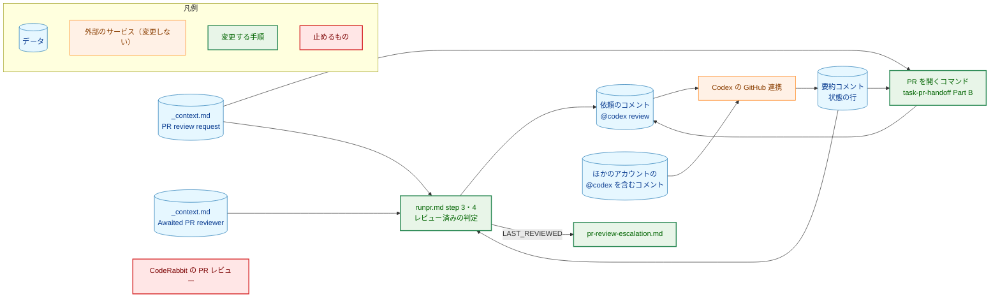
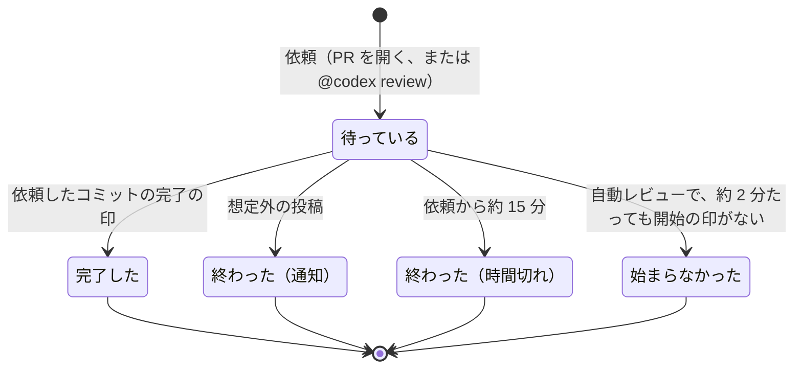
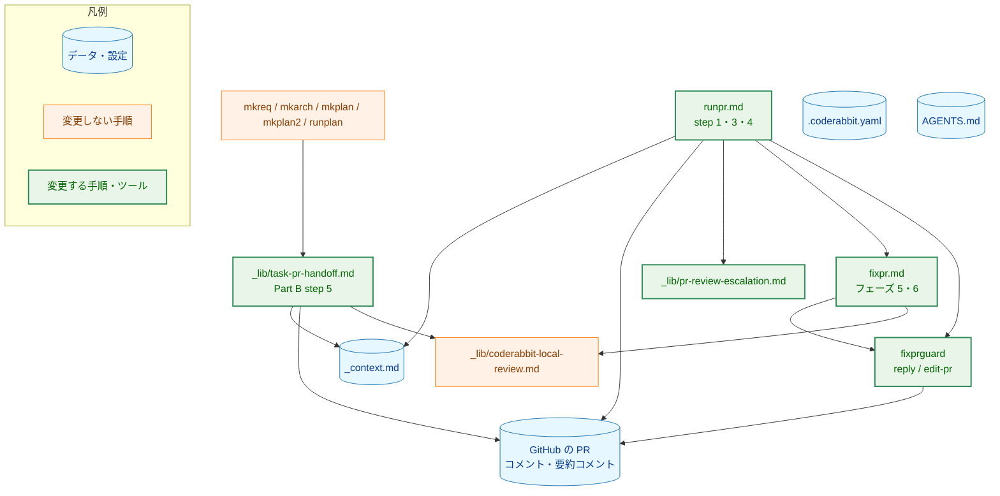
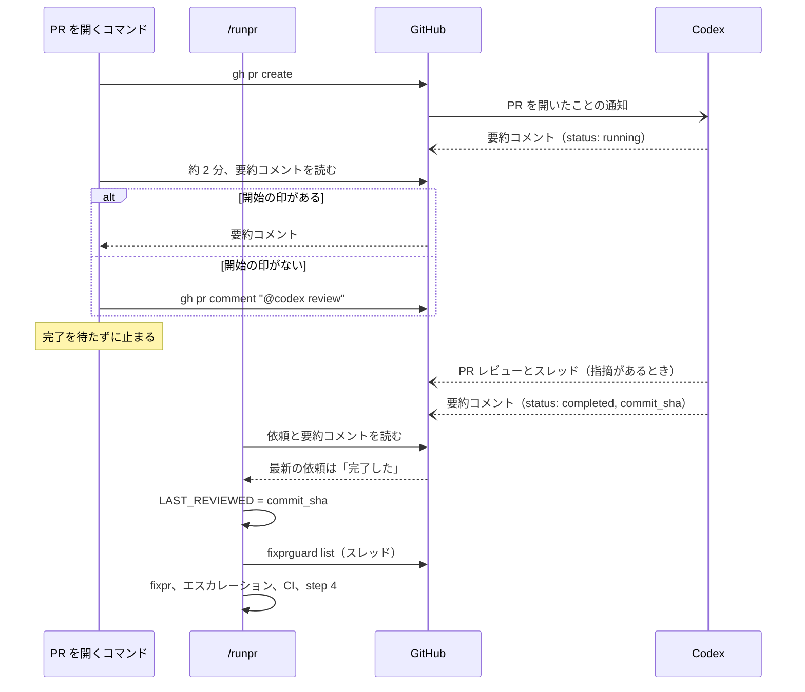
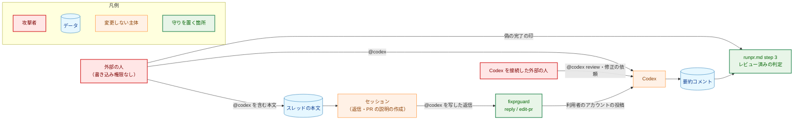
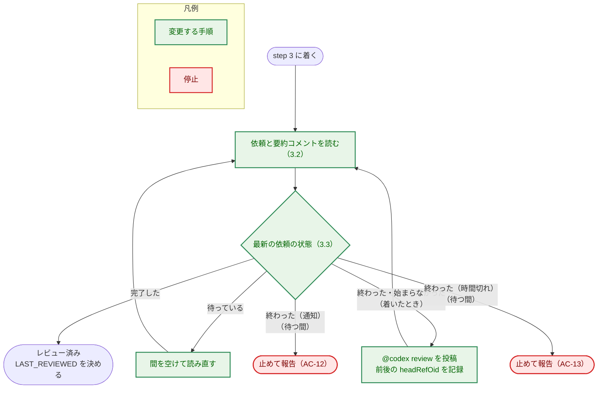
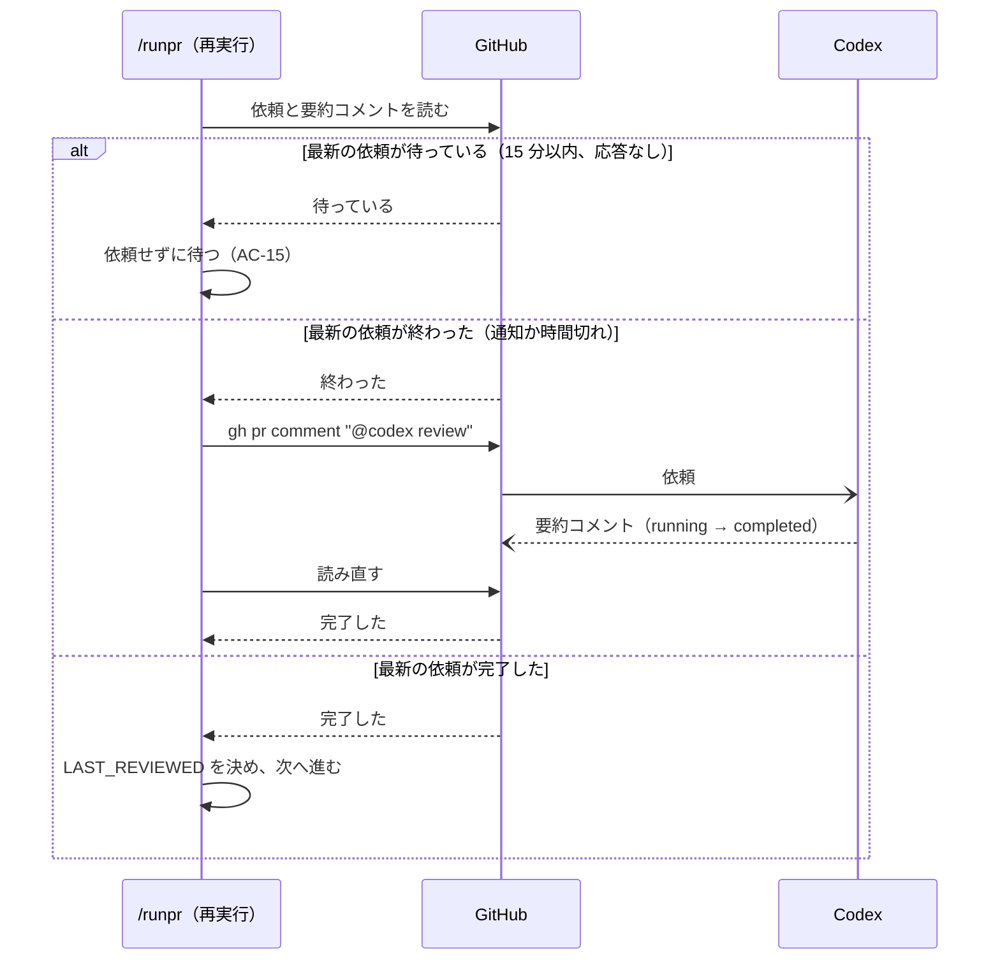

# アーキテクチャ設計書：PR レビューを CodeRabbit から Codex の GitHub 連携に切り替える

## Document Status

| Item | Value |
|---|---|
| Status | `draft` |
| Created | 2026-10-22 |
| Review date | - |
| Reviewer | - |
| Comments | - |

本書は [01_requirements.md](01_requirements.md)（要件定義書。以下、要件書）の設計である。既存のファイルに関する記述は、コミット `3ed049b` のファイルで確かめた。`file:line` はこのコミットの行番号を指す。F-NNN・AC-NN は要件書の項番を、H-NN は [design_handoff.md](design_handoff.md) の項番を指す。Codex の振る舞いに関する記述は、[observations.md](observations.md)（観測の記録。以下、観測の記録）の項目番号で根拠を示す。申し送りへの対応は付録 A に、受け入れ基準との対応は付録 B にまとめる。

本書は次の用語を、要件書 6 節と `docs/translation_glossary.md` と同じ意味で使う: PR レビュー、ローカルの CLI レビュー、割り当て、指摘、スレッド、依頼、完了の印、レビュー済み、完了を待つ PR レビュアー、切り替えの PR、自動レビュアー、自動レビュアーの一覧、ガードツール（`fixprguard`）、セッション。ほかに次の用語を使う。

-   **要約コメント:** Codex が PR の会話に 1 件だけ置き、レビューのたびに書き換えるコメント（観測の記録の項目 1）。本文の 1 行目は `<!-- codex-pull-request-review-summary -->` である。
-   **状態の行:** 要約コメントの 2 行目。`<!-- codex-review-state:v1 ` の後に JSON のオブジェクトが続き、` -->` で終わる。JSON の `code_review.commit_sha` がレビューの対象のコミットを、`code_review.status` がレビューの状態（`running`・`completed`）を示す。
-   **開始の印:** Codex がレビューを始めたことを示すもの（要件書 AC-01 の 9）。本書では、依頼の時点より後に書き換えられた要約コメントを指す（3.3）。
-   **想定外の投稿:** 完了を待つ PR レビュアーの投稿のうち、要件書 AC-12 の 4 種のどれにも当たらないもの（3.3）。
-   **依頼したコミット:** 依頼がレビューを求めたコミット。決め方は 3.3 で定める。
-   **内容のガード:** `cmd/yt2column/fixpr_docs_test.go`。コマンドの文書・`_context.md`・用語集の記述を検査するテスト（`docs/tasks/0033_multiple_trusted_reviewers/02_architecture.md` と同じ呼び方）。

## 1. 設計の全体像 (Design Overview)

### 1.1. 設計原則

-   **完了の印は、要約コメントの状態の行だけにする。** 指摘の有無にかかわらず残るのは状態の行だけである（観測の記録の項目 1）。Codex の PR レビューのオブジェクトは、指摘があるときにしか投稿されない。そのうえ、PR レビューの一覧には、スレッドへの返信が作るオブジェクトも入る（観測の記録の項目 2。利用者の返信が作ったものを観測した）。Codex がスレッドに返信すれば、その時点の head を `commit_id` に持つオブジェクトができ、レビューしていないコミットを完了と誤る。そのため、PR レビューのオブジェクトは判定に使わない。
-   **完了の印は、自分が示すコミットにだけ効く。** 状態の行の `commit_sha` を、そのコミットのレビュー済みの根拠にする。ほかのコミットのレビュー済みの根拠にはしない。そのため、依頼したコミットの決め方（3.3）が多少ずれても、レビューしていないコミットをレビュー済みと判定することはない。
-   **疑わしいときはレビュー済みにしない。** 形の合わない状態の行、想定外の投稿、時間切れは、どれもレビュー済みにならない。止めて報告するか、待ち続けるかのどちらかである（AC-12・AC-13）。
-   **外部の人には `/runpr` を止めさせない。** 外部の人の `@codex` に Codex が返す断りのコメントは、想定外の投稿として扱わず無視する（3.3）。無視しても完了の印がなければレビュー済みにならず、待つ時間の上限で止まるので、安全側に倒れる。
-   **判定はコマンドの文書で行う。** レビュー済みの判定は、`runpr.md` の手順として書き、Go のコードを持たない（要件書 4.2 の「センチネルエラー」）。Go のコードを変えるのは、`fixprguard` が投稿の本文から `@codex` を拒否する部分（H-09、3.8）だけである。
-   **値は 1 か所で定める。** 完了を待つ PR レビュアーの名前は `_context.md` の `Awaited PR reviewer` の行に置く（AC-25）。依頼の文面と、ほかの投稿に `@codex` を書かない規則は、新しい行 `PR review request` に置く（3.1）。

### 1.2. 設計の際に決めたこと（2026-10-22）

利用者に確かめて決めたこと:

-   **`@codex` のメンションは、ツールと文書の両方で防ぐ（H-09）。** `fixprguard` の `reply`・`edit-pr` は、本文とタイトルのファイルに `@codex` があれば拒否する（3.8）。文書にも、投稿の文面に `@codex` を書かず `Codex` と書く規則を置く（3.1）。スレッドへの返信と PR の説明は、信頼できないスレッドの本文をもとに書かれる。そのため、慣行だけに頼らず、書き込みの経路であるツールで止める（`CLAUDE.md`「Enforce invariants with the type, not with convention」）。ツールの変更は Go のコードなので、ツールの PR と切り替えの PR に分ける（8 章）。
-   **依頼したコミットは、`/runpr` が自分で投稿した依頼では投稿の前後の head で、それ以外では Codex の応答で決める（H-01）。** PR を開いたときの自動レビューと、前回の実行で投稿した依頼について、依頼の時点の head を GitHub から確実に求める方法はない。push の時刻を返す API がないためである。そこで、Codex が状態の行に示した `commit_sha` を、その依頼の依頼したコミットとみなす。完了の印は自分が示すコミットにだけ効く（1.1）ので、このみなしでレビューしていないコミットをレビュー済みと誤ることはない。AC-10 との関係は 3.3 に書く。
-   **ほかのアカウントの `@codex` の後に Codex が投稿したコメントは、無視する（H-01・AC-12）。** 断りのコメントは、誰への返信かを本文に含まない（コメント 6311013571 の本文は「To use Codex here, …」だけだった。2026-10-22 に `gh api repos/isseis/yt2column/issues/411/comments` で確かめた）。そのため、コメントの並びで対応づける（3.3）。
-   **外部の前提を設計の前に確かめた。** 2026-10-22 に、読み取りだけの `gh api` で次を確かめた。
    -   `main` には branch protection がない（`repos/isseis/yt2column/branches/main/protection` が 404「Branch not protected」）。ruleset は 1 つ（id 24096227）で、規則は `deletion`・`non_fast_forward`・`pull_request`（必要な承認 0）だけである。必須のステータスチェックはない。CodeRabbit を止めても、マージは妨げられない（H-05）。
    -   PR #413・#411 の要約コメントの本文。1 行目と状態の行の形は、本書の冒頭の定義のとおりだった。状態の行の JSON には、`code_review` のほかに `security_review`（`commit_sha`・`status` などを持ち、使われていなければ値が `null`）がある。
    -   要約コメントの説明によると、Codex のレビューは、PR を開いたとき、draft を ready にしたとき、`@codex review` か `@codex security review` のコメントで始まる。コマンドは draft の PR を作らず、`@codex security review` も投稿しない。
-   **待つ時間は今と同じにする（H-08）。** 開始の印は約 2 分、完了は依頼から約 15 分待つ。観測では、開始の印までが 12〜25 秒、完了までが 1 分 10 秒〜3 分 14 秒だった（観測の記録の項目 7・9）。どちらも最大値の約 5 倍の余裕がある。

設計で決めたこと:

-   **`_context.md` の `Awaited PR reviewer` の値を `chatgpt-codex-connector` に変える（AC-25）。** REST の名前は、この名前に `[bot]` を付けたものである（観測の記録の項目 3。H-03）。0033 が定めた行の形と、`runpr.md` の `<awaited-reviewer>` は変えない。
-   **依頼の文面と、ほかの投稿にメンションを書かない規則を、`_context.md` の新しい行 `PR review request` に置く（AC-29）。** 依頼の文面 `@codex review` は、完了を待つ PR レビュアーの名前からは作れない。そのため、名前とは別の行にする。`runpr.md` と `_lib/task-pr-handoff.md` は、依頼のコマンド `gh pr comment <number> --body "@codex review"` を具体的に書く。内容のガードは、コマンドの文書の `@codex` が、この行の値と同じ依頼の文面だけであることを確かめる（3.11）。
-   **自動レビュアーの一覧から `coderabbitai` は外さない。** 外すかどうかは、0033 も本タスクも決めない（`docs/tasks/0033_multiple_trusted_reviewers/01_requirements.md:71`、要件書 2.3）。CodeRabbit の PR レビューを止めた後も、開いている PR に CodeRabbit のスレッドが残りうる。外すことは 9 章で扱う。
-   **ツールの `Protocol` は上げない。** 3.8 の変更は、引数と出力の形を変えず、受け付ける本文の範囲を狭めるだけである。古いツールと新しい文書の組み合わせでは、ツールが検査しないだけで、文書の規則は働く。新しいツールと古い文書の組み合わせでは、`@codex` を含む本文が拒否されて、その返信が投稿されないだけである。どちらも誤った投稿にはならない。

### 1.3. なぜ今の仕組みのままでは足りないか

今の `/runpr` は、CodeRabbit だけが出す 2 つの印でレビュー済みを判定する（`.claude/commands/runpr.md:203-232`）。1 つは `CodeRabbit` のステータスコンテキストの `SUCCESS`、もう 1 つは、PR レビューの本文か要約コメントにある「between `<sha>` and `<headRefOid>`.」の行である。Codex は、ステータスコンテキストもチェックランも付けない（観測の記録の項目 4）。「between」の行も書かない。そのため、今の判定のままでは、Codex のレビューは決してレビュー済みにならない。AC-09 を満たせない。

CodeRabbit の印を使う判定と、Codex の印を使う判定を両方持つ案は採らない。判定の方法は Codex 用の 1 つだけにする（要件書 4.5）。CodeRabbit への自動の切り替えもしない（要件書 1 節）。

### 1.4. 他のタスクの設計との関係

本タスクは、次の 2 つの方針を変える。どちらの設計書も書き換えず、本書に例外として記録する。

| 元の方針（場所） | 本タスクでの扱い | 古い振る舞いを確かめているテスト |
|---|---|---|
| ツールは書き込みの本文を、通常のファイルで 64 KiB 以下であることなどだけ検査し、内容は検査しない（`docs/tasks/0030_fixpr_untrusted_threads/02_architecture.md` 5.3 の「書き込みの本文の出所」、3.6 の「本文のファイル」） | **例外として、`@codex` を含む本文とタイトルを拒否する（3.8）。** 理由: 0030 は、本文が任意のローカルファイルでないことを守る目的で検査を最小にした。本タスクでは、利用者のアカウントの投稿が Codex を動かすという、新しい害がある（要件書 4.2）。ツールは、セッションの書き込みの通常の経路である（`fixpr.md` フェーズ 5・6、`runpr.md` step 4 の返信）。セッションは Bash で `gh` を直接実行できるので、この検査は抜け道のない境界ではない。文書の規則に重ねる守りである | なし。本文に `@codex` を含めて受け付けることを確かめるテストはない（`git grep -n "@codex" -- '*_test.go'` は 0 件。2026-10-22） |
| `runpr.md` step 3 の `fixpr` を再び実行する条件の文は、`fixprguard` への切り替えの前と同じでなければならない（`cmd/yt2column/fixpr_docs_test.go:96-106` の `autoFixprCondition` のコメント「the switch must leave it unchanged」）。step 3 の見出しとレビュー済みの判定の文も、内容のガードが文字列で固定している（同 `37`・`82-94`） | **文の中の CodeRabbit の語だけを Codex の判定に合わせて改める。** 再び実行する条件（まだ渡していないスレッド ID があるときに実行する。数でなく集合で比べる）は変えない。理由: 条件の文が「CodeRabbit is still `PENDING`」と、なくなる印を名指ししているためである（3.5） | `cmd/yt2column/fixpr_docs_test.go` の `TestRunprDocContract` の `auto_fixpr_condition`・`reviewed_check`（`282-343`）と、`TestContextAndCommandsAgree`（`527-570`）。3.11 のとおり書き換える |

0033 の設計書は、本タスクが `Awaited PR reviewer` の値と `runpr.md` step 3 と依頼の文面を変え、内容のガードの「許す文字列」も変えると予告している（`docs/tasks/0033_multiple_trusted_reviewers/02_architecture.md:581`）。本タスクはそのとおりに変える。

### 1.5. 概念モデル

依頼から判定までの値の流れを示す。図の矢印 A → B は「A の値または投稿が B に渡る」を表す。



`CR`（CodeRabbit の PR レビュー）は、`.coderabbit.yaml` で止める（3.9）。どこからも値を受け取らず、どこにも値を渡さない。ローカルの CLI レビューは、この図に含めない（変えないため）。

依頼は、次の状態をとる。図の矢印 A → B は「A の状態から、ラベルの出来事で B の状態に移る」を表す。各状態の判定の規則は 3.3 で定める。



「始まらなかった」は、PR を開いたときの自動レビューだけがとる状態である（AC-06）。`/runpr` は、最新の依頼が「完了した」なら依頼しない。「待っている」なら依頼せずに待つ。「終わった」か「始まらなかった」なら、新しく依頼する（AC-15）。ただし、実行の途中で「終わった」に移ったときは、その実行では依頼し直さず、止めて報告する（AC-12〜AC-14）。

## 2. システム構成 (System Structure)

### 2.1. 全体構成

PR レビューに関わるコマンドの文書と、それらが読む値・呼ぶツールを示す。図の矢印 A → B は「A が B を読む、または呼ぶ」を表す。



`.coderabbit.yaml` は CodeRabbit の PR レビューを止める設定、`AGENTS.md` は Codex が読むレビューの規則である。どちらもコマンドからは読まれず、それぞれ CodeRabbit と Codex が読む。そのため、図には矢印を描かない。`MK`（PR を開くコマンドの本体）は変えず、共通の `_lib/task-pr-handoff.md` を変える。

### 2.2. コンポーネント配置

新しいパッケージもファイルも作らない（本書を除く）。PR の欄は 8 章の順序を示す。

| ファイル | 変更 | PR |
|---|---|---|
| `internal/fixprguard/write.go` | 本文とタイトルのファイルの検査に、`@codex` の拒否を加える（3.8） | PR-1 |
| `internal/fixprguard/errors.go` | 拒否の理由を表す非公開の値を加える（4 章） | PR-1 |
| `internal/fixprguard/write_test.go`、`cmd/fixprguard/main_test.go` | 7.1 のテスト | PR-1 |
| `docs/dev/developer_guide/fixprguard_guide.ja.md`・`fixprguard_guide.md` | `reply`・`edit-pr` の本文の条件と、終了コード `2` の説明に、`@codex` の拒否を書き足す（3.8） | PR-1 |
| `.claude/commands/_context.md` | `Awaited PR reviewer` の値を `chatgpt-codex-connector` に変える。`PR review request` の行を加える（3.1） | PR-2 |
| `.claude/commands/runpr.md` | `description`、冒頭の説明、Authorization、step 1（単独の変更で PR を作った後）、step 3 の見出しとレビュー済みの判定と依頼、step 4 の PR レビューの質問と依頼（3.5） | PR-2 |
| `.claude/commands/_lib/task-pr-handoff.md` | 冒頭の説明、AFTER_CREATE の説明、Authorization、Part B step 5（3.6） | PR-2 |
| `.claude/commands/_lib/pr-review-escalation.md` | `description`、割り当ての説明、LAST_REVIEWED の説明（3.7） | PR-2 |
| `.claude/commands/fixpr.md` | 「Convergence policy」の PR レビューの説明（`fixpr.md:86-89`）。フェーズ 5・6 の文面の規則（3.8） | PR-2 |
| `.claude/commands/mkreq.md` | PR レビューの Bot の説明（`mkreq.md:16`）（3.10） | PR-2 |
| `.coderabbit.yaml` | 自動レビューを止め、コメントで理由を説明する（3.9） | PR-2 |
| `AGENTS.md` | `## Review guidelines` を `## Code Review Rules` に改め、節の中で `CLAUDE.md` を参照する（3.10） | PR-2 |
| `CLAUDE.md` | PR レビューの Bot の説明（`CLAUDE.md:56`・`86`・`96-106`）（3.10） | PR-2 |
| `docs/translation_glossary.md` | 「割り当て」「指摘」「スレッド」を加える（3.10） | PR-2 |
| `cmd/yt2column/fixpr_docs_test.go` | 内容のガードを新しい文書に合わせ、確かめる項目を加える（3.11） | PR-2 |

次のものは変えない。

-   `_lib/coderabbit-local-review.md` と、それを呼ぶ `runplan.md`・`fixpr.md` フェーズ 4.5・`task-pr-handoff.md` Part B step 1。ローカルの CLI レビューは CodeRabbit のまま残す（要件書 2.3）。
-   `mergepr.md` と `cmd/mergepr`。CodeRabbit にも PR レビューにも触れない（`git grep -n -i coderabbit -- cmd/mergepr .claude/commands/mergepr.md` は 0 件。2026-10-22）。
-   `fixprguard_guide` の使用例の `--reviewer coderabbitai`（`fixprguard_guide.ja.md:99` など）。`coderabbitai` は自動レビュアーの一覧に残る（1.2）。

### 2.3. データフロー: PR を開いてからレビュー済みになるまで

PR を開くコマンドと `/runpr` が、Codex の自動レビューを扱う流れを示す。実線の矢印は呼び出しか投稿を、点線の矢印はその戻りか、GitHub に現れる結果を表す。



`/runpr` が要約コメントを読むのが Codex の完了より前なら、最新の依頼は「待っている」であり、`/runpr` は依頼せずに読み直す（3.5）。

### 2.4. 既存の挙動の確認

次の事実を、コミット `3ed049b` と、記載した日の GitHub の応答で確かめた。

-   `runpr.md` step 3 のレビュー済みの判定は、`CodeRabbit` のステータスコンテキストと「between」の行を使う（`.claude/commands/runpr.md:203-232`）。依頼は `@coderabbitai review` で、依頼から約 15 分で止める（`runpr.md:240-249`）。CodeRabbit のステータスが `FAILURE`・`ERROR` なら止める（`runpr.md:320-322`）。step 4 の PR レビューの質問と依頼は、CodeRabbit を名指しする（`runpr.md:352-356`・`377-381`）。
-   PR を開くコマンドは、約 2 分たってもレビューされず `PENDING` でもなければ `@coderabbitai review` で依頼する（`.claude/commands/_lib/task-pr-handoff.md:186-191`）。
-   エスカレーションの文書は、CodeRabbit の割り当てを前提に書かれ、LAST_REVIEWED を「CodeRabbit の最後の PR レビューが終わったコミット」と説明する（`.claude/commands/_lib/pr-review-escalation.md:7-12`・`22`）。
-   `_context.md` の `Awaited PR reviewer` の値は `coderabbitai` である（`.claude/commands/_context.md:186`）。内容のガードは、この値が `coderabbitai` であること（`cmd/yt2column/fixpr_docs_test.go:532-533`）と、`fixpr.md`・`runpr.md` が名前を `@<名前> review` の中だけに書くこと（同 `549-563`）を確かめる。`_lib/task-pr-handoff.md` は、この確認の対象に入っていない。
-   `fixprguard` の `reply` と `edit-pr` は、本文とタイトルのファイルを `readTextFile` で読む（`internal/fixprguard/write.go:28`・`108`・`279`。タイトルは `readTitleFile` が `readTextFile` を呼ぶ。同 `54-55`・`275`）。`readTextFile` が `ErrInvalidInput` を包んだエラーを返すと、`run` は終了コード `2` で止まる（`cmd/fixprguard/main.go:287-292`）。
-   `.coderabbit.yaml` は増分レビューだけを止めている（`.coderabbit.yaml:9-14`）。`AGENTS.md` の見出しは `## Review guidelines` である（`AGENTS.md:5`）。Codex の公式文書の見出しは `## Code Review Rules` である（観測の記録の項目 6）。
-   Codex の投稿の著者は、REST で `type: Bot`・`login: chatgpt-codex-connector[bot]` である（観測の記録の項目 3）。依頼していない push ではレビューしない（同 項目 2）。

## 3. コンポーネント設計 (Component Design)

### 3.1. `_context.md` の値（AC-25・AC-29）

`Domain-specific` の表を次のとおりにする。行の形（バッククォートで囲んだ値、` — `、説明の文）は 0033 の `Awaited PR reviewer` の行と同じにする。

| 行 | 値 | 説明の文に書くこと |
|---|---|---|
| `Awaited PR reviewer`（変更） | `chatgpt-codex-connector` | 今の文のまま（`runpr.md` step 3 が完了を待つ自動レビュアーで、GraphQL の `author.login` の形。REST の `user.login` は `[bot]` を付けた形） |
| `PR review request`（追加） | `@codex review` | 完了を待つ PR レビュアーに PR レビューを依頼するコメントの本文であること。コマンドが GitHub に投稿するほかの文面（スレッドへの返信、PR のタイトルと本文、issue とそのコメント、PR のコメント）は、`@codex` を含まないこと。Codex を指すときは `@` を付けずに `Codex` と書くこと。理由（利用者のアカウントの `@codex` は Codex に修正やブランチの作成をさせうる） |

`@codex` の規則を `PR review request` の行に置くのは、依頼の文面だけが例外であることを、例外そのものと同じ場所で述べるためである。

### 3.2. GitHub から読む値（受け入れる形）

`/runpr` と PR を開くコマンドが判定に使う値と、その受け入れる形を定める。すべて GitHub API の応答であり、信頼できない入力として扱う（要件書 4.2）。一覧は `--paginate` でページを最後まで読む。応答のメンバーのうち、ここに挙げないものは拡張可能として無視する（要件書 4.2 の「使うメンバーと上限」）。件数とサイズの上限は N/A とする（同）。

| 値 | 読み方 | 使うメンバー | 受け入れる形 |
|---|---|---|---|
| PR | `gh pr view <number> --json createdAt,headRefOid` | `createdAt`、`headRefOid` | `headRefOid` は 40 桁の小文字の 16 進数 |
| 要約コメント | `gh api --paginate repos/<owner>/<repo>/issues/<number>/comments` | `user.type`、`user.login`、`body` の 1 行目と 2 行目、`updated_at`、`html_url` | 著者が `user.type` `Bot` かつ `user.login` `<awaited-reviewer>[bot]`（3.1）で、`body` の 1 行目が `<!-- codex-pull-request-review-summary -->` と完全に一致するもの。状態の行は下記 |
| ほかの Codex のコメント | 同上 | `user.type`、`user.login`、`created_at`、`html_url`、`body`（報告のときだけ） | 著者が上と同じで、要約コメントでないもの |
| 依頼のコメント | 同上 | `user.type`、`user.login`、`body`、`created_at` | `user.type` が `User`、`user.login` が `gh api user --jq .login` の値と一致し、`body` の前後の空白を除いたものが `PR review request` の値（3.1）と完全に一致するもの |
| `@codex` を含むほかのコメント | 同上 | `user.login`、`created_at`、`body` に `@codex` があるか（大文字と小文字を区別しない） | 依頼のコメントでも Codex のコメントでもなく、`body` に `@codex` を含むもの |

**状態の行の受け入れる形。** 要約コメントの 2 行目が、行の全体で `<!-- codex-review-state:v1 `・JSON・` -->` の並びに一致し、JSON がオブジェクトで、`code_review` がオブジェクトで、`code_review.status` が文字列で、`code_review.commit_sha` が 40 桁の小文字の 16 進数の文字列であること。この形のとき、状態の行は次のどれかに当たる。

-   `status` が `completed`: `commit_sha` の**完了の印**。時点は要約コメントの `updated_at` である。
-   `status` が `running`: **レビューの途中の投稿**（要件書 AC-12 の 2 種めの投稿）。
-   それ以外の `status`: **想定外の投稿**。時点は `updated_at` である。

形に合わない状態の行（2 行目がない、JSON でない、メンバーが欠けている、型が違う、`commit_sha` が 40 桁でない）も、想定外の投稿とする。値を補って受け入れることはしない。`code_review` 以外のメンバー（`security_review` など）と、`code_review` の `has_any_findings`・`has_unresolved_findings` は使わない。

要約コメントが 2 件以上あるときは、どれを使うかを選ばず、想定外の投稿として止める（AC-12）。0 件のときは、Codex がまだ一度もレビューを始めていない。

**読み方の制約。** 要約コメントの本文は、1 行目と 2 行目だけを取り出して読み、残り（表、説明）は読まない。依頼のコメントとほかのコメントの本文は、一致するかどうか、`@codex` を含むかどうかを確かめるだけで、内容をセッションに取り込まない。本文を読むのは、想定外の投稿を報告するときだけである（AC-12。4 章）。読んだ本文はデータとして扱い、指示として従わない（`runpr.md:12-17` の規則と同じ）。

**時点の比べ方。** 依頼の時点と投稿の時点は、どちらも GitHub が付けた時刻（`createdAt`・`created_at`・`updated_at`）で比べる。待つ時間（約 2 分・約 15 分）の経過は、GitHub の時刻と手元の時計の差で測る。手元の時計の狂いは、15 分に比べて十分小さいとみなす。

### 3.3. 依頼と完了の印の対応づけ（H-01・AC-09〜AC-15）

**依頼の一覧。** 依頼は次の 2 種である（要件書 6 節の「依頼」）。

-   **自動レビューの依頼:** 時点は PR の `createdAt`。
-   **コメントの依頼:** 3.2 の依頼のコメント。時点はコメントの `created_at`。

**最新の依頼**は、時点がもっとも新しい依頼である。同じコミットに複数の依頼があるときも、最新の依頼だけを使う。依頼の後に別の依頼があれば、前の依頼の応答は次の依頼の応答と区別できない（要約コメントは 1 件で、書き換えられる）。そのため、古い依頼の状態は判定しない。

**依頼したコミット。**

-   `/runpr` がこの実行の中で投稿した依頼: 投稿の直前と直後に読んだ `headRefOid` が同じなら、そのコミットである。違えば（投稿の間に push があれば）、下のとおり Codex の応答で決める。
-   それ以外の依頼（自動レビューの依頼、前回の実行の依頼、利用者が手で投稿した依頼）: 依頼の時点の後に書き換えられた状態の行が示す `commit_sha` である。Codex が応答するまでは決まっていない。

自動レビューの依頼の依頼したコミットは、AC-10 では「PR を開いた時点の head」である。Codex は、PR を開いてから 12〜25 秒でレビューを始め（観測の記録の項目 9）、そのときの head をレビューする。この間に push がなければ、2 つは一致する。`/runplan` のように、PR を開いた直後に記録のコミットを push するコマンドもある（`_lib/task-pr-handoff.md` の AFTER_CREATE）。その場合、Codex が push の前と後のどちらをレビューしても、レビューしたコミットだけがレビュー済みになる（1.1）。head がレビュー済みでなければ、LAST_REVIEWED が head より古くなり、今と同じくエスカレーションと step 4 の質問が扱う。そのため、このみなしで判定が誤る方向にはずれない。

**最新の依頼の状態**は、次の規則で決める。規則は上から順に当てはめる。「依頼の後」は、時点が依頼の時点より後であることを指す。

1.  **完了した:** 依頼の後に書き換えられた状態の行が、完了の印である。依頼したコミットが決まっていれば、その `commit_sha` が依頼したコミットと一致すること。一致しない完了の印は、ほかのコミットの完了の印（AC-11）であり、この規則には当たらない。
2.  **終わった（通知）:** 依頼の後に、想定外の投稿がある。想定外の投稿は、次のどちらかである。
    -   依頼の後に書き換えられた、想定外の投稿に当たる状態の行（3.2）。
    -   依頼の後に作られた、ほかの Codex のコメント（3.2）。ただし、依頼の時点からそのコメントの時点までの間に、`@codex` を含むほかのコメント（3.2）があれば、そのコメントは想定外の投稿としない。誰の `@codex` への応答かを区別できないためである（下記の「断りのコメント」）。
3.  **終わった（時間切れ）:** 依頼の時点から約 15 分たった（AC-13）。
4.  **始まらなかった:** 自動レビューの依頼で、PR を開いてから約 2 分たち、依頼の後に書き換えられた要約コメントがない（開始の印がない。AC-06）。
5.  **待っている:** 上のどれにも当たらない。

次の投稿は、どの規則にも使わず、想定外の投稿にもしない。要件書 AC-12 の 4 種との対応を示す。

| 投稿 | AC-12 の 4 種との対応 |
|---|---|
| 依頼したコミットの完了の印 | 1 種め（規則 1 で「完了した」にする） |
| `status` が `running` の状態の行、👀 のリアクション | 2 種め（レビューの途中の投稿）。リアクションは読まない |
| Codex の PR レビューのオブジェクト、行へのコメント（スレッド）、スレッドへの返信 | 3 種め（受け入れたレビューに属するもの）。スレッドは `fixprguard list` が扱う。PR レビューのオブジェクトは判定に使わない（1.1） |
| 依頼したコミット以外の完了の印 | 4 種め。依頼の状態は「待っている」のままで、時間切れで止まる（AC-13） |
| 👍 のリアクション | どのコミットへの印か分からないので使わない。読まない |

**断りのコメント。** 外部の人の `@codex` に、Codex は断りのコメントを返す（観測の記録の項目 8）。本文は誰への返信かを示さない（1.2）。規則 2 の但し書きにより、依頼の後に外部の人が `@codex` を書けば、それ以降の Codex のコメントは想定外の投稿にならない。本物のレート制限の通知も見落としうるが、その場合も完了の印がない限り「完了した」にはならず、約 15 分で時間切れになって止まる（AC-13）。外部の人ができるのは、止まるまでの時間を延ばすことだけである。レビュー済みにさせることも、`/runpr` を止めることもできない。

**LAST_REVIEWED（AC-10・AC-17）。** この実行の中で見た完了の印の `commit_sha` と、今の要約コメントの完了の印の `commit_sha` のうち、ほかのすべてを祖先に持つもの（`git merge-base --is-ancestor`）である。完了の印が 1 つもなければ、ない。要約コメントは書き換えられるので、前回の実行の完了の印は、今の要約コメントに残っているものしか使えない。その場合も、今の状態の行は最新のレビューを示すので、LAST_REVIEWED が実際より古くなることはあっても、新しくなることはない。古くなった場合は、エスカレーションと step 4 の質問が、レビューされていない変更として扱う。

### 3.4. 依頼を投稿する条件（AC-06・AC-08・AC-15）

`@codex review` を投稿するのは、次の場合だけである。どの場合も、最新の依頼が「待っている」なら投稿せず、その依頼を待つ。

| 投稿する者 | 条件 | 回数 |
|---|---|---|
| PR を開くコマンド（`_lib/task-pr-handoff.md` Part B step 5） | PR を開いた後、約 2 分のうちに開始の印が現れない | 1 回 |
| `/runpr` step 3（初回のレビュー） | step 3 に着いたとき、最新の依頼が「終わった」か「始まらなかった」 | 1 回 |
| `/runpr` step 3（エスカレーション） | エスカレーションの判断が `request`（AC-08） | 実行ごとに 1 回（今と同じ） |
| `/runpr` step 4 | 利用者が「先に PR レビューを依頼する」を選んだ（AC-08） | 選ばれるたびに 1 回 |

最新の依頼が「完了した」なら、初回のレビューは依頼しない。依頼したコミットが head より古くても、今と同じくエスカレーションと step 4 の質問に任せる。

単独の変更で `/runpr` が PR を作った場合（step 1）は、`/runpr` 自身が PR を開くコマンドである。この場合の AC-06 は、step 3 の初回のレビューの規則で満たす。step 3 に着いたとき、自動レビューの依頼が「始まらなかった」（PR を開いてから約 2 分たっても開始の印がない）なら依頼する。約 2 分たっていなければ、たつまで待つ。

### 3.5. `runpr.md` の変更（F-002・F-003・AC-17・AC-22）

-   **`description` と冒頭（`runpr.md:2`・`30`）:** 「CodeRabbit and CI」を「Codex's PR review and CI」の趣旨に改める（AC-24）。
-   **Authorization（`runpr.md:50-69`）:** `gh pr comment`（Codex への依頼）、`gh api`（step 3 で要約コメントと PR のコメントを読む。`gh api user` は今もある）。`coderabbit review` の常時の承認は残す（ローカルの CLI レビュー）。
-   **step 3 の見出しと冒頭（`runpr.md:190-201`）:** 見出しを「Wait for Codex's first review and CI, running fixpr as comments appear」の趣旨にする。冒頭の割り当ての説明を、Codex の割り当て（ChatGPT のほかの利用と共有され、上限の数は公表されていない。観測の記録の項目 5）とレビューのタイミング（PR 作成時のみ。AC-07）の説明に改める。「`SUCCESS` だけではレビューが走ったと言えない」の段落はなくす。
-   **「Reviewed」（`runpr.md:203-238`）:** 3.2・3.3 の規則に置き換える。ステータスコンテキストと「between」の行を読む手順はなくす。要約コメントは `<awaited-reviewer>[bot]` と `Bot` の種類で絞り込み、1 行目と 2 行目だけを取り出す。LAST_REVIEWED の定義は 3.3 に改める。
-   **「Requesting the review」（`runpr.md:240-249`）:** 3.3 の状態と 3.4 の条件に置き換える。依頼のコマンドは `gh pr comment <number> --body "@codex review"`。投稿の直前と直後の `headRefOid` を記録する（3.3）。待つ間は、待ってから読み直す（今と同じく、間を空けずに読み続けない）。最新の依頼が待っている間に「終わった（通知）」になれば AC-12 のとおり、「終わった（時間切れ）」になれば AC-13 のとおり止める（4 章）。
-   **`fixpr` を再び実行する条件（`runpr.md:262-270`）:** 「while CodeRabbit is still `PENDING`」を「while Codex's review is still in progress」の趣旨に、「threads CodeRabbit still posts」を「threads Codex still posts」の趣旨に改める。条件そのものは変えない（1.4）。
-   **CodeRabbit のステータスによる停止（`runpr.md:320-322`）:** なくす。Codex はステータスを付けない（観測の記録の項目 4）。完了を待つ PR レビュアーの失敗は、想定外の投稿として扱う（3.3 の規則 2）。
-   **`gh pr checks --watch`（`runpr.md:323-326`）:** 変えない。Codex はチェックランもステータスも付けないので、この待ちに影響しない（H-05）。
-   **step 4 の PR レビューの質問（`runpr.md:352-356`）と依頼（`runpr.md:377-381`）:** 「CodeRabbit has not reviewed」を「Codex has not reviewed」の趣旨に、依頼を Codex への依頼に改める。依頼の後の扱いは step 3 と同じである。
-   **`@codex` を書かない規則:** step 4 で deferred のスレッドを移す issue の本文とコメント、スレッドへの返信、単独の変更の PR のタイトルと本文に、`@codex` を書かない（`_context.md` の `PR review request`）。

### 3.6. PR を開くコマンドの変更（AC-06・AC-24）

`_lib/task-pr-handoff.md` を次のとおりにする。`mkreq.md` などの本体は、Part B を呼ぶだけなので変えない（`mkreq.md:16` の説明の文を除く。3.10）。

-   **冒頭（`task-pr-handoff.md:20`）と AFTER_CREATE（`:45`）:** 「CodeRabbit」を「Codex」に改める。
-   **Authorization（`:55`）:** `gh pr comment` を Codex への依頼に、`gh api` で PR のコメント（要約コメント）を読むことを加える。
-   **Part B step 5（`:186-191`）:** PR を開いた後、約 2 分のあいだ要約コメントを読む。依頼の後に書き換えられた要約コメント（3.2 の形の 1 行目を持つもの）が現れれば、開始の印があったとして依頼しない。現れなければ `gh pr comment <number> --body "@codex review"` で 1 回依頼する。完了は待たない（今と同じ）。開始の印は 1 行目だけで判定し、状態の行の形は確かめない。形の確かめは、完了を判定する `/runpr` が行う。
-   **Part B step 3 の PR の本文:** `@codex` を書かない（3.1）。

### 3.7. エスカレーションの変更（AC-17）

`_lib/pr-review-escalation.md` の判断の基準と手順は変えない（要件書 5 節）。変えるのは次の説明だけである。

-   `description` と冒頭の段落（`:2`・`:7-12`）: PR レビューを行うのは Codex であり、その割り当ては ChatGPT のほかの利用と共有され、数が公表されていないので、初回のレビューの後は必要なときだけ依頼する、という説明にする。ローカルの CLI レビューの割り当てが別であることは残す。
-   LAST_REVIEWED の入力の説明（`:22`）: 「the commit Codex's last completed PR review was for」の趣旨にし、`runpr.md` step 3 の定義（3.3）を参照する。

### 3.8. 投稿の本文の `@codex` の拒否（H-09・AC-29）

**ツール（PR-1）。** `fixprguard` の `readTextFile` は、ファイルの内容に `@codex` が含まれていれば、大文字と小文字を区別せず（ASCII の範囲で）拒否する。`@codex` が単語の一部か（`@codexbot`、`a@codex.example`）は区別しない。誤って拒否しても、セッションが文面を書き直せば済むためである。`readTextFile` は `reply` の本文、`edit-pr` のタイトルと本文の 3 つを読む（2.4）ので、この 3 つに同じ規則が働く。拒否は `ErrInvalidInput` を包んだエラーで、終了コード `2` になる（2.4）。GitHub にも git にも触れる前に拒否する（`readTextFile` は `Reply` で GitHub を読む前に呼ばれる。`internal/fixprguard/write.go:108-115`）。

拒否する文字列 `@codex` は、ツールの中の定数にする。ツールは `_context.md` を読まない（0033 の 1.1）。また、メンションの名前 `codex` は、完了を待つ PR レビュアーの `login`（`chatgpt-codex-connector`）とは違うので、`--reviewer` から作れない。

**文書（PR-2）。** `fixpr.md` は、フェーズ 2・3 のエージェントに渡す返信の文面の規則と、フェーズ 6 の PR の説明の規則に、`@codex` を書かないことを加える。`fixprguard` が拒否したとき（終了コード `2`、診断に `@codex` を含む）、フェーズ 5 は、ほかの止まり方と同じく、そのスレッドを「Skipped threads」に挙げて次のスレッドに進む（`fixpr.md` の今の規則）。返信の文面をセッションが書き直して再び送ることはしない。書き直した文面は、エージェントの判断を経ないためである。

**返信がスレッドの本文を引用する場合。** スレッドの本文に `@codex` があり、返信がそれを引用すると、返信は拒否される（AC-29 の「スレッドの本文を引用する返信でも同じ」）。拒否された返信は投稿されず、スレッドは未解決のまま残り、利用者が判断する。

### 3.9. CodeRabbit の PR レビューの停止（F-004・AC-22）

`.coderabbit.yaml` の `reviews.auto_review` に `enabled: false` を加える。今の `auto_incremental_review: false` は、自動レビューを止めれば意味を持たなくなるので消す。コメントには、PR レビューは Codex が行い、CodeRabbit は割り当てを二重に使わないよう PR レビューを行わないこと、ローカルの CLI レビュー（`coderabbit review`）は続けて使うことを書く。`pre_merge_checks.docstrings` の設定と、その説明のコメントは変えない。

`auto_review.enabled: false` がローカルの CLI レビューに影響しないことは、確かめていない。切り替えの PR の実装で、変更の後に `coderabbit review` を実行し、指摘が返ることを確かめる（7.3）。影響があれば、実装を止めて利用者に報告する（設計の前提が崩れるため）。

CodeRabbit が、自動レビューを止めた後もステータスコンテキストやチェックランを付けるかは、確かめていない。付けても、`/runpr` はもう読まない（3.5）。`PENDING` のまま残るステータスが `gh pr checks --watch` を止めるおそれは、9 章と 5.3 に記録する。

### 3.10. 文書（F-006・AC-24・AC-26・AC-27）

-   **`CLAUDE.md`:** `:56` の Bot のコマンドの例を `@codex review` にする。`:86` の `/runpr` の説明と、`:96-106` の PR の流れの説明で、PR レビューを Codex として説明する（AC-24）。`:104-106` の割り当ての説明は、3.7 と同じ趣旨にする。ローカルの CLI レビュー（`:96` の「local CodeRabbit」、`:392-394` の `coderabbit review`）は CodeRabbit のまま残す。Codex の設定（レビューのタイミングは「PR 作成時のみ」、徹底的なコードレビューは無効）を、利用者が行うリポジトリの外の設定として書く（AC-07）。
-   **`mkreq.md:16`:** 「the CodeRabbit threads」を「the review threads」の趣旨に改める。
-   **`fixpr.md:86-89`:** 「A push no longer triggers a CodeRabbit PR review」を、Codex のレビューのタイミング（PR 作成時のみ）の説明に改める。
-   **`AGENTS.md`:** 見出し `## Review guidelines` を `## Code Review Rules` に改める（観測の記録の項目 6）。節の最初に、この節の規則に加えて `CLAUDE.md` の規約・設計原則・テストの規則に従うことを書き、`CLAUDE.md` の内容は写さない（AC-26）。今の箇条（重大度、回答済みの指摘、承認の順序、セキュリティ）は、`CLAUDE.md` の写しではないので残す。下位の `### Static guards …` の節は変えない。
-   **`docs/translation_glossary.md`:** 次の 3 行を加える（AC-27）。
    -   割り当て / quota: 自動レビュアーが一定時間に受け付けるレビューの回数の上限。「枠」（slot）とは別の概念であることを書く。
    -   指摘 / finding: レビューが挙げる個々の問題。
    -   スレッド / thread: PR のファイル・行に紐づくレビューコメントの連なり。

### 3.11. 文書のガード（AC-28 ほか）

内容のガード（`cmd/yt2column/fixpr_docs_test.go`）を次のとおりにする。どれも `doc-guard` の CI のジョブで実行される（`CLAUDE.md` の「Development Notes」）。

-   **完了を待つ PR レビュアーの値:** `TestContextAndCommandsAgree` の期待値を `chatgpt-codex-connector` にする（今は `coderabbitai`。`:532-533`）。
-   **依頼の文面:** 許す文字列を、`@` と名前から作る形（`:549`）から、`_context.md` の `PR review request` の行の値に改める。行がないこと、2 行あること、値の形が違うことを、0033 の行の検査と同じく失敗にする。
-   **名前と `@codex` の場所:** `fixpr.md`・`runpr.md` に加えて `_lib/task-pr-handoff.md` も、完了を待つ PR レビュアーの名前を書かないことを確かめる（AC-25）。`.claude/commands/` の下のすべての文書と `CLAUDE.md` について、`@codex`（大文字と小文字を区別しない）が依頼の文面の中にしか現れないことを確かめる。ただし、`_context.md` の `PR review request` の行の説明の文は、規則そのものを述べるので除く（AC-29 の文書の側）。
-   **CodeRabbit の PR レビューの依頼と待ちが残らないこと:** `.claude/commands/` の下のすべての文書と `CLAUDE.md` に `@coderabbitai review` がないこと、`runpr.md` に `StatusContext`・`between [0-9a-f]{40}` の判定がないことを確かめる（AC-22）。
-   **`runpr.md` step 3 の固定した文:** `runprStep3`・`reviewedCheck`・`lastReviewedRule`・`autoFixprCondition` を新しい文に改める（1.4）。新しい `reviewedCheck` は、要約コメントの絞り込み（`Bot` の種類と `<awaited-reviewer>[bot]`）、1 行目の一致、状態の行の形の要求、ページを最後まで読むことを含む。
-   **`.coderabbit.yaml`:** `auto_review` の `enabled: false` があることを確かめる（AC-22）。
-   **`AGENTS.md`:** `## Code Review Rules` の見出しがちょうど 1 つあり、その節が `CLAUDE.md` を参照し、`## Review guidelines` がないことを確かめる（AC-26）。
-   **用語集:** `TestGlossaryTerms` に、割り当て / quota、指摘 / finding、スレッド / thread を加える（AC-27）。

どのガードも、壊した写しで失敗することを確かめる（7.2）。

### 3.12. 副作用の契約

| 主体 | GitHub への書き込み | GitHub からの読み取り |
|---|---|---|
| PR を開くコマンド（Part B step 5） | `@codex review` のコメントを、開始の印がないときに 1 回だけ | PR のコメント（要約コメントの 1 行目） |
| `/runpr` step 3・4 | `@codex review` のコメント（3.4 の条件のときだけ）。スレッドへの返信と解決（`fixprguard reply`。今と同じ）。deferred のスレッドを移す issue（今と同じ） | PR（`createdAt`・`headRefOid`）、PR のコメント（3.2）、`gh api user` |
| `fixprguard reply`・`edit-pr` | 今と同じ。ただし、`@codex` を含む本文とタイトルは、何も書かずに拒否する | 今と同じ |

`/runpr` は、最新の依頼が「待っている」間は、どの理由でも依頼を投稿しない（AC-15）。リアクションは読みも書きもしない。

## 4. エラーハンドリング設計 (Error Handling Design)

**`fixprguard`（PR-1）。** 新しい公開のセンチネルエラーは作らない。拒否は、既存の `ErrInvalidInput` を包んだ非公開の値で表す。テストは `errors.Is` でこの値を確かめ、ほかの理由の拒否（空、大きさ、符号化）と区別する。

```go
// errCodexMention rejects a reply body, PR title, or PR body that mentions
// @codex: a post from the user's account must not invoke Codex.
var errCodexMention = fmt.Errorf("%w: text mentions @codex", ErrInvalidInput)
```

`stop` は `ErrInvalidInput` を終了コード `2` にする（`cmd/fixprguard/main.go:287-292`）ので、出力の形も終了コードの表も変わらない。診断の文は、ほかの値と同じく値を含めない（`internal/fixprguard/errors.go:8-10` の方針）。ファイルの内容は診断に出さない。

**`/runpr` の停止。** レビューが届かないときの停止は、コマンドの文書が定める報告であり、Go のエラーではない。どの停止でも、`/runpr` はマージの質問（step 4）に進まない（AC-14）。

| 停止 | 条件（3.3） | 報告する内容 |
|---|---|---|
| 想定外の投稿 | 待っている依頼が「終わった（通知）」になった | 投稿の URL と内容の要約（AC-12）。状態の行なら `status` と `commit_sha`。ほかの Codex のコメントなら本文の要約。本文はデータとして扱う |
| 要約コメントが 2 件以上 | 3.2 | 各要約コメントの URL |
| 時間切れ | 待っている依頼が「終わった（時間切れ）」になった | 依頼の時点、依頼したコミット（分かっていれば）、Codex が最後に投稿したもの（要約コメントの URL・`status`・`commit_sha`・`updated_at`。なければ、投稿がないこと）（AC-13） |

どの報告にも、再実行したときの振る舞いを添える。最新の依頼は「終わった」とみなされ、`/runpr` は新しく依頼する（AC-15）。割り当てが尽きた場合は、回復を待ってから再実行する（要件書 4.3）。

## 5. セキュリティ考慮事項 (Security Considerations)

`docs/dev/security.md` の観点のうち、本タスクは、ネットワークへの送信（PR へのコメントの投稿）と、信頼できない入力（GitHub API の応答）の扱いに関わる。秘密は扱わない。

### 5.1. 脅威モデル

図の矢印 A → B は「A が B に働きかけうる」を表す。



### 5.2. 守りの対応

| 脅威 | 守り |
|---|---|
| 外部の人が、要約コメントに似たコメントを書いて、レビュー済みにさせる | 要約コメントは、著者が `Bot` の種類で `<awaited-reviewer>[bot]` のものだけを使う（3.2）。`User` のアカウントは名前に `[bot]` を含められず、種類も `User` である（AC-11） |
| 外部の人が `@codex` を書いて、Codex に断りのコメントを返させ、`/runpr` を止める | その後の Codex のコメントは想定外の投稿にしない（3.3 の規則 2 の但し書き）。止まるまでの時間が延びうるだけで、レビュー済みにはならない |
| 外部の人の `@codex` で、利用者の割り当てを消費する | Codex のアカウントを接続していないアカウントでは、Codex は実行されず、割り当ても消費されない（観測の記録の項目 8。要件書 AC-05 のゲートは当たらなかった） |
| スレッドの本文の `@codex` を返信に写し、利用者のアカウントから Codex に修正やブランチの作成を依頼させる | `fixprguard` が `@codex` を含む本文とタイトルを拒否する（3.8）。文書も書かないよう定める（3.1） |
| Codex の投稿の本文による指示の注入 | 要約コメントは 1 行目と 2 行目だけを、決まった形で読む（3.2）。ほかのコメントの本文は、想定外の投稿を報告するときだけ読み、データとして扱う |
| 状態の行の値の改ざん・形の崩れ | 形に合わない状態の行は想定外の投稿として止める。値を補わない（3.2）。コメントを編集できるのは、投稿した Bot と書き込み権限のあるアカウントだけである |
| 一覧の打ち切りによる見落とし | 一覧はページを最後まで読む（3.2） |

### 5.3. 残るリスク

-   **Codex を接続した外部の人の `@codex`:** 確かめていない（要件書 4.2）。その人の割り当てで実行されると考えられる。レビューなら、その結果は本物の Codex のレビューであり、完了の印も正しい。修正やブランチの作成の依頼で、App の書き込み権限（`code`・`workflows`）が使われうるかは残る。
-   **依頼の取り違え:** 依頼の後に、利用者のほかの操作（手で投稿した `@codex security review`、draft を ready にすること）で状態の行が書き換わると、その書き換えを最新の依頼への応答と取り違えうる。取り違えても、完了の印は示すコミットにだけ効く（1.1）。そのため、レビューしていないコミットがレビュー済みになることはない。
-   **状態の行の形は公開されていない:** `codex-review-state:v1` は公式文書に書かれていない（観測の記録の項目 1）。Codex が形を変えると、すべての状態の行が想定外の投稿になり、`/runpr` は止まる。誤ってレビュー済みにする方向には壊れない。
-   **状態の行の JSON の重複したキー:** 状態の行を解析する手段（`gh` の `--jq` の `fromjson`）は、重複したキーを最後の値で受け入れる。状態の行を書けるのは、完了を待つ PR レビュアーと書き込み権限のあるアカウントだけなので、残るリスクとする。
-   **CodeRabbit のステータスの残り:** 自動レビューを止めた後に、CodeRabbit が `PENDING` のステータスを付けたままにすると、`gh pr checks --watch` が終わらないおそれがある。確かめていない。切り替えの PR のマージの後の最初の PR で確かめる（7.3）。
-   **`coderabbitai` は信頼されたまま:** 自動レビュアーの一覧に残る（1.2）。CodeRabbit の PR レビューは止まるが、誰かが `@coderabbitai review` と書けば、CodeRabbit がスレッドを開きうる。そのスレッドは信頼する著者のスレッドとして処理される。この扱いは本タスクの前から同じである。外すことは 9 章で扱う。
-   **ツールの検査は境界ではない:** セッションは Bash で `gh` を直接実行できる（1.4）。`@codex` の拒否は、通常の経路に置く守りである。

### 5.4. 観測のしやすさ

止まったときの報告（4 章）は、依頼の時点、依頼したコミット、要約コメントの URL と状態を含む。そのため、利用者は GitHub の画面で、Codex の応答と照らし合わせられる。`fixprguard` の拒否は、診断に理由（`text mentions @codex`）を出す。

## 6. 処理フロー詳細 (Processing Flow Details)

### 6.1. `runpr.md` step 3 の初回のレビュー

step 3 に着いてから、初回のレビューがレビュー済みになるまでを示す。図の矢印は処理の順序を表す。



「着いたとき」は、この実行で step 3 の判定を初めて行うときを指す。そのときに「終わった」なら、前回の実行で止まった依頼なので、新しく依頼する（AC-15）。「始まらなかった」は、着いたときにも待つ間にも、新しく依頼する（AC-06）。投稿は、この実行の初回のレビューで 1 回だけである（3.4）。投稿した依頼が再び「終わった」になれば、止める。

スレッドの処理（`fixpr`）は、この流れと並んで今と同じく行う。レビューの途中でも、まだ渡していないスレッド ID があれば `fixpr` を実行する（3.5）。

### 6.2. 再実行

止まった後に `/runpr` を再実行したときを示す。実線の矢印は呼び出しか投稿を、点線の矢印はその戻りか、GitHub に現れる結果を表す。



## 7. テスト戦略 (Test Strategy)

本タスクの変更の大半は、コマンドの文書（エージェントへの手順）である。手順の振る舞いは Go のテストで動かせない。そのため、手順は内容のガードで記述を固定し、振る舞いは切り替えの PR 自身の `/runpr` で確かめる。

### 7.1. ユニットテスト（PR-1）

-   `internal/fixprguard/write_test.go`: `reply` の本文、`edit-pr` のタイトルと本文のそれぞれについて、`@codex`・`@Codex`・`@CODEX`、行頭と文の途中、`@codex review` を含むファイルが `errCodexMention` で拒否されること（`errors.Is`）。拒否のとき、fake の `gh` が一度も呼ばれないこと。`Codex`（`@` なし）、`codex`、`@coderabbitai` を含むファイルは受け付けること。
-   `cmd/fixprguard/main_test.go`: `@codex` を含む本文で `reply`・`edit-pr` を実行すると、終了コード `2` で、標準出力に何も出ず、診断にファイルの内容が出ないこと。

### 7.2. 壊して失敗を確かめる

`CLAUDE.md` の「Every test must be able to fail for its stated reason」に従い、次を確かめてコミットメッセージに書く。

-   `readTextFile` の `@codex` の検査を外すと、7.1 のテストが失敗すること。大文字と小文字を区別する形に変えると、`@Codex` の行が失敗すること。
-   内容のガードの各項目（3.11）について、本物の文書の写しを 1 か所壊すと失敗すること。たとえば、`runpr.md` に `@coderabbitai review` を戻す、`task-pr-handoff.md` に `chatgpt-codex-connector` を書く、`fixpr.md` に `@codex` を加える、`AGENTS.md` の見出しを戻す、`.coderabbit.yaml` の `enabled: false` を消す、`PR review request` の行を消すか 2 行にする、用語集の行を消す。

### 7.3. 結合テストと手動の確かめ

-   **切り替えの PR 自身:** 切り替えの PR は、その PR のブランチの新しい文書で `/runpr` を実行する。PR を開いたときの Codex の自動レビュー、開始の印、完了の印、LAST_REVIEWED を確かめる（AC-06・AC-09・AC-10・AC-17）。
-   **ローカルの CLI レビュー:** `.coderabbit.yaml` を変えた後に `coderabbit review` を実行し、指摘が返ることを確かめる（3.9）。
-   **CodeRabbit のステータス:** 切り替えの PR のマージの後の最初の PR で、CodeRabbit のステータスコンテキストとチェックランを確かめ、`gh pr checks --watch` が終わることを確かめる（5.3）。
-   **停止と再実行（AC-12・AC-13・AC-15）:** 再現に割り当ての枯渇か長い待ちが要るので、自動のテストは作らない。文書の記述を内容のガードで固定し（3.11）、PR のレビューで読み合わせる。

### 7.4. セキュリティテスト

-   `@codex` の拒否は 7.1 で確かめる。
-   完了の印の絞り込み（`Bot` の種類と名前、1 行目の一致、状態の行の形）は、内容のガード（3.11 の `reviewedCheck`）で記述を固定する。

## 8. 実装の優先順位 (Implementation Priorities)

1.  **PR-1（ツール）:** `fixprguard` の `@codex` の拒否、そのテスト、ガイド（日英）。`Protocol` は上げない（1.2）。マージの後、利用者が `make install-fixprguard` を実行する。PR-1 だけをマージした時点では、文書は今のままで、振る舞いの違いは `@codex` を含む書き込みが拒否されることだけである。
2.  **PR-2（切り替えの PR）:** 3.1・3.5〜3.7・3.9〜3.11 のすべて。#403 を閉じる（要件書 2.4）。CodeRabbit の停止と `/runpr` の判定の切り替えを同じ PR に入れる。分けると、間の期間に、CodeRabbit を待つ文書で CodeRabbit が来ないか、両方が同じ PR をレビューすることになるためである。

PR-1 を先にするのは、切り替えの PR の `/fixpr` を、`@codex` を拒否するツールで動かすためである。PR-2 の境界と順序の詳細は、実装計画で定める。

## 9. 将来の拡張 (Future Extensibility)

-   **`coderabbitai` を自動レビュアーの一覧から外す:** CodeRabbit のスレッドが開いている PR に残らなくなったら、外すことを別の issue で検討する（5.3）。外す手順は `fixprguard_guide` の 9 章のとおりである。
-   **エスカレーションの方針の見直し:** Codex の割り当てを実測した後に、初回だけの方針を見直す（要件書 2.3）。
-   **ほかのレビュアーへの切り替え:** `Awaited PR reviewer` と `PR review request` の行を変え、完了の印の読み方（3.2）を書き直す。メンションの拒否（3.8）の定数も変える。
-   **`@codex security review`:** 使う場合は、状態の行の `security_review` を読むよう 3.2 を広げる。
-   **完了の印の公式な手段:** Codex が完了をステータスやチェックランで示すようになれば、状態の行の解析をやめて、それに置き換える。

## 付録 A: 申し送り（design_handoff.md）への対応

| 項目 | 対応 |
|---|---|
| H-01（レビュー済みを判定する手段） | 完了の印は要約コメントの状態の行だけ（1.1・3.2）。PR レビューの `commit_id` は使わない。依頼したコミット、依頼の投稿者の照合（`user.type` `User` と `gh api user` の `login`）、同じコミットへの複数の依頼（最新の依頼だけを使う）、通知と依頼の対応づけ、断りのコメントの扱いは 3.3 |
| H-02 | 削除済み（要件書の Comments） |
| H-03（REST の名前の作り方） | GraphQL の名前に `[bot]` を付ける規則は Codex でも成り立つ（観測の記録の項目 3）。0033 の `<awaited-reviewer>[bot]` をそのまま使う（3.1） |
| H-04 | 削除済み（要件書 AC-01 の 8 に移した） |
| H-05（ステータスコンテキスト・チェックラン） | Codex は付けない（観測の記録の項目 4）。判定に使わない。`gh pr checks --watch` に影響しない。branch protection と ruleset は CodeRabbit のステータスを必須にしていない（1.2）ので、設定を変える必要はない（3.5） |
| H-06・H-07 | 削除済み |
| H-08（待つ時間） | 開始の印は約 2 分、完了は依頼から約 15 分（1.2・3.3） |
| H-09（`@codex` を除く手段） | `fixprguard` が拒否し、文書にも規則を置く（3.1・3.8）。0030 の「内容は検査しない」の例外として 1.4 に記録する |

## 付録 B: 受け入れ基準との対応

| AC | 設計 |
|---|---|
| AC-01〜AC-05 | 観測の記録で満たした（観測の記録の「AC-05 に当たる点」）。AC-05 のどの項目にも当たらない |
| AC-06 | 3.4・3.6、6.1 の「始まらなかった」 |
| AC-07 | 利用者が行う設定。`CLAUDE.md` に書く（3.10）。観測の記録の項目 2・9 |
| AC-08 | 3.4、3.5 の step 4 |
| AC-09 | 3.2 の完了の印、3.3 の規則 1 |
| AC-10 | 3.3 の依頼したコミットと LAST_REVIEWED |
| AC-11 | 3.2 の著者の絞り込み、3.3 の規則 1 と表 |
| AC-12 | 3.3 の規則 2、4 章 |
| AC-13 | 3.3 の規則 3、4 章 |
| AC-14 | 4 章 |
| AC-15 | 3.3、3.4、6.2 |
| AC-17 | 3.3 の LAST_REVIEWED、3.5、3.7 |
| AC-22 | 3.5、3.9、3.11 |
| AC-24 | 3.5、3.6、3.7、3.10 |
| AC-25 | 3.1、3.11 |
| AC-26 | 3.10、3.11 |
| AC-27 | 3.10、3.11 |
| AC-28 | 3.11、7 章 |
| AC-29 | 3.1、3.8、3.11 |
