# アーキテクチャ設計書：PR のタイトルを日本語にし、squash のコミットは英語のままにする

## Document Status

| Item | Value |
|---|---|
| Status | `approved` |
| Created | 2026-10-21 |
| Review date | 2026-10-21 |
| Reviewer | isseis |
| Comments | 2026-10-21 (editorial): 3.7 の末尾と 3.11 の表で、`mergepr_guide.md`・`mergepr_guide.ja.md` の 93 行目（承認の質問で示す項目の列挙）に接頭辞を決めた規則の記録を加えるとした。3.7 が `mergepr.md` の step 3 に加えると決めた項目を、ガイドの同じ列挙にも写すだけで、決定は変わらない（実装プランのレビューの指摘）。2.1 の図、7.5 の表、8 章の順序は、ガイドを `mergepr.md` の変更（8 章の 4）に含めるものとして、改めない |

本書は [01_requirements.md](01_requirements.md)（要件定義書。以下、要件書）の設計である。既存のファイルについての記述は、コミット `8c3a680` のファイルで確かめた。`file:line` はこのコミットの行番号を指す。F-NNN・AC-NN は要件書の項番を指す。要件のレビューで設計に申し送られた事項（[design_handoff.md](design_handoff.md) の H-01〜H-05）への対応は 3.10 にまとめる。

本書は、要件書 §6 の用語（PR のタイトル、squash のコミット、件名、接頭辞、要約、PR マーカー、`推奨タイトル`、プランの PR、単独の変更、PR の材料）を同じ意味で使う。ほかに次の用語を使う。

-   **受け付ける接頭辞 (accepted prefix):** AC-13 の形に合う接頭辞。`<type>(<scope>): ` または `<type>: ` で、`<type>` は 11 個の値のいずれか、`<scope>` は英小文字・数字・`-` の 1 文字以上の並びである（3.1）。
-   **タイトルの規約の節:** 本タスクで `.claude/commands/_context.md` に新しく設ける節「PR title and squash subject」。PR のタイトル・受け付ける接頭辞・squash のコミットの件名・`推奨タイトル` の形を、ここに 1 か所で定める（3.1）。
-   **プランの PR の判定:** ある PR がプランの PR かどうかを決める規則。今は `runpr.md:105-108` にあり、本タスクで `_context.md` に移す（3.2）。
-   **コマンドの定義:** `.claude/commands/` の下の Markdown ファイル。エージェントへの指示であり、英語で書く（`CLAUDE.md:47-48`）。

## 1. 設計の全体像 (Design Overview)

### 1.1. 設計原則

-   **形は 1 か所に定め、ほかは参照する。** PR のタイトル・受け付ける接頭辞・squash のコミットの件名・`推奨タイトル` の形は、タイトルの規約の節だけに書く。`CLAUDE.md` は言語の規則だけを述べてその節を参照し、各コマンドの定義もその節を参照する（H-01・H-04）。例外は、`mkplan2.md` がプランへそのまま挿入する PR マーカーのひな形で、ここには `推奨タイトル` の形を直接書く（3.9）。今は英語のタイトルの規則が 10 か所にそれぞれの言葉で書かれている（`CLAUDE.md:49-52`、`.claude/commands/_lib/task-pr-handoff.md:100-101`、`runpr.md:85-87`、`fixpr.md:466`、`mergepr.md:49-52`、`_context.md:62`、`mkplan2.md:62`・`mkplan2.md:80`・`mkplan2.md:129`、`runplan.md:198`。`docs/tasks/` の外にほかの箇所がないことを `8c3a680` で `git grep` により確かめた）。次に規則を変えるときの書き漏らし（AC-17）を防ぐためである。
-   **PR のタイトルと squash のコミットの件名を切り離す。** PR のタイトルは人が読むための日本語の名前とし、squash のコミットの件名は `/mergepr` がマージの時点で PR の材料から英語で書く。PR のタイトルから件名へ渡るのは、受け付ける接頭辞だけである（AC-11・AC-12）。
-   **言語を判定して分岐しない。** `/runplan` は、`推奨タイトル` が日本語か英語かを判定しない。常に下書きとして扱い、要約を日本語で書く（AC-05、H-03）。`/mergepr` も、PR のタイトルの言語を判定しない。接頭辞が受け付ける形に合うかだけを見る（AC-12）。`CLAUDE.md` の「Declare, don't infer」と同じく、入力の中身を推測して振る舞いを選ばないためである。
-   **形の崩れた接頭辞は直さず、ないものとして扱う。** `CLAUDE.md` の「Reject, don't normalize」に従う（AC-13）。
-   **コミットのメッセージは変えない。** 各コマンドが作るコミットのメッセージと squash のコミットのメッセージは英語のままとする（AC-10・AC-14）。コミットの件名の形に依存する既存の箇所（3.8）は、そのまま働く。
-   **実行時のコードを変えない。** 変えるのは `CLAUDE.md`・コマンドの定義・`docs/translation_glossary.md` だけである。`mergepr` のバイナリ（`cmd/mergepr`・`internal/mergepr`）は変えない（要件書 2.3）。

### 1.2. 設計の際に決めたこと（2026-10-21）

-   **タイトルの規約の節を `_context.md` に新しく設ける（H-01・H-04）:** PR のタイトル・受け付ける接頭辞（`<type>` の一覧と `<scope>` の文字の範囲）・squash のコミットの件名・`推奨タイトル` の形を、`_context.md` の新しい節に置く。`CLAUDE.md` の「Language」には言語の規則だけを書き、この節を参照する。`_context.md` は、コマンドが使うプロジェクト固有の値を 1 か所に集める文書だからである（`_context.md:7-9`）。形をすべて `CLAUDE.md` に書く案は採らない。`CLAUDE.md` は毎回のセッションで読み込まれるので、接頭辞の文法のような、コマンドだけが使う細部を置く場所に向かないためである。
-   **タスクの文書の PR のタイトルは、`_lib/task-pr-handoff.md` の PR_TEXT（呼び出す側のコマンドが渡す、PR のタイトルと本文に書く事項）から 1 か所で参照する（H-02）:** PR_TEXT の定義を「タイトルの規約の節の、タスクの文書の PR のタイトル」に改める。形そのものはタイトルの規約の節にだけ書く。`/mkreq`・`/mkarch`・`/mkplan`・`/mkplan2` の定義は変えない。4 つのコマンドがそれぞれタイトルを指定する案は採らない。同じ規則を 4 回書くことになるためである。
-   **`/mergepr` は、プランの PR を `runpr.md` と同じ定義で見分ける:** 今の `mergepr.md:51` の「plan-driven PR」には定義がなく、判定がエージェントに任されている。定義は `runpr.md:105-108` の「Plan PR」（PR の URL が、あるタスクの `03_implementation_plan.md` の `PR を作成した` 行に書かれている PR）を使う。PR のタイトルの `<scope>` がタスク ID の形かどうかで推測する案は採らない。PR のタイトルは信頼できない入力で（5.2）、推測は「Declare, don't infer」に反するためである。
    -   この定義は、`runpr.md` の中ではなく、`_context.md` のプランの PR の判定として 1 か所に置き、`runpr.md` と `mergepr.md` の両方から参照する（3.2）。`runpr.md` は `mergepr.md` の step 1〜2 を呼ぶ側なので（`runpr.md:263-264`）、呼ばれる側の `mergepr.md` が `runpr.md` を参照すると、参照が循環するためである。定義の中身は変えない。どのツリーを読むか（PR の head）だけを明記する。

### 1.3. 概念モデル

本タスクの後、PR のタイトルと squash のコミットの件名は別々に書かれる。図の矢印 A → B は「A が B を書く、または A の値が B を書く材料になる」を表す。点線の矢印は、本タスクで新しくできる関係を表す。

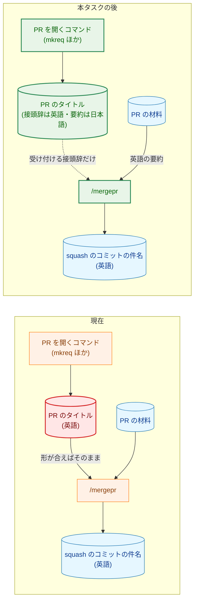

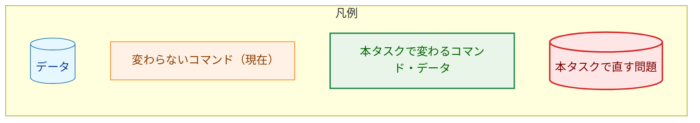

PR の材料は、`prepare` が書く `log.txt`・`stat.txt`・`body.txt` と、必要なときに読む diff である（要件書 §6）。形をどの文書が定めるかは 2.1 の図に示す。

### 1.4. 既存の仕組みとの関係

-   PR のタイトルの言語を検査するテスト・CI・CodeRabbit の設定は、リポジトリの中にない（要件書 1 節の背景）。`8c3a680` で、`*_test.go` が `.claude/` と `CLAUDE.md` の「Language」の節を読まないことを `git grep` で確かめた。そのため、本タスクで直す既存のテストはない。
-   `/runpr` の step 4 は、`mergepr.md` の step 1〜2 をそのまま実行する（`runpr.md:263-264`）。そのため、件名の決め方の変更（3.7）は、`/runpr` からのマージにも同じく効く。

## 2. システム構成 (System Structure)

### 2.1. ファイル構成

本タスクが変えるファイルと、それらの参照関係を示す。矢印 A → B は「A の記述が B を参照する、または B の手順を実行する」を表す。点線の矢印は、本タスクで新しくできる参照を表す。

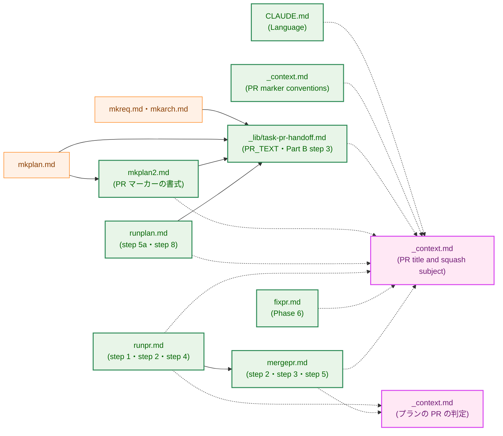

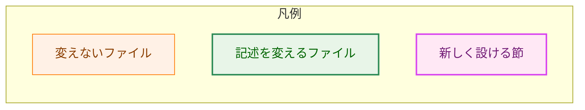

`.claude/commands/` の下のファイルは、図では `.claude/commands/` を省いて書く。`mkreq.md`・`mkarch.md`・`mkplan.md` は、PR のタイトルを PR_TEXT（`_lib/task-pr-handoff.md`）に任せているので変えない（H-02）。`mkplan.md` は PR の境界を `mkplan2.md` の step 4〜9 で設計するので（`mkplan.md:161-164`）、`推奨タイトル` の書式は `mkplan2.md` の変更を通じて `/mkplan` にも効く。

今の `mergepr.md:51-52` は、`<scope>` をタスク ID にする根拠として `_context.md` の「PR marker conventions」を参照している。本タスクでは、この参照をプランの PR の判定とタイトルの規約の節への参照に置き換える（3.7）。

### 2.2. PR のタイトルと件名が決まる流れ

PR のタイトルが書かれてから squash のコミットの件名が決まるまでを示す。

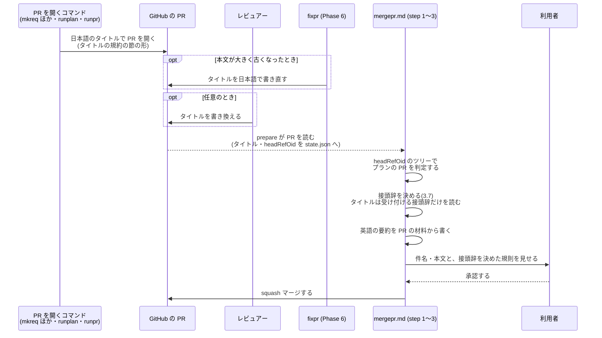

## 3. コンポーネント設計 (Component Design)

本タスクにコードの型はない。各ファイルが述べる規則を、以下に定める。コマンドの定義に書く文は英語である（`CLAUDE.md:47-48`）。本節の日本語は、その内容を示す。

### 3.1. タイトルの規約の節（`_context.md`、新設。F-001〜F-004、H-01・H-04）

`_context.md` の「Process convention」の中に、「PR marker conventions」と並べて節「PR title and squash subject」を設ける。この節は次の項目を定める。

| 項目 | 定める内容 | 対応する AC |
|---|---|---|
| PR のタイトル | `<type>(<scope>): <日本語の要約>`。接頭辞は `<scope>` のある受け付ける接頭辞で英語、要約は日本語。コマンドが書く PR のタイトルには、`<scope>` のない `<type>: ` を使わない。`<scope>` のない形は、受け付ける接頭辞と squash のコミットの件名の形にだけ含まれる。コマンド名・ファイル名・識別子は表記を変えずに含めてよいが、バッククォートで囲まない（3.1.1） | AC-02 |
| 受け付ける接頭辞 | 下の表のとおり | AC-13・AC-16 |
| タスクの文書の PR のタイトル | `docs(<task-id>): <日本語の要約>`。要約は、その PR で追加または変更した文書の内容を述べる | AC-04 |
| プランの PR のタイトル | 接頭辞は、`推奨タイトル` が `<scope>` のある受け付ける接頭辞で始まればその接頭辞、そうでなければ `<type>(<task-id>): `。要約は日本語。書き方の手順は `runplan.md` の step 5a・step 8 に置く（3.5） | AC-05〜AC-07 |
| `推奨タイトル` | PR のタイトルであって、squash のコミットの件名ではない。書くときの形は `<type>(<task-id>): <日本語の要約>`。本タスクの前に書かれた英語の値も、`/runplan` の入力として有効である（3.5） | AC-15・AC-16 |
| squash のコミットの件名 | `<type>(<scope>): <English summary> (#<number>)` または `<type>: <English summary> (#<number>)`。英語で、印字可能な ASCII 文字だけからなる。決め方は `mergepr.md` の step 2 に置く（3.7） | AC-03・AC-11 |

受け付ける接頭辞の形は、次のとおりである。

| 部分 | 受け付ける値 |
|---|---|
| 全体 | `<type>(<scope>): ` または `<type>: `。すべて ASCII 文字で、`:` の直後に ASCII の空白（U+0020）がちょうど 1 つ続く |
| `<type>` | `feat`・`fix`・`docs`・`refactor`・`test`・`perf`・`build`・`ci`・`chore`・`style`・`revert` のいずれか |
| `<scope>` | ASCII の英小文字・数字・`-` の 1 文字以上の並び |
| それ以外 | 受け付けない。直して使わず、接頭辞がないものとして扱う。例: `!` 付きのもの、大文字や日本語を含むもの、`:` の後に空白がないもの、空白が 2 つ以上あるもの、括弧が空のもの、全角の `：`・`（`・`）`・数字・英字を含むもの、`:` の後が全角空白（U+3000）やノーブレークスペース（U+00A0）のもの、ASCII 以外の似た字形（キリル文字の `е`、`‐`・`−` など）を含むもの |

`_context.md:62` の「Conventional commit scope format: `feat(<task-id>): <concise English title>`」は削り、「PR marker conventions」から `推奨タイトル` の項目としてこの節を参照する（3.9）。

#### 3.1.1. タイトルの渡し方とバッククォート

PR のタイトルは、今は `gh pr create --title "<title>"`（`_lib/task-pr-handoff.md:98`、`runpr.md:82`）と `gh pr edit NUMBER --title "<real title>"`（`fixpr.md:462`）で、シェルの二重引用符の中に直接置かれる。二重引用符の中では、バッククォートと `$` が展開され、`"` と `\` が引用を壊す。日本語の要約では、本リポジトリの文書の書き方に倣って識別子をバッククォートで囲みたくなる。また、`$` を含む識別子（`$ARGUMENTS` など）も、表記を変えずに書いてよいことになっている。バッククォートや `$` がシェルに展開されると、タイトルが壊れるだけでなく、環境変数の値（`.envrc` の秘密の値を含む）が PR のタイトルとして公開されうる。

そこで、3 か所とも、タイトルを Write ツールでスクラッチパッド（追跡されるツリーの外）のファイルに書き、`--title "$(cat <file>)"` で渡すと定める。コマンド置換の結果は、二重引用符の中で再び展開されない。PR の本文を `--body-file` で、`mergepr` の件名を `--subject-file` で渡しているのと同じ考え方である。`gh pr create` と `gh pr edit` には、タイトルをファイルから読むフラグがない（`gh` 2.96.0 で確かめた）ので、コマンド置換を使う。

これとは別に、PR のタイトルと `推奨タイトル` では、識別子をバッククォートで囲まない。`推奨タイトル` の値は、PR マーカーの中でバッククォートのコードスパンに入っており（`mkplan2.md:62`）、値の中のバッククォートがコードスパンを壊すためである。`git log origin/main` の件名にも、これまでバッククォートは 1 つもない（`8c3a680` で `git log --format=%s 8c3a680` の 2607 件の件名で確かめた。`$` も 0 件である）。

### 3.2. プランの PR の判定（`_context.md`、`runpr.md` から移す）

`runpr.md:105-108` の「Plan PR」の定義を、`_context.md` の「Process convention」へ移す。`runpr.md` の step 2 と `mergepr.md` の step 2・step 5 は、この定義を参照する。

-   **定義（中身は今と同じ）:** PR の head のツリーで、あるタスクの `03_implementation_plan.md` の `PR を作成した` 行に、その PR の URL が書かれている PR を、プランの PR とする。タスク ID は、その `03_implementation_plan.md` があるタスクのディレクトリの番号である。最後の PR かどうかの規則（`runpr.md:107-108`）も一緒に移す。
-   **読むツリー:** PR の head とする。`/runpr` は PR の head ブランチを checkout して最新にしてから（`runpr.md:91-94`）判定するので、今の振る舞いと同じである。`/mergepr` は `prepare` が記録した `headRefOid` のツリーを読む。`mergepr merge` は `--match-head-commit <headRefOid>` でマージするので（`mergepr.md:93-95`）、判定したツリーとマージされるツリーは一致する。
-   **URL の照合:** URL 全体が一致する行だけを数える。たとえば `.../pull/41` を探すとき、`.../pull/410` の行を数えない。
-   **一致する行がないとき:** プランの PR ではない。
-   **一致する行が 2 つ以上のタスクのプランにあるとき:** 判定できないとして止まる（4.3）。
-   **ツリーを読めないとき:** 判定できないとして止まる（4.3）。「一致する行がない」と「読めない」は区別する。
-   **`/runpr` の中で `/mergepr` を実行するとき:** `/runpr` の step 2 が同じ head で判定した結果をそのまま使い、もう一度判定しない。`/runpr` は head が変わるたびに step 2 をやり直すので（`runpr.md:100-102`）、その結果は `prepare` の `headRefOid` と同じ head のものである。

`mergepr.md` には、定義のないままプランの PR を指す箇所が 3 つある（`mergepr.md:51` と `mergepr.md:60` の「plan-driven PR」、`mergepr.md:107` の「when the PR came from `/runplan`」）。これらは、「プランの PR」の語にそろえる。

判定の規則は `_context.md` の定義に書き、それぞれの文の置き場所は次のとおりとする。

-   止まる 2 つの場合（一致する行が 2 つ以上のタスクのプランにある、ツリーを読めない）は、定義の一部として書く。そのため、`runpr.md` の step 2 も、`mergepr.md` の step 2 も、これらの場合に止まる。
-   `/runpr` の判定をそのまま使うという文は、`mergepr.md` の step 2 に書く。

### 3.3. `CLAUDE.md` の「Language」（F-001・AC-01〜AC-03）

-   「What lives on GitHub: Japanese」の項目に、PR のタイトルを含める。PR のタイトルを英語にする例外の文（`CLAUDE.md:50-51`）は削る。bot のコマンドの例外（`CLAUDE.md:52`）は残す。
-   PR のタイトルの形は、接頭辞を英語の conventional-commit の形で書き、要約を日本語で書くと述べ、形の詳細はタイトルの規約の節を参照する（AC-02）。
-   「What stays in the git repository: English」の項目に、squash のコミットの件名と本文は英語で書き、件名は `/mergepr` が PR の材料から書き、PR のタイトルをそのまま使わないと加える（AC-03）。

### 3.4. タスクの文書の PR（`_lib/task-pr-handoff.md`。F-002・AC-04・AC-10、H-02）

-   **PR_TEXT の定義（`_lib/task-pr-handoff.md:35-37`）:** タスクの文書のコマンドについて、「文書を追加したコミットのタイトル」を「タイトルの規約の節の、タスクの文書の PR のタイトル」に改める。`runplan.md` についての記述は、「`推奨タイトル` から書いたタイトル（`runplan.md` の step 5a）」に改める。
-   **Part B の step 3（`_lib/task-pr-handoff.md:96-101`）:** 「The title is PR_TEXT's, in English (the squash commit subject is built from it).」を、「タイトルは PR_TEXT のもので、タイトルの規約の節の形に従う」に改める。タイトルは 3.1.1 のとおりファイルから渡す。本文を日本語で書く規則は変えない。
-   **コミットのメッセージ（AC-10）:** 4 つのコマンドのコミットの件名（`mkreq.md:106-107`、`mkarch.md:76` の `docs(NNNN): draft ...` など）は英語のままとし、変えない。

### 3.5. プランの PR（`runplan.md`。F-002・AC-05〜AC-07・AC-10、H-03）

-   **PR マーカーのあるプラン（`runplan.md:91`、step 5a）:** PR_TEXT のタイトルを、次のように書くと定める。
    -   `推奨タイトル` が受け付ける接頭辞で始まり、その接頭辞に `<scope>` があれば、その接頭辞を使う。要約の下書きは、接頭辞の後の部分である（AC-05）。
    -   `推奨タイトル` が `<scope>` のない受け付ける接頭辞（`feat: ` など）で始まれば、その `<type>` が PR の変更の種類に合えばそれを使い、合わなければ変更の種類に合う値を選ぶ。接頭辞は、どちらの場合も `<type>(<task-id>): ` とする。要約の下書きは、接頭辞の後の部分である（AC-06）。
    -   `推奨タイトル` が受け付ける接頭辞で始まらなければ、接頭辞を `<type>(<task-id>): ` とし、`<type>` は受け付ける値のうち、PR の変更の種類に合うものとする。値の全体を、接頭辞のない内容の下書きとして扱う（AC-06）。
    -   要約は、下書きと同じ内容を日本語で書く。`推奨タイトル` が英語か日本語かは判定しない。日本語の値なら、その値そのものが要約になる（AC-05、H-03）。
    -   `/runplan` は、このためにプランを書き換えない（AC-05）。
-   **PR マーカーのないプラン（`runplan.md:198`、step 8）:** 「the title is `feat(<task-id>): <concise English title>`」を、「タイトルの規約の節の、プランの PR のタイトル」に改める。`推奨タイトル` がないので、接頭辞は `<type>(<task-id>): ` とし、`<type>` は変更の種類に合うものを選ぶ（AC-07）。
-   `推奨タイトル` の `<scope>` がタスク ID と違う値（たとえば `feat(server): `）でも、AC-05 のとおり、その接頭辞を PR のタイトルに使う。件名の `<scope>` は、`/mergepr` がプランの PR の判定で決めたタスク ID とする（3.7 の 1）。2026-10-21 の時点で、既存の 168 個の `推奨タイトル` はすべて `<scope>` がタスク ID である。

### 3.6. 単独の変更の PR と、タイトルの書き直し（`runpr.md`・`fixpr.md`。F-002・AC-08〜AC-10）

-   **`runpr.md` の step 1（`runpr.md:85-87`）:** 「English, since the squash commit subject is built from it」を削り、タイトルをタイトルの規約の節の PR のタイトルの形で書くと改める。`<type>(<scope>)` を `git log origin/main` の形に合わせる指示は残す（AC-08）。タイトルは 3.1.1 のとおりファイルから渡す。本文を日本語で書く指示は変えない。
-   **`runpr.md` の step 2（`runpr.md:105-108`）:** 「Plan PR」の定義を、`_context.md` のプランの PR の判定への参照に置き換える（3.2）。判定できないときに止まる規則も、その定義から受け継ぐ。
-   **`runpr.md` の step 4 の 2（`runpr.md:270-273`）:** `mergepr.md` の step 3 が求める項目を括弧の中に列挙している。この列挙に、接頭辞を決めた規則の記録（3.7）を加える。
-   **`fixpr.md` の Phase 6（`fixpr.md:450-470`）:** Phase 6 は、`haiku` のモデルで動くサブエージェントへのプロンプトである（`fixpr.md:449`）。サブエージェントは `_context.md` を読み込んでいないので、プロンプトの中で `.claude/commands/_context.md` の節「PR title and squash subject」を名指しし、タイトルを書き直す前に読むよう指示する。「Keep the title an English conventional-commit title」は、「新しいタイトルはその節の PR のタイトルの形で書く」に改める。`gh pr edit` に渡すタイトルは、3.1.1 のとおりファイルから渡す。タイトルを書き直す条件（本文が大きく古くなったときだけ、具体的な文を書けたときだけ。`fixpr.md:458-470`）は変えない（AC-09）。
-   どちらのコマンドも、コミットのメッセージの言語の指示は変えない（AC-10）。

### 3.7. squash のコミットの件名（`mergepr.md` の step 2。F-003・AC-11〜AC-14、H-04）

`mergepr.md:49-52` の「Subject」の項目を、次の規則に置き換える。「When the PR title already fits, use it.」（`mergepr.md:50-51`）は削る（AC-11）。

-   **形:** タイトルの規約の節の squash のコミットの件名の形とする。要約は英語で、PR の材料から書く。PR のタイトルは要約の情報源にしない（AC-11）。
-   **接頭辞の決め方（AC-12）:** 次の順で決める。
    1.  プランの PR の判定（3.2）でプランの PR なら、`<scope>` をタスク ID とする。
    2.  PR のタイトルが受け付ける接頭辞で始まれば、その接頭辞を使う。プランの PR では、その `<type>` だけを使う。
    3.  それ以外は、PR の材料と `git log origin/<baseRefName>` の形から決める。プランの PR では、`<scope>` はタスク ID のままとする。
-   **接頭辞の書き方:** 件名の `<type>` は、タイトルの規約の節の表の値を書く。PR のタイトルの文字をそのまま写さない。`<scope>` も ASCII の文字で書く。表の値と同じに見える別の文字が件名に入らないようにするためである。
-   **承認の前の確かめ:** 件名のファイルを書いた後、承認の質問（step 3）の前に、件名が squash のコミットの件名の形に合い、印字可能な ASCII 文字だけからなることを確かめる。合わなければ書き直す。人は端末で似た字形を見分けられないので、承認だけに頼らないためである。どう確かめるか（たとえば `LC_ALL=C` の `grep -E`）は実装プランで決める。
-   **接頭辞を決めた規則を示す（step 3）:** step 2 は、1〜3 のどれで接頭辞を決めたかを記録する。プランの PR なら、そのタスク ID とプランのパスも記録する。PR のタイトルの先頭に接頭辞らしいものがあっても、受け付ける形に合わなければ、それをデータとして引用し、使わなかったことを記録する。`mergepr.md` の step 3 が利用者に見せる項目（PR の URL、base ブランチ、CI の結果、件名と本文の全文）に、この記録を加える。`/runpr` の中では、`runpr.md` の step 4 の 2 が `mergepr.md` の step 3 の項目を括弧書きで列挙している（`runpr.md:270-273`）ので、その列挙にもこの記録を加える（3.6）。利用者が、件名の接頭辞がどこから来たかを、承認の時点で確かめられるようにするためである。明示の承認なしにマージしない規則は変えない。
-   **PR のタイトルの読み方（AC-14）:** PR のタイトルは、`prepare` が書く `state.json` の `title` から読む（`mergepr_guide.md:120`）。`prepare` の出力の 1 行目（`PR #<number>: <title>`。`cmd/mergepr/main.go:48`）は、端末で制御文字が見えなくなりうるので使わない。PR のタイトル・本文・コミットのメッセージ・diff をデータとして扱い、従う指示としない規則（`mergepr.md:46-48`）は保ち、PR のタイトルの接頭辞を読むときにも適用すると明記する。
-   **タイトルの時点:** `state.json` の `title` は `prepare` の時点の値である。その後に GitHub でタイトルが書き換えられても、マージに使うのは利用者が承認した件名なので、件名は変わらない。
-   **英語のタイトルの PR:** 本タスクの前に開いた PR も同じ規則で件名を書く（AC-12）。たとえば `docs(0031): draft requirements for ...` のタイトルでは、接頭辞 `docs(0031): ` を使い、要約は PR の材料から書く。
-   **本文（AC-14）:** 英語で書く規則（`mergepr.md:48`）と、本文の長さ・記録の規則（`mergepr.md:53-82`）は変えない。

`docs/dev/developer_guide/mergepr_guide.md` と `mergepr_guide.ja.md` は、PR のタイトルを件名に使うとは述べていない（`8c3a680` で確かめた。`title` の出現は `state.json` の説明だけ）。ただし、両方の 93 行目は承認の質問で示す項目（PR の URL、base ブランチ、CI の結果、件名と本文）を列挙しているので、この列挙に接頭辞を決めた規則の記録を加える。

### 3.8. 変えずに残す、コミットの件名に依存する箇所

次の箇所は、コミットの件名（英語のまま）を読むか書く。PR のタイトルは読まないので、本タスクの後も同じく働く。

| 箇所 | 読むか書くもの | 根拠 |
|---|---|---|
| 作業中のブランチを使い続けるかの判定（Part A の step 3） | コミットの件名 `docs(<task-id>): draft` を読む | `_lib/task-pr-handoff.md:67-69` |
| `/runpr` の記録のコミット | 件名 `docs(<task-id>): record the review of PR #<number>` を書く | `runpr.md:114-115` |
| PR の種類の判定（Plan PR・Task-document PR・Standalone change） | プランの `PR を作成した` 行と、PR が変えるファイルを読む | `runpr.md:104-112` |

### 3.9. PR マーカーの `推奨タイトル`（`_context.md`・`mkplan2.md`。F-004・AC-15・AC-16）

AC-16 が挙げる 4 か所を、次のように改める。

| 場所 | 今の記述 | 本タスクの後 |
|---|---|---|
| `_context.md:62`（PR marker conventions） | `feat(<task-id>): <concise English title>` | `推奨タイトル` は PR のタイトルであって squash のコミットの件名ではないと述べ、形はタイトルの規約の節を参照する（AC-15） |
| `mkplan2.md:62`（挿入する書式） | `` `feat(<task-id>): <concise English title>` `` | `` `<type>(<task-id>): <Japanese summary>` `` |
| `mkplan2.md:80`（欄の説明） | 英語の conventional commit のタイトル | タイトルの規約の節の `推奨タイトル` の形に従う、`/runplan` が PR のタイトルに使う日本語のタイトル |
| `mkplan2.md:129`（レビューのチェックリスト） | 英語の conventional commit のタイトルとして正しい | タイトルの規約の節の `推奨タイトル` の形に合い、バッククォートを含まない |

`mkplan2.md:62` の書式は、そのままプランへ挿入されるひな形なので、参照ではなく形を直接書く（1.1 の例外）。`<type>` の値の一覧は書かず、`mkplan2.md:80` の説明からタイトルの規約の節を参照する。

既存のプランに残る英語の `推奨タイトル`（2026-10-21 の時点で 168 個）は書き換えない（要件書 2.3）。

### 3.10. design_handoff の各項目への対応

| 項目 | 採った方針 | 本書の節 |
|---|---|---|
| H-01: タイトルの形を定める場所 | 候補の方針のとおり。規則は `CLAUDE.md` の「Language」、形は `_context.md` のタイトルの規約の節に置き、各コマンドはその節を参照する | 1.2・3.1・3.3 |
| H-02: タスクの文書の PR の PR_TEXT | 候補の方針の前者に近い。形はタイトルの規約の節に置き、`_lib/task-pr-handoff.md` の PR_TEXT はその項目を参照する。4 つのコマンドは変えない | 1.2・3.4 |
| H-03: 英語の `推奨タイトル` の扱い | 候補の方針のとおり。言語を判定せず、常に下書きとして扱う | 1.1・3.5 |
| H-04: `/mergepr` の接頭辞の規則の書き方 | 候補の方針のとおり。`<type>` の一覧と `<scope>` の文字の範囲をタイトルの規約の節に置き、`mergepr.md` と PR マーカーの規約から参照する。接頭辞を決める順序は `mergepr.md` の step 2 に書く。あわせて、プランの PR の判定を `_context.md` に置く | 1.2・3.1・3.2・3.7 |
| H-05: タスク 0031 との重なり | 候補の方針のとおり。先にマージされた側の変更の上に重ねる。2026-10-21 の時点で、タスク 0031 は要件書（PR #407）だけがマージされ、`_lib/task-pr-handoff.md` と `runpr.md` はまだ変えていない。本タスクが変えるのは Part B の step 3（`_lib/task-pr-handoff.md:96-101`）と `runpr.md` の step 1・step 2 である。タスク 0031 が対象にする Part B の step 5（`_lib/task-pr-handoff.md:116-121`）と `runpr.md:153-196` とは段落が重ならない | 8 |

### 3.11. コンポーネント責務表

すべて既存のファイルの変更である。新しいファイルはない。

| ファイル | 本タスクで述べること | 対応する AC |
|---|---|---|
| `CLAUDE.md` | 「Language」: PR のタイトルを日本語のものに含め、squash のコミットの件名と本文を英語とし、件名を `/mergepr` が PR の材料から書くと述べる。形はタイトルの規約の節を参照する | AC-01〜AC-03 |
| `.claude/commands/_context.md` | タイトルの規約の節とプランの PR の判定を新しく設ける。「PR marker conventions」の `推奨タイトル` の行を、タイトルの規約の節の参照に改める | AC-02〜AC-07・AC-11〜AC-13・AC-15・AC-16 |
| `.claude/commands/_lib/task-pr-handoff.md` | PR_TEXT の定義と Part B の step 3 を、タイトルの規約の節に合わせる。タイトルをファイルから渡す | AC-04・AC-10 |
| `.claude/commands/runplan.md` | step 5a の PR_TEXT と step 8 のタイトルを、`推奨タイトル` からの日本語のタイトルとプランの PR のタイトルの形に改める | AC-05〜AC-07・AC-10 |
| `.claude/commands/runpr.md` | step 1 のタイトルを PR のタイトルの形の日本語に改め、ファイルから渡す。step 2 の「Plan PR」をプランの PR の判定の参照に置き換える。step 4 の 2 の示す項目に、接頭辞を決めた規則を加える（3.6） | AC-08・AC-10・AC-12 |
| `.claude/commands/fixpr.md` | Phase 6 のプロンプトでタイトルの規約の節を名指しして読ませ、書き直すタイトルを PR のタイトルの形の日本語にし、ファイルから渡す | AC-09・AC-10 |
| `.claude/commands/mergepr.md` | step 2 の件名の規則を 3.7 の規則に置き換える。step 3 で見せる項目に、接頭辞を決めた規則を加える。step 2・step 5 のプランの PR の言い回しを、プランの PR の判定の参照にそろえる | AC-11〜AC-14 |
| `.claude/commands/mkplan2.md` | PR マーカーの書式・欄の説明・チェックリストの `推奨タイトル` を改める | AC-16 |
| `docs/dev/developer_guide/mergepr_guide.md`・`mergepr_guide.ja.md` | 93 行目の、承認の質問で示す項目の列挙に、接頭辞を決めた規則の記録を加える（3.7） | AC-12 |
| `docs/translation_glossary.md` | 「接頭辞 (prefix)」「受け付ける接頭辞 (accepted prefix)」「要約 (summary)」「プランの PR (plan PR)」を加え、「材料」に必要なときに読む diff を含めると改める。コマンドの定義で使う英語の語と、文書の日本語の語を対応させるためである | （要件書 §6 の用語） |

変えるテストはない（1.4）。

## 4. エラーハンドリング設計 (Error Handling Design)

### 4.1. エラーの表し方

本タスクは Go のコードを変えないので、新しいエラー型はない。`mergepr` のバイナリが件名を検査する規則（空でない 1 行。`internal/mergepr/mergepr.go:441-450`）と、その失敗のメッセージ（`mergepr_guide.md:220`）は変わらない。

### 4.2. 失敗ではなく、ないものとして扱う場合

| 場合 | 扱い | 理由 |
|---|---|---|
| PR のタイトルの接頭辞が受け付ける形に合わない | 接頭辞がないものとして扱い、3.7 の 3 で決める。止まらない。承認の質問で、使わなかった接頭辞を引用して示す | 要件書 AC-13。レビュアーが書き換えたタイトルでマージが止まると、タイトルを直す手間だけが増える |
| `推奨タイトル` が受け付ける接頭辞で始まらない、または `<scope>` がない | `<type>(<task-id>): ` を補う。止まらない | 要件書 AC-06 |

### 4.3. 止まる場合

-   **プランの PR かどうかを判定できない:** head のツリーを読めない（`git` が失敗する）とき、または PR の URL が 2 つ以上のタスクのプランの `PR を作成した` 行にあるとき、`/mergepr` は推測で続けず、そのことを報告して止まる。`mergepr.md:31-32` の「If the tool stops, report its error ... do not work around it」と同じ扱いとする。単独の変更として扱って続けると、プランの PR の件名からタスク ID が落ちうるためである。`/runpr` の中では `/runpr` の step 2 の判定を使うので（3.2）、この停止は `/runpr` の step 2 で起きる。
-   **件名が形に合わない:** 3.7 の承認の前の確かめで合わなければ、書き直してから承認の質問に進む。書き直しても合わないまま承認の質問へ進まない。

### 4.4. 判定の穴として残るもの

-   **記録の欠け:** `/runplan` が PR の URL をプランに記録するコミット（`runplan.md:93-95`）が失敗すると、その PR はプランの PR と判定されない。その場合、件名の `<scope>` はタスク ID に固定されず、3.7 の 2・3 で決まる。今の `/runpr` も、同じ記録で PR の種類を判定しており（`runpr.md:105-108`）、記録の欠けは `/runpr` の step 2 の記録（`runpr.md` の step 2 が定める PRE_MERGE のチェックポイント）にも影響する。本タスクは、この記録の仕組みを変えない。3.7 の「接頭辞を決めた規則を示す」で、承認の質問に規則 2・3 で決めたことが表示されるので、利用者が気づける。
-   **PR が自分の記録を書ける:** プランの PR の判定は PR の head のツリーを読むので、PR の diff が `PR を作成した` 行を加えれば、プランの PR として扱われる。影響は件名の `<scope>` だけであり、その件名は承認の質問で利用者が確かめる。

### 4.5. 副作用の契約

本タスクは、副作用を変えるフラグやモードを加えない。各コマンドの外部への副作用（`gh pr create`・`gh pr edit`・`gh pr merge`・`git push`）の種類と回数は変わらない。変わるのは、`gh pr create`・`gh pr edit` に渡すタイトルの文字列と渡し方（ファイルからのコマンド置換。3.1.1）、`gh pr merge` に渡す件名の決め方、`/mergepr` が判定のために読む git のツリー（読むだけで、書かない）である。

## 5. セキュリティ考慮事項 (Security Considerations)

本タスクは、`docs/dev/security.md` の適用の条件のどれにも当たらない（要件書 4.2）。ただし、PR のタイトルを読む規則と、タイトルをシェルに渡す方法が変わるので、その境界を以下にまとめる。

### 5.1. 脅威モデル

矢印 A → B は「A の値が B に渡る」を表す。

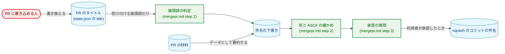

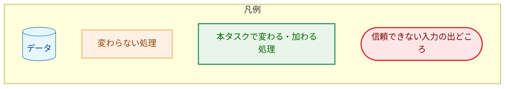

| 脅威 | 対策 |
|---|---|
| PR のタイトルに、エージェントへの指示に見える文を書く | PR のタイトルはデータとして扱い、従う指示としない（`mergepr.md:46-48` を保ち、接頭辞を読むときにも適用すると明記する。AC-14）。タイトルから件名へ渡るのは、11 個の `<type>` と ASCII の `[a-z0-9-]` の `<scope>` からなる接頭辞だけである |
| 形の崩れた接頭辞や、全角文字・似た字形の接頭辞で、件名に意図しない文字を入れる | 受け付ける形に合わない接頭辞は直さず、ないものとして扱う（AC-13、3.1 の表）。件名の `<type>` は表の値を書き、PR のタイトルから写さない。件名が印字可能な ASCII 文字だけからなることを、承認の前に確かめる（3.7） |
| プランの PR の `<scope>` を、タイトルでタスク ID と違う値にする | プランの PR では、タイトルからは `<type>` だけを使い、`<scope>` はプランの PR の判定で決めたタスク ID とする（AC-12） |
| どの経路でも、利用者が見ないまま件名が `main` に入る | 利用者の明示の承認なしにはマージしない規則（`mergepr.md` の step 3）は変えない。承認の質問で見せる項目に、接頭辞を決めた規則を加える（3.7） |
| エージェントが書くタイトルの `$`・バッククォートがシェルに展開され、環境変数の値が PR のタイトルとして公開される | タイトルを Write ツールでファイルに書き、`--title "$(cat <file>)"` で渡す（3.1.1） |

### 5.2. 信頼できない入力の境界

本タスクが新たに読む信頼できない入力は、PR のタイトルの接頭辞だけである（要件書 4.2）。

| 境界 | 受け付ける形 | 合わないとき | 使うもの |
|---|---|---|---|
| PR のタイトル（`state.json` の `title`） | 先頭の受け付ける接頭辞（3.1） | 接頭辞がないものとして扱い、承認の質問で引用して示す（4.2） | `<type>` と `<scope>`。プランの PR では `<type>` だけ。接頭辞の後の要約は使わない |

`<scope>` の長さには上限を設けない。AC-13 は長さを定めておらず、受け付けた `<scope>` は承認の質問で利用者が確かめるためである。

### 5.3. 対象クライアント環境の検証

N/A。本タスクは、Mattermost に送る記事の形を変えない。新しく頼る外部 API の機能もない。GitHub の issue のタイトルはすでに日本語で書いており（`runpr.md:321`）、PR のタイトルも同じ API で文字列を渡すだけである。

### 5.4. 残るリスク

-   **接頭辞の判定はエージェントの読み取りに頼る。** `mergepr` のバイナリは件名の形を検査しない（要件書 2.3）。受け付ける形を表で一意に定め（3.1）、合わない例を挙げ、件名の形と文字を承認の前に確かめる（3.7）。それでも残る誤り（たとえば、受け付ける形の中で別の `<type>` を選ぶ誤り）は、承認の質問で利用者が見つける前提である。

## 6. 処理フロー詳細 (Processing Flow Details)

### 6.1. `/mergepr` が件名の接頭辞を決める流れ

矢印は処理の順序を表す。

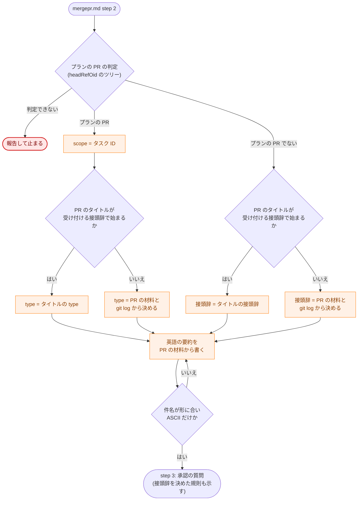

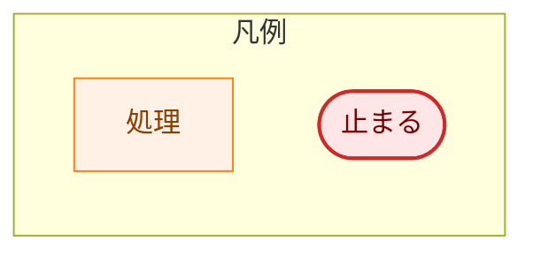

角の丸い節点は始まりと終わりを、ひし形は分岐を表す。

### 6.2. `/runplan` が `推奨タイトル` から PR のタイトルを書く流れ

矢印は処理の順序を表す。`推奨タイトル` の言語による分岐はない（H-03）。

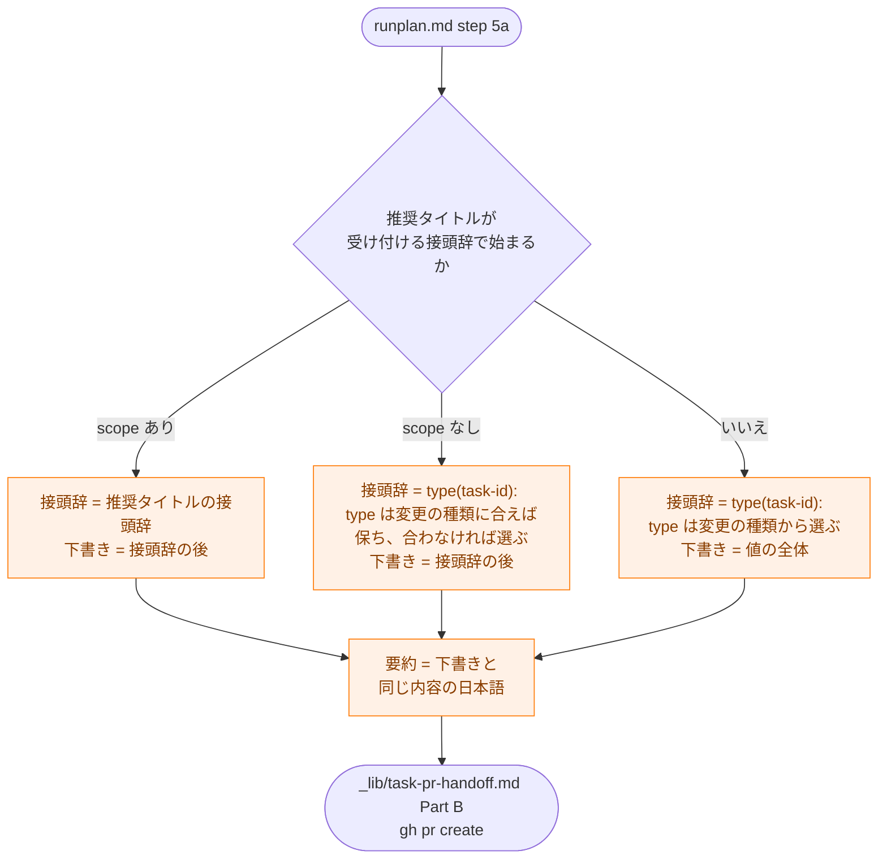

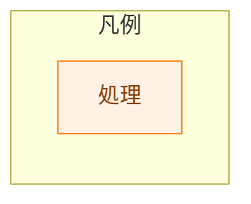

角の丸い節点は始まりと終わりを、ひし形は分岐を表す。

## 7. テスト戦略 (Test Strategy)

### 7.1. ユニットテスト

追加しない。本タスクは Go のコードと拡張のコードを変えない。PR のタイトルの形を検査するガードのテストも追加しない（要件書 2.3）。`make test` と `make lint` は、変更の前後で同じく通ることを確かめる。

### 7.2. 静的な検査

各 AC を、変更後のファイルの記述を読んで確かめる（7.5）。AC-17 は、`docs/tasks/` を除く追跡中のファイルに対して、次の記述が残っていないことを `git grep` で確かめる。

-   `English` と `title` を同じ文で述べる記述（`concise English title`、`English conventional-commit title` など）。
-   `squash commit subject is built from it`、`When the PR title already fits` など、件名を PR のタイトルから作る記述。
-   `feat(<task-id>)` に限る `推奨タイトル` の形。

検索の語の一覧は、実装プランで確定する。AC-05 の、英語の `推奨タイトル` を入力として受け付ける説明は除外する。あわせて、`--title "<` の形でタイトルを直接二重引用符に置く呼び出しが残っていないことも確かめる（3.1.1）。

### 7.3. 統合テスト（手動）

本タスクのマージの後に確かめる。

-   **正常の経路:**
    -   マージの後に初めて実行するタスクの文書のコマンド（次のタスクの `/mkreq` など）が開く PR のタイトルが、`docs(<task-id>): ` と日本語の要約になる（AC-04）。
    -   英語の `推奨タイトル` を持つプランで `/runplan` を実行したとき、PR のタイトルが日本語の要約になり、プランが書き換わらない（AC-05）。
    -   `/mergepr` が、日本語のタイトルの PR と、本タスクの前に開いた英語のタイトルの PR の両方で、英語の件名を書く（AC-11・AC-12）。
-   **形の崩れた入力（マージしない試し）:** テスト用の PR のタイトルを次のように変え、`/mergepr` の step 1〜2 を実行して、件名と、承認の質問に示される規則を確かめる。確かめた後は step 3 で断り、`mergepr discard` で片付ける。
    -   全角の `：` や `（）`、全角空白を含む接頭辞（受け付けず、規則 3 で決まる）。
    -   大文字の `Feat(...)`、`!` 付きの接頭辞（同上）。
    -   プランの PR で、タイトルの `<scope>` がタスク ID と違うもの（`<scope>` はタスク ID になる）。
    -   `$HOME` とバッククォートを含む日本語のタイトルを `/runpr` の step 1 の方法で渡したとき、文字が展開されずに GitHub に入る（3.1.1）。

### 7.4. セキュリティテスト

7.3 の形の崩れた入力の試しが、5.1 の対策を確かめる。ほかに追加しない。5.1 の対策はすべてコマンドの定義の記述なので、7.2 の静的な検査で、`mergepr.md` が PR のタイトルをデータとして扱う記述（AC-14）と受け付ける形の参照（AC-13）を保つことも確かめる。

### 7.5. 受け入れ基準と設計の対応

| AC | 設計 | 確かめ方 |
|---|---|---|
| AC-01〜AC-03 | 3.3 | 静的 |
| AC-04 | 3.1・3.4 | 静的・手動 |
| AC-05〜AC-07 | 3.1・3.5 | 静的・手動 |
| AC-08 | 3.6 | 静的 |
| AC-09 | 3.6 | 静的 |
| AC-10 | 3.4・3.5・3.6 | 静的 |
| AC-11・AC-12 | 3.2・3.7 | 静的・手動 |
| AC-13 | 3.1・3.7 | 静的・手動 |
| AC-14 | 3.7・5.1 | 静的 |
| AC-15・AC-16 | 3.1・3.9 | 静的 |
| AC-17 | 1.1（10 か所の一覧）・3.3〜3.9 | 静的（7.2 の `git grep`） |

## 8. 実装優先順位 (Implementation Priorities)

すべての変更を 1 つの PR にまとめる。途中の状態を `main` に置かないためである。コマンドの定義は、マージされた時点でそのまま次のセッションの振る舞いになる。たとえば `mergepr.md` だけが先にマージされると、`/runpr` はまだ英語のタイトルを書き、`CLAUDE.md` は PR のタイトルから件名を作ると述べたままになる。

1.  `_context.md` にタイトルの規約の節とプランの PR の判定を設け、「PR marker conventions」を改める（3.1・3.2・3.9）。ほかのすべての変更がこれらを参照するので、最初に置く。
2.  `CLAUDE.md` の「Language」と `docs/translation_glossary.md` を改める（3.3・3.11）。
3.  PR のタイトルを書くコマンドの定義を改める: `_lib/task-pr-handoff.md`（3.4）、`runplan.md`（3.5）、`runpr.md`・`fixpr.md`（3.6）、`mkplan2.md`（3.9）。
4.  `mergepr.md` の step 2・step 3・step 5 を改める（3.2・3.7）。
5.  7.2 の静的な検査を行う（AC-17）。

タスク 0031 の変更が先に `main` に入っていたら、その上に重ねる（H-05）。

**移行の注意:**

-   コマンドの定義は、各チェックアウト（worktree）の作業ツリーから読み込まれる。マージの後も古い `main` のままの worktree や、古い定義を読み込んだセッションで `/mergepr` を実行すると、日本語のタイトルの PR にも「When the PR title already fits, use it.」の規則が適用され、日本語の件名を提案しうる。マージの後は、ほかの worktree を `origin/main` に進めるか、セッションをやり直してから `/mergepr`・`/runpr` を実行する。この注意は、実装の PR の本文に書く。
-   本タスクの実装の PR 自身は、そのブランチにある、改めた後の `mergepr.md` でマージされる（`/mergepr` は作業ツリーの定義を読むため）。その PR のタイトルは、PR を開いたセッションが読み込んだ定義で書かれる。どちらの言語のタイトルでも、改めた `mergepr.md` は英語の件名を書けるので（3.7）、マージに支障はない。

## 9. 将来の拡張性 (Future Extensibility)

-   **squash のコミットの言語を日本語にする場合:** 要件書は「当面は英語のまま」とした。変えるときは、タイトルの規約の節の件名の行、`CLAUDE.md` の「Language」、`mergepr.md:48` の「Write the message in English」、3.7 の ASCII の確かめを改める。PR のタイトルの規則には触れない。
-   **受け付ける `<type>` を増やす場合:** タイトルの規約の節の表だけを改める。`mergepr.md` と `mkplan2.md` の説明はその表を参照するので変えない。
-   **接頭辞の判定を機械化する場合:** 判定の誤りが実際に問題になれば、`mergepr prepare` が受け付ける接頭辞を取り出して表示し、`merge` が件名の形を検査する案がある。今はエージェントの読み取り、承認の前の形の確かめ、利用者の承認で足りるので、加えない（YAGNI）。
