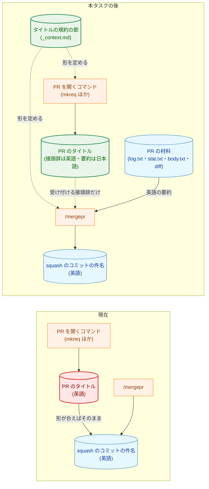
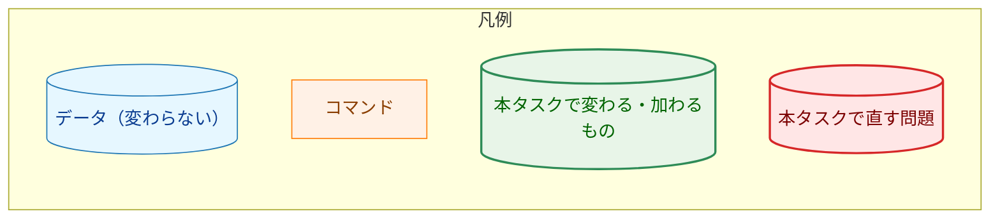
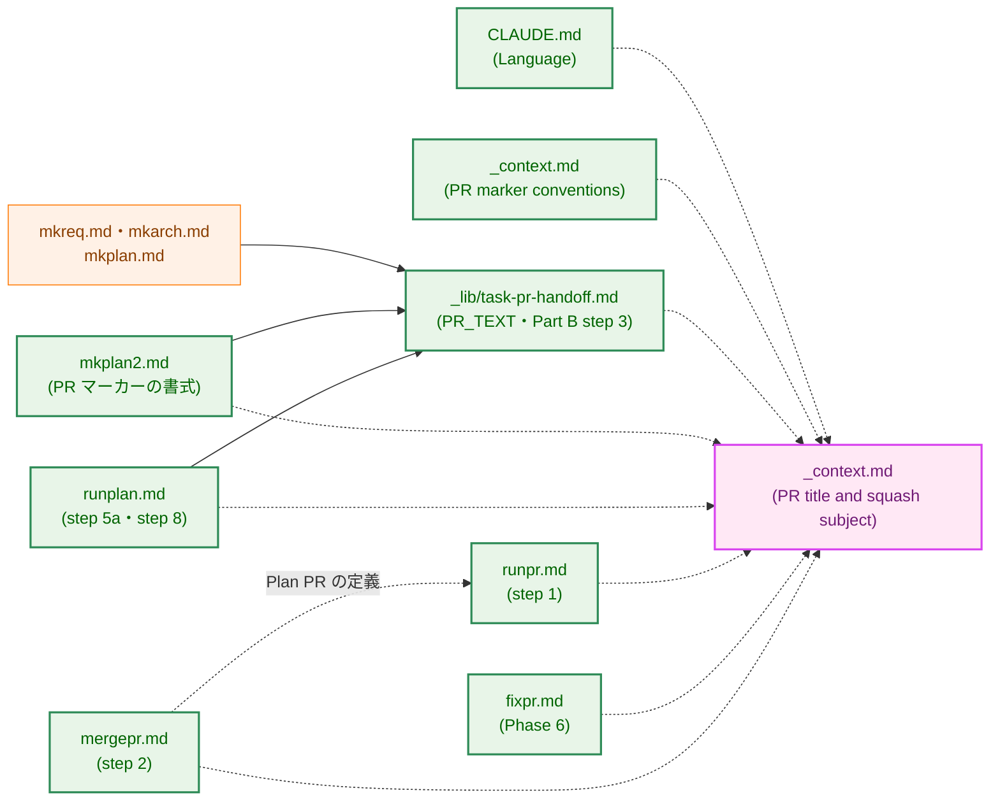
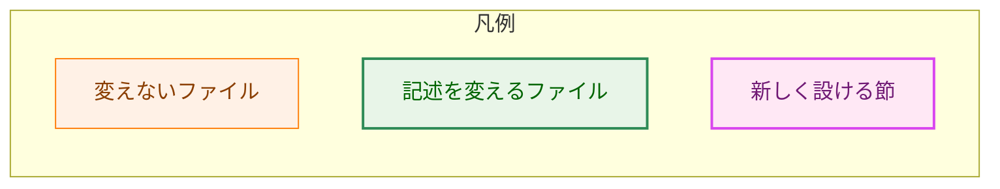
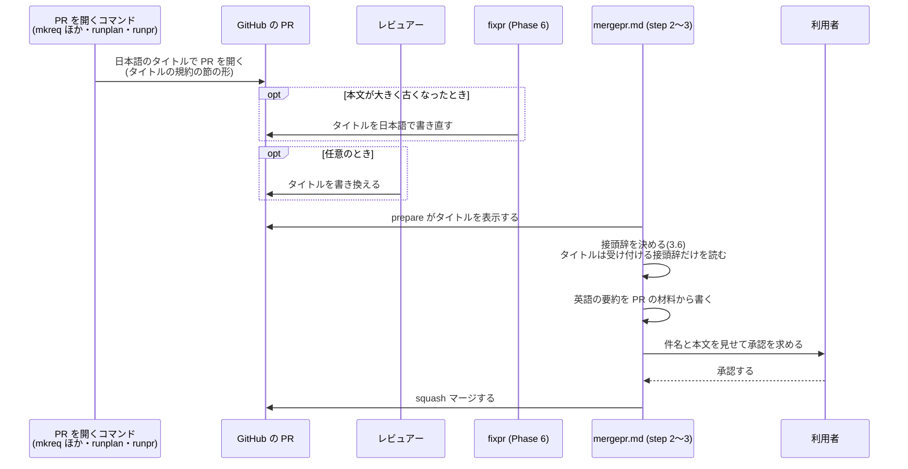
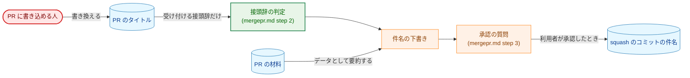
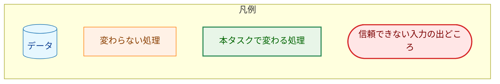
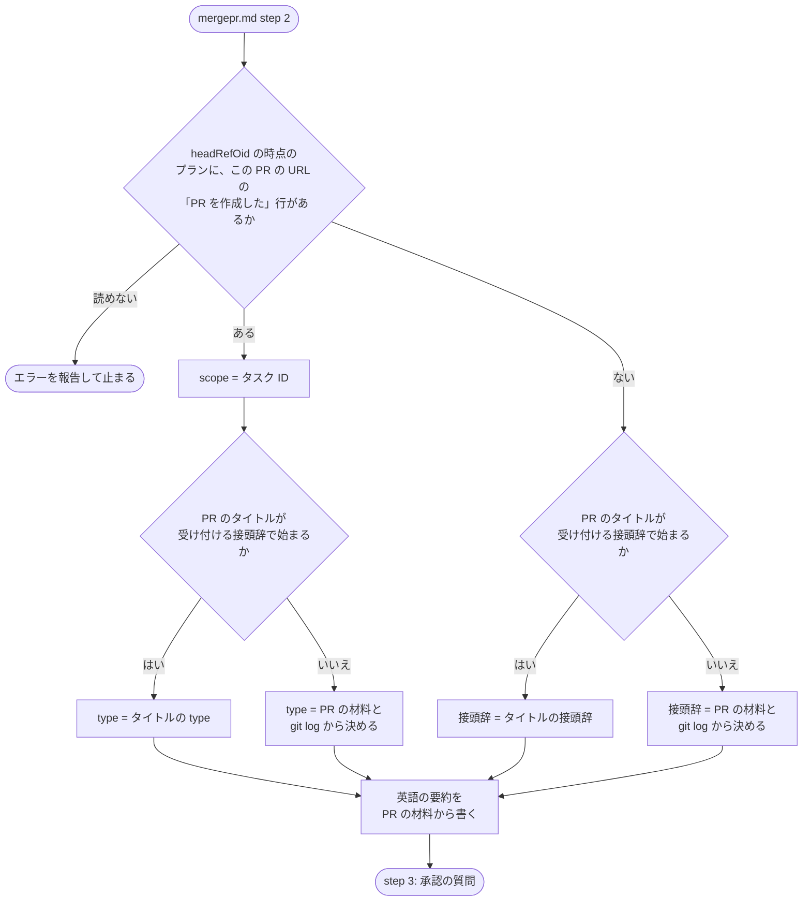
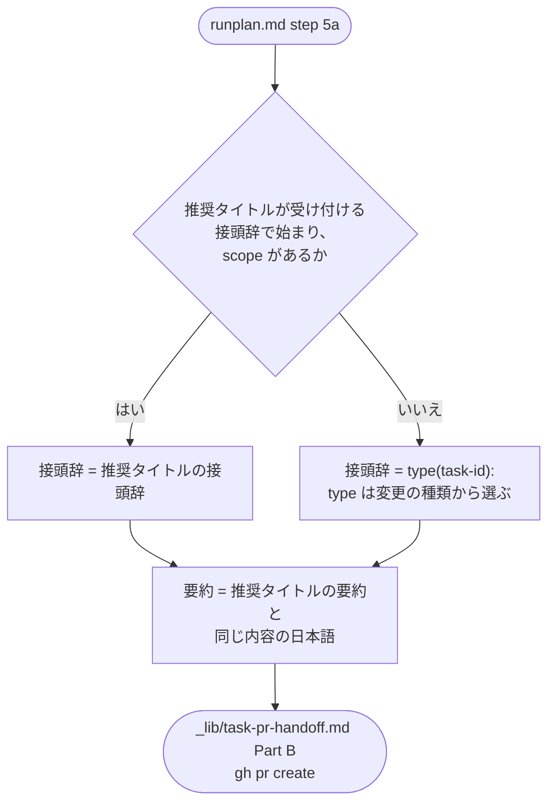

# アーキテクチャ設計書：PR のタイトルを日本語にし、squash のコミットは英語のままにする

## Document Status

| Item | Value |
|---|---|
| Status | `draft` |
| Created | 2026-10-21 |
| Review date | - |
| Reviewer | - |
| Comments | - |

本書は [01_requirements.md](01_requirements.md)（要件定義書。以下、要件書）の設計である。既存のファイルについての記述は、コミット `8c3a680` のファイルで確かめた。`file:line` はこのコミットの行番号を指す。F-NNN・AC-NN は要件書の項番を指す。要件のレビューで設計に申し送られた事項（[design_handoff.md](design_handoff.md) の H-01〜H-05）への対応は 3.9 にまとめる。

本書は、要件書 §6 の用語（PR のタイトル、squash のコミット、件名、接頭辞、要約、PR マーカー、`推奨タイトル`、プランの PR、単独の変更、PR の材料）を同じ意味で使う。ほかに次の用語を使う。

-   **受け付ける接頭辞 (accepted prefix):** AC-13 の形に合う接頭辞。`<type>(<scope>): ` または `<type>: ` で、`<type>` は 11 個の値のいずれか、`<scope>` は英小文字・数字・`-` の 1 文字以上の並びである（3.1）。
-   **タイトルの規約の節:** 本タスクで `.claude/commands/_context.md` に新しく設ける節「PR title and squash subject」。PR のタイトル・受け付ける接頭辞・squash のコミットの件名・`推奨タイトル` の形を、ここに 1 か所で定める（3.1）。
-   **コマンドの定義:** `.claude/commands/` の下の Markdown ファイル。エージェントへの指示であり、英語で書く（`CLAUDE.md:47-48`）。

## 1. 設計の全体像 (Design Overview)

### 1.1. 設計原則

-   **形は 1 か所に定め、ほかは参照する。** PR のタイトル・受け付ける接頭辞・squash のコミットの件名・`推奨タイトル` の形は、タイトルの規約の節だけに書く。`CLAUDE.md` は言語の規則だけを述べてその節を参照し、各コマンドの定義もその節を参照する（H-01・H-04）。今は同じ規則が 10 か所にそれぞれの言葉で書かれている（`CLAUDE.md:49-52`、`.claude/commands/_lib/task-pr-handoff.md:100-101`、`runpr.md:85-87`、`fixpr.md:466`、`mergepr.md:49-52`、`_context.md:62`、`mkplan2.md:62`・`mkplan2.md:80`・`mkplan2.md:129`、`runplan.md:198`）。次に規則を変えるときの書き漏らし（AC-17）を防ぐためである。
-   **PR のタイトルと squash のコミットの件名を切り離す。** PR のタイトルは人が読むための日本語の名前とし、squash のコミットの件名は `/mergepr` がマージの時点で PR の材料から英語で書く。PR のタイトルから件名へ渡るのは、受け付ける接頭辞だけである（AC-11・AC-12）。
-   **言語を判定して分岐しない。** `/runplan` は、`推奨タイトル` が日本語か英語かを判定しない。常に下書きとして扱い、要約を日本語で書く（AC-05、H-03）。`/mergepr` も、PR のタイトルの言語を判定しない。接頭辞が受け付ける形に合うかだけを見る（AC-12）。`CLAUDE.md` の「Declare, don't infer」と同じく、入力の中身を推測して振る舞いを選ばないためである。
-   **形の崩れた接頭辞は直さず、ないものとして扱う。** `CLAUDE.md` の「Reject, don't normalize」に従う（AC-13）。
-   **コミットのメッセージは変えない。** 各コマンドが作るコミットのメッセージと squash のコミットのメッセージは英語のままとする（AC-10・AC-14）。コミットの件名の形に依存する既存の判定（3.7）は、そのまま働く。
-   **実行時のコードを変えない。** 変えるのは `CLAUDE.md` とコマンドの定義だけである。`mergepr` のバイナリ（`cmd/mergepr`・`internal/mergepr`）は変えない（要件書 2.3）。

### 1.2. 設計の際に決めたこと（2026-10-21）

-   **タイトルの規約の節を `_context.md` に新しく設ける（H-01・H-04）:** PR のタイトル・受け付ける接頭辞（`<type>` の一覧と `<scope>` の文字の範囲）・squash のコミットの件名・`推奨タイトル` の形を、`_context.md` の新しい節に置く。`CLAUDE.md` の「Language」には言語の規則だけを書き、この節を参照する。`_context.md` は、コマンドが使うプロジェクト固有の値を 1 か所に集める文書だからである（`_context.md:7-9`）。形をすべて `CLAUDE.md` に書く案は採らない。`CLAUDE.md` は毎回のセッションで読み込まれるので、接頭辞の文法のような、コマンドだけが使う細部を置く場所に向かないためである。
-   **タスクの文書の PR のタイトルは、`_lib/task-pr-handoff.md` の PR_TEXT の定義で 1 回だけ定める（H-02）:** PR_TEXT を「`docs(<task-id>): ` と、その PR で追加または変更した文書の内容の日本語の要約」と書き換える。`/mkreq`・`/mkarch`・`/mkplan`・`/mkplan2` の定義は変えない。4 つのコマンドがそれぞれタイトルを指定する案は採らない。同じ規則を 4 回書くことになるためである。
-   **`/mergepr` は、プランの PR を `runpr.md` の定義で見分ける:** プランの PR とは、`headRefOid` の時点のツリーで、あるタスクの `03_implementation_plan.md` の `PR を作成した` 行にその PR の URL が書かれている PR である（`runpr.md:105-108` の「Plan PR」）。今の `mergepr.md:51` の「plan-driven PR」には定義がなく、判定がエージェントに任されている。PR のタイトルの `<scope>` がタスク ID の形かどうかで推測しないのは、PR のタイトルは信頼できない入力で（5.2）、推測は「Declare, don't infer」に反するためである。

### 1.3. 概念モデル

本タスクの後、PR のタイトルと squash のコミットの件名は別々に書かれる。図の矢印 A → B は「A が B を書く、または A の値が B を決める材料になる」を表す。点線の矢印は、本タスクで新しくできる関係を表す。

### 1.4. 既存の仕組みとの関係

-   PR のタイトルの言語を検査するテスト・CI・CodeRabbit の設定は、リポジトリの中にない（要件書 1 節の背景。`git grep` で `*_test.go` が `.claude/` と `CLAUDE.md` の「Language」の節を読まないことを `8c3a680` で確かめた）。そのため、本タスクで直す既存のテストはない。
-   `/runpr` の step 4 は、`mergepr.md` の step 1〜2 をそのまま実行する（`runpr.md:263-264`）。そのため、件名の決め方の変更（3.6）は、`/runpr` からのマージにも同じく効く。`runpr.md` の step 4 は変えない。

## 2. システム構成 (System Structure)

### 2.1. ファイル構成

本タスクが変えるファイルと、それらの参照関係を示す。矢印 A → B は「A の記述が B の節を参照する」を表す。点線の矢印は、本タスクで新しくできる参照を表す。

`.claude/commands/` の下のファイルは、図では `.claude/commands/` を省いて書く。`mkreq.md`・`mkarch.md`・`mkplan.md` は、PR のタイトルを PR_TEXT（`_lib/task-pr-handoff.md`）に任せているので変えない（H-02）。`mkplan2.md` は、PR を開く部分は同じく変えず、PR マーカーの書式だけを変える。

### 2.2. PR のタイトルと件名が決まる流れ

PR のタイトルが書かれてから squash のコミットの件名が決まるまでを示す。

## 3. コンポーネント設計 (Component Design)

本タスクにコードの型はない。各ファイルが述べる規則を、以下に定める。コマンドの定義に書く文は英語である（`CLAUDE.md:47-48`）。本節の日本語は、その内容を示す。

### 3.1. タイトルの規約の節（`_context.md`、新設。F-001〜F-004、H-01・H-04）

`_context.md` の「Process convention」の中に、「PR marker conventions」と並べて節「PR title and squash subject」を設ける。この節は次の 6 項目を定める。

| 項目 | 定める内容 | 対応する AC |
|---|---|---|
| PR のタイトル | `<type>(<scope>): <日本語の要約>` または `<type>: <日本語の要約>`。接頭辞は受け付ける接頭辞の形で英語、要約は日本語。コマンド名・ファイル名・識別子は表記を変えずに含めてよいが、バッククォート・`$`・`"`・`\` は使わない（3.1.1） | AC-02 |
| 受け付ける接頭辞 | 下の表のとおり | AC-13・AC-16 |
| タスクの文書の PR のタイトル | `docs(<task-id>): <日本語の要約>`。要約は、その PR で追加または変更した文書の内容を述べる | AC-04 |
| プランの PR のタイトル | `<type>(<task-id>): <日本語の要約>` | AC-05〜AC-07 |
| squash のコミットの件名 | `<type>(<scope>): <English summary> (#<number>)` または `<type>: <English summary> (#<number>)`。英語。`/mergepr` が PR の材料から書き、PR のタイトルからは受け付ける接頭辞だけを使う（`mergepr.md` の step 2 を参照） | AC-03・AC-11 |
| `推奨タイトル` | PR のタイトルであって、squash のコミットの件名ではない。形はプランの PR のタイトルと同じ。本タスクの前に書かれた英語の値も、`/runplan` の入力として有効である（3.4） | AC-15・AC-16 |

受け付ける接頭辞の形は、次のとおりである。

| 部分 | 受け付ける値 |
|---|---|
| 全体 | `<type>(<scope>): ` または `<type>: `。`:` の直後に半角空白がちょうど 1 つ続く |
| `<type>` | `feat`・`fix`・`docs`・`refactor`・`test`・`perf`・`build`・`ci`・`chore`・`style`・`revert` のいずれか |
| `<scope>` | 英小文字・数字・`-` の 1 文字以上の並び |
| それ以外 | 受け付けない。`!` 付きのもの、大文字や日本語を含むもの、`:` の後に空白がないもの、空白が 2 つ以上あるもの、括弧が空のものなどは、直して使わず、接頭辞がないものとして扱う |

`_context.md:62` の「Conventional commit scope format: `feat(<task-id>): <concise English title>`」は削り、「PR marker conventions」から `推奨タイトル` の項目としてこの節を参照する（3.8）。

#### 3.1.1. タイトルに使わない文字

PR のタイトルは、`gh pr create --title "<title>"`（`_lib/task-pr-handoff.md:98`、`runpr.md:82`）と `gh pr edit NUMBER --title "<real title>"`（`fixpr.md:462`）で、シェルの二重引用符の中に置かれる。二重引用符の中では、バッククォートと `$` が展開され、`"` と `\` が引用を壊す。日本語の要約では、`推奨タイトル` のような識別子をバッククォートで囲みたくなる。本リポジトリの文書はそう書くことが多いためである。そこで、タイトルの規約の節は、これらの 4 文字をタイトルに使わないと定める。識別子は表記を変えずにそのまま書く（例: `docs(0032): PR のタイトルを日本語にする設計を起草する`）。`git log origin/main` の件名には、これまでバッククォートが 1 つもない（`8c3a680` で `git log --format=%s origin/main | grep -c '`'` が 0）ので、英語のタイトルの時代と同じ書き方を保つだけである。

`gh` に渡す方法を変える案（ファイルから読ませるなど）は採らない。`gh pr create` にはタイトルをファイルから読むフラグがなく、4 文字を避ければ今の呼び出し方のままで足りるためである。

### 3.2. `CLAUDE.md` の「Language」（F-001・AC-01〜AC-03）

-   「What lives on GitHub: Japanese」の項目に、PR のタイトルを含める。PR のタイトルを英語にする例外の文（`CLAUDE.md:50-51`）は削る。bot のコマンドの例外（`CLAUDE.md:52`）は残す。
-   PR のタイトルの形は、接頭辞を英語の conventional-commit の形で書き、要約を日本語で書くと述べ、形の詳細はタイトルの規約の節を参照する（AC-02）。
-   「What stays in the git repository: English」の項目に、squash のコミットの件名と本文は英語で書き、件名は `/mergepr` が PR の材料から書き、PR のタイトルをそのまま使わないと加える（AC-03）。

### 3.3. タスクの文書の PR（`_lib/task-pr-handoff.md`。F-002・AC-04・AC-10、H-02）

-   **PR_TEXT の定義（`_lib/task-pr-handoff.md:35-37`）:** タスクの文書のコマンドについて、「文書を追加したコミットのタイトル」を「タイトルの規約の節の、タスクの文書の PR のタイトル」に改める。`runplan.md` についての記述は、「`推奨タイトル` から書いたタイトル（`runplan.md` の step 5a）」に改める。
-   **Part B の step 3（`_lib/task-pr-handoff.md:100-101`）:** 「The title is PR_TEXT's, in English (the squash commit subject is built from it).」を、「タイトルは PR_TEXT のもので、タイトルの規約の節の形に従う」に改める。本文を日本語で書く規則は変えない。
-   **コミットのメッセージ（AC-10）:** 4 つのコマンドのコミットの件名（`mkreq.md:106-107`、`mkarch.md:76` の `docs(NNNN): draft ...` など）は英語のままとし、変えない。

### 3.4. プランの PR（`runplan.md`。F-002・AC-05〜AC-07・AC-10、H-03）

-   **PR マーカーのあるプラン（`runplan.md:91`、step 5a）:** PR_TEXT のタイトルを、次のように書くと定める。
    -   `推奨タイトル` が受け付ける接頭辞で始まり、その接頭辞に `<scope>` があれば、その接頭辞を使う（AC-05）。
    -   そうでなければ、接頭辞を `<type>(<task-id>): ` とし、`<type>` は受け付ける値のうち、PR の変更の種類に合うものとする（AC-06）。
    -   要約は、`推奨タイトル` の要約と同じ内容を日本語で書く。`推奨タイトル` が英語か日本語かは判定しない。日本語の値なら、同じ内容の日本語の要約はその値そのものになる（AC-05、H-03）。
    -   `/runplan` は、このためにプランを書き換えない（AC-05）。
-   **PR マーカーのないプラン（`runplan.md:198`、step 8）:** 「the title is `feat(<task-id>): <concise English title>`」を、「タイトルの規約の節の、プランの PR のタイトル」に改める。`<type>` は変更の種類に合うものを選ぶ（AC-07）。
-   `推奨タイトル` の `<scope>` がタスク ID と違う値（たとえば `feat(server): `）でも、AC-05 のとおり、その接頭辞を PR のタイトルに使う。件名の `<scope>` は、`/mergepr` がタスク ID に置き換える（3.6 の 1）。PR のタイトルと件名で `<scope>` が違いうるが、PR のタイトルの `<scope>` は件名を決めないので、矛盾は生じない。

### 3.5. 単独の変更の PR と、タイトルの書き直し（`runpr.md`・`fixpr.md`。F-002・AC-08〜AC-10）

-   **`runpr.md` の step 1（`runpr.md:85-87`）:** 「English, since the squash commit subject is built from it」を削り、タイトルをタイトルの規約の節の PR のタイトルの形で書くと改める。`<type>(<scope>)` を `git log origin/main` の形に合わせる指示は残す（AC-08）。本文を日本語で書く指示は変えない。
-   **`fixpr.md` の Phase 6（`fixpr.md:466`）:** 「Keep the title an English conventional-commit title」を、「新しいタイトルはタイトルの規約の節の PR のタイトルの形で書く」に改める。タイトルを書き直す条件（本文が大きく古くなったときだけ、具体的な文を書けたときだけ。`fixpr.md:458-470`）は変えない（AC-09）。
-   どちらのコマンドも、コミットのメッセージの言語の指示は変えない（AC-10）。

### 3.6. squash のコミットの件名（`mergepr.md` の step 2。F-003・AC-11〜AC-14、H-04）

`mergepr.md:49-52` の「Subject」の項目を、次の規則に置き換える。「When the PR title already fits, use it.」（`mergepr.md:50-51`）は削る（AC-11）。

-   **形:** タイトルの規約の節の squash のコミットの件名の形とする。要約は英語で、PR の材料から書く。PR のタイトルは要約の情報源にしない（AC-11）。
-   **接頭辞の決め方（AC-12）:** 次の順で決める。
    1.  プランの PR では、`<scope>` をタスク ID とする。プランの PR かどうかは、`runpr.md` の step 2 の「Plan PR」の定義で、`prepare` が表示した `headRefOid` の時点のツリーを見て決める（1.2）。タスク ID は、その `03_implementation_plan.md` があるタスクのディレクトリの番号である。
    2.  PR のタイトルが受け付ける接頭辞で始まれば、その接頭辞を使う。プランの PR では、その `<type>` だけを使う。
    3.  それ以外は、PR の材料と `git log origin/<baseRefName>` の形から決める。プランの PR では、`<scope>` はタスク ID のままとする。
-   **PR のタイトルの読み方（AC-14）:** PR のタイトルは、`prepare` の出力の 1 行目（`cmd/mergepr/main.go:48`）から読む。PR のタイトル・本文・コミットのメッセージ・diff をデータとして扱い、従う指示としない規則（`mergepr.md:46-48`）は保ち、PR のタイトルの接頭辞を読むときにも適用すると明記する。
-   **英語のタイトルの PR:** 本タスクの前に開いた PR も同じ規則で件名を書く（AC-12）。たとえば `docs(0031): draft requirements for ...` のタイトルでは、接頭辞 `docs(0031): ` を使い、要約は PR の材料から書く。
-   **本文（AC-14）:** 英語で書く規則と、本文の長さ・記録の規則（`mergepr.md:53-82`）は変えない。
-   **承認（AC-13）:** 接頭辞がないものとして扱った場合も含め、利用者は承認の質問（`mergepr.md` の step 3）で件名を確かめる。step 3 は変えない。

`docs/dev/developer_guide/mergepr_guide.md` は、PR のタイトルを件名に使うとは述べていない（`8c3a680` で `title` の出現は `state.json` の説明の 1 か所だけ。`mergepr_guide.md:120`）ので変えない。

### 3.7. 変えずに残す、コミットの件名への依存

次の判定は、コミットの件名（英語のまま）を読む。PR のタイトルは読まないので、本タスクの後も同じく働く。

| 判定 | 読むもの | 根拠 |
|---|---|---|
| 作業中のブランチを使い続けるか（Part A の step 3） | コミットの件名 `docs(<task-id>): draft` | `_lib/task-pr-handoff.md:67-69` |
| `/runpr` の記録のコミット | 件名 `docs(<task-id>): record the review of PR #<number>` を書く | `runpr.md:114-115` |
| PR の種類（Plan PR・Task-document PR・Standalone change） | プランの `PR を作成した` 行と、PR が変えるファイル | `runpr.md:104-112` |

### 3.8. PR マーカーの `推奨タイトル`（`_context.md`・`mkplan2.md`。F-004・AC-15・AC-16）

AC-16 が挙げる 4 か所を、次のように改める。

| 場所 | 今の記述 | 本タスクの後 |
|---|---|---|
| `_context.md:62`（PR marker conventions） | `feat(<task-id>): <concise English title>` | `推奨タイトル` は PR のタイトルであって squash のコミットの件名ではないと述べ、形はタイトルの規約の節を参照する（AC-15） |
| `mkplan2.md:62`（挿入する書式） | `` `feat(<task-id>): <concise English title>` `` | `` `<type>(<task-id>): <Japanese summary>` `` |
| `mkplan2.md:80`（欄の説明） | 英語の conventional commit のタイトル | タイトルの規約の節の `推奨タイトル` の形に従う、`/runplan` が PR のタイトルに使う日本語のタイトル |
| `mkplan2.md:129`（レビューのチェックリスト） | 英語の conventional commit のタイトルとして正しい | タイトルの規約の節の `推奨タイトル` の形に合う |

`mkplan2.md:62` の書式は、そのままプランへ挿入されるひな形なので、参照ではなく形を直接書く。`<type>` の値の一覧は書かず、`mkplan2.md:80` の説明からタイトルの規約の節を参照する。

既存のプランに残る英語の `推奨タイトル`（2026-10-21 の時点で 168 個）は書き換えない（要件書 2.3）。

### 3.9. design_handoff の各項目への対応

| 項目 | 採った方針 | 本書の節 |
|---|---|---|
| H-01: タイトルの形を定める場所 | 候補の方針のとおり。規則は `CLAUDE.md` の「Language」、形は `_context.md` のタイトルの規約の節に置き、各コマンドはその節を参照する | 1.2・3.1・3.2 |
| H-02: タスクの文書の PR の PR_TEXT | 候補の方針の前者。`_lib/task-pr-handoff.md` の PR_TEXT の定義を 1 か所だけ改め、4 つのコマンドは変えない | 1.2・3.3 |
| H-03: 英語の `推奨タイトル` の扱い | 候補の方針のとおり。言語を判定せず、常に下書きとして扱う | 1.1・3.4 |
| H-04: `/mergepr` の接頭辞の規則の書き方 | 候補の方針のとおり。`<type>` の一覧と `<scope>` の文字の範囲をタイトルの規約の節に置き、`mergepr.md` と PR マーカーの規約から参照する。接頭辞を決める順序は `mergepr.md` の step 2 に書く。あわせて、プランの PR の見分け方を `runpr.md` の定義の参照として明記する | 1.2・3.1・3.6 |
| H-05: タスク 0031 との重なり | 候補の方針のとおり。先にマージされた側の変更の上に重ねる。2026-10-21 の時点で、タスク 0031 は要件書（PR #407）だけがマージされ、`_lib/task-pr-handoff.md` と `runpr.md` はまだ変えていない。本タスクが変えるのは Part B の step 3 と `runpr.md` の step 1 で、タスク 0031 が対象にする Part B の step 5 と `runpr.md:153-196` とは段落が重ならない | 8 章 |

### 3.10. コンポーネント責務表

すべて既存のファイルの変更である。新しいファイルはない。

| ファイル | 本タスクで述べること | 対応する AC |
|---|---|---|
| `CLAUDE.md` | 「Language」: PR のタイトルを日本語のものに含め、squash のコミットの件名と本文を英語とし、件名を `/mergepr` が PR の材料から書くと述べる。形はタイトルの規約の節を参照する | AC-01〜AC-03 |
| `.claude/commands/_context.md` | タイトルの規約の節を新しく設ける。「PR marker conventions」の `推奨タイトル` の行を、その節の参照に改める | AC-02・AC-04・AC-13・AC-15・AC-16 |
| `.claude/commands/_lib/task-pr-handoff.md` | PR_TEXT の定義と Part B の step 3 を、タイトルの規約の節に合わせる | AC-04・AC-10 |
| `.claude/commands/runplan.md` | step 5a の PR_TEXT と step 8 のタイトルを、`推奨タイトル` からの日本語のタイトルとプランの PR のタイトルの形に改める | AC-05〜AC-07・AC-10 |
| `.claude/commands/runpr.md` | step 1 のタイトルを、PR のタイトルの形の日本語に改める | AC-08・AC-10 |
| `.claude/commands/fixpr.md` | Phase 6 で書き直すタイトルを、PR のタイトルの形の日本語に改める | AC-09・AC-10 |
| `.claude/commands/mergepr.md` | step 2 の件名の規則を、3.6 の規則に置き換える | AC-11〜AC-14 |
| `.claude/commands/mkplan2.md` | PR マーカーの書式・欄の説明・チェックリストの `推奨タイトル` を改める | AC-16 |

変えるテストはない（1.4）。

## 4. エラーハンドリング設計 (Error Handling Design)

### 4.1. エラーの表し方

本タスクは Go のコードを変えないので、新しいエラー型はない。`mergepr` のバイナリが件名を検査する規則（空でない 1 行。`internal/mergepr/mergepr.go:441-450`）と、その失敗のメッセージ（`mergepr_guide.md:220`）は変わらない。

### 4.2. 失敗ではなく、ないものとして扱う場合

| 場合 | 扱い | 理由 |
|---|---|---|
| PR のタイトルの接頭辞が受け付ける形に合わない | 接頭辞がないものとして扱い、3.6 の 3 で決める。止まらない | 要件書 AC-13。レビュアーが書き換えたタイトルでマージが止まると、タイトルを直す手間だけが増える。件名は承認の質問で利用者が確かめる |
| `推奨タイトル` が受け付ける接頭辞で始まらない、または `<scope>` がない | `<type>(<task-id>): ` を補う。止まらない | 要件書 AC-06 |

### 4.3. 止まる場合

-   **プランの PR かどうかを確かめられない:** `headRefOid` の時点のツリーを読めない（`git` が失敗する）とき、`/mergepr` は推測で続けず、そのエラーを報告して止まる。`mergepr.md:31-32` の「If the tool stops, report its error ... do not work around it」と同じ扱いとする。単独の変更として扱って続けると、プランの PR の件名からタスク ID が落ちるためである。

### 4.4. 副作用の契約

本タスクは、副作用を変えるフラグやモードを加えない。各コマンドの外部への副作用（`gh pr create`・`gh pr edit`・`gh pr merge`・`git push`）の種類と回数は変わらない。変わるのは、`gh pr create`・`gh pr edit` に渡すタイトルの文字列と、`gh pr merge` に渡す件名の決め方だけである。

## 5. セキュリティ考慮事項 (Security Considerations)

本タスクは、`docs/dev/security.md` の適用の条件のどれにも当たらない（要件書 4.2）。ただし、PR のタイトルを読む規則が変わるので、その境界を以下にまとめる。

### 5.1. 脅威モデル

矢印 A → B は「A の値が B に渡る」を表す。

| 脅威 | 対策 |
|---|---|
| PR のタイトルに、エージェントへの指示に見える文を書く | PR のタイトルはデータとして扱い、従う指示としない（`mergepr.md:46-48` を保ち、接頭辞を読むときにも適用すると明記する。AC-14）。タイトルから件名へ渡るのは、11 個の `<type>` と `[a-z0-9-]` の `<scope>` からなる接頭辞だけである |
| 形の崩れた接頭辞（`Feat(0032):`、`feat!:` など）で、件名に意図しない接頭辞を入れる | 受け付ける形に合わない接頭辞は直さず、ないものとして扱う（AC-13） |
| プランの PR の `<scope>` を、タイトルでタスク ID と違う値にする | プランの PR では、タイトルからは `<type>` だけを使い、`<scope>` はプランから決めたタスク ID とする（AC-12） |
| どの経路でも、利用者が見ないまま件名が `main` に入る | 承認の質問（`mergepr.md` の step 3）は変えない。利用者の明示の承認なしにはマージしない |
| エージェントが書くタイトルに、シェルが展開する文字が入る | タイトルにバッククォート・`$`・`"`・`\` を使わないと定める（3.1.1） |

### 5.2. 信頼できない入力の境界

本タスクが新たに読む信頼できない入力は、PR のタイトルの接頭辞だけである（要件書 4.2）。

| 境界 | 受け付ける形 | 合わないとき | 使うもの |
|---|---|---|---|
| PR のタイトル（`prepare` の出力の 1 行目） | 先頭の受け付ける接頭辞（3.1） | 接頭辞がないものとして扱う（4.2） | `<type>` と `<scope>`。プランの PR では `<type>` だけ。接頭辞の後の要約は使わない |

### 5.3. 対象クライアント環境の検証

N/A。本タスクは、Mattermost に送る記事の形を変えない。新しく頼る外部 API の機能もない。GitHub の PR のタイトルは、これまでも日本語を含む任意の文字列を受け付けており（issue のタイトルはすでに日本語。`runpr.md:321`）、新しい機能ではない。

### 5.4. 残るリスク

-   **接頭辞の判定はエージェントの読み取りに頼る。** `mergepr` のバイナリは件名の形を検査しない（要件書 2.3）。判定の誤りは、承認の質問で利用者が見つける前提である。受け付ける形を表で一意に定め（3.1）、合わない例を挙げることで、誤りの余地を小さくする。

## 6. 処理フロー詳細 (Processing Flow Details)

### 6.1. `/mergepr` が件名の接頭辞を決める流れ

矢印は処理の順序を表す。

### 6.2. `/runplan` が `推奨タイトル` から PR のタイトルを書く流れ

矢印は処理の順序を表す。`推奨タイトル` の言語による分岐はない（H-03）。

## 7. テスト戦略 (Test Strategy)

### 7.1. ユニットテスト

追加しない。本タスクは Go のコードと拡張のコードを変えない。PR のタイトルの形を検査するガードのテストも追加しない（要件書 2.3）。`make test` と `make lint` は、変更の前後で同じく通ることを確かめる。

### 7.2. 静的な検査

各 AC を、変更後のファイルの記述を読んで確かめる（7.4）。AC-17 は、`docs/tasks/` を除く追跡中のファイルに対して、次の記述が残っていないことを `git grep` で確かめる。

-   `English` と `title` を同じ文で述べる記述（`concise English title`、`English conventional-commit title` など）。
-   `squash commit subject is built from it`、`When the PR title already fits` など、件名を PR のタイトルから作る記述。
-   `feat(<task-id>)` に限る `推奨タイトル` の形。

検索の語の一覧は、実装プランで確定する。AC-05 の、英語の `推奨タイトル` を入力として受け付ける説明は除外する。

### 7.3. 統合テスト（手動）

本タスクのマージの後に、次の実際の PR で確かめる。

-   `/mkplan 0032` が開く PR のタイトルが、`docs(0032): ` と日本語の要約になる（AC-04）。
-   英語の `推奨タイトル` を持つプランで `/runplan` を実行したとき、PR のタイトルが日本語の要約になり、プランが書き換わらない（AC-05）。
-   `/mergepr` が、日本語のタイトルの PR と、本タスクの前に開いた英語のタイトルの PR の両方で、英語の件名を書く（AC-11・AC-12）。

### 7.4. セキュリティテスト

追加しない。5.1 の対策はすべてコマンドの定義の記述であり、7.2 の静的な検査で、`mergepr.md` が PR のタイトルをデータとして扱う記述（AC-14）と受け付ける形の参照（AC-13）を保つことを確かめる。

### 7.5. 受け入れ基準と設計の対応

| AC | 設計 | 確かめ方 |
|---|---|---|
| AC-01〜AC-03 | 3.2 | 静的 |
| AC-04 | 3.1・3.3 | 静的・手動 |
| AC-05〜AC-07 | 3.1・3.4 | 静的・手動 |
| AC-08 | 3.5 | 静的 |
| AC-09 | 3.5 | 静的 |
| AC-10 | 3.3・3.4・3.5 | 静的 |
| AC-11・AC-12 | 3.6 | 静的・手動 |
| AC-13 | 3.1・3.6 | 静的 |
| AC-14 | 3.6・5.1 | 静的 |
| AC-15・AC-16 | 3.1・3.8 | 静的 |
| AC-17 | 3.10 のすべて | 静的（7.2 の `git grep`） |

## 8. 実装優先順位 (Implementation Priorities)

すべての変更を 1 つの PR にまとめる。コマンドの定義は、マージされた時点でそのまま次のセッションの振る舞いになる。たとえば `/mergepr` だけが先にマージされると、`推奨タイトル` が英語のままでもタイトルの言語の規則が食い違う。途中の状態を `main` に置かないためである。

1.  `_context.md` にタイトルの規約の節を設け、「PR marker conventions」を改める（3.1・3.8）。ほかのすべての変更がこの節を参照するので、最初に置く。
2.  `CLAUDE.md` の「Language」を改める（3.2）。
3.  PR のタイトルを書くコマンドの定義を改める: `_lib/task-pr-handoff.md`（3.3）、`runplan.md`（3.4）、`runpr.md`・`fixpr.md`（3.5）、`mkplan2.md`（3.8）。
4.  `mergepr.md` の step 2 を改める（3.6）。
5.  7.2 の静的な検査を行う（AC-17）。

タスク 0031 の変更が先に `main` に入っていたら、その上に重ねる（H-05）。本タスクの実装の PR 自身のタイトルは、その時点でセッションが読み込んだ定義で書かれる。どちらの言語のタイトルでも、改めた `mergepr.md` は英語の件名を書けるので（3.6）、マージに支障はない。

## 9. 将来の拡張性 (Future Extensibility)

-   **squash のコミットの言語を日本語にする場合:** 要件書は「当面は英語のまま」とした。変えるときは、タイトルの規約の節の件名の行と、`CLAUDE.md` の「Language」の 2 か所を改めればよい。PR のタイトルの規則には触れない。
-   **受け付ける `<type>` を増やす場合:** タイトルの規約の節の表だけを改める。`mergepr.md` と `mkplan2.md` はその表を参照するので変えない。
-   **接頭辞の判定を機械化する場合:** 判定の誤りが実際に問題になれば、`mergepr prepare` が受け付ける接頭辞を取り出して表示する案がある。今はエージェントの読み取りと利用者の承認で足りるので、加えない（YAGNI）。
