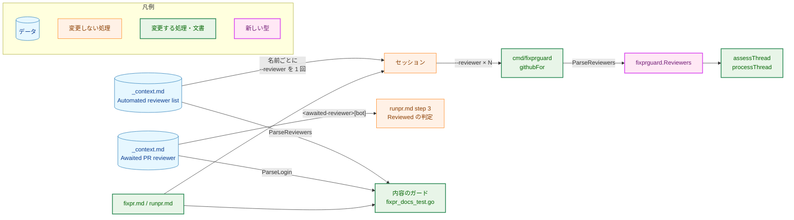
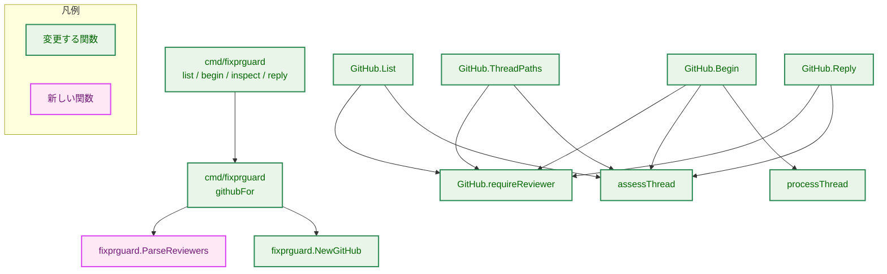
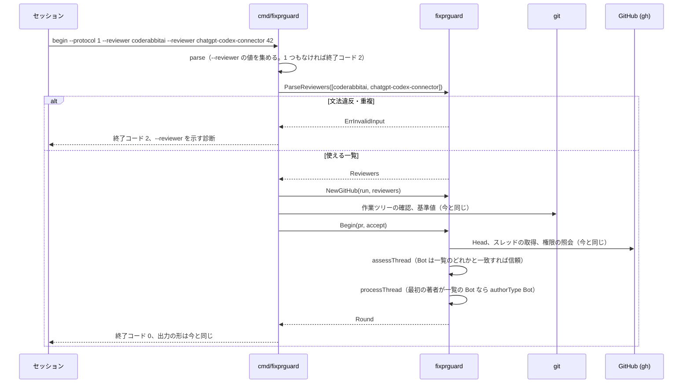
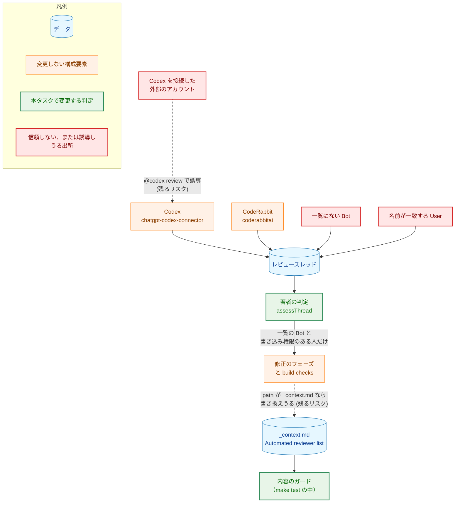
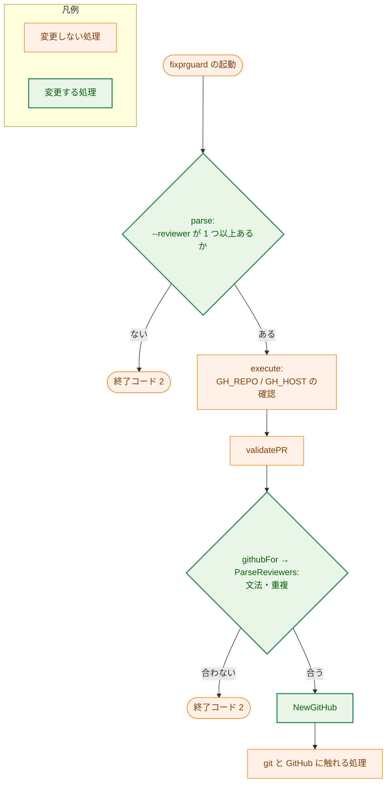
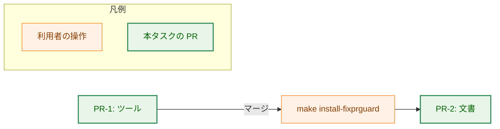

# アーキテクチャ設計書：fixprguard で複数の自動レビュアー（CodeRabbit と Codex）を信頼できるようにする

## Document Status

| Item | Value |
|---|---|
| Status | `draft` |
| Created | 2026-10-22 |
| Review date | - |
| Reviewer | - |
| Comments | - |

本書は [01_requirements.md](01_requirements.md)（要件定義書。以下、要件書）の設計である。既存のファイルに関する記述は、コミット `e5db595` のファイルで確かめた。`file:line` はこのコミットの行番号を指す。F-NNN・AC-NN は要件書の項番を、H-NN は [design_handoff.md](design_handoff.md) の項番を指す。申し送り H-01〜H-04 への対応は付録 A にまとめる。

本書は次の用語を、要件書 6 節と `docs/translation_glossary.md` と同じ意味で使う: 自動レビュアー、自動レビュアーの一覧、待つ PR レビュアー、信頼する著者、信頼する著者のスレッド、想定外の著者のスレッド、名指し、ガードツール（`fixprguard`）、セッション、フェーズ。ほかに次の用語を使う。

-   **文書のガード:** コマンドの文書と `_context.md` を読んで検査するテストの総称（要件書 AC-02 の「文書のガードのテスト」）。本書では次の 2 つを区別する。
    -   **内容のガード:** `cmd/yt2column/fixpr_docs_test.go`。`_context.md`・`fixpr.md`・`runpr.md`・用語集の記述を検査する。
    -   **呼び出しのガード:** `cmd/fixprguard/docs_test.go` の `TestDocumentedInvocationsParse`。文書に書いた `fixprguard` の呼び出しを、ツール自身の引数の解析に通す。

## 1. 設計の全体像 (Design Overview)

### 1.1. 設計原則

-   **信頼の判定の規則は変えず、比べる相手だけを 1 つの名前から自動レビュアーの一覧に変える。** 判定の表（`docs/tasks/0030_fixpr_untrusted_threads/02_architecture.md` 3.3）の `Bot` の行の「`login` が自動レビュアーの名前と一致」を、「一覧のどれかと一致」に変えるだけにする。理由 (a)〜(f)、権限の照会、照会の上限、取得の 2 段階は変えない。
-   **一覧の不変条件は型で保証する。** 空でないこと、各名前が `login` の文法に合うこと、重複がないことを、`fixprguard` パッケージの新しい型 `Reviewers` の唯一の構築関数 `ParseReviewers` が保証する（3.2）。「唯一」であることは、既存の `TestRestrictedTypesBuiltByConstructors`（`internal/fixprguard/construction_test.go`）に `Reviewers` を登録して機械的に確かめる。`cmd/fixprguard` のフラグの解析と内容のガードは、どちらもこの関数を通す。同じ検査を 2 か所に書かない（`CLAUDE.md`「Enforce invariants with the type, not with convention」「DRY」）。
-   **ツールは `_context.md` を読まない。** 名前は呼び出し元が `--reviewer` で渡す（0030 の `02_architecture.md` 1.2・5.3。要件書 2.3・5 節）。
-   **自動レビュアーの一覧と待つ PR レビュアーは、別々の値として `_context.md` に置く。** 一覧は「誰のスレッドを信頼するか」を、待つ PR レビュアーは「`/runpr` が何をもってレビュー済みとするか」を決める（要件書 1 節）。
-   **古いツールと新しい文書の組み合わせは、誤った判定をせずに止まる。** `protocol` の番号は上げない。ツールの変更を先にマージして再インストールし、その後に文書を切り替える（1.2・6.2・8 章）。

### 1.2. 設計の際に決めたこと（2026-10-22）

利用者に確かめて決めたこと:

-   **`protocol` の番号は上げず、ツールと文書を 2 つの PR に分ける（H-01）。** PR-1 でツールを変え（`--reviewer` を繰り返し受け付ける）、マージして `make install-fixprguard` を実行した後に、PR-2 で `_context.md`・`fixpr.md`・`runpr.md`・用語集・内容のガードを一覧に切り替える。理由は次のとおりである。
    -   新しいツールは、`--reviewer` を 1 回だけ渡す今の文書と同じ結果を返し、出力の形も変えない（AC-04、要件書 4.4）。PR-1 のマージから PR-2 のマージまでの間も、どの worktree の文書でも今までどおり動く。
    -   古いツールは、`--reviewer` を 2 回渡されると引数の解析で止まり、使い方のエラー（終了コード `2`）になる（`cmd/fixprguard/main.go:186-195`）。誤った判定をせずに止まる。
    -   番号を上げると、呼び出しのガードが文書の `--protocol` をバイナリの番号で解析する（`cmd/fixprguard/docs_test.go:89-116`）ので、ツールと文書を同じ PR で変えることになる。すると、その PR 自体の `/runpr`・`/fixpr` が、ブランチの文書（`--protocol 2`）とインストール済みのツール（`1`）の食い違いで止まる。
    -   これは、ガイドの「引数の契約を変えたら `Protocol` を上げる」（`docs/dev/developer_guide/fixprguard_guide.md:276`）の例外である。扱いは 1.4 に書く。
-   **文書のコードブロックは `--reviewer <reviewer>` を 1 つだけ書き、定義の文で「一覧の名前ごとに 1 回ずつ繰り返す」と定める（AC-10）。** 名前の数を文書に書かないので、一覧を変えても文書を変えずに済む（要件書 4.5）。呼び出しのガードは、各呼び出しの `--reviewer` がちょうど 1 つのプレースホルダーであることを確かめる（3.4）。数を固定して `--reviewer <reviewer-1> --reviewer <reviewer-2>` と書く案は、一覧を変えるたびに文書を変えることになるので採らない。セッションが名前を渡し忘れても、その Bot のスレッドが理由 (b)（`other-bot`）で信頼されないだけで、安全側に倒れる（5.2）。
-   **古いツールで止まったときの案内は、ガイドだけに書く（要件書 4.3）。** 解析の段階の使い方のエラーの診断は、すでにガイドのパスを示す（`cmd/fixprguard/main.go:255`）。ガイドの終了コード `2` の説明に、診断が `flag given twice: --reviewer` を含むときはツールが古いので `make install-fixprguard` で直ること、インストール済みのツールの版は `go version -m "$(command -v fixprguard)"` の `vcs.revision` で確かめられることを書き足す。新しいツールが同じ名前の重複を拒否するときの診断（4 章）はこの文字列を含まないので、2 つは取り違えない。`fixpr.md`・`runpr.md` には書き足さない。止まるのは再インストールまでの一時的な状態であり、手順書に恒久的な分岐を足すほどではないためである。

設計で決めたこと:

-   **`_context.md` の一覧は、表の 1 行に置く（H-02）。** 行の名前（1 列目）は `Automated reviewer list` とする。値のセルは、バッククォートで囲んだ名前を `, `（カンマと空白 1 つ）で区切った並び、` — `（前後に空白のある em ダッシュ）、説明の文の順に書く。内容のガードは、最初の ` — ` より前だけを名前の並びとして読む。その部分がこの形に厳密に合わなければ、ガードは失敗する（3.4）。説明の文の中のコード（`[bot]` など）は、名前として読まない。
-   **待つ PR レビュアーは、別の行 `Awaited PR reviewer` に置く（AC-03）。** 値のセルは、バッククォートで囲んだ名前ちょうど 1 つ、` — `、説明の文の順に書く。説明の文は、REST の `user.login` の形がその名前に `[bot]` を付けたものであることを述べる。今の `Automated reviewer` の行（`.claude/commands/_context.md:185`）は、この 2 行に置き換えてなくす。
-   **`runpr.md` step 3 は、待つ PR レビュアーを新しいプレースホルダー `<awaited-reviewer>` で参照する（AC-11）。** 今の `<reviewer>[bot]`（`.claude/commands/runpr.md:216-224`）を `<awaited-reviewer>[bot]` に変える。`<reviewer>` は `--reviewer` の値だけを指すので、2 つの役割を 1 つのプレースホルダーで兼ねない。
-   **名前の重複の拒否は `ParseReviewers` だけで行い、フラグの解析では行わない（H-03）。** `--reviewer` は `--accept`・`--thread` と同じく、値を集めるフラグにする（`cmd/fixprguard/main.go:213`）。文法・重複・空の検査は、`githubFor` が `ParseReviewers` を呼んで行う。`githubFor` は、`list`・`begin`・`inspect`・`reply` の中で、GitHub にも git にも触れる前に呼ばれる（`cmd/fixprguard/main.go:427`・`465`・`545`・`616`。それより前に呼ばれる `validatePR` は値の検査だけで、外部のコマンドを起動しない）。そのため、AC-07 の「GitHub にも git にも触れずに止まる」が成り立つ。この順序は型では強制されないので、4 つのサブコマンドのそれぞれについてテストで確かめる（7.1）。
-   **セッションは、1 回の実行で使う `--reviewer` の並びを最初に 1 度だけ作り、その実行のすべての呼び出しで同じものを使う。** `/fixpr` では Phase 1 の `begin` の前、`/runpr` では最初の `fixprguard` の呼び出しの前に作る。修正のフェーズが `_context.md` を書き換えうる（要件書 4.2）ので、実行の途中で `_context.md` を読み直して作り直すと、`begin` と `inspect`・`reply` の判定に使う一覧が食い違いうる。とくに、`inspect` の一覧が `begin` より広いと、名指しで処理したスレッドが `inspect` で信頼する著者のスレッドと判定され、名指しされたスレッドの狭い範囲の規則ではなく、信頼する著者のスレッドの広い範囲の規則が、判定の後で適用される（0030 の `02_architecture.md` 3.6 の規則 4）。この定めは `<reviewer>` の定義の文に含める（3.5）。

### 1.3. なぜ今の仕組みのままでは足りないか

今の仕組みは、自動レビュアーの名前を 1 つだけ受け取る。`--reviewer` は値を 1 つしか持てない（`cmd/fixprguard/main.go:186-195`）。`GitHub` は `Login` を 1 つだけ持つ（`internal/fixprguard/github.go:30-33`）。判定は、その 1 つとだけ比べる（`internal/fixprguard/trust.go:86`、`internal/fixprguard/github.go:393`）。このままでは、CodeRabbit と Codex の両方を名指しなしで信頼することを求める AC-05 を満たせない。

一覧の名前を 1 つの値に詰めて渡す案（`--reviewer coderabbitai,chatgpt-codex-connector`）は、issue #405 で採らないと決めている（要件書 1 節「`--reviewer` を繰り返し指定できる形にする」）。

### 1.4. 0030 の設計とガイドの方針との関係

本タスクは、次の 3 点を変える。いずれも issue #405 の目的によるもので、0030 の設計書（`docs/tasks/0030_fixpr_untrusted_threads/02_architecture.md`）は書き換えない。

| 元の方針（場所） | 本タスクでの扱い | 古い振る舞いを確かめているテスト |
|---|---|---|
| 自動レビュアーの名前を `_context.md` に 1 つだけ置く（0030 の 1.2 の「自動レビュアーの名前は」。3.3 の判定の表。9 章の「信頼する著者の追加」） | 名前の一覧に変える。0030 の 9 章が「複数の自動レビュアーを信頼する場合は `NewGitHub` を変える」と予告していたとおりの変更である | `cmd/yt2column/fixpr_docs_test.go:41-44`（`reviewerSentence`）・`336-363`（`TestContextAndCommandsAgree`）、`cmd/fixprguard/docs_test.go:106`（`TestDocumentedInvocationsParse` の `--reviewer` の確認）、`internal/fixprguard/github_test.go:38-46`（`TestNewGitHub`）、`internal/fixprguard/trust_test.go:18`（`TestAssessAuthors`） |
| 値を 1 つだけ持つフラグを 2 回渡すと使い方のエラーにする。`--accept`・`--thread` だけが繰り返せる（`cmd/fixprguard/main.go:175-195`、`fixprguard_guide.md:60` の「Flag position」の行） | `--reviewer` を、繰り返せるフラグに加える。同じ名前の重複は `ParseReviewers` が拒否する。ほかのフラグ（`--protocol`・`--baseline` など）を 2 回渡したときの拒否は変えない | `cmd/fixprguard/main_test.go:95-99`（`TestAcceptThreadFlagParsing` の「`--reviewer` twice」）。この行は、値を 1 つだけ持つフラグを 2 回渡す拒否の唯一のテストなので、消さずに別のフラグ（たとえば `--baseline`）を 2 回渡す行に置き換える。`--reviewer` の重複は、`run` の終了コード `2` で確かめる新しいテストにする（7.1） |
| 引数か出力の契約を変えたら `Protocol` を上げる（`fixprguard_guide.md:276`。0030 の 1.2 の差分 9） | **例外として上げない。** ガイドの規則そのものは変えず、次の 3 つの条件がすべて成り立つ変更に限って上げなくてよいという但し書きを加える。本タスクはそれに当たる。(1) 古いツールは、新しい文書の呼び出し（`--reviewer` が 2 つ以上）を引数の解析で拒否し、古い規則で判定しない（`cmd/fixprguard/main.go:186-195`）。(2) 新しいツールは、古い文書の呼び出し（`--reviewer` が 1 つ）を今と同じ規則で判定する（AC-04）。(3) 出力の形は変えない（要件書 4.4）。但し書きの文言は 3.5 に書く | なし（`--protocol 1` は変わらないので、呼び出しのガードは今のまま通る） |

### 1.5. 概念モデル

名前の出所から判定までの経路を示す。図の矢印 A → B は「A の値または記述が B に渡る」を表す。



`STEP3` は、プレースホルダーの名前が変わるだけで、判定の方法は変わらない（AC-11）。そのため、変更しない処理として示す。

## 2. システム構成 (System Structure)

### 2.1. 全体構成

`fixprguard` の中で、自動レビュアーの一覧を使う箇所を示す。図の矢印 A → B は「A が B を呼ぶ」を表す。



`GitHub.List`・`Begin`・`ThreadPaths`・`Reply` の変更は、`g.reviewer` を `assessThread`・`processThread` に渡す箇所（`internal/fixprguard/github.go:328`・`380`・`466`・`519`、`internal/fixprguard/write.go:126`）が `g.reviewers` に変わることだけで、処理の順序は変わらない。`ThreadPaths` は `inspect` から呼ばれる。

### 2.2. コンポーネント配置

新しいパッケージは作らない。変更は、既存の `internal/fixprguard`・`cmd/fixprguard`・コマンドの文書・ガイド・文書のガードの中に収まる。PR の欄は 8 章の順序を示す。

| ファイル | 変更 | PR |
|---|---|---|
| `internal/fixprguard/types.go` | `Reviewers` と `ParseReviewers` を加える（3.2） | PR-1 |
| `internal/fixprguard/github.go` | `GitHub` が `Reviewers` を持つ。`NewGitHub` の引数を `Reviewers` にし、使えない `Reviewers` を拒否する。`requireReviewer` は `Reviewers` が使えることを確かめる。`processThread` は `Reviewers` で `authorType` を決める（AC-08）。`NewGitHub`・`processThread` のコメントを改める | PR-1 |
| `internal/fixprguard/trust.go` | `assessThread` の引数を `Reviewers` にし、`Bot` の判定を「一覧のどれかと一致」にする（AC-05・AC-06）。`assessThread` のコメントを改める | PR-1 |
| `internal/fixprguard/write.go` | `Reply` の `assessThread` の呼び出しに `g.reviewers` を渡す | PR-1 |
| `internal/fixprguard/construction_test.go` | `restrictedConstructors` に `Reviewers`→`ParseReviewers` を加える（3.2）。`Reviewers` は `zeroLiteralAllowed` に入れない。「`NewGitHub` rejects a zero Login」のコメントを `Reviewers` に合わせる | PR-1 |
| `cmd/fixprguard/main.go` | `--reviewer` を値を集めるフラグにする。必須のフラグの確認が、値を集めるフラグにも働くようにする（今は `inv.values` だけを見る。`cmd/fixprguard/main.go:218-221`）。`githubFor` は `ParseReviewers` を呼び、エラーに `--reviewer` を付ける（AC-07）。`flagValue` のコメント（`main.go:175-177`）を改める | PR-1 |
| `internal/fixprguard/*_test.go`・`test_helpers.go`、`cmd/fixprguard/main_test.go`・`test_helpers.go` | 7 章のテスト。`newTestGitHub`（`internal/fixprguard/test_helpers.go:205-213`）を `Reviewers` で作る | PR-1 |
| `cmd/fixprguard/docs_test.go` | 呼び出しのガードが、`--reviewer` を取る各呼び出しで、`--reviewer` の値がちょうど 1 つで、それがプレースホルダー `<reviewer>` であることを確かめる（今は `inv.values` を読む。`cmd/fixprguard/docs_test.go:106`。直さないと、`--reviewer` の値が `inv.values` に入らなくなるので、この確認が何も検査しないまま通る）。`reviewerPlaceholder` のコメント（`docs_test.go:57-58`）を改める | PR-1 |
| `docs/dev/developer_guide/fixprguard_guide.ja.md`・`fixprguard_guide.md` | ツールの振る舞いの記述（3.5 のガイドの PR-1 の項目） | PR-1 |
| `docs/dev/developer_guide/package_reference.md` | `internal/fixprguard` の説明を `Reviewers` に合わせる（AC-12） | PR-1 |
| `.claude/commands/_context.md` | `Automated reviewer` の行を、`Automated reviewer list` と `Awaited PR reviewer` の 2 行に置き換える（AC-01・AC-03） | PR-2 |
| `.claude/commands/fixpr.md` | `<reviewer>` の定義の文、「Untrusted threads」の信頼する著者の説明、ラウンド上限の説明（AC-10・AC-12） | PR-2 |
| `.claude/commands/runpr.md` | `<reviewer>` の定義の文、step 3 の `<awaited-reviewer>`（AC-10・AC-11） | PR-2 |
| `docs/dev/developer_guide/fixprguard_guide.ja.md`・`fixprguard_guide.md` | `_context.md` の一覧を参照する記述（3.5 のガイドの PR-2 の項目） | PR-2 |
| `docs/translation_glossary.md` | 「信頼する著者」の定義を改め、「自動レビュアー」「自動レビュアーの一覧」「待つ PR レビュアー」を加える（AC-13） | PR-2 |
| `cmd/yt2column/fixpr_docs_test.go` | `reviewerSentence`、`TestContextAndCommandsAgree`、`TestGlossaryTerms` を一覧に合わせる（3.4。AC-02・AC-03・AC-10・AC-11・AC-13） | PR-2 |

ガイドの英語版は、日本語版から翻訳する（`CLAUDE.md`「Translation Guidelines」。ガイドは developer_guide の例外で、両方の版を持つ）。

次のファイルは `@coderabbitai review` を含むが、変えない。レビューの依頼のコメントは 0031 の範囲である（要件書 2.3）: `.claude/commands/_lib/task-pr-handoff.md:190`、`.claude/commands/_lib/pr-review-escalation.md:9`、`CLAUDE.md:56`、`.claude/commands/runpr.md:238`。

### 2.3. データフロー: `/fixpr` の `begin`

自動レビュアーの一覧に 2 つの名前があるときの `begin` を示す。実線の矢印は呼び出しを、点線の矢印はその戻りを表す。



### 2.4. 既存の挙動の確認

次の事実を、コミット `e5db595` で確かめた。

-   `--reviewer` を 2 回渡すと、`flagValue.Set` が `errFlagTwice` を返し（`cmd/fixprguard/main.go:190-192`）、`parse` が `errUsage` で失敗する。`run` は診断にガイドのパスを付けて終了コード `2` を返す（`cmd/fixprguard/main.go:253-257`）。古いツールが新しい文書で止まるときの振る舞いである。
-   値を集めるフラグは `--accept` と `--thread` だけである（`cmd/fixprguard/main.go:213`）。
-   必須のフラグの確認は `inv.values` だけを見る（`cmd/fixprguard/main.go:218-221`）。`--reviewer` を値を集めるフラグにするなら、この確認も変える必要がある。
-   `processThread` は、`ParseLogin` を通さない `first.loginRaw` を `reviewer.String()` と文字列で比べる（`internal/fixprguard/github.go:393`）。`assessThread` は `ParseLogin` を通した `Login` で比べる（`internal/fixprguard/trust.go:42-46`・`86`）。本タスクでは、`processThread` も `ParseLogin` を通した `Login` で比べる形に揃える（3.3）。
-   `Bot` で `login` が文法に合わないもの（たとえば `coderabbitai[bot]`）は、`authorsOf` で `Login` にならず、理由 (c) になる（`internal/fixprguard/trust.go:42-46`・`81-82`。テスト `internal/fixprguard/trust_test.go:116` の `bot_login_outside_grammar`）。
-   `head`・`fence`・`finish`・`push`・`edit-pr` の `spec` は `--reviewer` を持たないので、フラグの解析が拒否する（`cmd/fixprguard/main.go:104-118`）。この振る舞いは変えない（AC-09）。

## 3. コンポーネント設計 (Component Design)

### 3.1. `fixprguard` の引数

| 項目 | 今 | 本タスクの後 |
|---|---|---|
| `--reviewer` を受け付けるサブコマンド | `list`・`begin`・`inspect`・`reply` | 同じ（AC-04・AC-09） |
| 回数 | ちょうど 1 回 | 1 回以上。各値が 1 つの名前 |
| 1 つもない | 使い方のエラー（`--reviewer is required`） | 同じ（AC-07） |
| 同じ名前を 2 回以上 | 使い方のエラー（`flag given twice`） | 使い方のエラー。診断は `--reviewer` を示す（AC-07） |
| 違う名前を 2 回以上 | 使い方のエラー | 受け付ける |
| 文法に合わない値 | 使い方のエラー。診断に値を書かない | 同じ。診断は `--reviewer` を示す（AC-07） |
| 値の数の上限 | - | 設けない（要件書 3.2） |
| 渡す順序 | - | 意味を持たない。判定は集合として行い、出力は順序によらない |
| `--protocol` | `1` | `1` のまま（1.2） |

出力の形（`list` の `findings`、`begin` の `authorType` など）は変えない（要件書 4.4）。

### 3.2. 型と interface

主な型だけを示す。

```go
package fixprguard

// Reviewers is the set of automated reviewer logins whose Bot comments are
// trusted without a permission lookup. It is never empty and holds no name
// twice. The zero value is "no reviewers": NewGitHub rejects it and the calls
// that judge threads refuse to run with it. Only ParseReviewers builds a
// usable one.
type Reviewers struct {
	logins map[Login]struct{}
}

// ParseReviewers checks every name against the login grammar and rejects an
// empty list and a name given twice (compared as exact strings, with no case
// folding and no [bot] handling). Its errors wrap ErrInvalidInput and name the
// rule only, never a value.
func ParseReviewers(names []string) (Reviewers, error)

// NewGitHub fails when reviewers is not usable, so a missing --reviewer stops
// the run instead of trusting no bot or a default one.
func NewGitHub(run cmdrunner.InputRunner, reviewers Reviewers) (*GitHub, error)
```

-   **集合として持つ。** 名前を含むかの判定は名前の順序によらず、1 回の判定が名前の数に比例しない（`CLAUDE.md`「Use `map[T]struct{}` rather than `map[T]bool` for set semantics」）。
-   **構築関数の強制。** `restrictedConstructors`（`internal/fixprguard/construction_test.go:17-21`）に `Reviewers`→`ParseReviewers` を加え、`ParseReviewers` の外で `Reviewers` のリテラル・`new`・`var` 宣言を書くとテストが失敗するようにする。`Reviewers` は `zeroLiteralAllowed` に入れない。`Baseline` と違い、ゼロ値を構築関数の外で作る必要のある箇所を想定していないためである。`NewGitHubWithoutReviewer`（`internal/fixprguard/github.go:51-56`）は `GitHub` のリテラルで `Reviewers` のフィールドを省くだけなので、この検査に触れない。
-   **公開する範囲。** `Reviewers` が名前を含むかを調べるメソッドと、使えるかを調べるメソッドは、パッケージの外に出さない。`cmd/fixprguard` と内容のガードが使うのは `ParseReviewers` と `NewGitHub` だけである。
-   **`NewGitHubWithoutReviewer` は変えない。** これが作る `GitHub` の `Reviewers` はゼロ値なので、スレッドを判定する呼び出しは今と同じく拒否する。
-   **引数を `[]string` にする理由。** `cmd/fixprguard` のフラグの値と、内容のガードが `_context.md` から読む名前は、どちらも文字列の並びである。`[]Login` を受け取る形にすると、呼び出し元がそれぞれ `ParseLogin` を回すことになる。

### 3.3. 信頼の判定（F-002）

判定の表（0030 の `02_architecture.md` 3.3）の `Bot` の行と、名前が一致する `User` を次のように定める。ほかの行（`login` が文法に合わない著者は (c)、`__typename` が `User`・`Bot` 以外は (f) など）は変えない。

| 著者の種類（GraphQL `__typename`） | 判定 | 理由 |
|---|---|---|
| `Bot` で、`login` が `Reviewers` のどれかの名前と完全に一致 | 信頼する。権限の照会はしない（AC-05） | - |
| `Bot` で、`login` が文法に合い、`Reviewers` のどの名前とも一致しない | 信頼しない。権限の照会もしない（AC-06） | (b)。`account` に名前を付ける |
| `User` で、`login` が `Reviewers` のどれかの名前と一致 | 自動レビュアーとして扱わず、権限の照会で判定する（AC-06。今の `User` の行と同じ） | (a)、照会できなければ (d) |

-   **一致の比べ方。** 大文字と小文字を区別した文字列の完全な一致である。`ParseLogin` も `ParseReviewers` も値を変換しないので、大文字と小文字だけが違う名前は一致せず、理由 (b) になる（AC-05、要件書 3.2）。`[bot]` を付けた名前と前後に空白のある名前は `login` の文法に合わないので、GitHub の応答にあれば理由 (c)（2.4）、`--reviewer` に渡せば使い方のエラーになる。
-   **混ざったスレッド。** スレッドの判定は、各コメントの著者の判定を集めるだけなので、`coderabbitai` の `Bot` と `chatgpt-codex-connector` の `Bot` が混ざったスレッドも、ほかの条件（0030 の AC-04〜AC-06）を満たせば信頼する著者のスレッドになる（AC-05）。
-   **`authorType`（AC-08）。** `processThread` は、最初のコメントの著者が `Bot` で、その名前が `ParseLogin` を通り、`Reviewers` のどれかと一致するときだけ `Bot` とする。それ以外は `User` である。`assessThread` と同じ `Reviewers` を同じ比べ方で使うので、2 つの判定は 1 回の実行の中で食い違わない。`fixpr.md` のラウンド上限（`.claude/commands/fixpr.md:94-101`）は、一覧のどの自動レビュアーが開いたスレッドにも同じく働く。
-   **`reply` の書き込みの前の判定。** `Reply` も、同じ `g.reviewers` で判定し直す（`internal/fixprguard/write.go:126`）。`list`・`begin`・`inspect`（`ThreadPaths`）・`reply` の判定は、どれも `assessThread` 1 つで行う（AC-05 の最後の文）。サブコマンドは別々のプロセスなので、呼び出しをまたいで同じ一覧が使われることは、文書の定め（1.2 の最後の項目）に依存する。

### 3.4. `_context.md` と文書のガード（F-001・F-003）

**`_context.md` の 2 行。** 次の形にする（説明の文は実装で決める。ここでは形だけを示す）。

```
| Automated reviewer list | `coderabbitai`, `chatgpt-codex-connector` — <説明。GraphQL の author.login の形であること、fixpr.md・runpr.md が 1 つずつ --reviewer で渡すこと、スレッドを信頼する Bot はこの一覧の名前の Bot であること> |
| Awaited PR reviewer | `coderabbitai` — <説明。GraphQL の形であること、REST の user.login の形はこの名前に [bot] を付けたものであること、runpr.md step 3 がレビュー済みの判定に使うこと> |
```

`Automated reviewer list` の説明の文は、1 つの Bot だけを信頼するとは述べない（AC-01）。今の行の「It is the only Bot whose review threads are trusted」（`.claude/commands/_context.md:185`）はなくす。

**内容のガード（`cmd/yt2column/fixpr_docs_test.go`）。** `TestContextAndCommandsAgree` を次の検査に改める。

1.  `Automated reviewer list` の行の値のセルを、最初の ` — ` で切る。前の部分が「バッククォートで囲んだ名前を `, ` で区切った並び」に厳密に合うことを確かめる。合わなければ失敗する。` — ` がないとき、前の部分が空のとき、区切りの形が違うときも失敗する。
2.  取り出した名前を `fixprguard.ParseReviewers` に通す。空の一覧、文法に合わない名前、重複は、ここで失敗する（AC-02）。ツールと同じ関数なので、ガードとツールの受け入れる形が食い違わない。
3.  自動レビュアーの一覧がちょうど `coderabbitai` と `chatgpt-codex-connector` の 2 つであることを確かめる（AC-01）。この確認は、一覧の書き換え（要件書 4.2 の残るリスク）に対する守りも兼ねる（5.2）。
4.  `Awaited PR reviewer` の行の値のセルを最初の ` — ` で切り、前の部分がバッククォートで囲んだ名前ちょうど 1 つであることを確かめる。2 つ以上の名前、`, ` を含む並び、空は失敗する。取り出した名前を `fixprguard.ParseLogin` に通す（AC-03）。
5.  `fixpr.md` と `runpr.md` の本文から、許す文字列 `@<待つ PR レビュアー> review` を取り除いた残りに、一覧のどの名前も、待つ PR レビュアーの名前も現れないことを確かめる（AC-11）。名前に `[bot]` を付けた形はその名前を含むので、この検査で同時に拒否される。
6.  両方の文書が、`<reviewer>` の定義の文（`--reviewer <reviewer>` を一覧の名前ごとに 1 回ずつ繰り返すこと、1 回の実行の中で同じ並びを使うことを定める文）を含むことを確かめる（AC-10）。`runpr.md` は、`<awaited-reviewer>` の定義の文も含む（AC-11）。

`TestGlossaryTerms` に、「自動レビュアー」（automated reviewer）、「自動レビュアーの一覧」（automated reviewer list）、「待つ PR レビュアー」（awaited PR reviewer）の 3 行を加える（AC-13）。

**呼び出しのガード（`cmd/fixprguard/docs_test.go`）。** `--reviewer` を取る各呼び出しで、`--reviewer` の値がちょうど 1 つで、それがプレースホルダー `<reviewer>` であることを確かめる（1.2 の 2 つめの項目の定めを機械的に保つ）。プレースホルダーは名前の文法に合わないので、文書の呼び出しは `parse` には受け入れられるが、`ParseReviewers` には受け入れられない。このガードは今と同じく `parse` だけを使う。

### 3.5. コマンドの文書とガイド（F-003）

-   **`fixpr.md`・`runpr.md` の `<reviewer>` の定義（PR-2）。** 次の趣旨の文にする（AC-10）。名前そのものは書かない。
    -   `--reviewer <reviewer>` は、`_context.md` の `Automated reviewer list` の名前ごとに 1 回ずつ書く `--reviewer` を表す。一覧のすべての名前を、GraphQL の形のまま渡す。
    -   その並びは、実行の最初（`fixpr.md` では Phase 1 の前、`runpr.md` では最初の `fixprguard` の呼び出しの前）に 1 度だけ作り、その実行のすべての呼び出しで同じものを使う。実行の途中で `_context.md` を読み直して作り直さない（1.2）。
-   **`fixpr.md` の「Untrusted threads」（PR-2）。** 信頼する著者を「書き込み権限を持つ人、または一覧のどれかの名前の Bot」と書く（`.claude/commands/fixpr.md:142-143` の「the automated reviewer `<reviewer>`」を改める。AC-12）。
-   **`fixpr.md` のラウンド上限（PR-2）。** 「一覧のどれかの自動レビュアーが開いたスレッド」と書く（`.claude/commands/fixpr.md:94-95`。AC-12）。
-   **`runpr.md` step 3（PR-2）。** `<awaited-reviewer>[bot]` で PR レビューと PR のコメントを絞り込む。照合の行、LAST_REVIEWED の決め方、`@coderabbitai review` の依頼のコメントは変えない（AC-11）。
-   **ガイド（日本語版と英語版）の PR-1 の項目。** ツールの振る舞いだけを、`_context.md` の行の名前に触れずに書く。PR-1 の時点の `_context.md` には一覧の行がまだないためである。
    -   信頼する著者の説明（`fixprguard_guide.md:11`）を「`--reviewer` で渡した名前のどれかの Bot」にする。
    -   `--reviewer` の行（`fixprguard_guide.md:58`）を「1 回以上必須。名前ごとに 1 回ずつ渡す。1 つもないとき、同じ名前を 2 回以上渡したとき、文法に合わないときは使い方のエラー」にする。
    -   「Flag position」の行（`fixprguard_guide.md:60`）の、繰り返せるフラグに `--reviewer` を加え、同じ名前は拒否することを書く。
    -   サブコマンドの見出し（`fixprguard_guide.md:87`・`106`・`141`・`175`）の `--reviewer LOGIN` を、繰り返せることが分かる `--reviewer LOGIN ...` にする（`--accept ID=FINGERPRINT ...` と同じ書き方）。各節の呼び出しの例（`fixprguard_guide.md:92` など）は、`--reviewer` を 1 つ書いた形のままでよい（AC-04 によって、1 回だけ渡す呼び出しも正しい）。
    -   終了コード `2` の説明に、古いツールの案内（1.2 の 3 つめの項目。`flag given twice: --reviewer` の文字列と `go version -m`）を加える。
    -   `other-bot` の行（`fixprguard_guide.md:100`）を「`--reviewer` で渡したどの名前とも一致しない Bot」にする。
    -   §7.2 の「保証しないこと」（`fixprguard_guide.md:246`）の `--reviewer` の値の行を、渡した値の集合について述べる形にする。
    -   §9 の `Protocol` の規則（`fixprguard_guide.md:276`）に、1.4 の 3 つの条件がすべて成り立つ変更だけは番号を上げなくてよい、という但し書きを加える。規則そのものは変えない。
-   **ガイドの PR-2 の項目。** 信頼する著者の説明と `--reviewer` の行に、渡す名前は `_context.md` の `Automated reviewer list` のすべての名前であることを加える。自動レビュアーを一覧から外すときの手順（9 章）を加える。
-   **`package_reference.md`（PR-1）。** `internal/fixprguard` の説明（`docs/dev/developer_guide/package_reference.md:21`）の「the reviewer bot's `Login`」「by the reviewer bot」を、`ParseReviewers` が作る `Reviewers` と「一覧のどれかの Bot」に改める（AC-12）。

### 3.6. 副作用の契約

本タスクは、副作用を持つフラグやモードを加えない。`--reviewer` の数は、どのスレッドを処理するか（つまり、どのスレッドの本文を取得し、修正し、返信するか）を変えるだけで、副作用の種類は変えない。使い方のエラーで止まるときは、GitHub にも git にも触れない（AC-07、1.2）。

## 4. エラーハンドリング設計 (Error Handling Design)

新しいセンチネルエラーは作らない。`ParseReviewers` の失敗は、既存の `ErrInvalidInput` を包む。`cmd/fixprguard` の `stop` は、`ErrInvalidInput` を使い方のエラー（終了コード `2`、標準出力なし）に写す（`cmd/fixprguard/main.go:278-283`）。

| 状況 | 検出する場所 | 終了コード | 診断 |
|---|---|---|---|
| `--reviewer` が 1 つもない | `parse` の必須のフラグの確認 | `2` | `--reviewer is required` とガイドのパス（今と同じ） |
| 同じ名前を 2 回以上 | `githubFor` → `ParseReviewers` | `2` | `--reviewer` と、拒否した規則の名前。名前は書かない |
| 文法に合わない値 | `githubFor` → `ParseReviewers` | `2` | `--reviewer` と、拒否した規則の名前（`login grammar`）。値は書かない |
| 古いツールに 2 つ以上の `--reviewer` | 古いツールの `parse`（Go の `flag` パッケージの書式） | `2` | `flag given twice: --reviewer` を含み、ガイドのパスを示す。ガイドの終了コード `2` の説明が再インストールを案内する |
| 一覧にない `Bot` | `assessThread` | `0` | エラーではない。理由 (b)（`other-bot`、`account` に名前）として出力に入る（AC-06） |

フラグの名前 `--reviewer` は `cmd/fixprguard` の `githubFor` が付け、`internal/fixprguard` には持ち込まない。診断の中での並び順と規則の名前の文言は実装で決める。どの場合も、診断は `--reviewer` を示し、GitHub から得た値と、文法に合わない入力の値は書かない（AC-07）。今の `githubFor` は `ParseLogin` のエラー（`login grammar`）をそのまま返し、フラグの名前を示さない（`cmd/fixprguard/main.go:377-383`）。本タスクで `--reviewer` を付ける。

## 5. セキュリティ考慮事項 (Security Considerations)

### 5.1. 脅威モデル

本タスクが変えるのは、どの `Bot` のスレッドを、名指しなしで修正のフェーズに渡すかである。図の矢印 A → B は「A が B に働きかける、または A のテキストが B に届く」を表す。点線の矢印は、本タスクの後も残るリスクの経路を表す。



### 5.2. 守りの対応

-   **信頼を広げるのは、一覧の名前と一致する `Bot` だけである。** 一覧にない `Bot` は理由 (b)、名前が一致する `User` は権限の照会、著者を確かめられないコメントは理由 (c)・(f) で、0030 と同じく信頼しない（3.3。要件書 4.2）。
-   **本文の扱いと変更の範囲の確認は変えない。** Codex のスレッドの本文も、区切りのブロックでデータとして渡し、変更の範囲の確認（0030 の `02_architecture.md` 3.6）を通った変更だけが build checks に届く。
-   **名前の比べ方を緩めない。** 完全な一致だけを一致とし、変換しない（3.3）。`login` の文法は ASCII の英数字とハイフンだけなので、見た目の似た別の文字の名前は文法で落ちる。
-   **重複を拒否する。** 同じ名前を 2 回書いたもの（別の名前を書くつもりで写し間違えたもの）は、内容のガード（AC-02）とツール（AC-07）の両方で表に出る。ツールの側では、重複は集合の判定の結果を変えないが、`_context.md` か文書の書き間違いの兆しなので止める（`CLAUDE.md`「Reject, don't normalize」）。
-   **名前の渡し忘れは安全側に倒れる。** セッションが一覧の名前の一部しか渡さないと、渡さなかった Bot のスレッドは理由 (b) で想定外の著者のスレッドになり、本文を取得しない。`begin` と `list` の出力は、その Bot の名前を `account` に示すので、利用者は報告から渡し忘れに気づける。
-   **一覧の書き換えは、内容のガードで止まる。** 内容のガードは、自動レビュアーの一覧がちょうど決めた 2 つの名前であることを確かめる（3.4 の 3）。修正のフェーズが信頼する著者のスレッド（`path` が `_context.md`）から一覧に名前を加えると、`finish` の `make test` でこのガードが失敗し（`build-checks-failed`）、コミットされない。ガードの期待値を同時に変えるには、`cmd/yt2column/fixpr_docs_test.go` を変える必要がある。これは `_context.md` と別のディレクトリの `.go` のファイルなので変更の範囲の外であり、`inspect` が利用者に確かめる（終了コード `3`）。この守りは確認の厳しさに依存するので、この確認を「解析に通って空でない」程度に緩めると、この守りがなくなる（9 章）。ただし、セッションが同じ実行の中で書き換えた `_context.md` を読み直すことは、文書の定め（1.2）で防ぐだけで、ツールは検出しない。

### 5.3. 残るリスク

要件書 4.2 の 4 つ（外部の人による誘導、一覧の書き換え、`--reviewer` の値、Bot の同一性）を受け入れる。設計では、次のことが加わる。

-   **既存のスレッドへの誘導。** 混ざったスレッドを信頼する（AC-05）ので、外部の人が既存の CodeRabbit のスレッドに `@codex` を含むコメントを書き込んで Codex に返信させ、自分のコメントを消すと、そのスレッドは CodeRabbit と Codex のコメントだけになり、信頼する著者のスレッドになる。要件書 4.2 の「外部の人による誘導」が、Codex の新しいスレッドだけでなく、既存の CodeRabbit のスレッドにも及ぶ形である。Codex を接続していない外部のアカウントが依頼しても、Codex は決まった断りの文を返すだけである（0031 の `observations.md` の項目 8）。要件書 4.2 の「外部の人による誘導」の変形として、このリスクを受け入れる。
-   **一覧からの削除の伝わり方。** 各セッションは、作業しているブランチの `_context.md` を読む。`main` で一覧から名前を外しても、`main` を取り込んでいない開いたブランチでは、その Bot のスレッドの処理が続く。削除は、ブランチごとに `main` を取り込んだ時点で効く。急いで信頼をやめるときの手順は 9 章に書く。
-   **切り替えの間の worktree。** ツールのバイナリは、同じ利用者のすべての worktree で共有される（0030 の `02_architecture.md` 5.3 の「ガードツールの更新」）。PR-2 のマージの後も、`main` を取り込んでいないブランチの文書は `--reviewer` を 1 つだけ渡すので、そのブランチの Codex のスレッドは想定外の著者のスレッドとして報告される。安全側の振る舞いであり、ブランチに `main` を取り込めば解消する。
-   **`protocol` の番号で検出しない更新。** 番号を上げないので、古いツールが「`--protocol` が合わない」と止まることはない。古いツールが止まる理由は `flag given twice: --reviewer` の診断で示す（1.2・4 章）。

### 5.4. 観測のしやすさ

-   一覧にない `Bot` は、`list`・`begin` の出力の `findings` に `other-bot` と `account` で現れる（今と同じ）。Codex のスレッドが想定外の著者のスレッドとして報告されたときは、次の 3 つを確かめる。セッションが渡した `--reviewer` に `chatgpt-codex-connector` が入っていたか。インストール済みのツールが PR-1 の後のものか（`go version -m "$(command -v fixprguard)"` の `vcs.revision`）。ブランチの `_context.md` が PR-2 の後のものか。
-   出力は、判定に使った一覧を含まない（出力の形を変えないため。要件書 4.4）。セッションが一覧にない名前を余分に渡したことは、出力からは分からない。これは要件書 4.2 の「`--reviewer` の値」の残るリスクと同じである。
-   使い方のエラーの診断は、`--reviewer` を示す（4 章）。値を書かないので、どの名前が問題かは診断からは分からない。呼び出し元（セッション）は自分が渡した値を持っているので、それと `_context.md` を比べて特定する。

## 6. 処理フロー詳細 (Processing Flow Details)

### 6.1. `--reviewer` の検査

`list`・`begin`・`inspect`・`reply` の起動から、判定の準備ができるまでを示す。図の矢印は処理の順序を表す。



`validatePR` は値の検査だけで外部のコマンドを起動しない。`git と GitHub に触れる処理` の順序は今と同じである。

### 6.2. 切り替えの順序

PR-1 と PR-2 の間に、インストール済みのツールと文書の組み合わせがどう変わるかを示す。

| インストール済みのツール ＼ 文書 | 今の文書（`--reviewer` 1 つ） | PR-2 の後の文書（`--reviewer` が一覧の数だけ） |
|---|---|---|
| 今のツール | 今と同じ | 引数の解析で使い方のエラー（終了コード `2`）。誤った判定はしない |
| PR-1 の後のツール | 今と同じ（AC-04） | 一覧のすべての Bot を信頼する |



図の矢印 A → B は「A が終わってから B に進む」を表す。`make install-fixprguard` は、PR-1 をマージした後の `main` で実行する。PR-1 の `/runpr`・`/fixpr` は、今の文書と今のツールで動く。PR-2 の `/runpr`・`/fixpr` は、PR-2 のブランチの文書（`--reviewer` が 2 つ）と PR-1 の後のツールで動く。

**1 つのセッションの中の、文書と `_context.md` の食い違い。** `/runpr` は、`runpr.md` と `_context.md` を、PR のブランチに切り替える前に読む（`.claude/commands/runpr.md:6`・`134-140`）。そのため、PR-2 のマージの前後で別のブランチから始めた `/runpr` は、古い `runpr.md` と新しい `_context.md`（またはその逆）を組み合わせうる。どの組み合わせでも、渡す名前は新しい一覧の部分集合にとどまる。古い `runpr.md` が、新しい `_context.md` にはない `Automated reviewer` の行を参照したときは、セッションが名前を得られずに止まるか、一部の名前だけを渡して Codex のスレッドを信頼しないか、step 3 の約 15 分の待ちの上限（`.claude/commands/runpr.md:239-243`）で止まる。いずれも安全側である。

戻すときは逆の順にする。PR-2 を戻すと、文書は 1 つの `--reviewer` に戻り、PR-1 の後のツールで今までどおり動く。PR-2 を残したまま PR-1 を戻して再インストールすると、文書が 2 つの `--reviewer` を渡すので、PR-2 も戻すまで、ツールが使い方のエラーで止まる。

## 7. テスト戦略 (Test Strategy)

ユニットテストは `gh` を呼ばない。GitHub は、`cmdrunner.Runner` の fake（`internal/cmdrunner/testutil`）で置き換える（0030 の `02_architecture.md` 7 章と同じ）。

### 7.1. ユニットテスト

-   **`ParseReviewers`（`internal/fixprguard/types_test.go`）。** 1 つの名前、2 つの名前を受け付けること。大文字と小文字だけが違う 2 つの名前は、重複ではないので受け付けること。空の一覧、文法に合わない名前（`coderabbitai[bot]`、空白を含む名前）、同じ名前の 2 回を拒否すること。エラーが `ErrInvalidInput` を包み、値を含まないこと。
-   **構築関数の強制（`internal/fixprguard/construction_test.go`）。** `ParseReviewers` の外で `Reviewers` を作るコードを、`TestRestrictedTypesBuiltByConstructors` が報告すること（既存の型と同じく、検査そのものの自己テストの行を加える）。
-   **判定の表（`internal/fixprguard/trust_test.go` の `TestAssessAuthors`）。** 名前を 2 つ持つ `Reviewers` で、次の行を別々に用意する（H-04、要件書 1 節の「判定の表に行を加える」）。
    -   1 つめの名前だけに一致する `Bot` は信頼する。
    -   2 つめの名前だけに一致する `Bot` は信頼する。
    -   両方の名前の `Bot` が混ざったスレッドは信頼する。
    -   どちらにも一致しない `Bot` は理由 (b)。
    -   大文字と小文字だけが違う `Bot` は理由 (b)。
    -   1 つめの名前、2 つめの名前のそれぞれと一致する `User` は、権限の照会で判定する。

    名前に `[bot]` を付けた `Bot` が理由 (c) になることは、既存の `TestAssessUnverifiableAuthor` の `bot_login_outside_grammar`（`internal/fixprguard/trust_test.go:116`）が確かめている。この行は、名前を 2 つ持つ `Reviewers` でも同じ結果になることを確かめる形にする。
-   **`authorType`（`internal/fixprguard/github_test.go` の `TestBeginAuthorType`）。** 最初のコメントの著者が 1 つめの名前の `Bot`、2 つめの名前の `Bot` のスレッドは `Bot`、一覧にない `Bot` の名指しされたスレッドは `User` であること（AC-08）。
-   **`reply`（`internal/fixprguard/write_test.go`）。** 2 つめの名前の `Bot` のスレッドに、名指しなしで返信できること。一覧にない `Bot` のスレッドには `ErrThreadNotTrusted` で書き込まないこと（AC-05 の最後の文）。
-   **`ThreadPaths`。** 2 つめの名前の `Bot` のスレッドが `Named` でないこと（`inspect` の範囲の規則が、信頼する著者のスレッドとして働く）。
-   **順序によらないこと。** `--reviewer` の順序を逆にしても、`list`・`begin` の出力が同じであること。
-   **`NewGitHub`（`TestNewGitHub`）。** ゼロ値の `Reviewers` を拒否すること。
-   **引数（`cmd/fixprguard/main_test.go`）。**
    -   違う名前の `--reviewer` を 2 回渡すと受け付けること。
    -   `list`・`begin`・`inspect`・`reply` のそれぞれで、ほかの引数を正しい値にしたうえで、同じ名前を 2 回渡したとき、または文法に合わない値を渡したとき、`run` が終了コード `2` を返し、診断が `--reviewer` を含み、fake の `gh` と git に 1 回も届かないこと（AC-07。既存の「コマンドを起動しない」表、`cmd/fixprguard/main_test.go:100-128` に行を加える）。
    -   値を 1 つだけ持つフラグ（たとえば `inspect` の `--baseline`）を 2 回渡すと `parse` が `errUsage` で失敗すること（今の「`--reviewer` twice」の行の置き換え。1.4）。置き換えの後、`go tool cover -func` で `flagValue.Set` のカバレッジが変わらないことを確かめる（`CLAUDE.md`「Deleting a test is a claim that must be checked」）。
    -   `--reviewer` を 1 回だけ渡す既存のテストが、そのまま通ること（AC-04）。
    -   `TestReviewerFlag` が、受け付けないサブコマンドの拒否を今と同じく確かめること（AC-09）。

### 7.2. 壊して失敗を確かめる

各テストは、対象の実装を壊して失敗することを確かめてからコミットし、コミットメッセージに書く（`CLAUDE.md`「Testing Strategy」）。たとえば次の壊し方である。どの壊し方でどの行が失敗するかは、実装の後に壊して確かめる（H-04）。

-   `assessThread` が一覧の名前のうち 1 つとだけ比べる。
-   `processThread` が今の 1 つの名前の比較のまま。
-   `Reply` が `assessThread` に別の `Reviewers` を渡す。
-   `ParseReviewers` の重複の確認を外す。空の一覧の確認を外す。
-   比べる前に大文字と小文字をそろえる。
-   `inspect` で `githubFor` を `CheckState` の後に動かす（AC-07 の行）。
-   内容のガードで、名前の並びの形の確認、ちょうど 2 つの名前の確認を外す（`_context.md` の写しを壊した入力で失敗することを確かめる）。

2 つの層が同じ出力を作れる入力は、どちらの層のテストにもならない（`CLAUDE.md`「A layered path needs inputs only one layer can handle」）。`--reviewer` の重複は、フラグの解析ではなく `ParseReviewers` だけが拒否する設計なので、`run` のテストの重複の入力は `ParseReviewers` だけが止められる。`errFlagTwice` の経路は、`--reviewer` については使われなくなるが、値を 1 つだけ持つほかのフラグには残るので、そのテストを残す（7.1）。

### 7.3. 文書のガード

3.4 の内容のガードの検査を、PR-2 で入れる。呼び出しのガードの、値を集めるフラグへの対応は、フラグの変更と同じ PR-1 に入れる（2.2）。どちらも CI の `doc-guard` のジョブが実行する（AC-14）。

内容のガードは、`_context.md` の一覧の形が壊れたとき（空、文法違反、重複、区切りの違い、3 つめの名前）に失敗することを、`_context.md` の写しを壊して確かめる。

### 7.4. 結合テストとセキュリティテスト

-   **結合テスト。** `cmd/fixprguard` の既存の流れのテスト（`begin` から `reply` まで）に、2 つの名前を渡して 2 つめの名前の `Bot` のスレッドを処理する場合を 1 つ加える。
-   **セキュリティテスト。** 次が、要件書 4.2 の「信頼を広げるのは一覧の名前だけ」の検査にあたる。
    -   7.1 の判定の表の「一致しない `Bot`」「名前が一致する `User`」「大文字と小文字の違い」と、既存の `[bot]` 付きの行。
    -   引数の「重複・文法違反で GitHub にも git にも触れない」。
    -   内容のガードの「3 つめの名前を加えた一覧で失敗する」（5.2 の一覧の書き換えへの守り）。

## 8. 実装の優先順位 (Implementation Priorities)

実装計画（`/mkplan`）が PR の境界を決める。順序の制約は次のとおりである。

1.  **PR-1（ツール）。** `Reviewers` と `ParseReviewers`、`NewGitHub` と `assessThread`・`processThread`・`Reply` の変更、`cmd/fixprguard` のフラグ、7.1 のテスト、呼び出しのガード、ガイドの PR-1 の項目（日本語版、英語版の順）、`package_reference.md`。コマンドの文書と `_context.md` は変えないので、この PR の `/runpr`・`/fixpr` は、今のツールで今までどおり動く。
2.  **PR-1 のマージの後、利用者が `main` を更新して `make install-fixprguard` を実行する。** 今の `/runpr` と `/mergepr` は、マージの後に再インストールを案内しない（案内は `CLAUDE.md` の「Build Commands」の `make install-fixprguard` の行にあるだけである）。そのため、実装計画は、計画書の PR-1 の作成ポイント（`### PR-N 作成ポイント`）の申し送り（次のコマンドの案内）に再インストールを書き、PR-2 の作業の初めに、インストール済みのツールが PR-1 のマージの後のものであること（`go version -m` の `vcs.revision`）を確かめる手順を置く。忘れても、PR-2 の `/runpr` が使い方のエラーで止まるだけで、誤った判定はしない。
3.  **PR-2（文書）。** `_context.md`、`fixpr.md`、`runpr.md`、ガイドの PR-2 の項目、用語集、内容のガード。内容のガードは PR-1 の `ParseReviewers` を使うので、PR-1 より先にはマージできない。

段階的な導入（新旧の並行運用）は設けない。6.2 の表のとおり、どの組み合わせでも誤った判定はしないためである。

## 9. 将来の拡張 (Future Extensibility)

-   **自動レビュアーの追加と削除。** `_context.md` の `Automated reviewer list` と、内容のガードの期待する名前（3.4 の 3）を、同じコミットで変える。文書は名前の数を書かず（1.2）、ツールは値の数に上限を設けない（3.1）。内容のガードの「ちょうど決めた名前」の確認を「解析に通って空でない」程度に緩めると、一覧の書き換えへの守り（5.2）がなくなるので、緩めない。CodeRabbit の PR レビューを止めた後（0031 の F-004）に `coderabbitai` を外すかは、本タスクでは決めない（要件書 2.3）。
-   **急いで信頼をやめるとき。** 削除は、ブランチごとに `main` を取り込んだ時点で効く（5.3）。急ぐときは、上の変更を `main` に入れたうえで、開いている PR のブランチに `main` を取り込むか、取り込むまでそのブランチで `/fixpr` を使わない。手順はガイドに書く（3.5 の PR-2 の項目）。
-   **待つ PR レビュアーの変更（0031）。** 0031 は `Awaited PR reviewer` の値を `chatgpt-codex-connector` に変え、`runpr.md` step 3 の判定の方法と、依頼のコメントを Codex 用に変える。依頼のコメント（`@codex review`）は名前から作れないので、内容のガードの「許す文字列」（3.4 の 5）も 0031 で変える。
-   **Bot のノード ID による特定。** 0030 と同じく採らない（要件書 2.3）。一覧の名前の数が増えても、`__typename` と `login` で判定する前提（要件書 4.2 の「Bot の同一性」）は変わらない。

## 付録 A: 申し送り（design_handoff.md）への対応

| 項目 | 対応 |
|---|---|
| H-01 ツールと文書の変更の順序と `protocol` の番号 | 番号は上げない（ガイド §9 の規則に加える但し書きの 3 つの条件に当たる。条件は 1.4）。PR-1（ツール）をマージして再インストールした後に、PR-2（文書）を入れる。古いツールは `flag given twice: --reviewer` の使い方のエラーで止まり、ガイドの終了コード `2` の説明が再インストールと `go version -m` での確かめ方を案内する（1.2・1.4・6.2・8 章） |
| H-02 `_context.md` の一覧の書き方と、文書のガードの読み方 | `Automated reviewer list` の 1 行に、バッククォートの名前を `, ` で区切って並べ、` — ` の後に説明を書く。内容のガードは ` — ` より前を厳密な形で読み、`ParseReviewers` に通す。待つ PR レビュアーは `Awaited PR reviewer` の別の行に、名前ちょうど 1 つで置く（1.2・3.4） |
| H-03 名前の一覧の型と、空の一覧を通さない保証 | `Reviewers`（フィールドは非公開の集合）と、唯一の構築関数 `ParseReviewers` を加える。空・文法違反・重複を構築の時点で拒否する。「唯一」は `construction_test.go` の `restrictedConstructors` で機械的に確かめる。`NewGitHub` は `Reviewers` を受け取り、ゼロ値を拒否する。重複の拒否は `ParseReviewers` だけで行い、フラグの解析では行わない（1.2・3.2） |
| H-04 判定の表のテストと、壊して失敗を確かめる対象 | 1 つめの名前だけ・2 つめの名前だけ・両方が混ざったスレッド・どちらにも一致しない `Bot`・大文字と小文字だけが違う `Bot`・名前が一致する `User` を別々の行にする。`processThread` の `authorType` と `Reply` も同じ `Reviewers` を使うことをテストする。壊し方の候補は 7.2 に挙げ、どの行が失敗するかは実装の後に確かめる（7.1・7.2） |

## 付録 B: 受け入れ基準との対応

| AC | 設計の箇所 |
|---|---|
| AC-01 | 1.2（`_context.md` の一覧の行）、3.4（`_context.md` の 2 行、内容のガードの 3） |
| AC-02 | 3.4（内容のガードの 1・2）、7.3 |
| AC-03 | 1.2（`Awaited PR reviewer`）、3.4（内容のガードの 4） |
| AC-04 | 1.4、3.1、6.2、7.1（引数） |
| AC-05 | 3.3、7.1（判定の表、`reply`、`ThreadPaths`） |
| AC-06 | 3.3、7.1（判定の表） |
| AC-07 | 1.2（重複の拒否の場所）、3.1、4 章、6.1、7.1（引数） |
| AC-08 | 3.3（`authorType`）、7.1（`TestBeginAuthorType`） |
| AC-09 | 2.4、3.1、7.1（`TestReviewerFlag`） |
| AC-10 | 1.2（プレースホルダー、並びを 1 度だけ作る定め）、3.4（内容のガードの 6、呼び出しのガード）、3.5 |
| AC-11 | 1.2（`<awaited-reviewer>`）、3.4（内容のガードの 5・6）、3.5 |
| AC-12 | 3.5（`fixpr.md`、ガイド、`package_reference.md`） |
| AC-13 | 2.2、3.4（`TestGlossaryTerms`） |
| AC-14 | 7.3、8 章 |
