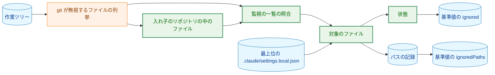
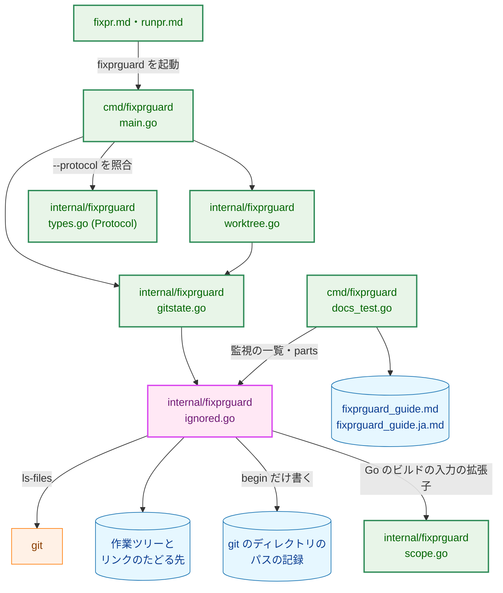
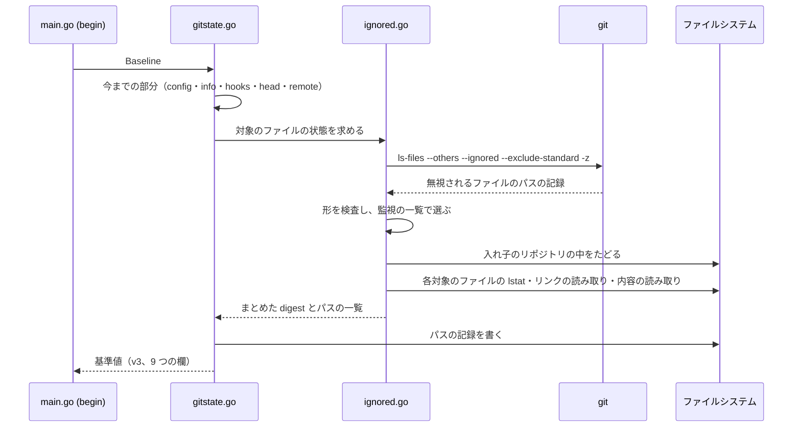
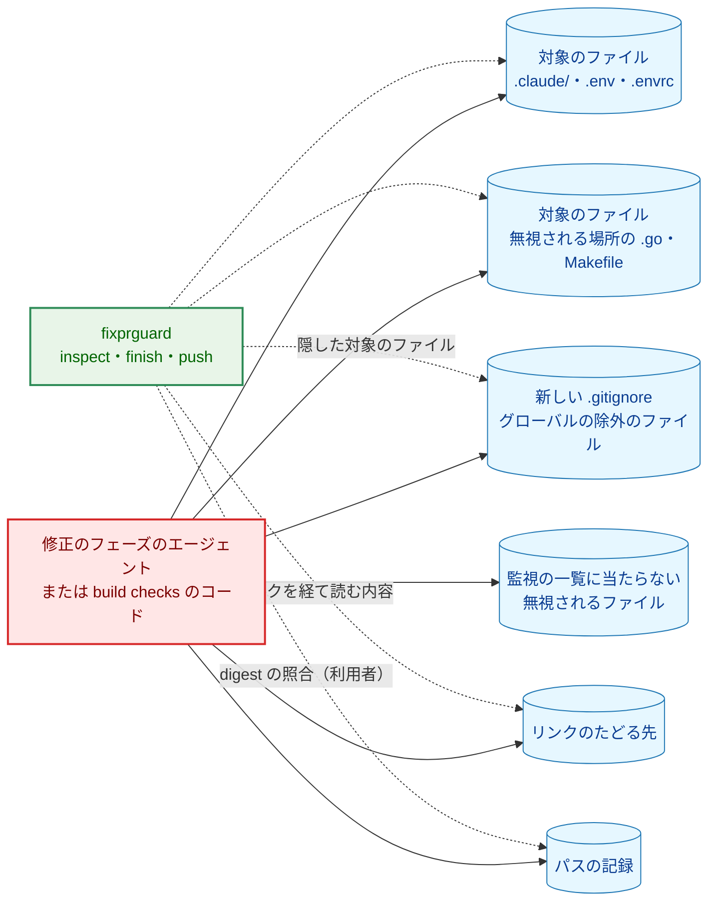
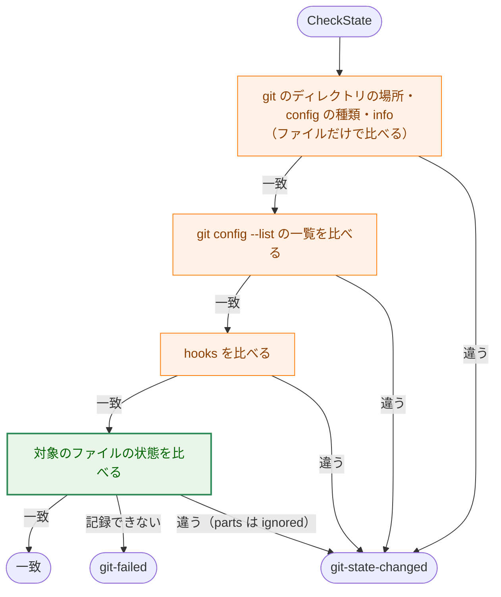
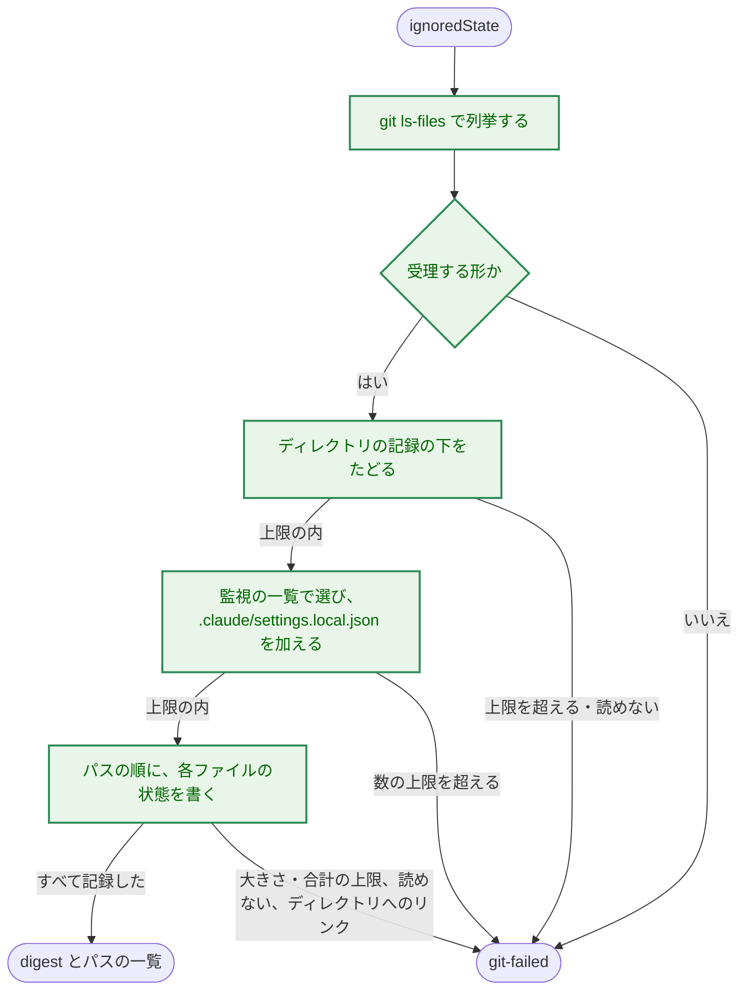

# アーキテクチャ設計書：git が無視するファイルのうち、後の実行に関わるものへの書き込みを fixprguard が検出する

## Document Status

| Item | Value |
|---|---|
| Status | `draft` |
| Created | 2026-10-22 |
| Review date | - |
| Reviewer | - |
| Comments | - |

本書は [01_requirements.md](01_requirements.md)（要件定義書。以下、要件書）の設計である。既存のファイルに関する記述は、コミット `9f83469` のファイルで確かめた。`file:line` はこのコミットの行番号を指す。F-NNN・AC-NN は要件書の項番を、H-NN は [design_handoff.md](design_handoff.md) の項番を指す。申し送り H-01〜H-08 への対応は付録 A にまとめる。

## 1. 設計の全体像 (Design Overview)

### 1.1. 設計原則

-   **既存の比較に 1 つの部分を足す。** 対象のファイル（要件書 3 章）の状態は、基準値の新しい部分 `ignored` として、git の状態を比べる関数 `CheckState`（`internal/fixprguard/gitstate.go:568-607`）の中で比べる。`inspect`・`finish`・`push` は、git の状態を比べるすべての時点で `CheckState` を通る（2.4）。そのため、比べる時点を新しく決めなくても、`finish` の build checks の後（AC-10）を含む、既存のすべての時点で対象のファイルを比べられる。
-   **無視されるかどうかは git に聞き、監視の一覧に当たるかどうかはパスの文字列で決める。** 無視されるファイルの列挙は git に任せる。`.gitignore` の規則を Go で解釈し直すことはしない。監視の一覧の照合は、パスのバイト列だけを読む純粋な関数で行う。ファイルシステムは読まない。範囲の規則（`internal/fixprguard/scope.go:11-14`）と同じ方針である。
-   **基準値にはまとめた値だけを置く。** すべての対象のファイルの状態を 1 つの digest にまとめる。ファイルごとの digest、パス、ファイル名は、基準値にも出力にも置かない（AC-15）。
-   **記録できない、比べられないときは止まる。** 列挙の形の誤り、上限の超過、読み取りの失敗、ディレクトリを指すシンボリックリンクでは、`git-failed` で止まる（AC-16）。一部だけを記録したり、一部だけを比べたりはしない。
-   **監視の一覧は範囲の規則とは別に持つ。** 共有するのは、Go のビルドの入力の拡張子の一覧だけである（要件書 4.5）。

### 1.2. 設計の際に決めたこと（2026-10-22）

`/mkarch 0034` の検討で、次のことを決めた。

-   **Claude Code が `.claude/` の下に書く実行時のファイルでも、要件書のとおり止める。** main のチェックアウトの `.git/info/exclude` には、Claude Code が `.claude/` の下に書くファイルの一覧がある（`scheduled_tasks.lock`・`scheduled_tasks.json`・`worktrees/`・`checkpoints/`・`mailbox/`・`agent-registry.json` など）。監視の一覧は `.claude/` の下のすべてを含むので、これらも対象である。確かめたことは次の 2 点である（2026-10-22）。
    -   このセッションでサブエージェントを 1 つ起動しても、作業ツリーの `.claude/` には何も書かれなかった（起動の前に置いた印のファイルより新しいファイルを `find -newer` で探した）。
    -   main のチェックアウトには `.claude/scheduled_tasks.lock` があり、スケジュールを使うセッションが書き換えていた。

    `.claude/worktrees/<name>/` に Claude Code の worktree があると、git はそれを入れ子のリポジトリとして列挙する（3.3）。その下のファイルはすべて `.claude/` の下にあるので、チェックアウトの全体が対象になる。そのため、上限を超えて `begin` が止まるか、そこで並行するセッションが編集するたびに `git-state-changed` で止まる。除外は要件書の決定を変えることになるので、採らない。ガイド 8 章で、worktree を `.claude/` の外に置くこと、止まったら実行時のファイルを確かめることを案内する（3.10）。理由: 対象を狭めると、`scheduled_tasks.json` のように後で実行されうるファイルが対象から外れる。このリポジトリの worktree は `.claude/` の外に置かれている。レビュアーが選んだ。
-   **ディレクトリを指すシンボリックリンクでは、一律に `git-failed` で止める（H-04）。** 対象のファイルがシンボリックリンクで、たどる先がディレクトリのときは、その下を記録せずに止まる。要件書 3 章が設計に任せた 2 つの案のうち、一律に止める案である。理由: その下を記録する案は、リンクの循環と作業ツリーの外の大きな部分木を、エントリの数の上限で抑える仕組みが要り、実装とテストが増える。main のチェックアウトにも本 worktree にも、該当するリンクはない（2026-10-22 に確かめた）。レビュアーが選んだ。
-   **削除されたファイルを特定するための記録は、`begin` が git のディレクトリに書き、基準値の digest で束縛する（H-08）。** `begin` は、対象のファイルのパスの一覧をファイルに書き、そのファイルの digest を基準値の新しい部分に置く（3.8）。止まった後、利用者はガイドのコマンドで、記録の digest が基準値の値と一致することを確かめてから、記録の各パスが今もあるかを調べる。理由: 利用者が保存を忘れても記録が残り、記録が書き換えられたことも検出できる。レビュアーが選んだ。
-   **記録は、作業ツリーごとの git のディレクトリに置く。** 置き場所は `locateGitDirs` が求める作業ツリーごとの git のディレクトリ（`gitstate.go:191-196`。main のチェックアウトでは `.git`、linked worktree では `.git/worktrees/<name>`）である。理由: 作業ツリーの外にあり、git は列挙しない。作業ツリーごとに分かれ、新しい設定の項目や外のディレクトリを要しない。修正のフェーズのエージェントがそこに書けることは、digest の照合が補う（5.3）。
-   **0030 の承認済みの文書は、本文を改め、状態は `approved` のままにする（H-06）。** タスク 0035 が 0030 の文書を改めたときの前例（0030 `01_requirements.md:11` の `Comments`）に合わせる。決定は本タスクの要件書の承認（AC-20・AC-20a）で得たので、`Comments` にその旨を記録する。理由: 過去のタスクの記録であっても、今の保証の範囲を示す文書として読まれる。参照を追記するだけでは、古い記述が本文に残る。
-   **`Protocol` は `4` にする（H-03）。** タスク 0036 の設計が `3` を使い、0034 は `4` 以上を使うよう申し送った（0036 `02_architecture.md:44`・3.8）。本タスクの実装が先に `main` に入っても `4` にする（2 から 4 に上げる）。理由: 番号は、ブランチの間で違えばよく、連続している必要はない。
-   **列挙には `git ls-files --others --ignored --exclude-standard -z` を使い、`--directory` は付けない（H-01）。** main のチェックアウト（`extension/node_modules/`・`.venv/`・`build/` がある）で、出力は 5540 件、379,494 バイト、約 0.1 秒だった（2026-10-22 に測った）。`--directory` を付けると、無視されるディレクトリの中の `.go` や `Makefile` が 1 つの記録にまとめられ、ツールが中をたどることになる（H-01）。
-   **対象のファイルは比較の最後に比べ、`parts` には `ignored` だけを示す（H-05）。** `CheckState` の hooks の比較の後に比べる（3.7）。
-   **上限の値は、測った値に余裕を持たせて決める（H-01）。** 3.5 の表のとおりである。

### 1.3. なぜ既存の仕組みでは足りないか

-   **作業ツリーの clean の検査と変更の集合（`worktree.go:66-75`・`worktree.go:351`）。** どちらも `--exclude-standard` で無視されるファイルを除く。無視されるファイルを含めて数えると、`coverage.out` や `extension/node_modules/` の下のすべてで止まり、AC-12 を満たせない。
-   **`git status --ignored`。** 無視されるファイルを示すが、監視の一覧で選ぶ手段がない。また、無視されるディレクトリを 1 つの記録にまとめるので、中の `.go` が見えない（H-01）。
-   **hooks の digest（`hooksDigest`、`gitstate.go:327-366`）。** 1 つのディレクトリの下をすべて digest にする関数であり、パスの一覧で選んだファイルを扱えない。上限もない。ただし、フィールドの書き方（`writeField`、`threads.go:428-431`）、FIFO で待たずに開く関数（`openRegular`、`gitstate.go:246-261`）、内容の SHA-256 の考え方は、そのまま使う（3.4）。

### 1.4. 概念モデル

次の図は、対象のファイルの状態が、基準値と記録になるまでを表す。矢印 A → B は「A から B を求める」を表す。




-   **対象のファイル**は、git が無視するファイルとして列挙したパスと、入れ子のリポジトリの中でツールが見つけたパスのうち、監視の一覧に当たるものである。`.claude/settings.local.json` は、列挙の結果にかかわらず必ず含める（AC-04）。
-   **状態**は、対象のファイルの有無と、種類・内容・実行の許可・シンボリックリンクの先・たどる先の状態である（3.4）。
-   **基準値の `ignored`** は、すべての対象のファイルの状態をまとめた digest である。
-   **パスの記録**は、`begin` の時点の対象のファイルのパスの一覧である。**基準値の `ignoredPaths`** は、その記録の digest である（3.8）。

## 2. システム構成 (System Structure)

### 2.1. 全体構成

次の図の矢印 A → B は「A が B を呼ぶ、または読む・書く」を表す。




今のコードにある関係は次のとおりである。`fixpr.md`・`runpr.md` から `main.go`、`main.go` から `types.go`（`cmd/fixprguard/main.go:232` の `--protocol` の照合）、`main.go` から `worktree.go` と `gitstate.go`（`main.go:568` の `CheckState`）、`worktree.go` から `gitstate.go`（`worktree.go:130`・`:243`・`:273` など）、`docs_test.go` からガイド（`docs_test.go:45-62`）。`gitstate.go` から `ignored.go` と、その先の矢印は、本タスクが加える。`fixpr.md`・`runpr.md` は `--protocol` の番号だけを変えるので「変えるコンポーネント」とした。

### 2.2. コンポーネント配置

| ファイル | 種別 | 内容 |
|---|---|---|
| `internal/fixprguard/ignored.go` | 新規 | 監視の一覧のデータと照合（3.2）、列挙と受理する形（3.3）、状態の記録（3.4）、上限（3.5）、パスの記録の書き込み（3.8） |
| `internal/fixprguard/gitstate.go` | 変更 | `Baseline` に `ignored`・`ignoredPaths` を加え、トークンの版を `v3`、欄の数を 9 にする（`:28-32`・`:112-153`。3.6）。`PartIgnored` を加える（`:50-56`）。`Baseline`（`:742-787`）で対象のファイルの状態を求めて記録を書き、`CheckState`（`:568-607`）の最後で比べる（3.7） |
| `internal/fixprguard/scope.go` | 変更 | Go のビルドの入力の拡張子の一覧を置く。タスク 0036 の実装が先に置いていれば、それを使う（3.2） |
| `internal/fixprguard/types.go` | 変更 | `Protocol` を `4` にする（`:20`。3.9） |
| `cmd/fixprguard/docs_test.go` | 変更 | ガイドに監視の一覧のすべての項目と `parts` のすべての値があることを確かめる（3.10） |
| `.claude/commands/fixpr.md`・`.claude/commands/runpr.md` | 変更 | `--protocol` の番号を `4` にする（3.9）。手順は変えない |
| `docs/tasks/0032_japanese_pr_title/check_rules.sh` | 変更 | `:524` の `--protocol 2` を `4` にする（3.9） |
| `docs/dev/developer_guide/fixprguard_guide.ja.md`・`fixprguard_guide.md` | 変更 | 4 章・5 章・7 章・8 章・9 章（3.10） |
| `docs/tasks/0030_fixpr_untrusted_threads/01_requirements.md` | 変更 | 4.2 の残余のリスクの項目（AC-20a。3.10） |
| `docs/tasks/0030_fixpr_untrusted_threads/02_architecture.md` | 変更 | 5.3「無視されるファイル」（AC-20。3.10） |

本タスクの変更で直す既存のテストは次のとおりである。どれも、基準値の形（版と欄の数）か `Protocol` の番号を前提にしている。

| テスト | 前提にしていること |
|---|---|
| `internal/fixprguard/gitstate_test.go:324-355`（`TestBaselineMalformedRejected`） | 欄の位置（`with(5, ...)`・`with(6, ...)`）と、`v1` を前の版とすること |
| `cmd/fixprguard/test_helpers.go:381-390`（`validBaseline`） | `v2` と 7 つの欄 |
| `cmd/fixprguard/main_test.go:26`（`validArgs` の `"v2.x"`） | 引数の解析だけを試す値。版を変える |
| `cmd/fixprguard/main_test.go:305-330`（`TestPreviousBaselineRejected`） | 前の版を `v1.` と今の欄で作ること。前の版は、`v2` と 7 つの欄の形にする（AC-03） |
| `cmd/fixprguard/docs_test.go:122`・`:352`（`TestDocumentedInvocationsParse`・`TestDocumentedProtocolMatches`） | 文書の `--protocol` がバイナリの番号と一致すること。テストは変えず、文書を直す |

### 2.3. データフロー

`begin` は、基準値を求めるときに、対象のファイルの状態とパスの記録を求める。



`inspect`・`finish`・`push` は、`CheckState` の最後で同じ手順を行い、digest を基準値の `ignored` と比べる。記録は書かない（3.7・3.11）。

### 2.4. 既存の挙動の確認

-   `CheckState` は、git のディレクトリの場所・config のファイルの種類・info をファイルだけから比べ、次に `git config --list` の一覧を、最後に hooks を比べる（`gitstate.go:568-607`）。違いがあれば、その時点で `GitStateError` を返す。`parts` に 2 つ以上の値が並ぶのは、config と info が同時に違う場合だけである（`gitstate.go:581-590`）。
-   `inspect` は、`gh` を起動する前に `CheckState` を呼び（`main.go:568`）、`Inspect` の中で `compareState` からもう一度呼ぶ（`worktree.go:130`、`gitstate.go:804`）。
-   `finish` は、`compareState` を `checkedChanges` から 3 回（`worktree.go:213`・`:231`・`:249` → `:273`）、`CheckState` を `make test` の後（`:243`）、`git add` の後（`:326`）、commit の後（`:383`）に呼ぶ。stage を取り消すとき（`:367`）にも呼ぶ。
-   `push` は、`compareState` を呼んでから push する（`worktree.go:502`）。
-   git の出力の上限は 64 MiB である（`cmd/fixprguard/main.go:45`）。超えると `gitFailure` が `git-failed` にする（`gitstate.go:468-476`）。
-   git は、無視されるディレクトリの中の入れ子のリポジトリを、末尾に `/` を付けた 1 つの記録として示す。FIFO は示さない。シンボリックリンクは、ディレクトリを指すものも含めて、1 つのファイルとして示す（git 2.50.1 で、一時リポジトリで確かめた。2026-10-22）。

## 3. コンポーネント設計 (Component Design)

### 3.1. 型と関数

```go
// PartIgnored names the target files among the parts of the git state.
const PartIgnored = "ignored"

// Baseline gains two digests: the state of every target file, and the
// path record begin wrote. The token version becomes "v3" with 9 fields.
type Baseline struct {
	head, branch, remoteOID, hooks, config, configList, info string
	ignored      string
	ignoredPaths string
}

// ignoredState is what one enumeration of the target files yields.
type ignoredState struct {
	digest string // over every target file's path and state
	paths  []byte // the target paths, sorted, each followed by a NUL
}

// ignoredState enumerates the target files and records their state,
// stopping with ErrGitFailed when it cannot record all of them.
func (w *Worktree) ignoredState(ctx context.Context) (ignoredState, error)

// isWatched reports whether a repository-relative path is on the watch list.
func isWatched(p string) bool

// WatchListPatterns lists the watch list in the form the guide prints it.
func WatchListPatterns() []string

// GitStateParts lists every value GitStateError.Parts can hold.
func GitStateParts() []string
```

`Baseline` の欄は、今までどおり非公開で、`newBaseline` だけが組み立てる（`gitstate.go:122-126`、`construction_test.go:20`）。

### 3.2. 監視の一覧のデータと照合（要件書 3 章・4.5、H-01）

監視の一覧は `ignored.go` に置く。照合は、パスを ASCII の大文字小文字を同一視して（`strings.ToLower` ではなく ASCII の文字だけを小文字にして）行う。不正な UTF-8 のバイト列をそのまま残すためである。パスは正規化しない。

| データ | 中身 | 照合 |
|---|---|---|
| 最上位のディレクトリ | `.claude` | パスが `.claude/` で始まる、またはパスが `.claude` そのもの |
| 最上位のファイル | `.env`・`.envrc`・`claude.local.md` | パスがどれかと一致する |
| 名前 | `claude.md`・`makefile`・`gnumakefile`・`go.mod`・`go.work` | パスの最後の要素がどれかと一致する |
| 拡張子 | `.go`・`.mk` | パスの最後の要素がどれかで終わる（名前がその文字列だけのものを含む） |
| Go のビルドの入力の拡張子 | `.c`・`.h`・`.cc`・`.cpp`・`.cxx`・`.hh`・`.hpp`・`.hxx`・`.m`・`.s`・`.sx`・`.f`・`.for`・`.f90`・`.swig`・`.swigcxx`・`.syso` | 同上 |

-   **Go のビルドの入力の拡張子は、タスク 0036 が `scope.go` に置く一覧を使う。** 0036 の実装（PR-1）は、同じ 17 種類を、拒否リストのデータとして `scope.go` の非公開のパッケージ変数に置く（0036 `02_architecture.md` 3.1）。0036 は本タスクの実装より先に `main` に入る見込みである（issue #424 の 0036 からの申し送り、2026-10-22）。同じパッケージなので、監視の一覧はその変数をそのまま参照する（要件書 4.5）。本タスクの実装の時点で 0036 がまだ入っていなければ、本タスクが同じ 17 種類を `scope.go` に置き、0036 がそれを使う。
-   **ほかのデータは共有しない。** 名前と `.mk` は今の `execNames`・`execSuffixes`（コミット `9f83469` の `scope.go:41-43`。0036 の後は行が変わる）と重なるが、タスク 0036 が `execNames` を変える（`go.sum` などを含む。0036 `02_architecture.md` 3.1）。監視の一覧は実行関連ファイルの定義（0036 の後の用語）が変わっても変わらない（要件書 2.3）ので、別に持つ。
-   **ガイドの表記。** `WatchListPatterns` は、`.claude/`、`/.env`・`/.envrc`・`/claude.local.md`（先頭の `/` は最上位だけで当たる印）、名前、`*.go` のような拡張子の形で返す。ガイドは同じ表記で載せ、文書のガードが一致を確かめる（3.10、AC-17）。

### 3.3. 列挙と受理する形（要件書 4.2、AC-07・AC-13・AC-16、H-01）

**列挙の手段。** `git ls-files --others --ignored --exclude-standard -z` を、`gitHardening`（`gitstate.go:77-86`）を付けて起動する。`--exclude-standard` は、`.gitignore`（入れ子のものを含む）、`info/exclude`、グローバルの除外のファイル（`core.excludesFile`）をすべて読む。そのため、`begin` の後に置かれた `.gitignore` や書き換えられたグローバルの除外のファイルが隠した新しいファイルも、列挙に現れる（AC-13）。`ls-files` は hook を実行しない。

**受理する形。** 要件書 4.2 の形だけを受理する。出力をバイト列のまま次のとおり検査し、合わなければ補正も読み飛ばしもせずに `git-failed` で止まる。

-   空でない出力は NUL で終わる。NUL で区切った各記録は空でない。
-   記録は `/` で始まらない。記録を `/` で分けた各要素は、空でなく、`.` でも `..` でもない。ただし、末尾の `/` が 1 つだけの記録はディレクトリの記録とし、その `/` を除いて同じ検査をする。
-   同じバイト列の記録は 2 度現れない。

**ディレクトリの記録。** 末尾に `/` を持つ記録（入れ子のリポジトリ。2.4）は、ツールがその下をたどる。シンボリックリンクはたどらずにエントリとして扱い、ディレクトリの下に降りる。見つけた各エントリのパスは、ディレクトリの記録のパスにつないだものとし、3.2 の照合に掛ける。当たったもののうち、通常のファイルとシンボリックリンクだけを対象のファイルにする。FIFO などは、git の列挙と同じく含めない（要件書 3 章）。たどったエントリの数は、3.5 の上限に数える。ディレクトリを読めなければ `git-failed` で止まる。

**`.claude/settings.local.json`。** 列挙の結果にかかわらず、必ず `lstat` で調べて状態に含める。存在しないことも「存在しない」として記録する。種類が通常のファイルでもシンボリックリンクでもなければ、種類だけを記録する（要件書 3 章）。列挙の結果にも現れた場合は、1 つとして扱う。

### 3.4. 状態の記録（要件書 3 章、AC-08・AC-08a・AC-08b、H-04）

対象のファイルは、パスのバイト列の順に並べ、1 つずつ次の値を SHA-256 に書く。値の区切りは既存の `writeField`（`threads.go:428-431`。値を `strconv.Quote` で引用し、改行で終える）に従う。引用するので、改行や不正な UTF-8 を含むパスも、ほかのパスの値と混ざらない。

| 対象のファイルの種類 | 書く値 |
|---|---|
| 存在しない（`.claude/settings.local.json` だけ。列挙の後に消えたものを含む） | パス、`absent` |
| 通常のファイル | パス、種類、実行の許可（`perm & 0o111`）、内容の SHA-256 |
| シンボリックリンク | パス、種類、リンクの文字列、たどる先の値（下の表） |
| それ以外（FIFO など） | パス、種類 |

シンボリックリンクは、`os.Stat`（途中のリンクもすべてたどる）でたどる先を調べる。

| たどる先 | 書く値 |
|---|---|
| 通常のファイル | 種類、実行の許可、内容の SHA-256（リンクを経て読む） |
| ディレクトリ | 書かない。`git-failed` で止まる（1.2 の決定） |
| それ以外（FIFO など） | 種類 |
| たどれない（存在しない、循環する、途中がディレクトリでない） | `unresolved` |
| 調べられない（権限がないなど） | 書かない。`git-failed` で止まる |

-   **たどれないリンクは記録する。** 後でたどれるようになれば、たどる先の値が `unresolved` から変わるので検出する（AC-08b）。`begin` は止まらない。
-   **更新時刻・所有者・拡張属性は書かない（AC-08a）。** 実行の許可は、`perm` の実行のビットだけを書く。読み書きのビットは、実行される内容を変えないためである。
-   **内容の読み方。** 通常のファイルは、`openRegular`（`gitstate.go:246-261`）と同じく `O_NONBLOCK` で開き、開いたファイルの `Stat` で通常のファイルであることと大きさを確かめてから読む。対象のファイルそのものはリンクをたどらずに開き（`O_NOFOLLOW`）、シンボリックリンクのたどる先はリンクを経て開く。`lstat` と開く間に FIFO に置き換えられても、開いたファイルの検査で止まり、読み取りで待たない（H-04）。開いた後の `Stat` の大きさが上限を超えれば、読まずに止まる。大きさの検査の後に伸びたファイルも、上限に 1 を足した量までしか読まない。

### 3.5. 上限（AC-01a・AC-16、要件書 4.3、H-01）

| 上限 | 値 | 数えるもの | 根拠 |
|---|---|---|---|
| 列挙の出力 | 64 MiB | git が列挙するすべての無視されるファイルの記録 | 既存の git の出力の上限（`main.go:45`）。main のチェックアウトの出力は 379,494 バイト |
| 対象のファイルの数 | 10,000 | `.claude/settings.local.json` を含む対象のファイル | main のチェックアウトでは 3 個 |
| ディレクトリの記録の下のエントリ | 100,000 | 3.3 でたどったエントリ（ディレクトリ・FIFO などを含む） | 入れ子のリポジトリは、`.git` の objects を含めても通常はこれより少ない |
| 1 つのファイルの大きさ | 8 MiB | 対象の通常のファイルと、シンボリックリンクのたどる先の通常のファイル | 変更の集合の内容の上限（`changes.go:24` の `maxDigestBytes`）と同じ値。main のチェックアウトの最大は 6,025 バイト |
| 読み取る内容の合計 | 64 MiB | 1 回の記録または比較で読んだバイト数の合計 | main のチェックアウトでは 6,723 バイト |

-   **合計は、読んだバイト数をそのまま足す（H-01）。** 同じ inode を 1 度だけ読む案は採らない。対象のファイルの数と 1 つのファイルの大きさに上限があるので、そのままでも読む量は有限である。上限の内の 1 つの疎ファイルを指すハードリンクやシンボリックリンクを多数作られても、合計の上限で止まる。
-   **超えたら止まる。** どの上限を超えても、内容を読み続けずに `git-failed` で止まる。診断は規則の名前だけを示す（例: `git-failed: ignored files over the cap`）。
-   **時間（要件書 4.1）。** 1 回の比較は、列挙（main のチェックアウトで約 0.1 秒）と、対象のファイルの読み取りである。`finish` は `CheckState` を 6 回ほど呼ぶ（2.4）ので、加わる時間は 1 秒に満たない。数十秒以上かかる build checks に比べて小さい。

### 3.6. 基準値の形（AC-03・AC-15、H-03・H-07）

-   **版と欄。** トークンの版を `v2` から `v3` に、欄の数を 7 から 9 に変える。加える欄は `ignored`（3.4 のまとめた digest）と `ignoredPaths`（3.8 の記録の digest）で、どちらも 64 文字の小文字の 16 進数である。`ParseBaseline` は、今までどおり版と欄の数と各欄の形を検査し、合わなければ `ErrInvalidInput` で拒否する（`gitstate.go:130-145`）。
-   **前の版の基準値は受け付けない（AC-03）。** 本タスクの前の `begin` が出力したトークンは `v2` で 7 つの欄なので、版と欄の数のどちらでも拒否される。終了コードは、既存の基準値の形の誤りと同じ `2` である。
-   **まとめた値だけを置く（H-07）。** `ignored` は、すべての対象のファイルを 1 つの SHA-256 にまとめた値である。ファイルごとの digest は置かない。`.env` の内容の候補が少なく、ほかの対象のファイルの内容が分かっていれば、まとめた値からも推測できる。これは要件書 4.2 の残余のリスク（まとめた値からの推測）のとおりである。

### 3.7. 比べる位置と順序（F-002、AC-04〜AC-14、H-05）

-   **位置。** `CheckState` の最後、hooks の比較（`gitstate.go:599-605`）の後で、`ignoredState` を求めて基準値の `ignored` と比べる。違えば `GitStateError{Parts: []string{PartIgnored}}` を返す。`CheckState` を通る既存のすべての時点（2.4）で比べることになる。`finish` の、build checks の前（AC-09）、`make test` の後と `make lint` の後（AC-10）、`push` の前（AC-11）を含む。
-   **順序の理由。** 列挙で起動する `git ls-files` は、config（`core.excludesFile` など）を読む。そのため、config の一覧の比較の後に置く。hook は実行しないが、既存の順序（比べてから起動する）に揃えて hooks の比較の後に置く。
-   **`parts`（AC-14、H-05）。** 前の部分が違えば、`CheckState` はその時点で返す（2.4）ので、`ignored` が並ぶのは前の部分がすべて一致したときだけである。そのため、対象のファイルの状態だけが違うときの `parts` は `ignored` だけになる。ほかの部分と同時に違うときは、前の部分だけを示す。止まった後の対処（ガイド 8 章）は、`parts` によらず、すべての部分と対象のファイルを確かめるよう案内する（3.10）。
-   **比べられないとき。** 比較の時点で `ignoredState` が `git-failed` になった場合は、`git-failed` で止まる。`git-state-changed` にはしない。git の config の一覧が読めない場合（`configListFailure`、`gitstate.go:526-537`）と違い、上限の超過や読み取りの失敗は、状態の違いと区別できないためではなく、記録できないことを示すためである（AC-16）。

### 3.8. パスの記録（AC-19、H-08）

-   **書く時点と場所。** `begin` の `Baseline` が、すべての値を求め終えた最後に、作業ツリーごとの git のディレクトリ（1.2）に `fixprguard-ignored-paths` という名前で書く。`inspect`・`finish`・`push` は書かない。
-   **形。** 対象のファイルのパスを、バイト列の順に並べ、各パスの後に NUL を置いたもの（`ignoredState.paths`）である。改行や不正な UTF-8 を含むパスも、そのまま 1 つの記録になる（H-08）。件数は 3.5 の対象のファイルの数の上限に従う。
-   **書き方。** 同じディレクトリに一時ファイルを `O_EXCL` と `0600` で作って書き、`rename` で置き換える。`rename` は置き換える先のシンボリックリンクをたどらないので、記録の名前にリンクを置かれても、リンクの先には書かない。書けなければ `git-failed` で止まる。
-   **基準値との束縛。** 基準値の `ignoredPaths` は、記録のファイルの内容の SHA-256 である。利用者は、止まった後に `shasum -a 256` で記録の digest を求め、基準値のトークンの 9 番目の欄と比べる。一致しない、または記録がない場合は、記録を信頼しない（3.10、5.3）。
-   **出力しない（AC-15）。** パスは記録のファイルにだけ書き、標準出力・標準エラー・基準値には含めない。記録を読む手順は、利用者が Claude Code のセッションの外の端末で実行する（3.10）。ファイル名は攻撃者が選べるので、セッションに届けないためである（要件書 1 章）。

### 3.9. `Protocol` と文書の番号（要件書 4.4、H-03）

-   **上げる値。** `types.go:20` の `Protocol` を `4` にする（1.2）。`git-state-changed` の `parts` に `ignored` が加わり、基準値の形も変わるので、出力の契約の変更である（ガイド 9 章）。
-   **揃える場所。** タスク 0036 の設計が列挙した場所（0036 `02_architecture.md` 3.6 の表）と同じである。`fixpr.md` と `runpr.md` の `--protocol`、ガイドの日本語版と英語版の 4 章の現在の番号・5 章の `--protocol`・出力の例の `"protocol"`、`docs/tasks/0032_japanese_pr_title/check_rules.sh:524` である。ガイドの基準値の例 `'v2....'`（日本語版と英語版の `:153`・`:165`・`:177`）は `'v3....'` にする。
-   **同じ commit に入れる。** `Protocol` の変更と文書の番号の変更は、同じ commit に入れる。`TestDocumentedInvocationsParse` と `TestDocumentedProtocolMatches`（`docs_test.go:122`・`:352`）が一致を求めるためである。
-   **0036 との順序。** 0036 が先に `main` に入っていれば、文書の番号は `3` から `4` に変える。本タスクが先なら `2` から `4` に変え、0036 は後で番号を上げ直す（0036 `02_architecture.md` 3.8 は、0034 の実装が先に入った場合に扱いを決め直すとしている）。

### 3.10. 文書の変更（F-004、AC-17〜AC-20a、H-06）

| 文書 | 変える内容 |
|---|---|
| ガイド 4 章 | 現在の番号を `4` にする |
| ガイド 5 章 | `begin` の副作用に、git のディレクトリにパスの記録を書くことを加える。基準値の例を `'v3....'` にする |
| ガイド 7.1 | 行を 1 つ加える。保証は「git が無視するファイルのうち監視の一覧に当たるものの作成・書き換え・削除を、`inspect`・`finish`・`push` が基準値と比べて検出する」、仕組みは列挙と状態の比較（AC-17）。同じ節の近くに、監視の一覧の表を `WatchListPatterns` と同じ表記で載せる |
| ガイド 7.2 | 今の「`.gitignore` が無視するファイル、…」の項目（`fixprguard_guide.ja.md:255`）を分ける。(1) 監視の一覧に当たらない無視されるファイルと、要件書 4.2 の残余のリスクの各項目。(2) `.gitignore` やグローバルの除外のファイルで隠したファイルのうち、対象のファイルでないもの。(3) index の stat の偽造（AC-18）。ディレクトリを指すシンボリックリンクで止まることも書く |
| ガイド 8 章 `git-state-changed` の行 | `parts` に `ignored` を加え、意味と対処を書く（AC-19）。対処は次の 5 つ。(a) 対象のファイルを一覧にするコマンド（列挙の結果を監視の一覧で選ぶもの）。どのファイルが変わったかは示されないので、一覧のすべてを確かめる。更新時刻では絞り込まない。(b) パスの記録の digest を基準値の 9 番目の欄と比べ、一致すれば記録の各パスが今もあるかを調べて、なくなったパスを特定するコマンド。一致しない、記録がない場合は、記録を信頼せず、`.claude/settings.local.json` などを自分の知る内容と比べる。(c) 内容を確かめるファイル（`.claude/settings.local.json` の `hooks`・`permissions`、`.envrc`・`.env`、無視される場所の `.go`・Go のビルドの入力・`Makefile`・`*.mk`）。(d) 作業ツリーに残した変更の扱い。(e) 利用者自身の許可の確認への回答や、Claude Code の実行時のファイル（`.claude/scheduled_tasks.lock`、`.claude/worktrees/` の下の worktree など）が原因の場合も、内容を確かめてからやり直すこと。worktree は `.claude/` の外に置くこと。コマンドは Claude Code のセッションの外の端末で実行する |
| ガイド 8 章 `git-failed` の行 | AC-16 の原因（列挙の形の誤りと上限、対象のファイルの数の上限、ディレクトリの記録の下のエントリの上限、1 つのファイルの大きさの上限、読み取る内容の合計の上限、対象のファイルやディレクトリを読めない、ディレクトリを指すシンボリックリンク、パスの記録を書けない）と対処を書く（AC-19a） |
| ガイド 9 章 | 監視の一覧を変えたら 7 章の表も変えることを、「`stop` の種類や実行関連ファイルの一覧を変えたら」の項目（`fixprguard_guide.ja.md:300` 付近。今の文言は「実行に関わるファイル」で、0036 が「実行関連ファイル」に改める）に加える |
| 0030 `02_architecture.md` 5.3「無視されるファイル」 | 本タスクで検出するようになった範囲と、なお残る範囲（要件書 4.2 の残余のリスクと同じ）を書く（AC-20）。`Comments` に、決定は本タスクの要件書の承認で得たので `approved` のままとすることを記録する（1.2） |
| 0030 `01_requirements.md` 4.2 | 残余のリスクの「git が無視するファイル（`.envrc` など）を変えること」（`:201`）を、AC-20 と同じ内容にする（AC-20a）。`Comments` は上と同じ |

**文書のガード（`docs_test.go`）。** 次の 2 つを加える。

-   ガイドの日本語版と英語版に、`WatchListPatterns` のすべての項目がコードスパンで載っていること（AC-17）。今の `TestGuideCoversStopKindsAndScope`（`docs_test.go:45-62`）が `ExecutionFilePatterns` について行っていることと同じである。
-   ガイドの `git-state-changed` の行に、`GitStateParts` のすべての値がコードスパンで載っていること（AC-19）。

### 3.11. 副作用の契約

| サブコマンド | 本タスクの後の副作用 |
|---|---|
| `begin` | 今まで（GitHub と `git ls-remote` の読み取り）に加え、作業ツリーごとの git のディレクトリにパスの記録を 1 つ書く（置き換える）。作業ツリーと対象のファイルは変えない |
| `inspect`・`finish`・`push` | 対象のファイルを読むだけで、書かない。パスの記録も書かない。それ以外は今までどおり |
| `head`・`list`・`fence`・`reply`・`edit-pr` | 変わらない。対象のファイルを読まない（要件書 2.3） |

### 3.12. 先行するタスクの方針との関係

-   **0030 の残余のリスク。** 0030 は、無視されるファイルを検出しないことを残余のリスクとした（0030 `01_requirements.md:201`、0030 `02_architecture.md:847`）。本タスクはそれを縮める。方針の例外ではなく、範囲の拡大である。文書の改め方は 3.10 のとおりである。
-   **`begin` の副作用。** 0030 は、`begin` の副作用を GitHub と `git ls-remote` の読み取りだけとした（ガイド 5 章）。本タスクは、git のディレクトリへの書き込みを 1 つ加える（3.11）。理由は 1.2 の H-08 の決定である。これを前提にしたテストはない。
-   **基準値の大きさ。** 0030 は、基準値を約 300 バイトとした（0030 `02_architecture.md` 3.7）。2 つの欄を加えるので、約 430 バイトになる。セッションが引数で渡す長さとして問題はない。

## 4. エラーハンドリング設計 (Error Handling Design)

新しい止まった種類も、新しい sentinel のエラーも加えない。

| 場合 | エラー | `stop` | 終了コード |
|---|---|---|---|
| 対象のファイルの状態が基準値と違う | `*GitStateError`（`Parts` は `ignored`） | `git-state-changed` | `1` |
| 列挙の失敗・形の誤り・上限の超過、対象のファイルの数・エントリの数・大きさ・合計の上限の超過、読み取れない、ディレクトリを指すシンボリックリンク、パスの記録を書けない | `ErrGitFailed` を包むエラー | `git-failed` | `1` |
| 前の版の基準値 | `ErrInvalidInput` を包むエラー | なし | `2` |

診断は、今までどおり規則の名前だけを示す（`gitstate.go:451-476`）。たとえば `git-failed: list ignored files failed`、`git-failed: ignored files over the cap`、`git-failed: read ignored files`、`git-failed: ignored link to a directory`、`git-failed: write ignored path record` である。パス、ファイル名、内容、digest は含めない（AC-15）。

## 5. セキュリティ考慮事項 (Security Considerations)

条件付きのセキュリティガイド（`docs/dev/security.md`）のトリガーに該当する。秘密の値が置かれる `.envrc`・`.env`（`security.md` §2）の内容を読むからである。内容は SHA-256 に通すだけで、出力・ログ・エラーメッセージに含めない（3.6・4 章）。

### 5.1. 脅威モデル

次の図の矢印 A → B は「A が B に書き込む、または B を変える」を表す。点線の矢印は「ツールが検出する」を表す。




### 5.2. 守りの対応

| 経路 | 守り |
|---|---|
| `.claude/settings.local.json` に `hooks`・`permissions.allow` を書く | 状態の比較で `git-state-changed`（AC-04・AC-05）。存在しないことも記録する |
| 無視される場所に `.go`・`Makefile`・`*.mk` を置く、書き換える | 同上（AC-07）。入れ子のリポジトリの中もたどる（3.3） |
| 新しい `.gitignore` やグローバルの除外のファイルで新しいファイルを隠す | 列挙が `--exclude-standard` を使うので、隠したファイルは無視されるファイルとして現れ、監視の一覧に当たれば検出する（AC-13） |
| 自分自身を無視させる `.gitignore` を下の階層に置き、`CLAUDE.md` や `.syso` などを変更の集合から隠す（0036 の残余のリスク。0036 `02_architecture.md` 3.8） | 監視の一覧は `claude.md` と Go のビルドの入力をどの階層でも含むので、隠したファイルは対象のファイルとして検出する。`agents.md` などの自動レビュアーの指示ファイルは、無視されると GitHub に届かないので対象外のままである（要件書 3 章） |
| 対象のファイルを指すシンボリックリンクの先を書き換える | たどる先の内容を状態に含める（AC-08b）。ディレクトリを指すリンクは止まる（1.2） |
| 巨大な疎ファイル、同じ内容を指す多数のリンク | 1 つのファイルの大きさと合計の上限で止まる（3.5） |
| FIFO に置き換えて読み取りで待たせる | 待たずに開き、開いたファイルで種類を確かめる（3.4） |
| 攻撃者が選んだファイル名を出力に載せる | パスを出力しない（AC-15）。記録はファイルにだけ書き、セッションの外で読む（3.8） |
| 削除を見落とさせる | `begin` のパスの記録と digest の照合（3.8） |
| パスの記録の名前にリンクを置き、`begin` の書き込みを外に向ける | 一時ファイルと `rename` で書く（3.8） |

### 5.3. 残余のリスク

要件書 4.2 の残余のリスクに加えて、設計で次のことが分かっている。

-   **パスの記録の削除と書き換え。** 修正のフェーズのエージェントは、同じ利用者の権限で動くので、git のディレクトリの記録を削除または書き換えられる。書き換えは digest の照合で分かり、削除はファイルがないことで分かる。ただし、どちらの場合も、なくなったパスを記録から特定することはできない。利用者は、`.claude/settings.local.json` などを自分の知る内容と比べることになる（3.10）。
-   **Claude Code の実行時のファイル。** `.claude/` の下に Claude Code が書くファイル（`scheduled_tasks.lock`、`.claude/worktrees/` の下の worktree など）でも止まる（1.2）。止まることに慣れて確かめなくなるおそれは、要件書 4.2 の「止まった後のやり直し」と同じである。
-   **ディレクトリを指すシンボリックリンク。** 対象のファイルがディレクトリを指すリンクであれば、`begin` も止まる（1.2）。そのようなリンクを置く使い方では `/fixpr` を使えない。守りは弱まらない。
-   **列挙と読み取りの間のずれ。** 列挙の後、読み取りの前に置き換えられたファイルは、置き換えた後の状態で記録する。比較もその時点の状態で行うので、0030 の「確認と実行の間のずれ」（0030 `02_architecture.md` 5.3）と同じく、ある時点だけの確認である。

## 6. 処理フロー詳細 (Processing Flow Details)

### 6.1. `CheckState` の順序

次の図の矢印 A → B は「A の後に B を行う」を表す。




### 6.2. 対象のファイルの状態を求める流れ




矢印 A → B は「A の後に B を行う」を表す。

## 7. テスト戦略 (Test Strategy)

テストは、今までどおり一時ディレクトリの実際のリポジトリで git を動かす（ガイド 9 章）。グローバルの除外のファイルが試験の環境に左右されないよう、試験のリポジトリで `core.excludesFile` を固定する。

### 7.1. 単体テスト

-   **監視の一覧の照合。** 要件書 3 章の例（当たるものと当たらないもの）、大文字小文字の違い（`MAKEFILE`・`X.GO`）、最上位でない `.env`・`claude.local.md`、名前がその文字列だけのもの（`.go`）、不正な UTF-8 と制御文字を含むパス。
-   **列挙の形の検査。** 要件書 AC-16 の例（終端の NUL がない、空の記録、重複、`/` で始まる、空の要素、`.`・`..`、`//`）をそれぞれ `git-failed` にすること。正しい出力とディレクトリの記録を受け付けること。
-   **状態の比較（AC-04〜AC-08b・AC-08a・AC-12・AC-13）。** `begin` の後に、`.claude/settings.local.json` の作成・書き換え、対象のファイルの削除、`.envrc`・`.env`、無視される `build/` の `.go`・`Makefile`・`*.mk`、入れ子のリポジトリの中の `.go`、種類・実行の許可・リンクの文字列の変化、リンクのたどる先の書き換え、たどれないリンクがたどれるようになること、新しい `.gitignore` で隠した `.go`、で `inspect` 相当の比較が `ignored` を返すこと。更新時刻だけの変化と、監視の一覧に当たらない無視されるファイルでは返さないこと。
-   **上限と読み取り（AC-16）。** 各上限を超えること（試験では上限の値を小さくして試す）、読めないファイル、読めないディレクトリ、ディレクトリを指すリンク、FIFO に置き換えたファイルで待たないこと。
-   **`parts`（AC-14）。** 対象のファイルだけが違うときに `parts` が `ignored` だけであること。
-   **基準値の形（AC-03）。** `v3` と 9 つの欄の往復、前の版（`v2` と 7 つの欄）の拒否。
-   **パスの記録（AC-19）。** 記録の内容が対象のファイルのパスの NUL 区切りであること、digest が基準値の欄と一致すること、記録の名前にあるシンボリックリンクをたどらないこと。

### 7.2. 統合テスト

-   **`finish`（AC-09・AC-10）。** fake の make が `make test` の中で対象のファイルを書く場合に、`finish` が `git-state-changed` で止まり、commit を作らないこと。`finish` の前に書いた場合に、build checks を 1 つも実行しないこと。
-   **`push`（AC-11）。** `finish` の後に対象のファイルを書くと、`push` が止まり、push しないこと。
-   **AC-02。** 対象のファイルを変えなければ、`inspect`・`finish`・`push` の出力が `protocol` を除いて変わらないこと。

### 7.3. セキュリティのテスト

-   出力（標準出力・標準エラー）と基準値に、対象のファイルのパス、名前、内容が現れないこと（AC-15）。名前に識別できる文字列を入れたファイルで確かめる。
-   CLAUDE.md の「Testing Strategy」に従い、各テストが目的の理由で失敗できることを、比較の呼び出しを外す、照合の項目を消す、上限の検査を外すなどして確かめる。

### 7.4. 文書のガード

-   ガイドに監視の一覧のすべての項目と `parts` のすべての値があること（3.10）。
-   文書の `--protocol` がバイナリの番号と一致すること（既存のテスト）。
-   AC-01a は、`extension/node_modules/` があるチェックアウトで `begin` を実行して確かめる（手で行う。CI には `node_modules` がない場合がある）。

## 8. 実装の優先順位 (Implementation Priorities)

1.  Go のビルドの入力の拡張子の一覧を `scope.go` に置く（0036 が先に置いていれば省く）。監視の一覧のデータ、`isWatched`、`WatchListPatterns`。
2.  列挙と受理する形の検査、ディレクトリの記録の下のたどり、上限。
3.  状態の記録とまとめた digest。
4.  基準値の形（`v3`）、`Baseline` での記録、パスの記録の書き込み、`CheckState` での比較、`PartIgnored`・`GitStateParts`。既存のテスト（2.2 の表）を直す。
5.  `Protocol` を `4` にし、`fixpr.md`・`runpr.md`・ガイドの番号・`check_rules.sh` を同じ commit で揃える。
6.  ガイドの日本語版（4・5・7・8・9 章）、英語版、文書のガード。
7.  0030 の要件書と設計書。

## 9. 将来の拡張 (Future Extensibility)

-   **監視の一覧の変更。** 一覧はデータであり、項目を足すにはデータとガイドの表を変えるだけでよい。ただし、項目を足すと、正当な書き込みで止まる場面が増える。足すかどうかは、要件として決める。
-   **ディレクトリを指すシンボリックリンクの記録。** 必要になれば、エントリの数の上限を使って、その下を記録する案（1.2 で採らなかった案）に変えられる。

## 付録 A. 申し送りへの対応

| 項目 | 対応 |
|---|---|
| H-01 | 列挙は `--directory` なしの `git ls-files --others --ignored --exclude-standard -z`（1.2・3.3）。ディレクトリの記録の下はツールがたどる（3.3）。測った値は 1.2・3.5。1 つのファイルの上限は 8 MiB で、開いたファイルの大きさで読む前に判定する（3.4・3.5）。合計の上限は 64 MiB で、読んだバイト数をそのまま足す（3.5）。列挙の出力は既存の 64 MiB の上限で足り、git が列挙するすべての無視されるファイルを数える（3.5）。監視の一覧は `ignored.go` に置き、Go のビルドの入力の拡張子だけを `scope.go` と共有する（3.2） |
| H-02 | `.DS_Store` とスワップファイルは、`.claude/` の下でだけ止まる（要件書の決定のまま）。build checks は無視される場所に対象のファイルを書かない。`make fmt`・`make lint` は書かず、`make test` が書く `coverage*.out` は監視の一覧に当たらない（`.gitignore:6`）。Claude Code の実行時のファイルは、要件書のとおり止めることにした（1.2）。サブエージェントの起動では `.claude/` に書かれないことを確かめた |
| H-03 | 版を `v3`、欄を 9 にし、前の版を形の検査で拒否する（3.6）。`Protocol` は `4`（1.2・3.9）。文書のガードに `parts` の値を加える（3.10） |
| H-04 | リンクの文字列とたどる先の状態を記録する（3.4）。たどれないリンクは `unresolved` として記録する（3.4）。ディレクトリを指すリンクは一律に止める（1.2）。読み取りは `O_NONBLOCK` で開き、開いたファイルで種類を確かめる（3.4） |
| H-05 | hooks の比較の後に比べる。`parts` は、対象のファイルだけが違うとき `ignored` だけで、ほかの部分が違うときはその部分だけ（3.7） |
| H-06 | 本文を改め、`approved` のまま `Comments` に記録する（1.2・3.10） |
| H-07 | まとめた 1 つの digest だけを置き、残る推測の可能性は要件書 4.2 のとおり（3.6） |
| H-08 | `begin` が作業ツリーごとの git のディレクトリに NUL 区切りの記録を書き、その digest を基準値に置く（1.2・3.8）。利用者が保存を忘れることはない。記録の改変や削除は防げないが、digest の照合と記録の有無で分かる（5.3）。別の実行の記録は digest が一致しない。件数は対象のファイルの数の上限に従う。記録の読み取りはセッションの外で行う（3.8） |
