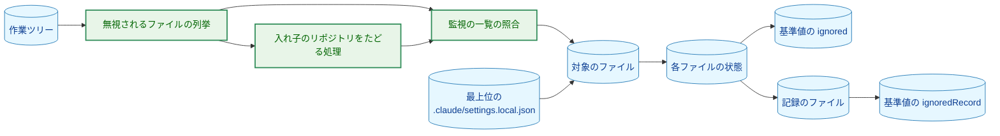
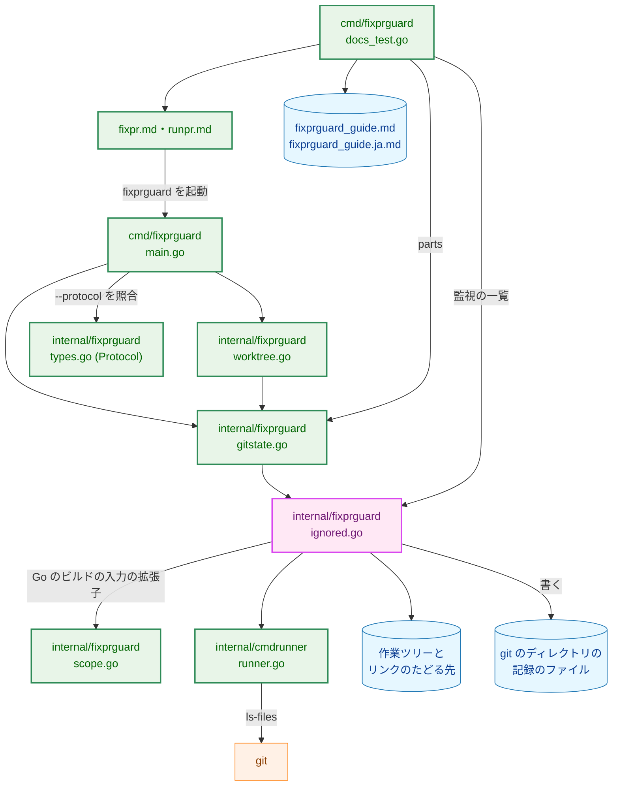
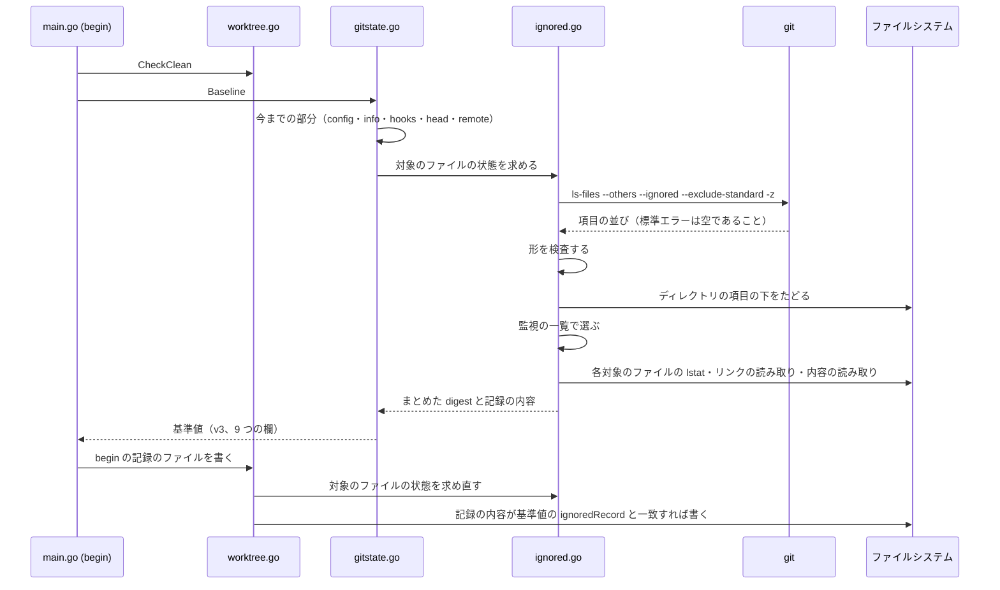
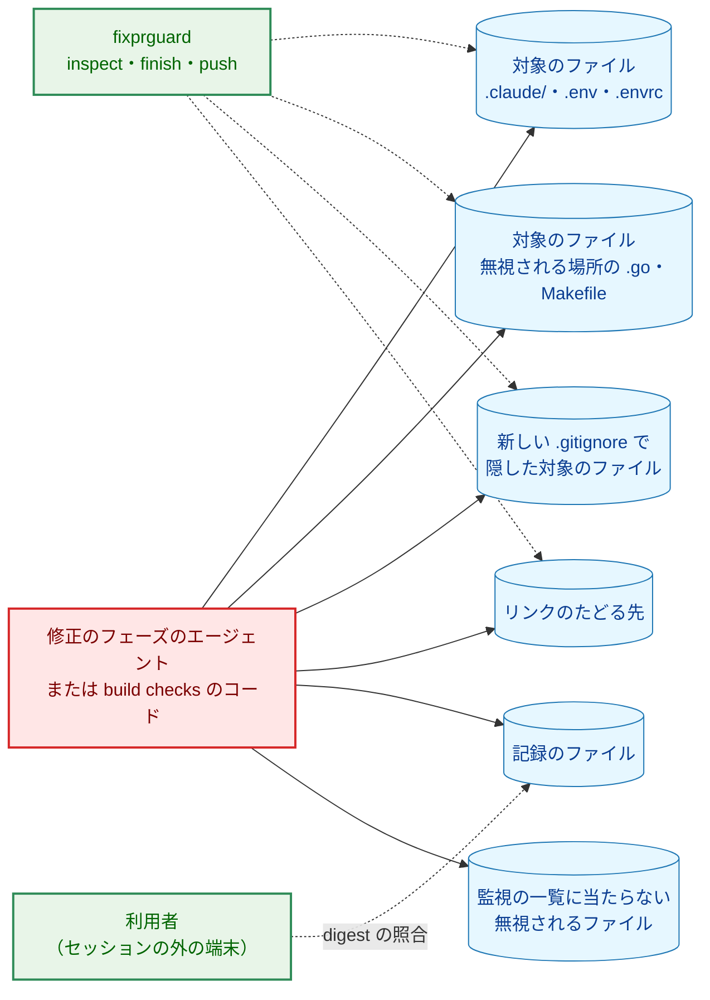
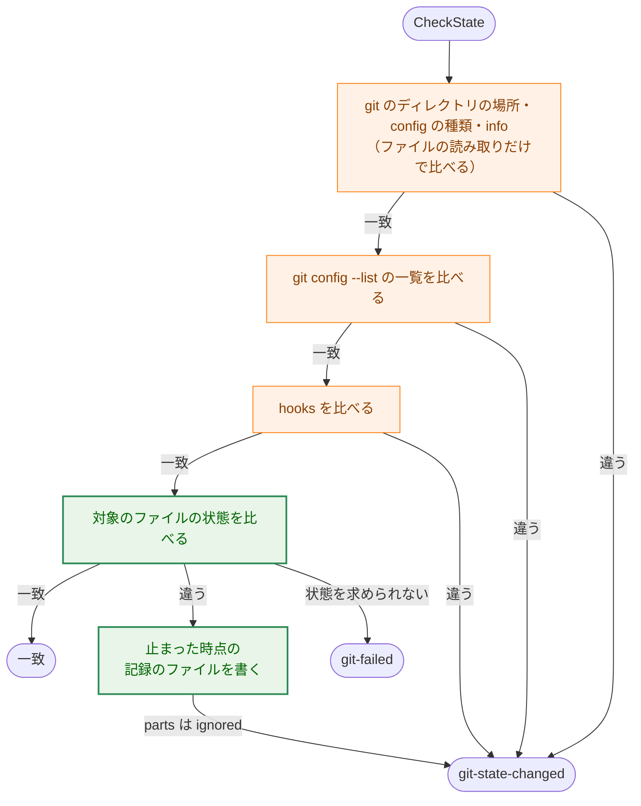
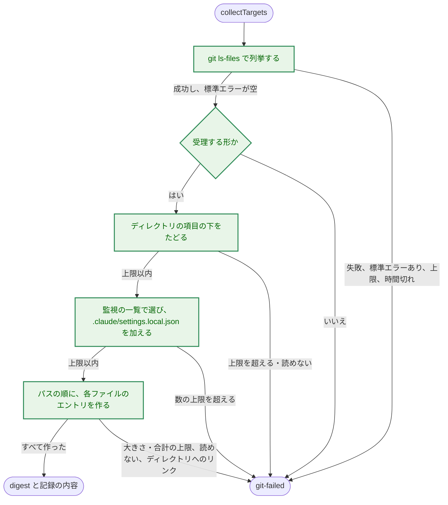

# アーキテクチャ設計書：git が無視するファイルのうち、後の実行に関わるものへの書き込みを fixprguard が検出する

## Document Status

| Item | Value |
|---|---|
| Status | `approved` |
| Created | 2026-10-22 |
| Review date | 2026-10-22 |
| Reviewer | isseis |
| Comments | 2026-10-22 (editorial): `/mkplan 0034` で、2.2 の表を実際のコードに合わせた。`internal/cmdrunner/testutil/mocks.go` は変えないこと、`NewWorktree` の呼び出しのあるファイル（`worktree_flow_test.go` ではなくテストの補助のファイル）、cmd 側のテスト用のリポジトリにも同じ設定を固定すること、`package_reference.md` と用語集の行を加えた。作るものと理由は変えないので、決定の変更ではなく、`Status` は `approved` のままとする。同じ `/mkplan 0034` の計画のレビューで、次の editorial correction も加えた。2.2 の表の `check_rules.sh` の今の番号（0036 の後は `3`）、`main.go` の行の `env` の欄、3.1 の「`Baseline` だけを呼ぶテスト」の例（`mustBaseline` は `Worktree.Begin` を呼ぶので書く）、3.10 の 0034 の要件書の行（設計書の PR #447 で変更済み）、3.10 のガイド 8 章の対処の置き場所（1 行の表のセルに複数行のコマンドが入らないので、表の後の小見出しに置く。レビュアーが選んだ。中身は変えない）。2026-10-22 (decision): 同じレビューで、`fixpr.md` がセッションに無視されるファイルを調べさせない範囲を、`ignored` で止まった場合から、無視されるファイルにかかわるすべての止まり方（`begin` の `ignored` と、4 章の無視されるファイルの規則の `git-failed` を含む）に広げた（2.2・3.10 の `fixpr.md` の行）。どの止まり方でも、調べるとファイル名がセッションに届くためである。レビュアーがこのセッションで選んだので、`Status` は `approved` のままとする。2026-10-22 (decision): `/runplan 0034` のフェーズ 1 のレビューで、APFS が完全な大文字小文字の変換で名前を解決すると分かった。照合は単純な変換のままとし、展開する変換で同じになる名前を残余のリスクとした（1.2・5.3）。レビュアーがこのセッションで選んだので、`Status` は `approved` のままとする。2026-10-23 (decision): `/runplan 0034` のフェーズ 3・4 のレビューで、git が `.git` という名前のディレクトリの下を列挙しないと分かり、最上位の `.claude/` の下のその名前で `git-failed` で止めることにした（1.2・3.3・4 章・5.2）。レビュアーがこのセッションで選んだので、`Status` は `approved` のままとする。2026-10-23 (editorial): 同じレビューで、3.4 の表に、`lstat` の `ENOTDIR` を「存在しない」とすることと、実行の許可を開いたファイルから取ることを書き足した。2026-10-23 (editorial): 同じレビューの確認で、3.3・3.5・4 章に、飛ばすのは git が無視されるものとして示す入れ子のリポジトリだけであること、`.claude` そのものがその項目なら走査しないこと、走査の上限と規則が `.claude` の走査にも当てはまることを書き足した。2026-10-23 (editorial): `/runplan 0034` のフェーズ 5 のレビューで、前のラウンドの止まった時点の記録が残ると、利用者の照合が新しい `begin` の記録と古い止まった時点の記録を比べ、違うパスを示すと分かった。3.8 に、`WriteBeginRecord` がその記録を消すことを書き足した。同じ確認のフェーズ 6・7 のレビューで、`begin` が止まったときに前のラウンドの記録が前の基準値と一致したまま残ると分かり、消すものを前のラウンドの 2 つの記録にし、状態を求め直す前に消すことにした。2 つの記録を比べて変わったパスを特定するという 3.8 の手順を成り立たせるための書き足しで、作るものと理由は変えないので、`Status` は `approved` のままとする。2026-10-23 (editorial): `/runplan 0034` のフェーズ 8 のレビューで、0030 の要件書 4.2 の層 (3) の説明（「それ以外の変化は検出しない」）と、0030 の設計書 3.6 の「変更の数え上げ」が、改めた残余のリスクと食い違うと分かった。3.10 の 0030 の 2 つの行に、これらの箇所も改めることを加えた。1.2 の「古い記述が本文に残る」のを避けるための書き足しで、作るものと理由は変えないので、`Status` は `approved` のままとする。2026-10-23 (decision): タスク 0038 の F-005 により、7.4 の `TestGuideDescribesConfigScope` の確認（0035 の AC-18 を補うもの）を PR のレビューでの読み合わせに改めた（そのテストを削除したため）。決定はタスク 0038 の要件の承認で得たので、`Status` は `approved` のままとする。 |

本書は [01_requirements.md](01_requirements.md)（要件定義書。以下、要件書）の設計である。既存のファイルに関する記述は、コミット `9f83469` のファイルで確かめた。`file:line` はこのコミットの行番号を指す。`internal/fixprguard/scope.go` の行番号は、タスク 0036 の実装で変わる。F-NNN・AC-NN は要件書の項番を、H-NN は [design_handoff.md](design_handoff.md) の項番を指す。申し送り H-01〜H-08 への対応は付録 A にまとめる。#424 などは GitHub の issue の番号を指す。

## 1. 設計の全体像 (Design Overview)

### 1.1. 設計原則

-   **既存の比較に 1 つの部分を足す。** 対象のファイル（要件書 3 章）の状態は、基準値の新しい欄 `ignored` として、git の状態を比べる関数 `CheckState`（`internal/fixprguard/gitstate.go:568-607`）の中で比べる。`inspect`・`finish`・`push` は、git の状態を比べるすべての時点で `CheckState` を通る（2.4）。そのため、比べる時点を新しく決めなくても、`finish` の build checks の後（AC-10）を含む、既存のすべての時点で対象のファイルを比べられる。
-   **無視されるかどうかは git に聞き、監視の一覧に当たるかどうかはパスの文字列で決める。** 無視されるファイルの列挙は git に任せる。`.gitignore` の規則を Go で解釈し直すことはしない。監視の一覧の照合は、パスのバイト列だけを読む純粋な関数で行い、ファイルシステムは読まない。範囲の規則（`internal/fixprguard/scope.go:11-14`）と同じ方針である。
-   **基準値と出力には、まとめた値だけを置く。** すべての対象のファイルの状態を 1 つの digest にまとめる。ファイルごとの digest、パス、ファイル名は、基準値にも標準出力・標準エラーにも置かない（AC-15）。止まった後の調査に使うパスとファイルごとの digest は、git のディレクトリの記録のファイルにだけ書く（3.8）。
-   **状態を求められないときは止まる。** 列挙の形の誤り、git の警告、上限の超過、読み取りの失敗、時間切れ、ディレクトリを指すシンボリックリンクでは、`git-failed` で止まる（AC-16）。一部だけを digest に書いたり、一部だけを比べたりはしない。
-   **監視の一覧は範囲の規則とは別に持つ。** 共有するのは、Go のビルドの入力の拡張子の一覧だけである（要件書 4.5）。

### 1.2. 設計の際に決めたこと（2026-10-22）

`/mkarch 0034` の検討で、次のことを決めた。「レビュアーが選んだ」とした項目は、レビュアーにこのセッションで問い、答えを得たものである。

-   **Claude Code が `.claude/` の下に書く実行時のファイルでも、要件書のとおり止める（H-02）。** main のチェックアウトの `.git/info/exclude` には、Claude Code が `.claude/` の下に書くファイルの一覧がある（`scheduled_tasks.lock`・`scheduled_tasks.json`・`routines/.state/`・`worktrees/`・`checkpoints/`・`mailbox/`・`agent-registry.json`・`agent-memory-local`・`first-run`・`assistant-daemon-state.json`）。監視の一覧は `.claude/` の下のすべてを含むので、これらも対象である。確かめたことは次のとおりである（2026-10-22）。
    -   本 worktree で、印のファイルを置いた後に、Write ツールでのファイルの作成、ファイルの書き換え、サブエージェント 3 つの実行を行った。その後、印より新しいファイルを `find .claude -newer` で探したが、`.claude/` には何も書かれていなかった。git が無視するファイルの列挙も空だった。
    -   main のチェックアウトには `.claude/scheduled_tasks.lock` があり、スケジュールを使うセッションが書き換えていた。`/fixpr` の `begin` から `push` までの手順は、スケジュールを使わない。

    `/fixpr` の 1 回の実行の全体（`begin` から `push` まで）を観測してはいない。観測した範囲の操作では書かれなかったので、要件書の決定を変える根拠はないと判断した。

    `.claude/worktrees/<name>/` に Claude Code の worktree があると、git はそれを入れ子のリポジトリとして列挙する（3.3）。その下のファイルはすべて `.claude/` の下にあるので、チェックアウトの全体が対象になる。そのため、上限を超えて `begin` が止まるか、その worktree の下で並行するセッションが編集するたびに `git-state-changed` で止まる。ガイド 8 章で、worktree を `.claude/` の外に置くことを案内する（3.10）。理由: 対象を狭めると、`scheduled_tasks.json` のように後で実行されうるファイルが対象から外れる。このリポジトリの worktree は `.claude/` の外に置かれている。レビュアーが選んだ。
-   **ディレクトリを指すシンボリックリンクでは、一律に `git-failed` で止める（H-04）。** 対象のファイルがシンボリックリンクで、たどる先がディレクトリのときは、その下を digest に書かずに止まる。要件書 3 章が設計に任せた 2 つの案のうち、一律に止める案である。理由: その下を記録する案は、リンクの循環と作業ツリーの外の大きな部分木を上限で抑える仕組みが要り、実装とテストが増える。main のチェックアウトにも本 worktree にも、該当するリンクはない（2026-10-22 に確かめた）。レビュアーが選んだ。
-   **監視の一覧の照合は、Unicode の単純な大文字小文字の変換で行う。** 要件書 3 章と 4.4 は「ASCII の大文字小文字を同一視」とする。ところが、macOS の大文字小文字を区別しない APFS は、Unicode の大文字小文字の変換で名前を解決する。レビューで次のことが確かめられた（2026-10-22）。KELVIN SIGN（U+212A）を含む `go.worK` は、`[ -e go.work ]` で見つかる。`go env GOWORK` もそれを `go.work` として返す。ASCII だけの照合では、このファイルが対象から漏れる。そこで、正しい UTF-8 の文字は `unicode.SimpleFold` の変換で同一視し、不正なバイトは完全に一致するものだけを同一視する（3.2）。ASCII の同一視を含み、対象が広がる方向（安全側）の変更である。要件書の状態は `approved` のままとし、本文の 2 か所を改め、`Comments` に決定として記録する（3.10）。レビュアーが選んだ。APFS は完全な大文字小文字の変換（合字 `fi` を `fi` に、`ß` を `ss` にする）で名前を解決することが、`/runplan 0034` のフェーズ 1 のレビューで分かった（`makefile` を作ると `[ -e makefile ]` で見つかる。2026-10-22）。照合は単純な変換のままとし、展開する変換で一覧の項目と同じになる名前は残余のリスクとする（5.3）。レビュアーが選んだ。
-   **削除されたファイルと変わったファイルを特定するための記録を、ツールが git のディレクトリに 2 つ書く（H-08）。** `begin` が書く記録と、`ignored` で止まったときに書く記録である。どちらも、対象のファイルごとに、パスとそのファイルの状態の digest を 1 行に書く（3.8）。基準値には、`begin` の記録のファイルの digest を置く。止まった後、利用者はガイドのコマンドで、`begin` の記録の digest が基準値の値と一致することを確かめる。そのうえで 2 つの記録を比べ、変わった・増えた・消えたパスを特定する。理由: 利用者が保存を忘れても記録が残り、記録の書き換えも検出できる。シェルで監視の一覧を照合し直すと、ツールの照合と食い違う（大文字小文字、入れ子のリポジトリ、リンク）が、ツールが書いた記録を比べればその食い違いがない。レビュアーが選んだ。
-   **記録は、作業ツリーごとの git のディレクトリに置く。** 置き場所は `locateGitDirs`（`gitstate.go:203-241`）が求める作業ツリーごとの git のディレクトリである。main のチェックアウトでは `.git`、linked worktree では `.git/worktrees/<name>` になる。理由: 作業ツリーの外にあり、git はそれを列挙しない。作業ツリーごとに分かれ、新しい設定の項目や外のディレクトリを要しない。修正のフェーズのエージェントがそこに書けるかどうかは、Claude Code の権限の確認に依存する。main のチェックアウトの `.git` と linked worktree の `.git/worktrees/<name>` のどちらについても、エージェントが書けるかどうかは確かめていない。digest の照合が書き換えを、記録の有無が削除を示す（5.3）。
-   **0030 の承認済みの文書は、本文を改め、状態は `approved` のままにする（H-06）。** タスク 0035 が 0030 の文書を改めたときの前例（0030 `01_requirements.md:11` の `Comments`）に合わせる。決定は本タスクの要件書の承認（AC-20・AC-20a）で得たので、`Comments` にその旨を記録する。理由: 過去のタスクの記録であっても、今の保証の範囲を示す文書として読まれる。参照を追記するだけでは、古い記述が本文に残る。
-   **`Protocol` は `4` にする（H-03）。** タスク 0036 の設計が `3` を使い、0034 は `4` 以上を使うよう申し送った（0036 `02_architecture.md:44`・3.8、#424 への 0036 からのコメント）。番号は上げるだけで、使った番号は再び使わない。本タスクの実装が先に `main` に入った場合は、0036 は `5` を使う（3.9）。理由: 番号が衝突すると、片方のブランチで作ったバイナリが、もう片方の文書の `--protocol` を受け付け、違う規則で黙って判定する。
-   **列挙には `git ls-files --others --ignored --exclude-standard -z` を使い、`--directory` は付けない（H-01）。** main のチェックアウト（`extension/node_modules/`・`.venv/`・`build/` がある）で、出力は 5540 件、379,494 バイトで、約 0.1 秒だった（2026-10-22 に測った）。`--directory` を付けると、無視されるディレクトリの中の `.go` や `Makefile` が、そのディレクトリを表す 1 つの項目（本書での「項目」は 1.4 の末尾で定義する）にまとめられ、ツールが中をたどることになる（H-01）。
-   **`.claude/` の下の `.git` という名前で止める。** git は、`.git` という名前（`core.ignorecase` が有効なら大文字小文字を問わない）のディレクトリやファイルの下を列挙しない。親が有効なリポジトリでなければ、入れ子のリポジトリの項目にもならない。そのため、`.claude/commands/.git/x.md` は列挙にも `git status` にも現れない（`/runplan 0034` のレビューで確かめた。2026-10-23）。ツールは最上位の `.claude/` を自らたどり、そのような名前のもので `git-failed` で止まる（3.3）。`go` と `make` はドットで始まるディレクトリを読まないので、ほかの場所は対象にしない。レビュアーが選んだ。
-   **列挙で git が標準エラーに何か書いたら止める。** git は、読めないディレクトリを警告だけで飛ばし、終了コード `0` を返す（3.3）。終了コードだけを見ると、そのディレクトリの中の対象のファイルを見逃す。
-   **対象のファイルは比較の最後に比べ、`parts` には `ignored` だけを示す（H-05）。** `CheckState` の hooks の比較の後に比べる（3.7）。
-   **上限の値は、測った値に余裕を持たせて決める（H-01）。** 3.5 の表のとおりである。

### 1.3. なぜ既存の仕組みでは足りないか

-   **作業ツリーの clean の検査と変更の集合（`worktree.go:66-75`・`worktree.go:351`）。** どちらも `--exclude-standard` で無視されるファイルを除く。無視されるファイルを含めて数えると、`coverage.out` や `extension/node_modules/` の下のすべてで止まり、AC-12 を満たせない。
-   **`git status --ignored`。** 無視されるファイルを示すが、監視の一覧で選ぶ手段がない。無視されるディレクトリを 1 つの項目にまとめるので、中の `.go` が見えない（H-01）。
-   **既存の digest の関数。** 次の表のとおり、使うものと使わないものを分ける。

| 既存の関数・値 | 扱い | 理由 |
|---|---|---|
| `writeField`（`threads.go:428-431`） | 使う | 値を `strconv.Quote` で引用して区切る。任意のバイト列のパスを曖昧さなく書ける |
| `openRegular`（`gitstate.go:246-261`） | 使う | `O_NONBLOCK` で開き、開いたファイルで通常のファイルかを確かめる |
| `gitFileMode`（`changes.go:372`） | 使わない | git のモード（`100644`・`100755`）を返す関数で、シンボリックリンクと通常のファイル以外を区別しない。3.4 の種類の区別が要る |
| `hooksDigest`・`digestPathType`・`fileSHA256`（`gitstate.go:327-441`） | 使わない | 1 つのディレクトリの下をすべて digest に書く関数と、その部品である。大きさの上限がなく（`fileSHA256` は上限なしに読む）、たどれないリンクを `dangling` 1 つで表す（3.4 は理由ごとに失敗と記録を分ける） |
| `readChanged`（`changes.go:382`） | 使わない | 変更の集合の内容を読む関数で、上限を超えても digest のために全体を読む（0030 の設計）。本タスクは上限で読み止める |
| `splitNUL`（`changes.go:194`） | 使わない | 空の項目を黙って捨てる。本タスクは空の項目を形の誤りとして止まる（AC-16） |

### 1.4. 概念モデル

次の図は、対象のファイルの状態が、基準値と記録のファイルになるまでを表す。矢印 A → B は「A から B を求める」を表す。




-   **対象のファイル**は、git が無視するファイルとして列挙したパスと、入れ子のリポジトリの中でツールが見つけたパスのうち、監視の一覧に当たるものである。`.claude/settings.local.json` は、列挙の結果にかかわらず必ず含める（AC-04）。
-   **各ファイルの状態**は、有無と、種類・内容・実行の許可・シンボリックリンクの先・たどる先の状態である（3.4）。
-   **基準値の `ignored`** は、すべての対象のファイルの状態をまとめた digest である。
-   **記録のファイル**は、対象のファイルごとに、パスとそのファイルの状態の digest を書いたファイルである（3.8）。`begin` の時点のものと、止まった時点のものがある。**基準値の `ignoredRecord`** は、`begin` の時点の記録のファイルの digest である。

本書では、git の列挙の出力の NUL で区切った 1 つ 1 つを「**項目**」と呼ぶ（要件書 4.2 の「記録」に当たる）。末尾に `/` を持つ項目を「**ディレクトリの項目**」と呼ぶ。「**記録のファイル**」は 3.8 のファイルだけを指す。

## 2. システム構成 (System Structure)

### 2.1. 全体構成

次の図の矢印 A → B は「A が B を呼ぶ、または読む・書く」を表す。




今のコードにある関係は次のとおりである。
-   `fixpr.md`・`runpr.md` から `main.go`。
-   `main.go` から `types.go`（`cmd/fixprguard/main.go:232` の `--protocol` の照合）。
-   `main.go` から `worktree.go` と `gitstate.go`（`main.go:568` の `CheckState`）。
-   `worktree.go` から `gitstate.go`（`worktree.go:130`・`:243`・`:273` など）。
-   `docs_test.go` からガイド（`docs_test.go:45-62`）と、`docs_test.go` からコマンドの文書（`docs_test.go:122`）。

`gitstate.go` から `ignored.go` への矢印と、`ignored.go` から先の矢印は、本タスクが加える。

### 2.2. コンポーネント配置

| ファイル | 種別 | 内容 |
|---|---|---|
| `internal/fixprguard/ignored.go` | 新規 | 監視の一覧のデータと照合、`WatchListPatterns`（3.2）。列挙と受理する形、ディレクトリの項目のたどり（3.3）。各ファイルの状態とまとめた digest（3.4）。上限と時間の上限（3.5）。記録のファイルの書き込み（3.8） |
| `internal/fixprguard/ignored_test.go` | 新規 | 7 章の単体テスト |
| `internal/fixprguard/gitstate.go` | 変更 | `Baseline` に `ignored`・`ignoredRecord` を加え、トークンの版を `v3`、欄の数を 9 にする（`:28-32`・`:112-153`。3.6）。`PartIgnored` と `GitStateParts` を加える（`:50-56`）。`Baseline`（`:742-787`）で対象のファイルの状態を求め、`CheckState`（`:568-607`）の最後で比べる（3.7） |
| `internal/fixprguard/worktree.go` | 変更 | `Worktree` に、列挙のための git の runner を加える（`:51-61`。3.3）。`Begin`（`:80-85`）が、`Baseline` の後に `begin` の記録のファイルを書く（3.8） |
| `internal/fixprguard/test_helpers_git.go`・`cmd/fixprguard/test_helpers.go` | 変更 | テスト用のリポジトリで、`core.excludesFile`・`core.ignorecase`・`core.precomposeunicode` と `HOME`・`XDG_CONFIG_HOME` を固定する（7 章）。`NewWorktree` の呼び出しに列挙のための runner を加える |
| `internal/fixprguard/scope.go` | 変更なし、または変更 | Go のビルドの入力の拡張子の一覧は、0036 が置く変数を使う。0036 がまだ入っていなければ、本タスクが置く（3.2） |
| `internal/fixprguard/types.go` | 変更 | `Protocol` を `4` にする（`:20`。3.9） |
| `internal/cmdrunner/runner.go` | 変更 | 成功しても標準エラーに出力があれば失敗とする設定（`Options` の新しい欄）と、そのエラー（3.3・4 章）。`internal/cmdrunner/testutil/mocks.go` の `Fake` は `Options` を持たず、`Step.Err` で失敗を再現できるので変えない |
| `cmd/fixprguard/main.go` | 変更 | `env`（`:135-143`）に列挙のための git の runner の欄を加え、標準エラーを失敗とする設定で作って `NewWorktree` に渡す（`:149-` の `osEnv`）。テストの `newTestRun`（`cmd/fixprguard/test_helpers.go:151-163`）もこの欄を設ける。`begin` が記録のファイルを書く呼び出しを、`Baseline` の後に加える（`:494` 付近。3.8） |
| `cmd/fixprguard/test_helpers.go` | 変更 | `validBaseline`（`:381-390`）を `v3` と 9 つの欄にする |
| `cmd/fixprguard/docs_test.go` | 変更 | ガイドの監視の一覧の表と `git-state-changed` の行、`fixpr.md` の `parts` の列挙を確かめるガードを加える（3.10） |
| `.claude/commands/fixpr.md` | 変更 | `--protocol` を `4` にする。`parts` の列挙に `ignored` を加え、無視されるファイルにかかわる止まり方（`begin`・`inspect`・`finish`・`push` の `ignored` と、4 章の無視されるファイルの規則の `git-failed`）では、セッションが無視されるファイルを一覧にしたり読んだりせず、利用者にガイド 8 章の手順を案内するよう書く（`:255-262`・`:492-493`・`:524-525`・`:663-664`。3.9・3.10） |
| `.claude/commands/runpr.md` | 変更 | `--protocol` を `4` にする（3.9）。`git-state-changed` の扱い（`:273-278`）は `fixpr` の報告を示して止まるだけなので変えない |
| `docs/tasks/0032_japanese_pr_title/check_rules.sh` | 変更 | `:524` の `--protocol` の番号（タスク 0036 の後は `3`）を `4` にする（3.9） |
| `docs/dev/developer_guide/fixprguard_guide.ja.md`・`fixprguard_guide.md` | 変更 | 1 章・4 章・5 章・7 章・8 章・9 章（3.10） |
| `docs/tasks/0034_fixprguard_ignored_files/01_requirements.md` | 変更済み（設計書の PR #447） | 3 章と 4.4 の照合の記述、AC-19 と 4.2 の記録と基準値の記述、`Comments`（1.2 の照合と記録の決定。3.10） |
| `docs/tasks/0030_fixpr_untrusted_threads/01_requirements.md` | 変更 | 4.2 の残余のリスクの項目（AC-20a。3.10） |
| `docs/tasks/0030_fixpr_untrusted_threads/02_architecture.md` | 変更 | 5.3「無視されるファイル」（AC-20。3.10） |
| `docs/dev/developer_guide/package_reference.md` | 変更 | `internal/cmdrunner` の行に新しい設定とエラーを、`internal/fixprguard` の行に対象のファイルの比較と記録のファイルを加える |
| `docs/translation_glossary.md` | 変更 | ガイドの翻訳で使った本タスクの用語を加える（`.claude/commands/mktrans.md`「Update Glossary」） |

本タスクの変更で直す既存のテストと、満たし続けるガードは次のとおりである。

| テスト | 前提にしていること | 扱い |
|---|---|---|
| `internal/fixprguard/gitstate_test.go:324-355`（`TestBaselineMalformedRejected`） | 欄の位置（`with(5, ...)`・`with(6, ...)`）と、`v1` を前の版とすること | 前の版を `v2` と 7 つの欄の形にし、新しい欄の誤りの行を加える |
| `cmd/fixprguard/test_helpers.go:381-390`（`validBaseline`） | `v2` と 7 つの欄 | `v3` と 9 つの欄にする |
| `cmd/fixprguard/main_test.go:26`（`validArgs` の `"v2.x"`） | 引数の解析だけを試す値 | 版を変える |
| `cmd/fixprguard/main_test.go:305-330`（`TestPreviousBaselineRejected`） | 前の版を `v1.` と今の欄で作ること | 前の版を `v2` と 7 つの欄の形にする（AC-03） |
| `cmd/fixprguard/docs_test.go:122`・`:352`（`TestDocumentedInvocationsParse`・`TestDocumentedProtocolMatches`） | 文書の `--protocol` がバイナリの番号と一致すること | テストは変えず、文書を直す |
| `cmd/fixprguard/docs_test.go:454-503`（`TestGuideDescribesConfigScope`） | ガイドの 1 章の層 (3)、5 章の `inspect`・`push`、7.1 の行、7.2、8 章の `git-state-changed` の行が、config の比較の範囲の 3 つの点を述べること | テストは変えない。本タスクが書き換える段落も、この 3 つの点を残す |
| `NewWorktree` の呼び出し（`internal/fixprguard/test_helpers_git.go:223`、`cmd/fixprguard/test_helpers.go:114`・`:125`） | `NewWorktree(gitRun, makeRun)` の 2 つの引数 | 列挙のための runner を加える |

### 2.3. データフロー

`begin` は、基準値を求めた後に、`begin` の記録のファイルを書く。



`inspect`・`finish`・`push` は、`CheckState` の最後で同じ手順で状態を求め、digest を基準値の `ignored` と比べる。違えば、止まった時点の記録のファイルを書いてから止まる（3.7・3.8）。

### 2.4. 既存の挙動の確認

-   `CheckState` は、git のディレクトリの場所・config のファイルの種類・info を、git を起動せずファイルの読み取りだけで比べ、次に `git config --list` の一覧を、最後に hooks を比べる（`gitstate.go:568-607`）。違いがあれば、その時点で `GitStateError` を返す。`parts` に 2 つ以上の値が並ぶのは、config と info が同時に違う場合だけである（`gitstate.go:581-590`）。
-   `inspect` は、`gh` を起動する前に `CheckState` を呼び（`main.go:568`）、`Inspect` の中で `compareState` からもう一度呼ぶ（`worktree.go:130`、`gitstate.go:804`）。
-   `finish` は、`compareState` を `checkedChanges` から 3 回（`worktree.go:213`・`:231`・`:249` から `:273`）、`CheckState` を `make test` の後（`:243`）、`git add` の後（`:326`）、commit の後（`:383`）に呼ぶ。stage を取り消すとき（`:367`）にも呼ぶ。
-   `push` は、`compareState` を呼んでから push する（`worktree.go:502`）。
-   git の出力の上限は 64 MiB である（`cmd/fixprguard/main.go:45`）。超えると `gitFailure` が `git-failed` にする（`gitstate.go:468-476`）。
-   `cmdrunner` の runner は、コマンドが成功したとき、標準出力だけを返し、標準エラーを捨てる（`internal/cmdrunner/runner.go:78-110`）。
-   git は、無視されるディレクトリの中の入れ子のリポジトリを、末尾に `/` を付けた 1 つの項目として示す。FIFO は示さない。シンボリックリンクは、ディレクトリを指すものも含めて、1 つのファイルとして示す。読めないディレクトリ（例: モード `0311`）は、標準エラーに `warning: could not open directory` を書いて飛ばし、終了コード `0` を返す（git 2.50.1 で、一時リポジトリで確かめた。2026-10-22）。

## 3. コンポーネント設計 (Component Design)

### 3.1. 型と関数

```go
// PartIgnored names the target files among the parts of the git state.
const PartIgnored = "ignored"

// GitStateParts lists every value GitStateError.Parts can hold.
func GitStateParts() []string

// Baseline gains two digests: the state of every target file, and the
// begin record file. The token version becomes "v3" with 9 fields.
type Baseline struct {
	head, branch, remoteOID, hooks, config, configList, info string
	ignored       string
	ignoredRecord string
}

// targetState is what one pass over the target files yields.
type targetState struct {
	digest string // over every target file's path and state
	record []byte // one line per target: entry digest and quoted path
}

// targetLimits bounds one pass. defaultTargetLimits holds the values of
// section 3.5; tests pass smaller ones.
type targetLimits struct {
	files       int   // target files
	walkEntries int   // entries visited under directory items
	fileBytes   int64 // one regular file
	totalBytes  int64 // bytes read in one pass
	timeout     time.Duration // the whole pass, enumeration included
}

// collectTargets enumerates the target files and records their state,
// stopping with ErrGitFailed when it cannot record all of them.
func (w *Worktree) collectTargets(ctx context.Context, lim targetLimits) (targetState, error)

// WriteBeginRecord writes the begin record file into the per-worktree git
// directory when the target files still match base.
func (w *Worktree) WriteBeginRecord(ctx context.Context, base Baseline) error

// isWatched reports whether a repository-relative path is on the watch list.
func isWatched(p string) bool

// WatchListPatterns lists the watch list in the form the guide prints it.
func WatchListPatterns() []string
```

-   `Baseline` の欄は、今までどおり非公開で、`newBaseline` だけが組み立てる（`gitstate.go:122-126`、`construction_test.go:20`）。
-   `Worktree.Baseline` は、今までどおり読み取りだけを行う。記録のファイルを書くのは `WriteBeginRecord` で、`begin` の呼び出し（`main.go` と `Worktree.Begin`）が `Baseline` の後に呼ぶ。そのため、`Baseline` だけを呼ぶテスト（`cmd/fixprguard/test_helpers.go:111-119` の `testRepo.Baseline`）は、git のディレクトリに書かない。`Worktree.Begin` を呼ぶ `internal/fixprguard/test_helpers_git.go:237-246` の `mustBaseline` は書く。
-   止まった時点の記録のファイルは、`CheckState` が `ignored` の違いを見つけたときに `ignored.go` の非公開の関数で書く（3.8）。

### 3.2. 監視の一覧のデータと照合（要件書 3 章・4.5、H-01）

監視の一覧は `ignored.go` に置く。

| データ | 中身 | 照合 |
|---|---|---|
| 最上位のディレクトリ | `.claude` | パスの最初の要素が `.claude` |
| 最上位のファイル | `.env`・`.envrc`・`claude.local.md` | パスが 1 つの要素で、それがどれかと同一視できる |
| 名前 | `claude.md`・`makefile`・`gnumakefile`・`go.mod`・`go.work` | パスの最後の要素がどれかと同一視できる |
| 拡張子 | `.go`・`.mk` | パスの最後の要素の末尾がどれかと同一視できる（名前がその文字列だけのものを含む） |
| Go のビルドの入力の拡張子 | `.c`・`.h`・`.cc`・`.cpp`・`.cxx`・`.hh`・`.hpp`・`.hxx`・`.m`・`.s`・`.sx`・`.f`・`.for`・`.f90`・`.swig`・`.swigcxx`・`.syso` | 同上 |

-   **同一視の仕方（1.2 の決定）。** パスを、正しい UTF-8 の文字と、不正なバイトに分けて比べる。文字は、`unicode.SimpleFold` で互いに行き来できる文字どうしは同一視する。この方法は ASCII の大文字小文字の同一視を含み、KELVIN SIGN（U+212A）と `k`、LONG S（U+017F）と `s` も同一視する。不正なバイトは、同じバイトだけを同一視する。`strings.EqualFold` は使わない。不正なバイトをすべて U+FFFD とみなすので、違う不正なバイト列を同じものとして扱うからである。パスは正規化しない。
-   **範囲の規則との違い。** 範囲の規則は `strings.ToLower` で小文字にしてから照合する（`scope.go:104`）。KELVIN SIGN は `k` になるが、LONG S は `s` にならない。監視の一覧の照合は、それより広く同一視する。範囲の規則の照合は、本タスクでは変えない。
-   **Go のビルドの入力の拡張子は、タスク 0036 が `scope.go` に置く一覧を使う。** 0036 の実装（PR-1）は、同じ 17 種類を、拒否リストのデータとして `scope.go` の非公開のパッケージ変数に置く（0036 `02_architecture.md` 3.1）。0036 は本タスクの実装より先に `main` に入る見込みである（#424 への 0036 からのコメント、2026-10-22）。同じパッケージなので、監視の一覧はその変数をそのまま参照する（要件書 4.5）。本タスクの実装の時点で 0036 がまだ入っていなければ、本タスクが同じ 17 種類を `scope.go` に置く。
-   **ほかのデータは共有しない。** 名前と `.mk` は今の `execNames`・`execSuffixes`（`scope.go:41-43`）と重なるが、タスク 0036 が `execNames` を変える（`go.sum` などを含む。0036 `02_architecture.md` 3.1）。監視の一覧は、実行関連ファイル（0036 の後の範囲の規則の用語）の定義が変わっても変わらない（要件書 2.3）ので、別に持つ。
-   **ガイドの表記。** `WatchListPatterns` は、`.claude/`、`/.env`・`/.envrc`・`/claude.local.md`（先頭の `/` は最上位だけで当たる印）、名前、`*.go` のような拡張子の形で返す。ガイドは同じ表記で、監視の一覧の表に載せる（3.10、AC-17）。

### 3.3. 列挙と受理する形（要件書 4.2、AC-07・AC-13・AC-16、H-01）

**列挙の手段。** `git ls-files --others --ignored --exclude-standard -z` を、`gitHardening`（`gitstate.go:77-86`）を付けて起動する。`--exclude-standard` は、`.gitignore`（入れ子のものを含む）、`info/exclude`、グローバルの除外のファイル（`core.excludesFile`）をすべて読む。そのため、`begin` の後に置かれた `.gitignore` や、書き換えられたグローバルの除外のファイルが隠した新しいファイルも、列挙に現れる（AC-13）。`ls-files` は hook を実行しない。

**標準エラー。** 列挙は、成功しても標準エラーに出力があれば失敗とする runner で起動する。git は、読めないディレクトリを警告だけで飛ばして終了コード `0` を返すからである（2.4）。そのため、`cmdrunner.Options` に、成功したときの標準エラーを失敗とする欄 `StderrIsFailure` を加え、その設定のもとで標準エラーに出力があった場合のエラー `ErrUnexpectedStderr` を `cmdrunner` に定める（4 章）。`Worktree` は、この設定の runner を、ほかの git の runner とは別に持つ。ほかの git の呼び出しには、この設定を当てはめない。`git add` や `git commit` は、正当な場合にも標準エラーに書くことがあるからである。既存の clean の検査と変更の集合にも同じ穴があるが、本タスクの範囲の外なので、#446 で扱う。

**受理する形。** 要件書 4.2 の形だけを受理する。出力をバイト列のまま次のとおり検査し、合わなければ補正も読み飛ばしもせずに `git-failed` で止まる。

-   空でない出力は NUL で終わる。NUL で区切った各項目は空でない。
-   項目は `/` で始まらない。項目を `/` で分けた各要素は、空でなく、`.` でも `..` でもない。ただし、末尾の `/` が 1 つだけの項目はディレクトリの項目とし、その `/` を除いて同じ検査をする。
-   同じバイト列の項目は 2 度現れない。

**ディレクトリの項目。** ディレクトリの項目（入れ子のリポジトリ。2.4）は、ツールがその下をたどる。たどって見つけたディレクトリの中身の 1 つ 1 つを「走査したエントリ」と呼ぶ（3.4 のエントリとは別）。シンボリックリンクはたどらずに 1 つの走査したエントリとして扱い、通常のディレクトリの下には降りる。走査した各エントリのパスは、ディレクトリの項目のパスにつないだものとし、3.2 の照合に掛ける。当たったもののうち、通常のファイルとシンボリックリンクだけを対象のファイルにする。FIFO などは、git の列挙と同じく含めない（要件書 3 章）。走査したエントリの数は、3.5 の上限に数える。ディレクトリを読めなければ `git-failed` で止まる。

**`.claude/` の下の `.git` という名前。** ツールは、最上位の `.claude` がディレクトリなら、その下をシンボリックリンクをたどらずに走査し、名前が `.git` と同一視できる（3.2）エントリがあれば `git-failed` で止まる。ディレクトリの項目（git が無視されるものとして示す入れ子のリポジトリ）の下は、上の走査が済んでいるので飛ばす。`.claude` そのものがディレクトリの項目なら、この走査はしない。無視されない入れ子のリポジトリ（`.claude/worktrees/` の worktree を無視する規則がない場合など）は飛ばさないので、その `.git` で止まる。`git status` は、追跡されていない入れ子のリポジトリの中の変化を示さないので、止まるのが安全側である。走査するのは `.claude` という名前のディレクトリだけで、Claude Code が読む名前である。走査したエントリは 3.5 の上限に数える。読めなければ `git-failed` で止まる。

**`.claude/settings.local.json`。** 列挙の結果にかかわらず、必ず `lstat` で調べて状態に含める。存在しないことも「存在しない」として digest に書く。種類が通常のファイルでもシンボリックリンクでもなければ、種類だけを書く（要件書 3 章）。列挙の結果にも現れた場合は、1 つとして扱う。

### 3.4. 各ファイルの状態（要件書 3 章、AC-08・AC-08a・AC-08b、H-04、H-07）

**エントリ。** 対象のファイルごとに、次の値を並べた「エントリ」を作る（3.3 の「走査したエントリ」とは別）。値の区切りは既存の `writeField` に従う。各エントリは、種類を表す印と、値の数から始める。そのため、パスやリンクの文字列にどんなバイト列があっても、エントリの境目は一意に決まる。

| 対象のファイルの種類 | 値 |
|---|---|
| 存在しない（`.claude/settings.local.json` だけ。列挙の後に消えたものを含む。`lstat` が `ENOENT` か `ENOTDIR` を返すもの） | 印 `absent`、パス |
| 通常のファイル | 印 `file`、パス、実行の許可（`perm & 0o111`。内容と同じく、開いたファイルの `Stat` から取る）、内容の SHA-256 |
| シンボリックリンク | 印 `link`、パス、リンクの文字列、たどる先の値（下の表） |
| それ以外（FIFO など） | 印 `other`、パス、種類 |

シンボリックリンクは、`os.Stat`（途中のリンクもすべてたどる）でたどる先を調べる。

| たどる先 | 値 |
|---|---|
| 通常のファイル | `file`、実行の許可、内容の SHA-256（リンクを経て読む） |
| ディレクトリ | 書かない。`git-failed` で止まる（1.2 の決定） |
| それ以外（FIFO など） | `other`、種類 |
| たどれない（`ENOENT`・`ELOOP`・`ENOTDIR`） | `unresolved` |
| ほかのエラー（`EACCES` など） | 書かない。`git-failed` で止まる |

-   **まとめた digest。** エントリをパスのバイト列の順に並べ、各エントリの値を順に 1 つの SHA-256 に書いたものが `ignored` である。
-   **エントリの digest。** 各エントリの値だけを SHA-256 に書いたものを、記録のファイルに書く（3.8）。基準値と出力には置かない（AC-15）。
-   **たどれないリンク。** 3 つのエラーだけを `unresolved` として記録し、ほかのすべてのエラーでは止まる。後でたどれるようになれば値が変わるので検出する（AC-08b）。たどれないリンクがあっても `begin` は止まらない。
-   **書かないもの（AC-08a）。** 更新時刻・所有者・拡張属性は書かない。実行の許可は、`perm` の実行のビットだけを書く。読み書きのビットは、実行される内容を変えないためである。
-   **内容の読み方。** 通常のファイルは、`openRegular` と同じく `O_NONBLOCK` で開き、開いたファイルの `Stat` で通常のファイルであることと大きさを確かめてから読む。対象のファイルそのものはリンクをたどらずに開き（`O_NOFOLLOW`）、シンボリックリンクのたどる先はリンクを経て開く。`lstat` と開く間に FIFO に置き換えられても、開いたファイルの検査で止まり、読み取りで待たない（H-04）。開いた後の `Stat` の大きさが上限を超えれば、読まずに止まる。大きさの検査の後に伸びたファイルも、上限に 1 を足した量までしか読まない。

### 3.5. 上限と時間の上限（AC-01a・AC-16、要件書 4.1・4.3、H-01）

| 上限 | 値 | 数えるもの | 根拠 |
|---|---|---|---|
| 列挙の出力 | 64 MiB | git が列挙するすべての無視されるファイルの項目 | 既存の git の出力の上限（`main.go:45`）。main のチェックアウトの出力は 379,494 バイト |
| 対象のファイルの数 | 10,000 | `.claude/settings.local.json` を含む対象のファイル | main のチェックアウトでは 3 個 |
| ディレクトリの項目と `.claude` の下の走査したエントリ | 100,000 | 3.3 で走査したエントリ（ディレクトリ・FIFO などを含む） | 入れ子のリポジトリそのものは測っていない。このリポジトリの main のチェックアウトの `.git` の下のファイル（4,066 個。2026-10-22 に測った）に対して 20 倍以上の余裕を取った |
| 1 つのファイルの大きさ | 16 MiB | 対象の通常のファイルと、シンボリックリンクのたどる先の通常のファイル | main のチェックアウトの最大は 6,025 バイト。依存のパッケージには、1 つにまとめた C のソース（SQLite の約 9 MB など）を含むものがあるので、それを超える値にする |
| 読み取る内容の合計 | 64 MiB | 1 回の状態を求める処理で読んだバイト数の合計 | main のチェックアウトでは 6,723 バイト |
| 時間 | 2 分 | 1 回の状態を求める処理の全体（列挙・たどり・読み取り） | 既存の git の時間の上限（`gitstate.go:26` の `gitTimeout`）と同じ値 |

-   **合計は、読んだバイト数をそのまま足す（H-01）。** 同じ inode を 1 度だけ読む案は採らない。対象のファイルの数と 1 つのファイルの大きさに上限があるので、そのままでも読む量は有限である。上限以下の大きさの 1 つの疎ファイルを指すハードリンクやシンボリックリンクを、攻撃者が多数作っても、合計の上限で止まる。
-   **時間の上限。** シンボリックリンクのたどる先は、作業ツリーの外（応答しないネットワークのファイルシステム、開くとダウンロードが始まるファイルなど）にもありうる。そのような読み取りは、ファイルを開く呼び出しの中で止まり、取り消せない。そのため、状態を求める処理の全体を時間の上限以内で待ち、超えたら結果を待たずに `git-failed` で止まる。プロセスはその後すぐ終わる。
-   **超えたら止まる。** どの上限を超えても、内容を読み続けずに `git-failed` で止まる。診断の規則の名前は上限ごとに分ける（4 章）。
-   **テストでの値。** `targetLimits` の値（時間の上限を含む）は、`defaultTargetLimits` の定数から渡す。テストは、小さな値を渡して各上限を超えさせる（3.1）。
-   **時間（要件書 4.1）。** 1 回の比較は、列挙（main のチェックアウトで約 0.1 秒）と、対象のファイルの読み取りである。`inspect` は 2 回（2.4）、`finish` は 6 回ほど比べるので、加わる時間は 1 秒に満たない。数十秒以上かかる build checks に比べて小さい。

### 3.6. 基準値の形（AC-03・AC-15、H-03・H-07）

-   **版と欄。** トークンの版を `v2` から `v3` に、欄の数を 7 から 9 に変える。加える欄は、`ignored`（3.4 のまとめた digest）と `ignoredRecord`（3.8 の `begin` の記録のファイルの digest）である。どちらも 64 文字の小文字の 16 進数で、トークンの最後の 2 つに置く。トークンを `.` で分けると、版が 1 番目、`ignored` が 9 番目、`ignoredRecord` が 10 番目になる。`ParseBaseline` は、今までどおり版と欄の数と各欄の形を検査し、合わなければ `ErrInvalidInput` で拒否する（`gitstate.go:130-145`）。
-   **前の版の基準値は受け付けない（AC-03）。** 本タスクの前の `begin` が出力したトークンは `v2` で 7 つの欄なので、版と欄の数のどちらでも拒否される。終了コードは、既存の基準値の形の誤りと同じ `2` である。
-   **まとめた値だけを置く（H-07）。** 基準値に置くのは、すべての対象のファイルを 1 つにまとめた digest と、記録のファイルの digest だけである（要件書 4.2。記録のファイルの digest は 1.2 の記録の決定で加えた）。ファイルごとの digest は置かない。`.env` の内容の候補が少なく、ほかの対象のファイルの内容が分かっていれば、まとめた値からも推測できる。これは要件書 4.2 の残余のリスク（まとめた値からの推測）のとおりである。

### 3.7. 比べる位置と順序（F-002、AC-04〜AC-14、H-05）

-   **位置。** `CheckState` の最後、hooks の比較（`gitstate.go:599-605`）の後で、対象のファイルの状態を求めて基準値の `ignored` と比べる。違えば、止まった時点の記録のファイルを書き（3.8）、`GitStateError{Parts: []string{PartIgnored}}` を返す。`CheckState` を通る既存のすべての時点（2.4）で比べることになる。`finish` の build checks の前（AC-09）、`make test` の後と `make lint` の後（AC-10）、`push` の前（AC-11）を含む。
-   **順序の理由。** 列挙で起動する `git ls-files` は、config（`core.excludesFile` など）を読む。そのため、config の一覧の比較の後に置く。hook は実行しないが、既存の順序（比べてから起動する）に揃えて hooks の比較の後に置く。
-   **`parts`（AC-14、H-05）。** 前の部分が違えば、`CheckState` はその時点で返す（2.4）。そのため、`ignored` が並ぶのは、前の部分がすべて一致したときだけである。対象のファイルの状態だけが違うときの `parts` は `ignored` だけになり、ほかの部分と同時に違うときは前の部分だけを示す。止まった後の対処（ガイド 8 章）は、`parts` によらず、すべての部分と対象のファイルを確かめるよう案内する（3.10）。
-   **状態を求められないとき。** 比較の時点で状態を求められなければ（4 章の `git-failed` の場合）、`git-failed` で止まる。`git-state-changed` にはしない。上限の超過や読み取りの失敗は、状態が違うことではなく、状態を求められないことを示すからである（AC-16）。

### 3.8. 記録のファイル（AC-15・AC-19、H-08）

| 記録のファイル | 書く時点 | 書く関数 |
|---|---|---|
| `fixprguard-ignored-begin` | `begin` が基準値を求めた後 | `WriteBeginRecord`（`main.go` の `begin` と `Worktree.Begin` が `Baseline` の後に呼ぶ） |
| `fixprguard-ignored-stop` | `CheckState` が `ignored` の違いを見つけたとき（`inspect`・`finish`・`push`） | `ignored.go` の非公開の関数 |

-   **置き場所。** 作業ツリーごとの git のディレクトリ（1.2）。
-   **形。** 対象のファイルごとに 1 行で、エントリの digest（16 進数）、空白、`strconv.QuoteToASCII` で引用したパス、改行を書く。行はパスのバイト列の順に並べる。引用した後の行は ASCII の印字できる文字だけからなる。そのため、改行や制御文字や不正な UTF-8 を含むパスも 1 行に収まり、端末に表示しても端末の制御の列にならない。行の数は、3.5 の対象のファイルの数の上限に従う。
-   **`begin` の記録と基準値の結び付け。** 基準値の `ignoredRecord` は、`fixprguard-ignored-begin` の内容の SHA-256 である。`WriteBeginRecord` は、対象のファイルの状態を求め直し、記録の内容の digest が基準値の `ignoredRecord` と一致するときだけ書く。一致しなければ、書かずに `git-state-changed`（`ignored`）で止まる。`begin` の中で基準値を求めた後に対象のファイルが変わった場合である。
-   **止まった時点の記録。** `fixprguard-ignored-stop` は、`ignored` の違いを見つけた比較で求めた状態から書く。書けなかったときも、`stop` の種類は `git-state-changed` のままとする。利用者がもう一度 `inspect` を実行すれば、同じ比較で書き直される。`WriteBeginRecord` は、対象のファイルの状態を求め直す前に、前のラウンドの 2 つの記録を消す（消せなければ `write ignored begin record` で止まる）。そのため、記録があれば、それはこのラウンドのものである。止まった時点の記録は今の `begin` の記録の後に書かれたもので、`begin` が止まったときは、前の基準値と一致する記録は残らない。このラウンドで書けなかった記録は、古い記録が残るのではなく、ないことになる。
-   **書き方。** 同じディレクトリに、`os.CreateTemp` でランダムな名前の一時ファイルを作り（`O_EXCL`、モード `0600`）、書いてから `rename` で置き換える。失敗したら一時ファイルを消す。`rename` は置き換える先のシンボリックリンクをたどらないので、記録の名前にリンクを置かれても、リンクの先には書かない。`begin` の記録を書けなければ、`git-failed` で止まる。`begin` は、記録のファイルを書き終えてから基準値を出力する。そのため、記録のない基準値がセッションに渡ることはない。
-   **利用者の照合。** 利用者は止まった後に、`fixprguard-ignored-begin` の SHA-256 を求め、基準値のトークンを `.` で分けた 10 番目と比べる。トークンは、セッションに残る `begin` の出力にある。SHA-256 のコマンドは、macOS の `shasum -a 256` と Linux の `sha256sum` の両方をガイドに書く。一致しない、または記録がない場合は、記録を信頼しない（3.10、5.3）。一致すれば、2 つの記録のファイルを `diff` で比べる。変わった行、増えた行、消えた行が、変わった・増えた・消えた対象のファイルである。
-   **出力しない（AC-15）。** パスとエントリの digest は記録のファイルにだけ書き、標準出力・標準エラー・基準値には含めない。記録を読む手順は、利用者が Claude Code のセッションの外の端末で実行する（3.10）。ファイル名は攻撃者が選べるので、セッションに届けないためである（要件書 1 章）。エントリの digest は、記録のファイルを読めるエージェントには、内容の候補の推測に使える。ただし、そのエージェントは対象のファイルを直接読めるので、新しく漏れるものはない。

### 3.9. `Protocol` と文書の番号（要件書 4.4、H-03）

-   **上げる値。** `types.go:20` の `Protocol` を `4` にする（1.2）。`git-state-changed` の `parts` に `ignored` が加わり、基準値の形も変わるので、出力の契約の変更である（ガイド 9 章）。
-   **揃える場所。** タスク 0036 の設計が列挙した場所（0036 `02_architecture.md` 3.6 の表）と同じである。`fixpr.md` と `runpr.md` の `--protocol`、ガイドの日本語版と英語版の 4 章の現在の番号・5 章の `--protocol`・出力の例の `"protocol"`、`docs/tasks/0032_japanese_pr_title/check_rules.sh:524` である。ガイドの基準値の例 `'v2....'`（日本語版と英語版の 5 章の `inspect`・`finish`・`push` の例）は `'v3....'` にする。
-   **同じ commit に入れる。** `Protocol` の変更と文書の番号の変更は、同じ commit に入れる。`TestDocumentedInvocationsParse` と `TestDocumentedProtocolMatches`（`docs_test.go:122`・`:352`）が一致を求めるためである。
-   **0036 との順序。** 0036 が先に `main` に入っていれば、文書の番号は `3` から `4` に変える。本タスクが先なら `2` から `4` に変え、0036 は `5` を使う。使った番号を再び使ったり、下げたりはしない。0036 のブランチで作った `3` のバイナリが、`3` を渡す文書に受け付けられ、対象のファイルを比べないまま判定することを防ぐためである。この規則をガイド 9 章に書き（3.10）、実装計画は、本タスクの実装が先に入る場合に、0036 にそのことを伝える手順（0036 の設計書と計画書の `3` を `5` に改めることの依頼）を持つ。

### 3.10. 文書の変更（F-004、AC-17〜AC-20a、H-06）

| 文書 | 変える内容 |
|---|---|
| ガイド 1 章の層 (3)（`fixprguard_guide.ja.md:13`） | 確かめるものに、git が無視するファイルのうち監視の一覧に当たるものを加える。config の比較の範囲の記述は残す |
| ガイド 4 章 | 現在の番号を `4` にする |
| ガイド 5 章 `begin` | 副作用に、git のディレクトリに `begin` の記録のファイルを書くことを加える |
| ガイド 5 章 `inspect`・`finish`・`push` | 比べる順序の (3) の後に、(4) 対象のファイルの状態を加える（`inspect` は `:150`。`finish`・`push` も、比べるものの列挙に加える）。基準値の例を `'v3....'` にする。副作用に、`ignored` で止まったときに止まった時点の記録のファイルを書くことを加える |
| ガイド 7.1 | 行を 1 つ加える。保証は「git が無視するファイルのうち監視の一覧に当たるものの作成・書き換え・削除を、`inspect`・`finish`・`push` が基準値と比べて検出する」、仕組みは列挙と状態の比較（AC-17）。その下に「監視の一覧」の小見出しと表を置き、`WatchListPatterns` と同じ表記で載せる |
| ガイド 7.2 | 今の「`.gitignore` が無視するファイル、…」の項目（`fixprguard_guide.ja.md:255`）を分ける（AC-18）。(1) 監視の一覧に当たらない無視されるファイルと、要件書 4.2 の残余のリスクの各項目。(2) `.gitignore` やグローバルの除外のファイルで隠したファイルのうち、対象のファイルでないもの。(3) index の stat の偽造。ほかに、ディレクトリを指すシンボリックリンクと `.claude/worktrees/` の下の worktree で止まること、`push` の後や確認の後の書き込み（5.3）を書く |
| ガイド 8 章 `git-state-changed` の行と、表の後の小見出し | 行の `parts` に `ignored` を加え、意味と、表の後の小見出しへの参照を書く。対処の (a)〜(e) とコマンドは、その小見出しに書く（AC-19。行は 1 行の表のセルなので、複数行のコマンドを入れない）。コマンドは、Claude Code のセッションの外の端末で実行するよう書く |
| ガイド 8 章 `git-failed` の行 | AC-16 の原因（4 章の表の規則の名前ごと）と対処を書く（AC-19a）。上限を超えた対象のファイルを探すコマンドは、出力のパスをエスケープする |
| ガイド 9 章 | 監視の一覧を変えたら 7 章の表も変えることを、「`stop` の種類や…一覧を変えたら」の項目（`fixprguard_guide.ja.md:300` 付近）に加える。`Protocol` の番号は上げるだけで、再び使わないことを書く（3.9） |
| `fixpr.md` | `parts` の列挙（`:492-493`）に `ignored` を加える。無視されるファイルにかかわる止まり方（`begin`・`inspect`・`finish`・`push` の `git-state-changed` の `ignored` と、4 章の無視されるファイルの規則の `git-failed`）では、セッションは無視されるファイルを一覧にしたり読んだりせず（`git status --ignored`・`git ls-files -o -i`・`ls .claude` などを実行しない）、利用者にガイド 8 章の手順を案内するよう書く（`:255-262`・`:524-525`・`:663-664`）。理由: ファイル名は攻撃者が選べるので、セッションに届けない（AC-15 の目的）。`begin` も記録の不一致で `ignored` で止まり、`git-failed` の原因を調べてもファイル名が届くので、`ignored` だけに限らない |
| 0034 `01_requirements.md` | 3 章の照合の段落と 4.4 の「ASCII の大文字小文字を同一視」を、1.2 の照合の決定に合わせる。AC-19 と 4.2 の「修正のフェーズが書き換えられない記録」を「書き換えれば分かる記録」に、4.2 の「基準値に置くのは…まとめた値だけ」に記録のファイルの digest を加える（1.2 の記録の決定）。`Comments` に、どちらも本設計のレビューでレビュアーが選んだ決定に合わせた変更なので `approved` のままとすることを記録する（設計書の PR #447 で記録済み） |
| 0030 `02_architecture.md` 5.3「無視されるファイル」 | 本タスクで検出するようになった範囲と、なお残る範囲（要件書 4.2 の残余のリスクと同じ）を書く（AC-20）。3.6 の「変更の数え上げ」の、無視されるファイルを数えない記述に、監視の一覧に当たるものは本タスクが検出することを加え、作業ツリーの中の `.gitignore` とグローバルの除外のファイルで隠すことを検出しないという記述を、監視の一覧に当たらないファイルを隠す場合に限る。`Comments` に、決定は本タスクの要件書の承認で得たので `approved` のままとすることを記録する（1.2） |
| 0030 `01_requirements.md` 4.2 | 残余のリスクの「git が無視するファイル（`.envrc` など）を変えること、またはネットワークに接続すること」（`:201`）のうち、無視されるファイルの部分だけを AC-20 と同じ内容にする（AC-20a）。ネットワークに接続することは、残余のリスクのまま残す。同じ 4.2 の層 (3) の説明の「それ以外の変化は検出しない」の前に、監視の一覧に当たる無視されるファイルの変化も検出することを加える。`Comments` は上と同じ |

**ガイド 8 章の、表の後の小見出しに書く対処（`ignored` の場合）。**

-   (a) 記録の照合: `begin` の記録のファイルの SHA-256 を、基準値のトークンの 10 番目の欄と比べるコマンド（3.8）。
-   (b) 変わったファイルの特定: 照合が一致すれば、2 つの記録のファイルを `diff` で比べるコマンド。変わった・増えた・消えたパスが分かる。一致しない、記録がない場合は、侵害を強く疑う。`.claude/settings.local.json`・`.envrc`・`.env` を、利用者が別に保管している信頼できる写しから戻し、止まった時点の記録のすべてのファイルを確かめる。更新時刻では絞り込まない。
-   (c) 内容を確かめるファイル: `.claude/settings.local.json` の `hooks`・`permissions`、`.envrc`・`.env`、無視される場所の `.go`・Go のビルドの入力・`Makefile`・`*.mk`。意図しない変更は取り除く。
-   (d) 作業ツリーに残した変更の扱い: 調べたうえで捨てて `/fixpr` をやり直すか、利用者が確かめて手で commit する。変更を残したまま `begin` を実行すると `dirty-work-tree` で止まる。
-   (e) 正当な原因の場合: 利用者自身の許可の確認への回答や、Claude Code の実行時のファイル（`.claude/scheduled_tasks.lock`、`.claude/worktrees/` の下の worktree など）が原因でも、内容を確かめてからやり直す。worktree は `.claude/` の外に置く。やり直した `begin` は、その時点の対象のファイルを新しい基準値として受け入れる。

**文書のガード（`docs_test.go`）。** 次の 3 つを加える。

-   ガイドの日本語版と英語版の「監視の一覧」の小見出しの下の表に、`WatchListPatterns` のすべての項目がコードスパンで載っていること（AC-17）。ガイド全体ではなく、その表だけを切り出して確かめる。監視の一覧の項目の多くは 6 章の実行関連ファイルの表にもあり、ガイド全体を探すと、7 章の表から項目が抜けても通ってしまうからである。0036 も、同じ理由でガイド全体を探す方法をやめた（0036 `02_architecture.md:42`）。
-   ガイドの日本語版と英語版の `git-state-changed` の行に、`GitStateParts` のすべての値がコードスパンで載っていること（AC-19）。
-   `fixpr.md` の `parts` を列挙する文に、`ignored` がコードスパンで載っていること。ほかの値は、今の文が `HEAD`・`the remote branch` のように言い換えているので、ガードの対象にしない。

### 3.11. 副作用の契約

| サブコマンド | 本タスクの後の副作用 |
|---|---|
| `begin` | 今まで（GitHub と `git ls-remote` の読み取り）に加え、作業ツリーごとの git のディレクトリに `begin` の記録のファイルを 1 つ書く（置き換える）。作業ツリーと対象のファイルは変えない |
| `inspect`・`finish`・`push` | 対象のファイルを読むだけで、書かない。`ignored` で止まったときだけ、止まった時点の記録のファイルを 1 つ書く（置き換える）。それ以外は今までどおり |
| `head`・`list`・`fence`・`reply`・`edit-pr` | 変わらない。対象のファイルを読まない（要件書 2.3） |

### 3.12. 先行するタスクの方針との関係

-   **0030 の残余のリスク。** 0030 は、無視されるファイルを検出しないことを残余のリスクとした（0030 `01_requirements.md:201`、0030 `02_architecture.md:847`）。本タスクはそれを縮める。方針の例外ではなく、範囲の拡大である。文書の改め方は 3.10 のとおりである。
-   **`begin` などの副作用。** ガイド 5 章は、`begin` の副作用を GitHub と `git ls-remote` の読み取りだけとする（`fixprguard_guide.ja.md:136`）。本タスクは、git のディレクトリへの書き込みを加える（3.11）。理由は 1.2 の記録の決定である。`begin` が git のディレクトリに書かないことを確かめるテストは、`internal/fixprguard` と `cmd/fixprguard` の `*_test.go` にない（コミット `9f83469` で、`git grep` で `gitDir`・`commonDir` への書き込みの検査を探した）。
-   **基準値の大きさ。** 0030 は、基準値を約 300 バイトとした（0030 `02_architecture.md` 3.7）。2 つの欄を加えるので、約 430 バイトになる。セッションが引数で渡す長さとして問題はない。

## 4. エラーハンドリング設計 (Error Handling Design)

新しい `stop` の種類は加えない。`cmdrunner` に、成功したコマンドが標準エラーに書いたことを示すエラーを加える。

```go
// ErrUnexpectedStderr reports that a command run with
// Options.StderrIsFailure exited successfully but wrote to standard error.
var ErrUnexpectedStderr = errors.New("command wrote to standard error")
```

| 場合 | エラー | `stop` | 終了コード |
|---|---|---|---|
| 対象のファイルの状態が基準値と違う | `*GitStateError`（`Parts` は `ignored`） | `git-state-changed` | `1` |
| 次の表の各場合 | `ErrGitFailed` を包むエラー | `git-failed` | `1` |
| 前の版の基準値 | `ErrInvalidInput` を包むエラー | なし | `2` |

`git-failed` の診断の規則の名前は、原因ごとに分ける。標準エラーの行は、今までどおり `fixprguard: git command failed: <規則の名前>` の形である（`errors.go:50`、`main.go:264`・`:288`）。パス、ファイル名、内容、digest は含めない（AC-15）。

| 原因 | 規則の名前 |
|---|---|
| 列挙の git が失敗した、または標準エラーに書いた | `list ignored files failed` |
| 列挙の出力が 64 MiB を超えた | `list ignored files output over the cap` |
| 列挙の出力が受理する形でない | `list ignored files output shape` |
| 対象のファイルの数の上限を超えた | `ignored target count over the cap` |
| ディレクトリの項目と `.claude` の下の走査したエントリの上限を超えた | `ignored directory entries over the cap` |
| 1 つのファイルの大きさの上限を超えた | `ignored file over the size cap` |
| 読み取る内容の合計の上限を超えた | `ignored read total over the cap` |
| 状態を求める処理の時間の上限を超えた（列挙の git の時間切れを含む。列挙は、この処理の時間の上限以内で起動する） | `read ignored files timed out` |
| ディレクトリの項目と `.claude` の下のディレクトリを読めない | `read ignored directory` |
| 対象のファイルを読めない（リンクのたどる先を含む） | `read ignored file` |
| 対象のファイルがディレクトリを指すシンボリックリンク | `ignored link to a directory` |
| 最上位の `.claude/` の下に `.git` という名前のものがある（3.3） | `.git name below .claude` |
| `begin` の記録のファイルを書けない | `write ignored begin record` |

## 5. セキュリティ考慮事項 (Security Considerations)

条件付きのセキュリティガイド（`docs/dev/security.md`）のトリガーに該当する。秘密情報が置かれる `.envrc`・`.env`（`security.md` §2）の内容を読むからである。内容は SHA-256 に通すだけで、標準出力・標準エラー・基準値に含めない（3.6・4 章）。記録のファイルには、ファイルごとの digest を書く（3.8）。

### 5.1. 脅威モデル

次の図の実線の矢印 A → B は「A が B に書き込む、または B を変える」を表す。点線の矢印 A → B は「A が B の変化を見つける」を表す。




`OTHER` への書き込みは、どの主体も見つけない（5.3）。

### 5.2. 守りの対応

| 経路 | 守り |
|---|---|
| `.claude/settings.local.json` に `hooks`・`permissions.allow` を書く | 状態の比較で `git-state-changed`（AC-04・AC-05）。存在しないことも記録する |
| 無視される場所に `.go`・`Makefile`・`*.mk` を置く、書き換える | 同上（AC-07）。入れ子のリポジトリの中もたどる（3.3） |
| 新しい `.gitignore` やグローバルの除外のファイルで新しいファイルを隠す | 列挙が `--exclude-standard` を使うので、隠したファイルは無視されるファイルとして現れ、監視の一覧に当たれば検出する（AC-13） |
| 自分自身を無視させる `.gitignore` を下の階層に置き、`CLAUDE.md` や `.syso` などを変更の集合から隠す（0036 の残余のリスク。0036 `02_architecture.md` 3.8） | 監視の一覧は `claude.md` と Go のビルドの入力をどの階層でも含むので、隠したファイルは対象のファイルとして検出する。`agents.md` などの自動レビュアーの指示ファイルは、無視されると GitHub に届かないので対象外のままである（要件書 3 章） |
| ディレクトリの読み取りの許可を外して、git の列挙から隠す | 列挙の git が標準エラーに書けば止まる（3.3） |
| `.claude/` の下の `.git` という名前のディレクトリに置いて、git の列挙から隠す | ツールが `.claude/` を走査して止まる（3.3） |
| Unicode の大文字小文字の別名（`go.worK` など）で、監視の一覧の照合を逃れる | Unicode の単純な大文字小文字の変換で照合する（3.2） |
| 対象のファイルを指すシンボリックリンクの先を書き換える | たどる先の内容を状態に含める（AC-08b）。ディレクトリを指すリンクは止まる（1.2） |
| 巨大な疎ファイル、同じ内容を指す多数のリンク | 1 つのファイルの大きさと合計の上限で止まる（3.5） |
| 対象のファイルを FIFO に置き換えて、または応答しないファイルシステムを指して、読み取りで待たせる | 待たずに開き、開いたファイルで種類を確かめる（3.4）。全体を時間の上限以内で待つ（3.5）。監視の一覧に当たるパスに FIFO を新しく作ることは、git が列挙しないので検出しない（要件書 4.2 の残余のリスク。`.claude/settings.local.json` を除く） |
| 攻撃者が選んだファイル名を出力やセッションに載せる | パスを出力しない（AC-15）。記録のファイルにだけ書き、`fixpr.md` はセッションが無視されるファイルを一覧にすることを禁じる（3.10） |
| 攻撃者が選んだファイル名で、利用者の端末を制御する | 記録のファイルのパスは ASCII に引用する（3.8）。ガイドのコマンドは出力をエスケープする（3.10） |
| 削除を見落とさせる | `begin` の記録のファイルと digest の照合（3.8） |
| 記録の名前にリンクを置き、書き込みを外に向ける | ランダムな名前の一時ファイルと `rename` で書く（3.8） |

### 5.3. 残余のリスク

要件書 4.2 の残余のリスクに加えて、設計で次のことが分かっている。

-   **記録のファイルの削除と書き換え。** 修正のフェーズのエージェントは、同じ利用者の権限で動く。git のディレクトリに書けるかどうかは、Claude Code の権限の確認（利用者の設定）に依存し、確かめていない（1.2）。書き換えは digest の照合で分かり、削除はファイルがないことで分かる。どちらの場合も、変わったファイルを記録から特定することはできない。利用者は、信頼できる写しから戻すことになる（3.10）。止まった時点の記録は基準値と結び付けていないので、書いた後に書き換えられても分からない。
-   **基準値のトークンの出所。** 照合に使う基準値のトークンは、セッションに残る `begin` の出力から取る。`begin` は修正のフェーズの前に実行するので、トークンはエージェントが動く前のものである。
-   **Claude Code の実行時のファイル。** `.claude/` の下に Claude Code が書くファイル（`scheduled_tasks.lock`、`.claude/worktrees/` の下の worktree など）でも止まる（1.2）。止まることに慣れて確かめなくなるおそれは、要件書 4.2 の「止まった後のやり直し」と同じである。
-   **使えなくなる場合。** 対象のファイルがディレクトリを指すリンクであるか、`.claude/worktrees/` に worktree があると、`begin` も止まり続ける（1.2）。原因を取り除くまで `/fixpr` を使えない。守りは弱まらない。
-   **確認の後の書き込み。** 修正のフェーズのエージェントがバックグラウンドで起動したままにしたプロセスや、`make test` が残したプロセスは、`push` の比較の後に書き込める。0030 の「確認と実行の間のずれ」（0030 `02_architecture.md` 5.3）と同じく、ある時点だけの確認である。
-   **グローバルの除外のファイルの内容。** 基準値が比べるのは `core.excludesFile` の設定の値であり、そのファイルの内容ではない（`info/exclude` の内容は比べる。`gitstate.go:312-320`）。グローバルの除外のファイルを書き換えて隠した新しいファイルは、監視の一覧に当たれば本タスクが検出する（AC-13）が、当たらなければ変更の集合からも消える。0030 の残余のリスク（0030 `02_architecture.md` 5.3「無視されるファイル」）のままである。
-   **完全な大文字小文字の変換で同じになる名前。** 照合は単純な変換で行うので、1 つの文字を複数の文字に展開する変換（`fi` → `fi`、`ß` → `ss` など）だけで一覧の項目と同じになる名前（`GNUmakefile` など）は対象にならない。APFS はそれを一覧の項目の名前として解決する（1.2）。要件書 4.2 の残余のリスクと同じである。
-   **読めないディレクトリと既存の検査。** 列挙は git の警告で止まる（3.3）が、既存の clean の検査と変更の集合は止まらない。#446 で扱う。

## 6. 処理フロー詳細 (Processing Flow Details)

### 6.1. `CheckState` の順序

次の図の矢印 A → B は「A の後に B を行う」を表す。




### 6.2. 対象のファイルの状態を求める流れ

次の図の矢印 A → B は「A の後に B を行う」を表す。図のすべての処理は、3.5 の時間の上限以内で行う。




## 7. テスト戦略 (Test Strategy)

テストは、今までどおり一時ディレクトリの実際のリポジトリで git を動かす（ガイド 9 章）。結果がテストの環境に左右されないよう、テスト用のリポジトリで次の値を固定する。`core.excludesFile`、`core.ignorecase`、`core.precomposeunicode`、環境の `HOME`・`XDG_CONFIG_HOME`（グローバルの設定）である。macOS の一時ディレクトリは大文字小文字を区別しないボリュームにあることが多く、Linux の CI は区別するからである。

### 7.1. 単体テスト

-   **監視の一覧の照合。** 要件書 3 章の例（当たるものと当たらないもの）、ASCII の大文字小文字の違い（`MAKEFILE`・`X.GO`）、Unicode の別名（`go.worK`、`x.ſ`。1.2）、最上位でない `.env`・`claude.local.md`、名前がその文字列だけのもの（`.go`）、不正な UTF-8 と制御文字を含むパス、不正なバイトだけが違う 2 つのパスを区別すること。
-   **列挙の形の検査。** 要件書 AC-16 の例（終端の NUL がない、空の項目、重複、`/` で始まる、空の要素、`.`・`..`、`//`）をそれぞれ `git-failed` にすること。正しい出力とディレクトリの項目を受け付けること。
-   **git の警告（AC-16）。** `build/` の下と `.claude/` の下にモード `0311` のディレクトリを置くと、`git-failed` で止まること。`cmdrunner` の新しい設定が、成功したコマンドの標準エラーを `ErrUnexpectedStderr` にすること。
-   **`begin` が止まらないこと（AC-01）。** 利用者が置いた `.claude/settings.local.json`・`.envrc` があるとき、無視されるディレクトリの中と入れ子のリポジトリの中の、監視の一覧に当たるパスに FIFO があるとき、`begin` が基準値を出力すること。
-   **状態の比較（AC-04〜AC-08b・AC-08a・AC-12・AC-13）。** `begin` の後の次の変化で、比較が `ignored` を返すこと。
    -   `.claude/settings.local.json` の作成・書き換え
    -   対象のファイルの削除
    -   `.envrc`・`.env` の作成・書き換え
    -   無視される `build/` の `.go`・`Makefile`・`*.mk`
    -   入れ子のリポジトリの中の `.go`
    -   種類・実行の許可・リンクの文字列の変化
    -   リンクのたどる先の書き換え
    -   たどれないリンクがたどれるようになること
    -   新しい `.gitignore` で隠した `.go`

    また、次の場合に `ignored` を返さないこと。
    -   更新時刻だけの変化
    -   監視の一覧に当たらない無視されるファイルの変化
-   **エントリの境目。** リンクの文字列やパスに、ほかのエントリの値に見える文字列を入れても、違う状態が同じ digest にならないこと。
-   **上限と読み取り（AC-16）。** `targetLimits` に小さな値を渡して、各上限を超えさせること。読めないファイル、読めないディレクトリ、ディレクトリを指すリンク、`EACCES` で調べられないリンクのたどる先で止まること。FIFO に置き換えたファイルで待たないこと。4 章の規則の名前がそれぞれの原因で出ること。
-   **`parts`（AC-14）。** 対象のファイルだけが違うときに `parts` が `ignored` だけであること。
-   **基準値の形（AC-03）。** `v3` と 9 つの欄の往復、前の版（`v2` と 7 つの欄）の拒否、新しい欄の形の誤りの拒否。
-   **記録のファイル（AC-19）。** 記録の行が対象のファイルごとのエントリの digest と ASCII に引用したパスであること。`begin` の記録の digest が基準値の `ignoredRecord` と一致すること。`begin` の後に対象のファイルが変わっていれば `WriteBeginRecord` が書かずに止まること。止まった時点の記録が書かれること。記録の名前にあるシンボリックリンクをたどらないこと。一時ファイルが残らないこと。

### 7.2. 統合テスト

-   **`finish`（AC-09・AC-10）。** fake の make が `make test` の中で対象のファイルを書く場合に、`finish` が `git-state-changed` で止まり、commit を作らないこと。`finish` の前に書いた場合に、build checks を 1 つも実行しないこと。
-   **`push`（AC-11）。** `finish` の後に対象のファイルを書くと、`push` が止まり、push しないこと。
-   **AC-02。** 対象のファイルを変えなければ、`inspect`・`finish`・`push` の出力が `protocol` を除いて変わらないこと。

### 7.3. セキュリティのテスト

-   標準出力・標準エラーと基準値に、対象のファイルのパス、名前、内容、ファイルごとの digest が現れないこと（AC-15）。名前に識別できる文字列を入れたファイルで確かめる。
-   CLAUDE.md の「Testing Strategy」に従い、各テストが目的の理由で失敗できることを確かめる。比較の呼び出しを外す、照合の項目を消す、上限の検査を外す、標準エラーの検査を外すなどして確かめる。

### 7.4. 文書のガード

-   ガイドの監視の一覧の表、`git-state-changed` の行、`fixpr.md` の `parts` の列挙のガード（3.10）。
-   文書の `--protocol` がバイナリの番号と一致すること（既存のテスト）。
-   書き換えた段落で config の比較の範囲の 3 つの点が保たれることを、PR のレビューで読み合わせる（2.2。タスク 0038 で `TestGuideDescribesConfigScope` を削除した）。
-   AC-01a は、`extension/node_modules/` があるチェックアウトで `begin` を実行して確かめる（手で行う。CI には `node_modules` がない場合がある）。

## 8. 実装の優先順位 (Implementation Priorities)

1.  Go のビルドの入力の拡張子の一覧を確かめる（0036 が置いていなければ置く）。監視の一覧のデータ、照合、`WatchListPatterns`。
2.  `cmdrunner` の標準エラーの設定と `ErrUnexpectedStderr`。
3.  列挙と受理する形の検査、ディレクトリの項目の下のたどり、上限と時間の上限。
4.  各ファイルのエントリ、まとめた digest、記録の内容。
5.  基準値の形（`v3`）、`CheckState` での比較と止まった時点の記録、`WriteBeginRecord`、`PartIgnored`・`GitStateParts`、`NewWorktree` の引数。既存のテスト（2.2 の表）を直す。
6.  `Protocol` を `4` にし、`fixpr.md`・`runpr.md`・ガイドの番号・`check_rules.sh` を同じ commit で揃える。`fixpr.md` の `ignored` の扱い。
7.  ガイドの日本語版（1・4・5・7・8・9 章）、英語版、文書のガード。
8.  0034 の要件書の照合の記述と、0030 の要件書と設計書。

## 9. 将来の拡張 (Future Extensibility)

-   **監視の一覧の変更。** 一覧はデータであり、項目を足すにはデータとガイドの表を変えるだけでよい。ただし、項目を足すと、正当な書き込みで止まる場面が増える。足すかどうかは、要件として決める。
-   **ディレクトリを指すシンボリックリンクの記録。** 必要になれば、エントリの数の上限を使って、その下を記録する案（1.2 で採らなかった案）に変えられる。
-   **標準エラーの検査をほかの git の呼び出しに広げる。** #446 の対応で、clean の検査と変更の集合にも、`cmdrunner` の同じ設定を使える。

## 付録 A. 申し送りへの対応

| 項目 | 対応 |
|---|---|
| H-01 | 列挙の手段と、ディレクトリの項目の下をツールがたどることは、1.2・3.3 のとおりである。測った値は 1.2・3.5 にある。上限は次のとおり（3.4・3.5）。<br>・1 つのファイル: 16 MiB。開いたファイルの大きさで、読む前に判定する。<br>・合計: 64 MiB。読んだバイト数をそのまま足す。<br>・列挙の出力: 既存の 64 MiB の上限で足りる。git が列挙するすべての無視されるファイルを数える。<br>監視の一覧は `ignored.go` に置き、Go のビルドの入力の拡張子だけを `scope.go` と共有する（3.2） |
| H-02 | 誤検出の候補ごとに、次のとおり扱う。<br>・`.DS_Store` とスワップファイル: `.claude/` の下でだけ止まる（要件書の決定のまま）。<br>・build checks: 無視される場所に対象のファイルを書かない。`make fmt`・`make lint` は書かず、`make test` が書く `coverage*.out` は監視の一覧に当たらない（`.gitignore:6`）。<br>・Claude Code の実行時のファイル: 要件書のとおり止める（1.2）。Write ツールとサブエージェントの実行では `.claude/` に書かれないことを確かめた |
| H-03 | 版を `v3`、欄を 9 にし、前の版を形の検査で拒否する（3.6）。`Protocol` は `4` で、番号は再び使わない（1.2・3.9）。文書のガードに `parts` の値を加える（3.10） |
| H-04 | リンクの文字列とたどる先の状態を記録する（3.4）。たどれないリンク（3 つのエラー）は `unresolved` として記録し、ほかのエラーでは止まる（3.4）。ディレクトリを指すリンクは一律に止める（1.2）。読み取りは `O_NONBLOCK` で開き、開いたファイルで種類を確かめる（3.4） |
| H-05 | hooks の比較の後に比べる。`parts` は、対象のファイルだけが違うときは `ignored` だけ、ほかの部分が違うときはその部分だけになる（3.7） |
| H-06 | 本文を改め、`approved` のまま `Comments` に記録する（1.2・3.10） |
| H-07 | 基準値には、まとめた 1 つの digest と記録のファイルの digest だけを置く。残る推測の可能性は、要件書 4.2 のとおりである（3.6） |
| H-08 | `begin` が、作業ツリーごとの git のディレクトリに記録のファイルを書き、その digest を基準値に置く（1.2・3.8）。主な性質は次のとおり。<br>・利用者が保存を忘れることはない。<br>・記録の改変や削除は防げないが、digest の照合と記録の有無で分かる（5.3）。<br>・パスの集合や状態が違う実行の記録は、digest が一致しない。<br>・形は ASCII に引用したパスの行で、行の数は対象のファイルの数の上限に従う。<br>・記録の読み取りはセッションの外で行う（3.8） |
