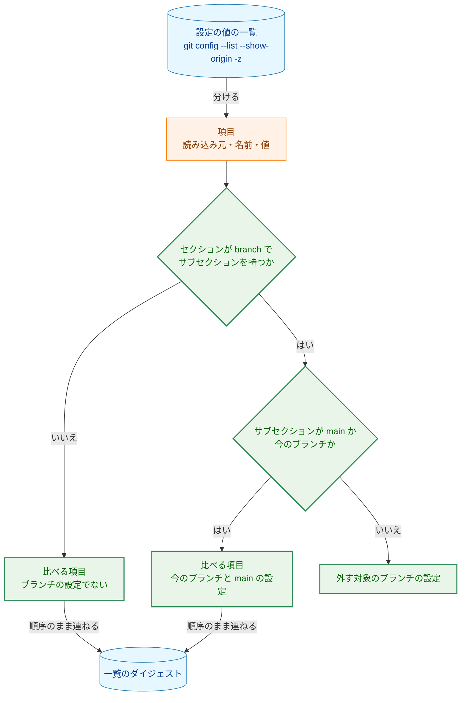
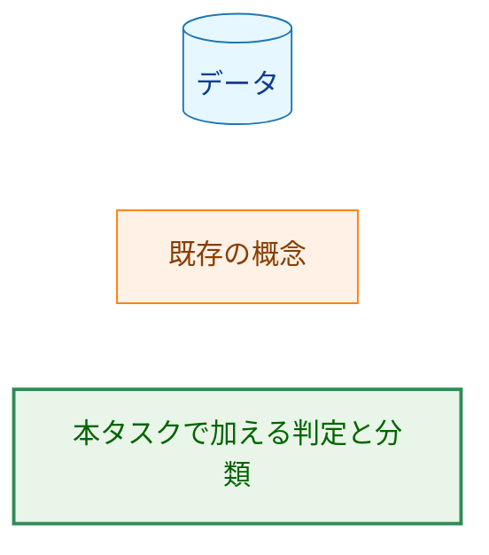
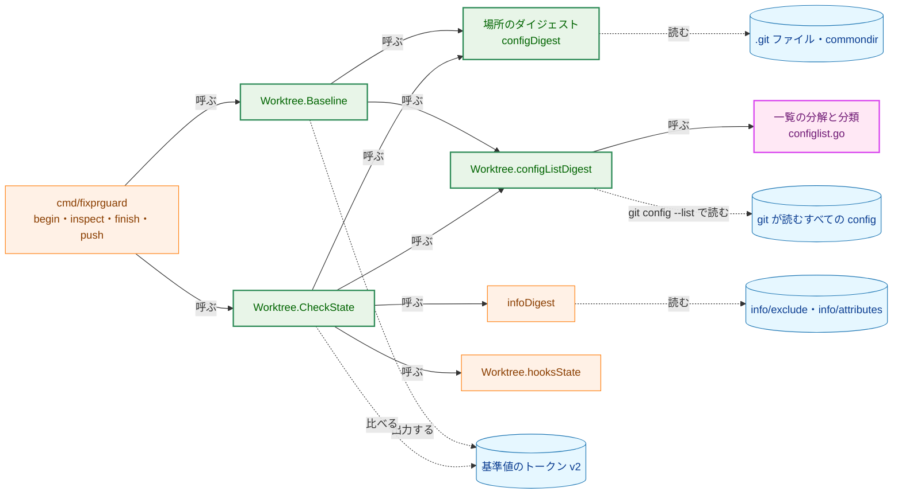
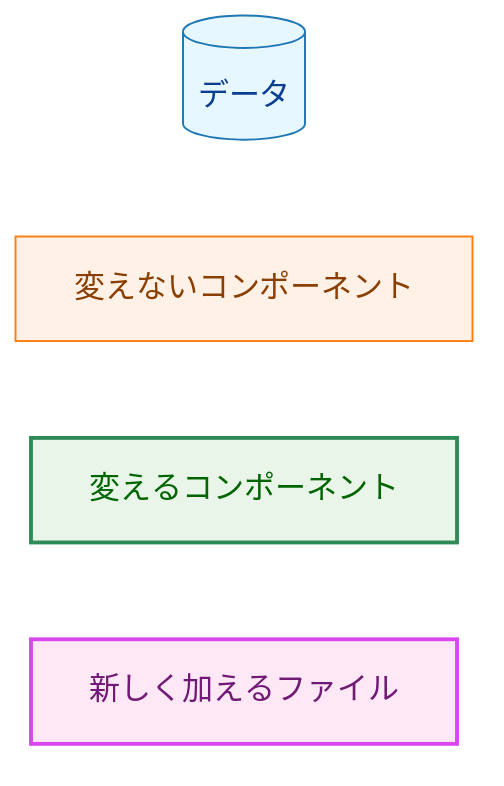
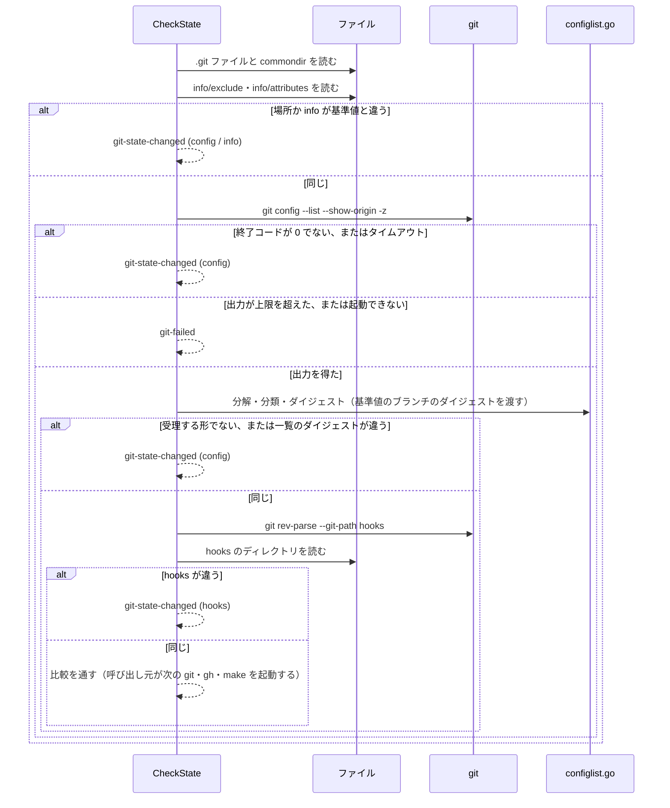
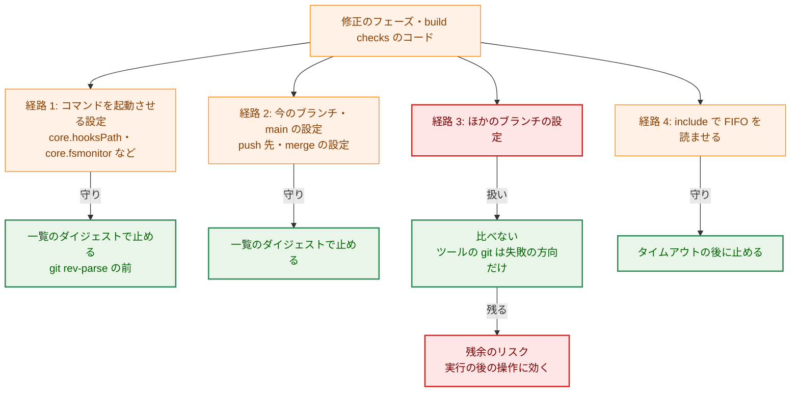
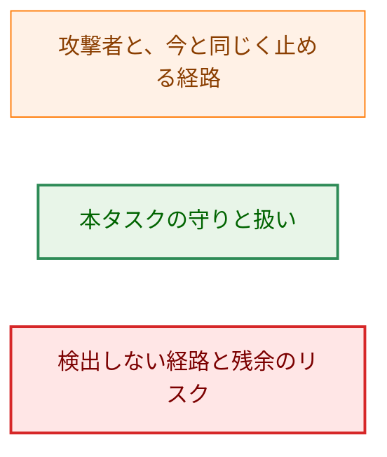
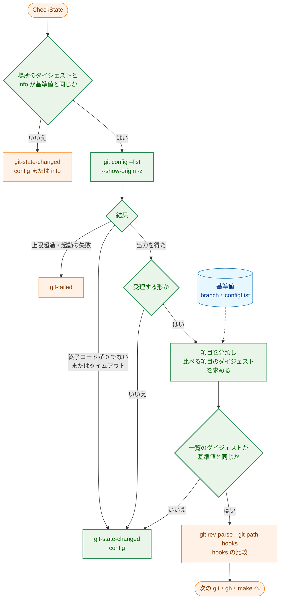
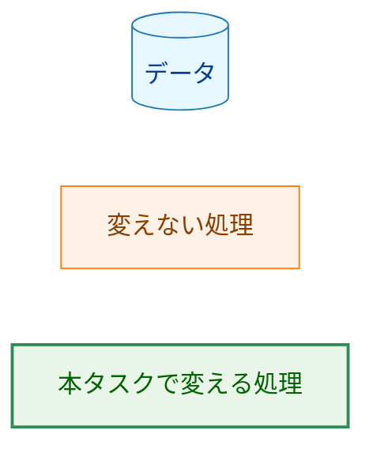

# アーキテクチャ設計書：fixprguard の config の比較から、ほかのブランチの `branch.<name>.*` を外す

## Document Status

| Item | Value |
|---|---|
| Status | `draft` |
| Created | 2026-10-22 |
| Review date | - |
| Reviewer | - |
| Comments | - |

本書は [01_requirements.md](01_requirements.md)（要件定義書。以下、要件書）の設計である。既存のファイルに関する記述は、コミット `b8038b4` のファイルで確かめた。`file:line` はこのコミットの行番号を指す。F-NNN・AC-NN は要件書の項番を、H-NN は [design_handoff.md](design_handoff.md) の項番を指す。申し送り H-01〜H-09 への対応は付録 A にまとめる。

本書は、要件書 3.1 で定義した次の用語を同じ意味で使う: ブランチの設定、今のブランチ、外す対象のブランチの設定、設定の値の一覧。「基準値」「ガードツール」「ダイジェスト」は、0030 の文書と同じ意味で使う。ほかに次の用語を使う。

-   **項目:** 設定の値の一覧の 1 つの要素。`git config --list --show-origin -z` が出力する、読み込み元・設定の名前・値（値を持たない項目もある）の組である（3.2）。
-   **比べる項目:** 外す対象のブランチの設定でない項目。基準値と比べる対象である。
-   **場所のダイジェスト:** git のディレクトリの場所（`.git` ファイルと `commondir` が指す先）だけのダイジェスト。今の `configDigest`（`internal/fixprguard/gitstate.go:279-298`）から、config のファイルの内容を除いたもの（3.1）。
-   **一覧のダイジェスト:** 比べる項目だけを、出力の順序のまま連ねたもののダイジェスト（3.2）。

## 1. 設計の全体像 (Design Overview)

### 1.1. 設計原則

-   **比べる範囲は、git の出力した項目の名前だけで決める。** config のファイルを Go で解析しない（issue #431）。git が解釈した結果の `git config --list --show-origin -z` を読み、項目の名前のセクションとサブセクションだけを解釈する（要件書 3.3）。
-   **判定は 1 か所に置く。** 項目の分解と、外す対象かどうかの判定は 1 つの関数にまとめ、`begin` と `inspect`・`finish`・`push` で同じものを使う（要件書 4.5）。
-   **今のブランチの名前は、基準値のダイジェストで照らす。** 基準値は今のブランチの名前をダイジェストでしか持たない（`gitstate.go:98-113`）。サブセクションのダイジェストを基準値のものと比べれば、比較の前に名前を求めるための git の起動が要らない（H-03）。
-   **起動の順序は、今の順序から 1 つだけ変える。** ファイルのバイト列の比較をやめ、`git config --list` を、ファイルだけで求める比較（場所と info）の直後に置く。`git config --list` は、書き換えられた config のままでも、コマンドを起動しない（1.3 の V-1）。その後に、hooks の場所を求める `git rev-parse` を置く順序は変えない（H-01）。
-   **読めないことは変化として扱う。** `begin` では読めた設定の値の一覧が、比較の時点で読めない、または受理する形でない場合は、`git-state-changed`（`config`）で止まる（AC-12）。
-   **形を補わない。** 受理する形に合わない出力は、一部を比べて続けることも、形を補うこともしない（CLAUDE.md「Reject, don't normalize」、要件書 3.3）。

### 1.2. 設計の際に決めたこと（2026-10-22）

-   **基準値のトークンは `v2` にし、項目の数は 7 のままにする（H-05・H-06）。** `config` の項目を場所のダイジェストに、`configList` の項目を一覧のダイジェストに変える。理由: 前の版の `v1` のトークンは、版の不一致で必ず拒否される（AC-15）。場所のダイジェストを別の項目として残すと、git を起動する前に比べられる部分が、トークンの上でも分かれたまま保てる。項目の数を変えないので、`ParseBaseline` と `String` の変更は版の文字列だけで済み、0034 が項目を足すときも、版をもう一度上げて足すだけで済む。
-   **FIFO を指す include は、今のタイムアウト（`gitTimeout`、2 分）で止める。** 比較の時点で `git config --list` がタイムアウトしたら、`git-state-changed`（`config`）で止まる（AC-12）。`config --list` だけに短いタイムアウトを設ける案は採らない。理由: この経路は、修正のフェーズのエージェントか build checks のコードが故意または誤りで FIFO を include させたときにしか起きない。そのときも、2 分待った後に止まるので、保証は弱まらない。正常な実行は数ミリ秒で終わり、短いタイムアウトを足しても守りは増えない（CLAUDE.md「Performance」・YAGNI）。
-   **ほかのブランチの値のない設定による git の失敗は、`git-failed` として受け入れる。** ほかのブランチの `branch.<name>.remote`・`merge`・`pushRemote` を値なしで書くと、`git ls-remote`・`git push`・`git remote -v` が失敗する（1.3 の V-4）。外す対象の設定なので比較では止まらず、その後の git の失敗として `git-failed`（`gh` の中の git なら `response-rejected`）で止まる。値のない項目だけを比べ続ける案は採らない。理由: 宛先を変えることはできず、失敗する方向にしか効かない（fail-closed）。並行するセッションのブランチの操作は、値のない項目を書かない（1.3 の V-5）。外す範囲に例外を作ると、規則が複雑になり、AC-01 の範囲も変わる。この場合の利用者向けの案内は、ガイド 8 章の `git-failed` の行に書き足す（3.5）。
-   **`gh` が起動する git を、実際の動作で確かめた。** `inspect` が起動する `gh` が、ほかのブランチの設定を読まないことは、`GIT_TRACE` で確かめた（1.3 の V-6）。残余のリスクとして書く案は採らない。費用が小さく、前提を確かめられるからである。

### 1.3. 確かめた git と `gh` の振る舞い

手元の git 2.50.1（Apple Git-155）と `gh` 2.96.0 で、一時ディレクトリの実際のリポジトリを使って確かめた（2026-10-22）。設計はこれらに依存する。

| 番号 | 確かめたこと | 方法と結果 |
|---|---|---|
| V-1 | 書き換えられた config のままでも、`git config --list --show-origin -z` はコマンドを起動しない | `core.pager`・`core.editor`・`core.askPass`・`core.fsmonitor`・`core.sshCommand`・`core.hooksPath`（hook を置いた先）・`credential.helper`・`diff.external`・`filter.<x>.process`・`gpg.program`・`alias.config`・`gc.auto`・`maintenance.auto`・`includeIf`（`hasconfig:`・`onbranch:`・`gitdir:`）をリポジトリの config に書き、ツールと同じ `gitHardening` を付けて、`GIT_TRACE=1` で実行した。trace には `built-in: git config --list --show-origin -z` だけが出た。子プロセスの起動はなかった。各コマンドが作るはずのファイルも作られなかった |
| V-2 | 壊れた config と特殊な include のときの終わり方 | 構文の誤り、ディレクトリを指す include、`/dev/zero` を指す include、循環する include は、すぐに終了コード 128 で終わる。存在しないファイルと `/dev/null` を指す include は、終了コード 0 で、何も加えない。**FIFO を指す include（`includeIf` を含む）は、書き手が現れるまで待ち続ける**ので、ツールでは `gitTimeout` で止まる |
| V-3 | 出力の形（H-04） | 各項目は `<読み込み元>` NUL `<名前>` LF `<値>` NUL である。値を持たない項目（`[core]` の下の `bare`）は `<読み込み元>` NUL `<名前>` NUL で、LF がない。空の値（`empty =`）は `<名前>` LF NUL で、両者は区別できる。セクションと変数の名前は小文字で出る（`[BRANCH "X.Y"] ReMote` は `branch.X.Y.remote`）。サブセクションは、`[branch "Feature"]` ならそのまま `branch.Feature.*`、古い書き方の `[branch.Feature]` なら小文字の `branch.feature.*`、`[branch ""]` なら `branch..*` で出る。引用符の中のエスケープは外して出る（`[branch "a\"b\\c"]` は `branch.a"b\c.remote`）。`include.path` の項目そのものも一覧に現れ、include 先の項目は include 先のファイルを読み込み元とする。`gitHardening` の `-c` は `command line:` を読み込み元として最後に並ぶ。ファイルの中の NUL は値に入らない（NUL の手前で値が切れる） |
| V-4 | 外す対象の設定が、ツールの起動する git に効くか（H-02） | ほかのブランチの `branch.other.remote`・`merge`・`pushRemote` を値なしで書くと、`git ls-remote`・`git push`・`git remote -v` は `missing value for 'branch.other.remote'` で終了コード 128 で終わる。git は、リモートの設定を読むときに、すべてのブランチの `branch.<name>.remote`・`merge`・`pushRemote` を読み込むためである。`branch.other.remote = -x` や `branch.other.rebase = bogus` のように値があれば、`ls-remote`・`push` は成功し、push 先は今のブランチの設定だけで決まる。ツールが起動するほかの git（`status`・`add`・`diff`・`diff-tree`・`ls-files`・`commit`・`rev-parse`・`symbolic-ref`・`cat-file`・`reset`・`config --get`）は、値のない項目があっても成功した |
| V-5 | issue #431 の表の git の操作が書き込む設定（H-09 (2)） | `git worktree add -b X origin/main` は `branch.X.remote`・`branch.X.merge` を加える。別の worktree での `git push -u` は `branch.X.merge` を変える。`git worktree remove` と `git branch -D X` は `[branch "X"]` の項目を消す。どれも `branch.X.*` のほかには書き込まず、`main` の設定にも書き込まない |
| V-6 | `inspect` が起動する `gh` が起動する git（H-02） | `GIT_TRACE` に出力先のファイルを指定して、`gh repo view --json nameWithOwner` と `gh pr view 432 --json number,headRefName` を実行した。どちらも、起動した git は `git remote -v` と `git config --get-regexp '^remote\..*\.gh-resolved$'` だけで、ブランチの設定を読む git は起動しなかった。ただし `git remote -v` は、V-4 の値のない項目があると失敗する |

`gh pr checkout` は、ツールが起動しない（ツールの外で並行するセッションが起動する）。書き込む設定を実際の動作で確かめていない。確かめていないのは、`main` の設定に書き込まないこと（要件書 1 章の決定の前提）である。`gh pr checkout` は、checkout するブランチの upstream を設定するために `branch.<そのブランチ>.*` を書く。`main` を checkout するのでない限り、`main` の設定に書く理由はない。fork の PR で `remote.*` を加える場合は、要件書 AC-08 のとおり止まる。いずれの場合も、止まるか止まらないかが要件と違う方向に外れることはない。

git の最低の版（H-08）は、ツールが使う機能のうち最も新しいものの版である。`git config --show-origin`（と `-z` との組み合わせ）が 2.8、`git status --porcelain=v1`（`worktree.go:67`。版を指定する書き方が入った版）が 2.11 で導入された。よって最低の版は 2.11 である。`includeIf` は git が読む config の書き方であって、ツールが使う機能ではないので、最低の版に関わらない。`gitstate.go:68-71` のコメントの「git 2.5 and later」は誤りであり、本タスクで直す（3.5）。版の導入は git のリリースノートの記述によるもので、実装のときにリリースノートで確かめ直す。

### 1.4. なぜ今の比較のままでは足りないか

今の config の比較は、リポジトリの config と worktree の config のファイルのバイト列のダイジェスト（`gitstate.go:292-296`）と、`git config --list --show-origin -z` の出力全体のダイジェスト（`gitstate.go:487-494`）の 2 つである。

-   ファイルのバイト列の比較は、ほかのブランチの節の追加と削除でも必ず変わる。このままでは AC-01・AC-02 を満たせない。コメントや空行だけの編集でも変わるので、AC-10 も満たせない。バイト列のまま、ほかのブランチの節だけを除くには、Go で config のファイルを解析することになる。issue #431 はこれを避けるとしている。
-   出力全体のダイジェストも、ほかのブランチの項目の追加と削除で変わる。出力を項目に分けて、外す対象を除く必要がある。

よって、ファイルのバイト列の比較はやめる。出力全体のダイジェストは、比べる項目だけのダイジェストに変える。git のディレクトリの場所の比較（AC-11）は、ファイルの内容を含まない形で残す。

### 1.5. 概念モデル

設定の値の一覧の各項目を、名前で 3 つに分ける。



矢印 A → B は、A から B が作られる、または A が B に振り分けられることを表す。

**Legend**



-   **セクションとサブセクション。** 名前の最初の `.` より前がセクション、最初の `.` と最後の `.` の間がサブセクションである（要件書 3.1）。`branch.autoSetupMerge` のように `.` が 1 つしかない名前は、サブセクションを持たないので、ブランチの設定ではない（AC-07）。
-   **今のブランチとの照合。** サブセクションのバイト列のダイジェストが、基準値のブランチのダイジェストと一致すれば、今のブランチの設定である。ダイジェストは、基準値が今のブランチの名前に使うものと同じ関数（`digestString`、`gitstate.go:425-431`）で求める。大文字・小文字は区別する（要件書 3.1）。`main` との照合は、サブセクションのバイト列が `main` と一致するかで行う。

## 2. システム構成 (System Structure)

### 2.1. 全体構成

変更は `internal/fixprguard` の中に閉じる。`cmd/fixprguard` の呼び出しの順序は変えない。



実線の矢印 A → B は、A が B を呼ぶことを表す。点線の矢印は、データの読み書きを表す。`Worktree.Baseline` から `infoDigest`・`hooksState` などへの矢印は、本タスクで変わらないので省いた。

**Legend**



### 2.2. コンポーネント配置

| ファイル | 変更 | 内容 |
|---|---|---|
| `internal/fixprguard/configlist.go` | 新規 | 設定の値の一覧の分解（受理する形の検査）、項目の分類（外す対象かどうか）、一覧のダイジェスト（3.2・3.3）。外部のコマンドを起動しない、純粋な関数だけを置く |
| `internal/fixprguard/configlist_test.go` | 新規 | 分解・分類・ダイジェストのユニットテスト（7.1） |
| `internal/fixprguard/gitstate.go` | 変更 | `baselineVersion` を `v2` にする。`configDigest` から config のファイルの内容を除き、場所のダイジェストにする。`configListDigest` が `configlist.go` の関数で一覧のダイジェストを求める。`CheckState` と `Baseline` の順序と失敗の扱い（3.4・4 章）。`gitHardening` のコメントの git の版（1.3）。`Baseline` の型のコメント |
| `internal/fixprguard/types.go` | 変更 | `Protocol` を `1` から `2` に上げる（AC-19） |
| `internal/fixprguard/gitstate_test.go` | 変更 | 7.3 の既存のテストの改訂と、AC-01〜AC-13・AC-15 の実際のリポジトリのテスト（7.2） |
| `internal/fixprguard/worktree_flow_test.go` | 変更 | 7.3 の既存のテストの改訂（config の変化の後に起動する git が `git config --list` だけであること） |
| `internal/fixprguard/test_helpers_git.go` | 変更（必要なら） | 別の worktree を作る、ブランチの名前を指定してリポジトリを作るなど、7.2 のテストに要る補助 |
| `.claude/commands/fixpr.md`・`.claude/commands/runpr.md` | 変更 | `--protocol 1` を `--protocol 2` にする（AC-19）。手順は変えない |
| `docs/dev/developer_guide/fixprguard_guide.md`・`fixprguard_guide.ja.md` | 変更 | 3.5 の箇所（AC-18・AC-19・H-08） |
| `docs/tasks/0030_fixpr_untrusted_threads/01_requirements.md`・`02_architecture.md` | 変更 | 3.5 の箇所（AC-17）。`Status` は `approved` のまま、`Comments` に `(decision)` を記録する |

`cmd/fixprguard` のコードは変えない。`inspect` の `CheckState` の呼び出し（`cmd/fixprguard/main.go:557`）と、`finish`・`push` の中の呼び出し（`worktree.go:130`・`243`・`273`・`326`・`367`・`383`・`502`）は、そのまま新しい比較を使う。`cmd/fixprguard/docs_test.go` の `TestDocumentedInvocationsParse` は、コマンドの文書の `--protocol` がバイナリの `Protocol` と一致することを確かめる（`docs_test.go:84-116`）。`Protocol` を上げて文書を直さなければ、このテストが失敗する。

### 2.3. データフロー: `inspect`・`finish`・`push` の比較



`git config --list` の前に起動する git はない。`git rev-parse` は、一覧のダイジェストが一致した後にしか起動しない。今の順序（`gitstate.go:522-560`）との違いは、最初の段でファイルのバイト列を比べないことだけである。

## 3. コンポーネント設計 (Component Design)

### 3.1. 基準値のトークン（H-05・H-06）

トークンは `v2.` に続く 7 つの項目を `.` で連ねた形である。前の版の `v1` のトークンは、版の文字列が違うので、`ParseBaseline` が `ErrInvalidInput` で拒否する（AC-15。終了コード `2`）。項目の数が同じでも、版が違えば拒否する。

| 位置 | 項目 | 今（`v1`） | 本タスク（`v2`） |
|---|---|---|---|
| 1 | head | HEAD の OID | 変えない |
| 2 | branch | HEAD がいるブランチの名前のダイジェスト | 変えない。一覧の分類で、今のブランチの照合にも使う |
| 3 | remote | push 先のブランチの OID か `none` | 変えない |
| 4 | hooks | hooks のディレクトリのダイジェスト | 変えない |
| 5 | config | 場所と、リポジトリの config・worktree の config のファイルの内容のダイジェスト | **場所のダイジェスト**。ファイルの内容を含めない |
| 6 | configList | `git config --list --show-origin -z` の出力全体のダイジェスト | **一覧のダイジェスト**。比べる項目だけを順序のまま連ねたもののダイジェスト |
| 7 | info | `info/exclude`・`info/attributes` のダイジェスト | 変えない |

-   **平文を含めない。** どの項目もダイジェストか OID である。ブランチの名前、設定の名前と値、読み込み元のパスを平文で含めない（AC-16）。今の方針（`gitstate.go:98-113`）を保つ。
-   **worktree の config のファイル。** 今は、`config.worktree` のバイト列を、git が読むかどうかに関わらず比べている。本タスクの後は、git が読むとき（`extensions.worktreeConfig` が真のとき）だけ、その項目が一覧に現れて比べられる。git が読まないファイルの変化は、git の振る舞いを変えない。`extensions.worktreeConfig` を後から真にする変更は、その項目が一覧に現れるので止まる。
-   **項目の数を変えない理由と、0034 との関係**は 1.2 のとおりである。0034 は、版を `v3` に上げて項目を足せばよい（9 章）。

### 3.2. 設定の値の一覧の分解と分類（要件書 3.3・H-04）

**受理する形。** 出力は、次の形の項目の並びである（1.3 の V-3）。

-   項目は、`<読み込み元>` NUL `<名前>` NUL、または `<読み込み元>` NUL `<名前>` LF `<値>` NUL である。
-   読み込み元は、空でないバイト列である。解釈しない。
-   名前は、最初の LF または NUL の手前までであり、空でない。最初の `.` の前（セクション）と、最後の `.` の後（変数の名前）が、どちらも空でない。`.` を含まない名前は受理しない。
-   値は、名前の後の LF から次の NUL の手前までのバイト列である。LF を含みうる。解釈しない。
-   出力は空でなく、最後の項目は NUL で終わる。出力が空になることはない。`gitHardening` の `-c` が、`command line:` の項目を必ず出すためである（V-3）。

この形に合わない出力は、項目が 1 つでもあれば、比較を続けずに拒否する。例: 最後の NUL がない出力、名前が空の項目、読み込み元のすぐ後で出力が終わる項目、`.` を含まない名前。補って続けない（要件書 3.3）。同じ名前の項目の繰り返しは正当な形であり、拒否しない。

**分類。** 受理した項目ごとに、1.5 の規則で比べる項目か、外す対象かを決める。

-   セクションが `branch` でない項目と、サブセクションを持たない `branch.<key>` は、比べる項目である。
-   サブセクションが空の項目（`branch..remote`）は、サブセクションを持つ項目として扱う。空の名前は `main` とも今のブランチとも一致しないので、外す対象になる（要件書 3.1。`begin` は HEAD がブランチを指すことを求め、ブランチの名前は空にならない）。
-   照合はバイト列で行う。サブセクションを UTF-8 として解釈しない。セクションの `branch` との照合も、git が小文字で出力するので、バイト列の一致で足りる（V-3）。

**一覧のダイジェスト。** 比べる項目を、出力の順序のまま、項目の区切り（NUL と LF）を含めたバイト列で連ねて、SHA-256 を取る。項目の区切りを含めるので、値を持たない項目と空の値の項目は区別される。項目の境界も一意に決まる。外す対象の項目は、ダイジェストに何も加えない。そのため、外す対象の項目が加わる、変わる、消えるときは、ダイジェストは変わらない（AC-01〜AC-04）。比べる項目の順序が変わればダイジェストは変わる（AC-09）。

**上限。** 出力の上限は、今の git の出力の上限（`cmd/fixprguard/main.go:43-45` の `gitMaxOutput`、64 MiB）である。項目の数には上限を設けない（要件書 3.3）。

### 3.3. 型と関数

本タスクは、公開する型と関数を加えない。`configlist.go` に、次の非公開の型と関数を置く。

```go
// errConfigList reports git config output that is not in the accepted shape.
// It never carries a name, a value, or an origin.
var errConfigList = errors.New("config list shape")

// configScope names the branch settings that are compared: those of the
// branch whose name digest is branch (the baseline's), and those of main.
type configScope struct {
	branch string // digestString of the current branch's name
}

// configListDigest parses the output of git config --list --show-origin -z,
// rejecting any other shape with errConfigList, and digests the entries
// scope keeps, in order.
func configListDigest(out []byte, scope configScope) (string, error)
```

-   `configScope` の零値（ブランチのダイジェストが空）は、どのサブセクションのダイジェストとも一致しない。この場合に比べるブランチの設定は、`main` の設定だけになる。`CheckState` は、使える基準値（`Baseline.usable`）からしか `configScope` を作らない。`Baseline` は、ブランチが定まった後にしか作らない（3.4）。
-   今の `Worktree.configListDigest(ctx)`（`gitstate.go:487-494`）は、git を起動して出力を得る役割だけを持つ形に変える。名前は計画で決める。

### 3.4. `CheckState` と `Baseline` の順序（H-01・H-03）

**`CheckState`（`inspect`・`finish`・`push`）。** 2.3 の順序で比べる。`CheckState` を呼ぶ位置は変えない。

1.  `.git` ファイルと `commondir` を読み、git のディレクトリを求める（`locateGitDirs`）。読めなければ `config` の変化として止まる（今と同じ。`gitstate.go:526-530`）。
2.  場所のダイジェストと info のダイジェストを、ファイルの読み取りだけで求め、基準値と比べる。違えば `config` または `info` で止まる。
3.  `git config --list --show-origin -z` を起動する。基準値のブランチのダイジェストで `configScope` を作り、一覧のダイジェストを求めて、基準値と比べる。失敗の扱いは 4 章のとおりである。
4.  `git rev-parse --git-path hooks` で hooks の場所を求め、比べる（今と同じ）。

**起動の順序の保証（AC-14）。** 書き換えられた config のまま起動する git は、手順 3 の `git config --list` だけである。これはコマンドを起動しない（V-1）。手順 3 で config の違いが分かれば、手順 4 の `git rev-parse` も、呼び出し元が次に起動する git・`gh`・make も起動しない。外す対象の設定は、手順 3 の後も比較を通るが、git にコマンドを起動させる設定ではない。ツールが起動する git に対して効くのは、失敗させる方向だけである（V-4）。

**`Baseline`（`begin`）。** 一覧のダイジェストには今のブランチの名前が要るので、`begin` は、ブランチが定まった後（`headState` の後）に、`CheckState` と同じ `configListDigest` で一覧のダイジェストを求める。`configScope` には、基準値に入れるのと同じ `digestString(branch)` を渡す。`begin` には比べる相手がないので、起動の順序の制約は今と同じくない（0030 `02_architecture.md` 3.7「基準値を採る `begin` だけは…」）。`begin` で一覧を読めない、または受理する形でない場合は、`git-failed` で止まり、基準値を出力しない（要件書 3.3）。

**AC-13 の `parts`。** `CheckState` は、HEAD の確認（`headState`。`compareState` の中で `CheckState` の後に呼ぶ。`gitstate.go:747-760`）より前に、基準値のブランチのダイジェストで分類する。HEAD が別のブランチ Y に移っていても、比べるのは基準値のブランチと `main` の設定であり、Y の設定は外す対象になる。基準値のブランチと `main` の設定が変わっていなければ、`CheckState` を通り、次の HEAD の確認で `head` として止まる。それらの設定が変わっていれば、`config` として止まる。detached になった場合も同じである。どちらの場合も、`parts` は `head` と `config` の少なくとも一方を含む。

### 3.5. 文書の改訂と `Protocol`（F-004・AC-17〜AC-19・H-08）

**`Protocol`。** `internal/fixprguard/types.go:20` の `Protocol` を `2` に上げる。`.claude/commands/fixpr.md` と `runpr.md` の `--protocol 1` をすべて `--protocol 2` にする。ガイド 4 章の「The current number is `1`」も `2` にする。前の版のバイナリが新しい文書から呼ばれると、`--protocol` の不一致で終了コード `2` で止まる。新しいバイナリが古い文書から呼ばれる場合も同じである（ガイド 4 章）。

**ガイド（英語・日本語）。** 次の箇所を、要件書 AC-17 の (a)〜(c) を述べる形に改める。(a) 外す対象のブランチの設定は比べない（今のブランチと `main` の設定は比べる）。(b) 設定の値の一覧を変えない編集は検出しない。(c) 外す対象のブランチの設定の書き換えは、残余のリスクである。

| 箇所 | 改める内容 |
|---|---|
| 1 章の層 (3)（`fixprguard_guide.md:13`） | config の比較の範囲 |
| 2 章の表 | git の最低の版（2.11）の行を加える（H-08） |
| 5 章の `inspect`（`:143`）・`push`（`:167`） | 比べる config の範囲。例のコマンド（`:146`・`:158`・`:170`）の `--protocol 1` と `'v1....'` を `--protocol 2` と `'v2....'` にする |
| 7.1 の「git is not started with rewritten hooks or config」の行（`:233`） | 外す対象のブランチの設定を除いた config を基準値と比べる、という範囲に書き改める。比べる前に起動する git が `git config --list` だけであることを書く |
| 7.2（`:237-248`） | (a)〜(c) の残余のリスク。ほかのブランチの値のない設定で git が失敗すること（1.2） |
| 8 章の `git-state-changed` の行（`:258`） | 原因の「config」の範囲。`begin` の後に一覧が読めなくなった場合も含むこと（AC-12） |
| 8 章の `git-failed` の行 | 原因に、ほかのブランチの `branch.<name>.remote` などが値なしで書かれた場合を加え、対処に `git config --list` が動くかを確かめることを加える（1.2） |

日本語版（`fixprguard_guide.ja.md`）の同じ箇所を、同じ内容で改める。

**0030 の文書。** 次の箇所を、AC-17 の (a)〜(c) を述べる形に改める。両文書の `Status` は `approved` のままとし、`Comments` に `2026-MM-DD (decision): タスク 0035（#431）の要件で決めた変更` の形で記録する（要件書 5 章「文書の改訂の規則の例外」）。日付は改訂した日である。

| 文書 | 箇所 |
|---|---|
| `01_requirements.md` | 1 章の決定「修正のフェーズの異常では止める」（`:61`）、AC-26（`:154`）、4.2 の層 (3) の説明（`:197`）と残余のリスク（`:200-206`） |
| `02_architecture.md` | 1.2 の push の決定（`:52`）、3.6 の `finish` の不変条件（`:633`・`:635`）と `push` の不変条件（`:641`）、3.7 の基準値の表の config の行（`:652`）と起動前の比較の順序（`:658`）、5.2 の守りの表（`:835`）、5.3（`:845`・`:854`）、7.1 のテストの一覧（`:963`） |

要件書 AC-17 は、0030 `02_architecture.md` の対象として「2 章の push の説明」を挙げる。2 章（`:136-273`）には config の記述がない。config を含む push の説明は 1.2 の決定（`:52`）にあるので、これを対象とする。

**コードのコメント。** `gitHardening` のコメント（`gitstate.go:58-71`）の「Every other setting … is held to the baseline by CheckState」を、外す対象のブランチの設定を除くことに合わせて改め、git の版を 2.11 にする。`Baseline` の型のコメント（`gitstate.go:98-104`）と `CheckState` のコメント（`gitstate.go:514-521`）も、ファイルの内容を読まないことに合わせて改める。

### 3.6. 副作用の契約

本タスクは、どのサブコマンドの外部への副作用も変えない。`CheckState` が起動する git は今と同じ `git config --list --show-origin -z` と `git rev-parse --git-path hooks` で、どちらも書き込みをしない。比較を通る条件が広がる（外す対象の変化で止まらない）ので、その後の git・`gh`・make が起動される場合が増える。起動される場合の副作用は、今と同じである。

### 3.7. 先行するタスクの方針の例外

本設計は、0030 の次の方針の例外である。

-   **元の方針と場所:** 0030 `02_architecture.md` 3.7（`:652`・`:658`）は、リポジトリの config と worktree の config の内容のダイジェストを、ファイルの読み取りだけで求めて、git を起動する前に比べると定める。0030 `01_requirements.md` AC-26 (c) は、git の設定ファイルが違えば止まると定める。
-   **例外とする理由:** ファイルのバイト列の比較では、AC-01・AC-02・AC-10 を満たせない（1.4）。バイト列の比較をやめた後も、`git config --list` はコマンドを起動しないので、書き換えられた設定のまま git にコマンドを起動させない、という 0030 の保証は保てる（V-1・3.4）。
-   **古い振る舞いを断言する既存のテスト:** 7.3 に挙げる。config の変化の後に git を 1 回も起動しないことを断言するテストは、起動するのが `git config --list` だけであることを断言する形に改める。

## 4. エラーハンドリング設計 (Error Handling Design)

新しい公開の番兵のエラーは加えない。止まり方の種類と `parts` の値の集合は変えない（AC-16）。設定の値の一覧の読み取りの失敗は、次のように分ける。

| 状況 | `begin` | `inspect`・`finish`・`push`（`CheckState`） |
|---|---|---|
| `git config --list` の終了コードが 0 でない（構文の誤り、ディレクトリを指す include、循環する include など。V-2） | `git-failed` | `git-state-changed`（`config`） |
| `gitTimeout` を超えた（FIFO を指す include。V-2） | `git-failed` | `git-state-changed`（`config`） |
| 出力が受理する形でない（`errConfigList`） | `git-failed` | `git-state-changed`（`config`） |
| 出力が上限（64 MiB）を超えた（`cmdrunner.ErrOutputTooLarge`） | `git-failed` | `git-failed`（要件書 3.3） |
| git を起動できない、呼び出しが取り消された | `git-failed` | `git-failed` |
| 一覧のダイジェストが基準値と違う | — | `git-state-changed`（`config`） |

-   `CheckState` の 1〜3 行目を `config` の変化とするのは、`begin` では読めた一覧が読めなくなったことが、config が変わったことを示すからである（要件書 1 章の決定、AC-12）。終了コードは、`cmdrunner.ExitError` かどうかで判定する。タイムアウトは `context.DeadlineExceeded` で判定する。今の `gitFailure`（`gitstate.go:450-458`）と同じ判定の仕方である。
-   `git-failed` と `git-state-changed` の診断は、今と同じく規則の名前だけを含む。`errConfigList` も、名前・値・読み込み元を含めない（AC-16）。
-   ほかのブランチの値のない設定で、後の `git ls-remote`・`git push` が失敗した場合は、今の `gitFailure` のとおり `git-failed` になる。`inspect` の `gh` の中の `git remote -v` が失敗した場合は、`ghFailure`（`github.go:79-84`）のとおり `response-rejected` になる（1.2）。

## 5. セキュリティ考慮事項 (Security Considerations)

条件付きのガイド（`docs/dev/security.md`）の適用条件には当たらない。本タスクは、`yt-dlp` の起動、API キー・Webhook の URL、キャッシュ、LLM API・Webhook への送信、信頼できないテキストのプロンプトや記事への埋め込みのいずれにも触れない（要件書 4.2）。この観点では `N/A` である。

ガードツールとしての脅威と守りを、以下に述べる。

### 5.1. 脅威モデル

攻撃者は、修正のフェーズのエージェント（レビューの本文の指示に従ってしまった場合）と、build checks が実行するコードである（0030 `02_architecture.md` 5.1）。本タスクで変わるのは、config を書き換える経路だけである。



矢印 攻撃者 → 経路 は、攻撃者がその経路を使えることを表す。経路 → 守り は、その経路への守りまたは扱いを表す。

**Legend**



### 5.2. 守りの対応

| 経路 | 守り | 保証の強さ |
|---|---|---|
| 経路 1: コマンドを起動させる設定（どのファイルにあっても） | 一覧のダイジェストの比較。`git config --list` はコマンドを起動しない（V-1）。違えば `git rev-parse` の前に止まる（3.4） | 今と同じ。確認の時点だけの保証 |
| 経路 2: 今のブランチと `main` の設定 | 一覧のダイジェストの比較（AC-05・AC-06） | 今と同じ |
| 経路 3: ほかのブランチの設定 | 比べない（F-001）。ツールが起動する git と `gh` は、ほかのブランチの設定を、push 先などの決定に使わない。値のない項目は git を失敗させるが、宛先を変えない（V-4・V-6） | 実行の間は、失敗の方向にしか効かない。実行の後は 5.3 |
| 経路 4: include で FIFO を読ませる | `gitTimeout` の後に `config` の変化として止まる（1.2） | 止まるまで最大 2 分 |
| `.git` ファイルや `commondir` の書き換え | 場所のダイジェストの比較。git を起動する前に止まる（AC-11） | 今と同じ |
| 前の版の基準値 | `v2` 以外の版を拒否する（AC-15）。`Protocol` の不一致も止まる（AC-19） | 決定的 |

### 5.3. 残余のリスク

要件書 4.2 の残余のリスクに加えて、設計で次のことが分かっている。

-   **ほかのブランチの値のない設定による停止。** 外す対象の `branch.<name>.remote`・`merge`・`pushRemote` を値なしで書かれると、`inspect`（`gh` の中の `git remote -v`、`git ls-remote`）と `push` が失敗して止まる（V-4・V-6）。止まり方は `git-failed` または `response-rejected` で、`git-state-changed` ではない。誤った宛先に push することはない。並行するセッションのブランチの操作はこの形を書かない（V-5）。
-   **FIFO による遅延。** 経路 4 では、止まるまで最大 2 分かかる（1.2）。今は、リポジトリの config への include の追加は、ファイルのバイト列の比較で即座に止まる。include 先のファイルの書き換えは、今も `git config --list` が待つ。
-   **git の振る舞いへの依存。** V-1 の「`git config --list` はコマンドを起動しない」は、手元の git 2.50.1 で確かめた。git が将来、設定を読むときにコマンドを起動する機能を加えれば、この保証は崩れる。今のコードも、同じ前提で `git config --list` を `git rev-parse` の前に起動している（`gitstate.go:545-551`）。前提は新しくない。ただし、本タスクの後は、書き換えられたリポジトリの config を、ファイルの比較で止めずに git に読ませる。そのため、この前提に依存する範囲が広がる。7.2 のテストが、この前提を実際の git で確かめ続ける。
-   **確認と実行の間のずれ**（0030 `02_architecture.md` 5.3）は変わらない。

### 5.4. 観測のしやすさ

止まったときの出力（`stop` と `parts`）と標準エラーの診断は、今と同じく規則の名前だけを含む（AC-16）。外す対象の設定の変化で止まらなかったことは、出力に現れない。止まらないことが正常な振る舞いであり、記録しても利用者の判断に使えないためである。`config` で止まったとき、変わった設定の名前は出力しない。利用者は `git config --list --show-origin` で確かめる（ガイド 8 章）。

## 6. 処理フロー詳細 (Processing Flow Details)

`CheckState` の判定の流れを示す。2.3 のシーケンス図と同じ順序である。



実線の矢印は処理の順序を、点線の矢印はデータの読み取りを表す。hooks が違う場合の停止は今と同じなので省いた。

**Legend**



## 7. テスト戦略 (Test Strategy)

ユニットテストは、git・`gh`・make の実物を起動しない方針（CLAUDE.md「Testing Strategy」）の例外として、0030 と同じく、git を一時ディレクトリの実際のリポジトリで動かす（ガイド 9 章）。`gh` と make は fake を使う。

### 7.1. ユニットテスト（`configlist_test.go`）

`configListDigest` に、git を起動せずにバイト列を与える。

-   **受理する形（要件書 3.3）。** 最後の NUL がない出力、空の出力、名前が空の項目、`.` を含まない名前、セクションか変数の名前が空の名前、読み込み元の後で終わる出力を、`errConfigList` で拒否すること。同じ名前の項目の繰り返しを受理すること。
-   **値の区別。** 値を持たない項目と空の値の項目で、ダイジェストが違うこと。
-   **分類。** 同じ入力に、外す対象の項目を足した入力、変えた入力、除いた入力で、ダイジェストが変わらないこと（AC-01・AC-02）。今のブランチのダイジェストと `main` の項目、2 段の `branch.*`、`branch` でないセクションの項目を変えると、ダイジェストが変わること（AC-05〜AC-08）。比べる項目の順序を入れ替えると変わること（AC-09）。サブセクションが今のブランチの名前を含む場合（`feature.a`）と、大文字・小文字だけが違う場合（`Feature`）が外す対象になること（AC-04）。`branch..remote` が外す対象になること。
-   **層の区別。** 分類のテストの入力は、分類を外すと（すべての項目を比べると）結果が変わるものにする。外す対象の項目の変化の入力で、まず分類なしのダイジェストが変わることを確かめ、その上で分類ありのダイジェストが変わらないことを確かめる（CLAUDE.md「A layered path needs inputs only one layer can handle」）。

### 7.2. 実際のリポジトリのテスト（`gitstate_test.go`・`worktree_flow_test.go`）

`begin` の後に設定を変えて、`CheckState`（と `inspect`・`finish`・`push`）の結果を確かめる（H-07）。

| AC | 入力 |
|---|---|
| AC-01 | 別の worktree での `git worktree add -b X origin/main`、`git push -u`（テスト用のリモートへ）、`git worktree remove` と `git branch -D X`。`git config branch.X.remote` による直接の書き込み |
| AC-02 | `[branch "X"]` の節の全体の追加と削除。`[branch ""]` の節の追加 |
| AC-03 | グローバルの config、worktree の config（`extensions.worktreeConfig` を真にしたもの）、`include.path` で読まれるファイル（include は `begin` の前に設定する）に、外す対象の設定を書く |
| AC-04 | 今のブランチ `<b>` に対して、`branch.<b>.a.remote` と、大文字・小文字だけが違う `[branch "<B>"]` の設定 |
| AC-05 | 今のブランチの設定。`.` を含む名前のブランチの設定。小文字の名前のブランチ `feature` に対する、古い書き方の `[branch.Feature]` の設定 |
| AC-06 | 今のブランチが `main` でないときの `branch.main.*` |
| AC-07 | `branch.autoSetupMerge` |
| AC-08 | 既存の行（`core.fsmonitor`・`remote.<name>.receivepack`・グローバルの config・include 先の変更）に、`remote.pushDefault`、`remote.<name>.*` の追加、`include.path` の追加を加える |
| AC-09 | 複数の値を持つ設定（例: 2 つの `remote.<name>.fetch`）の順序の入れ替え |
| AC-10 | リポジトリの config へのコメント・空行・字下げだけの追加。止まらないこと |
| AC-11 | 既存の `git_file_points_elsewhere`。git を 1 回も起動せずに止まること |
| AC-12 | `begin` の後の構文の誤り。FIFO を指す include は 2 分待つので、git の実行を fake に差し替え、`git config --list` だけが `context.DeadlineExceeded` で失敗する形で確かめる。どちらも `config` で止まり、`git rev-parse` を起動しないこと |
| AC-13 | 既存の `branch_switch_same_commit`。detached HEAD への切り替え |
| AC-14 | 7.3 の改訂後のテスト。config の変化の後に起動した git が `git config --list` だけで、`gh`・make・`git rev-parse`・push を起動しないこと |
| AC-15 | `v1.` に続く 7 つの項目のトークンを `ParseBaseline` に渡すと `ErrInvalidInput` になること。`cmd/fixprguard` で終了コード `2` になること |
| AC-16 | 今のブランチの名前と外す対象の設定の名前・値が、トークン、止まったときの出力、標準エラーに含まれないこと |

V-4 の振る舞い（値のない項目で `git ls-remote` が失敗すること）は、ツールの保証ではなく git の振る舞いなので、テストでは固定しない。

### 7.3. 改訂が要る既存のテスト

| テスト | 今の断言 | 改訂 |
|---|---|---|
| `TestBaselineMalformedRejected` の `version`（`gitstate_test.go:238`） | `v2` の版を拒否する | 前の版の `v1` を拒否する形にする（AC-15） |
| `TestBaselineDetectsChange` の `worktree_config`（`gitstate_test.go:132-134`） | `extensions.worktreeConfig` なしで `config.worktree` に書くと止まる | `begin` の前に `extensions.worktreeConfig` を真にする。git が読まないファイルの変化は、本タスクの後は止まらない（3.1） |
| `TestGitNotLaunchedAfterConfigChange` の `inspect`（`gitstate_test.go:266-276`） | config の変化の後、git を 1 回も起動しない | 起動した git が `git config --list` だけであること |
| `TestGitNotLaunchedAfterConfigChange` の `finish_after_make_test`（`gitstate_test.go:277-293`） | 最後のコマンドが `make test` | 最後のコマンドが `git config --list` で、`make lint` と後の git を起動しないこと |
| `TestFinishStopsWhenHooksChangeConfig`（`worktree_flow_test.go:285-313`） | 最後のコマンドが `git add`・`git commit` | 最後のコマンドが `git config --list` で、その直前が `git add`・`git commit` であること |
| `TestPushRechecks` の `config_changed`（`worktree_flow_test.go:422-424`・`440-442`） | `noGit`（git を 1 回も起動しない） | 起動した git が `git config --list` だけであること |

### 7.4. 壊して失敗を確かめる

ガイド 9 章のとおり、7.1 の保証を変えるので、次を壊してテストが失敗することを確かめ、commit のメッセージに書く。

-   分類を外す（すべての項目を比べる）と、AC-01〜AC-04 のテストが失敗すること。
-   今のブランチの照合を外す（`main` だけを比べる）と、AC-05 のテストが失敗すること。`main` の照合を外すと、AC-06 のテストが失敗すること。
-   一覧の比較を `git rev-parse` の後に移すと、AC-14 のテストが失敗すること。
-   `CheckState` で一覧の読み取りの失敗を `git-failed` にすると、AC-12 のテストが失敗すること。
-   版を `v1` に戻すと、AC-15 のテストが失敗すること。

### 7.5. 文書のガード

-   AC-19 は、`TestDocumentedInvocationsParse`（`cmd/fixprguard/docs_test.go:84-116`）が、コマンドの文書の `--protocol` とバイナリの `Protocol` の一致を確かめる。ガイド 4 章の現在の番号は、今のテストでは確かめていない。計画で、テストを加えるか、`static` の確認にするかを決める。
-   AC-17・AC-18 は、文書の記述の有無なので、`static` の確認（計画の受け入れ基準の確認の節）で足りる（要件定義のガイド 4 章）。

## 8. 実装の優先順位 (Implementation Priorities)

1.  `configlist.go` と `configlist_test.go`（3.2・3.3・7.1）。外部のコマンドに依存しないので、最初に置ける。
2.  `gitstate.go` の基準値の版、場所のダイジェスト、`CheckState` と `Baseline` の順序、失敗の扱い（3.1・3.4・4 章）と、7.2・7.3 のテスト。`Protocol` の引き上げとコマンドの文書の `--protocol` を同じ commit に入れる（`TestDocumentedInvocationsParse` が両方の一致を求めるため）。
3.  ガイド（英語・日本語）の改訂（3.5）。
4.  0030 の文書の改訂（3.5）。要件書 5 章のとおり、本タスクの要件書の承認の後に行う。

PR の分け方は計画で決める。1 と 2 は、比較の振る舞いを変える一つのまとまりである。3 と 4 は文書だけの変更である。

## 9. 将来の拡張 (Future Extensibility)

-   **タスク 0034（#424、PR #429）。** 0034 は基準値に項目を足す。本タスクの後は、版を `v3` に上げて項目を足せばよい（3.1）。0034 の要件案は、`gitstate.go:98-113` の行番号と基準値の内容（ファイルの内容のダイジェスト）を引いている。本タスクの後に、0034 の側で合わせる（要件書 2.3）。
-   **タスク 0033。** 0033 の `02_architecture.md` は、`Protocol` を上げない例外の条件を述べ、「`--protocol 1` は変わらない」と書いている（`docs/tasks/0033_multiple_trusted_reviewers/02_architecture.md:65`）。本タスクが先にマージされると、その時点の番号は `2` になる。例外の条件そのものは番号によらないので、0033 の側で、番号の記述を実装のときに合わせればよい。
-   **`main` の名前。** 比べ続けるブランチの名前は `main` に固定する（要件書 1 章の決定）。既定のブランチの名前が変わる場合は、この定数を変える。リモートの HEAD などから求める仕組みは、要件がないので設けない（YAGNI）。

## 付録 A: 申し送り（design_handoff.md）への対応

| 項目 | 対応 |
|---|---|
| H-01（バイト列の比較をやめた後の起動の順序の保証） | 確かめた。`gitHardening` の `-c` が上書きしない設定を含む config でも、`git config --list` はコマンドを起動しない（V-1）。`include.path`・`includeIf` の読み込みも起動しない（V-1）。壊れた config ではすぐに失敗し、FIFO を指す include では `gitTimeout` まで待つ（V-2）。失敗とタイムアウトは `config` の変化として止まる（4 章）。FIFO の待ちは受け入れる（1.2）。順序は 3.4 |
| H-02（外す対象の設定を読む git の有無） | 確かめた。ツールが起動する git は、ほかのブランチの設定を push 先などの決定に使わない。ただし、値のない `branch.<name>.remote`・`merge`・`pushRemote` は、`ls-remote`・`push`・`remote -v` を失敗させる（V-4）。`gh` が起動する git は `git remote -v` と `remote.*` の読み取りだけである（V-6）。失敗する方向は受け入れる（1.2・5.3） |
| H-03（今のブランチと `main` の名前の求め方） | サブセクションのダイジェストを基準値のブランチのダイジェストと比べる。比較の前に git を起動しない。`main` は定数とする。AC-13 の `parts` は、基準値のブランチと `main` の設定が変わっていなければ `head`、変わっていれば `config` である（1.5・3.4） |
| H-04（一覧の形と名前の分解） | git 2.50.1 で確かめた（V-3）。受理する形と分解は 3.2 |
| H-05（トークンの形と `Protocol`） | `v2` にし、項目の数は 7 のままにする。`Protocol` を `2` に上げる（1.2・3.1・3.5） |
| H-06（0034 との順序） | 0034 は版を上げて項目を足せばよい。行番号の引用は 0034 の側で合わせる（9 章） |
| H-07（テストの構成） | 7.1〜7.3。分類の有無の両方で入力を確かめ、層を区別する。場所の比較は、git を 1 回も起動しないことで、一覧の比較と区別する（AC-11） |
| H-08（git の最低の版） | 2.11（`git status --porcelain=v1`）。`gitHardening` のコメントとガイド 2 章を合わせる（1.3・3.5） |
| H-09（git と `gh` の前提） | (1) git は、`branch.<name>.*` を名前の完全な一致で使う。値のある項目では、ほかのブランチの値は使われなかった（V-4）。(2) issue #431 の表の git の操作は、そのブランチの設定だけを書く（V-5）。`gh pr checkout` は、実際の動作では確かめていない。外れても要件と違う方向には外れない（1.3） |

## 付録 B: 受け入れ基準との対応

| AC | 設計 | テスト |
|---|---|---|
| AC-01 | 1.5・3.2 の分類 | 7.1・7.2 |
| AC-02 | 3.2（`[branch ""]` を含む） | 7.1・7.2 |
| AC-03 | 3.2（読み込み元を問わずに分類する） | 7.2 |
| AC-04 | 1.5（バイト列の照合） | 7.1・7.2 |
| AC-05 | 1.5・3.2（今のブランチの照合、V-3 の小文字化） | 7.1・7.2 |
| AC-06 | 1.5（`main` の照合） | 7.1・7.2 |
| AC-07 | 3.2（2 段の名前） | 7.1・7.2 |
| AC-08 | 3.2（`branch` でないセクション、読み込み元を含むダイジェスト） | 7.1・7.2 |
| AC-09 | 3.2（順序のまま連ねる） | 7.1・7.2 |
| AC-10 | 1.4・3.1（バイト列の比較をやめる） | 7.2 |
| AC-11 | 3.1（場所のダイジェスト）・3.4 | 7.2 |
| AC-12 | 4 章 | 7.2 |
| AC-13 | 3.4 | 7.2 |
| AC-14 | 3.4・V-1 | 7.2・7.3 |
| AC-15 | 3.1 | 7.2・7.3 |
| AC-16 | 3.1・4 章・5.4 | 7.2 |
| AC-17 | 3.5 | 7.5 |
| AC-18 | 3.5 | 7.5 |
| AC-19 | 3.5 | 7.5 |
