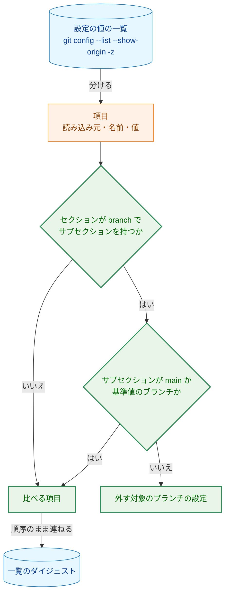
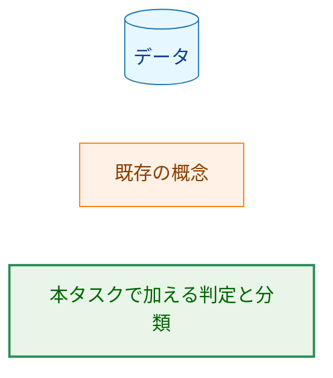
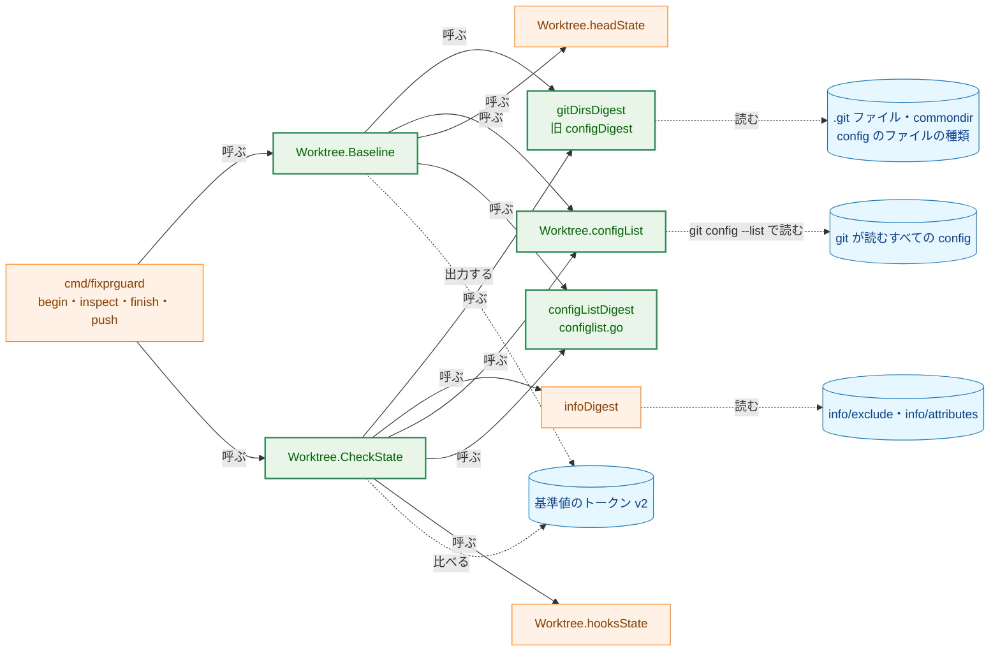
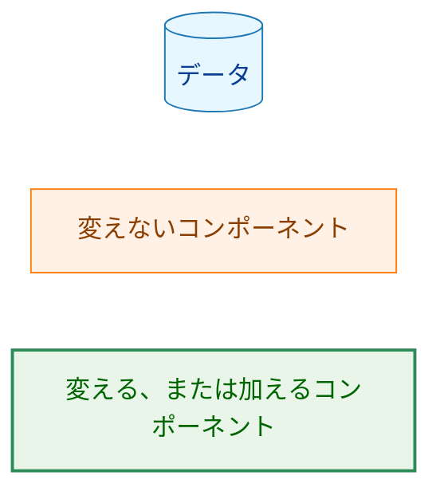
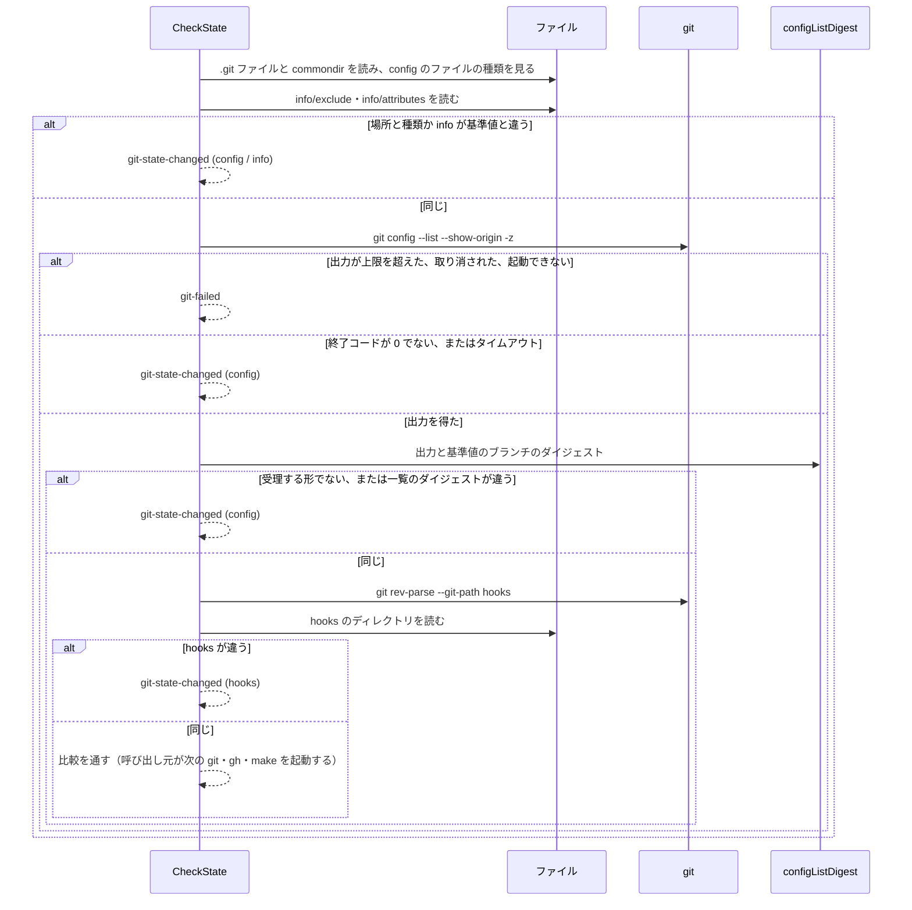
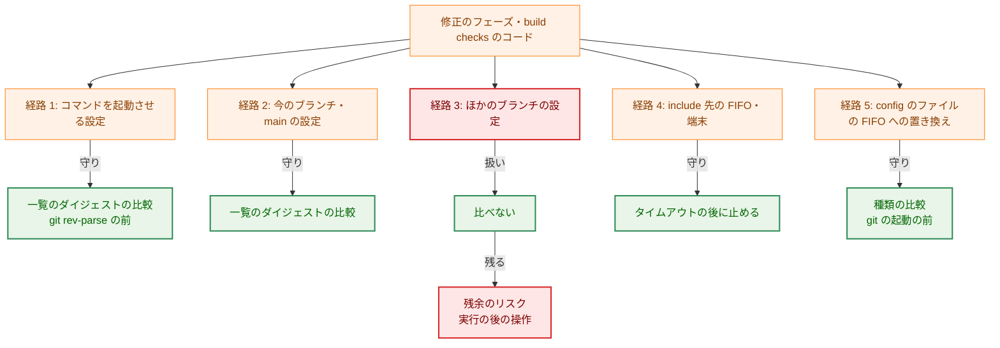
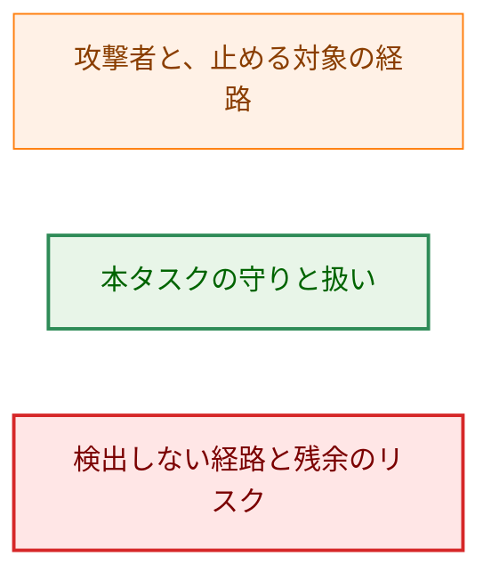
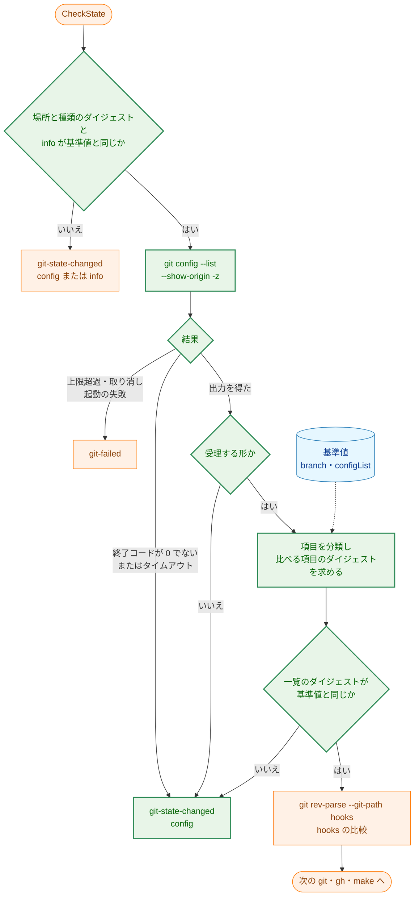
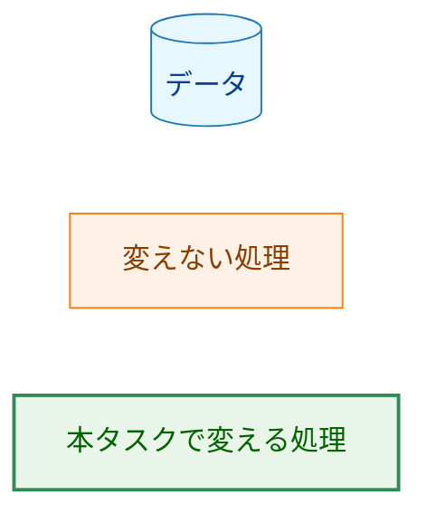

# アーキテクチャ設計書：fixprguard の config の比較から、ほかのブランチの `branch.<name>.*` を外す

## Document Status

| Item | Value |
|---|---|
| Status | `approved` |
| Created | 2026-10-22 |
| Review date | 2026-10-22 |
| Reviewer | isseis |
| Comments | 2026-10-22 (editorial): 2.2 の表に `cmd/fixprguard/test_helpers.go` の行を加えた（実装計画の調査で見つけた漏れ）。決定は変えていない。2026-10-22 (decision): AC-17 の確かめを、ガードのテスト（`static`）から PR のレビューでの読み合わせ（`manual`）に改めた。自然言語の記述はテストで保証できない（必須の語を含んでいても、否定を反転した文が通る。PR #438 のレビューの指摘）ため、7.5 の AC-17 を `manual` にした。PR #438 で、このセッションでレビュアーが指示し、承認した。AC-18 のガード（PR-1 でマージ済み）は変えていない。2026-10-23 (decision): タスク 0038 の F-005 により、7.5 の AC-18 を `manual` に改めた（`TestGuideDescribesConfigScope` を削除したため）。決定はタスク 0038 の要件の承認で得たので、`Status` は `approved` のままとする。 |

本書は [01_requirements.md](01_requirements.md)（要件定義書。以下、要件書）の設計である。既存のファイルに関する記述は、コミット `b8038b4` のファイルで確かめた。`file:line` はこのコミットの行番号を指す。F-NNN・AC-NN は要件書の項番を、H-NN は [design_handoff.md](design_handoff.md) の項番を、I-NN は [implementation_handoff.md](implementation_handoff.md)（実装計画への申し送り）の項番を指す。申し送り H-01〜H-09 への対応は付録 A にまとめる。「ガイド」は `docs/dev/guides/fixprguard_guide.md`（と日本語版の `fixprguard_guide.ja.md`）を指す。

本書は、要件書 3.1 で定義した次の用語を同じ意味で使う: ブランチの設定、今のブランチ、外す対象のブランチの設定、設定の値の一覧。「基準値」「ガードツール」「ダイジェスト」は、0030 の文書と同じ意味で使う。ほかに次の用語を定義して使う。

-   **項目:** 設定の値の一覧の 1 つの要素。`git config --list --show-origin -z` が出力する、読み込み元・設定の名前・値（値を持たない項目もある）の組である（3.2）。
-   **比べる項目:** 外す対象のブランチの設定でない項目。基準値と比べる対象である。
-   **基準値のブランチ:** 基準値が名前のダイジェストを持つブランチ。`begin` の時点の今のブランチである。比較の時点で HEAD が別のブランチに移っていても、比べるブランチの設定はこのブランチと `main` のものである（3.4）。
-   **場所と種類のダイジェスト:** git のディレクトリの場所（`.git` ファイルと `commondir` が指す先）と、リポジトリの config・worktree の config のファイルの種類（ないか、通常のファイルか、シンボリックリンクとその先か、それ以外か）のダイジェスト。ファイルの内容は含めない。今の `configDigest`（`internal/fixprguard/gitstate.go:279-298`）から、ファイルの内容を除いたものである（3.1）。
-   **一覧のダイジェスト:** 比べる項目だけを、出力の順序のまま連ねたもののダイジェスト（3.2）。

## 1. 設計の全体像 (Design Overview)

### 1.1. 設計原則

-   **比べる範囲は、git の出力した項目の名前だけで決める。** config のファイルを Go で解析しない（issue #431）。git が解釈した結果の `git config --list --show-origin -z` を読み、項目の名前のセクションとサブセクションだけを解釈する（要件書 3.3）。
-   **判定は 1 か所に置く。** 項目の分解と、外す対象かどうかの判定は 1 つの関数にまとめ、`begin` と `inspect`・`finish`・`push` で同じものを使う（要件書 4.5）。
-   **今のブランチの名前は、基準値のダイジェストと照合する。** 基準値は今のブランチの名前をダイジェストでしか持たない（`gitstate.go:98-113`）。サブセクションのダイジェストを基準値のものと比べれば、比較の前に名前を求めるための git の起動が要らない（H-03）。
-   **`CheckState` の起動の順序は、今の順序から 1 つだけ変える。** config のファイルの内容のバイト列を比べることをやめる。ファイルの種類の確認は残し、git を起動する前に行う。その後に `git config --list` を起動する。`git config --list` は、書き換えられた config のままでも、コマンドを起動しない（1.3 の V-1）。hooks の場所を求める `git rev-parse` をその後に置く順序は変えない（H-01）。
-   **読めないことは変化として扱う。** `begin` では読めた設定の値の一覧が、比較の時点で読めない、または受理する形でない場合は、`git-state-changed`（`config`）で止まる（AC-12）。
-   **形を補わない。** 受理する形に合わない出力は、一部を比べて続けることも、形を補うこともしない（CLAUDE.md「Reject, don't normalize」、要件書 3.3）。

### 1.2. 設計の際に決めたこと（2026-10-22）

-   **基準値のトークンは `v2` にし、要素の数は 7 のままにする（H-05・H-06。トークンは 3.1）。** `config` の要素を場所と種類のダイジェストに、`configList` の要素を一覧のダイジェストに変える。理由: 前の版の `v1` のトークンは、版の不一致で必ず拒否される（AC-15）。場所と種類のダイジェストを別の要素として残すと、git を起動する前に比べる部分を、トークンの中でも分けておける。要素の数を変えないので、`ParseBaseline` と `String` の変更は版の文字列だけで済み、0034 が要素を足すときも、版をもう一度上げて足すだけで済む。
-   **FIFO を指す include は、今のタイムアウト（`gitTimeout`、2 分）で止める。** 比較の時点で `git config --list` がタイムアウトしたら、`git-state-changed`（`config`）で止まる（AC-12）。`config --list` だけに短いタイムアウトを設ける案は採らない。理由: この経路は、修正のフェーズのエージェントか build checks のコードが、故意または誤りで include の先を FIFO にしたときにしか起きない。そのときも、2 分待った後に止まるので、保証は弱まらない。正常な実行は数ミリ秒で終わり、短いタイムアウトを足しても守りは増えない（CLAUDE.md「Performance」・YAGNI）。
-   **ほかのブランチの値のない設定による git の失敗は、`git-failed` として受け入れる。** ほかのブランチの `branch.<name>.remote`・`merge`・`pushRemote` を値なしで書くと、`git ls-remote`・`git push`・`git remote -v` が失敗する（1.3 の V-4）。外す対象の設定なので比較では止まらず、その後の git の失敗として `git-failed`（`gh` の中の git なら `response-rejected`）で止まる。値のない項目だけを比べ続ける案は採らない。理由: 値のない項目では push 先などの宛先を変えられず、効くのは失敗する方向だけである（fail-closed）。並行するセッションのブランチの操作は、値のない項目を書かない（1.3 の V-5）。外す対象に例外を作ると、規則が複雑になり、AC-01 の範囲も変わる。この場合の利用者向けの案内は、ガイド 8 章の `git-failed` の行に書き足す（3.5）。
-   **`gh` が起動する git を、実際の動作で確かめた。** `inspect` が文書の手順で起動する `gh` のうち、`gh repo view` と `gh pr view <番号>` が、ほかのブランチの設定を読まないことを `GIT_TRACE` で確かめた（1.3 の V-6）。確かめた範囲と確かめていない範囲は V-6 に書く。確かめていない `gh` の経路でも、外す対象の設定が効くのは失敗する方向だけであり、その根拠は確かめた結果によらない（V-6 の後の段落）。

### 1.3. 確かめた git と `gh` の振る舞い

手元の git 2.50.1（Apple Git-155）と `gh` 2.96.0 で、一時ディレクトリの実際のリポジトリを使って確かめた（2026-10-22）。設計はこれらに依存する。

| 番号 | 確かめたこと | 方法と結果 |
|---|---|---|
| V-1 | 書き換えられた config のままでも、`git config --list --show-origin -z` はコマンドを起動しない | `core.pager`・`core.editor`・`core.askPass`・`core.fsmonitor`・`core.sshCommand`・`core.hooksPath`（hook を置いた先）・`credential.helper`・`diff.external`・`filter.<x>.process`・`gpg.program`・`alias.config`・`gc.auto`・`maintenance.auto`・`includeIf`（`hasconfig:`・`onbranch:`・`gitdir:`）をリポジトリの config に書き、ツールと同じ `gitHardening` を付けて、`GIT_TRACE=1` で実行した。trace には `built-in: git config --list --show-origin -z` だけが出た。子プロセスの起動はなかった。各コマンドが作るはずのファイルも作られなかった |
| V-2 | 壊れた config と特殊な include のときの終わり方 | 構文の誤り、ディレクトリを指す include、`/dev/zero` を指す include、循環する include は、すぐに終了コード 128 で終わる。存在しないファイルと `/dev/null` を指す include は、終了コード 0 で、何も加えない。**FIFO を指す include（`includeIf` を含む）は、書き手が現れるまで待ち続ける**ので、ツールでは `gitTimeout` で止まる。`/dev/tty` のような端末の文字デバイスも、入力を待つため、同様に止まりうる（確かめていない） |
| V-3 | 出力の形（H-04） | 各項目は `<読み込み元>` NUL `<名前>` LF `<値>` NUL である。値を持たない項目（`[core]` の下の `bare`）は `<読み込み元>` NUL `<名前>` NUL で、LF がない。空の値（`empty =`）は `<名前>` LF NUL で、両者は区別できる。セクションと変数の名前は小文字で出る（`[BRANCH "X.Y"] ReMote` は `branch.X.Y.remote`）。サブセクションは、`[branch "Feature"]` ならそのまま `branch.Feature.*`、古い書き方の `[branch.Feature]` なら小文字の `branch.feature.*`、`[branch ""]` なら `branch..*` で出る。引用符の中のエスケープは外して出る（`[branch "a\"b\\c"]` は `branch.a"b\c.remote`）。`include.path` の項目そのものも一覧に現れ、include 先の項目は include 先のファイルを読み込み元とする。`gitHardening` の `-c` は `command line:` を読み込み元として最後に並ぶ。ファイルの中の NUL は値に入らない（NUL の手前で値が切れる） |
| V-4 | 外す対象の設定が、ツールの起動する git に効くか（H-02） | ほかのブランチの `branch.other.remote`・`merge`・`pushRemote` を値なしで書くと、`git ls-remote`・`git push`・`git remote -v` は `missing value for 'branch.other.remote'` というエラーを出し、終了コード 128 で終わる。git は、リモートの設定を読むときに、すべてのブランチの `branch.<name>.remote`・`merge`・`pushRemote` を読み込むためである。`branch.other.remote = -x` や `branch.other.rebase = bogus` のように値があれば、`ls-remote`・`push` は成功し、push 先は今のブランチの設定だけで決まる。ツールが起動するほかの git（`status`・`add`・`diff`・`diff-tree`・`ls-files`・`commit`・`rev-parse`・`symbolic-ref`・`cat-file`・`reset`・`config --get`）は、値のない項目があっても成功した |
| V-5 | issue #431 の表の git の操作が書き込む設定（H-09 (2)） | `git worktree add -b X origin/main` は `branch.X.remote`・`branch.X.merge` を加える。別の worktree での `git push -u` は `branch.X.merge` を変える。`git worktree remove` と `git branch -D X` は `[branch "X"]` の項目を消す。どれも `branch.X.*` のほかには書き込まず、`main` の設定にも書き込まない |
| V-6 | `inspect` が起動する `gh` が起動する git（H-02） | `GIT_TRACE` に出力先のファイルを指定して、`gh repo view --json nameWithOwner` と `gh pr view 432 --json number,headRefName` を実行した。どちらも、起動した git は `git remote -v` と `git config --get-regexp '^remote\..*\.gh-resolved$'` だけで、ブランチの設定を読む git は起動しなかった。ただし `git remote -v` は、V-4 の値のない項目があると失敗する。**確かめていないもの:** `GitHub.ThreadPaths`（`cmd/fixprguard/main.go:564`）が起動する `gh api graphql`（`threads.go:180`）と `gh api` の権限の照会（`trust.go:140`）、PR の番号を省いたときに `CurrentPR` が起動する `gh pr view --json number`（`github.go:200`）。後者は今のブランチから PR を求めるので、今のブランチの `branch.*` を読む。`/fixpr` の手順は `inspect` に PR の番号を渡す（`.claude/commands/fixpr.md:463`）ので、文書の手順では後者は起動されない。前者はネットワークを要するので、実装のときに確かめる（I-01）。設計はこの確認に依存しない（表の後の段落）。結果は `gh` 2.96.0 のものであり、`gh` の版が変われば変わりうる |
| V-7 | リポジトリの config のファイルを FIFO に置き換えたとき | 本書のレビューで再現した。手順: 基準値を取った後に `.git/config` を消して `mkfifo` で FIFO を作り、開かれた回数を数えながら書き込むバックグラウンドのプロセスを置く。4 回目までは元の内容を、それ以降は `core.hooksPath` を加えた内容を書く。その後に `git config --list`・`git rev-parse --git-path hooks`・`git add`・`git commit` を順に実行した。git はリポジトリの config が FIFO でも読み、1 つのプロセスの中で何度も開く。書き手が FIFO の開かれた回数を数えていれば、`git config --list` と `git rev-parse` には基準値と同じ内容を、次の git には `core.hooksPath` を書き換えた内容を渡せる。この場合、内容を比べるだけでは、次の `git commit` が書き換えた先の hook を実行する。今のコードは、ファイルの種類を含むダイジェスト（`gitstate.go:375-409` の `digestPath`）で、git を起動する前にこれを止めている |

**確かめていない `gh` の経路でも安全である理由（V-6）。** `gh api graphql` などが起動する git を確かめていなくても、外す対象の設定が `gh` に効くのは失敗する方向だけである。根拠は次の 3 つで、どれも V-6 の確認の結果によらない。

-   **外す対象のほかは、`gh` の前にすべて比べる。** `inspect` は `CheckState` を通った後にだけ `gh` を起動する（`cmd/fixprguard/main.go:557`・`564`）。`gh` の中の git が読む設定のうち、外す対象でないものは、すべて基準値と同じである。
-   **外す対象のキーは、コマンドを起動させない。** git が `branch.<name>.*` に定めるキー（`remote`・`pushRemote`・`merge`・`mergeOptions`・`rebase`・`description`）は、どれも起動するコマンドを値に持たない。`mergeOptions` と `rebase` は、merge・pull のときにエディタや署名のプログラムを起動させうるが、そのプログラムを名指すのは比べる項目（`core.editor`・`gpg.program` など）である。しかも、git はこれらのキーを、名前が完全に一致するブランチの操作にしか使わない（V-4、H-09 (1)）。
-   **問い合わせる先のリポジトリは、`branch.*` から決まらない。** `ThreadPaths` は、owner と name を `gh repo view` で求め（`github.go:96`・`504`）、GraphQL の変数（`threads.go:106`）と REST のパス（`trust.go:140-141`）に明示して渡す。`gh repo view` が起動する git は、`branch.*` を読まない（V-6）。

よって、`gh` の中の git が外す対象を読んでも、宛先を変えることも、コマンドを起動させることもできない。効くのは、V-4 の値のない項目による失敗だけであり、`response-rejected` で止まる（4 章）。実際に起動される git の確認は、実装のときに行う（I-01）。

**`gh pr checkout` が書き込む設定（H-09 (2)）。** `gh pr checkout` は、ツールが起動しない（ツールの外で並行するセッションが起動する）ので、書き込む設定は実際の動作でも文書でも確かめていない。書き込む範囲が `branch.<そのブランチ>.*` だけでなく、`branch.main.*` や `remote.*` に及んでも、要件書 AC-01 の但し書きと AC-06・AC-08 のとおり `git-state-changed` で止まる。誤りうる方向は止まりすぎ（fail-closed）だけであり、止めるべき変更を通すことはない。外れたときの影響は、並行するセッションの checkout で不要に止まることだけである。通常の PR と fork の PR で書き込む範囲は、ネットワークを要するので、実装のときに確かめる（I-02）。

**git の最低の版（H-08）。** 次の 3 つのうち最も新しい版である。

-   **ないと git が失敗する機能:** `git config --show-origin`（と `-z` との組み合わせ）が 2.8、`git status --porcelain=v1`（`worktree.go:67`。版を指定する書き方）が 2.11 である。
-   **`gitHardening` の `-c` のうち、すでにある機能を制限するもの:** git は知らない設定の名前を黙って無視する。`protocol.ext.allow=never` は、ext のトランスポートが前からあるのに、`protocol.<name>.allow` を読む git（2.12）でなければ効かない。ほかの `-c`（`core.fsmonitor` 2.16、`maintenance.auto` 2.29 など）は、古い git にない機能を止めるものなので、古い git で無視されても害がない。
-   **一覧の受理する形:** 3.2 の形は git 2.50.1 で確かめた。CI（`.github/workflows/ci.yml:57-71` の `ubuntu-latest` での `make test-ci`）が、実際のリポジトリのテスト（7.2）を Linux の git で実行するので、その版でも形が確かめられる。形の違う git では、`begin` が受理する形でないとして `git-failed` で止まる（fail-closed）。

よって最低の版は 2.12 である。`gitstate.go:68-71` のコメントの「git 2.5 and later」は誤りであり、本タスクで直す（3.5）。各機能が入った版はリリースノートの記述によるもので、実装のときにリリースノートで確かめ直す。`includeIf` は git が読む config の書き方であって、ツールが使う機能ではないので、最低の版に関わらない。

### 1.4. なぜ今の比較のままでは足りないか

今の config の比較は、リポジトリの config と worktree の config のファイルの種類と内容のバイト列のダイジェスト（`gitstate.go:292-296`・`375-409`）と、`git config --list --show-origin -z` の出力全体のダイジェスト（`gitstate.go:487-494`）の 2 つである。

-   ファイルの内容のバイト列の比較は、ほかのブランチの節の追加と削除でも必ず変わる。このままでは AC-01・AC-02 を満たせない。コメントや空行だけの編集でも変わるので、AC-10 も満たせない。バイト列のまま、ほかのブランチの節だけを除くには、Go で config のファイルを解析することになる。issue #431 はこれを避けるとしている。
-   出力全体のダイジェストも、ほかのブランチの項目の追加と削除で変わる。出力を項目に分けて、外す対象を除く必要がある。

よって、ファイルの内容のバイト列の比較はやめる。ファイルの種類の比較は残す。種類は、ほかのブランチの節の追加や削除、コメントの編集では変わらないので、AC-01・AC-02・AC-10 と両立する。種類の比較は今のコードがすでに行っているので、残しても新しい仕組みは要らない。種類を比べ続けると、FIFO などに置き換えて git に開くたびに違う内容を読ませる経路（V-7）も、今と同じく git の起動の前に止まる。この経路は、現実の脅威としては小さい（5.2 の経路 5）。それでも残すのは、外すと、保証が弱まる箇所とそれを受け入れる理由を書き加えることになり、今の振る舞いを保つほうが費用が小さいからである。出力全体のダイジェストは、比べる項目だけのダイジェストに変える。git のディレクトリの場所の比較（AC-11）も残す。

### 1.5. 概念モデル

設定の値の一覧の各項目を、名前で、比べる項目と外す対象のブランチの設定に分ける。



矢印 A → B は、A から B が作られる、または A が B に振り分けられることを表す。

**Legend**



-   **セクションとサブセクション。** 名前の最初の `.` より前がセクション、最初の `.` と最後の `.` の間がサブセクションである（要件書 3.1）。`branch.autoSetupMerge` のように `.` が 1 つしかない名前は、サブセクションを持たないので、ブランチの設定ではない（AC-07）。
-   **基準値のブランチとの照合。** サブセクションのバイト列のダイジェストが、基準値のブランチのダイジェストと一致すれば、基準値のブランチの設定である。ダイジェストは、基準値がブランチの名前に使うものと同じ関数（`digestString`、`gitstate.go:425-431`）で求める。大文字・小文字は区別する（要件書 3.1）。基準値は名前をダイジェストでしか持たないので、ダイジェストで照合する。
-   **`main` との照合。** サブセクションのバイト列が定数の `main` と一致するかどうかで判定する。`main` は名前が固定なので、ダイジェストを介す必要がない。

## 2. システム構成 (System Structure)

### 2.1. 全体構成

変更は `internal/fixprguard` の中に閉じる。`cmd/fixprguard` の呼び出しの順序は変えない。



実線の矢印 A → B は、A が B を呼ぶことを表す。点線の矢印は、データの読み書きを表す。`Worktree.Baseline` から `infoDigest`・`hooksState` への矢印など、本タスクで変わらない呼び出しは省いた。`Worktree.Baseline` から `Worktree.headState` への呼び出しは今もあるが、一覧のダイジェストがその結果（ブランチの名前）に依存するようになるので示した。

**Legend**



### 2.2. コンポーネント配置

| ファイル | 変更 | 内容 |
|---|---|---|
| `internal/fixprguard/configlist.go` | 新規 | 設定の値の一覧の分解（受理する形の検査）、項目の分類（外す対象かどうか）、一覧のダイジェスト（3.2・3.3）。外部のコマンドを起動しない、純粋な関数だけを置く |
| `internal/fixprguard/configlist_test.go` | 新規 | 分解・分類・ダイジェストのユニットテスト（7.1） |
| `internal/fixprguard/gitstate.go` | 変更 | `baselineVersion` を `v2` にする。`configDigest` を `gitDirsDigest` に改め、ファイルの内容を除いて種類だけを含める。`Worktree.configListDigest` を、出力を得るだけの `Worktree.configList` に改める。`CheckState` と `Baseline` の順序、および一覧の読み取りの失敗の振り分けを変える（3.4・4 章）。`gitHardening`・`Baseline`・`CheckState` のコメントを改める（3.5） |
| `internal/fixprguard/errors.go` | 変更 | `errConfigList` を加える（3.3） |
| `internal/fixprguard/types.go` | 変更 | `Protocol` を `1` から `2` に上げる（AC-19） |
| `internal/fixprguard/gitstate_test.go` | 変更 | 7.3 の既存のテストの改訂と、7.2 の結合テスト |
| `internal/fixprguard/worktree_flow_test.go` | 変更 | 7.3 の既存のテストの改訂（config の変化の後に起動する git が `git config --list` だけであること） |
| `internal/fixprguard/test_helpers_git.go` | 変更 | git の呼び出しの記録で `git config --list` を `git config --get` と区別する（今の記録はサブコマンドの名前だけである）。加えて、`git config --list` だけを失敗させる差し替え（AC-12 のタイムアウトのテスト。今の `gitRouter.Run`（`test_helpers_git.go:36-43`）はすべての git を実物に渡す）と、別の worktree の作成などの補助を加える |
| `cmd/fixprguard/main_test.go` | 変更 | AC-15 の、前の版の基準値で終了コード `2` になるテスト。`:25` の解析だけに使う `"v1.x"` を `"v2.x"` にする（そのままでも通るが、誤解を招く） |
| `cmd/fixprguard/test_helpers.go` | 変更 | `validBaseline`（`:358-369`）が作るトークンの版の `"v1"` を `"v2"` にする。このヘルパーは作ったトークンを `ParseBaseline` に通し、受け付けられなければテストの準備で失敗する |
| `.claude/commands/fixpr.md`・`.claude/commands/runpr.md` | 変更 | `--protocol 1` をすべて `--protocol 2` にする（AC-19）。手順は変えない |
| `docs/dev/guides/fixprguard_guide.md`・`fixprguard_guide.ja.md` | 変更 | 3.5 の箇所（AC-18・AC-19・H-08） |
| `docs/tasks/0030_fixpr_untrusted_threads/01_requirements.md`・`02_architecture.md` | 変更 | 3.5 の箇所（AC-17）。`Status` は `approved` のまま、`Comments` に `(decision)` を記録する |

`cmd/fixprguard` のコードは変えない。`inspect` の `CheckState` の呼び出し（`cmd/fixprguard/main.go:557`）と、`finish`・`push` の中の呼び出し（`worktree.go:130`・`243`・`273`・`326`・`367`・`383`・`502`）は、そのまま新しい比較を使う。`cmd/fixprguard/docs_test.go` の `TestDocumentedInvocationsParse` は、コマンドの文書の `--protocol` がバイナリの `Protocol` と一致することを確かめる（`docs_test.go:84-116`）。`Protocol` を上げて文書を直さなければ、このテストが失敗する。ガイドの番号を確かめるテストを加えるかは、計画で決める（7.5）。

### 2.3. データフロー: `inspect`・`finish`・`push` の比較



実線の矢印 `->>` は、呼び出しまたは読み取りを表す。点線の矢印 `-->>` は、`CheckState` が返す結果を表す。この図は色分けしたノードを持たないので、Legend はない。`alt` の分岐は、4 章の優先順位の順に並べた。

`git config --list` の前に起動する git はない。`git rev-parse` は、一覧のダイジェストが一致した後にしか起動しない。今の順序（`gitstate.go:522-560`）との違いは、最初の段でファイルの内容のバイト列を比べないことだけである。

## 3. コンポーネント設計 (Component Design)

### 3.1. 基準値のトークン（H-05・H-06）

トークンは `v2.` に続く 7 つの要素を `.` で連ねた形である。前の版の `v1` のトークンは、版の文字列が違うので、`ParseBaseline` が `ErrInvalidInput` で拒否する（AC-15。終了コード `2`）。要素の数が同じでも、版が違えば拒否する。

| 位置 | 要素 | 今（`v1`） | 本タスク（`v2`） |
|---|---|---|---|
| 1 | head | HEAD の OID | 変えない |
| 2 | branch | HEAD がいるブランチの名前のダイジェスト | 変えない。一覧の分類で、基準値のブランチの照合にも使う |
| 3 | remote | push 先のブランチの OID か `none` | 変えない |
| 4 | hooks | hooks のディレクトリのダイジェスト | 変えない |
| 5 | config | 場所と、リポジトリの config・worktree の config のファイルの種類と内容のダイジェスト | **場所と種類のダイジェスト**。ファイルの内容を含めない |
| 6 | configList | `git config --list --show-origin -z` の出力全体のダイジェスト | **一覧のダイジェスト**。比べる項目だけを順序のまま連ねたもののダイジェスト |
| 7 | info | `info/exclude`・`info/attributes` のダイジェスト | 変えない |

-   **平文を含めない。** どの要素もダイジェストか OID である。ブランチの名前、設定の名前と値、読み込み元のパスを平文で含めない（AC-16）。今の方針（`gitstate.go:98-113`）を保つ。
-   **ファイルの種類。** 今の `digestPath`（`gitstate.go:375-409`）が書く値から、通常のファイルの内容のダイジェストを除いたものを使う。すなわち、ないこと、シンボリックリンクとその先、リンクの先がないこと、ファイルの種類（通常のファイル・FIFO・デバイスなど）である。通常のファイルの書き換え（ほかのセッションのブランチの操作、コメントの編集）では種類は変わらない。
-   **worktree の config のファイル。** 今は、`config.worktree` の内容を、git が読むかどうかに関わらず比べている。本タスクの後は、git が読むとき（`extensions.worktreeConfig` が真のとき）にだけ、その内容の項目が一覧に現れ、比べられる。git が読まないファイルの内容の変化は、git の振る舞いを変えない。`extensions.worktreeConfig` を後から真にする変更は、その項目が一覧に現れるので止まる。ファイルの種類は、今と同じく常に比べる。
-   **要素の数を変えない理由と、0034 との関係**は 1.2 のとおりである。0034 は、版を `v3` に上げて要素を足せばよい（9 章）。

### 3.2. 設定の値の一覧の分解と分類（要件書 3.3・H-04）

**受理する形。** 出力は、次の形の項目の並びである（1.3 の V-3）。

-   項目は、`<読み込み元>` NUL `<名前>` NUL、または `<読み込み元>` NUL `<名前>` LF `<値>` NUL である。
-   読み込み元は、空でないバイト列である。解釈しない。
-   名前は、最初の LF または NUL の手前までであり、空でない。最初の `.` の前（セクション）と、最後の `.` の後（変数の名前）が、どちらも空でない。`.` を含まない名前は受理しない。
-   値は、名前の後の LF から次の NUL の手前までのバイト列である。LF を含みうる。解釈しない。
-   出力は空でない（`gitHardening` の `-c` が `command line:` の項目を必ず出すので、正常な出力が空になることはない。V-3）。最後の項目は NUL で終わる。

形に合わない項目を 1 つでも含む出力は、比較を続けずに拒否する。例: 最後の NUL がない出力、名前が空の項目、読み込み元のすぐ後で出力が終わる項目、`.` を含まない名前。補って続けない（要件書 3.3）。同じ名前の項目の繰り返しは正当な形であり、拒否しない。

**出力の内容で振る舞いを選ぶことについて。** 項目の名前を見て比べるかどうかを選ぶのは、CLAUDE.md「Declare, don't infer」が避ける、内容による振る舞いの選択に見える。ただし、これは呼び出し元が渡す文字列の推測ではなく、git が定めた機械向けの出力の形（`-z`）の解析である。同じパッケージの `checkIndexFlags`（`gitstate.go:676-690`）が `ls-files -v` の印を読む処理や、`git status --porcelain=v1 -z` の解析で状態を読む処理と同じ種類である。形に合わない出力は、広く解釈せずに拒否する。

**分類。** 受理した項目ごとに、1.5 の規則で比べる項目か、外す対象かを決める。

-   セクションが `branch` でない項目と、サブセクションを持たない `branch.<key>` は、比べる項目である。
-   サブセクションが空の項目（`branch..remote`）は、サブセクションを持つ項目として扱う。空の名前は `main` とも基準値のブランチとも一致しないので、外す対象になる（要件書 3.1。`begin` は HEAD がブランチを指すことを求め、ブランチの名前は空にならない）。
-   照合はバイト列で行う。サブセクションを UTF-8 として解釈しない。セクションの `branch` との照合も、git が小文字で出力するので、バイト列の一致で足りる（V-3）。
-   読み込み元は分類に使わない（AC-03）。比べる項目では、読み込み元もダイジェストに入る（AC-08）。

**一覧のダイジェスト。** 比べる項目を、出力の順序のまま、項目の区切り（NUL と LF）を含めたバイト列で連ねて、SHA-256 を取る。項目の区切りを含めるので、値を持たない項目と空の値の項目は区別される。項目の境界も一意に決まる。外す対象の項目は、ダイジェストに何も加えない。そのため、外す対象の項目が加わる、変わる、消えるときは、ダイジェストは変わらない（AC-01〜AC-04）。比べる項目の順序が変わればダイジェストは変わる（AC-09）。

**上限。** 一覧の出力の上限は、ほかの git と同じ `gitMaxOutput`（`cmd/fixprguard/main.go:43-45`、64 MiB）とする。上限は外す対象の項目も含めた出力全体にかかる。項目の数には上限を設けない（要件書 3.3）。

### 3.3. 型と関数

本タスクは、公開する型と関数を加えない。次の非公開の定義を置く。

```go
// errors.go

// errConfigList reports git config output that is not in the accepted
// shape. It never carries a name, a value, or an origin. It is a git
// failure at begin; CheckState reports it as a config change.
var errConfigList = fmt.Errorf("%w: config list shape", ErrGitFailed)

// configlist.go

// mainBranch is the branch whose settings are compared even when it is not
// the current branch.
const mainBranch = "main"

// configListDigest parses the output of git config --list --show-origin -z,
// rejecting any other shape with errConfigList, and digests, in order, every
// entry except the branch settings of branches other than mainBranch and the
// branch whose name digest is branchDigest. A branchDigest that is not a
// digest is rejected rather than read as matching no branch.
func configListDigest(out []byte, branchDigest string) (string, error)

// gitstate.go

// configList runs git config --list --show-origin -z and returns its output,
// or the runner's error unchanged so the caller can classify it.
func (w *Worktree) configList(ctx context.Context) ([]byte, error)

// gitDirsDigest covers where the git directories are and the type of the
// repository and worktree configuration files, never their content.
func gitDirsDigest(dirs gitDirs) (string, error)
```

-   **基準値のブランチのダイジェストは、引数で渡して関数の中で検査する。** 引数を構造体にまとめると、零値（空のダイジェスト）がどのブランチとも一致せず、基準値のブランチの設定を黙って比べなくなる（fail-open）。引数で渡し、ダイジェストの形（64 桁の小文字の 16 進数。`validHex(…, digestLength)`）でなければ拒否する。拒否は fail-closed である。
-   **エラーの変換は呼び出し元で行う。** `configList` は、`cmdrunner` が返したエラーをそのまま返す（今の `git` メソッドは `gitFailure` で元のエラーを捨てる。`gitstate.go:436-458`）。`begin` と `CheckState` での振り分けは 4 章のとおりで、`CheckState` の中の 1 か所で行う。
-   `errConfigList` は `ErrGitFailed` を包むので、`begin` でそのまま返せば `StopKind`（`errors.go:85-115`）が `git-failed` にする。同じ形の例は `ErrCommentNotInThread`（`errors.go:26`）である。

### 3.4. `CheckState` と `Baseline` の順序（H-01・H-03）

**`CheckState`（`inspect`・`finish`・`push`）。** 2.3 の順序で比べる。`CheckState` を呼ぶ位置は変えない。

1.  `.git` ファイルと `commondir` を読み、git のディレクトリを求める（`locateGitDirs`）。読めなければ `config` の変化として止まる（今と同じ。`gitstate.go:526-530`）。
2.  場所と種類のダイジェストと info のダイジェストを、ファイルの読み取りだけで求め、基準値と比べる。違えば `config` または `info` で止まる。リポジトリの config が FIFO などに置き換えられていれば、ここで止まる（V-7）。
3.  `git config --list --show-origin -z` を起動する。基準値のブランチのダイジェストを渡して一覧のダイジェストを求め、基準値と比べる。失敗の扱いは 4 章のとおりである。
4.  `git rev-parse --git-path hooks` で hooks の場所を求め、比べる（今と同じ）。

**起動の順序の保証（AC-14）。** 書き換えられた config のまま起動する git は、手順 3 の `git config --list` だけである。これはコマンドを起動しない（V-1）。手順 3 で config の違いが分かれば、手順 4 の `git rev-parse` も、呼び出し元が次に起動する git・`gh`・make も起動しない。リポジトリと worktree の config のファイルの種類が `begin` の時点と同じであることは、手順 2 で git の起動の前に確かめる。そのため、`begin` の後に FIFO などに置き換えて、手順 3 で読んだ内容と次の git が読む内容を食い違わせることはできない（V-7）。`begin` の時点ですでに FIFO だった場合は、0030 と同じく、`begin` の時点で設定が書き換えられていない前提に立つ（0030 `02_architecture.md` 3.7）。外す対象の設定は、手順 3 の後も比較を通るが、git にコマンドを起動させる設定ではない。ツールが起動する git に対して効くのは、失敗させる方向だけである（V-4）。

**`Baseline`（`begin`）。** `git config --list` を起動する位置は今と同じ（`gitstate.go:704`。ファイルのダイジェストの後、hooks の前）である。一覧のダイジェストには基準値のブランチの名前が要るので、出力から一覧のダイジェストを求めるのは、ブランチが定まった後（`headState` の後。`gitstate.go:715-721`）にする。`configListDigest` には、基準値に入れるのと同じ `digestString(branch)` を渡す。`begin` には比べる相手がないので、起動の順序の制約は今と同じくない（0030 `02_architecture.md` 3.7「基準値を採る `begin` だけは…」）。`begin` で一覧を読めない、または受理する形でない場合は、`git-failed` で止まり、基準値を出力しない（要件書 3.3）。

**AC-13 の `parts`。** `CheckState` は、HEAD の確認（`headState`。`compareState` の中で `CheckState` の後に呼ぶ。`gitstate.go:747-760`）より前に、基準値のブランチのダイジェストで分類する。HEAD が別のブランチ Y に移っていても、比べるのは基準値のブランチと `main` の設定であり、Y の設定は外す対象になる。基準値のブランチと `main` の設定が変わっていなければ、`CheckState` を通り、次の HEAD の確認で `head` として止まる。それらの設定が変わっていれば、`config` として止まる。detached になった場合も同じである。どちらの場合も、`parts` は `head` と `config` の少なくとも一方を含む。

### 3.5. 文書の改訂と `Protocol`（F-004・AC-17〜AC-19・H-08）

**`Protocol`。** `internal/fixprguard/types.go:20` の `Protocol` を `2` に上げる。`.claude/commands/fixpr.md` と `runpr.md` の `--protocol 1` をすべて `--protocol 2` にする。前の版のバイナリが新しい文書から呼ばれると、`--protocol` の不一致により、終了コード `2` で止まる。新しいバイナリが古い文書から呼ばれる場合も同じである（ガイド 4 章）。

**移行の手順。** 1 つのバイナリをすべての worktree が使い、`/fixpr` はその worktree の checkout の `fixpr.md` を読む。そのため、本タスクのマージと `make install-fixprguard` の後に、マージより前に作ったブランチの worktree で `/fixpr`・`/runpr` を実行すると、`--protocol 1` を渡して終了コード `2` で止まる。逆に、再インストールより前に新しいブランチで実行しても止まる。どちらも fail-closed だが、原因が分かるように、ガイド 3 章（インストール）に次を書く: マージの直後に再インストールする。作業中のブランチには、次の `/fixpr`・`/runpr` の前に `main` を取り込む。

**ガイド（英語・日本語）。** 次の箇所を、要件書 AC-17 の (a)〜(c) を述べる形に改める。(a) 外す対象のブランチの設定は比べない（今のブランチと `main` の設定は比べる）。(b) 設定の値の一覧を変えない編集は検出しない。(c) 外す対象のブランチの設定の書き換えは、残余のリスクである。

| 箇所 | 改める内容 |
|---|---|
| 1 章の層 (3)（`fixprguard_guide.md:13`） | config の比較の範囲 |
| 2 章の表 | git の最低の版（2.12）の行を加える（H-08） |
| 3 章 | 上の移行の手順 |
| 4 章 | 「The current number is `1`」を `2` にする |
| 4 章・5 章のすべての例 | `--protocol 1` と、出力の例の `"protocol":1` をすべて `2` にする。基準値の例の `'v1....'`（`:146`・`:158`・`:170`）を `'v2....'` にする |
| 5 章の `inspect`（`:143`）・`push`（`:167`） | 比べる config の範囲 |
| 7.1 の「git is not started with rewritten hooks or config」の行（`:233`） | 外す対象のブランチの設定を除いた config を基準値と比べる、という範囲に書き改める。比べる前に起動する git が `git config --list` だけであることを書く |
| 7.2（`:237-248`） | (a)〜(c) の残余のリスク。ほかのブランチの値のない設定で git が失敗すること（1.2）。include 先の FIFO で止まるまで最大 2 分かかること |
| 8 章の `git-state-changed` の行（`:258`） | 原因の「config」の範囲。`begin` の後に一覧が読めなくなった場合も含むこと（AC-12） |
| 8 章の `git-failed` の行 | 原因に、ほかのブランチの `branch.<name>.remote` などが値なしで書かれた場合と、設定の値の一覧が出力の上限を超えた場合を加える。対処に、`git config --list --show-origin` が動くかと、その大きさを確かめることを加える（1.2） |
| 8 章の `response-rejected` の行 | 原因に、`gh` の中の `git remote -v` が上の値のない設定で失敗する場合を加える |

日本語版（`fixprguard_guide.ja.md`）の同じ箇所を、同じ内容で改める。

**0030 の文書。** 次の箇所を、AC-17 の (a)〜(c) を述べる形に改める。両文書の `Status` は `approved` のままとし、`Comments` に `YYYY-MM-DD (decision): タスク 0035（#431）の要件で決めた変更` の形で記録する（要件書 5 章「文書の改訂の規則の例外」）。日付は改訂した日である。

| 文書 | 箇所 |
|---|---|
| `01_requirements.md` | 1 章の決定「修正のフェーズの異常では止める」（`:61`）、AC-26（`:154`）、4.2 の層 (3) の説明（`:197`）と残余のリスク（`:200-206`） |
| `02_architecture.md` | 1.2 の push の決定（`:52`）、3.6 の `finish` の不変条件（`:633`・`:635`）と `push` の不変条件（`:641`）、3.7 の基準値の表の config の行（`:652`）と起動前の比較の順序（`:658`）、5.2 の守りの表（`:835`）、5.3（`:845`・`:854`）、7.1 のテストの一覧（`:963`） |

要件書 AC-17 は、0030 `02_architecture.md` の対象として「2 章の push の説明」を挙げる。2 章（`:136-273`）には config の記述がない。config を含む push の説明は 1.2 の決定（`:52`）にあるので、これを対象とする。

**コードのコメント。** `gitHardening` のコメント（`gitstate.go:58-71`）の「Every other setting … is held to the baseline by CheckState」を、外す対象のブランチの設定を除くことに合わせて改め、git の版を 2.12 にする。`Baseline` の型のコメント（`gitstate.go:98-104`）と `CheckState` のコメント（`gitstate.go:514-521`）も、ファイルの内容を読まないことに合わせて改める。

### 3.6. 副作用の契約

本タスクは、どのサブコマンドの外部への副作用も変えない。`CheckState` が起動する git は今と同じ `git config --list --show-origin -z` と `git rev-parse --git-path hooks` で、どちらも書き込みをしない。比較を通る条件が広がる（外す対象の変化で止まらない）ので、その後の git・`gh`・make が起動される場合が増える。起動される場合の副作用は、今と同じである。

### 3.7. 先行するタスクの方針の例外

本設計は、0030 の次の方針の例外である。

-   **元の方針と場所:** 0030 `02_architecture.md` 3.7（`:652`・`:658`）は、リポジトリの config と worktree の config の内容のダイジェストを、ファイルの読み取りだけで求めて、git を起動する前に比べると定める。0030 `01_requirements.md` AC-26 (c) は、git の設定ファイルが違えば止まると定める。
-   **例外とする理由:** ファイルの内容のバイト列の比較では、AC-01・AC-02・AC-10 を満たせない（1.4）。内容の比較をやめた後も、ファイルの種類は git の起動の前に比べ（V-7）、`git config --list` はコマンドを起動しない（V-1）。そのため、書き換えられた設定のまま git にコマンドを起動させない、という 0030 の保証は保てる（3.4）。
-   **古い振る舞いを前提にしている既存のテスト:** 7.3 に挙げる。config の変化の後に git を 1 回も起動しないことを確かめるテストは、起動するのが `git config --list` だけであることを確かめる形に改める。

## 4. エラーハンドリング設計 (Error Handling Design)

新しく公開するエラー値（sentinel error）は加えない。止まり方の種類と `parts` の値の集合は変えない（AC-16）。設定の値の一覧の読み取りの失敗は、次の順に判定して振り分ける。上の行に当たれば、下の行は見ない。`cmdrunner` は、取り消しとタイムアウトのとき、`context` のエラー（`context.Canceled`・`context.DeadlineExceeded`）と `*cmdrunner.ExitError` を `errors.Join` で両方返す（`internal/cmdrunner/runner.go:104-108`）。そのため、`ExitError` の判定より前に、`context` のエラーを判定する。

| 順 | 状況 | 判定 | `begin` | `inspect`・`finish`・`push`（`CheckState`） |
|---|---|---|---|---|
| 1 | 出力が上限（64 MiB）を超えた | `cmdrunner.ErrOutputTooLarge` | `git-failed` | `git-failed`（要件書 3.3） |
| 2 | 呼び出しが取り消された（シグナルなど） | `context.Canceled` | `git-failed` | `git-failed` |
| 3 | `gitTimeout` を超えた（FIFO を指す include。V-2） | `context.DeadlineExceeded` | `git-failed` | `git-state-changed`（`config`） |
| 4 | 終了コードが 0 でない（構文の誤り、ディレクトリを指す include、循環する include など。V-2） | `*cmdrunner.ExitError` | `git-failed` | `git-state-changed`（`config`） |
| 5 | git を起動できないなど、上のどれでもない | — | `git-failed` | `git-failed` |
| 6 | 出力が受理する形でない | `errConfigList` | `git-failed` | `git-state-changed`（`config`） |
| 7 | 一覧のダイジェストが基準値と違う | — | — | `git-state-changed`（`config`） |

-   3・4・6 行を `CheckState` で `config` の変化とするのは、`begin` では読めた一覧が読めなくなったことが、config が変わったことを示すからである（要件書 1 章の決定、AC-12）。
-   `begin` の `git-failed` は、今の `gitFailure`（`gitstate.go:450-458`）と同じ規則の名前を付けて返す。`errConfigList` は `ErrGitFailed` を包むので、そのまま `git-failed` になる（3.3）。
-   `git-failed` と `git-state-changed` の診断は、今と同じく規則の名前だけを含む。`errConfigList` も、名前・値・読み込み元を含めない（AC-16）。
-   ほかのブランチの値のない設定で、後の `git ls-remote`・`git push` が失敗した場合は、今の `gitFailure` のとおり `git-failed` になる。`inspect` の `gh` の中の `git remote -v` が失敗した場合は、`ghFailure`（`github.go:79-84`）のとおり `response-rejected` になる（1.2）。

## 5. セキュリティ考慮事項 (Security Considerations)

条件付きのガイド（`docs/dev/security.md`）の適用条件には当たらない。本タスクは、`yt-dlp` の起動、API キー・Webhook の URL、キャッシュ、LLM API・Webhook への送信、信頼できないテキストのプロンプトや記事への埋め込みのいずれにも触れない（要件書 4.2）。この観点では `N/A` である。

ガードツールとしての脅威と守りを、以下に述べる。

### 5.1. 脅威モデル

攻撃者は、修正のフェーズのエージェント（レビューの本文の指示に従ってしまった場合）と、build checks が実行するコードである（0030 `02_architecture.md` 5.1）。本タスクで変わるのは、config を書き換える経路だけである。



矢印 攻撃者 → 経路 は、攻撃者がその経路を使えることを表す。経路 → 守り は、その経路への守りまたは扱いを表す。守り → 残余のリスク は、その扱いの後に残るリスクを表す。

**Legend**



### 5.2. 守りの対応

| 経路 | 守り | 保証の強さ |
|---|---|---|
| 経路 1: コマンドを起動させる設定（`core.hooksPath`・`core.fsmonitor` など。どのファイルにあっても） | 一覧のダイジェストの比較。`git config --list` はコマンドを起動しない（V-1）。違えば `git rev-parse` の前に止まる（3.4） | 今と同じ。確認の時点だけの保証 |
| 経路 2: 今のブランチと `main` の設定（push 先・merge の設定） | 一覧のダイジェストの比較（AC-05・AC-06） | 今と同じ |
| 経路 3: ほかのブランチの設定 | 比べない（F-001）。ツールが起動する git は、ほかのブランチの設定を push 先などの決定に使わない。`gh` は、外す対象のほかを比べた後にだけ起動し、問い合わせる先を明示して渡す。外す対象のキーはコマンドを起動させない。値のない項目は git を失敗させるが、宛先を変えない（V-4・V-6 と表の後の段落） | 実行の間は、失敗の方向にしか効かない。実行の後は 5.3 |
| 経路 4: include 先の FIFO・端末 | `gitTimeout` の後に `config` の変化として止まる（1.2） | 止まるまで最大 2 分 |
| 経路 5: リポジトリ・worktree の config のファイルを FIFO などに置き換え、開くたびに違う内容を読ませる | 場所と種類のダイジェストの比較。git を起動する前に止まる（V-7・3.4） | 今と同じ。脅威としては小さい（表の下） |
| `.git` ファイルや `commondir` の書き換え | 場所と種類のダイジェストの比較。git を起動する前に止まる（AC-11） | 今と同じ |
| 前の版の基準値 | `v2` 以外の版を拒否する（AC-15）。`Protocol` の不一致も止まる（AC-19） | 決定的 |

**経路 5 の評価。** 経路 5 は、費用のかからない守りとして残すものであり、防ぐべき現実の脅威として加えるものではない。理由は次のとおりである。

-   **攻撃に要る条件が重い。** config のファイルを FIFO に置き換え、切り離したプロセスを常駐させ、git が開いた回数を数えて内容を出し分ける必要がある。ガードツールの内部の作りを知り、狙いを定めた攻撃者でなければできない。レビューの本文の指示に従ってしまったエージェントの、偶発的な振る舞いで起きる種類のものではない。
-   **成り立っても、新しく得る能力がほとんどない。** この経路でできるのは、`git commit` のときに書き換えた先の hook を実行させることである。これができる攻撃者は、すでに任意のコードを実行できている。build checks は範囲内のテストのコードを実行し、修正のフェーズは自分で commit・push できる（0030 `02_architecture.md` 5.3、0030 `01_requirements.md` 1 章）。
-   **近いリスクは、すでに受け入れている。** 確認と実行の間に、切り離されたプロセスが config を書き換えるリスクは、0030 が残余のリスクとして受け入れている（0030 `02_architecture.md` 5.3）。経路 5 は、それを確実に起こせるようにした変種である。

### 5.3. 残余のリスク

要件書 4.2 の残余のリスクに加えて、設計で次のことが分かっている。

-   **ほかのブランチの値のない設定による停止。** 外す対象の `branch.<name>.remote`・`merge`・`pushRemote` を値なしで書かれると、`inspect`（`gh` の中の `git remote -v`、`git ls-remote`）と `push` が失敗して止まる（V-4・V-6）。止まり方は `git-failed` または `response-rejected` で、`git-state-changed` ではない。誤った宛先に push することはない。並行するセッションのブランチの操作はこの形を書かない（V-5）。
-   **include 先の FIFO・端末による遅延。** 経路 4 では、止まるまで最大 2 分かかる（1.2）。今は、リポジトリの config への include の追加は、ファイルの内容の比較で即座に止まる。include 先のファイルを FIFO に書き換えた場合は、今も `git config --list` が待つ。`gitTimeout` の 2 分は Claude Code の Bash ツールの既定のタイムアウトと同じなので、止まったことがセッションに遅れて届くことがある。fixprguard がシグナルで強制終了され、`context` が取り消されない場合、待っている git の子プロセスが残りうる。
-   **include 先とグローバルの config の FIFO。** 経路 5 の種類の確認の対象は、リポジトリと worktree の config のファイルだけである。グローバルの config や include 先のファイルを、書き手のいる FIFO に置き換えると、開くたびに違う内容を git に読ませることができる。これは今のコードでも同じで、本タスクで新たに生じるものではない。
-   **種類の確認と git の起動の間のずれ。** 手順 2 で通常のファイルであることを確かめた後、手順 3 の git が開くまでの間に FIFO に置き換えられる場合は防げない。0030 `02_architecture.md` 5.3 の「確認と実行の間のずれ」の一種として受け入れる。
-   **git と `gh` の振る舞いへの依存。** V-1 の「`git config --list` はコマンドを起動しない」は、手元の git 2.50.1 で確かめた。今のコードも、同じ前提で `git config --list` を `git rev-parse` の前に起動している（`gitstate.go:545-551`）。ただし、本タスクの後は、書き換えられたリポジトリの config の内容を、ファイルの比較で止めずに git に読ませる。そのため、この前提に依存する範囲が広がる。7.2 のテストが、この前提を CI の git でも確かめ続ける。V-6 の `gh` の振る舞いは `gh` 2.96.0 のものであり、`gh api` の経路は確かめていない（I-01）。`gh` の更新で、ほかのブランチの設定を読むようになる可能性は残る。そうなっても、効くのは失敗する方向だけである（1.3 の V-6 の後の段落）。
-   **確認と実行の間のずれ**（0030 `02_architecture.md` 5.3）は変わらない。

### 5.4. 観測のしやすさ

止まったときの出力（`stop` と `parts`）と標準エラーの診断は、今と同じく規則の名前だけを含む（AC-16）。

-   **`config` で止まった原因は区別しない。** 場所と種類の違い、`locateGitDirs` の失敗、一覧の読み取りの失敗（終了コード・タイムアウト・形）、一覧のダイジェストの違いは、どれも `parts` が `config` になる。原因ごとの規則の名前を診断に加える案は採らない。加えると診断の文言に新しい契約が生じるが、利用者の対処（ガイド 8 章: 意図しない config の変更を除き、`begin` からやり直す）は原因によらず同じだからである。止まり方の種類と `parts` は変えない（AC-16）。2 分待った後に止まったことは、待ち時間そのものから分かる。
-   **外す対象の設定の変化は、出力に現れない。** 止まらないことが正常な振る舞いだからである。要件書 4.2 の残余のリスク（修正のフェーズがほかのブランチの設定を書き換える）を検出するために、外す対象の項目の別のダイジェストを基準値に持ち、変わったら止めずに知らせる案もある。採らない。並行するセッションの操作でも同じ知らせが出るので、利用者が両者を区別できず、知らせが判断に使えないからである。
-   `config` で止まったとき、変わった設定の名前は出力しない。利用者は `git config --list --show-origin` で確かめる（ガイド 8 章）。

## 6. 処理フロー詳細 (Processing Flow Details)

`CheckState` の判定の流れを示す。2.3 のシーケンス図と同じ順序である。



実線の矢印は処理の順序を、点線の矢印はデータの読み取りを表す。hooks が違う場合の停止は今と同じなので省いた。

**Legend**



## 7. テスト戦略 (Test Strategy)

ユニットテストは、git・`gh`・make の実物を起動しない方針（CLAUDE.md「Testing Strategy」）の例外として、0030 と同じく、git を一時ディレクトリの実際のリポジトリで動かす（ガイド 9 章）。`gh` と make は fake を使う。7.1 がユニットテスト、7.2 が結合テスト、7.6 がセキュリティテストに当たる。

### 7.1. ユニットテスト（`configlist_test.go`・`gitstate_test.go`）

`configListDigest` に、git を起動せずにバイト列を与える。

-   **受理する形（要件書 3.3）。** 最後の NUL がない出力、空の出力、名前が空の項目、`.` を含まない名前、セクションか変数の名前が空の名前、読み込み元の後で終わる出力を、`errConfigList` で拒否すること。同じ名前の項目の繰り返しを受理すること。ダイジェストの形でないブランチのダイジェスト（空の文字列を含む）を拒否すること。
-   **値の区別。** 値を持たない項目と空の値の項目で、ダイジェストが違うこと。
-   **分類。** 同じ入力に、外す対象の項目を足した入力、変えた入力、除いた入力で、ダイジェストが変わらないこと（AC-01・AC-02）。読み込み元を `file:/etc/gitconfig`・`file:<include 先>` などにした外す対象の項目でも同じであること（AC-03。システムの config は実際のリポジトリのテストで差し替えられないので、ここで読み込み元によらないことを確かめる）。基準値のブランチのダイジェストと `main` の項目、2 段の `branch.*`、`branch` でないセクションの項目を変えると、ダイジェストが変わること（AC-05〜AC-08）。比べる項目の読み込み元だけを変えると変わること（AC-08）。比べる項目の順序を入れ替えると変わること（AC-09）。サブセクションが基準値のブランチの名前を含む場合（`feature.a`）と、大文字・小文字だけが違う場合（`Feature`）が外す対象になること（AC-04）。`branch..remote` が外す対象になること。
-   **層の区別。** 分類のテストの入力は、分類を外すと（すべての項目を比べると）結果が変わるものにする。外す対象の項目の変化の入力で、まず分類なしのダイジェストが変わることを確かめ、その上で分類ありのダイジェストが変わらないことを確かめる（CLAUDE.md「A layered path needs inputs only one layer can handle」）。
-   **エラーの振り分け（4 章）。** git の実行を差し替えて、`context.Canceled` と `ExitError` を `errors.Join` で返したときに `git-failed`、`context.DeadlineExceeded` と `ExitError` を返したときに `config` になること。

### 7.2. 結合テスト（実際のリポジトリ。`gitstate_test.go`・`worktree_flow_test.go`）

`begin` の後に設定を変えて、`CheckState`（と `inspect`・`finish`・`push`）の結果を確かめる（H-07）。

| AC | 入力 |
|---|---|
| AC-01 | 別の worktree での `git worktree add -b X origin/main`、`git push -u`（テスト用のリモートへ）、`git worktree remove` と `git branch -d X`。`git config branch.X.remote` による直接の書き込み。`gh pr checkout` はネットワークを要するので再現しない。それが書き込む `branch.X.*` は、`git config` による直接の書き込みで代える |
| AC-02 | `[branch "X"]` の節の全体の追加と削除。`[branch ""]` の節の追加 |
| AC-03 | グローバルの config、worktree の config（`extensions.worktreeConfig` を真にしたもの）、`include.path` で読まれるファイル（include は `begin` の前に設定する）に、外す対象の設定を書く。システムの config は 7.1 で確かめる |
| AC-04 | 今のブランチ `<b>` に対して、`branch.<b>.a.remote` と、大文字・小文字だけが違う `[branch "<B>"]` の設定 |
| AC-05 | 今のブランチの設定。`.` を含む名前のブランチの設定。小文字の名前のブランチ `feature` に対する、古い書き方の `[branch.Feature]` の設定 |
| AC-06 | 今のブランチが `main` でないときの `branch.main.*` |
| AC-07 | `branch.autoSetupMerge` |
| AC-08 | 既存のテストの入力（`core.fsmonitor`・`remote.<name>.receivepack`・グローバルの config・include 先の変更）に加えて、`remote.pushDefault`、`remote.<name>.*` の追加、`include.path` の追加、同じ名前と値の設定をリポジトリの config からグローバルの config に移すこと（読み込み元の変化）を扱う |
| AC-09 | 複数の値を持つ設定（例: 2 つの `remote.<name>.fetch`）の順序の入れ替え |
| AC-10 | リポジトリの config へのコメント・空行・字下げだけの追加。止まらないこと |
| AC-11 | 既存の `git_file_points_elsewhere`。git を 1 回も起動せずに止まること |
| AC-12 | `begin` の後の構文の誤り。FIFO を指す include は 2 分待つので、git の実行を差し替え、`git config --list` だけが `context.DeadlineExceeded` で失敗する形で確かめる。どちらも `config` で止まり、`git rev-parse` を起動しないこと |
| AC-13 | 既存の `branch_switch_same_commit`。detached HEAD への切り替え |
| AC-14 | 7.3 の改訂後のテスト。config の変化の後に起動した git が `git config --list` だけで、`gh`・make・`git rev-parse`・push を起動しないこと。リポジトリの config を FIFO に置き換えると、git を 1 回も起動せずに止まること（V-7） |
| AC-15 | `v1.` に続く 7 つの要素のトークンを `ParseBaseline` に渡すと `ErrInvalidInput` になること。`cmd/fixprguard` で終了コード `2` になること |
| AC-16 | 今のブランチの名前と外す対象の設定の名前・値が、トークン、止まったときの出力、標準エラーに含まれないこと |

V-4 の振る舞い（値のない項目で `git ls-remote` が失敗すること）は、ツールの保証ではなく git の振る舞いなので、テストでは固定しない。

### 7.3. 改訂が要る既存のテスト

| テスト | 今の検証内容 | 改訂 |
|---|---|---|
| `TestBaselineMalformedRejected` の `version`（`gitstate_test.go:238`） | `v2` の版を拒否する | 前の版の `v1` を拒否する形にする（AC-15） |
| `TestBaselineDetectsChange` の `worktree_config`（`gitstate_test.go:132-134`） | `extensions.worktreeConfig` なしで `config.worktree` に書くと止まる | `begin` の前に `extensions.worktreeConfig` を真にする。git が読まないファイルの内容の変化は、本タスクの後は止まらない（3.1） |
| `TestGitNotLaunchedAfterConfigChange` の `inspect`（`gitstate_test.go:266-276`） | config の変化の後、git を 1 回も起動しない | 起動した git が `git config --list` だけであること |
| `TestGitNotLaunchedAfterConfigChange` の `finish_after_make_test`（`gitstate_test.go:277-293`） | 最後のコマンドが `make test` | 最後のコマンドが `git config --list` で、`make lint` と後の git を起動しないこと |
| `TestFinishStopsWhenHooksChangeConfig`（`worktree_flow_test.go:285-313`） | 最後のコマンドが `git add`・`git commit` | 最後のコマンドが `git config --list` で、その直前が `git add`・`git commit` であること |
| `TestPushRechecks` の `config_changed`（`worktree_flow_test.go:422-424`・`440-442`） | `noGit`（git を 1 回も起動しない） | 起動した git が `git config --list` だけであること |
| `cmd/fixprguard/main_test.go:25` の `baseline = "v1.x"` | 解析だけに使う値 | `"v2.x"` にする（そのままでも通る） |

### 7.4. 壊して失敗を確かめる

ガイド 9 章のとおり、ガイド 7.1 に書かれた保証を変えるので、次を壊してテストが失敗することを確かめ、commit のメッセージに書く。

-   分類を外す（すべての項目を比べる）と、AC-01〜AC-04 のテストが失敗すること。
-   基準値のブランチの照合を外す（`main` だけを比べる）と、AC-05 のテストが失敗すること。`main` の照合を外すと、AC-06 のテストが失敗すること。
-   一覧の比較を `git rev-parse` の後に移すと、AC-14 のテストが失敗すること。
-   場所と種類のダイジェストから種類を外すと、FIFO に置き換えるテスト（AC-14）が失敗すること。
-   `CheckState` で一覧の読み取りの失敗を `git-failed` にすると、AC-12 のテストが失敗すること。
-   版を `v1` に戻すと、AC-15 のテストが失敗すること。

### 7.5. 文書のガード

-   AC-19 は、`TestDocumentedInvocationsParse`（`cmd/fixprguard/docs_test.go:84-116`）が、コマンドの文書の `--protocol` とバイナリの `Protocol` の一致を確かめる。ガイドの例と 4 章の現在の番号は、今のテストでは確かめていない。計画で、テストを加えるか、`static` の確認にするかを決める。
-   AC-18 は、ガイドの記述の意味を定める自然言語の AC なので、タスク 0038 の F-001・F-005 により PR のレビューで読み合わせる（`manual`。`TestGuideDescribesConfigScope` を削除した）。AC-17 は、PR のレビューで読み合わせる（`manual`）。自然言語の記述はテストで保証できないためである（2026-10-22 の決定）。

### 7.6. セキュリティテスト

ガードツールとしての守り（5.2）は、7.2 の AC-08・AC-11・AC-12・AC-14 と、7.4 の壊す確認で試す。経路 1 は AC-08 と AC-14、経路 4 は AC-12、経路 5 は AC-14 の FIFO の行、`.git` ファイルの書き換えは AC-11 に当たる。

## 8. 実装の優先順位 (Implementation Priorities)

1.  `configlist.go` と `configlist_test.go`（3.2・3.3・7.1）。外部のコマンドに依存しないので、最初に置ける。
2.  `gitstate.go` の基準値の版、場所と種類のダイジェスト、`CheckState` と `Baseline` の順序、失敗の振り分け（3.1・3.4・4 章）と、7.2・7.3 のテスト。`Protocol` の引き上げとコマンドの文書の `--protocol` を同じ commit に入れる（`TestDocumentedInvocationsParse` が両方の一致を求めるため）。
3.  ガイド（英語・日本語）の改訂（3.5）。
4.  0030 の文書の改訂（3.5）。要件書 5 章のとおり、本タスクの要件書の承認の後に行う。

PR の分け方は計画で決める。1 と 2 は、比較の振る舞いを変える 1 つのまとまりである。3 と 4 は文書だけの変更である。

## 9. 将来の拡張 (Future Extensibility)

-   **タスク 0034（#424、PR #429）。** 0034 は基準値に要素を足す。本タスクの後は、版を `v3` に上げて要素を足せばよい（3.1）。0034 の要件案は、`gitstate.go:98-113` の行番号と基準値の内容（ファイルの内容のダイジェスト）を引いている。本タスクの後に、0034 の側で合わせる（要件書 2.3）。
-   **タスク 0033。** 0033 の `02_architecture.md` は、`Protocol` を上げない例外の条件を述べ、「`--protocol 1` は変わらない」と書いている（`docs/tasks/0033_multiple_trusted_reviewers/02_architecture.md:65`）。本タスクが先にマージされると、その時点の番号は `2` になる。例外の条件そのものは番号によらない。0033 の実装の PR が、その文書の番号の記述と、自分が変えるコマンドの文書の `--protocol` を、その時点の番号に合わせる。
-   **`main` の名前。** 比べ続けるブランチの名前は定数 `mainBranch` に固定する（要件書 1 章の決定）。既定のブランチの名前が変わる場合は、この定数を変える。リモートの HEAD などから求める仕組みは、要件がないので設けない（YAGNI）。

## 付録 A: 申し送り（design_handoff.md）への対応

| 項目 | 対応 |
|---|---|
| H-01（バイト列の比較をやめた後の起動の順序の保証） | 確かめた。`gitHardening` の `-c` が上書きしない設定を含む config でも、`git config --list` はコマンドを起動しない（V-1）。`include.path`・`includeIf` の読み込みも起動しない（V-1）。壊れた config ではすぐに失敗し、FIFO を指す include では `gitTimeout` まで待つ（V-2）。失敗とタイムアウトは `config` の変化として止まる（4 章）。FIFO の待ちは受け入れる（1.2）。リポジトリの config のファイルの FIFO への置き換え（V-7）は、ファイルの種類の比較を git の起動の前に残して止める。順序は 3.4 |
| H-02（外す対象の設定を読む git の有無） | 確かめた。ツールが起動する git は、ほかのブランチの設定を push 先などの決定に使わない。ただし、値のない `branch.<name>.remote`・`merge`・`pushRemote` は、`ls-remote`・`push`・`remote -v` を失敗させる（V-4）。`gh repo view` と `gh pr view <番号>` が起動する git は `git remote -v` と `remote.*` の読み取りだけである（V-6）。`gh api graphql`・`gh api` の権限の照会と、番号なしの `gh pr view` は確かめていない（V-6）。確かめていない経路でも、外す対象の設定は宛先を変えず、コマンドを起動させないので、効くのは失敗する方向だけである（1.3 の V-6 の後の段落）。実際の確認は実装のときに行う（I-01）。失敗する方向は受け入れる（1.2・5.3） |
| H-03（今のブランチと `main` の名前の求め方） | サブセクションのダイジェストを基準値のブランチのダイジェストと比べる。比較の前に git を起動しない。`main` は定数 `mainBranch` とする。AC-13 の `parts` は、基準値のブランチと `main` の設定が変わっていなければ `head`、変わっていれば `config` である（1.5・3.4） |
| H-04（一覧の形と名前の分解） | git 2.50.1 で確かめた（V-3）。受理する形と分解は 3.2。Linux の git では CI が確かめる（1.3） |
| H-05（トークンの形と `Protocol`） | `v2` にし、要素の数は 7 のままにする。`Protocol` を `2` に上げる（1.2・3.1・3.5） |
| H-06（0034 との順序） | 0034 は版を上げて要素を足せばよい。行番号の引用は 0034 の側で合わせる（9 章） |
| H-07（テストの構成） | 7.1〜7.3。分類の有無の両方で入力を確かめ、層を区別する。場所と種類の比較は、git を 1 回も起動しないことで、一覧の比較と区別する（AC-11・AC-14） |
| H-08（git の最低の版） | 2.12（`protocol.ext.allow` を読む版）。`gitHardening` のコメントとガイド 2 章を合わせる（1.3・3.5） |
| H-09（git と `gh` の前提） | (1) git は、`branch.<name>.*` を名前の完全な一致で使う。値のある項目では、ほかのブランチの値は使われなかった（V-4）。(2) issue #431 の表の git の操作は、そのブランチの設定だけを書く（V-5）。`gh pr checkout` は、実際の動作でも文書でも確かめていない。ほかの設定に書き込んでも AC-01 の但し書きと AC-06・AC-08 のとおり止まり、誤りうる方向は止まりすぎだけである（1.3 の表の後の段落）。実際の確認は実装のときに行う（I-02） |

## 付録 B: 受け入れ基準との対応

| AC | 設計 | テスト |
|---|---|---|
| AC-01 | 1.5・3.2 の分類 | 7.1・7.2 |
| AC-02 | 3.2（`[branch ""]` を含む） | 7.1・7.2 |
| AC-03 | 3.2（読み込み元を分類に使わない） | 7.1・7.2 |
| AC-04 | 1.5（バイト列の照合） | 7.1・7.2 |
| AC-05 | 1.5・3.2（基準値のブランチの照合、V-3 の小文字化） | 7.1・7.2 |
| AC-06 | 1.5（`main` の照合） | 7.1・7.2 |
| AC-07 | 3.2（2 段の名前） | 7.1・7.2 |
| AC-08 | 3.2（`branch` でないセクション、読み込み元を含むダイジェスト） | 7.1・7.2 |
| AC-09 | 3.2（順序のまま連ねる） | 7.1・7.2 |
| AC-10 | 1.4・3.1（内容のバイト列の比較をやめる） | 7.2 |
| AC-11 | 3.1（場所と種類のダイジェスト）・3.4 | 7.2 |
| AC-12 | 4 章 | 7.1・7.2 |
| AC-13 | 3.4 | 7.2 |
| AC-14 | 3.4・V-1・V-7 | 7.2・7.3 |
| AC-15 | 3.1 | 7.2・7.3 |
| AC-16 | 3.1・4 章・5.4 | 7.2 |
| AC-17 | 3.5 | 7.5 |
| AC-18 | 3.5 | 7.5 |
| AC-19 | 3.5 | 7.5 |
