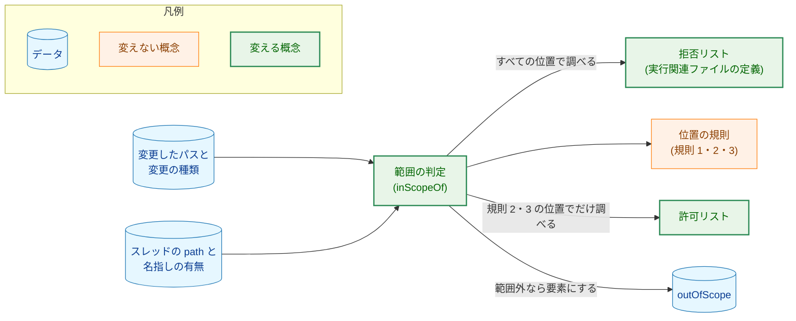
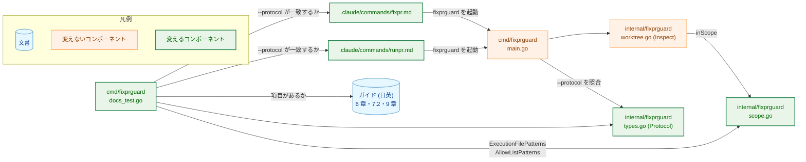
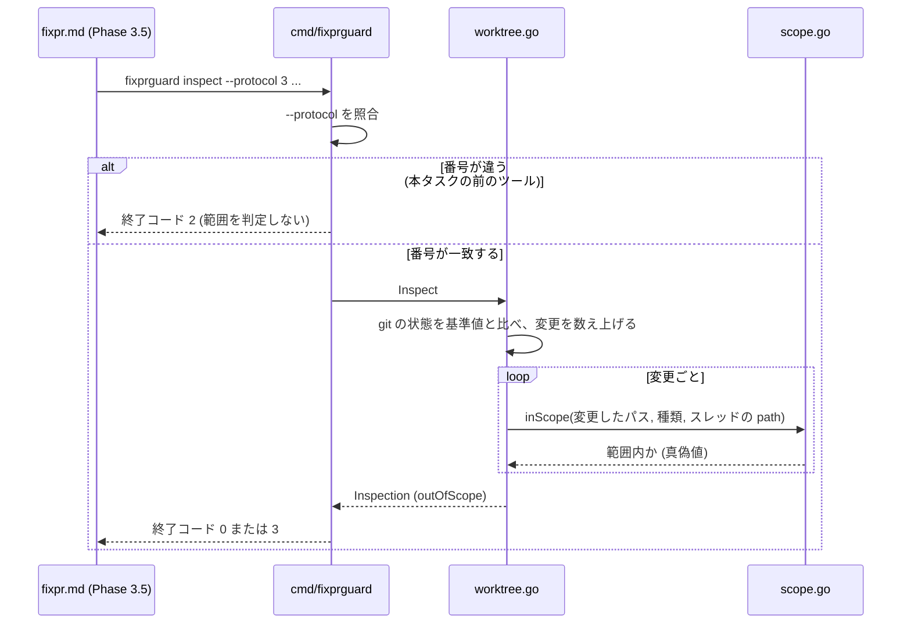
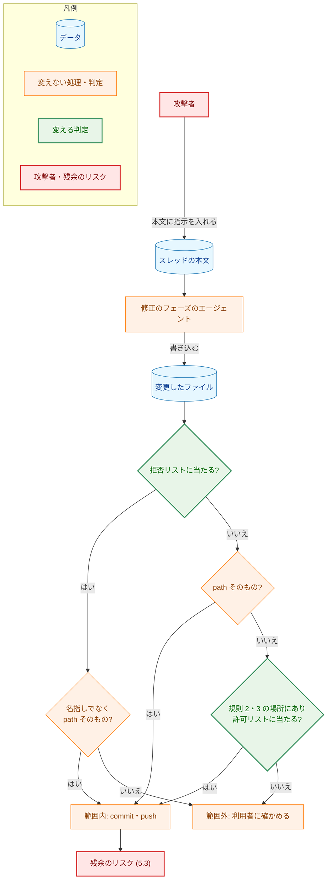
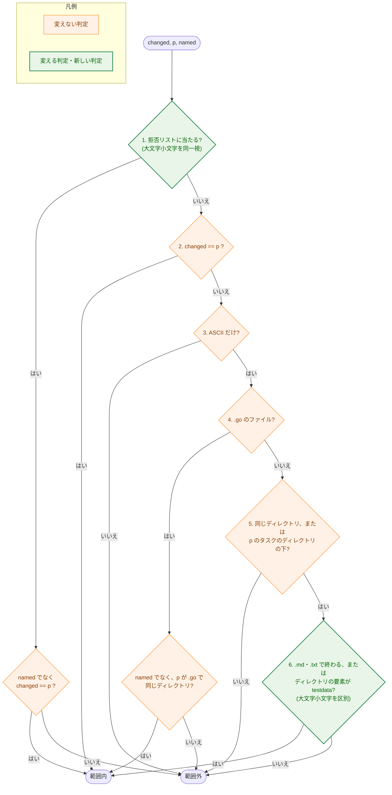

# アーキテクチャ設計書：fixprguard の範囲の規則で、下の階層の指示ファイルと Go のビルドの入力を範囲外にする

## Document Status

| Item | Value |
|---|---|
| Status | `approved` |
| Created | 2026-10-22 |
| Review date | 2026-10-22 |
| Reviewer | isseis |
| Comments | 2026-10-22 (editorial): 7.5 の `TestInspectExitCode` の行番号を `:493-520` から `:495-527` に直し、`TestInspectExitCode`・`TestInspectListsOutOfScope` の表に新しい規則でだけ範囲外になる入力を加えることを書き足した（実装計画 1.4。既存のテストの表に行を加えるだけで、結合テストは加えない）。8 章の 1 に、英語版のガイドは日本語版の commit の後の commit に入れることを書き足した（CLAUDE.md の翻訳の順序）。決定は変えていない。2026-10-22 (decision): 7.4 の AC-20 の確かめを、文書のガード（`static`）から PR のレビューでの読み合わせ（`manual`）だけに改めた（理由: 7.2 の項目は自然言語の文で、ガードが固定できるのは項目の書き出しの語句だけである。語句を固定すると、言い回しを直すたびに失敗し、中身が誤っていても通るので、確かめとしての信頼性が低い）。要件定義のプロセスのガイドの「各 AC に `test` か `static` を 1 つ以上」の例外になる。PR-2 の実装の際に、このセッションでレビュアーが決めた。実装計画 1.4・5 章も同じ commit で改めた。2026-10-23 (decision): タスク 0038 の F-005 により、7.4 の AC-18 を PR のレビューでの読み合わせ（`manual`）に改めた（`TestTask0030NotesScopeChange` を削除したため）。決定はタスク 0038 の要件の承認で得たので、`Status` は `approved` のままとする。 |

本書は [01_requirements.md](01_requirements.md)（要件定義書。以下、要件書）の設計である。既存のファイルに関する記述は、コミット `3ed049b` のファイルで確かめた。`file:line` はこのコミットの行番号を指す。F-NNN・AC-NN は要件書の項番を、H-NN は [design_handoff.md](design_handoff.md) の項番を指す。申し送り H-01〜H-06 への対応は付録 A にまとめる。「ガイド」は `docs/dev/developer_guide/fixprguard_guide.md`（と日本語版の `fixprguard_guide.ja.md`）を指す。行番号は日本語版のものである。

本書は、要件書 6 章で定義した用語を同じ意味で使う: 実行関連ファイル、拒否リスト、許可リスト、指示ファイル、Go のビルドの入力。「範囲外の変更」「信頼する著者のスレッド」「名指し」「ガードツール」は、用語集（`docs/translation_glossary.md`）の定義どおりに使う。「名指しのスレッド」は、名指しされた想定外の著者のスレッドの略である。規則 1〜6 は、ガイド 6 章の番号を指す（規則 1 は `path` そのもの、規則 2 は同じディレクトリ、規則 3 はタスクのディレクトリの下、規則 4 は実行関連ファイルの扱い）。ほかに次の用語を定義して使う。

-   **パスの要素:** パスを `/` で区切った 1 つ 1 つ。最後の要素がファイルの名前、それより前の要素がディレクトリの名前である。
-   **規則 2・3 の場所:** スレッドの `path` と同じディレクトリ（規則 2）と、`path` があるタスクのディレクトリの下（規則 3）。
-   **規則 2・3 の位置:** 変更したパスが、スレッドの `path` そのものでなく、規則 2・3 の場所にあること。
-   **規則 1 の位置:** 変更したパスが、スレッドの `path` そのものであること。

## 1. 設計の全体像 (Design Overview)

### 1.1. 設計原則

-   **判定は 2 つの一覧で決める。** 拒否リスト（実行関連ファイルの定義）は、すべての位置で効く。許可リストは、規則 2・3 の位置でだけ効く。規則 1 の位置には許可リストを適用しない（AC-10）。
-   **判定は今までどおりパスの文字列だけで決める。** ファイルシステムを読まない（`internal/fixprguard/scope.go:11-14`、要件書 5 章）。そのため、大文字小文字を区別しない macOS のボリュームと、区別する Linux の CI で、判定が同じになる。
-   **範囲に入れる側の照合は狭く、範囲外にする側の照合は広く。** 拒否リストは、パスを `strings.ToLower` で小文字にしてから照合する（今の `scope.go:104` のまま）。許可リストの (a)・(b) は区別して照合する（AC-09。(a)〜(c) は 1.5 で定義する）。(c) は今の `.go` の規則のまま、小文字にして照合する。そのため、どの照合でも、ASCII の大文字小文字の違いで今より範囲が広がることはない（H-06。3.3）。ただし、この照合は、ファイルシステムが行う Unicode の畳み込み（大文字小文字を同一視するための変換）とは一致しない（5.3）。
-   **定義は `scope.go` の 1 か所に置く。** 拒否リストと許可リストのデータは `scope.go` にだけ置き、ガイドに載せる一覧は、そのデータに揃える。文書のガードが、ガイドと一覧の一致を確かめる（要件書 4.5、AC-19）。`fixpr.md` は一覧を言い換えない。
-   **出力の形は変えない。** 範囲外になった理由は出力しない。`outOfScope` の要素の項目も変えない（AC-14）。判定の関数が返す値を真偽値のまま保つので、`inspect` と `finish` の流れ（`internal/fixprguard/worktree.go:141`）は変わらない。

### 1.2. 設計の際に決めたこと（2026-10-22）

-   **新しい規則に含まれる今の定義の項目は、コードのデータから消し、ガイドには例として載せる（H-03）。** 対象は次の項目である。
    -   AC-02 の「`.` で始まる要素」の規則に含まれるもの: `.claude/`・`.github/`（`scope.go:45`）、最上位の `.` で始まるファイル（`scope.go:119`）、`.tool-versions`・`.mise.toml`（`scope.go:41`）、`extension/` の直下の `.npmrc`・`.node-version`・`.prettierrc.json`・`.prettierignore`（`scope.go:51-52`）。
    -   AC-01 の指示ファイルの名前に含まれるもの: 最上位の `claude.md`・`agents.md`（`scope.go:48`）。

    ガイドの表では、`.` で始まる要素の行と指示ファイルの行に、これらを例として書く（3.5）。理由: これらの項目は、もう判定の結果を決めなくなる。データに残すと、判定に効かない項目が定義の一部に見え、どれが規則なのかを読み手が誤解する。要件書 AC-17 の「今の定義がすべて表に載る」は、例として載せることで満たす。AC-04（今の定義に当たるファイルが引き続き実行関連ファイルである）は、例の入力をテストに入れて確かめる（7.1）。レビュアーが選んだ（2026-10-22）。
-   **`*.go` は、許可リストの (c) として載せ、実行関連ファイルの一覧から外す。** 今の `ExecutionFilePatterns`（`scope.go:56-75`）は、`*.go` を「`.go` の規則」として出力し、ガイドはそれを実行関連ファイルの表に載せる（ガイド `:225`）。
    -   ところが判定では、`.go` のファイルは実行関連ファイルではない。名指しのスレッドでも、`path` そのものの `.go` のファイルは範囲に入る（`internal/fixprguard/scope_test.go:65` の `named_go_path_itself`）。実行関連ファイルなら、名指しのスレッドでは `path` そのものでも範囲外になる（`scope.go:170-172`）。要件書は、`.go` の規則を許可リストの (c) と定めた（AC-06）。そこで、`*.go` を許可リストの一覧に移す（3.2）。理由: 判定と一覧の分類を合わせる。レビュアーが選んだ（2026-10-22）。AC-17 の「今の定義」は、AC-04 が引く `scope.go:39-54` の定義であり、`*.go` を含まない。そのため、`*.go` を移しても AC-17 は満たされる。
    -   影響: タスク 0034 の要件定義書の案（PR #429。2026-10-22 の時点で `draft`）は、対象を「実行関連ファイルの定義（`.go` の規則を含む）」としている。0034 の設計は、`.go` の規則を許可リストの (c) として読み替える（3.8）。
-   **ガイドのガードは、各一覧の項目がそれぞれの表にあることを確かめる（AC-19）。** 今のガードは、ガイドの全体から項目のコードスパンを探す（`cmd/fixprguard/docs_test.go:53-57`）。許可リストの `*.md` のような項目は、表の外の文にも現れうるので、全体から探すと、表から項目を落としても通る。そこで、ガードは 6 章の 2 つの表をそれぞれ切り出し、`ExecutionFilePatterns` の項目は実行関連ファイルの表に、`AllowListPatterns` の項目は許可リストの表にあることを確かめる。`*.go` が実行関連ファイルの表にないことも確かめる（3.5）。理由: ガイドが表から項目を落としたこと、項目を別の表に置いたことを検出するためである。
-   **ガイド 9 章に、範囲の規則を変えたら `Protocol` を上げることを書く（H-01）。** 今の 9 章は、「出力や引数の契約を変える場合」に上げると書いている（ガイド `:287`）。範囲の規則は出力の形も引数も変えないが、本タスクは番号を上げる（要件書 1 章の決定、AC-16）。この関係が 9 章から読み取れるように、「範囲の規則を変える場合も上げる」と書き足す（3.6）。理由: 次に規則を変える人が、9 章の 3 つの条件を満たすと誤って判断し、番号を上げずに済ませることがないようにする。
-   **`Protocol` の番号 `3` は本タスクが使う（H-04）。** タスク 0034 も番号を上げる予定である。2 つのブランチが同じ `3` を使うと、片方のブランチで作ったバイナリが、もう片方の文書の `--protocol 3` を受け付け、違う規則で黙って判定する。そこで、本タスクが `3` を使い、0034 は `3` を使わないことを、0034 に申し送る（3.8）。理由: 番号の衝突は git の merge では衝突にならず、検出できない。番号を割り当てて衝突を避ければ、新しい仕組みは要らない。

### 1.3. 確かめた Go の振る舞い

要件書 AC-03 の拡張子は、手元の Go 1.27.1 で、次のとおり確かめた（2026-10-22）。

| 確かめたこと | 方法と結果 |
|---|---|
| `go` がパッケージのビルドで扱う拡張子 | `go help filetype` は、`.go` のほかに、`.c`・`.h`、`.cc`・`.cpp`・`.cxx`・`.hh`・`.hpp`・`.hxx`、`.m`、`.s`・`.S`・`.sx`、`.swig`・`.swigcxx`、`.syso` を挙げる |
| Fortran の拡張子 | `go/build` の `build.go:1095` が、`.f`・`.F`・`.for`・`.f90` を `FFiles` に振り分ける。`go help filetype` には載っていない |

AC-03 の一覧は、この 2 つを合わせたものと一致する。拒否リストは大文字小文字を同一視するので、`.S`・`.F` は `.s`・`.f` で照合される。リポジトリには、これらの拡張子のファイルが 1 つもない（`git ls-files` で確かめた。コミット `3ed049b`）。

### 1.4. なぜ拒否リストを広げるだけでは足りないか

拒否リストに当たらないファイルを、規則 2・3 はすべて範囲に入れる（`scope.go:181-189`）。拒否リストに項目を足すだけでは、新しい種類のファイルが現れるたびに、また漏れる（要件書 1 章の決定、issue #425）。たとえば、今の一覧にない Go のビルドの入力（`.cpp`・`.hpp`）は、issue の 7 種類を足すだけでは範囲内のまま残る。許可リストは、規則 2・3 で範囲に入るファイルを決まった種類に限る。そのため、一覧にない種類は、範囲外として利用者の確認に回る（fail-closed）。

一方、許可リストだけでは足りない。許可リストは `.md` を通すので、`CLAUDE.md` のような `.md` の指示ファイルは拒否リストで止める必要がある。また、規則 1 の位置と名指しのスレッドの扱いは、拒否リストで決まる（要件書 1 章の決定）。そのため、両方を持つ。

### 1.5. 概念モデル

次の図は、範囲の規則が使う概念の関係を表す。矢印 A → B は「A が B を決める、または B に当たるかを調べる」を表す。



拒否リストは、次の 3 つの部分からなる（要件書 6 章）。

| 部分 | 中身 | 照合の範囲 |
|---|---|---|
| (1) build checks と CI が読む・実行するファイル | 今の定義（1.2 で消す項目を除く）と、Go のビルドの入力の拡張子（AC-03） | 名前と拡張子はどの階層でも。`extension/scripts/` と `extension/` の直下のファイルは、その場所だけ |
| (2) 指示ファイル | AC-01 の 6 つの名前 | どの階層でも |
| (3) `.` で始まる要素を含むパス | パスの要素のどれかが `.` で始まる | どの階層でも |

許可リストは、次の 3 つの項目からなる（AC-06）。

| 項目 | 中身 | 大文字小文字 |
|---|---|---|
| (a) | 名前が `.md` または `.txt` で終わる | 区別する |
| (b) | パスのディレクトリの要素のどれかが `testdata` である | 区別する |
| (c) | `.go` の規則（変更したパスが `.go` のファイルで、スレッドの `path` も同じディレクトリの `.go` のファイルであり、名指しのスレッドでない） | 今までどおり同一視する（`scope.go:128`） |

## 2. システム構成 (System Structure)

### 2.1. 全体構成

範囲の判定は、`inspect` の中で、変更の数え上げと git の状態の比較の後に行う（`worktree.go:141`）。本タスクが変えるのは、判定の関数とそのデータ、`Protocol` の番号、文書、文書のガードだけである。次の図の矢印 A → B は「A が B を呼ぶ、または読む」を表す。



今のコードにある関係は次のとおりである。`fixpr.md`・`runpr.md` から `main.go`（コマンドの文書が `fixprguard` を起動する）、`main.go` から `types.go`（`cmd/fixprguard/main.go:232` の `--protocol` の照合）、`main.go` から `worktree.go`、`worktree.go` から `scope.go`（`worktree.go:141` の `inScope` の呼び出し）。`docs_test.go` から `scope.go` への `AllowListPatterns` の矢印は、本タスクが加える。`fixpr.md`・`runpr.md` は、`--protocol` の番号だけを変えるので「変えるコンポーネント」とした。

### 2.2. コンポーネント配置

新しいパッケージは作らない。変えるファイルは次のとおりである。

| ファイル | 変更 | 内容 |
|---|---|---|
| `internal/fixprguard/scope.go` | 変更 | 拒否リストのデータを改め（3.1）、許可リストのデータと `AllowListPatterns` を加え（3.2）、`inScopeOf` の判定の順序を改める（3.3）。ファイルの冒頭のコメント（`:11-28`）と、データのコメント（`:36-38`・`:56-59`）を新しい規則に合わせる |
| `internal/fixprguard/scope_test.go` | 変更 | AC-01〜AC-13 の例と H-06 の行を加える。`nested_dotfile_not_root_rule`（`:52`）は、期待を `true` から `false` に改める（7.3） |
| `internal/fixprguard/types.go` | 変更 | `Protocol` を `2` から `3` に上げ（`:20`）、コメント（`:17-19`）に判定の規則を加える（3.6） |
| `cmd/fixprguard/docs_test.go` | 変更 | `TestGuideCoversStopKindsAndScope`（`:45-62`）が、`AllowListPatterns` の項目も確かめ、範囲を 6 章に限る（3.5）。文書の AC の記述の有無と構造を確かめるガードを加える（AC-18・AC-21。7.4） |
| `.claude/commands/fixpr.md`・`.claude/commands/runpr.md` | 変更 | `--protocol 2` をすべて `--protocol 3` にする（3.6）。手順は変えない |
| `docs/tasks/0032_japanese_pr_title/check_rules.sh` | 変更 | `:524` の `--protocol 2` を `3` にする（3.6） |
| `docs/dev/developer_guide/fixprguard_guide.ja.md`・`fixprguard_guide.md` | 変更 | 4 章・5 章の番号、6 章の規則と表、7.2 の残余のリスク、9 章（3.5・3.6） |
| `docs/translation_glossary.md` | 変更 | 要件書 6 章の 5 つの用語を加える（AC-21。3.7） |
| `docs/tasks/0030_fixpr_untrusted_threads/02_architecture.md`・`01_requirements.md` | 変更 | 3.6 と F-004 に、範囲の規則が本タスクで変わったことの注記を加える。`Comments` に editorial correction として記録する（AC-18。3.7） |

`cmd/fixprguard` の本番のコード（テスト以外）は変えない。`inspect` の流れ（`worktree.go:141`）と出力の形（`worktree.go:119-138`）はそのままで、判定の結果だけが変わる。`docs/dev/developer_guide/package_reference.md` は変えない。`internal/fixprguard` と `cmd/fixprguard` の行（`:14`・`:21`）は、範囲の規則の中身を述べていない。

### 2.3. データフロー: `inspect` の判定

次の図は、`inspect` が 1 つの変更を判定する流れを表す。矢印は処理の進む順序を表す。範囲の規則を変えても、流れの外側（git の状態の比較、出力、終了コード）は変わらない。



## 3. コンポーネント設計 (Component Design)

### 3.1. 拒否リストのデータ（F-001・AC-01〜AC-04）

拒否リストのデータは、次の形にする。照合は、パスを `strings.ToLower` で小文字にしてから行う（今の `scope.go:104` のまま）。

| データ | 中身 | 照合 |
|---|---|---|
| 名前（今の `execNames`） | `makefile`・`gnumakefile`・`go.mod`・`go.sum`・`go.work`・`go.work.sum` | ファイルの名前がどれかと一致する（どの階層でも） |
| 指示ファイルの名前（新しい） | `claude.md`・`agents.md`・`claude.local.md`・`agent.md`・`gemini.md`・`agents.override.md` | 同上 |
| 拡張子（今の `execSuffixes`） | `.mk` | ファイルの名前がどれかで終わる（どの階層でも） |
| Go のビルドの入力の拡張子（新しい） | `.c`・`.h`・`.cc`・`.cpp`・`.cxx`・`.hh`・`.hpp`・`.hxx`・`.m`・`.s`・`.sx`・`.f`・`.for`・`.f90`・`.swig`・`.swigcxx`・`.syso` | 同上 |
| `.` で始まる要素（新しい規則） | なし（規則そのもの） | パスの要素のどれかが `.` で始まる |
| ディレクトリ（今の `execDirs`） | `extension/scripts/` | パスがこれで始まる |
| `extension/` の直下のファイル（今の `execExtensionFiles`） | `package.json`・`package-lock.json`・`eslint.config.js`・`tsconfig.json`・`tsconfig.core.json`・`tsconfig.build.json` | パスが `extension/` とこれを連ねたものと一致する |

今の `execTopLevel`（`scope.go:48`）と、最上位の `.` で始まるファイルの規則（`scope.go:119` の前半）はなくなる。`execNames` から `.tool-versions`・`.mise.toml` を、`execDirs` から `.claude/`・`.github/` を、`execExtensionFiles` から `.` で始まる 4 つを消す（1.2）。

**`.` で始まる要素の照合。** パスの検査（`validScopePath`、`scope.go:81-91`）を通ったパスは、`.` と `..` の要素を含まない。`path.Clean` で変わらないパスは `.` の要素を含まず（`scope.go:82`）、`..` の要素は明示して拒否する（`scope.go:90`）からである。そのため、`.` で始まる要素は、名前が `.` で始まるファイルかディレクトリだけである。変更したパスの検査は、拒否リストの照合より前に行う（`scope.go:157-159`）。

**データの置き方の理由。** 指示ファイルの名前と Go のビルドの入力の拡張子は、照合の仕方では今の名前・拡張子と同じである。それでも別のデータに分けるのは、ガイドの表で別の行として載せ、要件書 6 章の 3 つの部分（1.5）と対応させるためである。

### 3.2. 許可リストのデータ（F-002・AC-06・AC-09）

許可リストのデータは、次の 2 つである。照合は、大文字小文字を区別する（畳み込まない）。

| データ | 中身 | 照合 |
|---|---|---|
| 拡張子 | `.md`・`.txt` | ファイルの名前がどれかで終わる |
| ディレクトリの要素 | `testdata` | ディレクトリの要素のどれかと一致する（ファイルの名前は含めない） |

(c) の `.go` の規則は、データを持たない。今の `isGoFile`（`scope.go:128`）と、`inScopeOf` の `.go` の分岐（`scope.go:182-184`）をそのまま使う。

### 3.3. 判定の順序（H-02・H-06）

`inScopeOf`（1 つのスレッドの `path` についての判定）を、次の順序にする。「今」の列は、今の `scope.go:169-190` の対応する行を示す。

| 順 | 条件 | 結果 | 今 |
|---|---|---|---|
| 1 | 変更したパスが拒否リストに当たる | 範囲に入るのは、名指しのスレッドでなく、変更したパスが `path` そのもののときだけ | `:170-172`（拒否リストを 3.1 のとおり広げる） |
| 2 | 変更したパスが `path` そのもの | 範囲内（規則 1） | `:173-175` |
| 3 | 変更したパスが ASCII でない文字を含む | 範囲外 | `:178-180` |
| 4 | 変更したパスが `.go` のファイル | 範囲に入るのは、名指しのスレッドでなく、`path` が `.go` のファイルで、同じディレクトリにあるときだけ（許可リストの (c)） | `:182-184` |
| 5 | 変更したパスが、規則 2・3 のどちらの場所にもない | 範囲外 | `:185-189`（場所の判定を先に行う） |
| 6 | 規則 2・3 の場所にあるとき | 範囲に入るのは、許可リストの (a) または (b) に当たるときだけ | 新しい |

`inScope`（`scope.go:151-166`）は変えない。変更の種類とパスの検査を行い、スレッドの `path` のどれかで `inScopeOf` が範囲内を返せば範囲内とする。

**この順序の理由。**

-   **拒否リストを最初に置く。** 規則 1 の位置でも、名指しのスレッドでは実行関連ファイルを範囲外にする（AC-05）。そのため、`path` との一致より前に調べる。今の順序と同じである。
-   **`.go` の規則を、許可リストの (a)・(b) より前に置く。** `.go` のファイルには、(b)（`testdata`）にかかわらず (c) の規則だけを適用する（AC-06）。たとえば、`internal/x/testdata/gen.go`（スレッドの `path` は `internal/x/testdata/a.json`、名指しなし）は、(b) に当たるが、(c) で範囲外になる。順 4 で `.go` のファイルの判定を終えるので、順 6 に `.go` のファイルは届かない。
-   **場所の判定と許可リストを分ける。** 順 5 は今の規則 2・3 の場所の判定そのものであり、順 6 はその後に効く絞り込みである。場所の規則を変えずに、絞り込みだけを加える。

**大文字小文字の組み合わせ（H-06）。** 拒否リストは畳み込んで照合し、許可リストの (a)・(b) は区別して照合する。この組み合わせで範囲が広がらないことは、次のとおり示せる。

-   大文字小文字を違えて拒否リストを逃れることはできない。順 1 は畳み込んだパスで照合するので、`internal/x/Claude.MD` も `CLAUDE.md` として当たる。
-   大文字小文字を違えて許可リストに入ることもできない。順 6 は区別して照合するので、`README.MD` は `.md` に当たらず、範囲外になる。
-   両方に当たるパス（たとえば `internal/x/claude.md`）は、順 1 で判定が終わる。順 6 には届かない。
-   (c) は、今の `.go` の規則のまま小文字にして照合する（`scope.go:128`）。`internal/x/foo.GO` は、今と同じく、同じディレクトリの `.go` の `path` のときに範囲に入る。今より広がらない。

したがって、規則 2・3 の位置で範囲に入るのは、畳み込んでも拒否リストに当たらず、かつ区別して許可リストに当たるパスだけである。どの照合も、今の範囲より広げる方向には働かない。ただし、これは `strings.ToLower` が扱う大文字小文字についての議論である。ファイルシステムの Unicode の畳み込みによる別名は、5.3 の残余のリスクに書く。テストは 7.1 に書く。

### 3.4. 型と関数

公開するのは、ガイドに載せる一覧を返す 2 つの関数だけである。

```go
// ExecutionFilePatterns lists the execution-related file definitions (the
// deny list) in the form the guide prints them: a bare name or "*.ext"
// matches a file name in any directory, ".*" matches any path element that
// starts with ".", and a pattern ending in "/" or naming a file under
// "extension/" is a path from the repository root. Matching folds case with
// strings.ToLower.
func ExecutionFilePatterns() []string

// AllowListPatterns lists the allow list that rules 2 and 3 admit, in the form
// the guide prints them: "*.md" and "*.txt" match the end of a file name and
// "testdata/" a directory element, both case-sensitively; "*.go" is not a
// pattern but stands for the .go rule, which folds case.
func AllowListPatterns() []string
```

`ExecutionFilePatterns` が出力する項目は、次のとおりになる。今の `/.*`・`/claude.md`・`/agents.md`・`.claude/`・`.github/`・`*.go` などは出力しない（1.2）。

-   名前: `makefile`・`gnumakefile`・`go.mod`・`go.sum`・`go.work`・`go.work.sum`
-   指示ファイルの名前: `claude.md`・`agents.md`・`claude.local.md`・`agent.md`・`gemini.md`・`agents.override.md`
-   拡張子: `*.mk`、`*.c`〜`*.syso`（3.1 の 17 種類）
-   `.` で始まる要素: `.*`
-   ディレクトリ: `extension/scripts/`
-   `extension/` の直下のファイル: `extension/package.json` など 6 つ

`AllowListPatterns` が出力する項目は、`*.md`・`*.txt`・`testdata/`・`*.go` である。

関数の名前は、`ExecutionFilePatterns` を今のまま残し、新しい関数は用語集の「許可リスト」（allow list）に合わせて `AllowListPatterns` とする。`ExecutionFilePatterns` を `DenyListPatterns` に改める案は採らない。issue #425 と 0034 の要件定義書の案が、今の名前で参照するためである。

非公開の関数の型は変えない。`isExecutionRelated(p string) bool`・`inScopeOf(changed, p string, named bool) bool`・`inScope(changed string, kind ChangeKind, threads []ThreadPath) bool` のままである。許可リストの (a)・(b) を調べる非公開の関数を 1 つ加える。

**`ExecutionFilePatterns` の表記で、先頭の `/`（最上位だけで当たる規則の印）をやめる理由。** 今の表記の先頭の `/`（`/.*`・`/claude.md`・`/agents.md`）は、最上位だけで当たる規則を表していた。この 3 つは消える（1.2）。末尾が `/` の `extension/scripts/` と、`extension/` で始まる項目は、今と同じくルートからのパスを表す（表記の規則は `scope.go:56-59` のコメントのとおり）。

### 3.5. ガイドと文書のガード（F-005・AC-17・AC-19・AC-20）

**ガイド 6 章。** 日英の両方で、次のとおり改める。

| 箇所 | 今 | 改めた後 |
|---|---|---|
| 規則 2・3（ガイド `:209-210`） | `path` と同じディレクトリのファイル、タスクのディレクトリの下のすべてのファイル | 同じ場所の規則に、「ただし、許可リスト（下の表）に当たるファイルだけ」を加える |
| `.go` の段落（ガイド `:215`） | `.go` のファイルの規則を独立に述べる | 許可リストの (c) として述べ直す。内容（同じディレクトリの `.go` の `path` のときだけ、名指しのスレッドでは範囲外、規則 3 では範囲外）は変えない |
| 実行関連ファイルの説明（ガイド `:219`） | 「build checks と CI が、設定として読む、またはコンパイル・実行するファイル」 | 要件書 6 章の 3 つの部分（1.5）を書く。「照合では大文字小文字を同一視する」「一覧は `internal/fixprguard/scope.go` の定義と同じである」という記述は残す |
| 実行関連ファイルの表（ガイド `:221-228`） | 6 行 | 次の「実行関連ファイルの表」のとおり |
| 許可リストの表 | なし | 次の「許可リストの表」を加える。(a)・(b) は大文字小文字を区別し、(c) は区別しないと書く（AC-17） |
| 判定の順序 | なし | 3.3 の順 1〜6 を番号付きの箇条書きで載せる。範囲外になった理由は出力しないので、利用者が一覧のパスから理由を特定できるようにする（5.4） |
| 用語 | 「コマンドの実行に関わるファイル」「実行に関わるファイル」（ガイド `:211`・`:219`・`:300`） | 6 章の初出で「コマンドの実行に関わるファイル（実行関連ファイル）」と書き、以後は 6 章・7 章・9 章とも「実行関連ファイル」とする |

実行関連ファイルの表（日本語版の例。英語版も同じ構成）:

| 形 | 項目 |
|---|---|
| どの階層でも、この名前のファイル | `makefile`、`gnumakefile`、`go.mod`、`go.sum`、`go.work`、`go.work.sum` |
| どの階層でも、この名前の指示ファイル | `claude.md`、`agents.md`、`claude.local.md`、`agent.md`、`gemini.md`、`agents.override.md` |
| どの階層でも、この拡張子のファイル | `*.mk` |
| どの階層でも、この拡張子の Go のビルドの入力 | `*.c`、`*.h`、…、`*.syso`（3.1 の 17 種類をすべて書く） |
| どの階層でも、`.` で始まる要素を含むパス | `.*`（例: `.claude/`・`.github/` の下のすべてのファイル、`.golangci.yml`・`.gitignore`・`.gitattributes`・`.tool-versions`・`.mise.toml`、`extension/.npmrc`・`extension/.node-version`・`extension/.prettierrc.json`・`extension/.prettierignore`） |
| この下のすべてのファイル | `extension/scripts/` |
| `extension/` の直下のファイル | `extension/package.json`、`extension/package-lock.json`、`extension/eslint.config.js`、`extension/tsconfig.json`、`extension/tsconfig.core.json`、`extension/tsconfig.build.json` |

指示ファイルの行には、最上位の `CLAUDE.md`・`AGENTS.md` も含まれることを書く。こうして、今の定義の項目（1.2 で消すものを含む）が、すべて表に載る（AC-17）。

許可リストの表（日本語版の例）:

| 形 | 項目 |
|---|---|
| (a) 名前がこの拡張子で終わる（大文字小文字を区別する） | `*.md`、`*.txt` |
| (b) ディレクトリの要素のどれかがこの名前（大文字小文字を区別する） | `testdata/` |
| (c) `.go` の規則（上記。大文字小文字を同一視する） | `*.go` |

**ガイド 7.2。** 要件書 4.2 の残余のリスクの 4 項目を加える（AC-20）。指示として読まれる `.md` の文書、`testdata` の下のファイル、規則 1 で範囲に入るファイル、拒否リストに載らず読まれる・実行されるファイルである。あわせて、5.3 の本書が加える項目（自分自身を無視させる `.gitignore`、Unicode の別名、双方向の書式文字、確認への慣れ）も書く。今の 7.2 の「`.gitignore` が無視するファイル、作業ツリーの中の `.gitignore` …」の項目（ガイド `:255`）は残す。git が無視するファイルへの書き込みは、範囲の規則の対象の外（変更の集合に入らない）であり、本タスクの後も変わらない（要件書 2.3）。

**ガイド 8 章。** 範囲外の変更で利用者が「続けない」と答えたときの段落（ガイド `:281`）に、次のことを加える。残った変更は、`git status`・`git diff` だけで調べる。調べる前に、`make`・`go test` を実行したり、そのディレクトリで Claude Code のセッションを始めたりしない。下の階層の指示ファイルや Go のビルドの入力は、置かれているだけで読まれる・リンクされるためである。

**ガイド 9 章。** `stop` の種類や実行関連ファイルの一覧を変えたら 6 章と 8 章も更新する、という項目（ガイド `:300`）に、許可リストを加える。番号を上げる条件は 3.6 に書く。

**文書のガード（AC-19）。** `TestGuideCoversStopKindsAndScope`（`cmd/fixprguard/docs_test.go:45-62`）を、次のとおり改める。

-   ガイド（日英の両方）の 6 章を、`section`（`docs_test.go:197`。`## 6.` の見出しから次の `## ` の見出しまで）で切り出す。そこから、実行関連ファイルの表と許可リストの表を、それぞれの表の前に置く太字の見出し（「**実行関連ファイル。**」など）を目印に切り出す。切り出し方は実装計画で決める。
-   `ExecutionFilePatterns` のすべての項目が実行関連ファイルの表に、`AllowListPatterns` のすべての項目が許可リストの表に、コードスパンとして現れることを確かめる。`*.go` が実行関連ファイルの表に現れないことも確かめる。
-   `stop` の種類は、今までどおりガイド全体から探す（8 章の表にあるため）。

ガードは、コードの項目がガイドにあることを確かめる。逆向き（ガイドにだけある項目）は確かめない。1.2 で消した項目は、ガイドに例として残るので、逆向きのガードは誤って失敗する。AC-17 の文の内容（3 つの部分の説明、大文字小文字の扱い）は、自然言語の記述なので、PR のレビューで読み合わせる（`manual`。タスク 0035 の AC-17 と同じ扱い。0035 `02_architecture.md` の `Comments`）。

### 3.6. `Protocol` の番号（F-004・AC-16・H-01）

**上げる値。** `internal/fixprguard/types.go:20` の `Protocol` を `2` から `3` に上げる。`Protocol` のコメント（`types.go:17-19`）は「the version of the tool's input and output contract」と定義している。範囲の規則を変えたときも上げることが分かるように、コメントに判定の規則を加える。

**変える箇所。** 変える箇所は、コミット `3ed049b` で、次の 2 つの正規表現をリポジトリ全体に `git grep` して求めた。`cmd/fixprguard/docs_test.go:341-342` のガードが使う表記と同じである。

-   `--protocol[ =][0-9]+`
-   `"protocol":\s*[0-9]+`

当たった箇所のうち、変えるものは次のとおりである。

| ファイル | 箇所 | 確かめるテスト |
|---|---|---|
| `.claude/commands/fixpr.md` | `:44`（コードブロックの外の文）・`:246`・`:365`・`:468`・`:511`・`:532`・`:596`・`:643` | `TestDocumentedInvocationsParse`・`TestDocumentedProtocolMatches`（`docs_test.go:122`・`:352`） |
| `.claude/commands/runpr.md` | `:18`（コードブロックの外の文）・`:132`・`:253`・`:404` | 同上 |
| ガイドの日本語版と英語版 | 4 章の現在の番号（`:64`）、5 章の `--protocol 2` の 9 か所（`:89`・`:99`・`:120`・`:143`・`:153`・`:165`・`:177`・`:189`・`:199`）、出力の例の `"protocol":2` の 4 か所（`:92`・`:180`・`:192`・`:202`） | `TestDocumentedProtocolMatches` |
| `docs/tasks/0032_japanese_pr_title/check_rules.sh` | `:524`（`fixpr.md` に `fixprguard edit-pr --protocol 2 --title-file <title-file>` があることを確かめる） | なし。CI は実行しない。手で実行する（同 `:6-7`。7.4） |

変えないものは次のとおりである。

-   `docs/tasks/` の下の `.md` の文書（0030・0033・0035 などの要件書・設計書・計画書）にある `--protocol` の番号。どれも、その時点の呼び出しを記録したものである。ガードも読まない（`TestDocumentedProtocolMatches` が読むのは `.claude/commands/` とガイドだけ。`docs_test.go:366-391`）。
-   ガイド 3 章の「例: タスク 0035 で `1` から `2`」（`:52`）。上げた例の記録であり、上の正規表現にも当たらない。
-   基準値の例の `'v2....'`（ガイド `:153`・`:165`・`:177`）。基準値のトークンの版（`gitstate.go` の `baselineVersion`）であり、`Protocol` とは別である。範囲の規則は基準値を変えないので、版は上げない。

`docs/tasks/` の下の `.md` でないファイルで当たるのは、`check_rules.sh:524` だけである（`git grep` の結果）。

**同じ commit に入れるもの。** `Protocol` の変更と、`fixpr.md`・`runpr.md`・ガイドの番号の変更は、同じ commit に入れる。`TestDocumentedInvocationsParse` と `TestDocumentedProtocolMatches` が、両方の一致を求めるためである。`check_rules.sh` も同じ commit で直す。

**本タスクの前のツールの振る舞い（AC-16）。** 本タスクの前のツールの `Protocol` は `2` である。新しい文書は `--protocol 3` を渡すので、前のツールは引数の解析で拒否し、終了コード `2` で止まる（`cmd/fixprguard/main.go:232-233`）。範囲は判定しない。逆に、新しいツールを古い文書から呼んでも、同じく終了コード `2` で止まる。

**ガイド 9 章の 3 つの条件との関係。** 9 章は、次の 3 つがすべて成り立てば番号を上げなくてよいとする（ガイド `:287-292`）。(1) 古いツールは新しい文書の呼び出しを引数の解析で拒否する。(2) 新しいツールは古い文書の呼び出しを今までと同じ規則で判定する。(3) 出力の形は変えない。仮に番号を上げず、古い番号の呼び出しも受け入れるとすれば、本タスクは (2) を満たさない。そのとき新しいツールは、古い文書から呼ばれると新しい規則で判定し、古いツールは、新しい文書から呼ばれると古い規則で判定する。どちらも、利用者は判定の規則が変わったことに気づけない。そのため番号を上げる。番号を上げた後の実際の動作は、前の段落（AC-16）のとおりである。番号が一致しない呼び出しは、どちらの向きでも引数の解析で拒否され（`cmd/fixprguard/main.go:232-233`）、範囲は判定されない。9 章の「出力や引数の契約を変える場合」（`:287`）に、「範囲の規則を変える場合」を加える（1.2）。

**マージと入れ直しの順序。** ガイド 3 章の手順（`:52-58`）に従う。本タスクの手順は増やさない。

1.  実装の PR の `/runpr` の前に、その PR のブランチで `make install-fixprguard` を実行する。
2.  マージの直後に、マージの後の `main` で入れ直す。
3.  作業中のほかのブランチには、次の `/fixpr`・`/runpr` の前に `main` を取り込む。

どの順序の誤りでも、終了コード `2` で止まり、古い規則で判定することはない（fail-closed）。

**番号を固定している箇所の探し方。** 次に番号を上げる人が同じ漏れを起こさないように、上の 2 つの正規表現で `git grep` することを、実装計画の手順に書く。`check_rules.sh` のような CI が実行しない検査は、ガードでは見つからないためである（0035 でも同じ行を直した。0035 `03_implementation_plan.md:59`）。ガードを `docs/tasks/` の下のスクリプトにまで広げることはしない。そこにあるのは、各タスクが自分の確認のために置いた、手で実行するスクリプトだからである。

### 3.7. 用語集と 0030 の文書（AC-18・AC-21）

**用語集。** `docs/translation_glossary.md` の fixprguard の用語のまとまり（「範囲外の変更」の行、`:74` の近く）に、次の 5 つを加える。

| 用語 | 訳語 | 説明の要点 |
|---|---|---|
| 実行関連ファイル | execution-related file | 範囲の規則が、`path` そのものでなければ範囲外とするファイル。3 つの部分（1.5）。旧称: コマンドの実行に関わるファイル（ガイドでは初出で併記する。3.5） |
| 拒否リスト | deny list | 実行関連ファイルの定義を、名前・拡張子・パスの要素の一覧として見たときの呼び方 |
| 許可リスト | allow list | 規則 2・3 で範囲に入りうるファイルの種類 |
| 指示ファイル | instruction file | Claude Code や自動レビュアーが、置かれたディレクトリへの指示として自動で読むファイル |
| Go のビルドの入力 | Go build input | Go がパッケージのビルドで、`.go` のファイルのほかに扱うファイル |

英語版のガイドと `ExecutionFilePatterns`・`AllowListPatterns` のコメントは、この訳語を使う。

**0030 の文書。** 次の 2 か所に、範囲の規則が本タスクで変わったことと、本書と要件書への参照を、短い引用ブロックで加える。規則の本文は書き換えない。0030 の文書は、0030 の時点の決定の記録だからである。今の規則はガイド 6 章にある。

-   0030 `02_architecture.md` 3.6（`:564`）の、「範囲の規則（`scope.go`）」の段落の前。
-   0030 `01_requirements.md` F-004（`:136`）の、範囲の箇条書きの前。

注記には、`.go` の規則が許可リストの (c) になったことも書く。0030 の 3.6 は、`.go` の規則を「コマンドの実行に関わるファイル」の定義の一部として述べているためである。

どちらの文書も状態は `approved` のままとし、`Comments` に、決定を変えない注記（editorial correction）であることを記録する（要件書 1 章の決定、要件定義のプロセスのガイド「Editing an approved document」）。

### 3.8. タスク 0034 との関係（H-04）

2026-10-22 の時点で、0034 は要件定義書の PR（#429）が開いた状態であり、設計も実装もない。そのため、本タスクの実装が先に `main` に入る見込みである。ただし、これは見込みであって保証ではない。実装計画は、実装の PR を開く前に 0034 の状態を確かめ直す。0034 の実装が先に `main` に入っていたら、実装を止め、0034 が拒否リストをどう使っているかを調べて、扱いを利用者と決め直す。

本タスクの変更は、0034 の要件定義書の案（ブランチ `isseis/0034-fixprguard-ignored-files-01`）が前提にするものを、次のとおり変える。

-   **定義の中身。** 0034 の案は、対象を「実行関連ファイルの定義全体（`.go` の規則を含む）」とする。本タスクの後は、定義が `.` で始まる要素をどの階層でも含み、`.go` の規則は許可リストの (c) に移る（1.2）。その結果、次のことが起きる。
    -   0034 の案の AC-12 が「対象でない」例に挙げる、無視される `.vscode/settings.json` が、対象に入る。
    -   グローバルの除外設定で無視されることの多い `.DS_Store` や、エディタのスワップファイル（`.x.go.swp`）が、対象に入る。これらは、実行の途中で利用者のツールが書き込むことがある。
    -   無視される `extension/node_modules/` の下で、`.` で始まる要素を含むファイル（`.bin/` のシンボリックリンクなど）が、対象に入る。件数が 0034 の案の上限に影響する。
-   **0034 の守りが本タスクを補う。** 自分自身を無視させる `.gitignore` を置けば、本タスクの拒否リストを迂回できる（5.3）。本タスクの後の定義では、無視される下の階層の `.gitignore` や `.syso` も 0034 の対象になる。そのため、この迂回は、本タスクと 0034 の両方が入って初めて閉じる。
-   **行番号。** 0034 の案が引く `scope.go:36-54`・`:60-74`・`:103-128` は、本タスクで変わる。
-   **`Protocol` の番号。** 本タスクが `3` を使う（1.2）。0034 は、本タスクの後の番号（`4` 以上）を使う。

これらの扱いは、0034 の要件・設計で決める（要件書 1 章の決定）。本タスクは 0034 の文書を変えない。0034 に確実に伝わるように、本書の PR の説明にこの節を挙げる。実装計画は、本節の内容を 0034 の PR（#429）か issue（#424）にコメントで伝える手順を持つ。GitHub への書き込みなので、利用者の承認を得て行う。

### 3.9. 副作用の契約

本タスクは、副作用を変えるフラグやモードを加えない。`inspect` の副作用は、今までどおり GitHub と git の読み取りだけで、作業ツリーを変えない（ガイド `:158`）。範囲の判定は純粋な関数であり、ファイルシステムも読まない。

### 3.10. 先行するタスクの方針の例外

-   **元の方針:** 0030 は、範囲をスレッドの `path` と同じディレクトリまでとし、規則 2・3 でそのディレクトリとタスクのディレクトリのファイルを範囲に入れた。理由は、同じディレクトリのテストを直すたびに確認を入れないためである（0030 `01_requirements.md:55`、0030 `02_architecture.md` 3.6、`:564-575`）。
-   **例外の理由:** 拒否リストは網羅できない（1.4）。規則 2・3 で範囲に入るファイルを、許可リストに当たるものに限る。Go のテストは (c) で今までどおり通る。Go でない隣のファイル（`.ts` のテストなど）では確認が入ることを、レビュアーが受け入れた（要件書 1 章の決定、4.4）。範囲を狭める変更なので、0030 が守ろうとしたこと（範囲外の変更を確認なしに commit しない）は弱まらない。
-   **改める既存のテスト:** `scope_test.go:52` の `nested_dotfile_not_root_rule`（`docs/.keep`、スレッドの `path` は `docs/a.md`）。今は `true` を期待する。新しい規則では、`.` で始まる要素の規則（AC-02）と許可リスト（AC-06）のどちらでも範囲外になるので、`false` に改める。ほかの行の期待は変わらない（7.3）。

## 4. エラーハンドリング設計 (Error Handling Design)

新しいエラーの型と sentinel error は作らない。範囲外は判定の結果であって拒否ではない（要件書 4.2）。範囲外の変更は、今までどおり `outOfScope` の要素になり、`inspect` は終了コード `3` で終わる（AC-14）。

| 状況 | 振る舞い | 根拠 |
|---|---|---|
| 新しい規則で範囲外になった変更 | 今までの範囲外の変更と同じ形で `outOfScope` に入る。理由は出力しない | AC-14 |
| `/fixpr` が終了コード `3` を受け取る | 利用者に一覧を示して続けるかを確かめる。続けないなら、変更を作業ツリーに残して止まる | AC-15。`fixpr.md:476` の手順は変えない |
| 本タスクの前のツールが新しい文書から呼ばれる | `--protocol` の不一致で、終了コード `2` で止まる。診断は `--protocol does not match this binary's 2` | AC-16。`cmd/fixprguard/main.go:232-233` |

利用者は、範囲外になった理由を出力からは知ることができない。一覧のパスをガイド 6 章の 2 つの表と照らせば、理由が分かる（要件書 1 章の決定）。

## 5. セキュリティ考慮事項 (Security Considerations)

本タスクは、条件付きのセキュリティの手引き（`docs/dev/security.md`）の適用条件に当たらない（要件書 4.2）。範囲の規則は、0030 の守りの層 (3)（範囲外の変更の検出）の一部である。本タスクは、この層が範囲内と見なすファイルを狭める。

### 5.1. 脅威モデル

攻撃者は、スレッドの本文（想定外の著者のスレッド、または信頼する自動レビュアーが引用した内容）を通じて、修正のフェーズのエージェントに、範囲の規則が範囲内と見なすファイルを書かせようとする。次の図の矢印は、攻撃の経路と、それを止める判定を表す。



図は、ASCII の検査と `.go` の規則（3.3 の順 3・4）を省いて描いた。省いた規則のうち、名指しのスレッドでは、`.go` のファイルは `path` そのものでなければ範囲外になる。

### 5.2. 守りの対応

| 経路（issue #425 の表の行を含む） | 本タスクの後に止める判定 | 要件 |
|---|---|---|
| 下の階層の指示ファイル（`internal/writer/CLAUDE.md`・`AGENTS.md`、`docs/tasks/0030_x/CLAUDE.md`（名指し）、`CLAUDE.local.md`） | 拒否リストの指示ファイルの名前（順 1）。`.md` なので、許可リストだけでは止まらない | AC-01・AC-12 |
| `.` で始まるディレクトリの中（`docs/tasks/0030_x/.claude/commands/evil.md`）、下の階層の `.gitignore`・`.gitattributes`・`.envrc` | 拒否リストの `.` で始まる要素（順 1）。ただし、git が変更として数える `.gitignore` だけである。自分自身を無視させる `.gitignore` は変更の集合に現れない（5.3） | AC-02・AC-12 |
| Go のビルドの入力（`foo.syso`・`foo_amd64.s`・`foo.c`・`foo.HPP`）による、`.go` の規則の迂回 | 規則 2・3 の位置では、拒否リスト（順 1）と許可リスト（順 6）の両方。規則 1 の位置の名指しのスレッドでは、拒否リスト（順 1）。信頼する著者のスレッドでは、同じパッケージの `.go` のファイル（cgo の前文を含む）は今までどおり (c) で範囲に入る（5.3） | AC-03・AC-12・AC-13 |
| 一覧にない種類（`.ts`・`.tmpl`・`.sh`・`.json`・拡張子のないファイル） | 許可リスト（順 6） | AC-07 |
| 大文字小文字の違いによる回避（`Claude.MD`・`README.MD`・`TestData/`） | 拒否リストは畳み込み、許可リストは区別する（3.3） | AC-09・H-06 |

**確認が増えることの効果。** 下の階層の `.DS_Store` やエディタのスワップファイルは、今は規則 2 で範囲に入り、`finish` が確認なしに commit しうる。本タスクの後は、`.` で始まる要素の規則で範囲外になり、確認に回る。

**fail-closed。** 判定に迷う入力は範囲外になり、利用者の確認に回る。パスの検査に通らないパス、ASCII でない文字を含むパス（`path` そのものでなければ）、どちらの一覧にも当たらないパスが、これに当たる。範囲外は止まるのではなく確認なので、正当な変更は利用者が続けると答えれば進む。

**判定の時点と commit の時点。** 範囲の判定は `inspect` の時点の変更の集合に対して行い、`finish` は判定した集合と厳密に一致する変更だけを commit する（ガイド 7.1）。本タスクは、この仕組みを変えない。判定の後に許可リストの外のファイルを作っても、`judged-set-changed` で止まる。

### 5.3. 残余のリスク

要件書 4.2 の 4 項目は、本タスクの後も範囲内のまま残る。ガイド 7.2 に書く（AC-20。3.5）。

-   **指示として読まれる `.md` の文書。** 手順書や自動レビュアーが読んで従う文書（`.claude/commands/fixpr.md:34-35` が読むよう指示するガイドなど）は、規則 2・3 で範囲に入る。変更は PR の diff に現れ、マージの前に人が確かめる。
-   **`testdata` の下のファイル。** 実行関連ファイルを除き、種類を問わず規則 2・3 で範囲に入る。テストがそれを実行しない限り、実行されるコードにはならない。
-   **規則 1 で範囲に入るファイル。** 実行関連ファイルでないファイルは、`path` そのものなら種類を問わず範囲に入る（AC-10）。
-   **拒否リストに載らず読まれる・実行されるファイル。** AC-01 に挙げない名前の指示ファイルは、`.md` なら規則 2・3 で範囲に入る。`.txt` の名前で読まれるファイル（`vendor/modules.txt`・`CMakeLists.txt` など。リポジトリには今はない）も、許可リストの (a) で範囲に入る。拒否リストは網羅できない。

本書は、次の項目を加える。どれもガイド 7.2 に書く（3.5）。

-   **自分自身を無視させる `.gitignore`。** 下の階層に、自分自身と別のファイル（`foo.syso`・`CLAUDE.md` など）を無視させる `.gitignore` を置くと、どちらも変更の集合に現れない。`inspect` は範囲外の変更を見つけず、`finish` の `make test` は無視された `.syso` をリンクする（Go は `.gitignore` を読まない）。無視されたファイルは commit されないが、作業ツリーに残り、後のセッションが読む。このリスクは、今のガイド 7.2 の「`.gitignore` が無視するファイル」（ガイド `:255`）の一部であり、タスク 0034 が閉じる見込みである（3.8）。
-   **同じパッケージの `.go` のファイル。** 信頼する著者のスレッドでは、(c) により、同じパッケージの `.go` のファイルが範囲に入る。cgo の前文（`import "C"` の前の C のコードと `#cgo` の指示）も書ける。Go のビルドの入力による迂回を閉じるのは、名指しのスレッドについてだけである。
-   **ファイルシステムの Unicode の畳み込みによる別名。** 拒否リストの照合は `strings.ToLower` で小文字にするだけで、大文字小文字を区別しない macOS のボリュームの畳み込みとは一致しない。本書のレビューで、APFS では `agentſ.md`（U+017F）が `AGENTS.md` として、`makefile`（U+FB01）が `makefile` として開かれることを確かめた。規則 2・3 では ASCII でない文字を含むパスは範囲外なので、影響は規則 1 の位置に限られる。そのパスがすでに PR の diff にあり、スレッドが付いている必要がある。
-   **双方向の書式文字によるパスの見せかけ。** パスの検査は制御文字（Unicode の Cc）を拒否するが、U+202E などの書式文字（Cf）は拒否しない（`scope.go:85-89`）。`/fixpr` が利用者に示す一覧で、`.syso` のパスが `.go` のパスのように見えうる。理由を出力しないので、利用者は名前を目で見て判断する。書式文字の拒否はパスの検査の変更であり、AC-11 の範囲の外なので、別の issue で扱う。
-   **確認への慣れ。** 許可リストの外の正当な変更（`.ts` のテストなど）は、毎回確認に回る。利用者が「続ける」と答えることに慣れると、長い一覧の中の危険なパス（指示ファイルや Go のビルドの入力）を見落としうる。範囲外になった理由は出力しない（要件書 1 章の決定）。そのため、ガイド 6 章に判定の順序を載せ、利用者が一覧のパスから理由を特定できるようにする（3.5）。

### 5.4. 観測のしやすさ

`outOfScope` の要素は、パス・変更の種類・行数を示す（AC-14）。範囲外になった理由は示さないが、ガイド 6 章の判定の順序と 2 つの表に照らせば、利用者が理由を一意に特定できる（3.5）。範囲外の変更の数は今より増える（要件書 4.4）。`/fixpr` は一覧を示して確かめるので、確認が増えたことは利用者に見える。

## 6. 処理フロー詳細 (Processing Flow Details)

次の図は、`inScopeOf` の判定の順序（3.3）を表す。矢印は処理の進む順序を表す。始まりと終わりの楕円のノードは色分けしない。



## 7. テスト戦略 (Test Strategy)

ユニットテストは、`TestScopeRules`（`internal/fixprguard/scope_test.go:9-92`）の表に行を加える。ネットワークも外部コマンドも使わない。

### 7.1. ユニットテスト（`scope_test.go`）

**行は要件書の値から作る。** 指示ファイルの名前と Go のビルドの入力の拡張子の行は、`scope.go` のデータからではなく、要件書 AC-01・AC-03 に書かれた値から 1 つずつ作る。データから作ると、データから項目を消したときに行も消え、テストが失敗しない。

**片方の層だけが働く入力（H-05）。** 拒否リストと許可リストのどちらでも範囲外になる入力では、どちらの規則を確かめているかが分からない（CLAUDE.md「A layered path needs inputs only one layer can handle」）。そこで、確かめる層ごとに、次の入力を選ぶ。

| 確かめる層 | 入力の選び方 | 例 |
|---|---|---|
| 拒否リストの指示ファイルの名前（AC-01） | 6 つの名前のそれぞれを、規則 2・3 の位置の `.md`（許可リストだけなら範囲内）にする。加えて、規則 1 の位置で、信頼する著者のスレッドなら範囲内、名指しのスレッドなら範囲外 | `internal/writer/CLAUDE.md`・`AGENTS.md`・`Gemini.md`（`path` は `internal/writer/README.md`）、`CLAUDE.local.md`（`path` は `README.md`）、`agent.md`、`docs/tasks/0030_x/sub/agents.override.md` |
| 拒否リストの `.` で始まる要素（AC-02） | 規則 2・3 の位置の `.md`。加えて規則 1 の位置 | `docs/tasks/0030_x/.claude/commands/evil.md`・`docs/tasks/0030_x/.notes.md`、`internal/.config/foo.md`（規則 1） |
| 拒否リストの Go のビルドの入力（AC-03） | 17 種類の拡張子のそれぞれを、規則 1 の位置で、信頼する著者のスレッドと名指しのスレッドの組にする（許可リストは規則 1 に効かない） | `internal/writer/foo.syso`・`internal/writer/foo.HPP`・`foo.S`・`foo.F` など |
| 今の定義（AC-04） | 規則 1 の位置の組。1.2 で消した項目は、`.` で始まる要素の規則で当たる例を入れる | `Makefile`・`internal/x/go.mod`・`build/rules.mk`・`.github/workflows/ci.yml`・`extension/scripts/has-extension-changes.sh`・`extension/package.json`、`.claude/commands/a.md`・`extension/.npmrc` |
| 許可リスト（AC-07） | 拒否リストに当たらない、許可リストの外のファイル | `extension/src/a.test.ts`・`prompts/user.tmpl`・`docs/tasks/0032_japanese_pr_title/check_rules.sh`・`internal/x/data.json`・`LICENSE`・`extension/src/b.ts` の削除 |
| 許可リストの範囲内（AC-08） | 拒否リストに当たらない、許可リストに当たるファイル。(a)・(b) の例は名指しの有無の両方、(c) の例は信頼する著者のスレッドだけ | `docs/tasks/0030_x/02_architecture.md`・`docs/tasks/0030_x/sub/notes.txt`・`internal/x/testdata/b.json`（両方）、`internal/x/x_test.go`（信頼する著者のスレッドだけ） |
| 大文字小文字の区別（AC-09） | 拒否リストに当たらない、大文字の拡張子とディレクトリ | `docs/B.MD`・`internal/x/TestData/b.json` |
| 規則 1 に許可リストを当てない（AC-10） | 許可リストの外で、`path` そのもの。名指しの有無の両方 | `extension/src/a.ts` |
| `.go` に (b) を当てない（AC-06） | `testdata` の下の `.go` で、`path` が `.go` でない | `internal/x/testdata/gen.go`（`path` は `internal/x/testdata/a.json`） |
| 大文字小文字の組み合わせ（H-06） | 拒否リストに畳み込んで当たり、許可リストに区別して当たらない | `internal/x/Claude.MD`（規則 2 の位置で範囲外、規則 1 の位置で信頼する著者のスレッドなら範囲内・名指しなら範囲外） |
| issue の表（AC-12・AC-13） | 表の 10 行をそのまま。加えて、各行を規則 1 の位置にした組 | 要件書 AC-12 の表 |

### 7.2. 壊して失敗を確かめる

CLAUDE.md「Every test must be able to fail for its stated reason」に従い、実装のときに次のとおり壊して、対応する行が失敗することを確かめる。結果は commit メッセージに書く。

| 壊し方 | 失敗するはずの行 |
|---|---|
| 指示ファイルの名前のデータから、どれか 1 つを消す | その名前の AC-01 の行（規則 2・3 の位置の `.md` と、規則 1 の位置の名指し） |
| `.` で始まる要素の規則を外す | AC-02 の行、`extension/.npmrc` などの AC-04 の行 |
| Go のビルドの入力の拡張子のデータから、どれか 1 つを消す | その拡張子の AC-03 の規則 1 の位置の名指しの行（`.syso`・`.s`・`.c` なら AC-13 の行も） |
| 順 6 の許可リストの照合を外す（常に範囲内） | AC-07 の行 |
| 許可リストの照合で大文字小文字を畳み込む | AC-09 の行 |
| 順 4 と順 6 を入れ替える（許可リストを `.go` の規則より先に調べる） | AC-06 の `internal/x/testdata/gen.go` の行 |
| 拒否リストの照合で畳み込みをやめる | H-06 の `Claude.MD` の規則 1 の位置の名指しの行 |
| ガイドの許可リストの表から `*.txt` を消す。または `*.go` を実行関連ファイルの表に置く | `TestGuideCoversStopKindsAndScope` |

### 7.3. 改訂が要る既存のテスト

`scope_test.go` の今の 56 行を、新しい規則に当てはめて確かめた（コミット `3ed049b`）。期待が変わるのは `nested_dotfile_not_root_rule`（`:52`）だけで、`true` から `false` に改める。ほかの行は、範囲内を期待する行がすべて `.md` か `path` そのもの、または同じパッケージの `.go` なので、期待は変わらない。例: `same_directory`（`:21`、`docs/b.md`）、`extension_other_file`（`:55`、`extension/notes.md`）、`go_same_package`（`:60`）。

`internal/fixprguard/worktree_test.go`・`worktree_flow_test.go` と `cmd/fixprguard/main_test.go` で、範囲内を期待する変更は、`.md`・`.txt` のファイルか `path` そのものである。例: `worktree_test.go:44` の `docs/notes/c.md`、`worktree_flow_test.go:155` の `docs/notes/big.txt`、`worktree_flow_test.go:87-93` の `internal/x/x.go`（`path` そのもの）、`cmd/fixprguard/main_test.go:502` の `testFile`（`docs/notes/a.md`、`cmd/fixprguard/test_helpers.go:29`）。範囲外を期待する変更（`worktree_test.go:55-56` の `internal/x/x.go`・`docs/other/data.bin`）は、新しい規則でも範囲外である。そのため、改訂は要らない。

**試作による確かめ。** 本書の作成の際に、コミット `3ed049b` を一時的な worktree に取り出し、3.1〜3.3 の規則を `scope.go` に仮に入れて、`go test -tags test ./internal/fixprguard/ ./cmd/fixprguard/` を実行した（2026-10-22。試作は捨てた）。失敗したのは `TestScopeRules/nested_dotfile_not_root_rule` と、ガイドの表を改めていないための `TestGuideCoversStopKindsAndScope` だけだった。`worktree_test.go`・`worktree_flow_test.go`・`main_test.go` のテストは、すべて通った。

`cmd/fixprguard/docs_test.go` の `TestGuideCoversStopKindsAndScope` は、3.5 のとおり改める。`TestProtocolMismatch`（`cmd/fixprguard/main_test.go:43`）と `cmd/fixprguard/test_helpers.go:213` は、`fixprguard.Protocol` を参照するので、改めなくてよい。

### 7.4. 文書の確かめ

| AC | 確かめ方 |
|---|---|
| AC-16 | `TestDocumentedInvocationsParse`・`TestDocumentedProtocolMatches`（`test`）。`check_rules.sh` は手で実行する（`static`）。本タスクの前のツールが終了コード `2` で止まることは、`TestProtocolMismatch` が番号の不一致で止まることを確かめている（`test`）。インストール済みの前のツールでの確認は、実装の PR の前に手で行う（`manual`） |
| AC-17 | 表の項目は AC-19 のガード（`static`）。説明の文は PR のレビューで読み合わせる（`manual`。3.5） |
| AC-18 | 0030 の 2 つの文書（`02_architecture.md` 3.6・`01_requirements.md` F-004）に本タスクへの参照を含む注記があること、`Status` が `approved` のままであること、`Comments` に editorial correction の記録があることを、PR のレビューで読み合わせる（`manual`。タスク 0038 で `TestTask0030NotesScopeChange` を削除した） |
| AC-19 | `TestGuideCoversStopKindsAndScope`（`static`。`doc-guard` の CI のジョブが実行する） |
| AC-20 | ガイド（日英の両方）の 7.2 に、要件書 4.2 の残余のリスクの 4 項目があることと、各項目の説明が正しいことを、PR のレビューで読み合わせる（`manual`）。文書のガードは置かない（下の段落） |
| AC-21 | 用語集に、要件書 6 章の 5 つの用語（3.7 の表）の行があることを、文書のガード（`static`）で確かめる。訳語と説明が正しいことは、PR のレビューで読み合わせる（`manual`） |

要件定義のプロセスのガイド 4 章は、各 AC に `test` か `static` の確かめを 1 つ以上求め、文書の自然言語の記述を定める AC はタスク 0038 の改訂により `manual` だけでよいとする。AC-21 のガードが確かめるのは、記述の有無と構造（どの文書のどの節に、どの項目があるか）である。記述を落としたり、別の節に置いたりすると、CI で失敗する。ガードは既存の `cmd/yt2column/fixpr_docs_test.go::TestGlossaryTerms` を使う。AC-18 は、タスク 0038 で `TestTask0030NotesScopeChange` を削除したので、記述の有無と `Status`・`Comments` を PR のレビューで読み合わせる。

ただし、テストで確かめられるのは文字列の有無だけで、否定の文でも通る。そのため、中身が正しいことは、どの AC も PR のレビューで読み合わせる（`manual`）。AC-17 の説明の文は、自然言語の記述そのものを求めるので、`manual` だけとする。AC-17 のうち表の項目は、AC-19 のガードが確かめる（3.5）。タスク 0038 は、この種の記述の有無を確かめる文書のテストを、意味を保証できず言い換えで壊れるものとして削除した（0038 の F-001）。`Status` と `Comments` の記録も、その対象である。

AC-20 は、この規則の例外として `manual` だけで確かめる。7.2 の項目は自然言語の文で、ガードが固定できるのは項目の書き出しの語句だけである。語句を固定すると、言い回しを直すたびに失敗し、中身が誤っていても通るので、確かめとしての信頼性が低い。

### 7.5. 結合テスト

範囲の判定は `inspect` の中の純粋な関数なので、結合テストは加えない。`inspect` が範囲外の変更で終了コード `3` を返すこと（AC-14）は、今の `TestInspectExitCode`（`cmd/fixprguard/main_test.go:495-527`）と `TestInspectListsOutOfScope`（`worktree_test.go:51-74`）が確かめる。2 つのテストの範囲外の入力は今の規則でも範囲外の場所なので、新しい規則でだけ範囲外になる入力を、それぞれのテストの表に加える（実装計画 1.4）。AC-15 の `/fixpr`・`/runpr` の扱いは、手順書を変えないので、0030 の確かめのまま変わらない。

### 7.6. セキュリティテスト

5.2 の表の各経路は、7.1 の行で確かめる。拒否リストを逃れる入力（大文字小文字の違い）は H-06 の行で、許可リストに入り込む入力（大文字の拡張子・ディレクトリ）は AC-09 の行で確かめる。

## 8. 実装の優先順位 (Implementation Priorities)

1.  `scope.go` のデータと判定の順序（3.1〜3.4）、`scope_test.go` の行（7.1）、ガイド 6 章の 2 つの表と規則の説明、`TestGuideCoversStopKindsAndScope` の改訂（3.5）。`ExecutionFilePatterns` と `AllowListPatterns` の出力が変わると、ガードがガイドとの一致を求めるので、ガイドの表も同じ commit に入れる。英語版のガイドは、日本語版の commit の後に翻訳する（CLAUDE.md「Translation Guidelines」）ので、次の commit に入れる。
2.  `Protocol` の引き上げと、`fixpr.md`・`runpr.md`・ガイドの番号、`check_rules.sh`、ガイド 9 章（3.6）。ガードが一致を求めるので、同じ commit に入れる。
3.  ガイド 7.2 の残余のリスク（3.5）、用語集（3.7）、0030 の文書の注記（3.7）。英語版のガイドは日本語版から訳す（CLAUDE.md「Translation Guidelines」）。

PR の分け方は、実装計画で決める。ただし、1 と 2 は同じ PR に入れる。別の PR にすると、1 のマージから 2 のマージまで、同じ番号のまま規則が変わり、入れ直していないツールが古い規則で黙って判定する（ガイド `:46`）。これは AC-16 が防ごうとすることである。

## 9. 将来の拡張 (Future Extensibility)

-   **許可リストに種類を加える。** 確認が多すぎる種類（`.ts` のテストなど）が分かったら、許可リストのデータに加える。加えるのは範囲を広げる変更なので、その種類が build checks や CI に実行されないことを確かめる。たとえば、`.ts` のテストは `make ext-test` が実行するので、加えるなら別の規則（同じディレクトリの `.ts` の `path` のときだけ、など）が要る。データと `AllowListPatterns` とガイドの表を同じ commit で変え、`Protocol` を上げる（3.6）。確認の多くが許可リストの外の正当な変更で占められるようなら（5.3「確認への慣れ」）、許可リストを広げるか、範囲外になった理由を出力するかを、改めて要件で検討する。
-   **拒否リストに名前を加える。** 新しい自動レビュアーやツールが読む指示ファイルの名前は、指示ファイルの名前のデータに加える。自動レビュアーを一覧に加えるとき（ガイド 9 章）に、その Bot が読む指示ファイルの名前も確かめる。
-   **タスク 0034。** 0034 は、本タスクの拒否リストを、無視されるファイルの対象を決めるのに使いうる（3.8）。どの部分を使うかは 0034 で決める。

## 付録 A: 申し送り（design_handoff.md）への対応

| 項目 | 対応 |
|---|---|
| H-01（`protocol` の番号を上げる手順） | `2` から `3` に上げる。変える箇所は、`git grep` の 2 つの正規表現で求めた表のとおり（`check_rules.sh:524` を含む）。マージと入れ直しの順序はガイド 3 章の手順に従う。ガイド 9 章の 3 つの条件のうち (2) を満たさないので上げる。9 章に「範囲の規則を変える場合」を加える（1.2・3.6） |
| H-02（判定の順序） | 拒否リスト、`path` との一致、ASCII、`.go` の規則、場所、許可リストの順にする。`.go` の規則を許可リストの前に置くので、`.go` のファイルに (b) は適用されない（3.3） |
| H-03（データの形と、ガイドへの載せ方） | `.` で始まる要素は `.*`、指示ファイルの名前は名前、拡張子は `*.ext` で表す。新しい規則に含まれる今の項目はデータから消し、ガイドに例として載せる。許可リストは `AllowListPatterns` で出力し、ガードが 6 章の中にあることを確かめる（1.2・3.1・3.2・3.4・3.5） |
| H-04（タスク 0034 との実装の順序） | 2026-10-22 の時点で 0034 は要件の PR（#429）が開いた状態で、本タスクが先に入る見込みである。実装計画が実装の PR の前に確かめ直し、0034 が先に入っていたら止まって決め直す。本タスクの変更が 0034 の前提に及ぶ点（定義の中身と具体的な食い違い、0034 が本タスクを補う点、行番号、`Protocol` の番号の割り当て）を記録し、0034 に伝える手順を実装計画に持たせる。扱いは 0034 で決める（1.2・3.8） |
| H-05（テストの作り方） | 確かめる層ごとに、片方の層だけが働く入力を選ぶ。AC-12 の `.md` でない行の拒否リストの側は、AC-13 の規則 1 の位置の名指しの行で確かめる（7.1・7.2） |
| H-06（大文字小文字の扱いの組み合わせ） | 拒否リストを先に畳み込んで照合し、許可リストを区別して照合するので、範囲は広がらない。`internal/x/Claude.MD` の行で確かめる（3.3・7.1） |

## 付録 B: 受け入れ基準との対応

| AC | 設計の箇所 | 確かめ方 |
|---|---|---|
| AC-01 | 3.1（指示ファイルの名前） | 7.1・7.2 |
| AC-02 | 3.1（`.` で始まる要素） | 7.1・7.2 |
| AC-03 | 1.3・3.1（Go のビルドの入力の拡張子） | 7.1・7.2 |
| AC-04 | 1.2・3.1 | 7.1 |
| AC-05 | 3.3 の順 1 | 7.1（AC-01〜AC-04 の規則 1 の位置の行） |
| AC-06 | 3.2・3.3 の順 4〜6 | 7.1・7.2 |
| AC-07 | 3.3 の順 6 | 7.1・7.2 |
| AC-08 | 3.2・3.3 | 7.1 |
| AC-09 | 3.2・3.3 | 7.1・7.2 |
| AC-10 | 3.3 の順 2 | 7.1 |
| AC-11 | 3.3（パスの検査、ASCII、名前の変更、変更の種類は変えない） | 今の `scope_test.go:69-84` の行、名前の変更と通常のファイル以外の変更の数え上げは `internal/fixprguard/changes_test.go` |
| AC-12 | 5.2 | 7.1 |
| AC-13 | 3.3 の順 1 | 7.1 |
| AC-14 | 1.1・4 章 | 7.5 |
| AC-15 | 4 章 | 7.5 |
| AC-16 | 3.6 | 7.4 |
| AC-17 | 3.5 | 7.4 |
| AC-18 | 3.7 | 7.4 |
| AC-19 | 3.5 | 7.4 |
| AC-20 | 3.5・5.3 | 7.4 |
| AC-21 | 3.7 | 7.4 |
