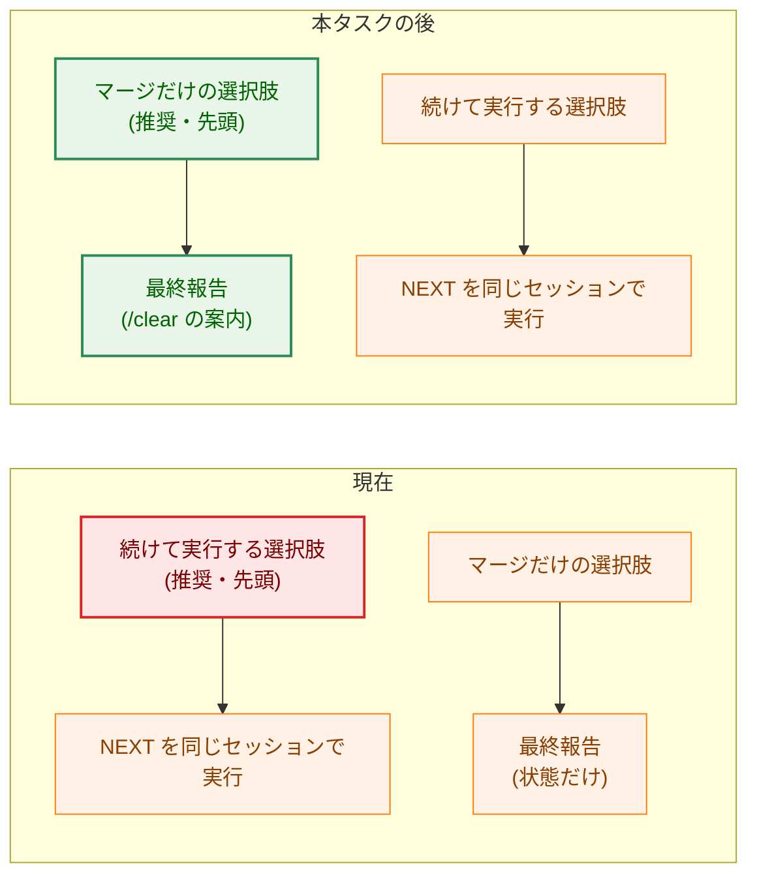
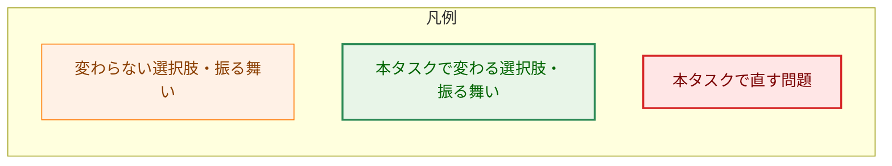
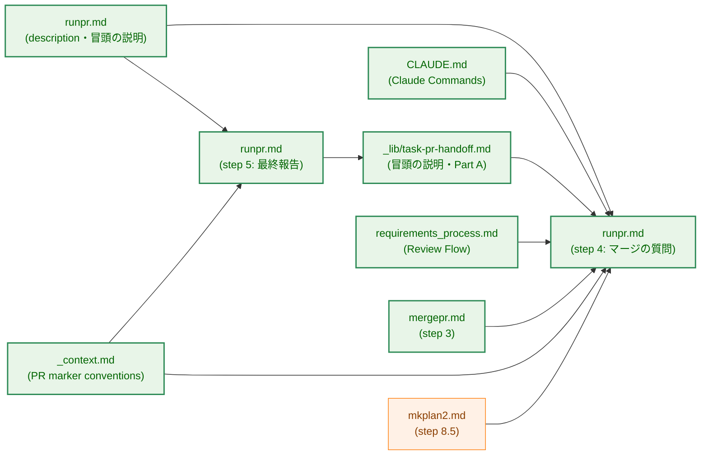
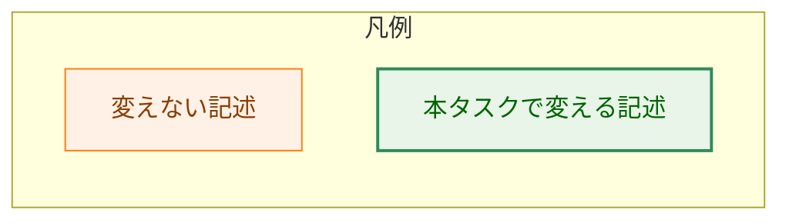
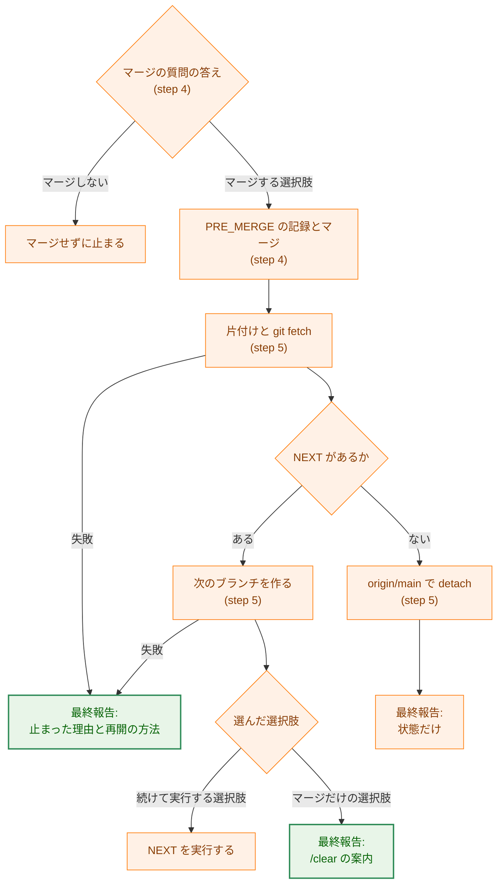
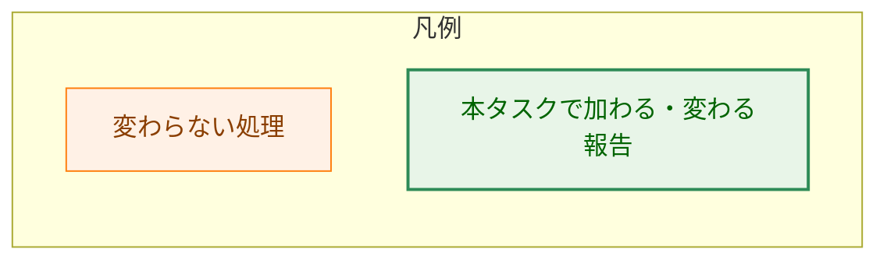
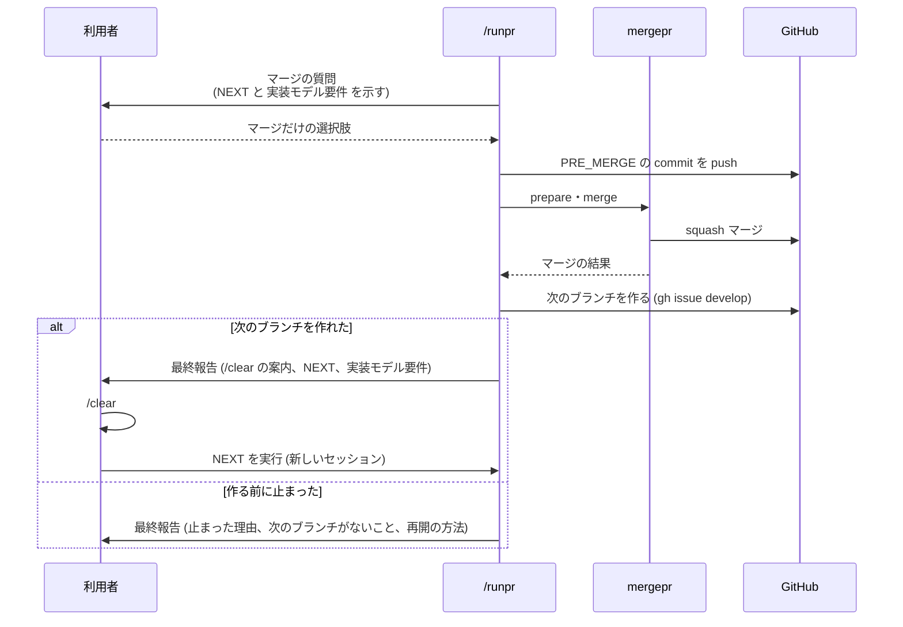

# アーキテクチャ設計書：/runpr のマージの質問で、次のコマンドを続けて実行する選択肢を推奨にしない

## Document Status

| Item | Value |
|---|---|
| Status | `draft` |
| Created | 2026-10-22 |
| Review date | - |
| Reviewer | - |
| Comments | - |

本書は [01_requirements.md](01_requirements.md)（要件定義書。以下、要件書）の設計である。既存のファイルについての記述は、コミット `e529b68` のファイルで確かめた。`file:line` はこのコミットの行番号を指す。F-NNN・AC-NN は要件書の項番を指す。要件のレビューで設計に申し送られた事項（[design_handoff.md](design_handoff.md) の H-01〜H-03）への対応は 3.7 にまとめる。

本書は、要件書 §6 の用語（マージの質問、マージ前の記録（PRE_MERGE）、マージだけの選択肢、続けて実行する選択肢、最終報告、次のコマンド（NEXT）、実装モデル要件）を同じ意味で使う。ほかに次の用語を使う。

-   **コマンドの定義:** `.claude/commands/` の下の Markdown ファイル。エージェントへの指示であり、英語で書く（`CLAUDE.md` の「Language」）。
-   **`/clear` の案内:** マージだけの選択肢を選んだときに、最終報告で `/clear` してから NEXT を実行するよう示す文（AC-05・AC-06）。
-   **次のブランチ:** マージの後、NEXT があるときに `runpr.md` の step 5 が `origin/main` から作るブランチ（`runpr.md:451-454`）。NEXT はこのブランチで作業を始める。
-   **再開の方法:** step 5 が次のブランチを作る前に止まったとき、最終報告で示す、NEXT を始めるための手順（AC-07）。

## 1. 設計の全体像 (Design Overview)

### 1.1. 設計原則

-   **振る舞いの種類は変えず、推奨と報告だけを変える。** マージの質問の選択肢の種類と、それぞれを選んだときの記録・マージ・ブランチの作成・NEXT の実行は、今のままとする（要件書 4.4）。変えるのは、「Merge」の選択肢の推奨の付け方と順序、step 4 のメッセージの `実装モデル要件` の欠けの扱い、step 5 の最終報告である。
-   **推奨は step 4 の 1 か所で定める。** 「Merge」の選択肢のどれを推奨にするかは、`runpr.md` の step 4 の選択肢の一覧にだけ書く（要件書 4.5）。ほかの文書（`CLAUDE.md`・`_lib/task-pr-handoff.md`・`requirements_process.md`・`mergepr.md`）は、`/runpr` が NEXT を示し、利用者が選んだときに実行するとだけ述べ、推奨には触れない。推奨を変えるときに書き直す場所を 1 つにするためである。
-   **NEXT を始める場所は次のブランチに限る。** `/clear` の案内は、step 5 が次のブランチを作った後にだけ示す。作る前に止まったときは、案内の代わりに再開の方法を示す（AC-07）。案内どおりに NEXT を実行したとき、NEXT は次のブランチで始まる（`_lib/task-pr-handoff.md` Part A step 3）。
-   **利用者が見た値を報告する。** `/clear` の案内に添える `実装モデル要件` は、マージを決めた step 4 の質問で示した値をそのまま使う。マージの後に読み直さない（1.2）。
-   **実行時のコードを変えない。** 変えるのは、コマンドの定義と、`CLAUDE.md`・`docs/dev/developer_guide/requirements_process.md` の記述だけである。Go のコード・テスト・拡張のコードは変えない。

### 1.2. 設計の際に決めたこと（2026-10-22）

-   **文書のガードのテストは加えない（H-01）:** マージの選択肢の推奨と順序（AC-01〜AC-03）と、最終報告の案内（AC-05〜AC-08）を固定するテストは加えず、静的な確認（7.2）で確かめる。レビュアーが決めた。`TestRunprDocContract`（`cmd/yt2column/fixpr_docs_test.go:282`）に `requirePhrases` のサブテストを加える案も示したが、採らなかった。後の変更で推奨が戻っても、テストでは検出されない。このリスクは 5.2 に記す。
-   **案内に添える `実装モデル要件` は、step 4 の質問で示した値を使う（H-02）:** マージを決めた step 4 の質問のメッセージで示した値を、最終報告にもそのまま示す。値がないときは、質問と報告の両方で、PR マーカーがないため値がないと示す。マージの後に `origin/main` の実装計画書から読み直す案は採らない。PRE_MERGE の commit はマーカーの `実装モデル要件` を変えないので（`runpr.md:173-176`）、読み直しても同じ値になる。それなのに手順が増え、利用者が質問で見た値と報告の値が食い違う余地も生まれるためである。
-   **案内の文面は、載せる項目だけを英語で定める（H-03）:** `runpr.md` には、`/clear` の案内に載せる項目（`/clear` すること、引数を含めてそのまま実行できる NEXT、NEXT が `/runplan` のときの `実装モデル要件`）だけを英語で書く。日本語の文例は載せない。`runpr.md` のほかの報告（issue を閉じるときのコメント。`runpr.md:470-471`）も、日本語で書くことと載せる項目だけを定めており、それにそろえる。

### 1.3. 概念モデル

マージの質問の「Merge」の選択肢と、それぞれを選んだときに `/runpr` がマージの後にすることを示す。矢印 A → B は「A を選ぶと、マージの後に B を行う」を表す。

図は NEXT があるときを示す。NEXT がないときは、続けて実行する選択肢を示さず（AC-02）、マージだけの選択肢を推奨にする（AC-01）。最終報告に `/clear` の案内は載せない（AC-08）。「承認なしでマージ」と「マージしない」は図から省いた。どちらも今のままで、推奨にしない（AC-03）。

### 1.4. 既存の仕組みとの関係

-   **文書のガードのテスト:** `cmd/yt2column/fixpr_docs_test.go:36-38` は、`runpr.md` の step 1・step 3・step 4 の見出しを定数として読む。本タスクは step 4 の見出しを変えないので、この定数は変わらない。step 5 の見出し（`runpr.md:443`）は変えるが、どのテストも読まない。`e529b68` で、`*_test.go` と `extension/` の `*.ts` に、本タスクが書き換える文言（`run the next command`、`starts the next command`、`run NEXT`、`carry it out`、`recommended`）を固定する箇所がないことを `git grep` で確かめた。そのため、本タスクで直す既存のテストはない。
-   **`AskUserQuestion` の慣習:** `AskUserQuestion` のツールの説明は、推奨する選択肢を先頭に置き、ラベルに「(Recommended)」を付けるよう求める。今の step 4 も推奨を先頭に置いている（`runpr.md:359`）。本タスクの後も、推奨（マージだけの選択肢）を先頭に置くので、この慣習と食い違わない。
-   **PR レビューの質問の推奨:** Escalation が `ask` のとき、PR レビューの質問は「request a PR review first」を推奨にする（`runpr.md:352-356`）。これは「Merge」とは別の質問なので、同じ `AskUserQuestion` の呼び出しで 2 つの質問にそれぞれ推奨が付くことがある。「request a PR review first」を選ぶとマージしないので（`runpr.md:377-381`）、2 つの推奨が同時に選ばれても、振る舞いは今と同じく決まる。本タスクはこの質問を変えない（要件書 2.3）。

## 2. システム構成 (System Structure)

### 2.1. ファイル構成

本タスクが変えるファイルと、それらの参照関係を示す。矢印 A → B は「A の記述が B の手順を参照する、または B の振る舞いを説明する」を表す。どの矢印も今ある参照で、本タスクで新しくできる参照はない。

`RPR5 → HAND` は、step 5 が次のブランチを `_lib/task-pr-handoff.md` Part A step 4 で作ること（`runpr.md:451-454`）と、再開の方法で NEXT が Part A step 3〜4 で次のブランチを作ること（AC-07）を表す。`HAND` で変えるのは冒頭の説明だけで、Part A は変えない。`mkplan2.md` の step 8.5 は「`/runpr` offers the approval and `/runplan` as the next command at the merge.」と述べ（`.claude/commands/mkplan2.md:107`）、NEXT を必ず実行するとは読めないので変えない。

### 2.2. マージの質問から最終報告までの流れ

マージの質問の答えから、step 5 の最終報告までの分かれ方を示す。矢印 A → B は「A の次に B へ進む」を表す。

-   「承認なしでマージ」は NEXT がないので（`runpr.md:363-365`）、「ない」の枝に進み、最終報告に `/clear` の案内を載せない（AC-08）。
-   NEXT がないときの片付けや `git fetch` の失敗は、今と同じく止まった理由を報告する。次のブランチを作らないので、再開の方法（AC-07）は示さない。
-   タスクの最後のプランの PR で issue を閉じる手順（`runpr.md:459-471`）は、NEXT がないときだけ行われ（`runpr.md:178-179`）、図の「ない」の枝に含まれる。本タスクはこの手順を変えない。

## 3. コンポーネント設計 (Component Design)

本タスクは Go の型やインターフェースを加えない。以下、各ファイルで述べることを設計する。英語の具体的な文は、実装で決める。

### 3.1. マージの質問の「Merge」の選択肢（`runpr.md` の step 4。F-001・AC-01〜AC-03）

`runpr.md:357-368` の選択肢の一覧を、次の順序と推奨に改める。

| 順序 | 選択肢 | 示す条件 | 推奨 |
|---|---|---|---|
| 1 | マージだけの選択肢: PRE_MERGE を記録してマージし、NEXT を実行しない（PRE_MERGE がないときは「merge」） | 常に | 推奨と示す |
| 2 | 続けて実行する選択肢: PRE_MERGE を記録してマージし、NEXT を実行する | NEXT があるとき | 示さない |
| 3 | 承認なしでマージ | タスク文書の PR で、PRE_MERGE に承認があるとき（今のまま） | 示さない |
| 4 | マージしない | 常に（今のまま） | 示さない |

-   推奨の付け方は、NEXT の有無と PR の種類（プランの PR、タスク文書の PR、standalone change）によらないと明記する（AC-01）。
-   今の一覧は、推奨を 1 番目の選択肢の括弧書き「(recommended; only when NEXT is set)」で示している（`runpr.md:359-360`）。本タスクの後は、推奨をマージだけの選択肢の項目に書き、続けて実行する選択肢には条件（NEXT があるとき）だけを書く。
-   選択肢は最大 4 つで、`AskUserQuestion` の上限を超えない（要件書 4.4、`runpr.md:347`）。
-   「Offer those of these that apply, and always the last」（`runpr.md:357-358`）は残す。

### 3.2. マージの質問のメッセージ（`runpr.md` の step 4 の 2。AC-04）

`runpr.md:345-347` の、NEXT を示す箇所に、`実装モデル要件` の値がないときの扱いを加える。実装計画書に未完了の PR マーカーがなく値がないときは、PR マーカーがないため値がないと示す。値がない例は、PR マーカーのない単一フェーズの実装計画書を承認するタスク文書の PR である（`.claude/commands/runplan.md:213`）。NEXT を示すこと自体と、`/runplan` のときに値を示すことは変えない。

ここで示した値（または値がないこと）を、step 5 の `/clear` の案内でもそのまま使う（1.2）。step 4 を 2 回以上尋ねたとき（deferred のスレッドを直した後など。`runpr.md:383-388`）は、step 2 を再び実行して NEXT を決め直すので、使うのはマージを決めた最後の質問で示した値である。

### 3.3. 最終報告（`runpr.md` の step 5。F-002・AC-05〜AC-10）

`runpr.md:472-474` の最後の項目を、選んだ選択肢と step 5 の進み方に応じて、次のように分ける。

| 場合 | 最終報告 | 対応する AC |
|---|---|---|
| 続けて実行する選択肢を選び、次のブランチを作った | 今と同じく NEXT を実行する。NEXT が PR を開いて止まったところで、このコマンドも終わる | AC-09 |
| マージだけの選択肢を選び、NEXT があり、次のブランチを作った | マージの結果に加え、`/clear` の案内を載せる。案内には、`/clear` すること、引数を含めてそのまま実行できる NEXT（例: `/runplan 0037`）、NEXT が `/runplan` のときは 3.2 で示した `実装モデル要件`（値がないときは、値がないこと）を載せる | AC-05・AC-06・AC-10 |
| NEXT がない（「承認なしでマージ」を含む） | 今と同じく最終の状態を報告する。`/clear` の案内は載せない | AC-08 |
| NEXT があるが、step 5 が次のブランチを作る前に止まった | `/clear` の案内は載せない。止まった理由、次のブランチを作っていないこと、再開の方法を示す（3.4） | AC-07 |
| マージしなかった | 今と同じく止まる（`runpr.md:374-375`）。step 5 に進まないので、`/clear` の案内は載せない | AC-08 |

-   次のブランチの作成（`runpr.md:451-454`）と、プランの PR の「次のブランチへ切り替えた」の記録（`runpr.md:174-176`）は変えない（AC-10）。どちらも「Merge」の選択肢によらず、NEXT があるかだけで決まる。
-   「次のブランチを作る前に止まった」の扱いは、続けて実行する選択肢を選んだときにも同じく適用する。今の step 5 も、次のブランチを作れなければ NEXT を実行せずに止まる。その報告に再開の方法を加える。

### 3.4. 再開の方法（`runpr.md` の step 5。AC-07）

step 5 が次のブランチを作る前に止まる場合は、片付けを終えられないとき、`git fetch origin main` が失敗したとき、`gh issue develop` が失敗したとき（`runpr.md:447-454`）である。このとき最終報告で示す再開の方法は、次の 2 点からなる。

1.  原因を解消する。
2.  マージしたブランチにまだいるときは、そこから離れる（たとえば `git switch --detach origin/main`）。そのうえで、NEXT を引数ごと実行する。NEXT が `_lib/task-pr-handoff.md` Part A step 4 で次のブランチを作る。

マージしたブランチから離れる必要があるのは、NEXT が Part A step 3 で、規則どおりの名前で `origin/main` より先の commit を持つブランチを見つけると止まるためである（`.claude/commands/_lib/task-pr-handoff.md:81-83`）。squash マージの後、マージしたブランチの commit は `main` の祖先ではない（`runpr.md:454-456`）。

`/runpr` の再実行は、再開の方法として示さない。マージ済みの PR では、step 1 の `MERGED` の場合に進み、次のブランチを作らずに止まるためである（`runpr.md:89-95`）。

`gh issue develop` が `origin` にブランチを作った後で失敗した場合、そのブランチは残りうる。NEXT が Part A step 4 で作るブランチの連番は、`origin` のブランチと PR の head ブランチのうち最大の番号の次になるので（`_lib/task-pr-handoff.md:86-90`）、残ったブランチと名前がぶつからない。残ったブランチの削除は、本タスクでは扱わない。

### 3.5. `/runpr` の説明（`runpr.md` の frontmatter・冒頭・step 5 の見出し。F-003・AC-11）

| 箇所 | 今の記述 | 改めた後に述べること |
|---|---|---|
| `runpr.md:2`（`description`） | 「... merge it, and run the next command」 | NEXT を示し、利用者が選んだときに実行する |
| `runpr.md:30-31`（冒頭の説明） | 「ask the user one question that covers the bookkeeping, the merge, and the next command, and carry it out」 | 1 つの質問で記録とマージを決め、NEXT を示して、利用者が選んだときに実行する |
| `runpr.md:443`（step 5 の見出し） | 「## 5. Switch branch, then run NEXT」 | ブランチを切り替え、NEXT を実行するか案内する（例: 「## 5. Switch branch, then run or show NEXT」） |

「Authorization」の段落の「the next command (NEXT) when the user chooses to run it in step 4」（`runpr.md:66`）は、すでに選んだときに実行すると述べているので変えない。

### 3.6. ほかの文書の記述（F-003・AC-12〜AC-14）

| ファイル | 箇所 | 改めた後に述べること |
|---|---|---|
| `CLAUDE.md` | 「Claude Commands」の `/runpr` の行（`CLAUDE.md:86`） | 記録し、マージし、NEXT を示す（利用者が選んだときに実行する） |
| `CLAUDE.md` | タスクの PR の流れの段落（`CLAUDE.md:98-102`） | 1 つの質問で記録とマージを決め、NEXT を示す。利用者が選んだときは続けて実行し、NEXT が次の PR を開いて止まる |
| `.claude/commands/_lib/task-pr-handoff.md` | 冒頭の説明（`:19-23`） | 質問が扱うのは、マージ、その直前の記録、マージの後に示す NEXT であり、NEXT を実行するのは利用者が選んだときである |
| `docs/dev/developer_guide/requirements_process.md` | 「Review Flow」の段落（`:55`） | 質問で承認とマージを決め、NEXT を示す。利用者が選んだときは続けて実行する |
| `.claude/commands/mergepr.md` | step 3 の、`runpr.md` の中で実行するときの説明（`:122-125`） | `runpr.md` の step 4 が、この質問をマージ前の記録と NEXT の扱いと合わせて尋ねる |
| `.claude/commands/_context.md` | 「PR marker conventions」の `実装モデル要件`（`:63`） | 値を示す場所として、マージの質問と、マージだけの選択肢を選んだときの最終報告（`/clear` の案内）の両方を挙げる |

-   どの記述も英語で書く（AC-14）。`requirements_process.md` は `docs/dev/developer_guide/*.md` なので、`CLAUDE.md` の「Documents」の例外として英語である。
-   どの記述も推奨には触れない（1.1）。
-   `requirements_process.md` の「Review Flow」の図（`:41-53`）は、承認とマージの流れだけを示し、NEXT を実行するとは書いていないので変えない。

### 3.7. design_handoff の各項目への対応

| 項目 | 採った方針 | 本書の節 |
|---|---|---|
| H-01: 文書のガードのテスト | 加えない（レビュアーの判断）。静的な確認で確かめる。step 4 の見出しは変えないので、`fixpr_docs_test.go:38` の定数も変わらない | 1.2・1.4・7.2 |
| H-02: 最終報告に載せる `実装モデル要件` の取り方 | マージを決めた step 4 の質問で示した値を使う。値がないときは、PR マーカーがないため値がないと示す | 1.2・3.2・3.3 |
| H-03: 案内の文面 | 載せる項目だけを英語で定め、日本語の文例は載せない | 1.2・3.3 |

### 3.8. コンポーネント責務表

すべて既存のファイルの変更である。新しいファイルはない。

| ファイル | 本タスクで述べること | 対応する AC |
|---|---|---|
| `.claude/commands/runpr.md` | step 4: 「Merge」の選択肢の順序と推奨（3.1）、`実装モデル要件` の値がないときの扱い（3.2）。step 5: 最終報告の分け方、`/clear` の案内、再開の方法（3.3・3.4）。frontmatter・冒頭・step 5 の見出し（3.5） | AC-01〜AC-11 |
| `CLAUDE.md` | 「Claude Commands」の `/runpr` の行と、タスクの PR の流れの段落（3.6） | AC-12・AC-14 |
| `.claude/commands/_lib/task-pr-handoff.md` | 冒頭の説明（3.6） | AC-12・AC-14 |
| `docs/dev/developer_guide/requirements_process.md` | 「Review Flow」の段落（3.6） | AC-12・AC-14 |
| `.claude/commands/mergepr.md` | step 3 の、`runpr.md` の中で実行するときの説明（3.6） | AC-12・AC-14 |
| `.claude/commands/_context.md` | 「PR marker conventions」の `実装モデル要件`（3.6） | AC-13・AC-14 |

変えるテストはない（1.4）。

## 4. エラーハンドリング設計 (Error Handling Design)

### 4.1. エラーの表し方

本タスクは Go のコードを変えないので、新しいエラー型はない。

### 4.2. 止まる場合と報告

| 場合 | 扱い |
|---|---|
| step 5 が次のブランチを作る前に止まった（NEXT がある） | `/clear` の案内を載せず、止まった理由、次のブランチを作っていないこと、再開の方法を示す（3.4）。続けて実行する選択肢を選んでいても、NEXT は実行しない |
| step 5 が片付けや `git fetch` で止まった（NEXT がない） | 今と同じく、止まった理由を報告する |
| `実装モデル要件` の値がない | 止まらない。質問と報告の両方で、PR マーカーがないため値がないと示す（3.2） |

### 4.3. 副作用の契約

本タスクは、副作用を変えるフラグやモードを加えない。各選択肢を選んだときの外部への副作用（PRE_MERGE の commit と `git push`、`gh pr merge`、`gh issue develop` による次のブランチの作成、issue を閉じる操作、NEXT の実行）の種類と条件は変わらない（要件書 4.4）。

-   マージだけの選択肢は、今と同じく、NEXT を実行しない。NEXT が行う操作（ブランチへの commit、`git push`、`gh pr create` など）は、利用者が `/clear` の後に NEXT を実行したときに、そのコマンド自身の許可で行われる。
-   次のブランチは、どちらの選択肢でも、NEXT があれば step 5 が作る（AC-10）。マージだけの選択肢を選んだ利用者がその後 NEXT を実行しなくても、次のブランチは `origin` に残る。これは今の振る舞いと同じである。
-   最終報告は会話に示すだけで、外部に送らない。

## 5. セキュリティ考慮事項 (Security Considerations)

### 5.1. 脅威モデル

N/A。本タスクは外部コマンドの実行、秘密情報、キャッシュ、ネットワークへの送信、信頼できないテキストの埋め込みのいずれも変えない（要件書 4.2、`.claude/commands/_context.md` の「Conditional-guide trigger」に当たらない）。マージには、今と同じく利用者の明示の答えが要る（`runpr.md:370-371`）。新しく受け取る入力もない（要件書 3.2）。最終報告に示す NEXT と `実装モデル要件` は、`runpr.md` の step 2 と step 4 がすでに決めて示す値で、新しい入力の出どころではない。

### 5.2. 残るリスク

-   **推奨が戻っても検出されない。** 推奨と案内を固定するテストを加えないので（1.2）、後の変更で続けて実行する選択肢が推奨に戻っても、`make test` と CI の `doc-guard` は通る。変更は `runpr.md` の step 4 の 1 か所に集まっており（1.1）、PR のレビューで見つける前提とする。
-   **古い定義を読み込んだセッション。** コマンドの定義は各 worktree の作業ツリーから読み込まれる。マージの後も古い `main` のままの worktree や、古い定義を読み込んだセッションでは、続けて実行する選択肢が推奨のまま示される。影響は推奨の表示だけで、どちらを選んでも振る舞いは要件のとおりである。

### 5.3. 対象クライアント環境の検証

N/A。本タスクは Mattermost に送る記事の形を変えず、新しく頼る外部 API の機能もない。

## 6. 処理フロー詳細 (Processing Flow Details)

### 6.1. マージだけの選択肢を選んだときの流れ

NEXT が `/runplan` のプランの PR で、マージだけの選択肢を選んだときの流れを示す。矢印は呼び出しまたは報告を、点線は応答を表す。

最後の「NEXT を実行」は、`/clear` の後の新しいセッションで NEXT のコマンド（`/runplan` など）が動くことを表す。`/runpr` 自身は最終報告で終わる。NEXT は Part A step 3 で、step 5 が作った次のブランチを使う。

## 7. テスト戦略 (Test Strategy)

### 7.1. ユニットテスト

追加しない。本タスクは Go のコードと拡張のコードを変えない。文書のガードのテストも加えない（1.2）。`make test`・`make lint` と、CI の `doc-guard` のジョブ（`go test -tags test ./cmd/yt2column ./cmd/yt2column-server ./cmd/fixprguard ./internal/pipeline`）は、変更の前後で同じく通ることを確かめる（AC-15）。`fixpr_docs_test.go` が読む step 4 の見出しは変えないので（1.4）、通ることが期待される。

### 7.2. 静的な確認

各 AC を、変更後のファイルの記述を読んで確かめる（7.5）。あわせて、`docs/tasks/` を除く追跡中のファイルに、次の記述が残っていないことを `git grep` で確かめる。

-   `/runpr` がマージの後に次のコマンドを必ず実行すると読める記述（`and run the next command`、`starts the next command`、`and carry it out` など）。
-   続けて実行する選択肢に推奨を付ける記述（`run NEXT (recommended`）。

検索の語の一覧は、実装プランで確定する。

### 7.3. 統合テスト（手動）

本タスクのマージの後、次に `/runpr` を実行するときに確かめる。

-   NEXT があるタスク文書の PR で、マージの質問の「Merge」の 1 番目にマージだけの選択肢が推奨と示され、続けて実行する選択肢が推奨なしで示される（AC-01・AC-02）。
-   マージだけの選択肢を選ぶと、最終報告に `/clear` の案内と、引数を含む NEXT が示される（AC-05）。NEXT が `/runplan` のときは `実装モデル要件` も示される（AC-06）。
-   NEXT がない PR（standalone change など）で、マージだけの選択肢が推奨と示され、最終報告に `/clear` の案内が載らない（AC-01・AC-08）。

step 5 が次のブランチを作る前に止まる場合（AC-07）は、意図して起こすと実際のリポジトリに副作用が出るので、手動の試しは行わず、静的な確認で確かめる。

### 7.4. セキュリティテスト

N/A（5.1）。

### 7.5. 受け入れ基準と設計の対応

| AC | 設計 | 確かめ方 |
|---|---|---|
| AC-01〜AC-03 | 3.1 | 静的・手動 |
| AC-04 | 3.2 | 静的 |
| AC-05・AC-06 | 3.2・3.3 | 静的・手動 |
| AC-07 | 3.3・3.4 | 静的 |
| AC-08 | 3.3 | 静的・手動 |
| AC-09・AC-10 | 3.3 | 静的 |
| AC-11 | 3.5 | 静的（7.2 の `git grep`） |
| AC-12・AC-13 | 3.6 | 静的（7.2 の `git grep`） |
| AC-14 | 3.6 | 静的 |
| AC-15 | 7.1 | `make test`・`make lint`・CI の `doc-guard` |

## 8. 実装優先順位 (Implementation Priorities)

すべての変更を 1 つの PR にまとめる。コマンドの定義はマージされた時点でそのまま次のセッションの振る舞いになるので、`runpr.md` と、それを説明する文書が食い違う状態を `main` に置かないためである。

1.  `runpr.md` の step 4 を改める（3.1・3.2）。推奨を定める唯一の場所なので、最初に置く。
2.  `runpr.md` の step 5 を改める（3.3・3.4）。
3.  `runpr.md` の frontmatter・冒頭・step 5 の見出しを改める（3.5）。
4.  ほかの文書（`CLAUDE.md`・`_lib/task-pr-handoff.md`・`requirements_process.md`・`mergepr.md`・`_context.md`）を改める（3.6）。
5.  7.2 の静的な確認を行い、`make test`・`make lint` と文書のガードを実行する。

**移行の注意:** 本タスクの実装の PR 自身は、そのブランチにある改めた後の `runpr.md` でマージの質問を受ける（コマンドの定義は作業ツリーから読み込まれる）。マージの後、ほかの worktree は `origin/main` に進めてから `/runpr` を実行する（5.2）。

## 9. 将来の拡張性 (Future Extensibility)

-   **推奨を変える場合:** `runpr.md` の step 4 の選択肢の一覧だけを改める（1.1）。ほかの文書は推奨に触れないので変えない。
-   **推奨を機械的に固定したくなった場合:** `TestRunprDocContract` に、step 4 の推奨と step 5 の案内を確かめるサブテストを加える（1.2 で採らなかった案）。step 5 を読むときは、step 5 の見出しの定数を `fixpr_docs_test.go` に加える。
-   **`/runpr` が自分で `/clear` 相当のことをする場合:** 要件書 2.3 のとおり本タスクの範囲外である。行うなら、NEXT を新しいセッションで始める手段が要り、step 5 の続けて実行する選択肢の扱いを改めることになる。
