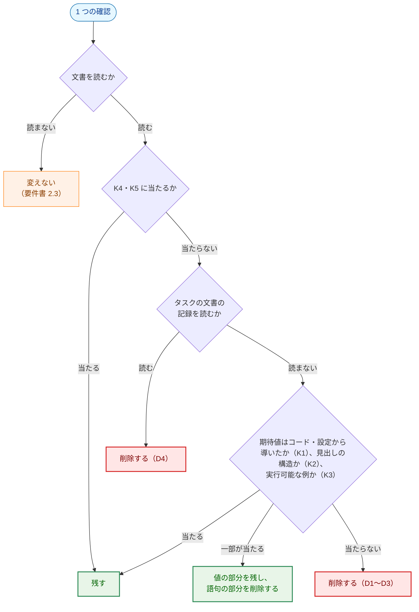
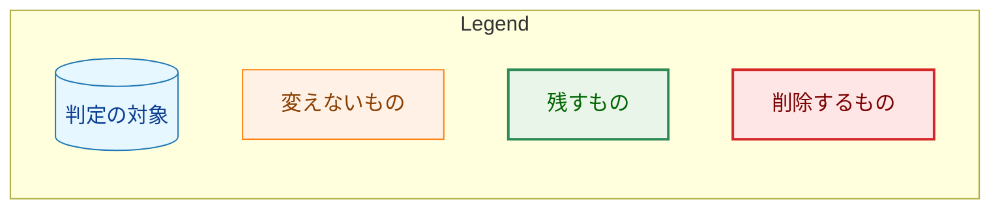
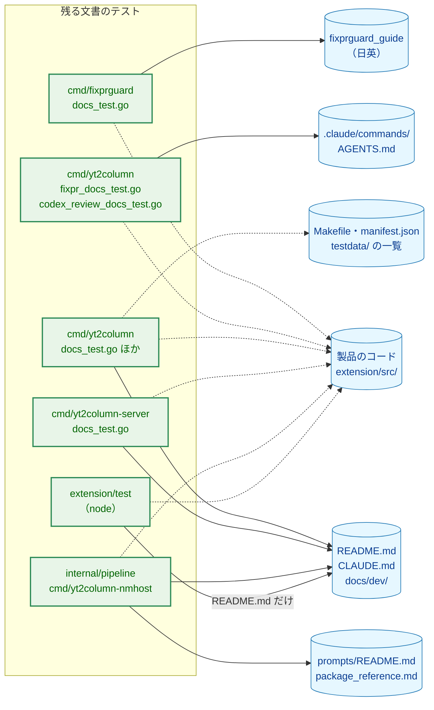
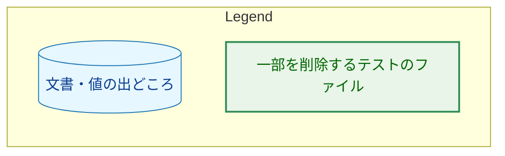
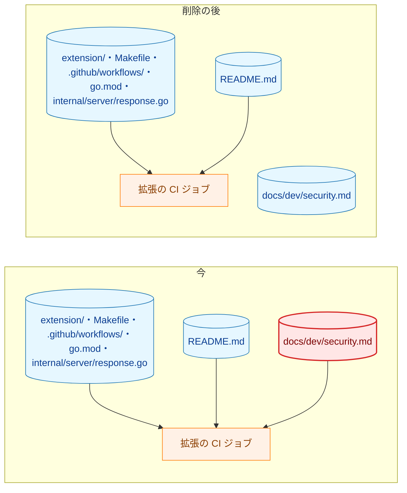
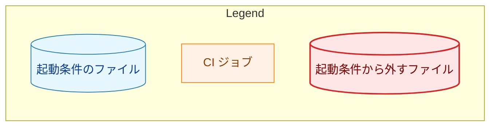
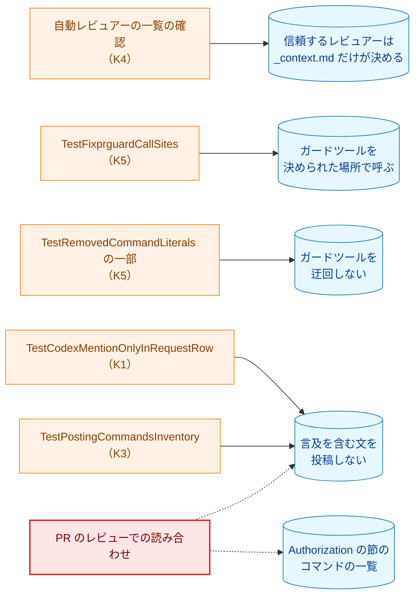
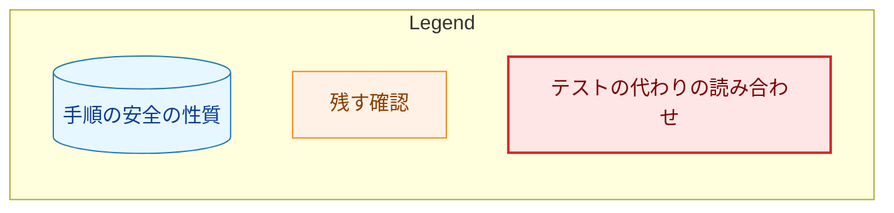
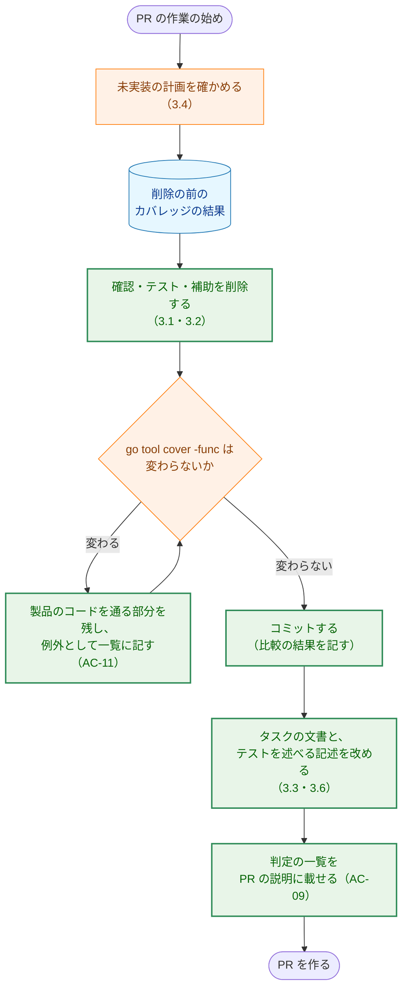
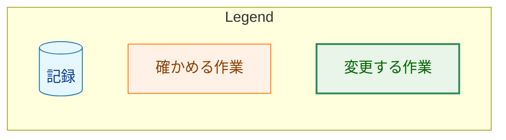

# アーキテクチャ設計書：自然言語の意味や不要な文言を固定する文書のテストを削除する

## Document Status

| Item | Value |
|---|---|
| Status | `draft` |
| Created | 2026-10-23 |
| Review date | - |
| Reviewer | - |
| Comments | - |

本書は [01_requirements.md](01_requirements.md)（要件定義書。以下、要件書）の設計である。既存のファイルについての記述は、コミット `80c17a8` のファイルで確かめた。`file:line` はこのコミットの行番号を指す。F-NNN・AC-NN・K1〜K5・D1〜D4 は要件書の項番と分類を指す。要件のレビューで設計に申し送られた事項（[design_handoff.md](design_handoff.md) の H-01〜H-08）への対応は 3.8 にまとめる。

本書は、要件書 6 章の用語（文書のテスト、確認、AC の検証方法、カバレッジの比較、値の照合、一部の削除、読み合わせ）を同じ意味で使う。ほかに次の用語を使う。

-   **判定:** 1 つのテストに要件書 F-001 の基準を当てはめた結果。「残す」「削除する」「一部を削除する」のいずれかである。
-   **判定の一覧:** テストごとの判定と、確認ごとの分類（K1〜K5・D1〜D4）を記した表（3.1）。AC-09 が PR の説明に載せる一覧の元になる。
-   **補助:** `_test.go` ファイルに定義した、テストが使う型・関数・定数・正規表現。
-   **補助の単体テスト:** 補助そのものを確かめるテスト（`TestSectionByHeading` など）。文書を読まない。
-   **削除の PR:** 本タスクの PR のうち、文書のテストを削除する、または一部を削除するもの（8 章の PR-2〜PR-5）。
-   **AC の検証の行:** タスクの文書で AC の検証方法を述べる箇所の 1 行。計画の受け入れ基準の検証の表の行、設計書のテスト戦略の表の行、およびそれらの注記を指す（F-005）。

## 1. 設計の全体像 (Design Overview)

### 1.1. 設計原則

-   **製品のコードは変えない。** 変えるのは、`_test.go` のファイル、拡張の node のテスト（`extension/test/`）、拡張の CI ジョブの起動条件のスクリプト（`extension/scripts/has-extension-changes.sh`）、文書（`CLAUDE.md`・`docs/`・`.claude/commands/`）だけである（要件書 4.4）。
-   **確認の単位で判定する。** 1 つのテストに残す確認と削除する確認があるときは、テストを残し、削除する確認だけを取り除く（要件書 F-001）。残す確認は、読む文書・位置・値の出どころを変えない（AC-02）。
-   **残す確認は書き換えない。** 削除の結果として残る確認の期待値の出どころを、直書きからコードへ移すといった書き換えはしない（要件書 2.3）。残す確認に手を入れるのは、同じ行に混ざった D1 の語句だけを外す場合（3.1.6 の `project_overview.md` の行）に限る。
-   **削除とその影響は同じ PR で直す。** テストを削除する PR は、そのテストを AC の検証方法として挙げるタスクの文書（F-005）、そのテストを述べる文書（F-007、AC-22）、承認済みで未実装の計画のうち、そのテストに関わる作業（F-006）を、同じ PR で改める。マージされたどの時点でも、文書が存在しないテストを挙げないようにするためである。
-   **規則を先に改める。** 手順の規則（`mkplan.md`・`runplan.md`・`requirements_process.md`）と `CLAUDE.md` の方針を、最初の PR で改める（8 章の PR-1）。その後の PR が過去のタスクの AC を `manual` に改めるとき、改めた後の規則に従った状態にするためである。

### 1.2. 設計の際に決めたこと（2026-10-23）

レビュアーが決めたもの:

-   **タスクの文書の値をコードと照合する確認は D4 とする:** `TestExtensionDocumentation` が、タスク 0007 の設計書 3.12.1 の拡張機能の ID を `extension/manifest.json` の値と照合する確認と、`TestCopiedTranscriptSurveyRecords` が、タスク 0015・0024 の調査の表の「保存する」の欄を `testdata/` のファイルの一覧と照合する確認（`sampleRecordedSaved`、`cmd/yt2column/copied_transcript_docs_test.go:113`）は、値がコードや設定から導かれていても D4 として削除する。タスクの文書は、その時点の記録であり、タスクの完了後に変わらないからである。`docs/dev/security.md` 7 章が求める、サンプルごとの出所の記録は `testdata/README.md` にあり、その照合（K1）は残る。
-   **コマンドの定義がレビュアーの名前を書かないことの確認は K4 とする:** `TestContextAndCommandsAgree`（`cmd/yt2column/fixpr_docs_test.go:796`）のうち、`fixpr.md`・`runpr.md`・`_lib/task-pr-handoff.md` が `_context.md` の自動レビュアーの名前を含まないことの確認は、文書の側の不在（D3）にも見えるが、K4 として残す。名前は古い語ではなく、`_context.md` から解析し `wantReviewers` と照合した今の値である。この確認があるので、信頼するレビュアーを決める場所が `_context.md` の 1 つに限られる。
-   **コードとの一致を別のテストが確かめているリテラルは D2 とする:** 要件書 F-001 の「テストがコードの値と等しいことを確かめたリテラル」は、そのテスト自身がコードの値と比べたリテラルに限る。たとえば `TestClaudeDocsContract` の `"test-integration-claude"` は、`cmd/yt2column/makefile_test.go:31` の定数と同じ値だが、`TestClaudeDocsContract` はその定数と比べていないので D2 として削除する。別のテストがコードの値を固定していても、このテストのリテラルは単独で古くなりうるからである。
-   **PR は、規則を先に、続いてパッケージごとに分ける:** 8 章のとおり、PR-1 で規則と方針を改め、PR-2〜PR-5 でパッケージ（またはテストの群）ごとに削除する。各削除の PR は、そのテストを挙げるタスクの文書も改める。

設計で決めたもの（レビュアーに諮らず、理由とともに記す）:

-   **`TestPostingCommandsInventory` は、要件書 4.2 のとおり K3 として残す。** 文書からコマンドの呼び出しを取り出して解析する点は K3 に当たる。ただし解析はテストの側の正規表現で行い、製品のパーサは使わない。要件書 4.2 がこのテストを残すと定めているので、判定は変えない。
-   **`AGENTS.md` の `## Code Review Rules` の見出しが 1 つだけあることの確認は K2 とする。** Codex がレビューの規則をこの見出しの下から読むので、見出しの構造の確認に当たる。
-   **`TestRemovedCommandLiterals` の heredoc の区切り（`REPLYBODY_EOF`、`<<'EOF'`）は D3 とする。** これらはコマンドではなく区切りの語である。区切りを使っていた投稿のコマンドは、`TestPostingCommandsInventory` と、残す K5 の確認（`gh pr edit --title "` の行）で検出される。
-   **残す確認のうち、手がかりの語として残すもの:** `docs/dev/security.md` 8.2 の `枠（`N`）` の `枠` は、値の量を示す手がかりの語であり、K1 の一部として残す。README の `curl` の行は、`curl` と `server.ArticlesPath` を残し、直書きの `--unix-socket "$socket"` は D2 として外す。

### 1.3. 概念モデル

文書のテストの各確認を判定する流れを示す。矢印 A → B は、「A の問いの答えに従って B へ進む」ことを表す。

Q2 を Q3 より先に置くのは、1.2 の 1 つめの決定（タスクの文書の値をコードと照合する確認も D4）を反映するためである。K4・K5 を最初に問うのは、要件書 F-001 の「K4・K5 に当たる確認は、D2・D3 にも当たる場合でも残す」に従うためである。

### 1.4. 要件書の記述との差異

`80c17a8` で確かめた事実のうち、要件書の記述と異なるものを記す。いずれも判定を変えない。要件書は、本書と同じ PR で編集上の訂正として直す（Status は `approved` のまま、`Comments` に記録する）。

-   **`fixprguard_guide` の章番号:** 要件書 1 章と AC-22 は「10 章」と書くが、ツールを変更する場合の章は 9 章である（`docs/dev/developer_guide/fixprguard_guide.ja.md:338`、`fixprguard_guide.md:338`）。ガイドは 1〜9 章からなる。本書は 9 章と書く。
-   **行番号:** `extension/test/ciChanges.test.ts` の該当の行は `:28-29`、`has-extension-changes.sh` のパスのパターンは `:18` である（要件書は `:27-28`・`:17`）。タスク 0034 の計画の行は、`fa65bd4` で 1 行ずれ、`:325`・`:336`・`:358` になった（要件書は `:324`・`:335`・`:357`）。
-   **タスク 0010 の古いパスの行:** 要件書 2.3 は、タスク 0010 の計画の `cmd/docs_test.go::TestReviewEvaluationRecords` を「本タスクが削除しない確認を指す」古い参照の例に挙げる。このテスト（`cmd/yt2column/docs_test.go:138`）はタスクの記録の確認（D4）であり、本タスクで削除する。そのため、0010 の計画の `:517-519` の行（AC-28〜AC-30）は F-005 で改める（3.3）。
-   **AC の検証の行の数:** 要件書 1 章は 120 行とする。本書の数え方（3.3.1）では、承認済みの 23 のタスクで 127 行、取り下げたタスク 0029 で 4 行である。差は、0012 の「検査 N」の間接の行、0034 の未実装のテストの行、ファイル名だけの行を数えるかによる。

## 2. システム構成 (System Structure)

### 2.1. 削除の後の文書のテストと、それが読むもの

削除の後に残る文書のテストと、それが読む文書・値の出どころの関係を示す。矢印 A → B は、「テスト A が B を読む」ことを表す。実線は文書を読むこと、点線は値の出どころ（コード・設定・ファイルの一覧）を読むことを表す。

削除の後、タスクの文書（`docs/tasks/`）を読むテストは `TestRunEvaluationProcedureFlags`（`cmd/yt2column/run_test.go:2614`）だけになる。このテストは、タスク 0010 の評価の手順からコマンドの例を取り出して実行する K3 の確認であり、記録の確認ではない。

`doc-guard` CI ジョブの対象パッケージ（`.github/workflows/ci.yml:184` の `./cmd/yt2column ./cmd/yt2column-server ./cmd/fixprguard ./internal/pipeline`）には、どのパッケージにも文書のテストが残る（3.1）。そのため対象パッケージは変えない（AC-21）。

### 2.2. 拡張の CI ジョブの起動条件（F-009）

拡張の CI ジョブは、`has-extension-changes.sh` が変更されたファイルの一覧から起動するかを決める（`extension/scripts/has-extension-changes.sh:18`）。矢印 A → B は、「A の変更が B を起動する」ことを表す。

-   **`docs/dev/security.md` を外す:** node のテストのうち `security.md` を読むのは `metadataDocs.test.ts` の 8.1 の確認（`extension/test/metadataDocs.test.ts:47`）だけで、これは D1 として削除する（3.1.7）。削除の後、node のテストは `security.md` を読まない。Go のテストは `security.md` を読み続けるが、`make test` と `doc-guard` ジョブが走らせるので、拡張のジョブは要らない。
-   **`README.md` は残す:** `serverReasons.test.ts` が拒否理由の表を（`:45`）、`metadataDocs.test.ts` が「Browser extension」節の展開の案内の文（`:38`、`expandPromptMessage` と照合する K1）を読み続ける。
-   **文書でない条件は変えない（AC-29）。** `ci.yml` は変更されたファイルの一覧をスクリプトに渡すだけで、文書のパスを持たないので変えない。
-   **合わせて変えるもの（AC-30）:** `has-extension-changes.sh` の冒頭の説明（`:8-10`）とパターン（`:18`）、`ciChanges.test.ts` の `triggering` の `["docs/dev/security.md"]`（`:28`）を `quiet` へ移すこと、`CLAUDE.md`「Development Notes」の説明（`CLAUDE.md:302-307`）。`quiet` の `x/docs/dev/security.md`・`docs/dev/security.md.orig` の行（`:67-68`）は、パターンの `^`・`$` を確かめる理由を失うので取り除く。

### 2.3. 変えるファイル

| 区分 | ファイル |
|---|---|
| Go の文書のテスト | `cmd/fixprguard/docs_test.go`、`cmd/yt2column/docs_test.go`・`copied_transcript_docs_test.go`・`extension_docs_test.go`・`fixpr_docs_test.go`・`output_layout_docs_test.go`・`codex_review_docs_test.go`・`run_test.go`、`cmd/yt2column-server/docs_test.go`、`internal/pipeline/relay_guard_test.go` |
| node のテスト | `extension/test/metadataDocs.test.ts`、`extension/test/ciChanges.test.ts` |
| 起動条件 | `extension/scripts/has-extension-changes.sh` |
| 方針・手順の規則 | `CLAUDE.md`、`.claude/commands/mkplan.md`・`runplan.md`、`docs/dev/developer_guide/requirements_process.md` |
| 文書のテストを述べる文書 | `CLAUDE.md`、`docs/dev/developer_guide/pricing_update.md`、`docs/dev/developer_guide/fixprguard_guide.md`・`fixprguard_guide.ja.md`（必要な場合） |
| タスクの文書 | 3.3.2 の 23 のタスクの `02_architecture.md`・`03_implementation_plan.md`、3.4 の未実装の計画、本タスクの `01_requirements.md`（1.4 の訂正） |

変えないもの: `cmd/yt2column-nmhost/main_test.go`（`TestReadmeHostExitCodes` は残す）、`internal/pipeline/pipeline_test.go`（2 つのテストとも残す）、`extension/test/serverReasons.test.ts`、`extension/test/markdownSection.test.ts`、`.github/workflows/ci.yml`、取り下げたタスク 0029 の文書。

## 3. コンポーネント設計 (Component Design)

本タスクは、新しい型・インターフェース・エラー型を加えない。削除するのはテストのコードと文書の記述だけである。そのため、本章にコードの例はない。

### 3.1. 判定の一覧（F-001・F-002、H-01）

テストごとの判定を、ファイルごとに示す。確認ごとの細目（読む位置、期待値の出どころ）は、実装の際に PR の説明の一覧（AC-09）に記す。「製品のコード」の列は、テストが製品の関数を呼ぶかを示す。呼ぶテストでは、残す部分がその呼び出しを含むことを確かめた（7.1 のカバレッジの比較で再び確かめる）。

AC-05 の調べ: 要件書 1 章の一覧にないファイルに、文書を読むテストはない。`makefile_test.go`（`Makefile` を読む）、`internal/transcript/ytdlp_test.go` の `TestLintTagsIncludeIntegration`（`Makefile`・CI の設定を読む）、`extension/test/repository.test.ts`・`secretsAbsent.test.ts`（設定とソースを読む）などは、設定とソースだけを読む。`cmd/fixprguard/main_test.go` などの `.md` の名前は、一時的なリポジトリのファイル名である。

#### 3.1.1. `cmd/fixprguard/docs_test.go`

| テスト | 判定 | 残す確認 | 削除する確認 | 製品のコード |
|---|---|---|---|---|
| `TestGuideCoversStopKindsAndScope`（`:48`） | 一部を削除する | 停止の種類（K1、`fixprguard.StopKinds`）、6 章の拒否の表と許可の表（K1、`ExecutionFilePatterns`・`AllowListPatterns`） | 拒否の表に `*.go` がないこと（D3。直書きで、コードと照合しない）、`CLAUDE.md` からガイドへのリンク（D2） | あり（残す部分） |
| `TestGuideTable`（`:111`） | 残す | 補助の単体テスト | - | なし |
| `TestDocumentedInvocationsParse`（`:194`） | 残す | 呼び出しの解析（K3、`parse`）、`cmd*` の呼び出しの一覧と `--reviewer` を `<reviewer>` として 1 回だけ渡すこと（K5） | - | あり |
| `TestCheckDocumentedReviewer`（`:226`） | 残す | 補助の単体テスト | - | あり |
| `TestGuideDescribesReviewerList`（`:311`） | 一部を削除する | `--reviewer LOGIN ...` を持つ見出しの集合が、`specs` で `flagReviewer` を取るサブコマンドの集合と等しいこと（K1） | 9 章の内容のガードのパス・識別子、テストのソースの `var wantReviewers `・`func TestContextReviewerRowsMalformed(`（D2。テストのソースは値の出どころでない）、フラグの位置と終了コード `2` の行（D2）、`Automated reviewer list` の言及（D2）、語句（D1） | なし |
| `TestDocumentedProtocolMatches`（`:424`） | 残す | `fixprguard.Protocol`（K1） | - | なし（定数） |
| `TestGuideDescribesConfigScope`（`:526`） | 削除する | - | 語句（D1）、古い言い回しの不在（D3）。AC-03（#440） | なし |
| `TestTask0030NotesScopeChange`（`:595`） | 削除する | - | タスク 0030 の文書のリンク・Status・記録（D4） | なし |
| `TestGuideDescribesMentionCheck`（`:663`） | 残す | `fixprguard.CodexMention`（K1） | - | なし（定数） |
| `TestCutSection`（`:678`） | 残す | 補助の単体テスト | - | なし |

#### 3.1.2. `cmd/yt2column/fixpr_docs_test.go`

| テスト | 判定 | 残す確認 | 削除する確認 | 製品のコード |
|---|---|---|---|---|
| `TestFixprDocContract`（`:264`） | 一部を削除する | ラウンドの数え方のコミットの件名（K1、`fixprguard.CommitSubject`）、Phase 3.5 の `` `dirty-work-tree` ``（K1、`StopDirtyWorkTree`） | 規則の語句・文（D1）、直書きのコマンド・jq の断片（D2） | あり（残す部分。`ParsePRNumber`・`CommitSubject`） |
| `TestRunprDocContract`（`:395`） | 一部を削除する | `gh pr checkout` の前の `fixprguard head`、`runpr.md` に `reviewThreads`・`comments(first:` がないこと（K5）、step 3 の `StopJudgedSetChanged`・`StopGitStateChanged`（K1） | jq のフィルタ・規則・文（D1・D2） | なし（定数） |
| `TestHandoffStartMarker`（`:568`） | 削除する | - | 開始の印の文（D1・D2） | なし |
| `TestFixprguardCallSites`（`:583`） | 残す | ガードツールの呼び出しの場所（K5） | - | なし |
| `TestFixprBuildChecksMatchTool`（`:609`） | 残す | `fixprguard.BuildCheckTargets`（K1） | - | あり |
| `TestContextAndCommandsAgree`（`:796`） | 一部を削除する | `checkContextReviewers` による解析と `wantReviewers` との照合、完了を待つ PR レビュアーの名前（K4）、コマンドの定義が名前を書かないこと（K4、1.2） | 行の説明と置き換えの文（D1）、`Guard tool` の行（D2）、「only」の検出（D3）、PR レビュー依頼の行の説明の `@codex`（D1。依頼の先頭の語は `CodexMention` と照合済み） | あり（残す部分。`ParseReviewers`・`ParseLogin`） |
| `TestContextReviewerRowsMalformed`（`:844`） | 残す | 壊した写しで照合が働くこと（K4） | - | あり |
| `TestAuthorizationSections`（`:926`） | 削除する | - | `Authorization` の節のコマンド名の一覧（D2。要件書 4.2） | なし |
| `TestRemovedCommandLiterals`（`:948`） | 一部を削除する | `git add -A`、`git commit -m`、`comments(first:10)`、`reviewThreads`、`gh pr edit --title "` の行、Phase 1〜6 の `git push`（K5） | `REPLYBODY_EOF`、`<<'EOF'`、`"Automated reviewer"`、`<reviewer>[bot]`（D3） | なし |
| `TestGlossaryTerms`（`:984`） | 削除する | - | 用語集の行（D2・D1） | なし |

#### 3.1.3. `cmd/yt2column/codex_review_docs_test.go`

| テスト | 判定 | 残す確認 | 削除する確認 | 製品のコード |
|---|---|---|---|---|
| `TestCodexMentionOnlyInRequestRow`（`:127`） | 残す | `CodexMention` が PR レビュー依頼の行にだけ現れること（K1。要件書 4.2） | - | なし（定数） |
| `TestPostingPathsCheckMention`（`:150`） | 削除する | - | 投稿の経路の文（D1・D2。要件書 4.2）。順序は `TestPostingCommandsInventory`、ガードツールの呼び出しは `TestFixprguardCallSites` が確かめる | なし |
| `TestRequestExemptFromMentionCheck`（`:175`） | 削除する | - | 文（D1。要件書 4.2） | なし |
| `TestPostingCommandsInventory`（`:246`） | 残す | 投稿のコマンドが言及の確認の後にあること（K3。要件書 4.2、1.2） | - | なし |
| `TestIsPost`（`:306`） | 残す | 補助の単体テスト | - | なし |
| `TestNoCodeRabbitPRReview`（`:385`） | 削除する | - | 古い語の不在（D3） | なし |
| `TestLocalCodeRabbitReviewKept`（`:406`） | 削除する | - | 語句・見出し（D1・D2） | なし |
| `TestDocsDescribeCodexReview`（`:439`） | 削除する | - | 語句（D1） | なし |
| `TestCodeRabbitConfigStopsReview`（`:505`） | 変えない | `.coderabbit.yaml` を読む（文書を読まない確認） | - | なし |
| `TestAgentsCodeReviewRules`（`:547`） | 一部を削除する | `## Code Review Rules` の見出しが 1 つだけあること（K2、1.2） | 古い見出しの不在（D3）、冒頭の文（D1・D2） | なし |
| `TestCodexObservationRecord`（`:623`） | 削除する | - | 観察の記録（D4・D1） | なし |

#### 3.1.4. `cmd/yt2column/docs_test.go`・`output_layout_docs_test.go`・`run_test.go`

| テスト | 判定 | 残す確認 | 削除する確認 | 製品のコード |
|---|---|---|---|---|
| `TestREADMEDocumentsFlags`（`docs_test.go:46`） | 一部を削除する | `newFlagSet` のフラグの一覧と README の照合（K1） | `--help` のリテラル（D2） | あり（残す部分） |
| `TestSlackDocsContract`（`:67`） | 残す | `testutil` の定数、`SlackMaxMessageRunesForTest` と照合した `16,383`（K1） | - | なし |
| `TestClaudeDocsContract`（`:110`） | 一部を削除する | コードの値との照合（K1） | `"test-integration-claude"`（D2、1.2） | なし |
| `TestReviewEvaluationRecords`（`:138`） | 削除する | - | タスク 0010 の評価の記録（D4） | あり（`transcript.ValidateVideoURL`。ほかのテストも通り、カバレッジは変わらないことを確かめた） |
| `TestSectionByHeading`（`:246`） | 残す | 補助の単体テスト | - | なし |
| `TestArtifactDocsContract`（`:527`） | 一部を削除する | `run -h` の出力の確認（`:555-564`。文書を読まない確認） | 文書の語句・リテラル（D1・D2） | あり（残す部分。`run`） |
| `TestTokenUsageDocsContract`（`:670`） | 一部を削除する | README の「Token usage」節と `run.go` の定数・`llm.UnknownUsage` の理由の照合、`checkExampleLines`（K1・K3） | `version 3`（D2）、`project_overview.md` の `Usage`、`security.md` の項目、`package_reference.md` の行（D1・D2） | あり（残す部分。`llm.UnknownReason`） |
| `TestPackageReferenceFixprguard`（`:787`） | 削除する | - | 直書きの名前（D2）、不在（D3） | なし |
| `TestCostDocsContract`（`:818`） | 一部を削除する | README の「Estimated cost」節とコードの定数・`costBasisWord`・`costReasonWord`・例の行（K1・K3）、`project_overview.md` の `costPrefix`（K1）、`rates.go` の冒頭のコメント（Go のソース。変えない） | `"Estimated cost"`（D2、1.2）、`pricing_update.md` のテスト名、`CLAUDE.md` のリンク、`call_time`（D2） | あり（残す部分） |
| `TestOutputLayoutDocsContract`（`output_layout_docs_test.go:90`） | 一部を削除する | README の 2 つの例を `FilePublisher`・`SlackMessagesForTest` の出力と比べること（K3） | 語句（D1）、リテラル（D2）、古い言い回しの不在（D3） | あり（残す部分。`publisher` のほか `stageModels`） |
| `TestFirstCodeBlockAfter`（`:162`） | 残す | 補助の単体テスト | - | なし |
| `TestRunEvaluationProcedureFlags`（`run_test.go:2614`） | 一部を削除する | タスク 0010 の手順のコマンドを取り出して偽物の依存で実行すること、コマンドが 3 つ以上あること（K3） | `--keep-cache` があること（D2） | あり（残す部分） |

`TestArtifactDocsContract` は、削除の後に文書を読まなくなる。テストの名前と置き場所を変えるかは、実装計画で決める。

#### 3.1.5. `cmd/yt2column/copied_transcript_docs_test.go`・`extension_docs_test.go`

| テスト | 判定 | 残す確認 | 削除する確認 | 製品のコード |
|---|---|---|---|---|
| `TestCopiedTranscriptSurveyRecords`（`copied_transcript_docs_test.go:30`） | 一部を削除する | `testdata/` のサンプルの一覧と `testdata/README.md` の照合（ファイル名と URL、手がかりの節の見出し）（K1） | 出所の項目名（`取得日` など）と CC BY 3.0 の文字列（D2）、タスク 0015・0024 の調査の表（D4、1.2） | なし |
| `TestClaudeMDCopiedTranscriptException`（`:186`） | 削除する | - | 語句（D1・D2） | なし |
| `TestCopiedTranscriptDocsUpdated`（`:223`） | 削除する | - | 語句・用語集の行（D1・D2） | なし |
| `TestClaudeBullet`（`:285`） | 削除する | - | 補助（`claudeBullet`）が使われなくなる | なし |
| `TestExtensionDocumentation`（`extension_docs_test.go:58`） | 一部を削除する | README・`security.md` の拡張機能の ID と `manifest.json` の照合、`CLAUDE.md` の `ext-` のターゲットと `Makefile` の照合、`security.md` 8.1 の権限と `manifest.json` の照合（K1） | 削除したメニューの不在（D3）、`project_overview.md` の TypeScript・`extension/`（D2）、タスク 0007 の 3.12.x の見出し・本文・拡張機能の ID（D4、1.2）、手動の確認の表（D4） | なし |
| `TestExtensionSendDocumentation`（`:201`） | 削除する | - | 語句・リテラル・不在・記録（D1〜D4）。`"Send to yt2column"` などは `extension/src` の文字列と同じ値だが、テストはそれと比べない（D2） | なし |
| `TestContextMenuRemovalRecords`（`:331`） | 削除する | - | タスク 0027 の記録（D4） | なし |
| `TestNativeMessagingRelayDocumentation`（`:370`） | 削除する | - | タスク 0026 の記録（D4） | なし |
| `TestSectionByHeadingPrefix`（`:398`） | 残す | 補助の単体テスト（補助が残る。3.2） | - | なし |
| `TestNativeHostContract`（`:481`） | 変えない | 文書を読まない | - | あり |
| `TestExtensionIDFromManifestKeyRejectsUnparseableKey`（`:543`）・`TestDeclaredPermissions`（`:557`） | 残す | 補助の単体テスト | - | なし |

#### 3.1.6. `cmd/yt2column-server`・`cmd/yt2column-nmhost`・`internal/pipeline`

| テスト | 判定 | 残す確認 | 削除する確認 | 製品のコード |
|---|---|---|---|---|
| `TestServerDocsContract`（`cmd/yt2column-server/docs_test.go:32`） | 一部を削除する | README の `slackEnv`、macOS とほかの Unix のソケットのパス、`curl` と `server.ArticlesPath` の行、終了コードの表（`exitOK`・`exitFailure`・`exitUsage`）、拒否理由のサブテスト全体（K1）。`project_overview.md` の、2 つの環境変数の名前を含む行（K1。`読まない` を外す）。`security.md` 8.2 の `枠（`N`）`、MiB の上限、`allowed_origins` と `nmhost.ExtensionOrigin`（K1） | README の開発用サーバの節、`CLAUDE.md`、用語集のサブテスト（D1・D2）、`security.md` 8 章の冒頭（D1）、引退した語の不在（D3）、`0700`・`0600`・バイナリとパッケージの名前・インストールのコマンド・トラブルシューティングの見出し・`--unix-socket "$socket"`（D2） | あり（残す部分。`socketRule`・`server.RejectReasonsForTest`） |
| `TestSectionByHeading`（`:322`） | 残す | 補助の単体テスト | - | なし |
| `TestReadmeHostExitCodes`（`cmd/yt2column-nmhost/main_test.go:408`） | 残す | 終了コードの定数（K1） | - | なし（定数） |
| `TestPackageReferenceListsPackages`（`internal/pipeline/pipeline_test.go:671`） | 残す | パッケージの一覧（K1） | - | なし |
| `TestPromptsREADMEMatchesContract`（`:755`） | 残す | `writer` のソースから導いた値（K1） | - | なし |
| `TestSharedTokenRemoved`（`internal/pipeline/relay_guard_test.go:397`） | 一部を削除する | 製品の Go のファイルと `extension/src`・`extension/static` を調べる部分（文書を読まない確認。H-07） | README・`CLAUDE.md`・用語集・`docs/dev/` の不在（D3）、更新の節が `server-token` を挙げること（D2）、更新の節の除外（D3） | なし |
| `TestWithoutSection`（`:368`） | 削除する | - | 補助（`withoutSection`）が使われなくなる | なし |

**`project_overview.md` の行（H-01）:** 今の確認は、同じ行に `cacheDirEnv`・`ytDlpEnv` の値と `読まない` の語があることを確かめる。`読まない` は否定の主張であり D1 に当たるので外し、2 つの値が同じ行にあることの確認（K1）を残す。2 つの名前が同じ行に並ぶのは `docs/dev/project_overview.md:125` だけで、設定の表（`:120`・`:121`）では別の行にある。そのため、値を探す位置は今と同じである。

**`security.md` 8.2 の `枠（`N`）`（H-01）:** `枠` は値の量を示す手がかりの語なので、確認を変えずに残す（1.2）。値だけ（`` `2` ``）にすると、8.2 のほかの `` `1` ``・`` `2` `` にも一致し、確かめる位置が変わるからである。

#### 3.1.7. 拡張の node のテスト

| テスト | 判定 | 残す確認 | 削除する確認 | 製品のコード |
|---|---|---|---|---|
| `metadataDocs.test.ts` の「README says the extension sends the video metadata」（`:28`） | 削除する | - | 語句（D1） | 通らない（`extension/src` を読み込まない） |
| 同「README gives the expand prompt word for word」（`:38`） | 残す | `expandPromptMessage`（`extension/src/core/messages.ts`）との照合（K1） | - | 通る |
| 同「security.md 8.1 records ...」（`:47`） | 削除する | - | 語句（D1） | 通らない |
| `serverReasons.test.ts`（`:45`） | 残す | `serverRejectStatus` との照合（K1） | - | 通る |
| `ciChanges.test.ts` | 一部を変える | 文書を読まない。起動条件の変更（2.2）に合わせて行を移す | - | - |

### 3.2. 補助の扱い（F-003、H-02）

削除の後にどのテストからも使われない補助を取り除き、その単体テストも取り除く。使い手が残る補助は残す。`cmd/yt2column` パッケージの補助は、複数のファイルのテストが使うので、パッケージ全体で使い手を数える。

| 補助 | 定義 | 扱い | 理由 |
|---|---|---|---|
| `readDoc`、`sectionByHeading`、`findTable`、`markdownTables`、`tableRow`、`tableRowsWithFirstCell`、`containsToken`、`checkExampleLines`、`firstCodeBlockAfter` など | `cmd/yt2column/docs_test.go:313`・`:464`・`:377`・`:405`・`:623` ほか | 残す | 残す確認（K1・K3・K4）が使う。`tableRowsWithFirstCell` は `checkContextReviewers`（K4）が使う |
| `flat`、`requireSection`、`requirePhrases` | `fixpr_docs_test.go:195`・`:224`・`:235` | 残す | `TestCodeRabbitConfigStopsReview`（変えない）と残す確認が使う |
| `markdownBullet` | `copied_transcript_docs_test.go:356` | 残す | `TestExtensionDocumentation` の残す確認が使う。間接の単体テストだった `TestClaudeBullet` を削除するので、実装の際に、残す確認だけで十分に通ることを確かめる |
| `sectionByHeadingPrefix` | `extension_docs_test.go:641` | 残す（`TestSectionByHeadingPrefix` も残す） | `TestCopiedTranscriptSurveyRecords` の残す確認が使う |
| `claudeBullet` と `TestClaudeBullet` | `copied_transcript_docs_test.go:347`・`:285` | 削除する | 使い手（`TestClaudeMDCopiedTranscriptException`）を削除する |
| `stepBlock`、`requireFilledRow`、`columnEvaluationVideoIDs`、`evaluatedVideoCount`、`bulletContaining` と、それだけが使うパスの定数 | `docs_test.go:491`・`:229`・`:611` ほか | 削除する | 使い手（`TestReviewEvaluationRecords` と削除する確認）がなくなる |
| `sampleRecordedSaved`、`tableColumnIndex`、`surveyHasCombination` と、タスクの文書のパスの定数 | `copied_transcript_docs_test.go:113`・`:150`・`:164` | 削除する | タスク 0015・0024 の確認を D4 として削除する（1.2） |
| `checkManualCheckTable`、`acLabel`、`pendingRecordMarker`、タスクの計画・設計書のパスの定数 | `extension_docs_test.go:771` ほか | 削除する | 使い手（D4 の確認）がなくなる |
| `handoffStep5`、`observationBlocks`、`hasCommitSHA`、文の定数・`runpr.md` のリテラルの定数 | `fixpr_docs_test.go:549`、`codex_review_docs_test.go:591` ほか | 削除する | 使い手を削除する。`checkContextReviewers` の読まなくなるフィールド（`listDesc` など）と `postingSection` の `handling` フィールドも取り除く |
| `configScope`、`passage`、`checkPassages`、`containsAll`、`reviewerListName`、`contentGuard`、`task0036Docs`、`commentRecord`、`scopeRequirement` | `cmd/fixprguard/docs_test.go:472`・`:484`・`:494`・`:650` ほか | 削除する | 使い手を削除する |
| `guideTable`、`section`、`subsection`、`cutSection`、`singleLine`、`documentedInvocations`、`checkDocumentedReviewer` | `cmd/fixprguard/docs_test.go:277` ほか | 残す（`TestGuideTable`・`TestCutSection`・`TestCheckDocumentedReviewer` も残す） | 残す確認が使う |
| `cmd/yt2column-server/docs_test.go` の補助の写し（`readDoc`・`findTable`・`sectionByHeading`。`:356` のコメント） | `:363`・`:427`・`:480` | 残す（`TestSectionByHeading` も残す） | 残す確認が使う。使われなくなるのはパスの定数（`claudePath`・`glossaryPath`）だけである |
| `withoutSection`、`splitSection`、`upgradeHeading` と `TestWithoutSection` | `internal/pipeline/relay_guard_test.go:363`・`:332`・`:368` | 削除する | 文書の確認を削除すると、README の更新の節を除外する必要がなくなる（H-07） |
| `markdownSection`（node） | `extension/test/helpers/repoFile.ts:15` | 残す（`markdownSection.test.ts` も残す） | `metadataDocs.test.ts` の残す確認（`:38`）が使う |

この表は `80c17a8` の使い手に基づく。実装の際は、`make lint`（`unused`）が使われなくなった補助を報告するので、それに従って取り除き、表と違えば PR の説明に記す。

### 3.3. タスクの文書の改訂（F-005、H-06）

#### 3.3.1. 改める箇所と数え方

改めるのは、AC の検証の行である。

-   計画（`03_implementation_plan.md`）の受け入れ基準の検証の表の行と、その表の注記（表の直後の段落・箇条）。表の列の形はタスクによって違う（`| AC | 検証 | 場所 |`、`| AC | ラベル | 検証 | 実装 |` など約 10 通り）が、最初の列が AC であれば対象とする。AC の欄が空の行は、上の行の AC に属する。
-   設計書（`02_architecture.md`）のテスト戦略の章の、AC と確かめ方を対にした表の行と、その注記。
-   タスク 0012 の計画の「検査 N のサブテスト」の行（`AC-02`〜`AC-07`）は、`TestExtensionDocumentation` のサブテストを指す間接の行として対象にする。検査 N とサブテストの対応は同じ計画の 5.1 にある。
-   ファイル名だけを挙げる行（17 行）は、その AC を確かめていた確認がどれかを、ファイルの中で特定して判定する。

改めないもの: 過去の実行の記録（タスク 0012 の計画 5.1 の壊した記録、0014 の計画 5.1 の手動の記録、0028 の計画 5.4、0036 の設計書 7 章の壊し方の表）、計画のテスト戦略の章の表（タスク 0031 の計画 4.1）、AC の検証の行でない本文。これらは記録であり、F-005 の対象（AC の検証方法を述べる箇所）に当たらないからである。

#### 3.3.2. 行の改め方と、対象のタスク

各行は、次の規則で改める。

1.  行が挙げるテストと確認がすべて残るなら、変えない。
2.  行が挙げるテスト（または、その AC を確かめていた確認）が削除され、行にほかの残る確認がないなら、検証を `manual`（PR のレビューでの読み合わせ）に改める。
3.  行が残る確認もあわせて挙げているなら、削除した確認の名前だけを取り除く。
4.  一部を削除するテストを挙げる行は、その AC が確かめていたのが残す確認か削除する確認かを、AC の文面と 3.1 の判定から決め、2 か 3 を当てはめる。

改めた文書の `Comments` には、日付、`(decision)`、本タスク（0038）で AC の検証方法を改めたこと、改めた AC の ID を記す（AC-14）。Status は `approved` のままとする（要件書 1 章「承認済みの文書は `approved` のまま記録する」）。

対象のタスクと文書（`80c17a8`）を示す。行は 3.3.1 の数え方による。担当する PR は、行が挙げるテストのパッケージで決める（8 章）。複数のパッケージのテストを挙げる行は、それぞれの PR が自分の削除の分を改める。

| タスク | 文書 | 行（AC） | 主なテスト | PR |
|---|---|---|---|---|
| 0005 | 計画 | `:690`（AC-43）と注記 `:703` | `TestREADMEDocumentsFlags`、`TestPackageReferenceListsPackages` | PR-4 |
| 0006 | 計画 | `:611`（AC-34） | `TestREADMEDocumentsFlags`、`TestSlackDocsContract` | PR-4 |
| 0010 | 計画 | `:517-519`（AC-28〜AC-30） | `TestReviewEvaluationRecords`（古いパス） | PR-4 |
| 0011 | 計画 | `:323`（AC-31） | `TestClaudeDocsContract`、`TestServerDocsContract` ほか | PR-4・PR-5 |
| 0012 | 計画 | `:262-274`（AC-01〜AC-07・AC-11・AC-13） | `extension_docs_test.go`（間接・ファイル名） | PR-4 |
| 0015 | 計画 | `:304-322`（AC-01・AC-01a・AC-01b・AC-03・AC-14） | `TestCopiedTranscriptSurveyRecords`、`TestClaudeMDCopiedTranscriptException` | PR-4 |
| 0016 | 計画 | `:285`（AC-18）と注記 `:290` | `TestREADMEDocumentsFlags` | PR-4 |
| 0017 | 設計書・計画 | 設計書 `:862`、計画 `:378`・`:383`・`:384` | `TestArtifactDocsContract`、`TestRunEvaluationProcedureFlags` | PR-4 |
| 0019 | 計画 | `:394`・`:409`（AC-15・AC-29） | `TestTokenUsageDocsContract` | PR-4 |
| 0020 | 設計書・計画 | 設計書 `:1428`・`:1434`、計画 `:474`・`:480` | `TestExtensionSendDocumentation`、`serverReasons.test.ts` | PR-4 |
| 0021 | 設計書・計画 | 設計書 `:441-442` と注記 `:450`、計画 `:319-320` | `TestServerDocsContract` | PR-5 |
| 0022 | 計画 | `:410`・`:429-431` | `TestCostDocsContract`、`TestTokenUsageDocsContract` | PR-4 |
| 0024 | 設計書・計画 | 設計書 `:728`・`:733`、計画 `:416`・`:428` | `TestCopiedTranscriptSurveyRecords`、`TestClaudeMDCopiedTranscriptException` | PR-4 |
| 0025 | 設計書・計画 | 設計書 `:853`、計画 `:379`（AC-18） | `metadataDocs.test.ts` | PR-5 |
| 0026 | 設計書・計画 | 設計書 `:1422-1443`、計画 `:590-634` | `TestExtensionDocumentation`、`TestExtensionSendDocumentation`、`TestServerDocsContract`、`TestSharedTokenRemoved`、`TestNativeMessagingRelayDocumentation` | PR-4・PR-5 |
| 0027 | 設計書・計画 | 設計書 `:685-686`、計画 `:521-535` | `TestContextMenuRemovalRecords`、`TestExtensionSendDocumentation`、`TestExtensionDocumentation` | PR-4 |
| 0028 | 計画 | `:623-625`（AC-23〜AC-25） | `TestOutputLayoutDocsContract`、`TestCostDocsContract` | PR-4 |
| 0030 | 計画 | `:533-554` と注記 `:556` | `TestFixprDocContract`、`TestRunprDocContract`、`TestAuthorizationSections`、`TestGlossaryTerms` ほか | PR-3（注記の `cmd/fixprguard` の分は PR-2） |
| 0031 | 計画 | `:477-499` | `TestCodexObservationRecord`、`TestDocsDescribeCodexReview`、`TestNoCodeRabbitPRReview` ほか | PR-3 |
| 0033 | 設計書・計画 | 設計書 `:609`、計画 `:441-453` | `TestGlossaryTerms`、`TestRemovedCommandLiterals`、`TestGuideDescribesReviewerList`、`TestPackageReferenceFixprguard` ほか | PR-2・PR-3・PR-4 |
| 0034 | 計画 | `:556-563` | `TestFixprDocContract` と未実装のテスト | PR-2・PR-3（3.4） |
| 0035 | 設計書・計画 | 設計書 7.5 `:638-639`、計画 `:430-433`（AC-16・AC-18・AC-19） | `TestGuideDescribesConfigScope`、`TestGuideCoversStopKindsAndScope` | PR-2 |
| 0036 | 設計書・計画 | 設計書 `:643`・`:646`、計画 `:390-396` | `TestTask0030NotesScopeChange`、`TestGuideCoversStopKindsAndScope`、`TestGlossaryTerms` ほか | PR-2・PR-3 |

タスク 0035 の AC-18 は、計画の 5 章の表と注記、設計書の 7.5 の両方で `manual` にする（AC-15）。取り下げたタスク 0029 の文書は変えない（AC-16）。

行番号は `80c17a8` のものである。実装の際は、各 PR の開始時にテスト名で検索し直して行を特定する。

### 3.4. 承認済みで未実装の計画（F-006、H-08）

`80c17a8` で、承認済みで実装の作業が残る計画は、タスク 0034 と 0037 の 2 つである。ほかの承認済みの計画に残る未チェックの項目は、ブランチの切り替えやマージの記録などの後始末だけで、文書のテストを加えない。

**タスク 0034**（PR-1 は `fa65bd4` でマージ済み、PR-2・PR-3 は未着手）の計画のうち、本タスクに関わる作業:

| 行 | 作業 | 分類 | 扱い（未実装の場合） | PR |
|---|---|---|---|---|
| `:325` | `TestFixprDocContract` に `requirePhrases` の行を加える | D1・D2 | 計画から除く | PR-3 |
| `:336` | `TestGuideDescribesConfigScope` が確かめる語句を保つ | 削除するテストを保つ | 計画から除く | PR-2 |
| `:350` | `TestGlossaryTerms` に用語の組を加える | D2 | 計画から除く | PR-3 |
| `:356` | `TestGuideListsWatchList`（`WatchListPatterns` との照合） | K1 | 残す（AC-19） | - |
| `:357` | `TestGuideNamesGitStateParts`（`GitStateParts` との照合） | K1 | 残す（AC-19） | - |
| `:358` | `TestGuideDescribesIgnoredFiles`（`passage`・`checkPassages`） | D1・D2 | 計画から除く | PR-2 |
| `:359` | `TestGuideIgnoredCommands`（文書のコマンドを実行する） | K3（日英の一致の確認は D2 として除く） | D の部分を除いて残す | PR-2 |
| `:360` | `fixpr.md` の部分の一覧に `` `ignored` `` があること | `GitStateParts` から導くなら K1、直書きなら D2 | 直書きなら計画から除く | PR-3 |
| `:436` | `TestTask0030DescribesIgnoredFiles` | D4 | 計画から除く | PR-2 |
| `:556-563` | AC の検証の表（AC-15・AC-17〜AC-20a） | - | 3.3.2 の規則で改める | PR-2・PR-3 |

**タスク 0037**（0 of 46 の項目が未チェック）の計画は文書のテストを加えない（計画 `:286`）が、本タスクが削除するテストを保つ作業を含む。

-   step 3-1（`:165`）: `codex_review_docs_test.go:119` の定数 `runprStep5` を変える。この定数を読むのは `TestPostingPathsCheckMention` の `postingSections` の表である。
-   `:67`・`:164`: `TestDocsDescribeCodexReview` が固定する語句を保つ。
-   `:70`・`:153`: `TestAuthorizationSections` が固定する節を書き換えない。

**確かめる時点:** 要件書の「本タスクの実装の時点」は、各削除の PR の作業を始める時点とする。PR-2・PR-3 は、作業の始めに、上の行が指すテストがすでに実装されているかを `git grep` で確かめる。

-   実装されていなければ、計画から当該の作業を除き、対応する AC の検証の行を 3.3.2 の規則で改め、計画の `Comments` に `(decision)` を記録する（AC-17）。
-   実装されていれば、そのテストを判定の一覧に加え、F-001 の基準を当てはめて削除の対象にする（AC-18）。
-   タスク 0037 が本タスクより先に実装された場合は、`runprStep5` の値が変わるだけであり、本タスクはその値のまま `TestPostingPathsCheckMention` ごと削除する。後に実装される場合は、PR-3 で計画の上の 3 か所を除く。

最後の PR（PR-5）は、その時点の承認済みの計画をすべて見直し、D1〜D4 だけに当たる文書のテストを加える計画が残っていないことを確かめる。PR-1 の後に書かれる計画は、改めた規則（3.5）に従うので、新たに当たるものは出ない見込みである。

### 3.5. 方針と手順の規則（F-007、AC-23〜AC-25）

-   **`CLAUDE.md`「Testing Strategy」（`CLAUDE.md:266-292`）:** 文書のテストについての一項を加える。文書のテストで確かめてよいもの（K1〜K3）と確かめないもの（D1〜D4）を述べ、自然言語の記述は PR のレビューでの読み合わせで確かめる、と述べる。K4・K5 の例外とその理由（`/fixpr`・`/runpr` の信頼の境界）も述べる。
-   **`mkplan.md:74`:** 「Every AC must have at least one `test` or `static` entry」に、文書の自然言語の記述を定める AC は `manual` だけでよい、という例外を加える。それ以外の AC（振る舞い、値、構造）には、今までどおり `test` か `static` を 1 つ以上求める（AC-25）。
-   **`mkplan.md:88`:** 文書だけの AC に `rg` の確認の作業を求める項目を改め、自然言語の記述は読み合わせ、値・構造は K1〜K3 の文書のテストで確かめる、とする。
-   **`mkplan.md:122`、`runplan.md:78`・`:158`・`:213`、`requirements_process.md:239`:** 同じ例外を反映する。

これらの規則の文言そのものは、自然言語の記述である。そのため、PR-1 の AC（AC-23〜AC-25）の検証方法は、改めた規則に従って `manual` とする（要件書 5 章）。

### 3.6. 文書のテストを述べる記述（F-007、AC-20〜AC-22）

各削除の PR は、自分が削除するテストと確認を述べる記述を、同じ PR で改める。

-   **`CLAUDE.md`「Development Notes」（`:302-315`）:** node のテストが読む文書を README.md だけにし（PR-5）、text-sync guards の一覧から「the task records」を外し、「the `project_overview.md` notes」を残る確認（環境変数の名前と `costPrefix`）に合わせる（PR-4・PR-5）。`doc-guard` のコマンド（`:311-315`）は変えない（2.1）。
-   **`docs/dev/developer_guide/pricing_update.md:69-71`:** `package_reference.md` の `internal/pricing` の行を `TestTokenUsageDocsContract` が確かめる、という記述を改める。この確認は D2 として削除する（PR-4）。`TestCostDocsContract` と `TestOutputLayoutDocsContract` を述べる `:55-66` は、残る確認（K1・K3）を述べているので変えない。
-   **`fixprguard_guide.md`・`fixprguard_guide.ja.md` 9 章（`:350-357`）:** 自動レビュアーの一覧を変える手順（`:350-355`）は K4 の手順であり、名前（`wantReviewers`、`TestContextReviewerRowsMalformed`）も残るので変えない。`:357` の「`cmd/fixprguard/docs_test.go` が、本書にすべての種類と項目があることを確かめる」は、残る K1 の確認（3.1.1）を述べているので変えない。PR-2 で、ほかに削除の対象を述べる箇所がないかを確かめる。
-   AC-22 の対象（`CLAUDE.md`、`README.md`、`docs/dev/`、`.claude/commands/`）で、削除したテストや補助の名前を検索する作業は、各削除の PR の終わりに行う。

### 3.7. #440 の扱い（F-008）

`TestGuideDescribesConfigScope` を削除する PR-2 の説明に `Refs #440` を書く（AC-26）。#440 は、本タスクの最後の PR（PR-5）のマージの後に、本タスクで対応したことを述べるコメントを付けて閉じる（AC-27）。`/runpr` は、最後の計画の PR の後にタスクの issue（#455）を閉じる（`runpr.md` step 5）が、#440 は対象でないので、PR-5 の計画に閉じる作業として記す。

### 3.8. design_handoff の各項目への対応

| 項目 | 対応 |
|---|---|
| H-01 判定の一覧 | 3.1 に、テストごと・確認ごとの判定を記した。境界の例は次のとおり決めた。`project_overview.md` の行は値の部分を残し、`security.md` 8.2 の `枠（`N`）` は手がかりの語として残す（3.1.6）。`TestDocumentedInvocationsParse` は K3・K5 として残す（3.1.1）。`TestCopiedTranscriptSurveyRecords` の出所の項目名は D2 とする（見出しでも表の列の見出しでもなく、箇条の札であるため。3.1.5）。`TestContextAndCommandsAgree` は 3.1.2 のとおり分け、名前の不在は K4 とする（1.2）。`TestRemovedCommandLiterals` は、ガードツールを迂回するコマンドを K5、heredoc の区切りと単一のレビュアーの行の語を D3 とする（3.1.2）。`TestGuideCoversStopKindsAndScope` の `*.go` の確認とリンクの確認は削除する（3.1.1） |
| H-02 共有の補助 | 3.2 に、補助ごとの扱いを記した。`cmd/yt2column-server` の写しは、残す確認が使うので残す |
| H-03 削除の順序 | `wantReviewers` と `TestContextReviewerRowsMalformed` は名前を変えずに残るので、`TestGuideDescribesReviewerList` の 9 章の確認（D2）の削除に順序の依存はない。PR の分け方は 8 章のとおり、規則を先に、続いてパッケージごととする |
| H-04 カバレッジの比較 | 7.1 に、比べる範囲と記録の形を記した |
| H-05 拡張のジョブの起動条件 | 2.2 のとおり、`docs/dev/security.md` を起動条件から外し、README.md を残す |
| H-06 タスクの文書の改訂の箇所 | 3.3 に、改める箇所の数え方、行の改め方、対象のタスクを記した。0012 の「検査 N」の行は間接の行として扱い、0010 の古いパスの行は、テストを削除するので改める |
| H-07 `TestSharedTokenRemoved` | 製品のコードと拡張のソースを調べる部分を残し、文書の部分と `withoutSection` などの補助を削除する（3.1.6・3.2） |
| H-08 未実装の計画の確認の時点 | 3.4 のとおり、各削除の PR の作業の始めに確かめ、最後の PR で承認済みの計画を見直す |

### 3.9. コンポーネント責務表

| ファイル | 変更 | 責務・変更の内容 | 担当 |
|---|---|---|---|
| `CLAUDE.md` | 変更 | 「Testing Strategy」に文書のテストの方針（AC-23）。「Development Notes」の文書のテストの説明（AC-20・AC-30） | PR-1・PR-4・PR-5 |
| `.claude/commands/mkplan.md`・`runplan.md` | 変更 | 自然言語の記述を定める AC に `manual` だけを認める（AC-24・AC-25） | PR-1 |
| `docs/dev/developer_guide/requirements_process.md` | 変更 | 同上（`:239`） | PR-1 |
| `cmd/fixprguard/docs_test.go` | 変更 | 3.1.1 の削除と、3.2 の補助の削除 | PR-2 |
| `docs/dev/developer_guide/fixprguard_guide.md`・`.ja.md` | 確認（必要なら変更） | 9 章の記述が残るテストと一致することを確かめる | PR-2 |
| `cmd/yt2column/fixpr_docs_test.go`・`codex_review_docs_test.go` | 変更 | 3.1.2・3.1.3 の削除と、補助の削除 | PR-3 |
| `cmd/yt2column/docs_test.go`・`output_layout_docs_test.go`・`run_test.go`・`copied_transcript_docs_test.go`・`extension_docs_test.go` | 変更 | 3.1.4・3.1.5 の削除と、補助の削除 | PR-4 |
| `docs/dev/developer_guide/pricing_update.md` | 変更 | `:69-71` の記述 | PR-4 |
| `cmd/yt2column-server/docs_test.go` | 変更 | 3.1.6 の削除と、パスの定数の削除 | PR-5 |
| `internal/pipeline/relay_guard_test.go` | 変更 | `TestSharedTokenRemoved` の文書の部分、`withoutSection` などの補助と `TestWithoutSection` の削除 | PR-5 |
| `extension/test/metadataDocs.test.ts` | 変更 | 2 つの確認の削除（3.1.7） | PR-5 |
| `extension/scripts/has-extension-changes.sh`・`extension/test/ciChanges.test.ts` | 変更 | 起動条件から `docs/dev/security.md` を外す（2.2） | PR-5 |
| 3.3.2 のタスクの文書 | 変更 | AC の検証の行と `Comments` | PR-2〜PR-5 |
| `docs/tasks/0034_*/03_implementation_plan.md`・`0037_*/03_implementation_plan.md` | 変更（未実装の場合） | 3.4 の作業を除き、AC の検証の行と `Comments` を改める | PR-2・PR-3 |
| `docs/tasks/0038_doc_test_pruning/01_requirements.md` | 変更 | 1.4 の編集上の訂正 | 本書の PR |

## 4. エラーハンドリング設計 (Error Handling Design)

### 4.1. エラーの表し方

本タスクは、製品のコードのエラーを変えない。新しいエラー型も加えない。残す確認の失敗のメッセージは変えない。

### 4.2. 副作用の契約

本タスクは、副作用の種類を変えるフラグやモードを加えない。CI の振る舞いの変化は、`docs/dev/security.md` だけを変える PR で拡張のジョブが走らなくなることだけである（2.2、要件書 4.4）。そのような PR でも、`doc-guard` ジョブが、`security.md` を読む Go のテスト（`cmd/yt2column` の `TestExtensionDocumentation`、`cmd/yt2column-server` の `TestServerDocsContract`）を走らせる（`.github/workflows/ci.yml:184`）。

### 4.3. 残るリスク

-   **削除した確認が守っていた記述は、テストでは検出されない。** 自然言語の記述が書き換えられて意味が変わっても、テストは落ちない。この残余のリスクは、PR のレビューでの読み合わせで扱うものとして受け入れる（要件書 4.2）。
-   **直書きの値が古くなっても検出されない。** D2 として削除した確認（たとえば `"test-integration-claude"`、`0700`）は、コードの値が変わっても文書の古い値を検出しない。値を照合する確認に書き換えることは、要件書 2.3 でスコープ外とした。必要なら別の issue で扱う。

## 5. セキュリティ考慮事項 (Security Considerations)

### 5.1. 脅威モデル

本タスクは、製品のコードの攻撃面を変えない（要件書 4.2）。変わるのは、エージェントが実行する手順（`.claude/commands/`）の安全の性質を、どの確認で守るかである。矢印 A → B は、「確認 A が手順の性質 B を守る」ことを表す。点線は、テストの代わりに読み合わせで守ることを表す。

-   **残す確認:** 信頼の境界を実行時に働かせる確認（K4・K5）と、言及を含む文を投稿しないことの確認（`TestCodexMentionOnlyInRequestRow`、`TestPostingCommandsInventory`）は残す。
-   **読み合わせに任せるもの:** 手順の中の安全の性質を述べる文（`TestPostingPathsCheckMention` の文、`TestRequestExemptFromMentionCheck`）と、`Authorization` の節のコマンド名の一覧（`TestAuthorizationSections`）。これらの文が書き換えられても、テストでは気づけなくなる（4.3）。`fixprguard` 自身が言及を含む本文を拒否する（`fixprguard_guide.ja.md` の 9 章、タスク 0031）ので、文が書き換えられても、`fixprguard` を通る投稿は言及を含まない。

### 5.2. 対象クライアント環境の検証

N/A。本タスクは、外部のサービスの新しい機能を使わず、Webhook への投稿も変えない。

## 6. 処理フロー詳細 (Processing Flow Details)

### 6.1. 削除の PR の作業の流れ

各削除の PR（PR-2〜PR-5）の作業の流れを示す。矢印 A → B は、「A を終えてから B を行う」ことを表す。

node のテストを削除するコミット（PR-5）では、カバレッジの比較の代わりに `make ext-test` を通し、削除した確認が `extension/src` を読み込まないことを一覧に記す（AC-12）。

## 7. テスト戦略 (Test Strategy)

### 7.1. カバレッジの比較（AC-10・AC-11、H-04）

-   **範囲:** リポジトリのルートで、`-tags test`、`-coverpkg=./...` を付けて `./...` のカバレッジを取り、`go tool cover -func` の出力を削除の前後で比べる。`-coverpkg=./...` を付けるのは、`cmd/yt2column` のテストが `internal/` のパッケージ（`publisher`・`llm`・`transcript` など）を通るので、テストのあるパッケージだけを測ると、削除で失われる他のパッケージの網羅を見落とすからである。
-   **単位:** Go のテストを削除する、または一部を削除するコミットごとに比べる。
-   **記録:** 比べたコマンドと、関数ごとの結果が変わらなかったこと（差分が空であること）を、コミットメッセージに記す。
-   **見込み:** 調べた範囲では、削除する確認はどれも製品の関数を呼ばない。製品の関数を呼ぶテストは、呼び出しを残す部分に持つ（3.1）。`cmd/yt2column` については、全部を削除する 5 つのテストを飛ばして `-coverpkg=./... -tags test` で測り、`go tool cover -func` が関数ごとに同じであることを確かめた（`80c17a8`）。実装の際は、実際の削除の後に測り直す。

### 7.2. 残す確認が落ちうること

一部を削除するテストのうち、残す確認に手を入れるもの（`project_overview.md` の行から `読まない` を外す、3.1.6）は、手を入れた後に値を壊して落ちることを確かめ、コミットメッセージに記す（`CLAUDE.md`「Every test must be able to fail for its stated reason」）。手を入れない残す確認は、今のまま変わらないので、改めて壊して確かめることは求めない。

### 7.3. 拡張の確認

`metadataDocs.test.ts`・`ciChanges.test.ts`・`has-extension-changes.sh` を変える PR-5 では、`make ext-check` を通す（AC-08）。`ciChanges.test.ts` は、`docs/dev/security.md` だけの変更が拡張のジョブを起動しないこと（`quiet`）と、README.md の変更が起動すること（`triggering`）を確かめる（AC-28）。

### 7.4. セキュリティテスト

新しいセキュリティテストは加えない。5.1 の残す確認（K1・K3・K4・K5）は変えずに残す。

### 7.5. 受け入れ基準と設計の対応

| AC | 設計 | 確かめ方 |
|---|---|---|
| AC-01・AC-02・AC-04 | 3.1 | 判定の一覧（PR の説明）と、残す確認の差分の読み合わせ |
| AC-03 | 3.1.1・3.7 | `TestGuideDescribesConfigScope` がないこと |
| AC-05 | 3.1 の AC-05 の調べ | 判定の一覧 |
| AC-06・AC-07 | 3.2 | `make lint`（`unused`）、補助の表 |
| AC-08 | 7.3 | `make test`・`make lint`・`make ext-check` |
| AC-09 | 6.1 | 各 PR の説明 |
| AC-10・AC-11 | 7.1 | コミットメッセージの比較の記録 |
| AC-12 | 6.1・7.3 | `make ext-test`、判定の一覧 |
| AC-13〜AC-16 | 3.3 | タスクの文書の差分の読み合わせ |
| AC-17〜AC-19 | 3.4 | 計画の差分の読み合わせ |
| AC-20〜AC-22 | 2.1・3.6 | 文書の差分の読み合わせ、削除した名前の検索 |
| AC-23〜AC-25 | 3.5 | 規則の差分の読み合わせ（`manual`） |
| AC-26・AC-27 | 3.7 | PR-2 の説明、#440 の状態 |
| AC-28〜AC-30 | 2.2 | `ciChanges.test.ts`、文書の差分の読み合わせ |

## 8. 実装優先順位 (Implementation Priorities)

PR は次の順に作る。各 PR の範囲と順序の細目は、実装計画で決める。

1.  **PR-1 規則と方針:** `CLAUDE.md`「Testing Strategy」、`mkplan.md`・`runplan.md`・`requirements_process.md`（3.5）。後の PR がタスクの文書を `manual` に改めるとき、改めた規則に従うようにするため、最初に置く。
2.  **PR-2 `cmd/fixprguard`:** 3.1.1 の削除、補助、タスク 0033・0035・0036 などの文書（3.3.2）、タスク 0034 の計画の該当の作業（3.4）、`Refs #440`（3.7）。
3.  **PR-3 `cmd/yt2column` の `/fixpr`・`/runpr`・Codex のテスト:** 3.1.2・3.1.3 の削除、補助、タスク 0030・0031・0033・0034・0036 の文書、タスク 0034・0037 の計画の該当の作業。
4.  **PR-4 `cmd/yt2column` のほかのテスト:** 3.1.4・3.1.5 の削除、補助、`pricing_update.md`、`CLAUDE.md` のタスクの記録の記述、該当のタスクの文書。
5.  **PR-5 サーバ・`internal/pipeline`・拡張:** 3.1.6・3.1.7 の削除、起動条件（2.2）、`CLAUDE.md`「Development Notes」の残り、該当のタスクの文書、承認済みの計画の見直し（3.4）、#440 を閉じること（3.7）。

PR-2〜PR-5 の間に順序の依存はない（3.8 の H-03）。順序は、削除の規模の小さいものから大きいものへ並べた。

## 9. 将来の拡張性 (Future Extensibility)

-   **直書きの期待値をコードから導く形に書き換えること:** D2 として削除した確認のうち、コードに対応する値があるもの（たとえばフラグの位置の行と `multiFlags`、`"Send to yt2column"` と `extension/src` の文字列）は、値の照合（K1）として書き直せる。要件書 2.3 でスコープ外とした。必要になれば別の issue で扱う。
-   **新しい文書のテスト:** 3.5 で改めた規則と `CLAUDE.md` の方針に従い、K1〜K3（と、手順の信頼の境界に当たる K4・K5）だけを加える。
