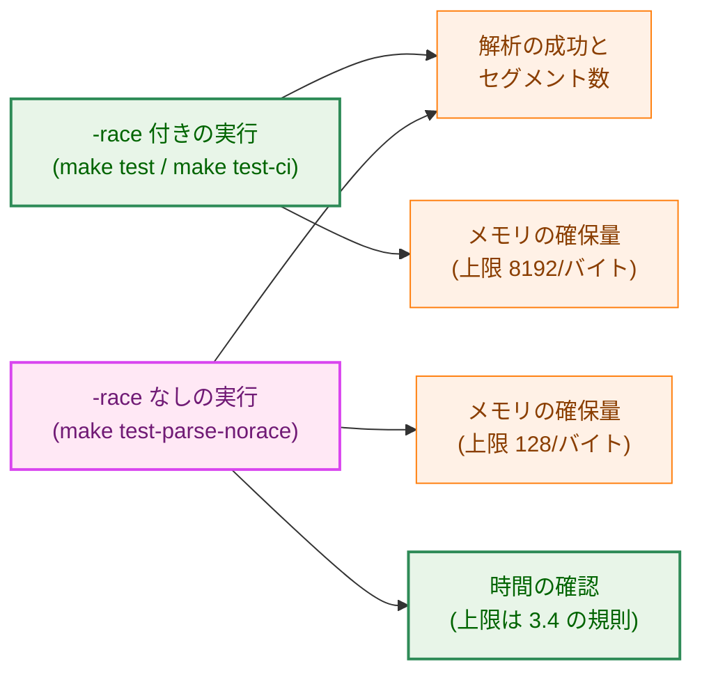
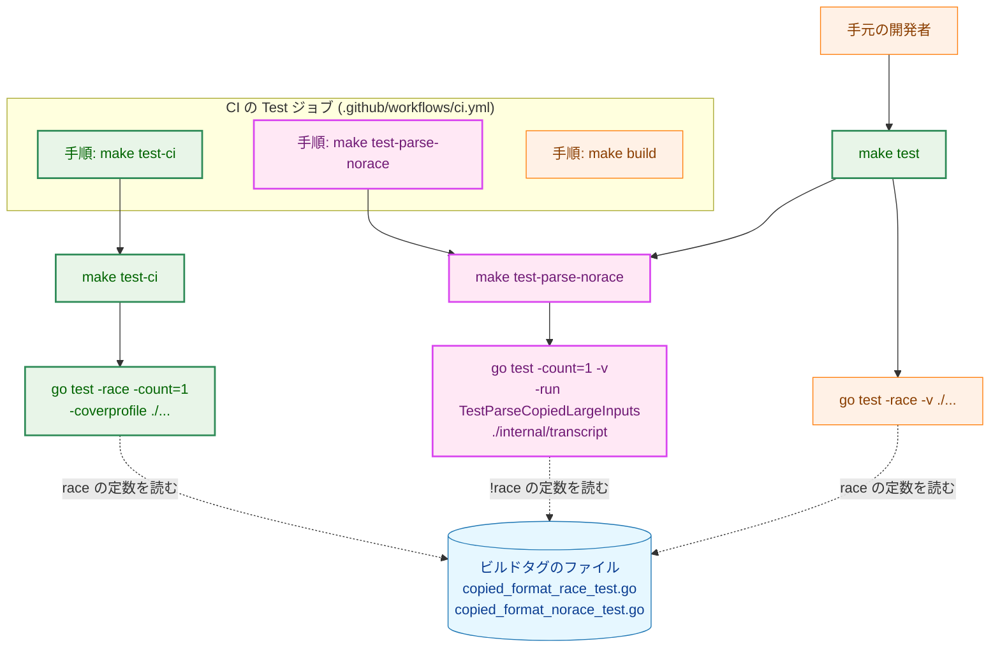
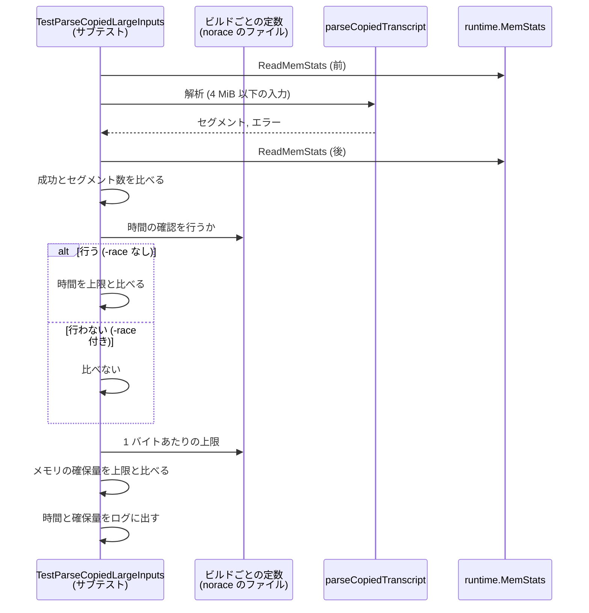
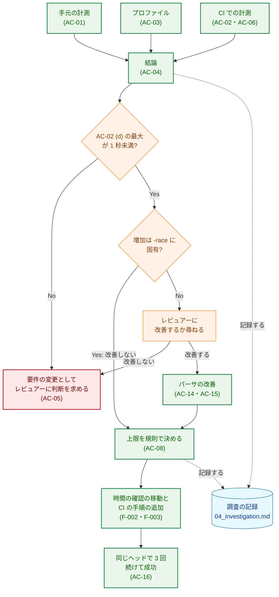
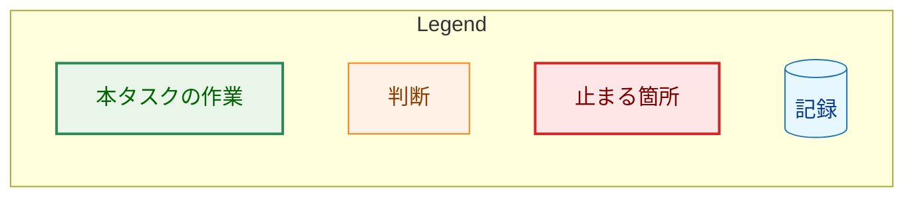

# アーキテクチャ設計書：大きな入力の解析のテストが CI で時間の上限を超える原因を調べて改善する

## Document Status

| Item | Value |
|---|---|
| Status | `draft` |
| Created | 2026-10-23 |
| Review date | - |
| Reviewer | - |
| Comments | - |

本書は [01_requirements.md](01_requirements.md)（要件定義書。以下、要件書）の設計である。既存のファイルについての記述は、コミット `448d021` のファイルで確かめた。`file:line` はこのコミットの行番号を指す。F-NNN・AC-NN は要件書の項番を指し、先行タスクの受け入れ基準は「0015 AC-08」のようにタスクの番号を付けて書く。要件のレビューで設計に申し送られた事項（[design_handoff.md](design_handoff.md) の H-01〜H-08）への対応は、付録 A にまとめる。

本書は、要件書 6 章の用語（`-race` 付きのビルド / `-race` なしのビルド、メモリの確保量、単独 / 並行、カバレッジ付き、プロファイル）を同じ意味で使う。ほかに次の用語を使う。

-   **大きな入力のテスト:** `internal/transcript` のテスト `TestParseCopiedLargeInputs`（`internal/transcript/copied_format_test.go:1049`）。7 つの入力を、それぞれサブテストとして解析する。
-   **時間の確認:** 大きな入力のテストのうち、解析の時間を上限と比べる確認（今は `copied_format_test.go:1080-1082`）。
-   **時間以外の確認:** 大きな入力のテストのうち、解析の成功・セグメント数・1 バイトあたりのメモリの確保量の上限を確かめる確認（AC-11・AC-12）。
-   **`-race` なしの確認のターゲット:** 本書が `Makefile` に加えるターゲット `test-parse-norace`。大きな入力のテストだけを、`-race` なし・カバレッジなしで実行する（3.2）。
-   **計測のワークフロー:** CI の runner で AC-02・AC-06 の値を取るための一時的な GitHub Actions のワークフロー。計測用の一時的なブランチにだけ置き、`main` には入れない（3.5.2）。
-   **調査の記録:** 本タスクで新しく置く文書 `04_investigation.md`。AC-01〜AC-04・AC-06・AC-08・AC-13・AC-15 の記録を置く（3.7）。

## 1. 設計の全体像 (Design Overview)

### 1.1. 設計原則

-   **時間は本番と同じ `-race` なしのビルドで確かめる。** 0015 の解析の予算（4 MiB を 30 秒未満、目標は 1 秒未満。`docs/tasks/0015_copied_transcript_source/02_architecture.md:731`）が守るのは本番のサーバの解析であり、本番は `-race` なしでビルドされる（`Makefile:60-64`）。`-race` 付きのビルドでは時間を確かめない（要件書 1 章「要件定義の際に決めたこと」）。
-   **ビルドごとの違いは、すでにある分け方に揃える。** メモリの確保量の上限は、ビルドタグ `race` / `!race` のファイル（`copied_format_race_test.go:1`・`copied_format_norace_test.go:1`）でビルドごとに定めている。時間の確認を行うかどうかも、同じ 2 つのファイルで定める（3.1）。テストの本体はビルドを見て分岐する処理を持たない。
-   **時間の確認は、ほかのテストと並行に走らせない。** `-race` なしの確認のターゲットは 1 つのパッケージの 1 つのテストだけを実行し、CI でも `make test-ci` とは別の手順として、その後に実行する。時間が、ほかのパッケージの並行の負荷とカバレッジの負担に左右されないようにするためである（要件書 AC-06）。
-   **数える実行は、テストを実際に実行する。** 時間とメモリの確保量を確かめる実行は、テストの結果のキャッシュを使わない（`-count=1`）。キャッシュから結果を再利用した実行は、何も確かめていないためである（AC-16、H-08）。
-   **計測を先に、変更を後に。** 原因の調査（F-001）と CI での計測（AC-02・AC-06）を、時間の確認の移動（F-002）の前に行う。計測の結果が F-002 の前提に合わないときは、変更に進まない（AC-05）。
-   **パーサのコードは、前提が崩れない限り変えない。** `CLAUDE.md`「Performance」に従い、最適化は実際の実行の絶対的な予算で正当化する。手元の計測では `-race` なしの解析は予算の中に十分に収まるので、改善はしない。ただし、この判断は AC-03 と AC-02 (d) の結果を条件とする（3.6）。

### 1.2. 設計の際に決めたこと（2026-10-23）

レビュアーが決めたもの:

-   **`-race` なしの確認は、新しいターゲットを `make test` と CI の `Test` ジョブから実行する（H-01）:** `Makefile` に `test-parse-norace` を加える。`make test` は、全パッケージの `-race` 付きの実行の後にこのターゲットを実行し、CI の `Test` ジョブは `make test-ci` の手順の後に、このターゲットを別の手順として実行する。手元の開発者が、いつもの `make test` で時間の確認まで実行できるようにするためである。`doc-guard` ジョブに加える案は採らなかった。`doc-guard` は文書だけの PR でも走り（`.github/workflows/ci.yml:168-170` のコメント）、`Test` ジョブとは走る条件が違うためである。
-   **時間の上限の値は、決め方の規則を本書で定め、値は計測の後に決める（H-05）:** 上限は、AC-06 の全計測を通した最大の 10 倍を、0.5 秒の単位に切り上げた値とする（3.4）。値は CI の runner で計測するまで決められないためである。
-   **CI での計測は、一時的なブランチで行い、マージしない（H-03）:** 計測のワークフローを、実装の PR とは別の一時的なブランチに置き、4 つの条件を各 5 回実行する。計測が終わったら、ブランチを削除する（3.5.2）。レビュアーは、マージしない一時的なドラフト PR を選んだ。本書は、PR を作らず、ブランチへの push だけで計測のワークフローを起動する形にした。PR を作ると、Codex の自動レビューがその PR にも走り、共有の割り当てを使うためである（`CLAUDE.md`「Commands」の Codex の説明）。マージせず、`main` に何も残さないという点は、レビュアーの選んだ案と同じである。
-   **パーサは、条件付きで改善しない（F-004）:** AC-03 のプロファイルで、`-race` 付きのビルドのメモリの確保量の増加が `-race` に固有であると確かめられ、かつ AC-02 (d) の最大が 1 秒未満であれば、パーサを改善しない（3.6）。
-   **調査の記録は `04_investigation.md` に置く（H-07）:** AC-01〜AC-04・AC-06・AC-08・AC-13・AC-15 の記録を、本タスクのディレクトリの新しい文書 `04_investigation.md` に置く。AC-16 の記録は、要件書のとおり `03_implementation_plan.md` に置く（3.7）。
-   **0015 の文書には `(decision)` の注記を加える（H-06）:** 0015 の設計書と実装計画の `Comments` に、本タスクで時間の確認の決定を変えたことを `(decision)` として記録する。`Status` は `approved` のままとする（3.8）。

設計で決めたもの（レビュアーに諮らず、理由とともに記す）:

-   **時間の確認を行うかどうかは、ビルドごとの定数で定める（H-02）:** `copied_format_race_test.go` と `copied_format_norace_test.go` に、時間の確認を行うかどうかを表す定数を 1 つずつ置く（3.1）。`copiedParseAllocPerByte` と同じ置き方なので、ビルドごとの値が 1 か所にまとまる。時間の確認を別のテスト関数に分ける案は、7 つの入力を作る処理と解析を 2 つのテストで重複させるので採らない。
-   **`make test-ci` にも `-count=1` を付ける（H-08）:** `Test` ジョブの `-race` 付きの実行（AC-11 の確認）も、AC-16 の数える実行で実際に実行させるためである（3.3）。
-   **予備のプロファイル:** 本書の作成時に、手元（macOS、Go 1.27.1、`448d021`）で `shortest_form_A_lines` のメモリのプロファイルを `-memprofilerate=1` で 1 回ずつ取った。`-race` 付きのビルドでは確保量の 97% が `regexp.(*bitState).reset` だった。`-race` なしのビルドでは、この関数は上位に現れなかった。この結果は H-04 の仮説と矛盾しないが、AC-03 の記録の代わりにはしない。AC-03 は 3.5.3 の手順で取り直す。

### 1.3. 概念モデル

大きな入力のテストの確認が、どのビルドのどの実行で行われるかを示す。矢印 A → B は「A の実行が B の確認を行う」ことを表す。




今の `-race` 付きの実行は、時間の確認も行っている（上限 15 秒。`copied_format_test.go:1033`）。本タスクの後は行わない（AC-10）。`-race` 付きの実行は、時間を確かめない代わりに、各入力の時間をこれまでどおりテストのログに出す（`copied_format_test.go:1088`）。

## 2. システム構成 (System Structure)

### 2.1. 全体の構成

`Makefile` のターゲット、`go test` の実行、CI のジョブの手順の関係を示す。矢印 A → B は「A が B を実行する」ことを表す。




点線の矢印は、ビルドタグによってどちらのファイルがコンパイルされるかを表す。`go test -race` は `race` のビルドタグを立てるので、`-race` 付きの実行は `copied_format_race_test.go` を、`-race` なしの実行は `copied_format_norace_test.go` をコンパイルする。

`make test` の `go test -race -v ./...`（G1）は今の形のままである。`-count=1` は付けない。手元では、変更のないパッケージのテストの結果をキャッシュから再利用したほうが速く、時間の確認を行う G3 は `-count=1` を付けるためである。

### 2.2. コンポーネント配置

| 置き場所 | 種類 | 内容 |
|---|---|---|
| `internal/transcript/copied_format_test.go` | 変更 | 時間の確認を、ビルドごとの定数が許すときだけ行う。時間の上限の定数とコメントを新しい測り方に合わせる |
| `internal/transcript/copied_format_race_test.go` | 変更 | 時間の確認を行わないことを表す定数を加える |
| `internal/transcript/copied_format_norace_test.go` | 変更 | 時間の確認を行うことを表す定数を加える |
| `Makefile` | 変更 | `test-parse-norace` を加え、`make test` から実行する。`make test-ci` に `-count=1` を付ける |
| `.github/workflows/ci.yml` | 変更 | `Test` ジョブに `make test-parse-norace` の手順を加える |
| `CLAUDE.md` | 変更 | 「Test Commands」に `make test-parse-norace` を加え、`make test` の説明を改める |
| `docs/tasks/0039_large_input_test_timeout/04_investigation.md` | 新規 | 調査の記録（3.7） |
| `docs/tasks/0015_copied_transcript_source/02_architecture.md`・`03_implementation_plan.md` | 変更 | `Comments` に `(decision)` の注記（3.8） |
| 計測のワークフロー（一時的なブランチの `.github/workflows/` の 1 ファイル） | 一時 | AC-02・AC-06 の計測。`main` には入れない（3.5.2） |

パーサのコード（`internal/transcript/copied_format.go`）は、3.6 の条件が満たされる限り変えない。

### 2.3. データの流れ

時間の確認を行う `-race` なしの実行で、1 つのサブテストが値を測って比べる流れを示す。`-race` 付きの実行では、時間の比較だけを行わない。



この図は時刻の順に上から読む。矢印 A → B は A が B を呼ぶ、または読むことを表し、点線の矢印は戻り値を表す。

## 3. コンポーネント設計 (Component Design)

### 3.1. ビルドごとの定数（H-02・AC-10）

時間の確認を行うかどうかを、ビルドタグのファイルで定める。型の上の形は次のとおりである。

```go
// copied_format_norace_test.go (//go:build test && !race)
const (
	copiedParseAllocPerByte = 128 // existing
	copiedParseChecksDeadline = true
)

// copied_format_race_test.go (//go:build test && race)
const (
	copiedParseAllocPerByte = 8192 // existing
	copiedParseChecksDeadline = false
)
```

-   テストの本体（`copied_format_test.go`）は、`copiedParseChecksDeadline` が真のときだけ時間を上限と比べる。時間を測ってログに出すことは、どちらのビルドでも行う。
-   時間の上限の定数 `copiedParseDeadline` は、両方のビルドで使う 1 つの値として `copied_format_test.go` に残す。値は 3.4 の規則で決める。
-   `make lint` は `test,integration` のタグだけを渡すので、`-race` のファイルは lint されない（`copied_format_race_test.go:13-15`）。`!race` のファイルと本体は lint される。真偽が反対の 2 つの定数を、それぞれ片方のビルドだけで使う形なので、どちらのビルドでも、条件が定数で決まる分岐として扱われる。lint がこの分岐を指摘する場合の扱いは、実装計画で決める。
-   要件書 3.2 の失敗の見え方（入力の名前・バイト数・かかった時間・上限）は、今の `t.Errorf` の形（`copied_format_test.go:1081`）を保つ。サブテストの名前が入力の名前である。

### 3.2. `-race` なしの確認のターゲット（H-01・AC-09・AC-12）

`Makefile` に `test-parse-norace` を加える。このターゲットは、次の形で `go test` を 1 回実行する。

-   ビルドタグは `test`。`-race` を付けない。カバレッジを取らない。
-   `-count=1` を付け、テストの結果のキャッシュを使わない。
-   `-v` を付け、各入力の時間とメモリの確保量（`copied_format_test.go:1088` のログ）を毎回出す。CI のログから、時間の推移を後で読めるようにするためである。
-   対象は `./internal/transcript` だけで、`-run` で大きな入力のテストだけに絞る。名前は `^TestParseCopiedLargeInputs$` のように両端を固定し、名前が前方一致するほかのテストを拾わないようにする。

`make test` は、全パッケージの `-race` 付きの実行の後に、このターゲットを実行する。`-race` 付きの実行が失敗したときは、`make` がそこで止まる。

このターゲットは作業ツリーにファイルを書かない（カバレッジのファイルを作らない）。`fixprguard` は `make test` の後に git の状態を比べるが（`docs/dev/developer_guide/fixprguard_guide.md:162`）、この比較に影響しない。

`extension/test/repository.test.ts:246-250` は、`node` と `npm` のない環境で `make -n build test lint deadcode` を実行し、レシピが `node`・`npm`・`npx` を呼ばないことを確かめる。新しいターゲットは Go のコマンドだけを呼ぶので、このテストは通るはずである。ただし `Makefile` を変えるので、実装では `make ext-test` も実行して確かめる。

### 3.3. CI の `Test` ジョブ（AC-09・H-08）

`Test` ジョブ（`.github/workflows/ci.yml:55-74`）の手順を次の順にする。

1.  `make test-ci`（今の「Run tests (race, coverage)」。`-race` 付き・カバレッジ付き・全パッケージ並行）
2.  `make test-parse-norace`（新しい手順。`-race` なし・カバレッジなし・単独）
3.  `make build`（今のまま）

手順 2 は `if:` や `continue-on-error:` を持たない。手順 2 が失敗すると `Test` ジョブが失敗し、PR の CI が失敗する（AC-09）。手順 1 が失敗したときは、GitHub Actions の既定の動作として後の手順が実行されない。そのときは手順 1 の失敗が `Test` ジョブを失敗させるので、時間の確認が実行されなくても、PR の CI は失敗する。

`make test-ci` に `-count=1` を付ける。CI は `actions/setup-go` のキャッシュを有効にしており（`ci.yml:68`）、Go のビルドのキャッシュの場所を保存・復元する。テストの結果のキャッシュもこの場所に入るので、同じコミットでの再実行（AC-16）で、`go test` が以前の結果を `(cached)` として表示し、テストを実行しないおそれがある。`-count=1` はこれを防ぐ。CI の実行の時間は、キャッシュに当たらなかった今の実行と変わらない。

`Test` ジョブが走るのは、`check-changes` が文書以外の変更を見つけた PR だけである（`ci.yml:59-60`）。パーサやテストを変える PR は必ず `Test` ジョブを走らせるので、時間の確認もその PR で実行される。

### 3.4. 時間の上限の決め方（H-05・AC-07・AC-08）

上限 `copiedParseDeadline` は次の規則で決める。

-   **規則:** AC-06 の全計測（7 つの入力 × 計測の回数）を通した最大の時間を 10 倍し、0.5 秒の単位に切り上げる。
-   **10 倍の理由:** CI の runner の速さは実行ごとに揺れる。PR #461 の `-race` 付きの CI の時間（15.02〜15.44 秒）は、手元の並行（代用）の時間（3.01 秒）の約 5 倍だった（要件書 1 章）。10 倍は、この 5 倍の揺れの 2 倍の余裕である。一方で、パーサが入力の長さの 2 乗に比例するような劣化をすれば、時間は数十倍以上になるので、10 倍の上限で検出できる。
-   **0.5 秒の単位の理由:** 上限を読みやすい値にするためである。切り上げで余裕が減ることはない。
-   **予算との関係:** AC-05 (a) で AC-02 (d) の最大が 1 秒未満であることを確かめてから進むので、AC-06 の最大も 1 秒前後に収まるはずである。規則で求めた上限が 30 秒以上になったときは、AC-07 の「30 秒未満」を満たせないので、実装を進めずに人間のレビュアーに判断を求める。
-   **記録（AC-08）:** 調査の記録に、AC-06 の最大の時間、規則で求めた上限、上限の倍率（上限 ÷ AC-06 の最大）、上限と 0015 の目標（1 秒）との比、上限と 0015 の予算（30 秒）との比を記録する。テストのコメントは、上限の値の根拠として調査の記録の節を示す。

上限が 0015 の目標（1 秒）を超えることはありうる。このとき、テストは目標の超過そのものを検出しない。目標の達成は、AC-02 (d)・AC-06 の計測で確かめた値として調査の記録に残る。時間の確認の役割は、目標を測ることではなく、CI で安定して通りつつ、劣化を検出することである（要件書 4.3）。

### 3.5. 原因の調査の手順（F-001・H-03・H-04）

#### 3.5.1. 手元の計測（AC-01）

手元で、7 つの入力の時間とメモリの確保量を、要件書 AC-01 の 4 つの条件で計測する。どの条件も `-count=1 -v` を付け、テストのログ（`copied_format_test.go:1088`）から値を読む。

| 条件 | 実行の形 |
|---|---|
| (a) `-race` 付き・単独 | `internal/transcript` の大きな入力のテストだけを `-race` 付きで実行する |
| (b) `make test` の中 | `make test` を実行する（`-v` はすでに付いている） |
| (c) (a) にカバレッジ | (a) に `make test-ci` と同じ `-coverprofile` を付ける |
| (d) `make test-ci` と同じ条件 | 全パッケージを `-race` 付き・カバレッジ付きで実行する。値を読むために `-v` を付ける |

各条件を 3 回ずつ実行し、入力ごとに最小・中央・最大を記録する。計測した環境（OS、CPU のコア数、Go の版）とコミットを記録する。(b) は本タスクの変更の前のコミットで計測する。変更の後の `make test` は `-race` なしの確認のターゲットまで実行するが、AC-01 (b) が求めるのは `-race` 付きの実行の値だからである。

#### 3.5.2. CI での計測（AC-02・AC-06）

計測のワークフローを、`main` から作った一時的なブランチに置いて push する。ワークフローは、そのブランチへの push で起動する。今の CI のワークフロー（`ci.yml`）は `pull_request` だけで起動するので（`ci.yml:3-5`）、このブランチへの push では起動しない。PR は作らない（1.2）。

計測のワークフローは、次の 4 つの条件を matrix のジョブとして、各条件 5 回ずつ実行する。1 回の実行は 1 つのジョブであり、ジョブごとに新しい runner で動くので、runner の速さの揺れが 5 回の値に現れる。

| matrix の条件 | 測る AC | 実行の形 |
|---|---|---|
| `race-cover-alone` | AC-02 (a) | 大きな入力のテストだけを、`-race` 付き・カバレッジ付きで実行する |
| `race-alone` | AC-02 (b) | 大きな入力のテストだけを、`-race` 付き・カバレッジなしで実行する |
| `ci-equivalent` | AC-02 (c)・AC-06 | `make test-ci` と同じ実行（`-v` を付ける）の後に、同じジョブで、`-race` なしの確認のターゲットと同じ実行を行う |
| `norace-alone` | AC-02 (d) | 大きな入力のテストだけを、`-race` なし・カバレッジなしで実行する |

-   どの実行も `-count=1 -v` を付ける。`fail-fast` を切り、1 つのジョブの失敗で残りを止めない。今の上限（15 秒）でテストが失敗しても、`t.Logf` のログ（`copied_format_test.go:1088`）は出るので、値は読める。
-   `ci-equivalent` は、本タスクの変更の後の `Test` ジョブと同じ順序（`make test-ci` の後に `-race` なしの実行）を、変更の前のコードで再現する。AC-06 が求める「CI で実行するときと同じ条件」は、この順序で、同じジョブの中で、ほかのパッケージと並行に走らずに実行することである。
-   ワークフローの権限は `contents: read` だけとし、秘密を参照しない。
-   AC-02 の要件のとおり、この計測は F-002 の実装より前に行う。計測の結果は、入力ごと・条件ごとに最小・中央・最大と、各実行の URL を調査の記録に記録する。
-   計測が終わったら、ブランチを `origin` とローカルから削除する。GitHub Actions の実行のログはブランチを消しても残るので、記録した URL は辿れる。
-   push・ブランチの削除・実行のログの取得は、ネットワークに触れる操作である。実装の段階で、その都度人間の承認を得る（`CLAUDE.md`「Tool Execution Safety」）。

#### 3.5.3. プロファイル（AC-03・H-04）

`shortest_form_A_lines` と `textless_form_B_timestamps` の 2 つの入力について、`-race` 付きと `-race` なしのそれぞれで、CPU のプロファイルとメモリの確保のプロファイルを取る。サブテストの名前で 1 つの入力に絞り（`-run`）、`go test` の `-cpuprofile`・`-memprofile` で取り、`go tool pprof` で読む。メモリのプロファイルは、確保の回数と量を漏れなく数えるため `-memprofilerate=1` で取る。

記録には次を含める。

-   メモリの確保量の大きい関数の上位と、その割合（`-race` 付きと `-race` なしの対比）。
-   H-04 の仮説（`regexp` の照合の状態が、`-race` の下では `sync.Pool` で再利用されず、照合のたびに確保される）が成り立つかどうかと、その根拠。根拠は、プロファイルの関数名と、Go の標準ライブラリの該当箇所である。
-   `-race` 付きの 1 バイトあたり約 1,710〜1,875 バイトの確保量が妥当かどうかの判断と理由。判断は、同じ入力の `-race` なしの確保量と、0015 の解析の予算に照らして述べる（AC-03）。

#### 3.5.4. 結論（AC-04）

AC-01〜AC-03 の値から、パーサの処理、`-race` の負担、カバレッジの負担、CI の runner の速さ、CI での並行の負荷のそれぞれが、上限の超過にどの程度効いているかを、次の比で述べる。

| 要因 | 比べる値 |
|---|---|
| パーサの処理 | AC-02 (d)（CI の `-race` なし・単独）と、0015 の目標（1 秒） |
| `-race` の負担 | AC-02 (b) ÷ AC-02 (d) |
| カバレッジの負担 | AC-02 (a) ÷ AC-02 (b) |
| CI の runner の速さ | AC-02 (b) ÷ AC-01 (a)（同じ条件の CI と手元） |
| CI での並行の負荷 | AC-02 (c) ÷ AC-02 (a) |

各比は、入力ごとの中央の値で求める。ばらつきは最小と最大で示す。

### 3.6. パーサの改善の判断（F-004・AC-05・AC-13）

次の 2 つが両方成り立てば、パーサを改善しない。

1.  AC-03 のプロファイルで、`-race` 付きのビルドのメモリの確保量と時間の増加が、`-race` に固有の仕組みによるものと確かめられる（`-race` なしのビルドには現れない）。
2.  AC-02 (d) の全計測の最大が 1 秒未満である（0015 の目標を満たす）。

理由: `CLAUDE.md`「Performance」は、最適化を実際の実行の絶対的な予算で正当化するよう求める。本番は `-race` なしでビルドされるので、条件 1 が成り立てば `-race` の下の増加は本番の解析の時間に現れない。条件 2 が成り立てば、本番の解析は 0015 の目標の中に収まっている。この場合の改善は予算に対して何も得ず、受理と拒否の規則を変えないこと（AC-14）を新たに保証する負担だけが加わる。

条件が崩れたときの扱い:

-   条件 2 が崩れた（AC-05 (a)）: F-002 に進まず、要件の変更として人間のレビュアーに判断を求める。
-   条件 1 が崩れ、`-race` なしのビルドにも現れる劣化が見つかった: パーサを改善するかどうかを、`/runplan` の中で人間のレビュアーに尋ねる。改善しないと決めた場合は、AC-05 (b) に当たるので F-002 に進まない。改善すると決めた場合は、AC-14・AC-15 に従い、改善を振る舞いの変更とは別のコミットにする（要件書 5 章）。

判断と理由は、調査の記録に AC-13 の記録として残す。

### 3.7. 記録の置き場（H-07）

| 記録 | 置き場 |
|---|---|
| AC-01・AC-02・AC-03・AC-04・AC-06・AC-08・AC-13・AC-15 | `04_investigation.md`（調査の記録） |
| AC-16（3 回の実行の URL） | `03_implementation_plan.md`（要件書 AC-16 が定める） |

調査の記録は、計測の値・プロファイルの結果・結論を残す文書である。設計書は、承認の後に計測の値で書き換えると、決定の変更と記録の追加の区別がつきにくくなる（`docs/dev/developer_guide/requirements_process.md`「Editing an approved document」）。計画書は作業の進み具合を追う文書なので、表の多い計測の値を入れると読みにくくなる。そのため、記録だけを置く別の文書にする。調査の記録は `Document Status` を持たない。承認ではなく、PR のレビューで中身を確かめる。

テストのコメント（`copied_format_test.go:1024-1030`）は、時間の上限の値の根拠として、調査の記録の該当する節を示す。

### 3.8. 0015 の文書の扱い（H-06）

0015 の設計書 §7.3「時間」（`docs/tasks/0015_copied_transcript_source/02_architecture.md:735`）と、実装計画のステップ 4-2（`docs/tasks/0015_copied_transcript_source/03_implementation_plan.md:184`）は、`-race` 付きで 15 秒の上限を確かめると決めている。本タスクはこの決定を変える（要件書 5 章）。

-   **原の方針と場所:** 上に挙げた 0015 の 2 か所。0024 は 0015 §7.3 を引き継ぐと書く（`docs/tasks/0024_copied_transcript_panel_lines/02_architecture.md:704`）。
-   **例外とする理由:** 要件書 1 章「時間は `-race` なしのビルドで確かめる」のとおりである。
-   **古い振る舞いを確かめる既存のテスト:** `TestParseCopiedLargeInputs` の時間の確認（`copied_format_test.go:1080-1082`）だけである。3.1 のとおり変える。

0015 の設計書と実装計画の `Comments` に、日付と `(decision)` を付けて、本タスクで時間の確認を `-race` なしのビルドに移したことと、本タスクの要件書・設計書への参照を記す。決定は本タスクの要件書の承認で得たので、`Status` は `approved` のままとする（タスク 0030 の要件書の `Comments` の `(decision)` と同じ扱い）。0015 の本文は書き換えない。0024 の文書は 0015 を参照するだけなので変えない。

注記は、時間の確認を移す実装の PR で加える。マージされたどの時点でも、0015 の文書の決定と、コードの振る舞いが食い違わないようにするためである。

### 3.9. コンポーネントの責務

| ファイル | 種類 | 責務 | AC |
|---|---|---|---|
| `internal/transcript/copied_format_test.go` | 変更 | 7 つの入力の成功・セグメント数・メモリの確保量を両方のビルドで確かめる。時間はビルドごとの定数が許すときだけ確かめる。コメントを新しい測り方に合わせ、上限の根拠として調査の記録を示す。**この変更で、今の時間の確認（`:1080-1082`）は `-race` 付きのビルドで行われなくなる** | AC-07・AC-10・AC-11・AC-12 |
| `internal/transcript/copied_format_race_test.go` | 変更 | 時間の確認を行わないことを定める | AC-10 |
| `internal/transcript/copied_format_norace_test.go` | 変更 | 時間の確認を行うことを定める | AC-07・AC-12 |
| `Makefile` | 変更 | `test-parse-norace` を加え、`make test` から実行する。`make test-ci` に `-count=1` を付ける。`.PHONY` に加える | AC-09・AC-12・AC-16 |
| `.github/workflows/ci.yml` | 変更 | `Test` ジョブに `make test-parse-norace` の手順を加える | AC-09・AC-16 |
| `CLAUDE.md` | 変更 | 「Test Commands」に新しいターゲットを加える | - |
| `docs/tasks/0039_large_input_test_timeout/04_investigation.md` | 新規 | 調査の記録 | AC-01〜AC-04・AC-06・AC-08・AC-13・AC-15 |
| `docs/tasks/0039_large_input_test_timeout/03_implementation_plan.md` | 新規（`/mkplan`） | AC-16 の記録 | AC-16 |
| `docs/tasks/0015_copied_transcript_source/02_architecture.md`・`03_implementation_plan.md` | 変更 | `Comments` の `(decision)` の注記 | - |
| 計測のワークフロー（一時的なブランチ） | 一時 | AC-02・AC-06 の計測 | AC-02・AC-06 |

本タスクの変更で書き換えが要る既存のテストは、`TestParseCopiedLargeInputs` だけである。`cmd/yt2column/makefile_test.go` は結合テストのターゲットと `make build` を確かめるが（`:41`・`:55`・`:68`・`:331`）、`test`・`test-ci` のレシピは確かめない。`extension/test/repository.test.ts` は `make -n test` を実行するので、3.2 のとおり `make ext-test` で確かめる。

## 4. エラーハンドリング設計 (Error Handling Design)

本タスクは製品のコードのエラーの型を加えも変えもしない。テストの失敗の見え方を次のように定める。

| 状況 | 見え方 |
|---|---|
| `-race` なしのビルドで時間が上限を超えた（AC-07） | サブテスト（入力の名前）が `parsed <バイト数> bytes in <時間>, want under <上限>` で失敗する（今の `copied_format_test.go:1081` の形） |
| どちらかのビルドでメモリの確保量が上限を超えた（AC-11・AC-12） | 今の `copied_format_test.go:1085-1086` の形で失敗する |
| 解析が失敗した、またはセグメント数が違う | 今の `copied_format_test.go:1075`・`:1078` の形で失敗する |
| `-race` 付きのビルドで解析が止まらない | `go test` のパッケージのタイムアウト（既定 10 分）で失敗する（要件書 3.2） |
| CI の手順 2（`make test-parse-norace`）が失敗した | `Test` ジョブの手順の名前で、`-race` なしの確認が失敗したことが分かる。`-v` のログに全入力の時間が出る |

どの失敗でも、テストのログ（`copied_format_test.go:1088`）に入力ごとの時間とメモリの確保量が出る。CI の失敗を調べる人は、ジョブのログだけで、どの入力がどれだけ上限を超えたかを読める。

## 5. セキュリティ考慮事項 (Security Considerations)

N/A。本タスクは、外部コマンドの呼び出し、秘密、キャッシュのディレクトリ、ネットワーク、信頼できない文字列のプロンプトへの埋め込みのどれも変えない（要件書 4.2）。パーサのコードは 3.6 の条件が満たされる限り変えない。改善する場合も、受理の形・拒否の番兵・大きさの上限は 0015・0024 のまま変えない（AC-14）。

計測のワークフローは、一時的なブランチで `contents: read` の権限だけを持ち、秘密を参照しない（3.5.2）。CI の手順の追加は、既存の `Test` ジョブの権限（ワークフロー全体の `contents: read`。`ci.yml:7-8`）を変えない。

## 6. 処理フローの詳細 (Processing Flow Details)

本タスクの作業の順序と、止まる箇所を示す。矢印 A → B は「A を終えてから B に進む」ことを表す。





点線の矢印は、作業の順序ではなく、結果を記録に書くことを表す。パーサを改善した場合（`FIX`）、上限は改善の後のコードで計測し直した AC-06 の値から決める。改善の前の AC-06 の値は、改善の後の解析の時間を表さないためである。

AC-16 の確かめ方:

-   対象の PR は、時間・メモリの確保量の確認か CI の手順を最後に変える PR である（要件書 AC-16）。
-   マージの直前のヘッドで、`Test` ジョブを、最初の実行と再実行 2 回の計 3 回、続けて成功させる。時間の確認は `Test` ジョブの手順 2 なので、数えるジョブは `Test` ジョブだけである。
-   各実行で、手順 1 と手順 2 の `go test` の出力に、`internal/transcript` の `(cached)` がないことを確かめる。`-count=1` を付けるので出ないはずだが、ログで確かめて記録する。
-   途中で失敗したら数え直す。ヘッドが変わったら、新しいヘッドで数え直す。
-   3 回の実行の URL は、マージの後に、`docs/` だけを変える別の PR で `03_implementation_plan.md` に記録する。
-   CI の再実行はネットワークに触れる操作なので、実装の段階で人間の承認を得る。

## 7. テスト戦略 (Test Strategy)

### 7.1. 単体テスト

-   `TestParseCopiedLargeInputs` は、`make test`（`-race` 付き、続けて `-race` なし）と `make test-ci`・`make test-parse-norace`（CI）で実行される。
-   **時間の確認が `-race` なしで失敗しうること（AC-07）:** 実装の際に、上限を解析の時間より小さい値に一時的に下げ、`make test-parse-norace` が失敗することを確かめる。確かめたことはコミットのメッセージに書く（`CLAUDE.md`「Testing Strategy」）。
-   **時間の確認が `-race` 付きで行われないこと（AC-10）:** 同じく上限を一時的に下げた状態で、`-race` 付きの実行が時間で失敗しないことを確かめる。
-   **`-race` なしのビルドで時間以外の確認が働くこと（AC-12）:** 実装の際に、`-race` なしの 1 バイトあたりの上限を一時的に下げ、`make test-parse-norace` が失敗することを確かめる。
-   **CI の手順 2 の失敗が PR の CI を失敗させること（AC-09）:** 時間の確認を移す PR で、上限を一時的に下げたコミットを push し、`Test` ジョブが失敗することを確かめてから戻す。この push と CI の実行は、実装の段階で人間の承認を得る。
-   パーサを改善した場合（AC-14）: 既存の 0015・0024 のテスト（fuzz のテストの種を含む）を、変更なしで通す。

### 7.2. 統合テスト

本タスクの統合テストはない。CI での安定は AC-16 の手順（6 章）で確かめる。

### 7.3. セキュリティテスト

N/A（5 章）。

### 7.4. 受け入れ基準と設計要素の対応

| AC | 設計 | 確かめ方 |
|---|---|---|
| AC-01 | 3.5.1 | 調査の記録 |
| AC-02 | 3.5.2 | 調査の記録（CI の実行の URL 付き） |
| AC-03 | 3.5.3 | 調査の記録 |
| AC-04 | 3.5.4 | 調査の記録 |
| AC-05 | 3.6・6 章 | 実装の手順（止まる箇所） |
| AC-06 | 3.5.2（`ci-equivalent`） | 調査の記録（CI の実行の URL 付き） |
| AC-07 | 3.1・3.4 | テスト（7.1 の確かめ方） |
| AC-08 | 3.4 | 調査の記録 |
| AC-09 | 3.3 | CI の設定と、7.1 の確かめ方 |
| AC-10 | 3.1 | テスト（7.1 の確かめ方） |
| AC-11 | 3.1・3.3 | テスト（`-race` 付きの実行） |
| AC-12 | 3.1・3.2 | テスト（`-race` なしの実行と、7.1 の確かめ方） |
| AC-13 | 3.6 | 調査の記録 |
| AC-14 | 3.6 | 既存のテスト（改善した場合だけ） |
| AC-15 | 3.6 | 調査の記録（改善した場合だけ） |
| AC-16 | 3.3・6 章 | `03_implementation_plan.md` の記録 |

## 8. 実装の優先順位 (Implementation Priorities)

1.  **調査（コードの変更なし）:** 手元の計測（3.5.1）とプロファイル（3.5.3）。
2.  **CI での計測:** 計測のワークフローを一時的なブランチで実行し（3.5.2）、終わったらブランチを削除する。
3.  **結論と判断:** AC-04 の結論、AC-05 の判定、AC-13 の判断（3.6）、規則による上限の値（3.4）を、調査の記録に書く。止まる条件に当たったら、ここで止まる。
4.  **（条件が崩れて改善すると決めた場合だけ）パーサの改善:** 改善のコミットを分け、AC-15 の計測を取り、AC-06 を計測し直して上限を決め直す。
5.  **時間の確認の移動と CI の手順の追加:** 3.1〜3.3 の変更、テストのコメント、`CLAUDE.md`、0015 の `Comments` の注記（3.8）を、1 つの PR にまとめる。マージされたどの時点でも、時間の確認がどこかのビルドで CI に実行されている状態を保つためである。
6.  **安定の確認:** 手順 5 の PR のマージの直前のヘッドで、AC-16 の 3 回の成功を確かめる。マージの後に、`docs/` だけを変える PR で URL を記録する。

調査の記録（手順 1〜3）を、手順 5 と同じ PR に入れるか、先に別の PR にするかは、実装計画で決める。

## 9. 将来の拡張性 (Future Extensibility)

-   ほかの、時間の上限を持つテスト（`internal/transcript/exec_test.go` など）が CI で失敗するようになったときは、同じ形（`-race` なしの確認のターゲットに `-run` で加える、ビルドごとの定数で時間の確認を切り替える）を使える。本タスクではこれらを扱わない（要件書 2.3）。加えるときは、`-race` なしの確認のターゲットの対象が増え、手順 2 の時間が延びることに注意する。
-   計測のワークフローは `main` に残さない。同じ計測が後で要るときは、調査の記録に残した条件の表（3.5.2）から作り直す。

## 付録 A. 設計への申し送り（H-01〜H-08）への対応

| 項目 | 対応 | 本書の節 |
|---|---|---|
| H-01: `-race` なしの時間の確認の実行の仕方 | 新しいターゲット `test-parse-norace` を `make test` と CI の `Test` ジョブの別の手順から実行する。カバレッジなし・単独・`-count=1 -v`。`doc-guard` には加えない | 1.2・3.2・3.3 |
| H-02: `-race` 付きのビルドで時間を確かめないようにする手段 | ビルドタグのファイルに、時間の確認を行うかどうかの定数を置く | 3.1 |
| H-03: CI での単独と並行の比較の手順 | 一時的なブランチの計測のワークフローで、4 つの条件を各 5 回実行する。PR を作らず、計測の後にブランチを削除する | 3.5.2 |
| H-04: `-race` 付きのメモリの確保量が大きい理由 | AC-03 のプロファイルで確かめる。本書の作成時の予備のプロファイルは仮説と矛盾しなかった | 1.2・3.5.3 |
| H-05: 時間の上限の値 | AC-06 の最大の 10 倍を 0.5 秒の単位に切り上げる規則を定める | 3.4 |
| H-06: 0015 の文書の扱い | 0015 の設計書と実装計画の `Comments` に `(decision)` の注記を加え、テストのコメントを直す | 3.8・3.1 |
| H-07: 記録を置く文書 | `04_investigation.md` に置く。AC-16 は `03_implementation_plan.md` | 3.7 |
| H-08: キャッシュの再利用を防ぐ手段 | `make test-ci` と `test-parse-norace` に `-count=1` を付け、AC-16 の各実行でログに `(cached)` がないことを確かめる | 3.3・6 章 |
