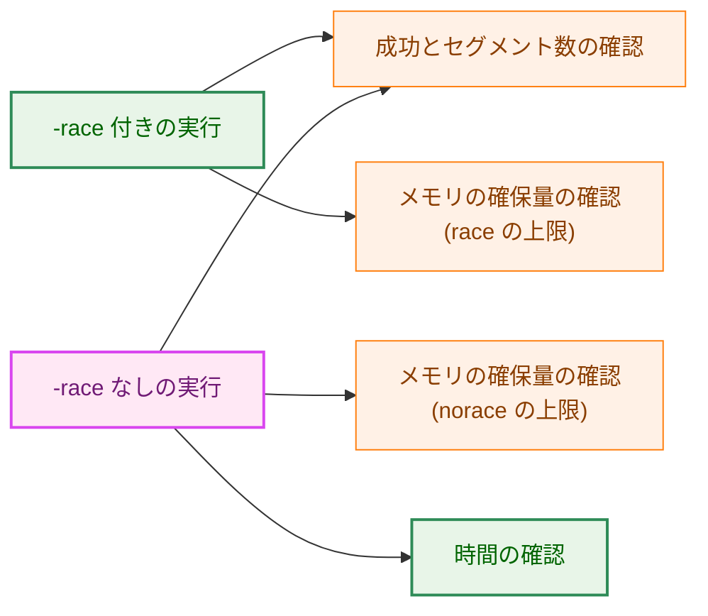
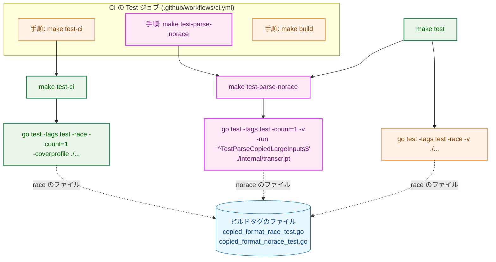
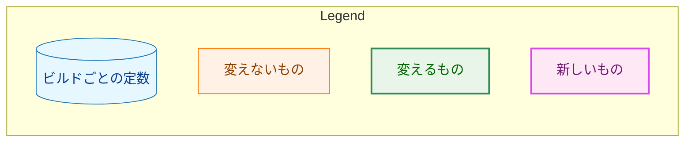
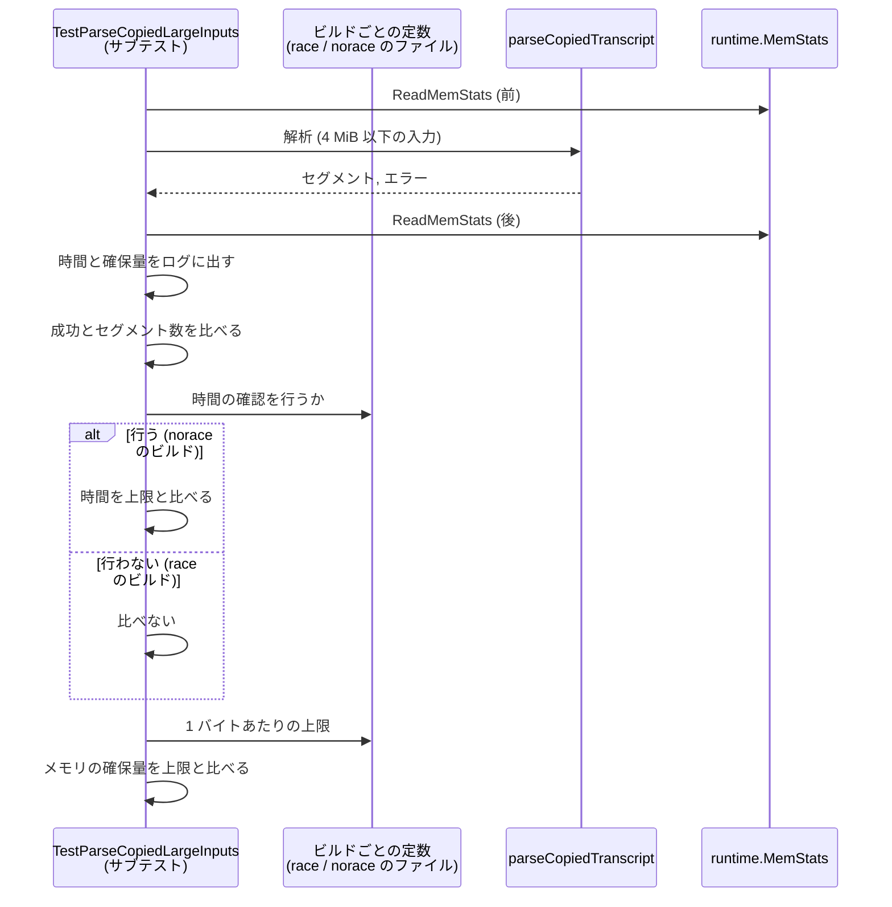
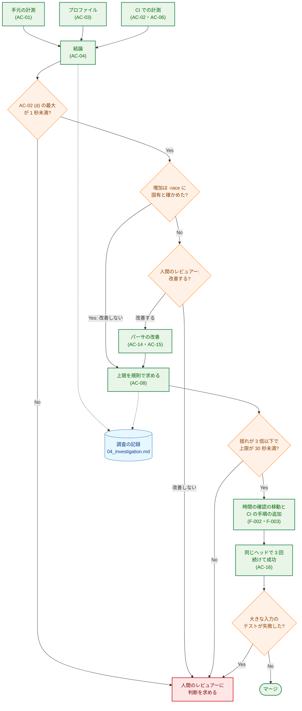
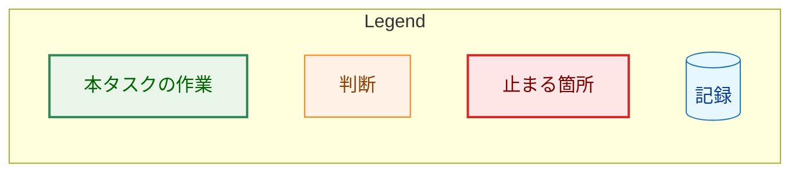

# アーキテクチャ設計書：大きな入力の解析のテストが CI で時間の上限を超える原因を調べて改善する

## Document Status

| Item | Value |
|---|---|
| Status | `approved` |
| Created | 2026-10-23 |
| Review date | 2026-10-23 |
| Reviewer | isseis |
| Comments | - |

本書は [01_requirements.md](01_requirements.md)（要件定義書。以下、要件書）の設計である。既存のファイルについての記述は、コミット `448d021` のファイルで確かめた。`file:line` はこのコミットの行番号を指す。F-NNN・AC-NN は要件書の項番を指し、先行タスクの受け入れ基準は「0015 AC-08」のようにタスクの番号を付けて書く。要件のレビューで設計に申し送られた事項（[design_handoff.md](design_handoff.md) の H-01〜H-08）への対応は、付録 A にまとめる。

本書は、要件書 6 章の用語（`-race` 付きのビルド / `-race` なしのビルド、メモリの確保量、単独 / 並行、カバレッジ付き、プロファイル）を同じ意味で使う。ほかに次の用語を使う。

-   **大きな入力のテスト:** `internal/transcript` のテスト `TestParseCopiedLargeInputs`（`internal/transcript/copied_format_test.go:1049`）。7 つの入力を、それぞれサブテストとして解析する。
-   **時間の確認:** 大きな入力のテストのうち、解析の時間を上限と比べる確認（今は `copied_format_test.go:1080-1082`）。
-   **時間以外の確認:** 大きな入力のテストのうち、解析の成功・セグメント数・1 バイトあたりのメモリの確保量の上限を確かめる確認（AC-11・AC-12）。
-   **`-race` なしの確認のターゲット:** 本書が `Makefile` に加えるターゲット `test-parse-norace`。大きな入力のテストだけを、`-race` なし・カバレッジなしで実行する（3.2）。
-   **レシピのガード:** `-race` なしの確認のターゲットと CI の手順が、決めた形のまま残っていることを確かめる常設のテスト（3.3）。
-   **計測のワークフロー:** CI の runner で AC-02・AC-06 の値を取るための一時的な GitHub Actions のワークフロー。計測用の一時的なブランチにだけ置き、`main` には入れない（3.6.2）。
-   **調査の記録:** 本タスクで新しく置く文書 `04_investigation.md`。AC-01〜AC-04・AC-06・AC-08・AC-13・AC-15 の記録を置く（3.8）。

## 1. 設計の全体像 (Design Overview)

### 1.1. 設計原則

-   **時間は本番と同じ `-race` なしのビルドで確かめる。** 0015 の解析の予算（4 MiB を 30 秒未満、目標は 1 秒未満。`docs/tasks/0015_copied_transcript_source/02_architecture.md:732`）が守るのは本番のサーバの解析であり、本番は `-race` なしでビルドされる（`Makefile:60-64`）。`-race` 付きのビルドでは時間を確かめない（要件書 1 章「要件定義の際に決めたこと」）。
-   **ビルドごとの違いは、すでにある分け方に揃える。** メモリの確保量の上限は、ビルドタグ `race` / `!race` のファイル（`copied_format_race_test.go:1`・`copied_format_norace_test.go:1`）でビルドごとに定めている。時間の確認を行うかどうかも、同じ 2 つのファイルで定める（3.1）。
-   **CI の時間の確認は、ほかのテストと並行に走らせない。** CI では、`-race` なしの確認のターゲットを `make test-ci` とは別の手順として、その後に実行する。このターゲットは 1 つのパッケージの 1 つのテストだけを実行するので、時間はほかのパッケージの並行の負荷とカバレッジの負担に左右されない（要件書 AC-06）。
-   **時間とメモリの確保量を確かめる実行は、テストの結果のキャッシュを使わない（`-count=1`）。** キャッシュから結果を再利用した実行は、何も確かめていないためである（AC-16、H-08）。
-   **時間の確認が黙って消えないようにする。** 時間の確認は `-run` で絞った 1 回の `go test` だけで行われる。テストの名前が変わる、`-race` が付く、手順が消えるといった変更では、確認が行われないまま CI が成功しうる。これをレシピのガードで検出する（3.3）。
-   **計測を先に、変更を後に。** 原因の調査（F-001）と CI での計測（AC-02・AC-06）を、時間の確認の移動（F-002）の前に行う。計測の結果が F-002 の前提に合わないときは、変更に進まない（AC-05）。
-   **パーサのコードは、前提が崩れない限り変えない。** `CLAUDE.md`「Performance」に従い、最適化は実際の実行の絶対的な予算で正当化する。手元の計測では `-race` なしの解析は予算の中に十分に収まるので、改善はしない。ただし、この判断は AC-03 と AC-02 (d) の結果を条件とする（3.7）。

### 1.2. 設計の際に決めたこと（2026-10-23）

人間のレビュアーが決めたもの:

-   **`-race` なしの確認は、新しいターゲットを `make test` と CI の `Test` ジョブから実行する（H-01）:** `Makefile` に `test-parse-norace` を加える。`make test` は、全パッケージの `-race` 付きの実行の後にこのターゲットを実行し、CI の `Test` ジョブは `make test-ci` の手順の後に、このターゲットを別の手順として実行する。手元の開発者が、いつもの `make test` で時間の確認まで実行できるようにするためである。`doc-guard` ジョブに加える案は採らなかった。`doc-guard` は文書だけの PR でも走り（`.github/workflows/ci.yml:167-169` のコメント）、`Test` ジョブとは走る条件が違うためである。
-   **時間の上限の値は、決め方の規則を本書で定め、値は計測の後に決める（H-05）:** 上限は、AC-06 の全計測を通した最大の 10 倍を、0.5 秒の単位に切り上げた値とする（3.5）。値は CI の runner で計測するまで決められないためである。
-   **CI での計測は一時的なものとし、マージせず、`main` に何も残さない（H-03）:** 計測のワークフローを実装の PR とは別に置き、計測の条件をそれぞれ複数回実行する（3.6.2）。人間のレビュアーは、そのための形として、マージしない一時的なドラフト PR を選んだ。下の「設計で決めたもの」のとおり、本書は PR を作らない形に改めた。
-   **パーサは、条件付きで改善しない（F-004）:** AC-03 のプロファイルで、`-race` 付きのビルドのメモリの確保量の増加が `-race` に固有であると確かめられ、かつ AC-02 (d) の最大が 1 秒未満であれば、パーサを改善しない（3.7）。
-   **調査の記録は `04_investigation.md` に置く（H-07）:** AC-01〜AC-04・AC-06・AC-08・AC-13・AC-15 の記録を、本タスクのディレクトリの新しい文書 `04_investigation.md` に置く。AC-16 の記録は、要件書のとおり `03_implementation_plan.md` に置く（3.8）。
-   **0015 の文書には `(decision)` の注記を加える（H-06）:** 0015 の設計書と実装計画の `Comments` に、本タスクで時間の確認の決定を変えたことを `(decision)` として記録する。`Status` は `approved` のままとする（3.9）。

設計で決めたもの（人間のレビュアーに諮らず、理由とともに記す）:

-   **計測のワークフローは、PR を作らず、一時的なブランチへの push で起動する（H-03。人間のレビュアーの確認を求める）:** 人間のレビュアーが選んだのはドラフト PR だが、PR を作ると Codex の自動レビューがその PR にも走り、共有の割り当てを使う（`CLAUDE.md`「Commands」の Codex の説明）。push で起動しても、計測の条件は変わらない。runner の種類（`ubuntu-latest`）、Go の版（`go.mod`）、並行の有無、カバレッジの有無は、ワークフローの中で決まり、起動の契機には依らないためである。違いは、ワークフローの起動の契機（`push`）と、チェックアウトするコミット（PR のマージの試行のコミットでなく、ブランチの先頭）の 2 点だけである。このブランチは `main` から作り、計測のワークフローの 1 ファイルだけを加えるので、チェックアウトの違いは計測するコードに影響しない。PR の形に戻すかどうかは、この設計書の PR のレビューで判断を求める。
-   **時間の確認を行うかどうかは、ビルドごとの定数で定める（H-02）:** `copied_format_race_test.go` と `copied_format_norace_test.go` に、時間の確認を行うかどうかを表す定数を 1 つずつ置く（3.1）。`copiedParseAllocPerByte` と同じ置き方なので、ビルドごとの値が 1 か所にまとまる。時間の確認を別のテスト関数に分ける案は、7 つの入力を作る処理と解析を 2 つのテストで重複させるので採らない。
-   **レシピのガードを常設する:** `-race` なしの確認のターゲットのレシピと、CI の手順の有無を、テストで確かめる（3.3）。手作業の 1 回の確認（7.1）だけでは、後の変更で時間の確認が黙って行われなくなることを防げないためである。既存の `internal/maketestutil.RunTarget`（`internal/maketestutil/make.go:105`）を使う。
-   **`make test-ci` にも `-count=1` を付ける（H-08）:** `Test` ジョブの `-race` 付きの実行（AC-11 の確認）も、AC-16 で数える実行で実際に実行させるためである（3.4）。
-   **大きな入力のテストの失敗は、AC-16 の数え直しで済ませない:** AC-16 の 3 回の実行の途中で大きな入力のテストが失敗したら、数え直す前に止まり、人間のレビュアーの判断を求める（6 章）。成功するまで再実行を繰り返せば、不安定な確認でも 3 回続けて成功しうる。それでは本タスクの目的を損なうためである。
-   **予備のプロファイル:** 本書の作成時に、手元（macOS、Go 1.27.1、`448d021`）で `shortest_form_A_lines` のメモリのプロファイルを `-memprofilerate=1` で 1 回ずつ取った。`-race` 付きのビルドでは確保量の 97% が `regexp.(*bitState).reset` だった。`-race` なしのビルドでは、この関数は上位に現れなかった。この結果は H-04 の仮説と矛盾しない。ただし、`go.mod` の Go の版（1.26.5。`go.mod:3`）と違う版で取ったので、AC-03 の記録の代わりにはしない。AC-03 は 3.6.3 の手順で取り直す。

### 1.3. 概念モデル

大きな入力のテストの確認が、どのビルドの実行で行われるかを示す。矢印 A → B は「A の実行が B の確認を行う」ことを表す。




-race 付きの実行は、`make test` の前段（全パッケージ）と `make test-ci` である。-race なしの実行は `make test-parse-norace` であり、`make test` の後段と CI の `Test` ジョブの手順から実行される（2.1）。メモリの確保量の上限は、`-race` 付きのビルドで 1 バイトあたり 8192、`-race` なしのビルドで 128 であり（`copied_format_race_test.go:16`・`copied_format_norace_test.go:9`）、本タスクでは変えない。

今の `-race` 付きの実行は、時間の確認も行っている（上限 15 秒。`copied_format_test.go:1033`）。本タスクの後は行わない（AC-10）。

## 2. システム構成 (System Structure)

### 2.1. 全体の構成

`Makefile` のターゲット、`go test` の実行、CI のジョブの手順の関係を示す。矢印 A → B は「A が B を実行する」ことを表し、点線の矢印はビルドタグによってどちらのファイルがコンパイルされるかを表す。`go test` のノードには、主な引数だけを書く。





`go test -race` は `race` のビルドタグを立てる。そのため `-race` 付きの実行は `copied_format_race_test.go` を、`-race` なしの実行は `copied_format_norace_test.go` をコンパイルする（どちらのファイルも `test` のタグを必要とするので、`-tags test` を付ける）。

`make test` の `go test -race -v ./...`（G1）は今の形のままである。`-count=1` は付けない。G1 は、手元で速く回すために、変更のないパッケージのテストの結果をキャッシュから再利用する。時間を実際に測る必要があるのは G3 であり、G3 には `-count=1` を付ける。

### 2.2. コンポーネント配置

| 置き場所 | 種類 | 内容 |
|---|---|---|
| `internal/transcript/copied_format_test.go` | 変更 | 時間の確認を、ビルドごとの定数が許すときだけ行う。ログを確認の前に出す。時間の上限の定数とコメントを新しい測り方に合わせる |
| `internal/transcript/copied_format_race_test.go` | 変更 | 時間の確認を行わないことを表す定数を加える |
| `internal/transcript/copied_format_norace_test.go` | 変更 | 時間の確認を行うことを表す定数を加える |
| レシピのガード（`internal/transcript` のテストのファイル。ファイル名は実装計画で決める） | 新規 | `test-parse-norace` のレシピと、`make test`・CI の `Test` ジョブがそれを実行することを確かめる（3.3） |
| `Makefile` | 変更 | `test-parse-norace` を加え、`make test` から実行する。`make test-ci` に `-count=1` を付ける |
| `.github/workflows/ci.yml` | 変更 | `Test` ジョブに `make test-parse-norace` の手順を加える |
| `CLAUDE.md` | 変更 | 「Test Commands」に `make test-parse-norace` を加え、`make test` の説明に `-race` なしの時間の確認も実行することを加える |
| `docs/tasks/0039_large_input_test_timeout/04_investigation.md` | 新規 | 調査の記録（3.8） |
| `docs/tasks/0039_large_input_test_timeout/03_implementation_plan.md` | 新規（`/mkplan`） | AC-16 の記録 |
| `docs/tasks/0015_copied_transcript_source/02_architecture.md`・`03_implementation_plan.md` | 変更 | `Comments` に `(decision)` の注記（3.9） |
| 計測のワークフロー（一時的なブランチの `.github/workflows/` の 1 ファイル） | 一時 | AC-02・AC-06 の計測。`main` には入れない（3.6.2） |

パーサのコード（`internal/transcript/copied_format.go`）は、3.7 の条件が満たされる限り変えない。

### 2.3. データの流れ

1 つのサブテストが値を測って比べる流れを、両方のビルドについて示す。矢印 A → B は A が B を呼ぶ、または読むことを表し、点線の矢印は戻り値を表す。上から時刻の順に読む。



ログ（今は `copied_format_test.go:1088`、確認の後）は、確認の前に出す。今は解析が失敗すると `t.Fatalf`（`:1075`）でサブテストが終わり、その入力の時間と確保量がログに出ない。ログを先に出すと、どの失敗でも値が残る。

## 3. コンポーネント設計 (Component Design)

### 3.1. ビルドごとの定数（H-02・AC-10）

時間の確認を行うかどうかを、ビルドタグのファイルで定める。型の上の形は次のとおりである。

```go
// copied_format_norace_test.go (//go:build test && !race)
const (
	copiedParseAllocPerByte   = 128 // existing
	copiedParseChecksDeadline = true
)

// copied_format_race_test.go (//go:build test && race)
const (
	copiedParseAllocPerByte   = 8192 // existing
	copiedParseChecksDeadline = false
)
```

-   テストの本体（`copied_format_test.go`）は、`copiedParseChecksDeadline` が真のときだけ時間を上限と比べる。時間を測ってログに出すことは、どちらのビルドでも行う。
-   時間の上限の定数 `copiedParseDeadline` は、両方のビルドで使う 1 つの値として `copied_format_test.go` に残す。値は 3.5 の規則で決める。
-   `make lint` は `test,integration` のタグだけを渡すので（`copied_format_race_test.go:13-15`）、lint がコンパイルするのは norace のファイルと本体だけである。lint から見ると定数は常に真である。lint がこの形を指摘しないことは、実装の際に `make lint` で確かめる。
-   要件書 3.2 の失敗の見え方（入力の名前・バイト数・かかった時間・上限）は、今の `t.Errorf` の形（`copied_format_test.go:1081`）を保つ。サブテストの名前が入力の名前である。
-   テストのコメントのうち、時間の上限の根拠を述べる箇所（`copied_format_test.go:1024-1030`）と、テスト関数の説明で各入力が上限の時間の中で解析されることを述べる箇所（`:1045-1048`）を、新しい測り方に合わせて直す。

### 3.2. `-race` なしの確認のターゲット（H-01・AC-09・AC-12）

`Makefile` に `test-parse-norace` を加える。このターゲットは、`$(GOTEST)` を次の形で 1 回実行する。`$(GOTEST)` を使うのは、レシピのガードがその実行を記録できるようにするためである（3.3）。

-   ビルドタグは `test`。`-race` を付けない。カバレッジを取らない。
-   `-count=1` を付け、テストの結果のキャッシュを使わない。
-   `-v` を付け、各入力の時間とメモリの確保量を毎回ログに出す。CI のログから、時間の推移を後で読めるようにするためである。
-   対象は `./internal/transcript` だけで、`-run` で大きな入力のテストだけに絞る。名前は両端を固定し（`^TestParseCopiedLargeInputs$`。`Makefile` の中では `$` を `$$` と書く）、名前が前方一致するほかのテストを拾わないようにする。
-   `-timeout` を、`go test` の既定（10 分）より短い値で付ける。`-race` なしの解析が止まらなくなったとき、CI の時間を長く使わずに失敗させるためである。値は、7 つの入力の時間の上限の合計より十分に長くし、上限を超えた入力が `t.Errorf` の失敗とログを出す前に `go test` が打ち切られないようにする。具体的な値は実装計画で決める。

`make test` は、全パッケージの `-race` 付きの実行の後に、レシピの中でこのターゲットを実行する。前提条件（prerequisite）にはしない。前提条件にすると、`make -j` ではこのターゲットが `-race` 付きの実行と並行に走り、時間の確認がその負荷を受けるためである。`-race` 付きの実行が失敗したときは、`make` がそこで止まる。

手元では、`make test` をほかの重い処理（ほかの worktree の `make test` など）と同時に実行すると、時間の確認がその負荷を受ける。手元の `-race` なしの最大は 0.116 秒（要件書 1 章）であり、上限は 3.5 の規則で CI の最大の 10 倍になるので、手元で上限を超えることはまれと見込む。超えた場合は、負荷のない状態で `make test-parse-norace` を実行し直して確かめる。

このターゲットは作業ツリーにファイルを書かない（カバレッジのファイルを作らない）。`fixprguard` は `make test` の後に git の状態を比べるが（`docs/dev/guides/fixprguard_guide.md:162`）、この比較に影響しない。

`extension/test/repository.test.ts:246-250` は、`node` と `npm` のない環境で `make -n build test lint deadcode` を実行し、レシピが `node`・`npm`・`npx` を呼ばないことを確かめる。新しいターゲットは Go のコマンドだけを呼ぶので、このテストは通るはずである。ただし `Makefile` を変えるので、実装では `make ext-test` も実行して確かめる。

### 3.3. レシピのガード（AC-09・AC-12）

時間の確認は、`-run` で絞った 1 回の `go test` だけで行われる。次のどれが起きても、時間の確認は行われないまま、その手順は成功する。

-   テストの名前が変わり、`-run` の型が何にも一致しない。`go test` は `testing: warning: no tests to run` を出して成功で終わる。
-   レシピに `-race` が付き、race のビルドになる（時間の確認を行わない）。
-   レシピから `-count=1` が消え、CI の再実行でキャッシュの結果が使われる。
-   CI の `Test` ジョブから手順が消える、または `make test` から呼び出しが消える。

レシピのガードは、`internal/transcript` のテストとして、次を確かめる。

-   `internal/maketestutil.RunTarget`（`internal/maketestutil/make.go:105`）で `make test-parse-norace` を `$(GOTEST)` の代わりの記録用のスクリプトで実行し、記録した引数に `-tags test`・`-count=1`・`./internal/transcript` があり、`-race` と `-coverprofile` がないこと。
-   記録した `-run` の値が、`^` + テスト関数の名前 + `$` に等しいこと。テスト関数の名前は、文字列で書かず、関数の値から求める。テスト関数の名前を変えると、ガードの参照がコンパイルできなくなるか、求めた名前が新しい名前になる。どちらの場合も、レシピの `-run` の値と食い違えばガードが失敗する。
-   `make test` のレシピと、`ci.yml` の `test` ジョブが、`test-parse-norace` を実行すること。CI の手順は、`ci.yml` を読んで確かめる（`internal/transcript/ytdlp_test.go:1759` が同じファイルを読む先例である）。確かめ方の細部は実装計画で決める。

ガードで防がない残りの経路は、norace のファイルの定数を偽に書き換えること、環境変数 `GOFLAGS` で `-race` を加えることである。前者はコードの変更として PR のレビューで見える。後者は CI のワークフローも `Makefile` も `GOFLAGS` を設定しない（`ci.yml`・`Makefile` に `GOFLAGS` の記述はない）ので、手元の開発者の環境だけの問題である。どちらも本タスクでは扱わない。

### 3.4. CI の `Test` ジョブ（AC-09・H-08）

`Test` ジョブ（`.github/workflows/ci.yml:55-74`）の手順を次の順にする。

1.  `make test-ci`（今の「Run tests (race, coverage)」。`-race` 付き・カバレッジ付き・全パッケージ並行）
2.  `make test-parse-norace`（新しい手順。`-race` なし・カバレッジなし・単独）
3.  `make build`（今のまま）

手順 2 は `if:` や `continue-on-error:` を持たない。手順 2 が失敗すると `Test` ジョブが失敗し、PR の CI が失敗する（AC-09）。手順 1 が失敗したときは、GitHub Actions の既定の動作として後の手順が実行されない。そのときは手順 1 の失敗が `Test` ジョブを失敗させるので、時間の確認が実行されなくても、PR の CI は失敗する。

`make test-ci` に `-count=1` を付ける。CI は `actions/setup-go` のキャッシュを有効にしており（`ci.yml:68`）、Go のビルドのキャッシュの場所を保存・復元する。テストの結果のキャッシュもこの場所に入るので、同じコミットでの再実行（AC-16）で、`go test` が以前の結果を `(cached)` として表示し、テストを実行しないおそれがある。`-count=1` はこれを防ぐ。CI の実行の時間は、キャッシュに当たらなかった今の実行と変わらない。

`make test-ci` には `-v` を付けない。そのため CI では、`-race` 付きの実行の時間は、サブテストが失敗したときを除いてログに出ない。CI のログで読める時間は、手順 2 の `-race` なしの実行のものである。

`Test` ジョブが走るのは、`check-changes` が文書以外の変更を見つけた PR だけである（`ci.yml:59`）。パーサやテストを変える PR は必ず `Test` ジョブを走らせるので、時間の確認もその PR で実行される。

### 3.5. 時間の上限の決め方（H-05・AC-07・AC-08）

上限 `copiedParseDeadline` は次の規則で決める。

-   **規則:** AC-06 の全計測（7 つの入力 × 計測の回数）を通した最大の時間を 10 倍し、0.5 秒の単位に切り上げる。
-   **10 倍の役割:** 上限は CI の実測から求めるので、CI の runner の平均的な速さは、すでに実測に含まれている。10 倍は、CI の実行ごとの揺れ（runner の割り当て、同じ機械のほかの負荷）を吸収するための余裕である。10 倍が十分かどうかは、AC-06 の揺れで確かめる（次の項目）。
-   **揺れが大きいときは止まる:** 時間の最も長い入力について、AC-06 の全計測の最大 ÷ 最小が 3 を超えたら、規則をそのまま当てはめずに人間のレビュアーに判断を求める。10 回の計測で 3 倍以上の揺れが見えるなら、10 倍の余裕でも安定しない見込みが高いためである。
-   **0.5 秒の単位の理由:** 上限を読みやすい値にするためである。切り上げで余裕が減ることはない。
-   **予算との関係:** AC-05 (a) で AC-02 (d) の最大が 1 秒未満であることを確かめてから進むので、AC-06 の最大も 1 秒前後に収まるはずである。規則で求めた上限が 30 秒以上になったときは、AC-07 の「30 秒未満」を満たせないので、実装を進めずに人間のレビュアーに判断を求める。
-   **記録（AC-08）:** 調査の記録に、AC-06 の最大の時間と最小の時間、規則で求めた上限、上限の倍率（上限 ÷ AC-06 の最大）、上限と 0015 の目標（1 秒）との比、上限と 0015 の予算（30 秒）との比を記録する。テストのコメントは、上限の値の根拠として調査の記録の節を示す。

**この上限が検出するもの:** 上限は 7 つの入力に共通の 1 つの値で、最も遅い入力の約 10 倍である。最も遅い入力では、時間が 10 倍未満に増える劣化は検出しない。速い入力（手元で数ミリ秒〜数十ミリ秒）では、さらに大きな倍率の劣化まで検出しない。検出するのは、入力の長さの 2 乗に比例するような、桁の違う劣化である。上限が 0015 の目標（1 秒）を超えることもありうる。目標の達成は、AC-02 (d)・AC-06 の計測で確かめた値として調査の記録に残る。時間の確認の役割は、目標を測ることではなく、CI で安定して通りつつ、大きな劣化を検出することである（要件書 4.3）。この検出の範囲を、テストのコメントにも書く。

### 3.6. 原因の調査の手順（F-001・H-03・H-04）

#### 3.6.1. 手元の計測（AC-01）

手元で、7 つの入力の時間とメモリの確保量を、要件書 AC-01 の 4 つの条件で計測する。値はテストのログから読む。

| 条件 | 実行の形 |
|---|---|
| (a) `-race` 付き・単独 | `internal/transcript` の大きな入力のテストだけを `-race` 付き・`-count=1 -v` で実行する |
| (b) `make test` の中 | テストのキャッシュを消して（`go clean -testcache`）から `make test` を実行する |
| (c) (a) にカバレッジ | (a) に `make test-ci` と同じ `-coverprofile` を付ける |
| (d) `make test-ci` と同じ条件 | 全パッケージを `-race` 付き・カバレッジ付き・`-count=1` で実行する。値を読むために `-v` を付ける |

-   Go の版は `go.mod` の版（`GOTOOLCHAIN` で指定する）に揃える。CI は `go.mod` の版を使う（`ci.yml` の `go-version-file: go.mod`）ので、版が違うと、手元と CI の比（3.6.4）に版の違いが混ざるためである。
-   各条件を 3 回ずつ実行し、入力ごとに最小・中央・最大を記録する。計測した環境（OS、CPU とそのコア数、Go の版）とコミットを記録する。
-   (b) は本タスクの変更の前のコミットで計測する。AC-01 (b) が求めるのは `make test` の中の `-race` 付きの実行の値だからである。記録には、`internal/transcript` の行が `(cached)` でないことを含める。

#### 3.6.2. CI での計測（AC-02・AC-06）

計測のワークフローを、`main` から作った一時的なブランチに置いて push する。ワークフローは、そのブランチの名前に限った push で起動する。今の CI のワークフロー（`ci.yml`）は `pull_request` だけで起動するので（`ci.yml:3-5`）、このブランチへの push では起動しない。PR は作らない（1.2）。

計測のワークフローは、次の 5 つの条件を matrix のジョブとして、各条件 5 回ずつ実行する。1 回の実行は 1 つのジョブであり、ジョブごとに新しい runner で動く。

| matrix の条件 | 測る AC | 実行の形 |
|---|---|---|
| `race-cover-alone` | AC-02 (a) | 大きな入力のテストだけを、`-race` 付き・カバレッジ付きで実行する |
| `race-alone` | AC-02 (b) | 大きな入力のテストだけを、`-race` 付き・カバレッジなしで実行する |
| `race-cover-package` | AC-04 の切り分け | `internal/transcript` のテストをすべて、`-race` 付き・カバレッジ付きで、このパッケージだけ実行する |
| `ci-equivalent` | AC-02 (c)・AC-06 | `make test-ci` のレシピと同じ `go test` の実行（`-count=1 -v` を付ける）の後に、同じジョブで、`-race` なしの確認のターゲットが行う予定の `go test` の実行（3.2 の引数）を行う |
| `norace-alone` | AC-02 (d) | 大きな入力のテストだけを、`-race` なし・カバレッジなしで実行する |

-   **時間をずらす:** ワークフローは、少なくとも 3 時間あけて 2 回実行する（2 回目は push のし直しか、実行のし直し）。1 回の実行の 25 のジョブは同じ時刻に始まるので、同じ時刻の runner の違いしか表さない。時間をずらすと、runner の混み具合の時間による違いも値に入る。各条件の標本は 10 になる。
-   **runner の記録:** 各ジョブは、開始の時刻、CPU の型名とコア数、runner のイメージの版、Go の版をログに出す。調査の記録には、実行の URL だけでなく、これらを値と並べて写す。GitHub Actions のログは保存の期限を過ぎると消えるためである。
-   どの実行も `-count=1 -v` を付ける。`fail-fast` を切り、1 つのジョブの失敗で残りを止めない。今の上限（15 秒）でテストが失敗しても、`t.Logf` のログ（`copied_format_test.go:1088`）は出るので、値は読める。
-   `ci-equivalent` は、本タスクの変更の後の `Test` ジョブと同じ順序（`make test-ci` の後に `-race` なしの実行）を、変更の前のコードで再現する。AC-06 が求める「CI で実行するときと同じ条件」は、この順序で、同じジョブの中で、ほかのパッケージと並行に走らずに実行することである。
-   ワークフローの権限は `contents: read` だけとし、秘密を参照しない。`main` は CI を `pull_request` でしか走らせないので、計測のジョブは Go のビルドのキャッシュを持たずに始まる。計測するのは解析の時間だけなので、ビルドの時間が延びても値に影響しない。
-   AC-02 の要件のとおり、この計測は F-002 の実装より前に行う。計測の結果は、入力ごと・条件ごとに最小・中央・最大と、各実行の URL を調査の記録に記録する。
-   計測が終わったら、ブランチを `origin` とローカルから削除する。
-   push・実行のし直し・ブランチの削除・実行のログの取得は、ネットワークに触れる操作である。実装の段階で、その都度人間の承認を得る（`CLAUDE.md`「Tool Execution Safety」）。`.github/workflows/` のファイルを push するには、`workflow` の権限を持つ認証情報が要る。

#### 3.6.3. プロファイル（AC-03・H-04）

`shortest_form_A_lines` と `textless_form_B_timestamps` の 2 つの入力について、`-race` 付きと `-race` なしのそれぞれで、CPU のプロファイルとメモリの確保のプロファイルを取る。Go の版は 3.6.1 と同じく `go.mod` の版に揃える。サブテストの名前で 1 つの入力に絞り（`-run`）、`go test` の `-cpuprofile`・`-memprofile` で取り、`go tool pprof` で読む。メモリのプロファイルは、確保の回数と量を漏れなく数えるため `-memprofilerate=1` で取る。

記録には次を含める。

-   メモリの確保量の大きい関数の上位と、その割合（`-race` 付きと `-race` なしの対比）。
-   H-04 の仮説（`regexp` の照合の状態が、`-race` の下では `sync.Pool` で再利用されず、照合のたびに確保される）が成り立つかどうかと、その根拠。根拠は、プロファイルの関数名と、Go の標準ライブラリの該当箇所である。
-   `-race` 付きの 1 バイトあたり約 1,710〜1,875 バイトの確保量が妥当かどうかの判断と理由。判断は、同じ入力の `-race` なしの確保量と、0015 の解析の予算に照らして述べる（AC-03）。

#### 3.6.4. 結論（AC-04）

AC-01〜AC-03 の値から、パーサの処理、`-race` の負担、カバレッジの負担、CI の runner の速さ、CI での並行の負荷のそれぞれが、上限の超過にどの程度効いているかを、次の比で述べる。

| 要因 | 比べる値 |
|---|---|
| パーサの処理 | AC-02 (d)（CI の `-race` なし・単独）と、0015 の目標（1 秒） |
| `-race` の負担 | AC-02 (b) ÷ AC-02 (d) |
| カバレッジの負担 | AC-02 (a) ÷ AC-02 (b) |
| CI の runner の速さ | AC-02 (b) ÷ 手元の (a) をカバレッジなしにした値（3.6.1 の (a)） |
| 同じパッケージの先行のテストの影響 | `race-cover-package` ÷ AC-02 (a) |
| CI での並行の負荷 | AC-02 (c) ÷ `race-cover-package` |

各比は、入力ごとの中央の値で求める。ばらつきは最小と最大で示す。AC-02 (c) では、大きな入力のテストより前に、同じパッケージのほかのテストが同じプロセスで動く。その影響（ヒープの大きさ、`-race` の検出器の状態など）と、ほかのパッケージとの並行の負荷を分けるため、`race-cover-package` の値をはさむ。要件書 AC-04 の「CI での並行の負荷」は、この 2 つの比をあわせて述べる。

### 3.7. パーサの改善の判断（F-004・AC-05・AC-13）

次の 2 つが両方成り立てば、パーサを改善しない。

1.  AC-03 のプロファイルで、`-race` 付きのビルドのメモリの確保量と時間の増加が、`-race` に固有の仕組みによるものと確かめられる（`-race` なしのビルドには現れない）。確かめられなかった場合（プロファイルが仮説を支持も否定もしない場合を含む）は、成り立たないものとして扱う。
2.  AC-02 (d) の全計測の最大が 1 秒未満である（0015 の目標を満たす）。

理由: `CLAUDE.md`「Performance」は、最適化を実際の実行の絶対的な予算で正当化するよう求める。本番は `-race` なしでビルドされるので、条件 1 が成り立てば `-race` の下の増加は本番の解析の時間に現れない。条件 2 が成り立てば、本番の解析は 0015 の目標の中に収まっている。この場合に改善しても、予算の面で得るものはなく、受理と拒否の規則を変えないこと（AC-14）を新たに保証する負担だけが増える。

条件が崩れたときの扱い:

-   条件 2 が崩れた（AC-05 (a)）: F-002 に進まず、要件の変更として人間のレビュアーに判断を求める。
-   条件 1 が崩れた: パーサを改善するかどうかを、`/runplan` の中で人間のレビュアーに尋ねる。改善しないと決めた場合は、AC-05 (b) に当たるので F-002 に進まない。改善すると決めた場合は、AC-14・AC-15 に従い、改善を振る舞いの変更とは別のコミットにする（要件書 5 章）。

判断と理由は、調査の記録に AC-13 の記録として残す。

### 3.8. 記録の置き場（H-07）

| 記録 | 置き場 |
|---|---|
| AC-01・AC-02・AC-03・AC-04・AC-06・AC-08・AC-13・AC-15 | `04_investigation.md`（調査の記録） |
| AC-16（3 回の実行の URL） | `03_implementation_plan.md`（要件書 AC-16 が定める） |

調査の記録は、計測の値・プロファイルの結果・結論を残す文書である。設計書は、承認の後に計測の値で書き換えると、決定の変更と記録の追加の区別がつきにくくなる（`docs/dev/conventions/requirements_process.md`「Editing an approved document」）。計画書は作業の進み具合を追う文書なので、表の多い計測の値を入れると読みにくくなる。そのため、記録だけを置く別の文書にする。調査の記録は `Document Status` を持たない。承認ではなく、PR のレビューで中身を確かめる。

### 3.9. 0015 の文書の扱い（H-06）

0015 の設計書と実装計画は、`-race` 付きで 15 秒の上限を確かめると決めている。本タスクはこの決定を変える（要件書 5 章）。

-   **変更前の決定とその場所:** 0015 の設計書 §7.3「時間」（`docs/tasks/0015_copied_transcript_source/02_architecture.md:735`）、実装計画のステップ 4-2（`docs/tasks/0015_copied_transcript_source/03_implementation_plan.md:184`）、実装計画 §5.1 の計測の表（同 `:332`）、実装計画のリスクの表（同 `:351`）。0024 は 0015 §7.3 を引き継ぐと書く（`docs/tasks/0024_copied_transcript_panel_lines/02_architecture.md:704`）。
-   **決定を変える理由:** 要件書 1 章「時間は `-race` なしのビルドで確かめる」のとおりである。
-   **古い振る舞いを確かめる既存のテスト:** `TestParseCopiedLargeInputs` の時間の確認（`copied_format_test.go:1080-1082`）だけである。3.1 のとおり変える。

0015 の設計書と実装計画の `Comments` に、日付と `(decision)` を付けて、本タスクで時間の確認を `-race` なしのビルドに移したこと、この決定を人間のレビュアー（isseis）が本タスクの要件書の承認（2026-10-23）で承認したこと、本タスクの要件書・設計書への参照を記す。0015 の本文は書き換えない。0024 の文書は 0015 を参照するだけなので変えない。

`Status` は `approved` のままとする。これは `requirements_process.md`「Editing an approved document」（決定の変更は `Status` を `draft` に戻す）の例外である。例外とする理由は、決定の変更を本タスクの要件書の承認ですでに得ており（要件書 5 章「先行タスクの決定の変更」）、0015 の本文には手を入れず注記を加えるだけだからである。0015 は実装を終えたタスクなので、`draft` に戻して承認し直しても、決めることが残っていない。この扱いは人間のレビュアーが選んだ（1.2）。同じ形の先例として、タスク 0030 の要件書の `Comments` の `(decision)` がある。

注記は、時間の確認を移す実装の PR で加える。マージされたどの時点でも、0015 の文書の決定と、コードの振る舞いが食い違わないようにするためである。

### 3.10. コンポーネントの責務

| ファイル | 種類 | 責務 | AC |
|---|---|---|---|
| `internal/transcript/copied_format_test.go` | 変更 | 7 つの入力の成功・セグメント数・メモリの確保量を両方のビルドで確かめる。時間はビルドごとの定数が許すときだけ確かめる。ログを確認の前に出す。コメントを新しい測り方に合わせ、上限の根拠として調査の記録を示す。**この変更で、今の時間の確認（`:1080-1082`）は `-race` 付きのビルドで行われなくなる** | AC-07・AC-10・AC-11・AC-12 |
| `internal/transcript/copied_format_race_test.go` | 変更 | 時間の確認を行わないことを定める | AC-10 |
| `internal/transcript/copied_format_norace_test.go` | 変更 | 時間の確認を行うことを定める | AC-07・AC-12 |
| レシピのガード（`internal/transcript` のテストのファイル） | 新規 | `test-parse-norace` のレシピと、`make test`・CI の `Test` ジョブがそれを実行することを確かめる | AC-09・AC-12 |
| `Makefile` | 変更 | `test-parse-norace` を加え、`make test` から実行する。`make test-ci` に `-count=1` を付ける。`.PHONY` に加える | AC-09・AC-12・AC-16 |
| `.github/workflows/ci.yml` | 変更 | `Test` ジョブに `make test-parse-norace` の手順を加える | AC-09・AC-16 |
| `CLAUDE.md` | 変更 | 「Test Commands」に新しいターゲットを加え、`make test` の説明を改める | - |
| `docs/tasks/0039_large_input_test_timeout/04_investigation.md` | 新規 | 調査の記録 | AC-01〜AC-04・AC-06・AC-08・AC-13・AC-15 |
| `docs/tasks/0039_large_input_test_timeout/03_implementation_plan.md` | 新規（`/mkplan`） | AC-16 の記録 | AC-16 |
| `docs/tasks/0015_copied_transcript_source/02_architecture.md`・`03_implementation_plan.md` | 変更 | `Comments` の `(decision)` の注記 | - |
| 計測のワークフロー（一時的なブランチ） | 一時 | AC-02・AC-06 の計測 | AC-02・AC-06 |

本タスクの変更で書き換えが要る既存のテストは、`TestParseCopiedLargeInputs` だけである。`cmd/yt2column/makefile_test.go` は結合テストのターゲットと `make build` を確かめるが（`:41`・`:55`・`:68`・`:331`）、`test`・`test-ci` のレシピは確かめない。`extension/test/repository.test.ts` は `make -n test` を実行するので、3.2 のとおり `make ext-test` で確かめる。

## 4. エラーハンドリング設計 (Error Handling Design)

本タスクは製品のコードのエラーの型を加えも変えもしない。テストの失敗の見え方を次のように定める。

| 状況 | 見え方 |
|---|---|
| `-race` なしのビルドで時間が上限を超えた（AC-07） | サブテスト（入力の名前）が `parsed <バイト数> bytes in <時間>, want under <上限>` で失敗する（今の `copied_format_test.go:1081` の形） |
| どちらかのビルドでメモリの確保量が上限を超えた（AC-11・AC-12） | 今の `copied_format_test.go:1085-1086` の形で失敗する |
| 解析が失敗した、またはセグメント数が違う | 今の `copied_format_test.go:1075`・`:1078` の形で失敗する |
| `-race` 付きのビルドで解析が止まらない | `go test` のパッケージのタイムアウト（既定 10 分）で失敗する（要件書 3.2） |
| `-race` なしのビルドで解析が止まらない | `test-parse-norace` の `-timeout`（3.2）で失敗する |
| CI の手順 2（`make test-parse-norace`）が失敗した | `Test` ジョブの手順の名前で、`-race` なしの確認が失敗したことが分かる |
| レシピや CI の手順が決めた形でなくなった | レシピのガード（3.3）が失敗する |

ログを確認の前に出すので（2.3）、上の失敗のうち解析が終わったものでは、失敗した入力の時間とメモリの確保量がログに出る。CI の手順 2 は `-v` 付きなので、成功したときも全入力の値が出る。CI の失敗を調べる人は、ジョブのログだけで、どの入力がどれだけ上限を超えたかを読める。

## 5. セキュリティ考慮事項 (Security Considerations)

N/A。本タスクは、外部コマンドの呼び出し、秘密、キャッシュのディレクトリ、ネットワーク、信頼できない文字列のプロンプトへの埋め込みのどれも変えない（要件書 4.2）。パーサのコードは 3.7 の条件が満たされる限り変えない。改善する場合も、受理の形・拒否の番兵・大きさの上限は 0015・0024 のまま変えない（AC-14）。

計測のワークフローは、一時的なブランチで `contents: read` の権限だけを持ち、秘密を参照しない（3.6.2）。CI の手順の追加は、既存の `Test` ジョブの権限（ワークフロー全体の `contents: read`。`ci.yml:7-8`）を変えない。

## 6. 処理フローの詳細 (Processing Flow Details)

本タスクの作業の順序と、止まる箇所を示す。矢印 A → B は「A を終えてから B に進む」ことを表し、点線の矢印は結果を記録に書くことを表す。





`STOP` に着いたら、実装を進めず、要件の変更（AC-05）か上限の決め方の見直しとして人間のレビュアーに判断を求める。パーサを改善した場合（`FIX`）、上限は改善の後のコードで計測し直した AC-06 の値から決める。改善の前の AC-06 の値は、改善の後の解析の時間を表さないためである。

AC-16 の確かめ方:

-   対象の PR は、時間・メモリの確保量の確認か CI の手順を最後に変える PR である（要件書 AC-16）。
-   マージの直前のヘッドで、`Test` ジョブを、最初の実行と再実行 2 回の計 3 回、続けて成功させる。時間の確認は `Test` ジョブの手順 2 なので、数えるジョブは `Test` ジョブだけである。
-   各実行で、手順 1 と手順 2 の `go test` の出力に、`internal/transcript` の `(cached)` がないことを確かめる。`-count=1` を付けるので出ないはずだが、ログで確かめて記録する。
-   途中で大きな入力のテスト（手順 2 の時間の確認、または手順 1・手順 2 の時間以外の確認）が失敗したら、すぐには数え直さずに止まり、その実行を記録して人間のレビュアーに判断を求める（図の `G4`）。確認が安定していないこと、または上限の決め方（3.5）の前提が崩れたことを示しうるためである。要件書 AC-16 の「途中で失敗したら、数え直す」は変えない。数え直す前に人間のレビュアーの判断を挟む手順を加えるだけである。runner の割り当ての失敗やネットワークの失敗など、テストに関わらない失敗のときだけ、その分類を記録して数え直す。
-   ヘッドが変わったら、新しいヘッドで数え直す。
-   3 回の実行の URL は、マージの後に、`docs/` だけを変える別の PR で `03_implementation_plan.md` に記録する。
-   CI の再実行はネットワークに触れる操作なので、実装の段階で人間の承認を得る。

## 7. テスト戦略 (Test Strategy)

### 7.1. 単体テスト

-   `TestParseCopiedLargeInputs` は、`make test`（`-race` 付き、続けて `-race` なし）と `make test-ci`・`make test-parse-norace`（CI）で実行される。
-   レシピのガード（3.3）は `make test`・`make test-ci` で実行される。実装の際に、レシピから `-count=1` を外す、`-race` を加える、`-run` の名前を変える、CI の手順を消す、のそれぞれでガードが失敗することを確かめる。
-   **時間の確認が `-race` なしで失敗しうること（AC-07）:** 実装の際に、上限を解析の時間より小さい値に一時的に下げ、`make test-parse-norace` が失敗することを確かめる。確かめたことはコミットのメッセージに書く（`CLAUDE.md`「Testing Strategy」）。
-   **時間の確認が `-race` 付きで行われないこと（AC-10）:** 同じく上限を一時的に下げた状態で、`-race` 付きの実行が時間で失敗しないことを確かめる。
-   **`-race` なしのビルドで時間以外の確認が働くこと（AC-12）:** 実装の際に、`-race` なしの 1 バイトあたりの上限を一時的に下げ、`make test-parse-norace` が失敗することを確かめる。
-   **CI の手順 2 の失敗が PR の CI を失敗させること（AC-09）:** 時間の確認を移す PR で、上限を一時的に下げたコミットを push し、`Test` ジョブが失敗することを確かめてから戻す。この push と CI の実行は、実装の段階で人間の承認を得る。
-   パーサを改善した場合（AC-14）: 既存の 0015・0024 のテスト（fuzz のテストの種を含む）を、変更なしで通す。

### 7.2. 統合テスト

本タスクの統合テストはない。CI での安定は AC-16 の手順（6 章）で確かめる。

### 7.3. セキュリティテスト

N/A（5 章）。

### 7.4. 受け入れ基準と設計要素の対応

| AC | 設計 | 確かめ方 |
|---|---|---|
| AC-01 | 3.6.1 | 調査の記録 |
| AC-02 | 3.6.2 | 調査の記録（CI の実行の URL と runner の情報付き） |
| AC-03 | 3.6.3 | 調査の記録 |
| AC-04 | 3.6.4 | 調査の記録 |
| AC-05 | 3.7・6 章 | 実装の手順（止まる箇所） |
| AC-06 | 3.6.2（`ci-equivalent`） | 調査の記録（CI の実行の URL と runner の情報付き） |
| AC-07 | 3.1・3.5 | テスト（7.1 の確かめ方） |
| AC-08 | 3.5 | 調査の記録 |
| AC-09 | 3.3・3.4 | レシピのガードと、7.1 の確かめ方 |
| AC-10 | 3.1 | テスト（7.1 の確かめ方） |
| AC-11 | 3.1・3.4 | テスト（`-race` 付きの実行） |
| AC-12 | 3.1・3.2・3.3 | テスト（`-race` なしの実行、レシピのガード、7.1 の確かめ方） |
| AC-13 | 3.7 | 調査の記録 |
| AC-14 | 3.7 | 既存のテスト（改善した場合だけ） |
| AC-15 | 3.7 | 調査の記録（改善した場合だけ） |
| AC-16 | 3.4・6 章 | `03_implementation_plan.md` の記録 |

## 8. 実装の優先順位 (Implementation Priorities)

1.  **調査（コードの変更なし）:** 手元の計測（3.6.1）とプロファイル（3.6.3）。
2.  **CI での計測:** 計測のワークフローを一時的なブランチで、時間をずらして 2 回実行し（3.6.2）、終わったらブランチを削除する。
3.  **結論と判断:** AC-04 の結論、AC-05 の判定、AC-13 の判断（3.7）、規則による上限の値（3.5）を、調査の記録に書く。止まる条件に当たったら、ここで止まる。
4.  **（条件が崩れて改善すると決めた場合だけ）パーサの改善:** 改善のコミットを分け、AC-15 の計測を取り、AC-06 を計測し直して上限を決め直す。
5.  **時間の確認の移動と CI の手順の追加:** 3.1〜3.4 の変更、テストのコメント、`CLAUDE.md`、0015 の `Comments` の注記（3.9）を、1 つの PR にまとめる。マージされたどの時点でも、時間の確認がどこかのビルドで CI に実行されている状態を保つためである。
6.  **安定の確認:** 手順 5 の PR のマージの直前のヘッドで、AC-16 の 3 回の成功を確かめる。マージの後に、`docs/` だけを変える PR で URL を記録する。

調査の記録（手順 1〜3）を、手順 5 と同じ PR に入れるか、先に別の PR にするかは、実装計画で決める。

## 9. 将来の拡張性 (Future Extensibility)

-   ほかの、時間の上限を持つテスト（`internal/transcript/exec_test.go` など）が CI で失敗するようになったときも、同じ考え方（時間は `-race` なしのビルドで確かめ、ビルドごとの定数で切り替える）を使える。そのときは、`-race` なしの確認のターゲットの名前と対象を見直す。本タスクではこれらを扱わない（要件書 2.3）。
-   計測のワークフローは `main` に残さない。同じ計測が後で要るときは、調査の記録に残した条件の表（3.6.2）から作り直す。

## 付録 A. 設計への申し送り（H-01〜H-08）への対応

| 項目 | 対応 | 本書の節 |
|---|---|---|
| H-01: `-race` なしの時間の確認の実行の仕方 | 新しいターゲット `test-parse-norace` を `make test` と CI の `Test` ジョブの別の手順から実行する。カバレッジなし・単独・`-count=1 -v`。`doc-guard` には加えない。レシピのガードで形を保つ | 1.2・3.2・3.3・3.4 |
| H-02: `-race` 付きのビルドで時間を確かめないようにする手段 | ビルドタグのファイルに、時間の確認を行うかどうかの定数を置く | 3.1 |
| H-03: CI での単独と並行の比較の手順 | 一時的なブランチの計測のワークフローで、5 つの条件を各 5 回、時間をずらして 2 回実行する。PR を作らず、計測の後にブランチを削除する | 1.2・3.6.2 |
| H-04: `-race` 付きのメモリの確保量が大きい理由 | AC-03 のプロファイルで確かめる。本書の作成時の予備のプロファイルは仮説と矛盾しなかった | 1.2・3.6.3 |
| H-05: 時間の上限の値 | AC-06 の最大の 10 倍を 0.5 秒の単位に切り上げる規則を定める。揺れが 3 倍を超えたら止まる | 3.5 |
| H-06: 0015 の文書の扱い | 0015 の設計書と実装計画の `Comments` に `(decision)` の注記を加え、テストのコメントを直す | 3.9・3.1 |
| H-07: 記録を置く文書 | `04_investigation.md` に置く。AC-16 は `03_implementation_plan.md` | 3.8 |
| H-08: キャッシュの再利用を防ぐ手段 | `make test-ci` と `test-parse-norace` に `-count=1` を付け、AC-16 の各実行でログに `(cached)` がないことを確かめる | 3.4・6 章 |
