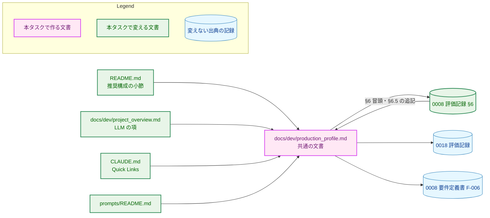
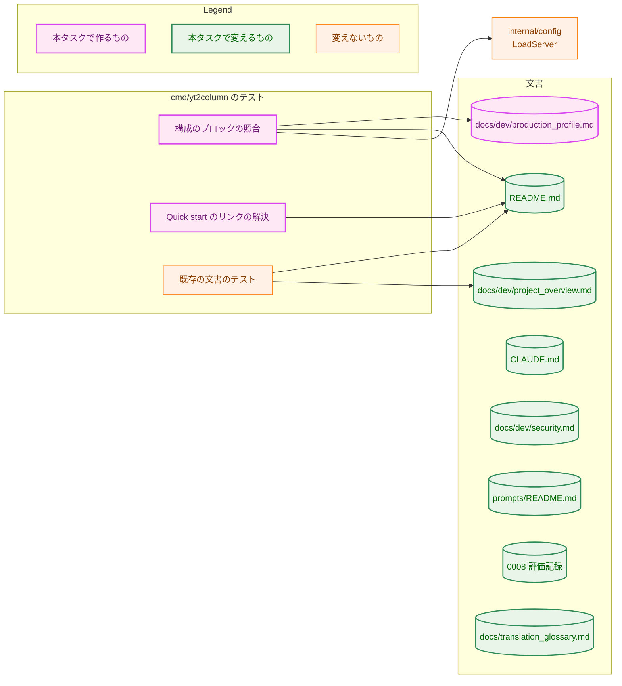
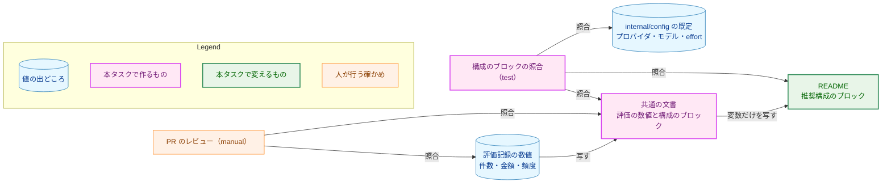
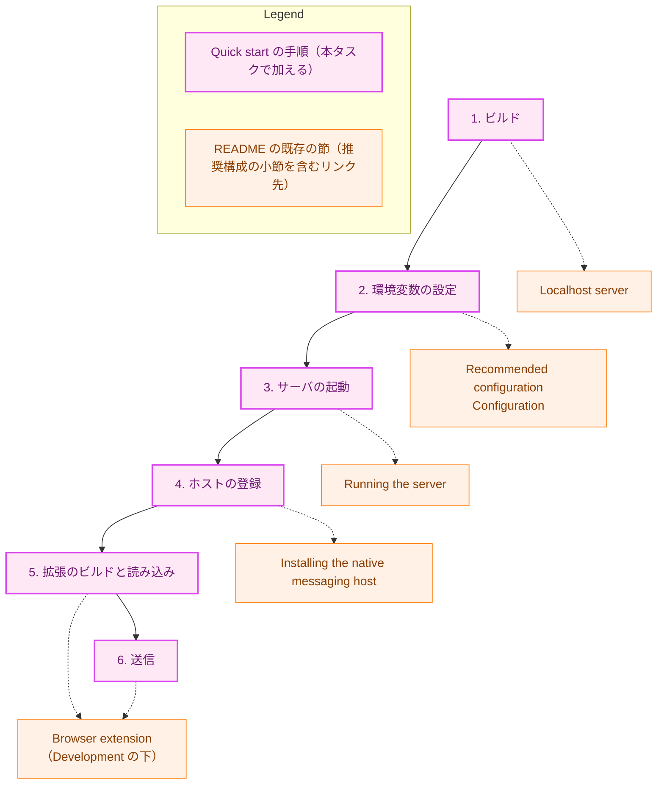
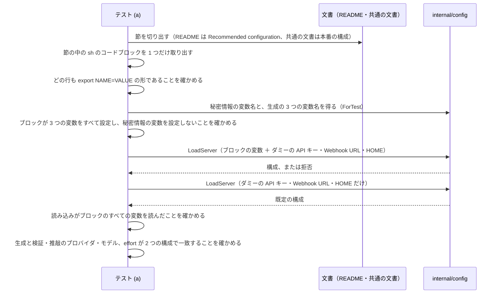
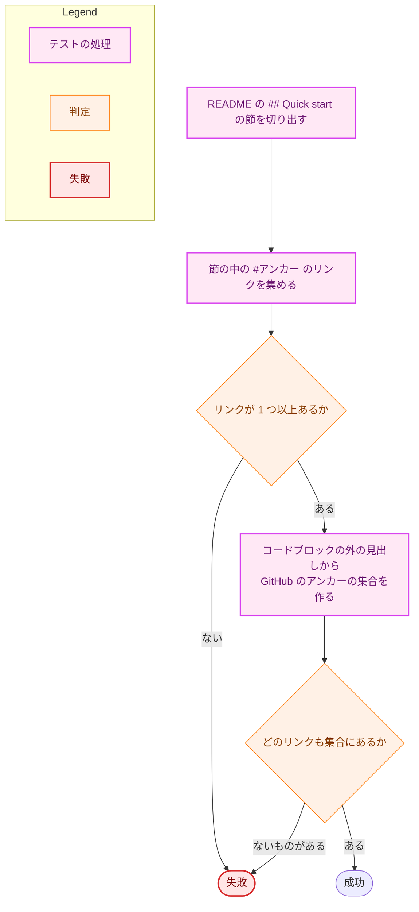

# アーキテクチャ設計書：本番の構成と品質を共通の文書にまとめ、文書の主経路をブラウザ拡張に改める

## Document Status

| Item | Value |
|---|---|
| Status | `draft` |
| Created | 2026-10-26 |
| Review date | - |
| Reviewer | - |
| Comments | - |

本書は [01_requirements.md](01_requirements.md)（要件定義書。以下、要件書）の設計である。既存のファイルについての記述は、コミット `f87f2a1` のファイルで確かめた。`file:line` はこのコミットの行番号を指す。要件書が挙げる行番号は、#490・#171 の変更が入る前のものなので、README のいくつかの行は本書の行番号と一致しない（たとえば、要件書の `README.md:818`「Browser extension」は、本書では `README.md:860`）。F-NNN・AC-NN は要件書の項番を指す。先行タスクの項番は「0008 F-006」のように、タスクの番号を付けて書く。要件のレビューで設計に申し送られた事項（[design_handoff.md](design_handoff.md) の H-01〜H-09）への対応は、付録 A にまとめる。

本書は、要件書 6 章の用語（主経路・補助の経路・本番の構成・共通の文書・品質の目標・製品の制約）を同じ意味で使う。ほかに次の用語を使う。

-   **推奨構成の小節:** README の「Configuration」に加える小節 `### Recommended configuration`（F-003）。
-   **構成のブロック:** 推奨構成の小節と、共通の文書の「本番の構成」の節に置く、`export <変数名>=<値>` の行だけから成るシェルのコードブロック（3.2）。
-   **評価記録:** `docs/tasks/0008_column_prompt/02_evaluation.md`（0008 評価記録）と `docs/tasks/0018_article_quality/02_evaluation.md`（0018 評価記録）。

## 1. 設計の全体像 (Design Overview)

### 1.1. 設計原則

-   **本番の構成の値の正本は、共通の文書だけに置く。** 品質の目標・製品の制約・構成の比較は、共通の文書にだけ書く。README は、英語の読者に向けて、本番の構成を表す環境変数と共通の文書へのリンクだけを繰り返す（要件書 §1「README の推奨構成は小節として加える」）。ほかの文書は共通の文書へリンクし、値を写さない（`CLAUDE.md`「DRY」）。
-   **共通の文書の数値は、評価記録から写すだけにする。** 件数・金額・頻度は、評価記録の値を丸めも言い換えもせずに写し、出典の節を示す（要件書 §4.5）。新しい評価はしない（要件書 §2.3）。
-   **主経路への書き直しは、位置づけの変更に限る。** README・`project_overview.md`・`CLAUDE.md`・`security.md` の書き直しは、主経路を先に、補助の経路を後に書く並べ替えと言い換えに限る。方針の決定は加えも除きもしない（F-004、AC-17）。
-   **既存の見出し・表・節の範囲を動かさない。** README を読むテストは、見出しの文言で節を切り出し（`cmd/yt2column/docs_test.go:382-404` など）、最初に合う表を取る（`cmd/yt2column/docs_test.go:295-309`）。新しい見出しは Quick start と推奨構成の小節の 2 つだけにし、新しい表は置かない。新しいコードブロックには、`#` で始まる行を書かない（3.6、H-05）。
-   **コードが定める値は、コードから導いてテストで確かめる。文章はレビューで読む。** 構成のブロックの変数名と値は、`internal/config` の読み込みに通して既定と照合する（7.1）。Quick start のリンクは、README の見出しに解決するかを構造として確かめる（7.1）。評価の数値と文章は、PR のレビューで読む（`CLAUDE.md`「Document tests check values, structure, and executable examples, never prose」）。

### 1.2. 設計の際に決めたこと（2026-10-26）

人間のレビュアーが決めたもの:

-   **テストは 2 つ加える（H-01）:** (a) 構成のブロックを `config.LoadServer` に通し、何も指定しないときの構成と一致するかを照合するテスト。(b) Quick start の節の `#` で始まるリンクが、README の見出しに解決するかを確かめるテスト。評価の数値（AC-04・AC-05）と、README の既存の見出しの保存（AC-12）は、PR のレビューで確かめる（`manual`）。評価の数値はコードが定める値ではない。また、見出しの一覧をテストに写すと、タスク 0038 が削除した「直書きのリテラルの存在の確認」に当たる（`docs/tasks/0038_doc_test_pruning/01_requirements.md` の「要件定義の際に決めたこと」）。(a) は、変数名・受理される値・「推奨構成はコード上の既定である」という主張の 3 つを、どれもコードから導いて確かめられる。
-   **3 つのパイプラインの図は、入力を 2 行で示して `TranscriptSource` で合流させる形にそろえる（H-04）:** 上の行に主経路の入力（コピーした字幕）を、下の行に補助の経路の入力（URL と yt-dlp）を置く（3.3）。`CopiedSource`・`YtDlpSource` の実装の名前で分ける案は、README の冒頭の読者に型の名前を求めるので採らなかった。
-   **用語集に用語を加える（H-08）:** 主経路・補助の経路・本番の構成・品質の目標・製品の制約を、英訳とともに `docs/translation_glossary.md` に加える（3.9）。README と `CLAUDE.md` の英語の言い方をそろえるためである。

設計で決めたもの（人間のレビュアーに諮らず、理由とともに記す）:

-   **共通の文書は 5 つの節で構成する（H-02）:** 冒頭、パイプライン、本番の構成、品質の目標と結果、製品の制約、構成の比較の順に置く（3.1）。読者が「何で動いているか → どれだけの品質か → 何が起こりうるか → なぜこの構成か」の順に読めるようにするためである。
-   **製品の制約の字数の調整の失敗の項目は、主経路の結果を先に書く（H-02）:** 共通の文書は主経路を主として書く文書だからである。ほかの 7 項目には、経路によって利用者が見る結果の違う項目はない（3.1 の表）。
-   **構成のブロックは `export` の行だけにする（H-01・H-05）:** 推奨構成の小節と共通の文書の「本番の構成」の節に、同じ形のブロックを置く。表にしないのは、`findTable(readme, "Variable")` が最初に合う表を取るため（`cmd/yt2column/docs_test.go:134`）と、テストがブロックから値を取り出しやすいためである。ブロックには `#` で始まる行も、秘密情報の変数も書かない（AC-15、H-05）。
-   **Quick start は `## Quick start` の見出しで、状態の注記（`README.md:17`）と `## Requirements`（`README.md:19`）の間に置く（H-03）:** 手順は番号付きの箇条書きで書き、コードブロックと表は使わない。コマンドはインラインのコードで示す。各手順は既存の節へリンクし、既存の節の説明は繰り返さない（3.2）。
-   **0008 評価記録への参照は、§6 の冒頭に 1 か所と、§6.5 の最後の項目の 2 か所に置く（H-07）:** §6.3・§6.4 のそれぞれに置く案は採らなかった。§6 の全体が 2026-10-25 時点の記録であることを一度に示せば足り、記録の中に追記が散らばらないためである（3.8）。
-   **図の下の `TranscriptSource` の説明も、主経路を先に並べ替える（H-04）:** `CLAUDE.md:141-143` と `docs/dev/project_overview.md:26` の説明は、yt-dlp から書き始めている。図だけを直すと、図と説明の順序が食い違う。中身は変えず、順序だけを入れ替える（3.3・3.4）。
-   **`CLAUDE.md`「Development Notes」の、文書を読むテストの一覧に、新しいテストの対象を加える:** `CLAUDE.md:324-328` は、文書を読む Go のテストが何を読むかを列挙している。(a) は共通の文書と README の構成のブロックを読むので、一覧に加えないと記述が古くなる（3.4）。
-   **`max_tokens` の引き上げ（#171）は、共通の文書の記述を変えない（H-09）:** 評価は `max_tokens` 16,000 で行い、B3 の 10 件の出力は最大 13,688 トークンで、打ち切られていない（0018 評価記録 §4.7.2 の 1 段目の表）。本番の上限の 40,000 でも、同じ記事が得られる。本番の構成の定義（テンプレート・プロバイダ・モデル・effort。要件書 6 章）にも `max_tokens` は含まれない。製品の制約の 8 項目に、出力の上限による打ち切りはない。

### 1.3. 概念モデル

本タスクの後の、文書の間の参照の関係を示す。矢印 A → B は「A が B へリンクする（B を参照する）」ことを表す。



-   共通の文書は、値の出典として評価記録と 0008 要件定義書を参照する。評価記録の §6 は、まとめた先として共通の文書を参照し返す。
-   README の推奨構成の小節だけが、共通の文書の値（本番の構成の環境変数）を繰り返す。共通の文書の冒頭の更新の規則は、この 2 か所を一緒に更新するよう求める（AC-06）。

### 1.4. 既存の方針の例外

本書は、ほかのタスクの設計書や `project_overview.md` が定めた方針に、例外を設けない。理由は次のとおりである。

-   `project_overview.md` の「決定済みの方針」は、書き方を変えるが、決定は変えない（3.3 の対照表）。`project_overview.md:5` の「本書の方針を変更する場合は、タスクの要件定義書でその旨を明記し、本書も更新する」には当たらない。
-   0008 評価記録は `approved` の文書である。参照を足す編集は、要件書が決めたとおり編集上の修正として扱い、status を `approved` のまま保つ（`docs/dev/developer_guide/requirements_process.md`「Editing an approved document」）。これは規則のとおりの扱いで、例外ではない。
-   `CLAUDE.md`「Key Design Patterns」の「Delegate the fragile part」（yt-dlp への委譲と、コピーした字幕のパーサの例外）は変えない。`project_overview.md` の「字幕取得」の項を並べ替えた後も、2 つは同じ決定を述べる（3.3、H-06）。

## 2. システム構成 (System Structure)

### 2.1. 全体の構成

本タスクが変えるファイルと、新しいテストが読むものを示す。矢印 A → B は「A が B を読む」ことを表す。コードの振る舞いは変えない（要件書 §2.3）。



-   文書のノードは、テストから読まれるデータとして円柱で示す。色は変更の種類を表す。
-   既存の文書のテストは変えない。本タスクの書き直しがそれらの検査の対象を壊さないことを、3.6 で確かめる。

### 2.2. コンポーネント配置

| ファイル | 種類 | 内容 | 要件 |
|---|---|---|---|
| `docs/dev/production_profile.md` | 新規 | 共通の文書（3.1） | F-001 |
| `README.md` | 変更 | 冒頭・図・Requirements・Usage の位置づけ、Quick start の節、推奨構成の小節（3.2） | F-002・F-003 |
| `docs/dev/project_overview.md` | 変更 | 冒頭・「実行形式」「字幕取得」「LLM」の項・パイプラインの図と説明（3.3） | F-004 |
| `CLAUDE.md` | 変更 | Quick Links、Architecture Overview の冒頭の一文・図・`TranscriptSource` の説明の順序、Development Notes の文書のテストの一覧（3.4） | F-005 |
| `docs/dev/security.md` | 変更 | 冒頭の位置づけの文（`docs/dev/security.md:5`）（3.5） | F-005 |
| `prompts/README.md` | 変更 | 評価と製品の制約の参照先（`prompts/README.md:9`）（3.7） | F-005 |
| `docs/tasks/0008_column_prompt/02_evaluation.md` | 変更 | §6 の冒頭と §6.5 への参照の追記、`Comments`（3.8） | F-005 |
| `docs/translation_glossary.md` | 変更 | 用語の追加（3.9） | 要件書 6 章（H-08） |
| `cmd/yt2column/docs_test.go` | 変更 | 新しいテスト 2 つと、その補助（7.1） | 要件書 §2.2 のテスト |
| `internal/config/test_helpers.go` | 変更 | テストが変数名を得るための `...ForTest` 関数（必要なもの。7.1） | 同上 |

既存のテストのうち、本タスクで変えるものはない。3.6 の制約を守れば、どれも変えずに通る。

### 2.3. データの流れ

値がどこから来て、どこで確かめられるかを示す。矢印 A → B は「A の値を B に写す、または B が A と照合する」ことを表す。



## 3. コンポーネント設計 (Component Design)

本タスクは Go の型・interface を加えも変えもしない。本章は、各文書の構成と、書き直しの範囲を定める。文面そのものは実装で書き、PR のレビューで読む。

### 3.1. 共通の文書 `docs/dev/production_profile.md`（F-001、H-02）

題は「本番の構成と品質」とする（要件書 §1）。節の構成と順序は次のとおりである。

| 順 | 節 | 内容 | 要件 |
|---|---|---|---|
| 0 | 冒頭（見出しの前の段落） | 本書の目的。更新の規則（本番の構成・品質の目標・製品の制約を変えるタスクは、本書と README の推奨構成の小節を合わせて更新する）。値の出典（0008 の最終の版の評価。記事の生成は 2026-10-23、構成の決定と比較は 2026-10-25）。評価記録は当時の記録として残り、最新の値は本書にあること | AC-06 |
| 1 | パイプライン | 段階の一覧の表（段階・役割・実行する部品）。段階は、コピーした字幕の取得 → 生成 → 字数の調整 → 検証・推敲 → 投稿の順に挙げる。補助の経路（CLI）では、最初の段階が yt-dlp による字幕の取得になることを表の下に注記する | AC-01 |
| 2 | 本番の構成 | LLM を呼ぶ 3 つの段階の表（段階・テンプレート・プロバイダ・モデル・effort。0008 評価記録 §6.1 の表と同じ値）。構成のブロック（3.2 の形）。次の 4 つの記述: 検証・推敲の変数を指定しなければ生成と同じプロバイダとモデルになること。effort は 3 つの段階で共通であること。本番の構成はコード上の既定であること（#490・#171）。利用者が指定しなければならない変数は `ANTHROPIC_API_KEY` と、主経路（サーバ）では `SLACK_WEBHOOK_URL` であること | AC-01・AC-02・AC-15 |
| 3 | 品質の目標と結果 | 品質の目標と、それが既定にするための関門ではなく、記事が目指す水準であること。判定の物差しとして 0008 要件定義書 F-006 へのリンク。最終の版の結果（解釈による判定で 10 件中 8 件、文言どおりの判定で 10 件中 7 件）と 0008 評価記録 §6.2 への参照。評価は CLI が yt-dlp で取得した字幕（キャッシュ）から生成した記事で行ったこと。主経路のコピーした字幕との素材の違いについては、0018 評価記録 §4.9.1 への参照 | AC-03・AC-25 |
| 4 | 製品の制約 | 頻度が 5 本の動画で 2 回ずつ生成した 10 件を母数とする、幅のある値であること。8 項目（下の表）。出典は 0008 評価記録 §6.3 | AC-04・AC-07 |
| 5 | 構成の比較と、構成を決めた理由 | 3 つの構成の表（生成・検証・推敲・目標を満たした記事（解釈 / 文言）・記事 1 本あたりの推定コスト）。値は 0008 評価記録 §6.4 の表のとおりで、DeepSeek の段階は peak の単価によること。構成を決めた理由（検証・推敲の効果と、生成のモデルの効果） | AC-05 |

本書は、未解決の関連 issue を挙げる節や一覧を持たない（AC-07）。

**製品の制約の 8 項目と、経路による違い。** 各項目の本文は 0008 評価記録 §6.3 から写す。写すときに変えるのは、次の表の「写し方」の列に書いた点だけである。数値（頻度・金額・倍率）は変えない（要件書 §4.5）。

| 項目 | 主経路と CLI で利用者が見る結果の違い | 写し方 |
|---|---|---|
| 1. 意味の変わる言い換え | ない（同じ `ArticleWriter` が書く） | そのまま |
| 2. 節の中身と見出しのずれ | ない | そのまま |
| 3. 発言の主体を広げたまとめ | ない | そのまま |
| 4. 話者の取り違え | ない | そのまま。#146 への言及を本文の一部として残す（AC-07） |
| 5. 字数の調整の失敗で記事が出ない | ある | 主経路の結果を先に書く。主経路では記事は投稿されず、失敗の通知が Webhook に投稿される（`README.md:76-79`。サーバは `writer.ErrTooLong` を `classifyWrite` の `default` の枝で `failure.KindLLM` に分類する。`internal/server/job.go:138-155`。通知の理由の文は `internal/publisher/slack_failure.go:111-112`）。CLI は記事を出さない（終了コード 1。`README.md:69`） |
| 6. 概要欄を開かずに送ったコピーした字幕 | 主経路だけで起こる | 0008 評価記録の「書き起こし」を、用語集の「コピーした字幕」に改める（AC-04） |
| 7. 費用 | ない（両方の経路が同じ 3 つの段階を呼ぶ） | 「§6.4 の DeepSeek の構成」を、本書の 5 節への参照に改める |
| 8. ほかの構成での品質の低下 | ない | 「既定のプロバイダは DeepSeek のままなので、本書の構成は環境変数で指定する必要がある」を写さない。代わりに、本番の構成がコード上の既定であり、環境変数でプロバイダやモデルを変えるとこの低下が起こりうることを書く（AC-04） |

-   項目 5 の通知の理由の文は「the LLM call failed」である。長さの超過を表す専用の分類はない（`internal/failure/failure.go:15-27`）。共通の文書は「失敗の通知が投稿される」ことだけを書き、理由の文は書かない。通知の分類を変えることはコードの変更で、本タスクの範囲外である（要件書 §2.3）。
-   主経路だけで起こる、素材の違い（区間の結合・概要欄の切れ。0018 評価記録 §4.9.1）は、3 節の評価の素材の注記で参照する（AC-25）。製品の制約の項目は増やさない（AC-04 が 8 項目を定めている）。

### 3.2. README（F-002・F-003、H-03・H-05）

README は英語で書く（`CLAUDE.md`「Documents」）。変える箇所は次の 6 つである。既存の見出しは文言も順序も変えない（AC-12）。

1.  **冒頭（`README.md:3-15`）。** 最初の段落を、主経路の説明に書き直す。ブラウザ拡張が文字起こしパネルからコピーした字幕を集め、Native Messaging のホスト（`yt2column-nmhost`）と localhost サーバ（`yt2column-server`）を経て記事を生成し、Webhook へ投稿する。続けて、CLI（`yt2column`）は動画の URL を受け取り yt-dlp で字幕を取得する、LLM の呼び出しや投稿の処理を開発・検証するための補助の経路だと書く。図は 3.3 の形にする。箇条書き（`README.md:12-15`）は次のように改める。
    -   「Subtitles are fetched with yt-dlp」を、主経路はコピーした字幕を使い、yt-dlp は CLI だけが使う、という書き方に改める。
    -   「The initial LLM provider is DeepSeek」は、#490 の後のコードと食い違っている（`README.md:725` の表では、既定は `claude`）。既定は claude-opus-5-5（本番の構成）で、DeepSeek も選べると改め、推奨構成の小節へリンクする。
    -   「Designed for local execution.」は残す。
2.  **Quick start（新しい `## Quick start`）。** 状態の注記（`README.md:17`）の後、`## Requirements`（`README.md:19`）の前に置く。拡張の経路で最初の記事を投稿するまでの手順を、次の順の番号付きの箇条書きで書く（AC-09）。

    | 手順 | 書く内容 | リンク先の見出し |
    |---|---|---|
    | 1. ビルド | `make build` | `## Localhost server`（3 つのバイナリを `build/` に作ることを述べる。`README.md:456-457`） |
    | 2. 環境変数の設定 | `ANTHROPIC_API_KEY` と `SLACK_WEBHOOK_URL` を設定する。ほかの LLM の変数は、既定が本番の構成なので要らない | `### Recommended configuration`、`## Configuration` |
    | 3. サーバの起動 | `./build/yt2column-server 2>>server.log` | `### Running the server` |
    | 4. ホストの登録 | `./build/yt2column-nmhost install chrome`（または `brave`） | `### Installing the native messaging host` |
    | 5. 拡張のビルドと読み込み | `make ext-install`・`make ext-build` の後、`extension/dist` を unpacked で読み込む。Node.js のバージョンの条件は、リンク先にある | `### Browser extension` |
    | 6. 送信 | 動画のページで概要欄を開き（「...more」）、文字起こしパネルを開いて字幕の行を選択し、拡張のアイコンから送る | `### Browser extension` |

    -   リンクは、GitHub の見出しのアンカー（`#localhost-server` など）で書く。リンク先はすべて、変更の後の README にある見出しを指す（AC-09。7.1 のテスト (b) で確かめる）。
    -   「Browser extension」は「Development」の下の `###` の節である（`README.md:860`）。節は動かさない（要件書 §2.3）。手順 5 に、拡張のビルドと読み込みの説明は「Development」の節にあると一言書く（H-03）。
    -   既存の節の説明（ソケットのパス、終了コード、拡張の結果の読み方など）は繰り返さない。Quick start は、手順の順序と、各手順の 1 つのコマンドだけを持つ（`CLAUDE.md`「DRY」）。
    -   コードブロックと表は使わない。コマンドはインラインのコードで書く（3.6）。
3.  **Requirements（`README.md:19-27`）。** 箇条書きを 2 つのまとまりに分ける。見出しは加えず、太字の導入の行で分ける（AC-10）。
    -   拡張の経路に必要なもの: Go（`go.mod`）、Node.js（バージョンは `extension/.node-version`。拡張のビルドに使う）、Chrome または Brave、`ANTHROPIC_API_KEY`（既定のプロバイダ）、`SLACK_WEBHOOK_URL`（サーバは必須とする。`README.md:459`）。
    -   CLI だけに必要なもの: `yt-dlp`（または `YT2COLUMN_YTDLP_PATH`。[Setting up yt-dlp](#setting-up-yt-dlp) へのリンク）。`SLACK_WEBHOOK_URL` は CLI では `--slack` のときだけ要る。
    -   プロバイダごとの API キーの説明（DeepSeek なら `DEEPSEEK_API_KEY`、検証・推敲が別のプロバイダならそのキーも要る）は、両方のまとまりに共通するので、2 つのまとまりの後に置く。
4.  **Usage（`README.md:29`）。** 見出しの直後に、CLI は LLM の呼び出しや投稿の処理を開発・検証するための補助の経路であり、主な使い方は Quick start の経路であるという段落を加える（AC-11）。以降のフラグの表と終了コードは変えない。
5.  **推奨構成の小節（新しい `### Recommended configuration`）。** 「Configuration」の中で、変数の表（`README.md:723-735`）とそれに続く段落の後、`### Using DeepSeek`（`README.md:785`）の前に置く（AC-13・AC-14）。
    -   構成のブロック: 言語の指定が `sh` のコードブロックに、`export YT2COLUMN_LLM_PROVIDER=claude`・`export YT2COLUMN_MODEL=claude-opus-5-5`・`export YT2COLUMN_CLAUDE_EFFORT=high` の 3 行だけを書く。空行・コメント・秘密情報の変数は書かない。
    -   ブロックの後の文: この 3 つはコード上の既定なので、指定しなくても同じ構成になること（#490・#171）。`ANTHROPIC_API_KEY` が必要であること（値の例は書かない。AC-15）。`YT2COLUMN_REVIEW_PROVIDER`・`YT2COLUMN_REVIEW_MODEL` を指定しなければ、検証・推敲は生成と同じ構成になること。別の構成にする場合は、環境変数で指定すること。品質の目標と製品の制約は共通の文書にあること（日本語）と、そのリンク。
    -   #171 の注意や、未解決の issue の一覧は書かない（要件書 §1「未解決の関連 issue の一覧は共通の文書に載せない」）。
6.  **そのほか。** 既存の節の本文は、上の 5 つ以外は変えない。「Development」の最後の段落（`README.md:811-815`）の、設計の文書は `project_overview.md` から読む、という案内には、共通の文書を加えない。共通の文書へのリンクは、推奨構成の小節に 1 か所だけ置く（1.1 の正本の原則）。

### 3.3. `docs/dev/project_overview.md`（F-004、H-04・H-06）

**図の形（3 つの図に共通）。** README（`README.md:8-10`）・`project_overview.md`（`docs/dev/project_overview.md:20-22`）・`CLAUDE.md`（`CLAUDE.md:137-139`）の図を、次の形にそろえる（AC-08・AC-18・AC-24）。README と `CLAUDE.md` は英語のラベル、`project_overview.md` は日本語のラベルで書く。型の名前（`TranscriptSource` など）は 3 つとも英語のままにする。

```
Copied transcript (browser extension → native messaging host → localhost server) ─┐
                                                                                   ├→ TranscriptSource → Transcript → ArticleWriter → Article → Publisher
URL → yt-dlp (CLI, for development) ───────────────────────────────────────────────┘
```

-   上の行が主経路の入力、下の行が補助の経路の入力である。どの行も `#` で始まらない（3.6）。
-   罫線の文字の幅は、等幅のフォントで揃うように実装で調整する。

**書き直す箇所。**

1.  **冒頭（`docs/dev/project_overview.md:3`）。** 主経路（ブラウザ拡張から localhost サーバを経て記事を生成し、Webhook へ投稿する）を主な使い方として述べ、CLI（動画の URL を受け取り yt-dlp で字幕を取得し、`--out` か `--slack` で出す）を開発・検証用の補助の経路として述べる（AC-16）。`:5` の更新の規則は変えない。
2.  **「実行形式」（`:10`）。** 太字の見出し語を、主経路を先に書く形（例:「localhost サーバとブラウザ拡張、開発用の CLI」）に改め、本文を主経路 → CLI の順に並べ替える。決定は下の対照表のとおり保つ（AC-17）。
3.  **「字幕取得」（`:11`）。** 太字の見出し語を、主経路はコピーした字幕を使い、CLI は yt-dlp に委譲する、という形に改める。本文を、主経路のコピーした字幕のパーサ（とその範囲） → CLI の yt-dlp への委譲 → 書式が変わったときの代わりの手段、の順に並べ替える。決定は下の対照表のとおり保つ（AC-17）。
4.  **「LLM」（`:12`）。** 今の本文（既定は Claude で DeepSeek も選べる。#490 の後の文面）は保つ。コード上の既定のプロバイダが Claude で、既定で本番の構成になること（#490・#171）と、本番の構成は [production_profile.md](production_profile.md) にあることを、それぞれリンクとともに書き足す（AC-19）。#490・#171 へは issue のリンクを付ける。今の本文の「`docs/tasks/0008_column_prompt/02_evaluation.md` §6.1」への参照は、共通の文書への参照に改める。評価記録は当時の記録で、最新の値は共通の文書にあるからである（AC-06）。
5.  **パイプライン（`:18-26`）。** 図を上の形にする。`TranscriptSource` の説明（`:26`）を、主経路の `CopiedSource` から書き始め、CLI の `YtDlpSource` を後に置く。「初期実装は `YtDlpSource`」という言い方は、実装の順序の記録なので、「CLI は `YtDlpSource` を使う」に改める。yt-dlp のコマンドの例と json3・info.json の説明（`:27-30`）は、`YtDlpSource` の説明として残す（AC-18）。

**変えない箇所。** 「設定（環境変数）」の表（`:105-120`）と、その後の段落（`:122-130`）は変えない。既存のテストが検査する値は、そこと次の行にある（AC-20）。

| 既存のテストが検査する値 | 場所 | テスト |
|---|---|---|
| `YT2COLUMN_CACHE_DIR` と `YT2COLUMN_YTDLP_PATH` を 1 行に書くこと | `docs/dev/project_overview.md:124` | `cmd/yt2column-server/docs_test.go:109-114` |
| `costPrefix` | `:36` | `cmd/yt2column/docs_test.go:574-576` |
| `16,383` | `:52`・`:60` | `cmd/yt2column/docs_test.go:79-88` |
| 表の既定の値 | `:109-112` | `cmd/yt2column/docs_test.go:120-161` |

書き直す 4 つの箇所（冒頭・`:10`・`:11`・`:26`）は、上のどの行とも重ならない。

**決定の対照表（AC-17、H-06）。** 変更の前の「実行形式」（`:10`）と「字幕取得」（`:11`）が述べる決定と、変更の後にそれを述べる項を示す。実装はこの表のすべての行を書き直した後の文に残し、PR のレビューはこの表と差分を照らして、決定の追加も削除もないことを確かめる（`manual`）。

| 決定 | 変更の前 | 変更の後 |
|---|---|---|
| コアロジックを `cmd/` から分離し、両方の入口で共有する | `:10` | 実行形式 |
| localhost サーバが、拡張がコピーした字幕を受け取り、記事を生成して投稿する（タスク 0011） | `:10` | 実行形式（主経路として先に書く） |
| サーバは TCP を待ち受けず、`HOME` だけから導出したパスの Unix ドメインソケットで HTTP を受ける（タスク 0026） | `:10` | 実行形式 |
| 拡張からの送信は、ブラウザが起動する Native Messaging のホストがソケットへ中継する | `:10` | 実行形式 |
| ホストの manifest は利用者が `install`/`uninstall` で登録・削除し、`make build` は登録しない | `:10` | 実行形式 |
| サーバの起動は手動で、サーバは `yt-dlp` を呼ばない | `:10` | 実行形式 |
| CLI はローカルで実行する | `:10` | 実行形式（補助の経路として後に書く） |
| 字幕の取得を外部コマンドの `yt-dlp` に委譲する。理由は、YouTube の非公式な仕様に依存する部分を保守の活発なツールに任せるため | `:11` | 字幕取得（CLI の経路として書く） |
| Go で字幕の取得を自前で実装しない | `:11` | 字幕取得 |
| コピーした字幕のパーサ（`CopiedSource` が `Raw` を解析する箇所）は、パネルの書式に依存する例外である | `:11` | 字幕取得（主経路として先に書く） |
| 依存はそのパーサに限り、Go から YouTube のページやパネルを取得・解析しない | `:11` | 字幕取得 |
| 書式が変わって拒否が続く間は、`yt-dlp` の経路を代わりの手段として残す | `:11` | 字幕取得 |

-   「字幕取得」の決定は、`CLAUDE.md`「Delegate the fragile part」（`CLAUDE.md:194-200`）と同じ内容である。並べ替えの後も、どちらも yt-dlp への委譲とパーサの例外を述べるので、矛盾しない。`CLAUDE.md` 側は変えない（要件書 F-005 の範囲外）。

### 3.4. `CLAUDE.md`（AC-23・AC-24）

`CLAUDE.md` は英語で書く。

1.  **Quick Links の「Project」（`CLAUDE.md:7-10`）。** 「Project Overview」の次に、共通の文書へのリンクを加える。説明の文は英語で、内容（本番の構成・品質の目標・製品の制約と、その根拠の評価の結果）と、文書が日本語であることを述べる（AC-23）。
2.  **Architecture Overview の冒頭の一文（`CLAUDE.md:135`）。** 「A Go CLI that turns ...」を、ブラウザ拡張の経路を主、CLI を開発・検証用の補助として述べる文に改める（AC-24）。
3.  **図（`CLAUDE.md:137-139`）。** 3.3 の形にする（AC-24）。
4.  **`TranscriptSource` の説明（`CLAUDE.md:141-144`）。** 順序だけを入れ替え、`CopiedSource` が主経路の実装であることを先に書く。中身は変えない（H-04）。「Two entry points share the pipeline」の段落（`CLAUDE.md:165-176`）は、2 つの入口の構造を述べるもので、主経路の位置づけを述べていないので変えない。
5.  **Development Notes の文書のテストの一覧（`CLAUDE.md:324-328`）。** 「The other text-sync guards that read documents」の列挙に、新しいテスト (a) が読む「`production_profile.md` と README の構成のブロック」を加える。新しいテストは `cmd/yt2column` にあるので、`doc-guard` CI ジョブ（`.github/workflows/ci.yml:187`）が文書だけの変更でも走らせる。README だけの変更の扱い（`make ext-test` が必要なこと）は変わらない。

### 3.5. `docs/dev/security.md`（AC-26）

冒頭の位置づけの文（`docs/dev/security.md:5`）を、次の 3 つを述べる文に改める。主経路では、利用者がブラウザ拡張からコピーした字幕（と動画の URL・メタ情報）を与えること。CLI では動画 URL を与えること。字幕・動画タイトル・概要欄・LLM の応答・外部サーバーのレスポンスを、信頼できない入力として扱うこと。§1 以降は変えない。

既存のテストは `security.md` の値（環境変数の名前、拡張の ID と権限、§8.2 の節）を読む（`cmd/yt2column/docs_test.go:94-112`、`cmd/yt2column/extension_docs_test.go:63-90`、`cmd/yt2column-server/docs_test.go:118`）。どれも `:5` の文を読まないので、影響はない。

### 3.6. README を読むテストと、書き方の制約（H-05）

README を読む既存のテストと、それぞれが頼る構造を示す。本タスクの README の変更は、右の列の制約を守る。

| テスト | 頼る構造 | 本タスクの変更が守る制約 |
|---|---|---|
| `TestREADMEDocumentsFlags`（`cmd/yt2column/docs_test.go:34`） | `findTable(doc, "Flag")` の最初の表 | 新しい表を置かない |
| `TestLLMDefaultsDocsContract`（`cmd/yt2column/docs_test.go:120`） | `findTable(doc, "Variable")` の最初の表 | 新しい表を置かない。推奨構成の小節は表ではなくコードブロックにする |
| `TestTokenUsageDocsContract`・`TestCostDocsContract`（`cmd/yt2column/docs_test.go:455`・`:513`） | `## Token usage`・`## Estimated cost` の節の範囲 | 見出しの文言を変えない。節の中に見出しを加えない |
| `TestServerDocsContract`（`cmd/yt2column-server/docs_test.go:30`） | `## Localhost server` の節の範囲、その中の `Code` の表、`findTable(readme, "reason")` の最初の表 | Quick start に表を置かない。`## Localhost server` の中は変えない |
| `TestReadmeHostExitCodes`（`cmd/yt2column-nmhost/main_test.go:408`） | `#` で始まる行で節を区切る（コードブロックを区別しない） | `### Installing the native messaging host` の中は変えない。新しいコードブロックに `#` で始まる行を書かない |
| `serverReasons.test.ts`（`extension/test/serverReasons.test.ts:13-42`） | `reason`・`status code`・`extension shows` の見出し行を持つ表 | 新しい表を置かない |
| `metadataDocs.test.ts`（`extension/test/metadataDocs.test.ts:25`） | `### Browser extension` から次の `#`〜`###` の見出しまで（`extension/test/helpers/repoFile.ts:15-25`） | `### Browser extension` の中は変えない |
| `TestClaudeDocsContract`・`TestSlackDocsContract`（`cmd/yt2column/docs_test.go:94`・`:52`） | README の全体に値（環境変数の名前・`make` のターゲット・`16,383`）が含まれること | 既存の本文から値を消さない |
| `extension_docs_test.go`（`cmd/yt2column/extension_docs_test.go:63`） | README の全体に拡張の ID が含まれること | 同上 |

-   `sectionByHeading`（`cmd/yt2column/docs_test.go:382-404`）と `markdownSection` は、コードブロックの中の `#` で始まる行も見出しとして数える。README は、コードブロックの中に `#`・`##` の行をすでに持つ（`README.md:216`・`:222`・`:251`・`:255`）。本タスクの新しいコードブロック（構成のブロックと図）は `#` で始まる行を持たないので、節の範囲は変わらない。
-   Quick start と推奨構成の小節は、どちらも既存のテストが切り出す節の外にある（Quick start は `# yt2column` の直下、推奨構成の小節は `## Configuration` の中）。`## Configuration` の節を切り出すテストはない。
-   Requirements の書き分けは、見出しを加えずに太字の導入の行で行う。`## Requirements` を切り出すテストはないが、AC-12 が許す新しい見出しは Quick start と推奨構成の小節の 2 つだけだからである。

### 3.7. `prompts/README.md`（AC-21）

`prompts/README.md:9` の 2 文目以降のうち、「評価と、その構成で起こりうる記事の誤りや欠け（製品の制約）は、0008 の評価記録 §6 にある」を、本番の構成・品質の目標・製品の制約は共通の文書 `docs/dev/production_profile.md` にある、という参照に改める。最終の版の出典（`docs/tasks/0008_column_prompt/v5/`）へのリンクは残す。

`TestPromptsREADMEMatchesContract`（`internal/pipeline/pipeline_test.go:755`）は、`prompts/README.md` の表と制限の行を読み、`:9` の文は読まないので、影響はない。

### 3.8. 0008 評価記録（AC-22、H-07）

1.  **§6 の冒頭。** 見出し「## 6. 最終の版の評価」と、その直後の既存の段落の間に、引用のブロックを 1 つ加える。本節は 2026-10-25 時点の記録であること、本番の構成・品質の目標・製品の制約の最新の値は共通の文書にあること（リンク）を書く。§6.3 の 8 の「既定のプロバイダは DeepSeek のまま」は、#490 の後のコードとは食い違うが、記録として残す（要件書 §1「0008 評価記録 §6 は残し、参照を足す」）。冒頭の注記は、この食い違いを読者が共通の文書で確かめられるようにする。
2.  **§6.5 の最後の項目。** 「…共通の文書としてまとめる予定である（人の判断、2026-10-25）。」の文の後に、まとめた先の文書へのリンクと追記の日付を、新しい文として加える。既存の文は変えない。
3.  **`Comments`。** 参照を足した日付と、編集上の修正で決定を変えていないことを書く（`(editorial)`）。status・`Review date`・`Reviewer` は変えない。

§6 のほかの文と表は変えない。PR のレビューは、§6 の差分が上の 2 か所の追記だけであることを確かめる（`manual`）。

### 3.9. 用語集 `docs/translation_glossary.md`（H-08）

次の行を加える。

| 日本語 | English | 備考 |
|---|---|---|
| 主経路 | primary path | ブラウザ拡張がコピーした字幕を集め、Native Messaging のホストと localhost サーバを経て記事を生成・投稿する経路 |
| 補助の経路 | development path | CLI が動画の URL を受け取り、yt-dlp で字幕を取得する経路。開発・検証に使う |
| 本番の構成 | production profile | 生成・字数の調整・検証・推敲のテンプレート・プロバイダ・モデル・effort の組。`docs/dev/production_profile.md`。README の推奨構成の小節（Recommended configuration）が環境変数で示す |
| 品質の目標 | quality target | 0008 F-006 |
| 製品の制約 | product limitations | 本番の構成で起こりうる記事の誤りや欠け。0008 評価記録 §6.3 |

用語集の変更は、`.claude/commands/mktrans.md` の手順のとおり、ほかの変更とは別のコミットにする。

## 4. エラーハンドリング設計 (Error Handling Design)

本タスクは、コードのエラーの型も、エラーの文言も加えない（要件書 §2.3）。

新しいテストの失敗の文言は、どの文書のどの節の何が合わないかを示す（例: README の推奨構成の小節の構成のブロックが、`internal/config` が読まない変数を設定している）。テストの失敗の扱いは、既存の文書のテストと同じく `t.Errorf`・`t.Fatalf` で報告する。

## 5. セキュリティ考慮事項 (Security Considerations)

N/A。本タスクは文書と、文書を読むテストだけを変える。外部コマンドの起動・秘密情報の扱い・キャッシュ・ネットワーク・信頼できないテキストの埋め込みのいずれにも触れないので、条件付きのガイド（`docs/dev/security.md`）の適用の条件に当たらない（要件書 §4.2）。脅威モデルの図は置かない。

-   **文書の秘密情報（AC-15）:** 共通の文書と README に加える記述は、秘密情報の変数（`ANTHROPIC_API_KEY`・`DEEPSEEK_API_KEY`・`SLACK_WEBHOOK_URL`）を変数名だけで示す。構成のブロックには秘密情報の変数を書かず、テスト (a) はブロックが秘密情報の変数を設定していたら失敗する（7.1）。テスト (a) が `config.LoadServer` に渡す API キーと Webhook URL は、テストの中のダミーの値で、実在の値ではない。文章の中の値の例は、PR のレビューで確かめる。
-   **`security.md` の冒頭の文（AC-26）:** 位置づけの記述だけを変え、脅威の分析と対策（§1 以降）は変えない。

## 6. 処理フローの詳細 (Processing Flow Details)

### 6.1. Quick start が案内する経路

README の Quick start の手順と、リンク先の節の対応を示す。矢印 A → B は「手順 A の次に手順 B を行う」ことを、点線の矢印は「手順が既存の節へリンクする」ことを表す。



-   推奨構成の小節は本タスクで加える見出しだが、Quick start から見ればリンク先の節なので、図ではリンク先と同じ色で示す。

### 6.2. テスト (a): 構成のブロックの照合

1 つの文書（README または共通の文書）について、テストが行う確かめの順を示す。



-   **ブロックのすべての変数が読まれたかを確かめる理由:** 変数名を書き誤ると（例: `YT2COLUMN_MODLE`）、`internal/config` はその変数を読まず、既定の構成と一致してしまう。`lookup` が問い合わせを受けた変数名を記録し、ブロックの変数名がすべて問い合わせられたかを確かめれば、この誤りで失敗する。
-   **値の誤り:** モデル名を書き誤ると（例: `claude-opus-5-6`）、モデルが既定と一致せずに失敗する。受理されない値（例: effort の `hgh`）は、`LoadServer` の拒否で失敗する。
-   **3 つの変数の名前:** 「本番の構成を表す 3 つの変数」（AC-02・AC-13）を確かめるため、`YT2COLUMN_LLM_PROVIDER`・`YT2COLUMN_MODEL`・`YT2COLUMN_CLAUDE_EFFORT` の名前を `internal/config` の定数から得る（`internal/config/config.go:32-38`。テストへは `test_helpers.go` の `...ForTest` 関数で渡す。今ある `...ForTest` 関数は `internal/config/test_helpers.go:16-62`）。テストに名前を直書きしない。
-   **読み込み関数:** 主経路のサーバの `LoadServer` を使う。CLI の `Load` も同じ `loadLLM` で LLM の設定を読む（`internal/config/config.go:283`・`:349-389`）ので、どちらでも結果は同じである。

### 6.3. テスト (b): Quick start のリンクの解決



矢印 A → B は「A の次に B を行う」ことを表す。

-   **アンカーの規則:** GitHub が見出しから作るアンカー（英字を小文字にし、英数字・空白・`-`・`_` 以外の文字を除き、空白を `-` にする）を、テストの中の小さな関数で作る。今の README の既存のリンク（`#setting-up-yt-dlp`・`#installing-the-native-messaging-host` など）が、この規則で作るアンカーと一致することを、実装で確かめる。同じアンカーの見出しが 2 つある場合の接尾辞（`-1`）は、Quick start のリンク先にないので扱わない。
-   **コードブロックの外の見出しだけを数える:** README のコードブロックの中にある `#` の行（`README.md:216` など）から作ったアンカーを集合に入れると、存在しない見出しへのリンクが通りうる。そのため、フェンスの中の行は見出しとして数えない。既存の `headingLevel`（`cmd/yt2column/docs_test.go:361-376`）はフェンスを区別しないので、フェンスを数える処理を足す。

## 7. テスト戦略 (Test Strategy)

### 7.1. 文書のテスト（`cmd/yt2column/docs_test.go`）

-   **(a) 構成のブロックの照合:** 6.2 のとおり。README の `### Recommended configuration` と、共通の文書の「本番の構成」の節の 2 つに当てる。節が見つからない、ブロックがない・2 つ以上ある、形の合わない行がある場合も失敗する。共通の文書のパスを、既存のパスの定数（`cmd/yt2column/docs_test.go:22-29`）に加える。
-   **(b) Quick start のリンクの解決:** 6.3 のとおり。
-   **置き場所:** 2 つとも、README と `project_overview.md` を読む既存のテストと同じ `cmd/yt2column/docs_test.go` に置き、既存の補助（`readDoc`・`sectionByHeading`）を使う。`doc-guard` CI ジョブが `./cmd/yt2column` を走らせる（`.github/workflows/ci.yml:187`）ので、文書だけの変更でも CI で確かめられる。
-   **失敗することの確認:** `CLAUDE.md`「Every test must be able to fail for its stated reason」に従い、実装のときに次のように壊して失敗を確かめ、コミットのメッセージに書く。(a): ブロックの変数名を書き誤る、モデル名を変える、3 つの変数の 1 つを消す、秘密情報の変数の行を加える。(b): Quick start のリンクを存在しないアンカーに変える、コードブロックの中の `#` の行のアンカーに変える。
-   **加えないテスト:** 評価の数値（AC-04・AC-05）は、評価記録の値でコードが定める値ではないので、PR のレビューで照らす。モデル名 `claude-opus-5-5` が単価の表にあることは、`internal/pricing/rates_test.go:35` がすでに確かめており、共通の文書はそれを主張しない。README の既存の見出しの保存（AC-12）は、PR の差分で確かめる（1.2）。

### 7.2. 既存のテスト

本タスクは既存のテストを変えない。`make test`（文書を読む Go のテスト）・`make ext-test`（README を読む拡張のテスト）・`make lint` が通ることを確かめる（要件書 §4.3）。README を変えるので、`make ext-test` も走らせる（`CLAUDE.md`「Development Notes」）。

### 7.3. 統合テスト・セキュリティテスト

N/A。コードの振る舞いを変えないので、統合テストは要らない。セキュリティの観点は 5 章のとおりで、テスト (a) の秘密情報の変数の確認のほかに加えるテストはない。

### 7.4. 受け入れ基準と確かめ方の対応

`test` は 7.1 のテスト、`manual` は PR のレビューでの読み取りを指す。

| AC | 確かめ方 | 内容 |
|---|---|---|
| AC-01 | manual | 共通の文書の 1・2 節の段階の一覧と表 |
| AC-02 | test (a) ＋ manual | 変数名・値・既定との一致は (a)。ほかの記述はレビュー |
| AC-03 | manual | 3 節の目標・リンク・件数 |
| AC-04 | manual | 4 節の 8 項目と値を 0008 評価記録 §6.3 と照らす |
| AC-05 | manual | 5 節の表を 0008 評価記録 §6.4 と照らす |
| AC-06 | manual | 冒頭の更新の規則と出典 |
| AC-07 | manual | 未解決の issue の節・一覧がないこと |
| AC-08 | manual | README の冒頭と図 |
| AC-09 | test (b) ＋ manual | リンク先の解決は (b)。手順の順序はレビュー |
| AC-10 | manual | Requirements の書き分け |
| AC-11 | manual | Usage の段落 |
| AC-12 | manual | 差分で既存の見出しの文言と順序を確かめる |
| AC-13 | test (a) ＋ manual | 3 つの変数と値は (a)。`ANTHROPIC_API_KEY` と検証・推敲の記述はレビュー |
| AC-14 | test (a) ＋ manual | 既定との一致は (a)。リンクと文はレビュー |
| AC-15 | test (a) ＋ manual | ブロックに秘密情報の変数がないことは (a)。文章はレビュー |
| AC-16 | manual | `project_overview.md` の冒頭 |
| AC-17 | manual | 3.3 の決定の対照表と差分を照らす |
| AC-18 | manual | `project_overview.md` の図と説明 |
| AC-19 | manual | 「LLM」の項のリンクと記述 |
| AC-20 | test（既存） | 3.3 の表の既存のテストが通ること |
| AC-21 | manual | `prompts/README.md:9` の参照 |
| AC-22 | manual | 0008 評価記録 §6 の差分が追記だけで、status と `Comments` が要件のとおりであること |
| AC-23 | manual | `CLAUDE.md` の Quick Links |
| AC-24 | manual | `CLAUDE.md` の冒頭の一文と図 |
| AC-25 | manual | 共通の文書の 3 節の評価の素材の注記 |
| AC-26 | manual | `security.md:5` の文と、§1 以降の差分がないこと |

## 8. 実装の優先順位 (Implementation Priorities)

#490 と #171 はすでに `main` に入っている（`f87f2a1` の `README.md:725-731`、`internal/config/config.go:59-62`・`:699`）。要件書 §5 の前提（既定の変更が入った後に文書を変える）は満たされている。

1.  共通の文書を作る（3.1）。ほかの文書がリンクする先なので最初に作る。
2.  テスト (a) と、`internal/config/test_helpers.go` の `...ForTest` 関数を加える（6.2）。共通の文書の構成のブロックで通ることを確かめる。
3.  README を変える（3.2）。テスト (a) を README にも当て、テスト (b) を加える。
4.  `project_overview.md`・`CLAUDE.md`・`security.md`・`prompts/README.md` を変える（3.3〜3.5・3.7）。
5.  0008 評価記録に参照を足す（3.8）。
6.  用語集を変える（3.9。別のコミット）。
7.  `make test`・`make ext-test`・`make lint` を走らせる。

すべてを 1 つの PR にする。文書だけを先に入れると、テストが確かめない期間ができる。逆にテストだけを先に入れると、共通の文書がなくて失敗する。

## 9. 将来の拡張性 (Future Extensibility)

-   **本番の構成が変わったとき:** 構成を変えるタスクは、共通の文書と README の推奨構成の小節を更新する（AC-06）。コードの既定を変えると、テスト (a) が 2 つの構成のブロックの食い違いで失敗するので、更新を忘れない。品質の目標と製品の制約は、そのタスクの評価記録を出典として書き直す（要件書 §4.5）。
-   **主経路での評価をしたとき:** 今の品質の結果は、補助の経路の素材（yt-dlp の字幕）によるものである（AC-25）。主経路の素材で評価したタスクは、共通の文書の 3 節の結果と注記を書き換える。
-   **プロバイダを加えたとき:** 共通の文書の 5 節は、評価した構成だけを比べる。評価していない構成は載せない。

## 付録 A. 設計への申し送り（design_handoff.md）への対応

| 項目 | 対応 |
|---|---|
| H-01: 文書の値と構造を検査するテスト | 人間のレビュアーの判断で、テスト (a)（構成のブロックの照合）と (b)（Quick start のリンクの解決）を `cmd/yt2column/docs_test.go` に加える（1.2、6.2、6.3、7.1）。環境変数の名前・値は (a) が `internal/config` の読み込みで確かめる。単価の表は `internal/pricing/rates_test.go:35` が確かめるので加えない。AC-12 と評価の数値は `manual` |
| H-02: 共通の文書の節の構成と順序 | 3.1 の 5 つの節の構成。字数の調整の失敗の項目は主経路の結果を先に書く。ほかの 7 項目に、経路による見え方の違いはない（3.1 の表）。値は 0008 評価記録 §6.3 から変えない |
| H-03: README の Quick start の手順の粒度と見出し | 見出しは `## Quick start`。6 つの手順は既存の節へのリンクと各 1 つのコマンドだけを持ち、説明は繰り返さない。「Browser extension」が「Development」の下にあることは手順 5 で一言書く（3.2） |
| H-04: 3 つのパイプラインの図の形 | 人間のレビュアーの判断で、入力を 2 行で示して `TranscriptSource` で合流させる形にそろえる（3.3）。図の下の `TranscriptSource` の説明も、主経路を先に並べ替える（3.3・3.4）。README の冒頭の箇条書きは 3.2 で書き直す |
| H-05: README の見出しと表を読むテストへの影響 | 3.6 の表のとおり。新しい表を置かず、新しいコードブロックに `#` で始まる行を書かず、新しい見出しは 2 つだけにする。Requirements の書き分けは見出しを加えずに行う |
| H-06: `project_overview.md` の書き直しと、既存のテストの検査対象 | 書き直す箇所は、既存のテストが検査する行と重ならない（3.3 の表）。決定の対照表を 3.3 に置き、PR のレビューで照らす。`CLAUDE.md`「Delegate the fragile part」とは矛盾しない（3.3） |
| H-07: 0008 評価記録への参照の置き場所 | §6 の冒頭の引用のブロックと、§6.5 の最後の項目の後の新しい文の 2 か所（3.8） |
| H-08: 用語集 | 人間のレビュアーの判断で、5 つの用語を加える（3.9） |
| H-09: #490・#171 の決定との整合 | #490・#171 は `main` に入っている。既定は、プロバイダ `claude`（`internal/config/config.go:59`）、モデル `claude-opus-5-5`（`:62`）、effort `high`（`:699`）である。利用者が指定しなければならない LLM の変数は `ANTHROPIC_API_KEY` だけで、AC-02・AC-13・AC-14・AC-19 はこれに合わせて書く（3.1・3.2・3.3）。テスト (a) が照合する既定の値は、`LoadServer` の結果から得るので、テストに値を写さない。`max_tokens` の 40,000 への引き上げは、製品の制約の記述を変えない（1.2）。#490・#171 は README「Configuration」と `project_overview.md`「設定（環境変数）」をすでに変えており、本タスクはその表と段落を変えない（3.2・3.3）。`project_overview.md`「LLM」の項は #490 の文面を保ち、AC-19 の記述を書き足す |
