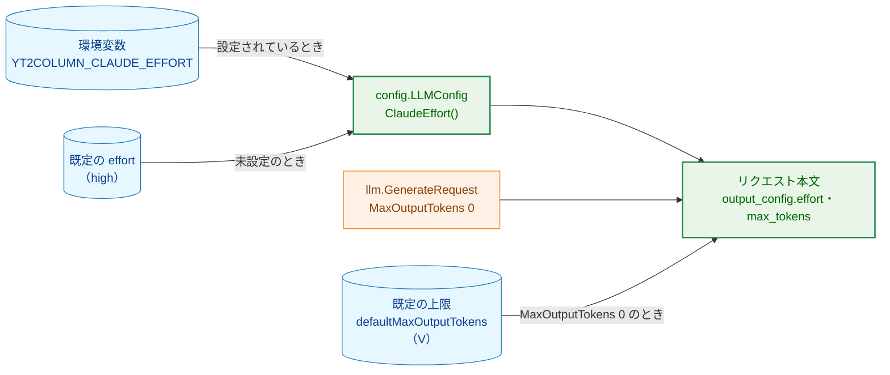
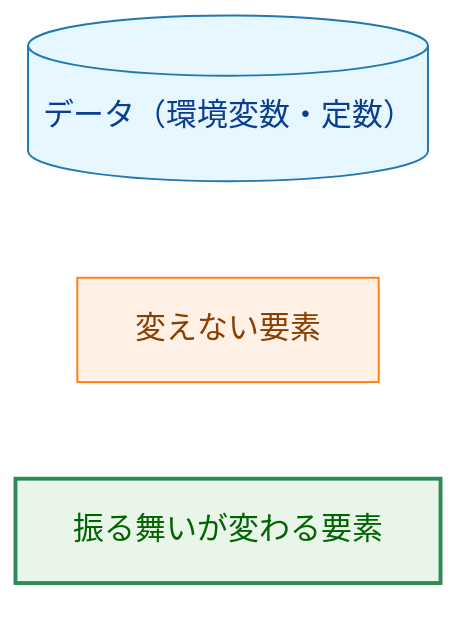
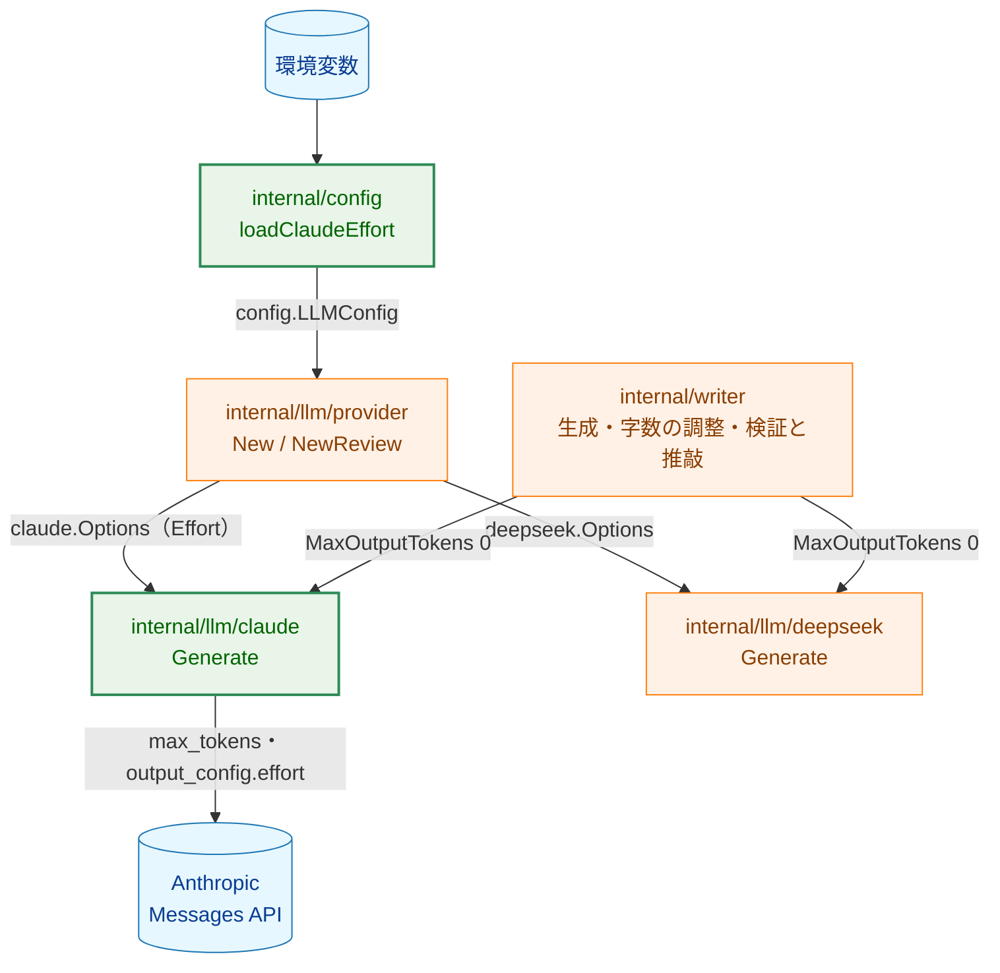
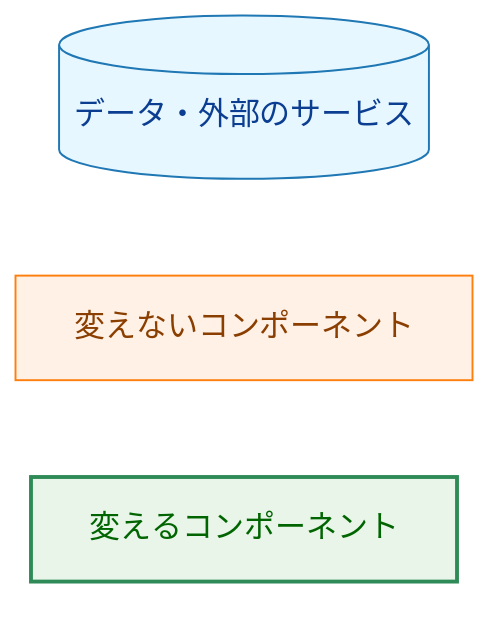
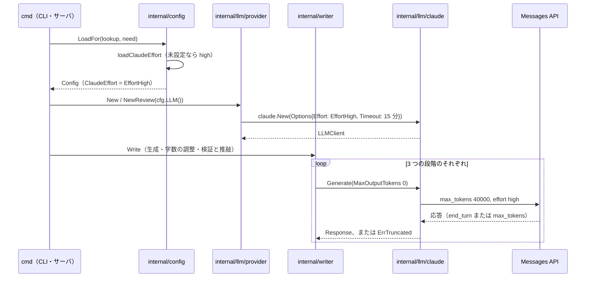
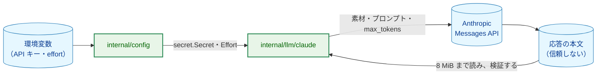
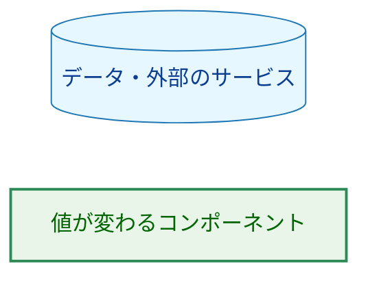
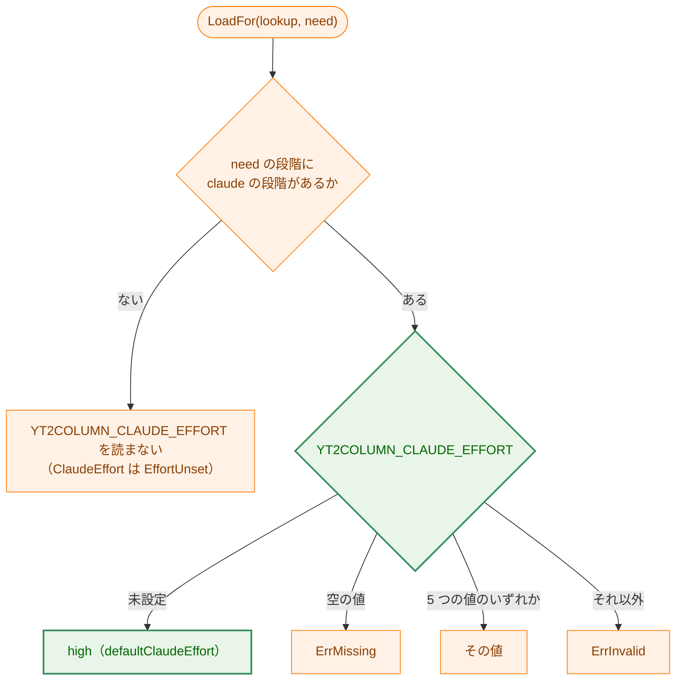

# アーキテクチャ設計書：Claude の effort の既定を high にし、出力の上限 16,000 を緩和する

## Document Status

| Item | Value |
|---|---|
| Status | `draft` |
| Created | 2026-10-25 |
| Review date | - |
| Reviewer | - |
| Comments | - |

本書は [01_requirements.md](01_requirements.md)（要件定義書。以下、要件書）の設計である。既存のファイルについての記述は、コミット `d92286a` のファイルで確かめた。`file:line` はこのコミットの行番号を指す。F-NNN・AC-NN は要件書の項番を指し、先行タスクの項番は「0009 F-006」のようにタスクの番号を付けて書く。要件のレビューで設計に申し送られた事項（[design_handoff.md](design_handoff.md) の H-01〜H-08）への対応は、付録 A にまとめる。

本書は、要件書 6 章の用語（effort、出力の上限、V、段階、本番の構成、打ち切り）を同じ意味で使う。ほかに次の用語を使う。

-   **既定の effort:** `YT2COLUMN_CLAUDE_EFFORT` が未設定のときに設定の読み込みが使う effort。本書では `high` である。
-   **既定の上限:** Claude アダプタが、`llm.GenerateRequest` の `MaxOutputTokens` が 0 のときに送る `max_tokens`。今は 16,000 で、本書の後は V（40,000）である。
-   **最も遅い出力の速さ:** 既存の測定から計算した出力の速さ（出力のトークン数 ÷ 所要時間）のうち、最も小さい値。本書では 98.1 トークン/秒である（1.4）。
-   **上限のガイド:** 本タスクで新設する英語の開発者ガイド `docs/dev/developer_guide/claude_output_limit.md`。既定の上限の根拠を測り直す手順を書く（3.5）。

## 1. 設計の全体像 (Design Overview)

### 1.1. 設計原則

-   **環境変数の解釈と既定値は `internal/config` だけが持つ。** 既定の effort は、`internal/config` の読み込みが、`YT2COLUMN_CLAUDE_EFFORT` が未設定のときに入れる。アダプタ（`internal/llm/claude`）とプロバイダの構築（`internal/llm/provider`）は、今までどおり検証済みの `config.LLMConfig` から値を受け取るだけである。既定のプロバイダ `deepseek` も `internal/config` が入れている（`internal/config/config.go:382-411`（`loadProvider`・`loadProviderOptional`））。
-   **既定の effort は、今は未設定がエラーになる条件の中だけで当てる。** 既定を入れるのは `loadClaudeEffort` で、この関数は、実行する段階のうちにプロバイダが `claude` の段階があるときだけ呼ばれる（`internal/config/config.go:525-542`）。呼ばれる条件は変えないので、`--after` で実行しない段階や DeepSeek だけの実行では、今までどおりこの変数を読まない（AC-05）。
-   **ゼロ値の `EffortUnset` をアダプタに届けない仕組みは変えない。** 既定を入れた後も、`claudeparam.EffortUnset` はゼロ値のまま、アダプタの構築が拒否する（`internal/llm/claudeparam/claudeparam.go` の `Effort` の doc コメント）。本書は `EffortUnset` の意味を変えず、未設定のときに `EffortHigh` を代入するだけである（CLAUDE.md「Declare, don't infer」）。
-   **既定の上限は、アダプタの 1 つの定数だけで決まる。** 3 つの段階は、どれも `MaxOutputTokens` を 0 にして呼ぶ（`internal/writer/writer.go:463`・`internal/writer/shorten.go:28`・`internal/writer/review.go:256`）。そのため、Claude アダプタの定数 `defaultMaxOutputTokens`（`internal/llm/claude/request.go:23-26`）を 1 か所変えれば、3 つの段階の上限が同じ値で変わる。段階ごとの値や、利用者が変える手段は作らない（要件書 2.3）。DeepSeek アダプタには触れない。
-   **非ストリーミングと 15 分のタイムアウトは変えない。** V は、`provider.LLMTimeout`（15 分）の半分に収まるように選ぶ（1.4）。新しい通信の仕組みは足さない（1.2 の 3 つ目）。
-   **数値は 1 か所に置き、文書には写さない。** V の値は定数 `defaultMaxOutputTokens` だけにあり、その根拠は本書 1.4 にある。README と上限のガイドは数値を書かず、定数の場所と本書を参照する。数値を写すと、値の一致を確かめるテストが要り（CLAUDE.md「Document tests check values, structure, and executable examples, never prose」）、写した値がコードと食い違いうるためである。

### 1.2. 設計の際に決めたこと（2026-10-25）

人間のレビュアーが決めたもの:

-   **V は 40,000 にする。** 要件書 F-002 の (a)・(b) から決まる範囲は 31,768 以上、44,165 以下である（1.4）。範囲の下端の 32,000 ではなく 40,000 を選んだ。理由は 2 つある。1 つ目は、40 分前後の動画を v5 で測っていないことである（要件書 5. 制約条件）。2 つ目は、16,000 で打ち切られた実行（0018 評価記録 §4.7.4 の roNZ-rLxhUE-1-f2）の出力の真の値が、16,000 以上としか分からないことである。どちらの欠けにも、観測の最大の 2 倍より大きい余裕で備える。上端の 44,000 は、(b) の見積もりの時間が 7.5 分にほぼ等しく、混雑時の速さの低下に余裕がないので選ばなかった。
-   **既定の effort は `internal/config` に置く。** `internal/config` に、既定の effort を表す名前付きの値を置き、その値は `claudeparam.EffortHigh` とする。`claudeparam` には足さない。既定は「環境変数が未設定のときにどう解釈するか」の規則であり、環境変数の解釈は `internal/config` の責務だからである（0009 F-006、`claudeparam` の doc コメントは「値の一覧はここだけにある」と定めるが、既定はその一覧の要素ではない）。
-   **非ストリーミングの長い無通信のリスクは受け入れ、仕組みを足さない。** 公開文書（API errors「Long requests」。2026-10-25 に確認）は、大きな `max_tokens` にはストリーミングを勧め、直接 API を呼ぶ場合は TCP の keep-alive を勧めている。本プロジェクトの HTTP クライアントは Transport を `nil` のままにしており（`internal/llm/llmhttp/llmhttp.go:29-33`）、Go の `http.DefaultTransport` の dialer が TCP の keep-alive（30 秒）を有効にしている。HTTP/2 の PING（`ReadIdleTimeout`）は足さない。無通信で接続が切れたという観測がなく、CLAUDE.md「Performance」の「Do not close a review finding by adding a mechanism until the finding's premise is verified」に従う。
-   **README と上限のガイドに V の数値を書かない。** 1.1 の最後の原則のとおりである。README の `max` の注意は「既定の上限でも」と書き、数値を挙げない（3.4）。

### 1.3. 概念モデル

矢印 A → B は「A の値が B を決める」を表す。



Legend:



### 1.4. V の決定と根拠（F-002・AC-13・H-01）

**使った測定。** 実 API での追加の測定はしていない（要件書「要件定義の際に決めたこと」）。

| 出典 | 構成 | 本書で使う値 |
|---|---|---|
| 0009 `02_architecture.md` §1.4 | Opus 5.5・Sonnet 5.5。当時の仮のテンプレート。各 1 回、`max_tokens` 64,000 の非ストリーミング | `high`・`xhigh` の出力の最大 8,099 トークン。`max` はどちらも 64,000 をすべて推論に使った。速さは Opus 約 114 トークン/秒（64,000 を 559 秒）、Sonnet 約 145 トークン/秒（64,000 を 442 秒）。64,000 の打ち切りの応答の本文は 245,601 バイト |
| 0008 評価記録 §5.7 | Sonnet 5.5・`high`・v5 | 5 本中 2 本が 16,000 で打ち切られ、うち 1 本（roNZ-rLxhUE）は推論だけで 16,000 に達した |
| 0018 評価記録 §4.7.2（B3、1 段目） | Opus 5.5・`high`・v5（本番の構成の生成） | 10 件の出力は 5,030〜13,688 トークン。字数の調整は 7,837・7,371、検証・推敲は最大 4,777 |
| 0018 評価記録 §4.7.4（B4g） | Opus 5.5・`high`・v7（テンプレートだけを変えた構成） | 成功した 10 件の出力は 5,273〜15,884 トークン。roNZ-rLxhUE-1-f2 は 16,000 で打ち切られた（出力の真の値は 16,000 以上としか分からない） |

**出力の速さ。** 0018 の 1 段目の 20 件（B3 の 10 件と B4g の 10 件）について、生成の出力のトークン数を所要時間で割った。値は 98.1〜107.9 トークン/秒で、最も遅いのは B4g の 18tbwwPM91A-1（11,586 トークンを 118.05 秒）の 98.1 トークン/秒である。0018 の所要時間は CLI の実行全体の時間で、生成の呼び出し以外の処理（プロンプトの組み立てなど）を含む。また、10 件を並列に起動している（0018 評価記録 §3.3）。どちらも速さを実際より遅く見積もる向きに働き、(b) の判定では安全側である。0009 の Opus の 114 トークン/秒と Sonnet の 145 トークン/秒は、これより速い。したがって、(b) には 98.1 トークン/秒を使う。

**(a)・(b) から決まる範囲。**

-   (a) V ≥ 15,884 × 2 = 31,768。
-   (b) V ÷ 98.1 トークン/秒 ≤ 450 秒（`provider.LLMTimeout` 15 分の半分）。すなわち V ≤ 44,165（98.14 × 450 の小数点以下を切り捨てた値）。
-   したがって、V は 31,768 以上、44,165 以下である。

**選んだ値と根拠。**

| 項目 | V = 40,000 のときの値 |
|---|---|
| (a) 観測した出力の最大 15,884 に対する倍率 | 約 2.52 倍。本番の構成（v5）の最大 13,688 に対しては約 2.92 倍 |
| (b) 最も遅い出力の速さでの見積もりの時間 | 40,000 ÷ 98.1 ≒ 408 秒（約 6.8 分）。7.5 分以内 |
| (b) 0009 の Opus の速さでの見積もりの時間 | 40,000 ÷ 114.5 ≒ 349 秒（約 5.8 分） |
| (c) モデルが受け付けるか | 受け付ける。公開文書「Models overview」（https://platform.claude.com/docs/en/about-claude/models/overview 、2026-10-25 に確認）は、claude-opus-5-5・claude-sonnet-5-5 の同期の Messages API の出力の上限（Max output）を 128K トークンとしている。0009 §1.4 では、どちらも非ストリーミングで 64,000 を受け付けた |
| 16,000 で打ち切られた実行の扱い | roNZ-rLxhUE-1-f2 の出力は 16,000 以上としか分からない。V はその 2.5 倍である。同じ動画・同じ構成の成功した試行は 15,884 と 11,569 だった。V を超える出力の見込みは小さいとみるが、保証はしない |
| 40 分前後の動画の扱い | v5 では測っていない。0018 でいちばん長い動画は roNZ-rLxhUE（32:29）で、v5 の出力は 10,986・11,122 だった。出力のトークン数は動画の長さの順に並ばない（要件書「要件定義の際に決めたこと」）。2.5 倍の余裕で備えるが、保証はしない（要件書 5. 制約条件） |
| Sonnet 5.5 の扱い | 0008 §5.7 では、`high`・v5 で推論だけで 16,000 に達した実行がある。V で足りるかは測っていない。README で、既定の effort は claude-opus-5-5 に合わせた値であり、ほかのモデルでは打ち切られうると案内する（AC-19、3.4） |

**ほかのモデルの出力の上限（H-02）。** 同じ公開文書で、claude-haiku-5-5 と claude-fable-5-1 の出力の上限も 128K トークンである。現行のモデルで、出力の上限が V より小さいものはない。そのため、要件書 4.4 の「V を超えて `400` で失敗しうるモデル」は、現行のモデルにはない。README には、この点についての案内を足さない。旧世代のモデル（例: 公開文書の「Legacy models」）の出力の上限は確かめていない。それらのモデルで `400` が返った場合は、今までどおり HTTP の状態のエラーとして報告され、`errors.go` の案内文が `max_tokens` を確かめるよう促す（`internal/llm/claude/errors.go:60`）。

## 2. システム構成 (System Structure)

### 2.1. 全体の構成

矢印 A → B は「A が B を呼ぶ、または B に値を渡す」を表す。緑のノードが本タスクで振る舞いが変わる要素である。



Legend:



図の矢印は、すべて今のコードにある関係である（`internal/llm/provider/provider.go:28-38`・`:54-78`、`internal/writer/writer.go:463`・`shorten.go:28`・`review.go:256`）。本タスクは新しい関係を足さない。

### 2.2. コンポーネント配置

| 変更 | 置き場所 | 理由 |
|---|---|---|
| 既定の effort | `internal/config`（`config.go` の `loadClaudeEffort` と、既定を表す名前付きの値） | 環境変数の解釈は `internal/config` の責務（1.2） |
| 既定の上限 V | `internal/llm/claude/request.go` の `defaultMaxOutputTokens` | Messages API は `max_tokens` を必須とし、0 を受け付けない。そのため「0 のときに送る値」は Claude アダプタの事情で、アダプタの外に出さない（CLAUDE.md「Provider details stay in their adapter package」） |
| タイムアウトの根拠のコメント | `internal/llm/provider/provider.go:16-19` | 値は変えず、根拠の記述だけを V に合わせる（H-03） |
| 上限のガイド | `docs/dev/developer_guide/claude_output_limit.md`（新設、英語） | 要件書「要件定義の際に決めたこと」と H-08 |

### 2.3. データの流れ

プロバイダが `claude` で、`YT2COLUMN_CLAUDE_EFFORT` が未設定の実行の流れを示す。



`--after` による再開や、DeepSeek だけを使う実行では、`loadClaudeEffort` が呼ばれず、この流れは起きない（AC-05）。

## 3. コンポーネント設計 (Component Design)

### 3.1. `internal/config`：既定の effort（F-001・H-06）

**型と値。** 新しい公開の型は足さない。`internal/config` に、既定の effort を表す非公開の名前付きの値を足す。

```go
// defaultClaudeEffort is the effort used when YT2COLUMN_CLAUDE_EFFORT is
// unset and a stage the run needs uses the claude provider.
const defaultClaudeEffort = claudeparam.EffortHigh
```

**`loadClaudeEffort` の規則。** 呼ばれる条件（`loadProviderVars` の `claude` の判定、`internal/config/config.go:525-542`）は変えない。呼ばれたときの規則を次のようにする。

| `YT2COLUMN_CLAUDE_EFFORT` | 今 | 本書の後 |
|---|---|---|
| 未設定 | `ErrMissing`（変数名を持つ `*VarError`） | `defaultClaudeEffort`（`high`）を入れ、エラーにしない |
| 空の値 | `ErrMissing` | 変えない（`ErrMissing`） |
| 5 つの値のいずれか | その値 | 変えない |
| それ以外 | `ErrInvalid`（固定の理由 `reasonClaudeEffort`） | 変えない |

空の値を未設定と区別するのは、`docs/dev/project_overview.md`「設定（環境変数）」と README の「an empty value is treated as set and rejected, not as unset」の方針に従うためである。`loadAnthropicWorkspaceID`（`config.go:603-620`）も、未設定と空の値を同じように区別している。

**doc コメントの更新。** 次の 2 か所は「claude なら必須」と書いているので、「未設定なら `high`」に直す。

-   `LLMConfig.ClaudeEffort` の doc コメント（`internal/config/config.go:158-159`）。「`EffortUnset` でない」という保証は変わらない。
-   `loadClaudeEffort` の doc コメント（`internal/config/config.go:586-589`）。

**ほかの変数への影響（AC-06）。** `loadProviderVars` は、`ANTHROPIC_API_KEY`・`YT2COLUMN_CLAUDE_EFFORT`・`ANTHROPIC_WORKSPACE_ID` のエラーを別々に集める（`config.go:534-540`）。effort の既定はこのうち 1 つの関数の中だけで当てるので、`ANTHROPIC_API_KEY` の未設定は今までどおり `ErrMissing` になる。

### 3.2. `internal/llm/claude`：既定の上限（F-002）

`defaultMaxOutputTokens`（`internal/llm/claude/request.go:23-26`）の値を 16,000 から 40,000 に変える。doc コメントに、値の根拠は本書 1.4 にあること、測り直しの手順は上限のガイドにあることを書く。`effectiveMaxTokens`（`request.go:66-75`）の規則（正の `MaxOutputTokens` はその値、0 なら既定の上限）は変えない。打ち切りのエラーのメッセージは、`effectiveMaxTokens` が返す値を `requestSummary` 経由で使っている（`response.go:297-307`）ので、V を送ったリクエストのメッセージは自動的に 40,000 を示す（AC-10）。

### 3.3. `internal/llm/provider`：タイムアウトの根拠（H-03・AC-12）

`LLMTimeout` の値（15 分。`internal/llm/provider/provider.go:20`）は変えない。doc コメント（`provider.go:16-19`）の「Claude アダプタの既定の上限の非ストリーミングの呼び出しは、十分に短い時間で終わると測定した」を、V に合わせて直す。新しい記述は、既定の上限を最も遅い出力の速さで出力したときの見積もりがタイムアウトの半分以内であること、根拠は本書 1.4 にあることを書く。CLI のタイムアウトのメッセージ（`cmd/yt2column/run.go:965`）と、サーバの停止の待ち時間（`cmd/yt2column-server/run.go:40-43`・`:232-235`）は `LLMTimeout` から計算しているので、変わらない。

### 3.4. 利用者向けの文書（F-003・AC-14〜AC-16・AC-19）

| 文書 | 変更 |
|---|---|
| README「Configuration」の表の `YT2COLUMN_CLAUDE_EFFORT` の行（`README.md:724`） | 「When unset」を「`high` when the generation or review provider is `claude`」に直す。空の値がエラーになることは、表の後の既存の文（`README.md:735-736`）が述べている（AC-14） |
| README の表の後の `max` の注意（`README.md:750-752`） | 残す。「既定の出力の上限でも、`max` は推論だけで上限を使い切り、記事の本文を返さないと見込まれる」と書き、数値は挙げない。根拠は、0009 §1.4 で 64,000（V より大きい）でも推論だけで上限に達したことである（AC-15） |
| README の `max` の注意の後 | 段落を足す。既定の `high` は claude-opus-5-5 に合わせて選んだ値であること、ほかのモデル（例: claude-sonnet-5-5）では `high` でも出力の上限に達して打ち切られうること、その場合は `YT2COLUMN_CLAUDE_EFFORT` で effort を下げられることを書く（AC-19） |
| README の `--after` の段落（`README.md:116-121`） | 「`claude` its effort) are still required」を削り、API キーだけが必須である書き方にする（AC-14） |
| `docs/dev/project_overview.md`「設定（環境変数）」の表の `YT2COLUMN_CLAUDE_EFFORT` の行（`:115`） | 「未設定のとき」を「生成または検証・推敲のプロバイダが `claude` なら `high`」に直す（AC-16） |
| `docs/dev/developer_guide/package_reference.md` の `internal/config` の行（`:27`） | 「the Claude effort via `claudeparam.ParseEffort`」に、未設定なら `high` であることを加える |

README の打ち切りの料金（H-05）は書かない。料金は単価の表の改定で変わり、文書に写すと古くなるためである。本書 4.3 に記録するだけにする。

### 3.5. 上限のガイド（F-003・AC-17・AC-18・H-08）

`docs/dev/developer_guide/claude_output_limit.md` を英語で新設する。`pricing_update.md` と同じく、繰り返し行う作業の手順を書く。節の構成は次のとおりである。

| 節 | 内容 |
|---|---|
| When to re-measure | 本番の構成の 3 つの段階のいずれかで、テンプレート、effort、モデルを変えたとき |
| Cost and approval | 測り直しは実 API を呼び、料金がかかる。人の承認を得てから行う（CLAUDE.md「Tool Execution Safety」）。評価の手順は 0008 評価記録 §2.3 と 0018 評価記録 §3 を参照する |
| What to collect | 段階ごとの出力のトークン数（README「Token usage」の `tokens:` の行の `output=`、`--artifacts` の中間生成物に記録したトークン数）、所要時間（CLI の実行の壁時計の時間）、打ち切られた実行の有無（CLI の `generation truncated by the output token limit` のエラー） |
| How to judge | 要件書 F-002 の (a)・(b)・(c) と照らす。(a) 出力の最大の 2 倍以上、(b) 最も遅い出力の速さで 7.5 分以内、(c) 対象のモデルの公開文書の出力の上限以下 |
| What to update | 条件を満たさない場合: 定数 `defaultMaxOutputTokens`（`internal/llm/claude/request.go`）、根拠の記録（その変更を扱うタスクの `02_architecture.md`。本タスクでは本書 1.4）、README の `max` の注意と既定の effort の案内 |

ガイドは V の値も出力の速さも写さない（1.2）。`CLAUDE.md` の Quick Links の「Development Guides」に、ガイドへのリンクと 1 行の説明を足す（AC-18）。

### 3.6. 先行タスクの方針の変更（0009）

本書は、0009 の 2 つの方針を変える。どちらも要件書 5. 制約条件で決まっており、ここでは設計に関わる点を書く。

-   **0009 F-006（`YT2COLUMN_CLAUDE_EFFORT` は claude なら必須で、既定値を持たない）。**
    -   元の方針: `docs/tasks/0009_claude_llm_client/01_requirements.md` F-006 と、その設計（0009 `02_architecture.md` §3.2）。どの effort で生成したかを、設定から常に読み取れるようにするためだった。
    -   例外とする理由: issue #171 の決定。何も指定しない利用者が、本番の構成の effort で記事を作れるようにする。未設定のときの値は README と `project_overview.md` に書くので、文書から読み取れる。
    -   古い振る舞いを確かめているテスト: `internal/config/config_test.go:281` の `TestLoadClaudeMissing` の行 `"effort unset"`。この行を外し、既定を確かめるテストに置き換える（7.1）。同じテストの `"effort empty"` の行（`:282`）は残す。
-   **0009 §3.6（既定の上限は、Anthropic の非ストリーミングの目安の約 16,000 を超えない）。**
    -   元の方針: 0009 `02_architecture.md` §3.6 の表の「`MaxOutputTokens` が 0 のときの `max_tokens`」の行。
    -   今の公開文書: API errors「Long requests」（https://platform.claude.com/docs/en/api/errors 、2026-10-25 に確認）は、16,000 という数値を挙げていない。大きな `max_tokens` にはストリーミングかバッチを勧め、10 分を超える呼び出しに特に注意を促し、公式 SDK は非ストリーミングの呼び出しが 10 分を超えると見込まれるかを確かめると書いている。この確認は SDK の中の仕組みで、標準ライブラリで HTTP を送る本アダプタには当てはまらない。API そのものは、0009 §1.4 で 64,000 の非ストリーミングを受け付けた。V の見積もりの時間（6.8 分）は 10 分に収まる。
    -   例外とする理由: v5 以降のテンプレートと effort `high` では 16,000 で打ち切られる（要件書 1. の背景）。
    -   古い振る舞いを確かめているテスト: 値そのものを固定するテストはない。`internal/llm/claude/claude_test.go:340-372` の `TestGenerateMaxTokens` と `response_test.go:160-181` の `TestGenerateValidationOrder` は定数 `defaultMaxOutputTokens` を参照しているので、値を変えても通る。

### 3.7. コンポーネントの責務

| ファイル | 新規 / 変更 | 責務と変更 | 更新が要る既存のテスト |
|---|---|---|---|
| `internal/config/config.go` | 変更 | `defaultClaudeEffort` を足し、`loadClaudeEffort` が未設定のときに使う。doc コメント 2 か所を直す | `config_test.go:281`（`"effort unset"` の行を外す） |
| `internal/config/config_test.go` | 変更 | 既定のテストを足す（7.1） | — |
| `internal/llm/claude/request.go` | 変更 | `defaultMaxOutputTokens` を 40,000 にし、doc コメントに根拠の場所を書く | なし（3.6） |
| `internal/llm/claude/claude_test.go` | 変更 | `TestGenerateMaxTokens` に、送った値が 31,768 以上であることの確認を足す（7.1） | — |
| `internal/llm/provider/provider.go` | 変更 | `LLMTimeout` の doc コメントの根拠を直す。値は変えない | なし |
| `internal/llm/provider/provider_test.go` | 変更 | effort を設定しない環境で、生成と検証・推敲のアダプタが送る `output_config.effort` を確かめるテストを足す（7.1） | なし（既存の環境はどれも `YT2COLUMN_CLAUDE_EFFORT` を設定している） |
| `internal/writer/steps_test.go` など | 変更 | 字数の調整と検証・推敲の呼び出しが `MaxOutputTokens` 0 を渡すことの確認を足す（7.1）。生成は `writer_test.go:153` がすでに確かめている | — |
| `README.md` | 変更 | 3.4 | `cmd/yt2column/docs_test.go` など、README を読む既存のテストは、変える箇所の値を読まない（3.8） |
| `docs/dev/project_overview.md` | 変更 | 3.4 | 同上 |
| `docs/dev/developer_guide/package_reference.md` | 変更 | 3.4 | なし |
| `docs/dev/developer_guide/claude_output_limit.md` | 新規 | 3.5 | — |
| `CLAUDE.md` | 変更 | Quick Links にリンクを足す | なし |

`internal/writer` と `internal/llm/deepseek` のコードは変えない。

### 3.8. 文書を読む既存のテスト

README と `project_overview.md` を読む Go のテスト（`cmd/yt2column/docs_test.go`）と拡張機能の node のテストのうち、本書が変える箇所（`YT2COLUMN_CLAUDE_EFFORT` の行、`max` の注意、`--after` の段落）の値を読むものはない。`TestClaudeDocsContract`（`cmd/yt2column/docs_test.go:93-115`）は統合テストの環境変数の名前だけを読む。README を変えるので、CLAUDE.md「Development Notes」に従い、実装では `make ext-test` も実行する。

## 4. エラーハンドリング設計 (Error Handling Design)

### 4.1. エラー型

新しいエラー型も sentinel も足さない。使うものは今までどおりである。

| 状況 | エラー |
|---|---|
| `YT2COLUMN_CLAUDE_EFFORT` が空の値 | `config.ErrMissing` を包む `*config.VarError`（`Name` は変数名、値を含まない） |
| `YT2COLUMN_CLAUDE_EFFORT` が 5 つの値以外 | `config.ErrInvalid` を包む `*config.VarError`（固定の理由 `reasonClaudeEffort`） |
| 応答が V で打ち切られた | `llm.ErrTruncated`。メッセージは `max_tokens 40000` と effort を示し、`text` ブロックがなければ effort を下げるよう案内する（`response.go:297-307`） |
| モデルが V を受け付けない | `200` 以外の状態のエラー（今までどおり）。現行のモデルでは起きない（1.4） |

### 4.2. エラーメッセージ

メッセージの形は変えない。未設定の `YT2COLUMN_CLAUDE_EFFORT` についてのメッセージは出なくなる。

### 4.3. 失敗の費用と時間（H-05）

上限を上げると、打ち切られた 1 回の呼び出しの料金と、失敗するまでの時間が増えうる。単価は `internal/pricing` の表（`internal/pricing/pricing_test.go:32-33` の計算式と同じ単価。claude-opus-5-5 は入力 4 USD・出力 20 USD／百万トークン、claude-sonnet-5-5 は入力 2 USD・出力 10 USD／百万トークン）を使い、入力は roNZ-rLxhUE-1-f2 と同じ 23,857 トークンとした。

| 状況 | 出力 | 推定コスト | 失敗するまでの時間の見積もり |
|---|---|---|---|
| 今の既定の上限で打ち切り（Opus。0018 §4.7.4 の実測） | 16,000 | 0.415428 USD | 約 2.5 分（実測） |
| V で打ち切り（Opus、`high` または `max`） | 40,000 | 0.895428 USD | 約 5.8〜6.8 分 |
| V で打ち切り（Sonnet、`high` または `max`） | 40,000 | 0.447714 USD | 約 4.6〜6.8 分 |

料金に上限は設けない（要件書 4.3）。effort `max` は、0009 §1.4 のとおり V まで推論に使って打ち切られると見込まれ、そのときの料金は上の表の値になる。

### 4.4. 副作用の契約

本タスクは、フラグもモードも足さない。既定の effort によって、今まで `YT2COLUMN_CLAUDE_EFFORT` の未設定で送る前に止まっていた設定が、Anthropic へリクエストを送るようになる（要件書 4.2）。送る相手、送るデータの種類、書き込むファイル、投稿先は、その設定で effort に `high` を指定した場合と同じである。

## 5. セキュリティ考慮事項 (Security Considerations)

### 5.1. 脅威モデル

矢印 A → B は「A から B へデータが流れる」を表す。本タスクは境界も流れも変えず、赤の要素はない。



Legend:



### 5.2. 秘密情報

変えない。`YT2COLUMN_CLAUDE_EFFORT` の拒否のエラーは、今までどおり変数名と固定の理由だけを持つ（AC-04）。既定の effort は秘密情報ではない。

### 5.3. ネットワークと送るデータ

送る相手（`https://api.anthropic.com/v1/messages`）と送るデータの種類は変えない（security.md §4）。変わるのはリクエスト本文の `max_tokens` の値と、未設定のときの `output_config.effort` の値だけである。

### 5.4. 応答の本文の大きさ（H-04）

応答の本文は `llmhttp.MaxResponseBytes`（8 MiB = 8,388,608 バイト。`internal/llm/llmhttp/llmhttp.go:19`）まで読む。0009 §1.4 では、64,000 トークンの打ち切りの応答の本文が 245,601 バイト（約 3.84 バイト/トークン。大部分は `thinking` ブロックの `signature`）だった。同じ比で、40,000 トークンの応答は約 154 KB であり、上限の約 54 分の 1 である。上限は変えない。

### 5.5. 対象クライアント環境の検証

N/A。本タスクは投稿先（Mattermost）への送り方を変えない。外部の API の新しい機能も使わない（`max_tokens` は 0009 から送っているメンバーで、値だけを変える）。値を受け付けることは 1.4 の (c) で確かめた。

## 6. 処理フローの詳細 (Processing Flow Details)

### 6.1. effort の決まり方

矢印は処理の順を表す。



Legend:


`need` の段階に claude の段階がないとき、`ClaudeEffort()` は `EffortUnset` のままで、Claude のアダプタは作られない（`internal/llm/provider/provider.go:54-78` は、そのときプロバイダが `deepseek` なので `claude` の分岐に入らない）。

### 6.2. 既定の上限が送られるまで

`internal/writer` の 3 つの段階が `MaxOutputTokens` 0 で `Generate` を呼び、Claude アダプタの `effectiveMaxTokens` が 0 を V に変えて `max_tokens` に入れる（2.3 の図）。正の `MaxOutputTokens`（統合テストの 1,024 と 16）は、そのまま送られる（AC-09）。

## 7. テスト戦略 (Test Strategy)

### 7.1. 単体テスト

-   **既定の effort（AC-01・AC-02）。** `internal/llm/provider` のテストで、`YT2COLUMN_CLAUDE_EFFORT` を設定しない環境から `config.Load` した設定でアダプタを作り、ループバックの記録用サーバ（`claudeRequestFor`、`provider_test.go:310-334`）に送ったリクエストの `output_config.effort` が `high` であることを確かめる。生成が `claude` の環境（AC-01、生成と検証・推敲の両方）と、一方だけが `claude` の 2 つの組み合わせ（AC-02）を対象にする。検証・推敲のアダプタを確かめるために、`claudeRequestFor` を、生成のプロバイダとモデルだけでなく検証・推敲のものでも作れるようにする。`internal/config` のテストには、同じ 3 つの環境で `ClaudeEffort()` が `EffortHigh` になることを足す。
-   **設定した値（AC-03）。** 既存の `TestLoadClaude`（`config_test.go:219-268`）と `TestNewClaudeSendsConfiguredRequest`（`provider_test.go:257-307`）が 5 つの値を確かめている。変えない。
-   **空の値と不正な値（AC-04）。** 既存の `TestLoadClaudeMissing` の `"effort empty"`、`TestLoadClaudeInvalid`（`config_test.go:300-316`）、値の目印を確かめるテスト（`config_test.go:720`）が確かめている。変えない。`TestLoadClaudeMissing` の `"effort unset"` の行は外す（3.6）。行を外す前後で `go tool cover -func ./internal/config` の関数ごとの値を比べ、`loadClaudeEffort` の被覆が新しい既定のテストで保たれていることを確かめる（CLAUDE.md「Deleting a test is a claim that must be checked」）。
-   **claude の段階がない場合（AC-05）。** 既存の `TestLoadIgnoresOtherProviderVars`（`config_test.go:380-457`）が、DeepSeek の環境で effort の未設定・空・不正・有効のどれでも読み込みが成功することを確かめている。`--after` については、既存の `TestLoadFor` の `"no stage reads no LLM variable"`（`config_test.go:1119-1133`）が `Need{}` を確かめている。検証・推敲だけが `claude` で `Need{Generation: true}` の場合を `TestLoadFor` に足し、effort の値によらず結果が変わらないことを確かめる。
-   **API キー（AC-06）。** 既存の `TestLoadClaudeMissing` の `"API key unset"` の行は、`validClaudeEnv()` が effort を設定している。effort を設定しない環境でも `ANTHROPIC_API_KEY` の未設定が `ErrMissing` になる行を足す。
-   **既定の上限（AC-07）。** 既存の `TestGenerateMaxTokens` の `"zero sends the default"` は、送った `max_tokens` を定数と比べている。これに、送った値が 31,768（要件書 F-002 (a) の下限）以上であることの確認を足す。この確認は定数とそれ自身の値を比べるのではなく、要件の下限と比べるので、定数を 31,768 未満にすると失敗する（CLAUDE.md「Do not assert that a constant equals its own literal」に当たらない）。
-   **3 つの段階（AC-08）。** 2 つの層に分けて確かめる（CLAUDE.md「A layered path needs inputs only one layer can handle」）。1 つ目の層は `internal/writer` で、偽の `LLMClient` が受け取った 3 つの段階のリクエストの `MaxOutputTokens` がどれも 0 であることを確かめる。生成は `writer_test.go:153` が確かめており、字数の調整と検証・推敲の確認を足す。2 つ目の層は Claude アダプタで、0 を受け取ると V を送ることを `TestGenerateMaxTokens` が確かめる。偽の `LLMClient` は 0 を変換しないので 1 つ目の層だけを、`TestGenerateMaxTokens` は writer を通らないので 2 つ目の層だけを確かめる。
-   **正の値（AC-09）。** 既存の `TestGenerateMaxTokens` の `"positive sends its value"` が確かめている。
-   **打ち切り（AC-10）。** 既存の `TestGenerateValidationOrder`（`response_test.go:160-181`）が、`text` ブロックのない打ち切りで `llm.ErrTruncated` になり、メッセージが既定の上限の値と effort を下げる案内を含むことを確かめている。定数を参照しているので、V に変えても V を確かめる。
-   **DeepSeek（AC-11）。** 本タスクは DeepSeek アダプタを変えない。既存の DeepSeek のテスト（`internal/llm/deepseek` の、`MaxOutputTokens` 0 で `max_tokens` を送らないことの確認）がそのまま確かめる。
-   **タイムアウト（AC-12）。** 既存のテストが確かめている。`claudeRequestFor` はアダプタが 15 分のタイムアウトを受け取ることを（`provider_test.go:318-320`）、`cmd/yt2column/run_test.go:633` は CLI のメッセージの「15-minute」を、`cmd/yt2column-server/run_test.go:426-427` は停止の通知の「about 45 minutes」を確かめている。変えない。
-   **各テストが失敗しうること。** 実装では、既定の effort の代入を外す、`defaultMaxOutputTokens` を 31,767 にする、writer の 1 か所の `MaxOutputTokens` を 1 にする、という変更でそれぞれ新しいテストが失敗することを確かめ、コミットメッセージに書く（CLAUDE.md「Every test must be able to fail for its stated reason」）。

### 7.2. 統合テスト

実 API を呼ぶ統合テスト（`internal/llm/claude/integration_test.go`）は、正の `MaxOutputTokens`（1,024 と 16）を渡すので、本タスクの影響を受けない（0009 §3.6）。本タスクで実 API の呼び出しは行わない。

### 7.3. セキュリティテスト

新しいテストは要らない。effort の拒否のエラーが値を含まないことは、既存の目印のテスト（`config_test.go:720`）が確かめている。

### 7.4. 受け入れ基準と設計要素の対応

| AC | 設計要素 | 確かめ方 |
|---|---|---|
| AC-01 | 3.1 | 7.1（provider と config の新しいテスト） |
| AC-02 | 3.1 | 7.1（同上、一方だけが claude の 2 つの組み合わせ） |
| AC-03 | 3.1（変えない） | 既存の `TestLoadClaude`・`TestNewClaudeSendsConfiguredRequest` |
| AC-04 | 3.1（変えない） | 既存の `TestLoadClaudeMissing`・`TestLoadClaudeInvalid`・目印のテスト |
| AC-05 | 1.1・6.1 | 既存の `TestLoadIgnoresOtherProviderVars`・`TestLoadFor`、足すテスト |
| AC-06 | 3.1 | 7.1（足す行） |
| AC-07 | 3.2・1.4 | `TestGenerateMaxTokens` |
| AC-08 | 3.2・6.2 | 7.1（writer とアダプタの 2 つの層） |
| AC-09 | 3.2（変えない） | 既存の `TestGenerateMaxTokens` |
| AC-10 | 3.2・4.1 | 既存の `TestGenerateValidationOrder` |
| AC-11 | 1.1（DeepSeek は変えない） | 既存の DeepSeek のテスト |
| AC-12 | 3.3 | 既存のテスト（7.1） |
| AC-13 | 1.4 | PR のレビューで読む（manual） |
| AC-14 | 3.4 | PR のレビューで読む（manual） |
| AC-15 | 3.4 | PR のレビューで読む（manual） |
| AC-16 | 3.4 | PR のレビューで読む（manual） |
| AC-17 | 3.5 | PR のレビューで読む（manual） |
| AC-18 | 3.5 | PR のレビューで読む（manual） |
| AC-19 | 3.4 | PR のレビューで読む（manual） |

AC-13〜AC-19 は文書の文面なので、テストでは確かめない（CLAUDE.md「Document tests check values, structure, and executable examples, never prose」）。文書に数値を写さないので（1.2）、値の一致を確かめるテストも要らない。

## 8. 実装の優先順位 (Implementation Priorities)

1.  **既定の effort（F-001）:** `internal/config` の変更と、config・provider のテスト。
2.  **既定の上限（F-002）:** `defaultMaxOutputTokens` の変更、`LLMTimeout` の doc コメント、アダプタと writer のテスト。
3.  **文書（F-003）:** README、`project_overview.md`、`package_reference.md`、上限のガイド、`CLAUDE.md` のリンク。

1 と 2 は互いに依存しない。3 は 1 と 2 の振る舞いを書くので最後にする。3 つとも小さいので、1 つの PR にまとめてよい（PR の分け方は `03_implementation_plan.md` で決める）。

## 9. 将来の拡張性 (Future Extensibility)

-   **ストリーミング。** 出力がさらに増えて (b) を満たせなくなった場合や、無通信による切断が実際に観測された場合は、ストリーミングを別の issue にする（0009 要件書 §2.3、本書 1.2）。
-   **段階ごとの上限。** 字数の調整と検証・推敲の出力は生成より小さい（1.4）。料金の上限が必要になった場合は、段階ごとの上限を別の issue で検討する。今は作らない（YAGNI）。
-   **測り直し。** テンプレート、effort、モデルを変えたときは、上限のガイドの手順で測り直し、V と本書の根拠に当たる記録を更新する。

## 付録 A. 設計への申し送り（H-01〜H-08）への対応

| ID | 対応 |
|---|---|
| H-01 | 1.4。使った測定、出力の速さの計算（並列の起動と CLI の所要時間による遅めの見積もりを含む）、(a)・(b) の範囲、選んだ倍率（約 2.52 倍）、16,000 で打ち切られた実行と 40 分前後の動画の扱い、Sonnet 5.5 の扱いを記録した |
| H-02 | 1.4。公開文書で、claude-opus-5-5・claude-sonnet-5-5・claude-haiku-5-5・claude-fable-5-1 の出力の上限が 128K トークンであることを確かめた（2026-10-25）。V を超えるモデルは現行にないので、README には案内を足さない。README の `max` の注意は 3.4 で直す |
| H-03 | 1.2・3.3・3.6。公開文書の今の記述（16,000 の数値はなく、大きな `max_tokens` にはストリーミングを勧め、SDK は 10 分の見込みを確かめる）を記録した。SDK の確認は本アダプタに当てはまらない。無通信のリスクは受け入れ、HTTP/2 の PING は足さない。TCP の keep-alive はすでに有効である。`LLMTimeout` の doc コメントを直す |
| H-04 | 5.4。V の応答の本文は約 154 KB と見積もられ、8 MiB の上限に十分に収まる |
| H-05 | 4.3。V で打ち切られた 1 回の推定コスト（Opus 0.895428 USD、Sonnet 0.447714 USD）を、16,000 での実測（0.415428 USD）と並べて記録した。README には料金を書かない（3.4） |
| H-06 | 1.2・3.1。既定値は `internal/config` の `defaultClaudeEffort`（値は `claudeparam.EffortHigh`）に置く。`EffortUnset` の意味と、アダプタがそれを拒否する仕組みは変えない。アダプタには既定値を持たせない。doc コメント 2 か所を直す。既定は `loadClaudeEffort` の中だけで当てるので、`--after` で実行しない段階には及ばない |
| H-07 | 3.6・3.7・7.1。`TestLoadClaudeMissing` の `"effort unset"` の行を外し、既定のテストに置き換える（被覆を `go tool cover -func` で比べる）。AC-08 は writer とアダプタの 2 つの層で確かめる。AC-07 は送った値を要件の下限と比べる。AC-12 は既存のテストが確かめているので変えない |
| H-08 | 3.5。ファイル名は `claude_output_limit.md` とした。人の承認と評価の手順への参照、集める値の出どころを書く。V の値と出力の速さは写さず、定数の場所と本書を参照するので、値の一致を確かめるテストは要らない |
