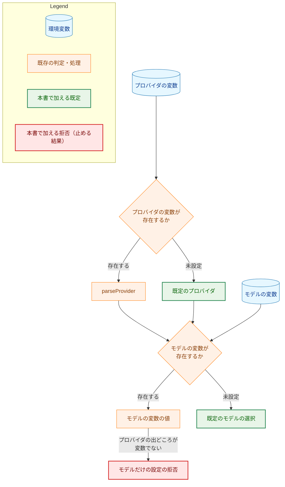
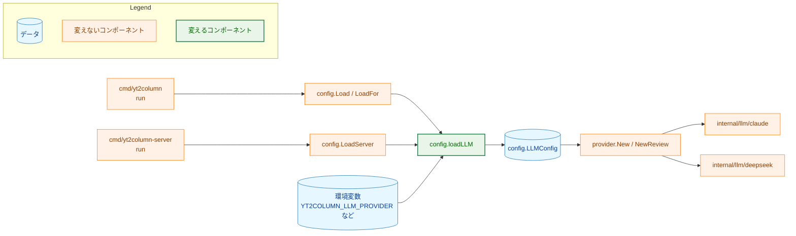
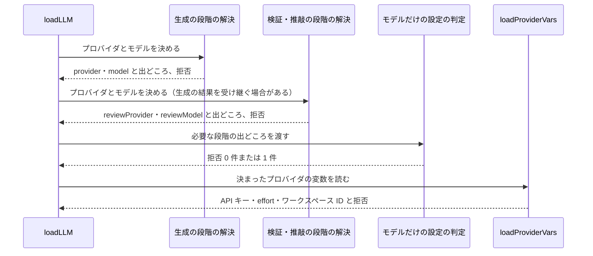
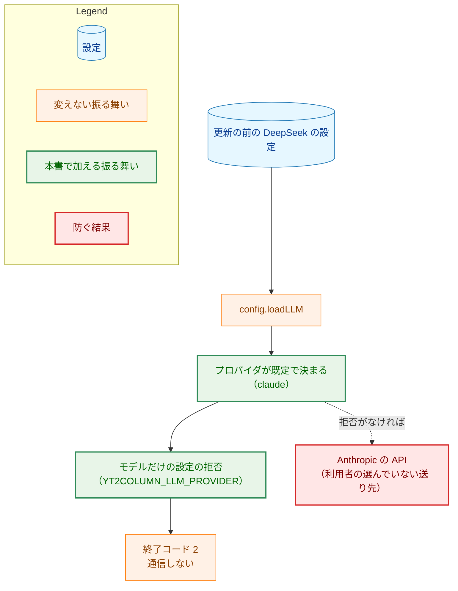
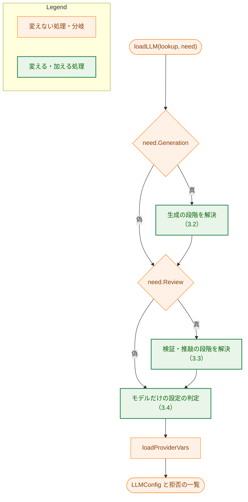

# アーキテクチャ設計書：既定の LLM を Claude Opus 5.5（claude-opus-5-5）にする

## Document Status

| Item | Value |
|---|---|
| Status | `approved` |
| Created | 2026-10-25 |
| Review date | 2026-10-25 |
| Reviewer | isseis |
| Comments | 2026-10-25、AC-24 の検証を、コードを読む確認から、`test` タグのテスト `TestIntegrationRunProviderSelection` を `make test` と CI で走らせる方式に改め、そのために `newIntegrationRun` を `test \|\| integration` のファイルへ移すことにした（3.5、7.4、7.5 の AC-24 の行）。また、要件書 §5 の変更に合わせ、#171 の後にマージするのを既定を変えるフェーズ 2〜4 に限り、フェーズ 1 は先にマージしてよいことにした（1.1、8 章の 6）。決定の変更なので本書を `draft` に戻し、PR の `/runpr` のマージの問いで改めて承認を受ける。それまでの承認は、レビュー日 2026-10-25、レビュアー isseis である。 |

本書は [01_requirements.md](01_requirements.md)（要件定義書。以下、要件書）の設計である。既存のファイルについての記述は、コミット `826fec2` のファイルで確かめた。`file:line` はこのコミットの行番号を指す。F-NNN・AC-NN は要件書の項番を指し、先行タスクの受け入れ基準は「0010 AC-17」のようにタスクの番号を付けて書く。要件のレビューで設計に申し送られた事項（[design_handoff.md](design_handoff.md) の H-01〜H-06）への対応は、付録 A にまとめる。

本書は、要件書 §3.1 と 6 章の用語（未設定・空、実行の種類、生成を実行する実行、検証・推敲だけを実行する実行、LLM を呼ばない実行、検証・推敲を実行する実行、既定で決まるプロバイダ、本番の構成）を同じ意味で使う。ほかに次の用語を使う。

-   **段階:** 設定の読み込みで、プロバイダとモデルの組を 1 つ決める単位。生成の段階（生成と字数の調整が使う）と、検証・推敲の段階の 2 つがある。段階が「必要」とは、`config.Need` の対応するフィールドが真であること（`internal/config/config.go:334-337`）。用語集の「段階」（パイプラインの `TranscriptSource` など）とは別の、本書だけの用法である。
-   **既定のプロバイダ:** 本書で `claude` にする、生成のプロバイダの既定（F-001）。
-   **既定のモデル:** 本書で加える、プロバイダが `claude` のときのモデルの既定 `claude-opus-5-5`（F-002・F-003）。
-   **出どころ:** 段階のプロバイダまたはモデルが、何によって決まったか。「変数」（変数が存在した。値が空・不正で拒否された場合を含む）、「既定」（変数が未設定で既定を当てはめた）、「なし」（そのどちらでもない）の 3 つを区別する（3.1）。
-   **モデルだけの設定の拒否:** F-004 の拒否。モデルの変数が設定されているのに、そのモデルを使う段階のプロバイダが変数ではなく既定で決まっている場合に、`YT2COLUMN_LLM_PROVIDER` の `ErrMissing` で設定を拒否する。

## 1. 設計の全体像 (Design Overview)

### 1.1. 設計原則

-   **既定と拒否は `internal/config` の 1 か所で決める。** CLI（`Load`・`LoadFor`）と localhost サーバ（`LoadServer`）は、どちらも `loadLLM`（`internal/config/config.go:369-380`）で LLM の設定を読む（`LoadServer` は `:260`、`LoadFor` は `:347`）。既定の当てはめとモデルだけの設定の拒否を `loadLLM` の下に置けば、2 つの入口に同じ規則が当てはまる（要件書 §5）。`internal/llm/provider` は、検査済みの `LLMConfig` からクライアントを作るだけで（`internal/llm/provider/provider.go:26-39`）、変数を読まないので変えない。
-   **既定は値の型で選ぶ。** 既定のモデルは、確定したプロバイダ（`config.Provider`）の `switch` で選ぶ。`default` の枝は「既定なし」とし、呼び出し側がモデルの変数の `ErrMissing` を報告する。新しいプロバイダを加えたときに、既定が黙って当てはまることはない。モデル名などの文字列の中身は見ない（`CLAUDE.md`「Declare, don't infer」、要件書 §5）。
-   **拒否するかは、変数が存在するかどうかで決める。** モデルだけの設定の拒否は、モデルの出どころが「変数」で、プロバイダの出どころが「変数」でない段階があるときに起こる。値が空でも、変数が存在すれば「変数」とする（要件書 AC-16〜AC-18 の「設定されている（空を含む）」）。
-   **送り先を守る判定は、失敗したら止める側に倒す。** モデルだけの設定の拒否は、利用者の選んでいない事業者にデータを送らないための唯一の判定である（要件書 §4.2）。そのため、プロバイダの出どころが「変数」と記録されていなければ拒否する。出どころの記録を落とす誤りがあっても、データを送らずに止まる（3.4）。
-   **読み込みの途中の値は、検査済みの設定に持ち込まない。** 出どころは、`loadLLM` の中でだけ使う値として持つ。`LLMConfig` にはフィールドもアクセサも加えない。読み込みの後に出どころを使う箇所はないからである（`CLAUDE.md`「YAGNI」）。
-   **既定は 1 か所に書く。** 既定のプロバイダ（受理する値の文字列）と既定のモデルは、`internal/config` の非公開の定数としてそれぞれ 1 か所に持つ。今の `parseProvider`（`config.go:437-450`）と `loadProviderOptional`（`config.go:399-411`）が `ProviderDeepSeek` をそれぞれ書いている重複は、本書でなくす（H-03）。
-   **effort の既定は #171 に任せる。** `YT2COLUMN_CLAUDE_EFFORT` の扱い（`loadClaudeEffort`、`config.go:590-601`）は本書では変えない。本書の実装のうち既定を変えるフェーズ 2〜4 は、#171 の実装の後にマージする（要件書 §5、8 章）。

### 1.2. 設計の際に決めたこと（2026-10-25）

人間のレビュアーが決めたもの:

-   **既定のモデル名の定数は `internal/config` に置く（H-02）:** 非公開の定数とし、文書を読むテストへは `test_helpers.go`（`test` タグ）の `...ForTest` 関数で値を渡す。既定を当てはめるのは設定の読み込みの責務であり、ほかの既定（キャッシュディレクトリの導出、今のプロバイダの既定）も `internal/config` にあるためである。`internal/llm/claudeparam` に置く案は、claudeparam が「Claude のパラメータの型と受理する値」だけでなく既定の方針も持つことになり、責務が広がるので採らなかった。

設計で決めたもの（人間のレビュアーに諮らず、理由とともに記す）:

-   **単価の表の文字列とはまとめない（H-02）:** `internal/pricing/rates.go:98` にも `claude-opus-5-5` がある。単価の表は、応答が報告したモデル名を引く参照表であり（`docs/dev/project_overview.md:67`）、使うモデルを選ぶ既定とは役割が違う。既定のモデルを変えても、古いモデルの単価は表に残す必要がある。1 つの定数にまとめると、片方を変えたときにもう片方も黙って変わってしまう。
-   **出どころは、段階ごとの解決の結果として値とともに返す（H-03）:** プロバイダを解決する関数は `Provider` と出どころを組で返し、段階を解決する関数は段階の出どころ（3.1 の `stageOrigins`）を返す。出どころは `loadLLM` の中でだけ使い、`LLMConfig` には持たせない。読み込みの後に出どころを使う箇所がないためである。値と出どころを別々に代入する形にしないのは、受け継ぎの経路（3.3）で出どころの写し忘れを起こしにくくするためである。
-   **変数の有無から直接判定する案は採らない（H-03）:** AC-16〜AC-18 は 4 つの変数の有無と `Need` だけで書けるので、`lookup` と `need` だけを見る 1 つの述語でも判定できる。この案は、検証・推敲の段階がいつ `YT2COLUMN_MODEL` を受け継ぐか（`YT2COLUMN_REVIEW_PROVIDER` と `YT2COLUMN_REVIEW_MODEL` がどちらも未設定で、生成を実行しないとき。AC-18）という `loadReview` の規則を、述語の中にもう 1 度書くことになる。2 つが食い違えば、拒否すべき設定を通しうる。段階の解決が出どころを返せば、受け継ぎの規則は `loadReview` の 1 か所に残る。
-   **モデルだけの設定の拒否は、段階の解決が終わった後に 1 回だけ判定する（H-03・AC-19）:** 生成の段階と検証・推敲の段階のプロバイダとモデルが決まった後で、必要な段階を順に見て、条件に当てはまる段階が 1 つでもあれば、拒否を 1 件だけ加える。段階ごとに判定する案は、AC-16 と AC-17 が同時に当てはまる設定（例: `YT2COLUMN_MODEL` と `YT2COLUMN_REVIEW_MODEL` だけを設定）で 2 件になるので採らない。
-   **`loadProvider` と `loadProviderOptional` を 1 つにまとめる（H-03）:** 2 つは、変数が未設定のときに `ProviderDeepSeek` を返し、存在すれば `parseProvider` で検査する点で、今も振る舞いが同じである（`config.go:384-393`・`:399-411`。`loadProvider` は `parseProvider` の `!present` の枝で、`loadProviderOptional` は自分の `!ok` の枝で `ProviderDeepSeek` を返す）。違うのは名前とコメントだけである。既定を変えるときに 2 か所を直さずに済むよう、1 つの関数にし、生成の段階と、検証・推敲だけを実行する実行の受け継ぎの両方から呼ぶ。変数が未設定のときは、既定の値の文字列（`defaultProviderValue`）を、存在する値と同じ `parseProvider` に通して `Provider` にする。これにより、文字列と `Provider` の対応は `parseProvider` の 1 か所だけに残る。また、文書のテストが読む値（3.1）とコードの既定は、同じ定数から来る。
-   **拒否の理由は新しい固定の定数にする（H-04）:** `reasonModelWithoutProvider` を、既存の理由の定数（`config.go:62-73`）に加える。文言は `must be set when YT2COLUMN_MODEL or YT2COLUMN_REVIEW_MODEL is set; when unset, the provider is claude` とする（4.2）。既定のプロバイダを文言に含めるのは、モデルの変数を消せば拒否は消えるが、その場合は Anthropic へ送ることになる、と拒否の行だけで分かるようにするためである。値は含まない（AC-19）。
-   **文書に書いた既定の値をテストで確かめる（H-02・H-06）:** README「Configuration」と `project_overview.md`「設定（環境変数）」の表で、`YT2COLUMN_LLM_PROVIDER`・`YT2COLUMN_MODEL`・`YT2COLUMN_REVIEW_MODEL` の「未設定のとき」の列に、コードの既定の値が書かれていることを、`cmd/yt2column/docs_test.go` のテストで確かめる（7.3）。`CLAUDE.md`「Document tests check values ...」は、文書の値とコードの値の比較を許し、文書の値を変えるときは対応するテストを求めている。
-   **既定に依存するテストの環境は、DeepSeek を明示する（H-01）:** `YT2COLUMN_LLM_PROVIDER` を設定せずに DeepSeek を前提としているテストの環境に、`YT2COLUMN_LLM_PROVIDER=deepseek` を加える（3.5）。既定を前提にしたテストの環境を `claude` に書き換える案は採らない。DeepSeek を明示する案のほうが、偽の LLM を使うテストの意図（どのプロバイダでもよい）を変えずに済み、差分も小さいからである。CLI の統合テストは、AC-24 のとおり DeepSeek だけを呼ぶ必要があるので、明示が必須である。
-   **文書と実装を同じ PR に入れ、AC-22 のテストも含める:** 既定を変えるコード、モデルだけの設定の拒否、文書、文書のテスト、AC-22 のテストを 1 つの PR に入れる（8 章）。既定だけが入って文書が古い期間や、案内（AC-27）がない期間を作らないためである。AC-22 のテストは effort の既定 `high` を期待するので、#171 の実装を前提とする。このテストが #171 より先のマージを CI で止める仕掛けとして働くかは、まだ書かれていないテストについての主張なので、本書では確かめたこととして扱わない。実装のときに、#171 の変更がない状態でこのテストを実行し、effort の既定がないという意図した理由で失敗するかを確かめて記録する（7.1）。マージの順序は、それとは別に実装計画の PR の手順で守る（8 章）。
-   **サーバの起動のログは変えない:** サーバの `listening` のログは `model` と `reviewModel` を出す（`cmd/yt2column-server/run.go:185-189`）。既定が当たったときもこの 2 つに `claude-opus-5-5` が出るので、使うモデルはログから分かる。ログにプロバイダを出すには `Provider` に文字列への変換を足す必要があり、要件書の範囲を越えるので加えない。
-   **effort の既定の部分は #171 の設計に委ねる（H-05）:** 本書の作成の時点で、#171（タスク 0041）の設計書はない。effort の既定の置き場所と当てはめ方は 0041 の設計で決まる。本書は `loadClaudeEffort` を変えず、AC-22 の確かめ方だけを 7.1 に書く。0041 の申し送り（`docs/tasks/0041_claude_effort_max_tokens/design_handoff.md` H-06）は、effort の既定の置き場所の候補に `claudeparam` も挙げている。2 つの既定は、どちらも「変数が未設定のときに設定の読み込みが当てはめる値」なので、同じ `internal/config` に置くのが一貫する。0041 の設計が別の場所を選んだ場合は、本書の実装計画で、既定のモデルの定数をそれに合わせて移すかを決める。

### 1.3. 概念モデル

段階ごとのプロバイダとモデルの決まり方を示す。矢印 A → B は「A の次に B を判定する、または A の値を B が読む」ことを表す。図は 1 つの段階について描き、検証・推敲の段階で生成の段階を受け継ぐ場合は 3.3 で述べる。



-   `parseProvider` は `deepseek`・`claude` を受理し、空なら `ErrMissing`、それ以外は `ErrInvalid` で拒否する（今までどおり）。モデルの変数の値は、空なら `ErrMissing` で拒否する（今までどおり）。
-   モデルだけの設定の拒否は、段階ごとではなく、すべての段階を解決した後に 1 回だけ判定する（3.4）。
-   既定のモデルの `switch` は、`ProviderClaude` なら既定のモデルを返し、それ以外（`ProviderDeepSeek`、プロバイダが拒否されて決まらなかった `ProviderUnset`）なら「既定なし」を返す。「既定なし」のとき、呼び出し側は今までどおりモデルの変数の `ErrMissing` を報告する（AC-04・AC-06・AC-09・AC-11）。
-   プロバイダの変数が存在して値が空・不正なときは、プロバイダは拒否され、`Provider` の値は `ProviderUnset` のままになる。それでも出どころは「変数」なので、モデルだけの設定の拒否は起こらない（AC-06・AC-13・AC-20）。

### 1.4. 既存の方針の例外

本書は、次の既存の方針を変える。それぞれ、元の方針の場所、例外にする理由、古い振る舞いを確かめている既存のテストを示す。

1.  **`project_overview.md` の「LLM: 初期実装は DeepSeek」（`docs/dev/project_overview.md:12`）と「モデル名は…コードにハードコードせず設定で与える」（同 `:67`）。** 要件書 §5 が方針を改めると決めている。本書は、既定のモデル名を `internal/config` の定数 1 つに置き（3.1）、この 2 か所の文書を書き直す（3.6）。この方針を確かめるテストはない。
2.  **0010 の設計の検証・推敲の設定の表（`docs/tasks/0010_post_generation_review/02_architecture.md:571-579`）。**
    -   「`YT2COLUMN_REVIEW_PROVIDER` が正しい値で `YT2COLUMN_REVIEW_MODEL` が未設定なら `ErrMissing`」の行は、プロバイダが `claude` のときだけ既定のモデルを使うように変わる（AC-10）。`deepseek` のときは今までどおり拒否する（AC-11）。理由: 「プロバイダが `claude` ならモデルの既定は `claude-opus-5-5`」という 1 つの規則を生成と検証・推敲でそろえる（要件書「要件定義の際に決めたこと」）。確かめているテスト: `internal/config/config_test.go:516-520`（`provider without model`）は `deepseek` を使うので、変えずに通る。`claude` の行は新しいテストで確かめる（7.1）。
    -   「`YT2COLUMN_REVIEW_PROVIDER` が未設定で `YT2COLUMN_REVIEW_MODEL` を設定すると、生成と同じプロバイダを使う」の行は、`YT2COLUMN_LLM_PROVIDER` も未設定なら、モデルだけの設定の拒否に変わる（AC-17）。理由: 利用者の選んでいない Anthropic にデータを送らないため（要件書 §4.2）。確かめているテスト: `config_test.go:476-491`（`model only reuses the generation provider`）は `YT2COLUMN_LLM_PROVIDER=deepseek` を含む `validEnv`（`config_test.go:30-41`）を使うので、変えずに通る。
3.  **検証・推敲だけを実行する実行での生成のプロバイダの受け継ぎ。** 0017 の設計（`docs/tasks/0017_intermediate_artifacts/02_architecture.md:474`）は、生成を実行しないとき生成の変数を必須にしないことだけを定め、受け継ぐプロバイダの既定は書いていない。未設定なら `deepseek` にする規則は、実装（`config.go:399-411`）だけにある。本書で、受け継ぐ生成のプロバイダの既定は `claude` になり、モデルが未設定なら既定のモデルを使う（AC-08・AC-09）。理由: F-001 の既定を、実行の種類によらず同じにするため（要件書 §2.2）。古い振る舞いを確かめているテスト: `config_test.go:1108-1117`（`review only requires a model`。プロバイダとモデルの変数がどれもなく `DEEPSEEK_API_KEY` だけがある環境で、`YT2COLUMN_REVIEW_MODEL` の `ErrMissing` を求める）と、`config_test.go:1166-1174`（`review only rejects an empty inherited model`。`YT2COLUMN_MODEL` だけが空で存在する環境）。どちらも書き直す（3.5）。
4.  **`YT2COLUMN_MODEL` は必須（0005 要件定義書 AC-03、`docs/tasks/0005_cli_assembly/01_requirements.md:94`。README「Configuration」の表、`README.md:719`、`project_overview.md:110`）。** プロバイダが `claude` のときは必須でなくなる（AC-03）。プロバイダが `deepseek` のときは今までどおり必須である（AC-04）。確かめているテスト: `config_test.go:141-163` の `TestLoadMissing` の `model unset` の行と、`config_test.go:902-918` の `TestLoadServerModelMissing` は、`deepseek` を含む `validEnv` を使うので変えずに通る。プロバイダを設定しない環境に依存するテストは 3.5 で直す。
5.  **`YT2COLUMN_LLM_PROVIDER` の既定は `deepseek`（0009 要件定義書 `docs/tasks/0009_claude_llm_client/01_requirements.md:183` の「未設定のときの既定は `deepseek` のままとする」と 0009 AC-27。`config.go:382-383` のコメント、`README.md:718`、`project_overview.md:109`）。** 既定を `claude` にする（AC-01）。確かめているテスト: `config_test.go:108-139` の `TestLoadDefaults`（プロバイダを設定せず `ProviderDeepSeek` を求める）と、`config_test.go:149` の `TestLoadMissing` の `provider unset and API key unset` の行（`DEEPSEEK_API_KEY` を挙げた拒否を求める）。書き直す、または削る（7.1）。0009 AC-27 が求める「既存の DeepSeek の設定の振る舞いは変わらない」は、`YT2COLUMN_LLM_PROVIDER=deepseek` を設定した設定についてだけ保つ（AC-23）。

## 2. システム構成 (System Structure)

### 2.1. 全体の構成

設定の読み込みから LLM のクライアントの構築までの構成を示す。矢印 A → B は「A が B を呼ぶ、または A のデータを B が読む」ことを表す。



変えるのは `loadLLM` とその下の関数だけである。`LLMConfig` の形（フィールドとアクセサ）は変えない。既定で決まったプロバイダとモデルも、変数で設定した値と同じく `Provider()`・`Model()`・`ReviewProvider()`・`ReviewModel()` で返す。そのため、`provider.New`・`provider.NewReview`（`internal/llm/provider/provider.go:29-39`）と、それを呼ぶ CLI とサーバは変えない。

### 2.2. コンポーネント配置

| 場所 | 置くもの |
|---|---|
| `internal/config/config.go` | 既定のプロバイダと既定のモデルの定数、モデルだけの設定の拒否の理由の定数、出どころの型、既定のモデルを選ぶ関数、モデルだけの設定の拒否の判定（3.1〜3.4） |
| `internal/config/test_helpers.go` | 文書を読むテストに既定の値を渡す `...ForTest` 関数（3.1） |
| `cmd/yt2column/docs_test.go` | 文書に書いた既定の値をコードの値と比べるテスト（7.3） |
| README・`docs/dev/project_overview.md` | 既定・必須の記述、方針、DeepSeek を使い続けるための案内（3.6） |

新しいパッケージは作らない。

### 2.3. データの流れ

`loadLLM` の中の順序を示す。生成と検証・推敲の両方が必要な実行（`Need{Generation: true, Review: true}`）の場合である。実線の矢印は呼び出し、点線の矢印はその戻り値を表す。



-   モデルだけの設定の判定は、プロバイダの変数（`ANTHROPIC_API_KEY` など）を読む前に行うが、結果によって読むかどうかを変えない。判定で拒否しても、既定で決まったプロバイダ（`claude`）は `LLMConfig` に残り、`loadProviderVars`（`config.go:525-542`）がその変数を読んで検査する（AC-19）。
-   拒否は今までどおり 1 件ずつ別の要素として返し、`LoadFor`・`LoadServer` が `errors.Join` でまとめる（`config.go:355`・`:273`）。

## 3. コンポーネント設計 (Component Design)

### 3.1. 定数と型

```go
package config

// The defaults applied when no provider or model variable is present. Each
// is written here alone (requirements §4.5).
const (
	// defaultProviderValue is the YT2COLUMN_LLM_PROVIDER value used when the
	// variable is unset. It goes through parseProvider like a present value,
	// so the string-to-Provider mapping stays in one place.
	defaultProviderValue = providerClaude
	// defaultClaudeModel is the model of a stage whose provider is
	// ProviderClaude and whose model variable is unset.
	defaultClaudeModel = "claude-opus-5-5"
)

// reasonModelWithoutProvider is the fixed reason for rejecting
// YT2COLUMN_LLM_PROVIDER when a model variable is present but the provider
// of the stage using it was not set by a variable (F-004).
const reasonModelWithoutProvider = "must be set when " + modelEnv + " or " +
	reviewModelEnv + " is set; when unset, the provider is " + defaultProviderValue

// settingOrigin says what decided a stage's provider or model while loadLLM
// runs. It never leaves loadLLM. The zero value assumes the least: nothing
// decided it.
type settingOrigin int

const (
	originNone     settingOrigin = iota // not decided: not read, or no default exists
	originVariable                      // the variable was present (its value may have been rejected)
	originDefault                       // the variable was unset and a default applied
)

// stageOrigins is what decided one stage's provider and model.
type stageOrigins struct {
	provider settingOrigin
	model    settingOrigin
}

// resolveProvider reads a provider variable; when it is unset, it parses
// defaultProviderValue instead. It returns the Provider (ProviderUnset on a
// rejection), the origin, and the rejection.
func resolveProvider(lookup LookupFunc, name string) (Provider, settingOrigin, error)

// defaultModel returns the default model of provider, and false when the
// provider has none (every Provider but ProviderClaude).
func defaultModel(provider Provider) (string, bool)

// modelWithoutProvider returns the F-004 rejection, or nil, from the origins
// of the stages the run needs. It rejects when a stage's model origin is
// originVariable and its provider origin is anything but originVariable.
func modelWithoutProvider(stages ...stageOrigins) error
```

既存の関数の形は次のとおり変える。

-   `loadModel`・`loadModelOptional` は、モデルの出どころも返す。
-   `loadReview` は、拒否の一覧に加えて、検証・推敲の段階の `stageOrigins` を返す。生成の段階の出どころを引数で受け取り、受け継ぐ場合はそれを写す（3.3）。
-   `parseProvider` は存在する値だけを扱う形にし、`present` の引数と未設定の枝を除く。

```go
//go:build test

package config

// DefaultProviderValueForTest returns defaultProviderValue.
func DefaultProviderValueForTest() string

// DefaultClaudeModelForTest returns defaultClaudeModel.
func DefaultClaudeModelForTest() string
```

-   `defaultProviderValue` は、既存の受理する値の定数（`providerClaude`、`config.go:47-50`）を使う。`DefaultProviderValueForTest` はこの定数を返す。既定の値を変えれば、文書のテスト（7.3）が読む値も変わる。
-   既定のモデルは、生成を実行する実行では `LLMConfig` の `model` に、`YT2COLUMN_REVIEW_PROVIDER` だけを設定した場合は `reviewModel` だけに入る。検証・推敲だけを実行する実行で生成の段階を受け継ぐ場合は、今の `loadReview` が受け継いだモデルを `cfg.model` に読み、それを `cfg.reviewModel` に写す（`config.go:503-508`）のと同じく、`model` と `reviewModel` の両方に入る。
-   型・関数・定数の名前は案である。実装計画で変えてよいが、既定の値はそれぞれ 1 か所に書き、値と出どころは組で返す。

### 3.2. 生成の段階の解決

生成の段階が必要な実行（`Need.Generation` が真）で、次のとおり決める。

| `YT2COLUMN_LLM_PROVIDER` | `YT2COLUMN_MODEL` | プロバイダ | モデル | 拒否 | AC |
|---|---|---|---|---|---|
| 未設定 | 未設定 | `claude`（既定） | `claude-opus-5-5`（既定） | なし | AC-01・AC-03 |
| 未設定 | 空でない値 | `claude`（既定） | 値 | `YT2COLUMN_LLM_PROVIDER`（モデルだけの設定） | AC-16 |
| 未設定 | 空 | `claude`（既定） | なし | `YT2COLUMN_LLM_PROVIDER`（モデルだけの設定）、`YT2COLUMN_MODEL`（`ErrMissing`） | AC-16 |
| `claude` | 未設定 | `claude` | `claude-opus-5-5`（既定） | なし | AC-03 |
| `deepseek` | 未設定 | `deepseek` | なし | `YT2COLUMN_MODEL`（`ErrMissing`） | AC-04 |
| `deepseek`・`claude` | 空でない値 | 値 | 値 | なし | AC-02・AC-05 |
| `deepseek`・`claude` | 空 | 値 | なし | `YT2COLUMN_MODEL`（`ErrMissing`） | AC-05 |
| 空 | 未設定 | なし | なし | `YT2COLUMN_LLM_PROVIDER`（`ErrMissing`、`reasonUnset`）、`YT2COLUMN_MODEL`（`ErrMissing`） | AC-02・AC-06 |
| 不正 | 未設定 | なし | なし | `YT2COLUMN_LLM_PROVIDER`（`ErrInvalid`）、`YT2COLUMN_MODEL`（`ErrMissing`） | AC-02・AC-06 |
| 空・不正 | 空でない値 | なし | 値 | `YT2COLUMN_LLM_PROVIDER`（空なら `ErrMissing`、不正なら `ErrInvalid`）。モデルだけの設定の拒否は起こらない | AC-02・AC-20 |
| 空・不正 | 空 | なし | なし | `YT2COLUMN_LLM_PROVIDER`（空なら `ErrMissing`、不正なら `ErrInvalid`）、`YT2COLUMN_MODEL`（`ErrMissing`） | AC-02・AC-05 |

-   プロバイダの出どころは、変数が未設定なら「既定」、存在すれば（値が空・不正でも）「変数」である。モデルの出どころは、変数が存在すれば「変数」、既定を当てはめれば「既定」、どちらでもなければ「なし」である。
-   既存の `loadModel` のコメント「which has no default」（`config.go:544`）は、プロバイダが `claude` のときの既定を述べるように直す。

### 3.3. 検証・推敲の段階の解決

検証・推敲の段階が必要な実行（`Need.Review` が真）で、次のとおり決める。表の「生成の段階」は、生成を実行する実行では 3.2 の結果、検証・推敲だけを実行する実行では、このときに読む生成の変数の結果を指す（下の箇条書き）。

| `YT2COLUMN_REVIEW_PROVIDER` | `YT2COLUMN_REVIEW_MODEL` | プロバイダ | モデル | 拒否 | AC |
|---|---|---|---|---|---|
| 未設定 | 未設定 | 生成の段階と同じ（出どころも受け継ぐ） | 生成の段階と同じ（出どころも受け継ぐ） | 下の箇条書き | AC-07〜AC-09・AC-18 |
| 未設定 | 空でない値 | 生成の段階と同じ（出どころも受け継ぐ） | 値 | 生成の段階のプロバイダが既定で決まったなら `YT2COLUMN_LLM_PROVIDER`（モデルだけの設定） | AC-17・AC-20 |
| `claude` | 未設定 | `claude` | `claude-opus-5-5`（既定） | なし | AC-10 |
| `deepseek` | 未設定 | `deepseek` | なし | `YT2COLUMN_REVIEW_MODEL`（`ErrMissing`） | AC-11 |
| `deepseek`・`claude` | 空でない値 | 値 | 値 | なし | AC-12 |
| 存在する（どの値でも） | 空 | 値（空・不正なら拒否） | なし | `YT2COLUMN_REVIEW_MODEL`（`ErrMissing`）と、`YT2COLUMN_REVIEW_PROVIDER` の拒否（空・不正の場合） | AC-12・AC-13・AC-14 |
| 未設定 | 空 | 生成の段階と同じ | なし | `YT2COLUMN_REVIEW_MODEL`（`ErrMissing`）。生成の段階のプロバイダが既定で決まったなら `YT2COLUMN_LLM_PROVIDER`（モデルだけの設定）も | AC-14・AC-17 |
| 空・不正 | 未設定 | なし | なし | `YT2COLUMN_REVIEW_PROVIDER`（空なら `ErrMissing`、不正なら `ErrInvalid`）。`YT2COLUMN_REVIEW_MODEL` の拒否は加えない | AC-13 |
| 空・不正 | 空でない値 | なし | 値 | `YT2COLUMN_REVIEW_PROVIDER`（空なら `ErrMissing`、不正なら `ErrInvalid`）。モデルだけの設定の拒否は起こらない | AC-13・AC-20 |

-   **生成を実行する実行での受け継ぎ。** 生成の段階の結果（既定のプロバイダと既定のモデルを含む）を、出どころとともにそのまま使う（AC-07）。`YT2COLUMN_REVIEW_MODEL` だけを設定した場合も、プロバイダの出どころは生成の段階のものを写す。生成のモデルが `ErrMissing` で決まらなかった場合も、今までどおり `YT2COLUMN_REVIEW_MODEL` の拒否は加えない（`config.go:508-511` の `generationRuns` の扱い）。
-   **検証・推敲だけを実行する実行での受け継ぎ。** 生成の段階は必要でないが、受け継ぐために `YT2COLUMN_LLM_PROVIDER` と `YT2COLUMN_MODEL` を必須にせずに読む（今の `config.go:478-487`・`:503-507`）。プロバイダは 3.2 と同じ関数で決める（1.2 の、2 つの関数をまとめる決定）。モデルは次のとおりである。
    -   `YT2COLUMN_MODEL` が空でない値: その値を使う（出どころは「変数」）。プロバイダが既定で決まったなら、モデルだけの設定の拒否（AC-18）。
    -   `YT2COLUMN_MODEL` が空: `YT2COLUMN_MODEL` の `ErrMissing`（今の `loadModelOptional`、`config.go:417-429`）。出どころは「変数」なので、プロバイダが既定で決まったなら、モデルだけの設定の拒否も加わる（AC-14・AC-18）。受け継いだモデルが空のままなので、今までどおり `YT2COLUMN_REVIEW_MODEL` の `ErrMissing` も加わる（`config.go:509-511`）。
    -   `YT2COLUMN_MODEL` が未設定: 受け継いだプロバイダで既定のモデルを選ぶ。`claude`（設定した場合も既定の場合も）なら既定のモデル（AC-08・AC-09）。`deepseek` なら、今までどおり `YT2COLUMN_REVIEW_MODEL` の `ErrMissing`（AC-09）。`YT2COLUMN_LLM_PROVIDER` が空・不正でプロバイダが決まらないときも、今までどおり `YT2COLUMN_REVIEW_MODEL` の `ErrMissing` を加える（`config.go:509-511`）。
-   **既定のモデルの選び方は、生成の段階と同じ関数を使う。** `YT2COLUMN_REVIEW_PROVIDER` だけを設定した場合（AC-10・AC-11）と、検証・推敲だけを実行する実行の受け継ぎ（AC-08・AC-09）で、3.2 と同じ「`Provider` の `switch`」を呼ぶ。拒否するときに挙げる変数の名前は、呼び出し側が決める。
-   `loadReview` のコメント「A set provider requires a set model」（`config.go:454-455`）と、`LLMConfig` のアクセサのコメント（`ReviewModel` の「It equals Model() when both ... are unset」、`config.go:139-141`）は、既定のモデルを述べるように直す。`Model` の「It is non-empty when the generation or the shorten step runs ..., or when a review-only run inherits YT2COLUMN_MODEL」（`config.go:125-128`）は、受け継ぐ場合に既定のモデルが入りうることを述べるように直す。

### 3.4. モデルだけの設定の拒否

生成の段階と検証・推敲の段階を解決した後で、`loadLLM` が 1 回だけ判定する。

-   **条件:** 必要な段階のうちに、モデルの出どころが「変数」で、プロバイダの出どころが「変数」でない段階がある。必要な段階のプロバイダの出どころは、正しい実装では必ず「変数」か「既定」のどちらかである。そのため、この条件は「プロバイダの出どころが「既定」である」と書いても同じ結果になる。出どころの記録を落とす誤りで「なし」が残った場合は、この条件が真になり、データを送らずに拒否する（1.1）。生成を実行しない実行（`Need.Generation` が偽）では、生成の段階を判定に含めない。検証・推敲だけを実行する実行で生成の変数を受け継いだ場合は、検証・推敲の段階の出どころとして判定する（AC-18）。
-   **報告:** `Name` が `YT2COLUMN_LLM_PROVIDER`、`Err` が `ErrMissing`、`Reason` が `reasonModelWithoutProvider` の `*VarError` を 1 件加える。条件に当てはまる段階が 2 つあっても 1 件である（AC-19）。
-   **プロバイダは消さない:** 拒否しても、段階のプロバイダ（既定の `claude`）は `LLMConfig` に残す。`loadProviderVars` がその変数を検査し、拒否を合わせて報告する（AC-19）。読み込みは拒否で終わるので、この `LLMConfig` が呼び出し側に渡ることはない（`LoadFor` は拒否があればゼロ値を返す、`config.go:355-357`。`LoadServer` も同じ、`config.go:273-275`）。
-   **起こらない場合:** `YT2COLUMN_LLM_PROVIDER` が存在すれば（空・不正を含む）、生成の段階のプロバイダの出どころは「変数」なので起こらない。`YT2COLUMN_REVIEW_PROVIDER` が存在すれば、検証・推敲の段階のプロバイダの出どころは「変数」なので、検証・推敲の段階では起こらない（AC-20）。LLM を呼ばない実行（`Need{}`）では、どの段階も必要でないので起こらない（AC-15）。

### 3.5. コンポーネントの責務と変えるファイル

| ファイル | 変更 | 関連 |
|---|---|---|
| `internal/config/config.go` | 3.1 の定数と型を加える。プロバイダの解決を 1 つの関数にまとめ、未設定なら `defaultProviderValue` を `parseProvider` に通す。`parseProvider` は存在する値だけを扱う形にし、`present` の引数と未設定の枝を除く（呼び出し側がすべて存在を確かめてから呼ぶ）。`loadModel`・`loadModelOptional`・`loadReview` で、モデルの変数が未設定のとき既定のモデルを選ぶ。出どころを記録し、`loadLLM` でモデルだけの設定の拒否を判定する。コメントを 3.2・3.3 のとおり直す | F-001〜F-004、H-03・H-04 |
| `internal/config/test_helpers.go` | `DefaultProviderValueForTest`・`DefaultClaudeModelForTest` を加える | H-02、AC-25 |
| `internal/config/config_test.go` | 1.4 の 3・5 のテスト（`TestLoadDefaults`、`TestLoadMissing` の `provider unset and API key unset` の行、`TestLoadFor` の `review only requires a model`・`review only rejects an empty inherited model`）を、7.1 のとおり書き直す、または削る。7.1 のテストを加える | AC-01〜AC-21 |
| `cmd/yt2column/run_test.go` | `newRunEnv` の環境（`run_test.go:139-145`）に `YT2COLUMN_LLM_PROVIDER=deepseek` を加える。何も設定しない CLI の実行が、既定のプロバイダとモデルで LLM のクライアントを作ることを確かめるテストを加える（7.2） | H-01、AC-01・AC-03 |
| `cmd/yt2column/signal_test.go` | 子のプロセスの環境（`signal_test.go:58-66`）に `YT2COLUMN_LLM_PROVIDER=deepseek` を加える | H-01 |
| `cmd/yt2column/integration_test.go`・`test_helpers_integration.go` | 統合テストの環境（`integration_test.go:144-149`）に `YT2COLUMN_LLM_PROVIDER=deepseek` を加える。`integration_slack_test.go` は同じ `newIntegrationRun` の環境を使う（`integration_slack_test.go:46` の `r.env`）ので、直すのはこの 1 か所である。`newIntegrationRun` と、それだけが使う型・定数・関数を、`integration` だけのファイルから `test \|\| integration` の `test_helpers_integration.go` へ移す。依存する `transcript.SeedCacheForTest`・`transcripttestutil.NewTripwire`・`deepseektestutil` はどれも `test \|\| integration` のファイルにあるので、移しても両方のビルドでコンパイルできる | H-01、AC-24 |
| `cmd/yt2column/integration_env_test.go`（新設、`//go:build test`） | `newIntegrationRun` が組み立てる環境を設定の読み込みに渡し、生成と検証・推敲が DeepSeek を選ぶことを確かめるテストを置く（7.4）。`test` タグなので `make test` と CI で走る | AC-24 |
| `cmd/yt2column-server/test_helpers.go` | `newServerEnv` の環境（`test_helpers.go:121-128`）に `YT2COLUMN_LLM_PROVIDER=deepseek` を加える | H-01 |
| `cmd/yt2column/docs_test.go` | 文書に書いた既定の値を確かめるテストを加える（7.3） | AC-25、H-02 |
| `README.md` | 「Configuration」の表と本文、DeepSeek を使い続けるための案内、「Localhost server」の「Troubleshooting」の項目（3.6） | AC-25〜AC-27 |
| `internal/llm/provider/provider_test.go` | `TestNewReviewUsesReviewModel` に、検証・推敲が `claude` のときモデルが Claude の構築に渡ることを確かめる部分テストを加える（7.1） | AC-10 |
| `docs/dev/developer_guide/package_reference.md` | `internal/config` の行を、既定のプロバイダとモデル、AC-10・AC-11 の規則、モデルだけの設定の拒否に合わせて直す（3.6） | AC-26 |
| `docs/dev/project_overview.md` | 「決定済みの方針」の LLM の項、「前提・制約」のモデル名の方針、「設定（環境変数）」の表と本文、DeepSeek を使い続けるための案内（3.6） | AC-25〜AC-29 |

変えないもの:

-   `internal/llm/provider/provider.go`・`internal/llm/claude`・`internal/llm/deepseek`・`internal/llm/claudeparam`: 検査済みの `LLMConfig` を受け取るだけで、既定を知らない。
-   `cmd/yt2column/run.go`・`cmd/yt2column-server/run.go`: 設定の読み込みの呼び方と、拒否の表示（`run.go:624` の `configuration: <変数>: <理由>` の 1 行）は変わらない。
-   `internal/pricing`: 1.2 のとおり、既定とは別に持つ。
-   `Makefile`: 統合テストの `YT2COLUMN_MODEL ?= deepseek-flash`（`Makefile:128`）はテスト用の既定であり、要件書 §2.3 のとおり変えない。CLI の統合テストは環境を閉じた map で組み立てる（`integration_test.go:144-149`）ので、プロセスの環境に `YT2COLUMN_LLM_PROVIDER` を加える必要はない。
-   `cmd/yt2column/makefile_test.go` の環境（`makefile_test.go:137-141`・`:238-245`）: Make のターゲットの検査用で、`config` の読み込みを通らないので変えない。

### 3.6. 文書の変更

-   **README「Configuration」（`README.md:714-752`）:**
    -   表の「When unset」の列（既定の値を列の最初のコードスパンに書く。7.3）: `YT2COLUMN_LLM_PROVIDER` は `claude`。`YT2COLUMN_MODEL` は、プロバイダが `claude` なら `claude-opus-5-5`、`deepseek` なら必須（エラー）。`YT2COLUMN_REVIEW_MODEL` は、`YT2COLUMN_REVIEW_PROVIDER` が `claude` なら `claude-opus-5-5`、`deepseek` なら必須（エラー）、`YT2COLUMN_REVIEW_PROVIDER` も未設定なら生成のモデル（AC-25）。
    -   表の説明の列の「required when `YT2COLUMN_REVIEW_PROVIDER` is set」と、本文の「Setting `YT2COLUMN_REVIEW_PROVIDER` requires `YT2COLUMN_REVIEW_MODEL`」（`README.md:738`）を、AC-10・AC-11 の規則に書き換える。モデルだけの設定の拒否を書く（AC-26）。
    -   DeepSeek を使い続けるための案内を加える（AC-27）。案内には、`YT2COLUMN_MODEL` を消すと拒否は消えるが Anthropic へ送るようになり、DeepSeek を使い続ける方法ではないことも書く。
    -   「Localhost server」の「Troubleshooting」（`README.md:626`）に、更新の後にサーバが `configuration: YT2COLUMN_LLM_PROVIDER` の行を出して終了コード 2 で終わる場合の項目を加え、「Configuration」の案内を指す。サーバは多くの場合バックグラウンドで動き、拡張からは接続できないことしか見えないためである。
    -   `ANTHROPIC_API_KEY`・`YT2COLUMN_CLAUDE_EFFORT` の行は、#171 の実装が書き換える。本書の実装は #171 の後にマージするので、その時点の行に合わせる。
-   **`project_overview.md`:**
    -   「決定済みの方針」の LLM の項（`:12`）を、既定の LLM が Claude（claude-opus-5-5）で DeepSeek も選べること、どちらも SDK を使わず標準ライブラリで呼ぶことに書き換える（AC-28）。
    -   「前提・制約」のモデル名の方針（`:67`）に、既定のモデル名をコードに持つ例外を、範囲（プロバイダが `claude` でモデルの変数が未設定のときの既定に限る）と理由（0008 の評価で本番の構成として決めたモデル）とともに書く（AC-29）。単価の表の注記と同じ書き方にする。
    -   「設定（環境変数）」の表（`:107-120`）と本文（`:126`）を、README と同じ内容に直し（AC-25・AC-26）、DeepSeek を使い続けるための案内を加える（AC-27）。
-   **`docs/dev/developer_guide/package_reference.md`:** `internal/config` の行（`:27`）の「each defaulting to the generation's; a set review provider requires a set review model」を、既定のプロバイダとモデル、AC-10・AC-11 の規則、モデルだけの設定の拒否に合わせて直す。
-   **#488 との関係:** #488（タスク 0040）の実装は本書の実装の後にマージする（要件書 §5）。本書の実装の時点で #488 の文書がすでに `main` にある場合は、その文書に合わせて書く（H-06）。

## 4. エラーハンドリング設計 (Error Handling Design)

### 4.1. エラーの型

新しいエラーの型と番兵は加えない。既存の `*VarError`（`config.go:90-105`）と `ErrMissing`・`ErrInvalid`（`config.go:82-86`）を使う。

```go
// Existing, unchanged.
type VarError struct {
	Name   string
	Reason string
	Err    error // ErrMissing or ErrInvalid
}
```

| 拒否 | `Name` | `Err` | `Reason` |
|---|---|---|---|
| モデルだけの設定（F-004） | `YT2COLUMN_LLM_PROVIDER` | `ErrMissing` | `reasonModelWithoutProvider`（新しい定数） |
| プロバイダの変数が空（今までどおり） | `YT2COLUMN_LLM_PROVIDER`・`YT2COLUMN_REVIEW_PROVIDER` | `ErrMissing` | `reasonUnset` |
| モデルの変数が未設定・空で既定がない（今までどおり） | `YT2COLUMN_MODEL`・`YT2COLUMN_REVIEW_MODEL` | `ErrMissing` | `reasonUnset` |

番兵を `ErrMissing` にするのは、要件書 AC-16〜AC-18 が定めるためである。空の `YT2COLUMN_LLM_PROVIDER` の拒否とは、`Reason` で区別できる（テストは理由の定数と比べる。7.1）。

### 4.2. 利用者が見るもの

拒否の理由は固定の文で、値を含まない（`config.go:59-61` のコメントの規則）。理由の定数は、変数の名前の定数だけから組み立てた定数式である。CLI とサーバは、今までどおり変数ごとに 1 行を出す。

```text
yt2column: configuration: YT2COLUMN_LLM_PROVIDER: must be set when YT2COLUMN_MODEL or YT2COLUMN_REVIEW_MODEL is set; when unset, the provider is claude
yt2column-server: configuration: YT2COLUMN_LLM_PROVIDER: must be set when YT2COLUMN_MODEL or YT2COLUMN_REVIEW_MODEL is set; when unset, the provider is claude
```

プロバイダを設定せずに DeepSeek を使っていた利用者が更新すると、この行と、`ANTHROPIC_API_KEY` を設定していなければ `ANTHROPIC_API_KEY` の行を見る。拒否の行は、`YT2COLUMN_LLM_PROVIDER` を設定すれば直ることと、未設定なら `claude` になることを示す。`ANTHROPIC_API_KEY` を別の用途で設定している利用者には、その行が出ない。この利用者は、モデルの変数を消すだけで拒否が消えると考えるかもしれない。しかし、消した後の送り先は Anthropic になる。このことを、拒否の行の後半と README の案内（3.6）で示す。既定が変わったことと、DeepSeek を使い続ける設定は、README と `project_overview.md` に書く（AC-27。要件書「要件定義の際に決めたこと」）。

## 5. セキュリティ考慮事項 (Security Considerations)

`docs/dev/security.md` を適用する。本タスクは API キーを扱い、LLM の API にデータを送る設定を変える。

### 5.1. 脅威モデル

次の図は、更新の前に DeepSeek を使っていた設定が、更新の後に利用者の選んでいない Anthropic へ送られる経路と、それを止める場所を示す。例にする設定は、`YT2COLUMN_MODEL` と `DEEPSEEK_API_KEY` を設定し、`YT2COLUMN_LLM_PROVIDER` を設定せず、別の用途の `ANTHROPIC_API_KEY` がある設定である。実線の矢印 A → B は「A の設定で B に進む」ことを、点線の矢印は「モデルだけの設定の拒否がなければ進んでいた経路」を表す。



### 5.2. 対策と残る範囲

-   **利用者の選んでいない送り先:** 更新の前に DeepSeek で動いていた設定は、`YT2COLUMN_MODEL`（検証・推敲だけを実行する実行では `YT2COLUMN_MODEL` または `YT2COLUMN_REVIEW_MODEL`）を必ず含む（要件書 §4.4）。この設定は、モデルだけの設定の拒否で、どの API にも通信する前に止まる。判定は設定の読み込みの中で行い、読み込みが失敗すれば CLI は `yt-dlp` も起動せず、サーバは待ち受けを始めない（要件書 §3.1）。拒否には、判定してから使うまでの間に値が変わりうる時間差がない。判定に使う環境変数は、読み込みのときに 1 回だけ読み、以後は検査済みの `LLMConfig` だけを使うためである（`provider.New` は変数を読まない、`provider.go:26-28`）。
-   **止まらない設定:** モデルの変数もプロバイダの変数も設定していない設定は、Anthropic へ送る。この設定は更新の前は `YT2COLUMN_MODEL` の未設定で拒否されていたので、更新の前に動いていた設定ではない（要件書 §4.2）。次の 2 つも、更新の前は拒否されていた設定なので、本書は防がない（残る範囲として受け入れる）。
    -   DeepSeek を使っていた利用者が、拒否を見て `YT2COLUMN_MODEL` を消した設定。拒否の行と README の案内で、Anthropic へ送ることを示す（4.2・3.6）。
    -   検証・推敲の変数だけで DeepSeek を選んだ設定（例: `YT2COLUMN_REVIEW_PROVIDER=deepseek`・`YT2COLUMN_REVIEW_MODEL`・`DEEPSEEK_API_KEY` と、別の用途の `ANTHROPIC_API_KEY`。生成の変数はない）。生成は既定の `claude` で Anthropic へ送る。更新の前は `YT2COLUMN_MODEL` の未設定で拒否されていた。
-   **読む変数:** プロバイダの変数をどれも設定しない実行は、`ANTHROPIC_API_KEY`・`YT2COLUMN_CLAUDE_EFFORT`・`ANTHROPIC_WORKSPACE_ID` を読み、`DEEPSEEK_API_KEY` を読まない。選んだプロバイダの変数だけを読む `loadProviderVars` の規則（`config.go:516-524` のコメント）は変えない（AC-01・AC-23）。
-   **エラーに値を含めない:** 新しい拒否も、変数の名前と固定の理由だけを持つ（4.2）。値を含まないことは、既存の `TestLoadErrorsOmitValues`（`config_test.go:666-741`）と同じ確かめ方のテストで確かめる（7.1）。
-   **出力の伏せ字化:** CLI とサーバは、設定された秘密情報を出力の前に伏せる。`LLMConfig` の形を変えないので、伏せる対象の一覧（`AnthropicAPIKey()` を含む）は変わらない。
-   **送るデータ:** 送るデータの種類と、Anthropic での扱い（`security.md` §4）は変わらない。`security.md` は変えない（要件書 §4.2）。

## 6. 処理フローの詳細 (Processing Flow Details)

### 6.1. `loadLLM` の流れ

矢印 A → B は「A の次に B を行う」ことを表す。



`need` の両方が偽（LLM を呼ばない実行）のときは、どの段階も解決せず、判定でも何も加えず、`loadProviderVars` も何も読まない（AC-15。`config.go:526-541` は必要な段階のプロバイダだけを見る）。

### 6.2. 代表的な設定の結果

| 実行 | 設定 | 結果 | AC |
|---|---|---|---|
| 生成を実行する | `ANTHROPIC_API_KEY` だけ（#171 の後） | 生成・字数の調整・検証・推敲のすべてが `claude`・`claude-opus-5-5`・effort `high` | AC-22 |
| 生成を実行する | LLM の変数がどれもない | `ANTHROPIC_API_KEY` の `ErrMissing`（#171 の前は `YT2COLUMN_CLAUDE_EFFORT` の `ErrMissing` も）。`DEEPSEEK_API_KEY` は読まない | AC-21 |
| 生成を実行する | `YT2COLUMN_MODEL=deepseek-flash`・`DEEPSEEK_API_KEY`（更新の前の DeepSeek の利用者） | モデルだけの設定の拒否と、`ANTHROPIC_API_KEY` の `ErrMissing`（未設定なら） | AC-16・AC-19・§4.4 |
| 生成を実行する | `YT2COLUMN_LLM_PROVIDER=deepseek`・`YT2COLUMN_MODEL`・`DEEPSEEK_API_KEY` | 今までどおりすべて DeepSeek。Anthropic の変数は読まない | AC-23 |
| 検証・推敲だけを実行する | LLM の変数のうち `ANTHROPIC_API_KEY` だけ | 検証・推敲は `claude`・`claude-opus-5-5` | AC-08 |
| 検証・推敲だけを実行する | `YT2COLUMN_MODEL` だけ（と API キー） | モデルだけの設定の拒否 | AC-18 |
| LLM を呼ばない | どの値でも | LLM の変数を読まない | AC-15 |

## 7. テスト戦略 (Test Strategy)

ユニットテストは `LookupFunc` の fake で環境を与え、LLM の API には通信しない（`CLAUDE.md`「Testing Strategy」）。エラーは `errors.Is` と `errors.AsType[*VarError]` で確かめ、文言の文字列を比べない。

### 7.1. ユニットテスト（`internal/config`・`internal/llm/provider`）

-   **生成の段階の表（3.2）:** 表の各行を、`Load`（生成と検証・推敲の両方が必要）と、生成だけが必要な `LoadFor(Need{Generation: true})` で確かめる。既定の行では、`Provider()` が `ProviderClaude`、`Model()` が既定のモデルであることを確かめる。期待する値は `defaultClaudeModel` の定数で書く（テストの中に文字列を写さない）。
-   **検証・推敲の段階の表（3.3）:** 表の各行を、生成を実行する実行（`Need{Generation: true, Review: true}`）と、検証・推敲だけを実行する実行（`Need{Review: true}`）の両方で確かめる。AC-10 では、`YT2COLUMN_MODEL` に既定と違う値を設定し、`ReviewModel()` が既定のモデルで、`Model()` と違うことを確かめる。
-   **モデルだけの設定の拒否（3.4）:** AC-16 は `Need{Generation: true, Review: true}` と `Need{Generation: true}` で、AC-17 は `Need{Generation: true, Review: true}` と `Need{Review: true}` で、AC-18 は `Need{Review: true}` で確かめる。それぞれ、拒否のうち `Name` が `YT2COLUMN_LLM_PROVIDER` の `*VarError` がちょうど 1 件で、`Reason` が `reasonModelWithoutProvider` であることを確かめる。AC-16 と AC-17 が同時に当てはまる設定でも拒否が 1 件であること（AC-19）、拒否があっても `ANTHROPIC_API_KEY` の拒否が合わせて報告されること（AC-19）、`YT2COLUMN_LLM_PROVIDER` または `YT2COLUMN_REVIEW_PROVIDER` を設定した設定では起こらないこと（AC-20）も確かめる。
    -   拒否の一覧からの探し方: `errors.Join` の一覧には複数の `*VarError` があり、`errors.AsType` は最初の 1 件だけを返す（既存の `assertVarError`、`config_test.go:578-590`）。件数と理由を確かめるテストは、一覧のすべての `*VarError` を見る。
    -   空の `YT2COLUMN_LLM_PROVIDER` の拒否（`reasonUnset`）と区別できることを、`Reason` の比較で確かめる。空の変数の拒否だけが出る設定と、モデルだけの設定の拒否だけが出る設定を並べ、それぞれ片方の理由だけが出ることを確かめる（`CLAUDE.md`「A layered path needs inputs only one layer can handle」）。
    -   判定そのもの（`modelWithoutProvider`）を、出どころの組の表で確かめる。プロバイダの出どころが「なし」でモデルの出どころが「変数」の組で拒否すること（止める側に倒れること、1.1）を含める。
-   **既定を当てはめない場合:** 空のモデルの変数（AC-05・AC-12・AC-14）、空・不正なプロバイダの変数（AC-06・AC-13）で、既定のモデルが入らず、拒否が今までどおりであることを確かめる。検証・推敲だけを実行する実行で `YT2COLUMN_MODEL` だけが空の場合は、`YT2COLUMN_LLM_PROVIDER`（モデルだけの設定）・`YT2COLUMN_MODEL`・`YT2COLUMN_REVIEW_MODEL` の 3 件であることを確かめる（3.3）。
-   **LLM を呼ばない実行（AC-15）:** 既存の `config_test.go:1119-1135`（`no stage reads no LLM variable`）が、プロバイダとモデルの変数を読まず、`Provider()` が `ProviderUnset` のままであることを確かめている。このテストに、`Model()`・`ReviewProvider()`・`ReviewModel()` も空・`ProviderUnset` のままであることの確認を加え、既定を当てはめないことを確かめる。
-   **読む変数（AC-01・AC-21・AC-23）:** 何も設定しない実行で、`DEEPSEEK_API_KEY` に空の値を入れても拒否されないこと、`ANTHROPIC_API_KEY` の `ErrMissing` が出ること。`YT2COLUMN_LLM_PROVIDER=deepseek` の実行で、Anthropic の変数に不正な値を入れても拒否されないこと（既存の `TestLoadIgnoresOtherProviderVars`、`config_test.go:380` が `deepseek` を設定した環境で確かめている）。
-   **値を含めない（AC-19・AC-21）:** モデルだけの設定の拒否で、`YT2COLUMN_MODEL` と `YT2COLUMN_REVIEW_MODEL` に目印の値を入れ、エラーの文字列に現れないことを確かめる（`TestLoadErrorsOmitValues`、`config_test.go:666` と同じ方法）。
-   **LoadServer:** 2 つの設定を確かめる。何も設定しない LLM の変数（`ANTHROPIC_API_KEY` だけ）で既定が当たること。更新の前の DeepSeek の設定（`YT2COLUMN_MODEL` と `DEEPSEEK_API_KEY`、プロバイダなし）でモデルだけの設定の拒否が出ること。規則の網羅は `Load` のテストに任せる（`LoadServer` は同じ `loadLLM` を呼ぶ、`config.go:260`。既存の `TestLoadServerModelMissing` のコメント、`config_test.go:899-901` と同じ分担）。
-   **effort の扱い:** AC-22 のテストのほかは、`ANTHROPIC_API_KEY` に加えて `YT2COLUMN_CLAUDE_EFFORT` を明示する。#171 の effort の既定に依存するテストを AC-22 のテストだけに限るためである。
-   **リクエストのモデル名（AC-03・AC-08・AC-10）:** `LLMConfig` の `Model()`・`ReviewModel()` が既定のモデルであることを上の表で確かめる。`provider.New` が `Model()` を Claude のリクエストのモデル名として送ることは、既存の `TestNewClaudeSendsConfiguredRequest`（`internal/llm/provider/provider_test.go:257`）が確かめている。`provider.NewReview` が `ReviewModel()` を構築に渡すことは、既存の `TestNewReviewUsesReviewModel`（同 `:442`）が DeepSeek で確かめているが、Claude のリクエストのモデル名までは確かめていない。そこで、`TestNewReviewUsesReviewModel` に、検証・推敲のプロバイダが `claude` のとき `ReviewModel()` が Claude の構築に渡ることを確かめる部分テストを 1 つ加える（`builders` の差し替え、`provider.go:43-46`）。
-   **AC-22:** `ANTHROPIC_API_KEY` だけを設定した環境で、`Provider()`・`ReviewProvider()` が `ProviderClaude`、`Model()`・`ReviewModel()` が既定のモデル、`ClaudeEffort()` が `claudeparam.EffortHigh` であることを確かめる。effort の部分は #171 の実装を前提にする。このテストは実装の PR に含める（8 章）。実装のときに、#171 の変更がない状態でこのテストを実行し、`YT2COLUMN_CLAUDE_EFFORT` の既定がないことを理由に失敗するかを確かめ、結果をコミットのメッセージと実装計画に記録する。意図した理由で失敗すると確かめられた場合に限り、このテストを #171 より先のマージを CI で止める仕掛けとして扱う。
-   **書き直す・削る既存のテスト:** 1.4 の 3・5 の 4 つ。
    -   `TestLoadDefaults` は、LLM 以外の既定（Slack、`yt-dlp`、キャッシュディレクトリ）を確かめるテストとして残し、環境に `YT2COLUMN_LLM_PROVIDER=deepseek` を加える。LLM の既定は、上の生成の段階の表のテストで確かめる。
    -   `TestLoadMissing` の `provider unset and API key unset` の行は、`YT2COLUMN_LLM_PROVIDER=deepseek` を残したまま `DEEPSEEK_API_KEY` を外す行と重なるので、削る。削る前後で `go tool cover -func` の関数ごとの値が変わらないことを確かめる（`CLAUDE.md`「Deleting a test is a claim that must be checked」）。プロバイダを設定しない場合の拒否は、モデルだけの設定の拒否のテストで確かめる。
    -   `review only requires a model` は、`YT2COLUMN_LLM_PROVIDER=deepseek` を加えて今の意図（モデルがどこにもない）を保つ。
    -   `review only rejects an empty inherited model` は、`YT2COLUMN_LLM_PROVIDER=deepseek` を加えて今の意図を保つ。プロバイダを設定しない場合は、AC-18 のテストとして別に書く。
-   **壊して確かめる:** 各テストは、対応する実装を外して失敗することを確かめてからコミットする（`CLAUDE.md`「Every test must be able to fail for its stated reason」）。例: 既定のモデルの `switch` の `ProviderClaude` の枝を外す。モデルだけの設定の判定を外す。判定を段階ごとに行って 2 件にする。`loadReview` の受け継ぎの枝で出どころを写さない（AC-17・AC-18 のテストが失敗すること）。確かめたことはコミットのメッセージに書く。

### 7.2. CLI とサーバのテスト（`cmd/`）

-   **テストの環境:** 3.5 のとおり、プロバイダを設定しない DeepSeek 前提の環境に `YT2COLUMN_LLM_PROVIDER=deepseek` を加える。この変更は、今の既定と同じ値を明示するだけなので、既定を変える前のコミットに置ける（8 章のフェーズ 1）。
-   **既定に依存するテストを機械的に探す:** 環境を直した後で、既定のプロバイダを一時的に `claude` に変えて `make test` を実行する。この時点では既定が `parseProvider` と `loadProviderOptional` の 2 か所にあるので、両方を変える。失敗するテスト（部分テストの単位）が、1.4 で書き直す・削る 4 つだけであることを確かめる。手で探した一覧（3.5）に漏れがあれば、ここで見つかる。一時的な変更はコミットしない。確かめたことはコミットのメッセージに書く。
-   **何も設定しない CLI の実行:** `cmd/yt2column` の既存の差し替えの口（`deps.newLLMClient`、`run_test.go:150`）で受け取る `config.LLMConfig` が、プロバイダ `claude`・既定のモデルであることを、`ANTHROPIC_API_KEY` と `YT2COLUMN_CLAUDE_EFFORT` だけを設定した環境で確かめる（AC-01・AC-03 を CLI の入口で）。サーバの入口は `config.LoadServer` のテスト（7.1）で確かめる。
-   **モデルだけの設定の拒否の表示:** CLI が終了コード 2 で終わり、標準エラーに `configuration: YT2COLUMN_LLM_PROVIDER` の行が出て、LLM のクライアントを作らず、`yt-dlp` を起動しないこと（既存の tripwire、`run_test.go:137-138`）を 1 つ確かめる。拒否の表示の経路は既存の設定の拒否と同じなので、網羅はしない。

### 7.3. 文書のテスト

-   `cmd/yt2column/docs_test.go` に、README「Configuration」の表と `project_overview.md`「設定（環境変数）」の表を読むテストを加える。「未設定のとき」の列の最初のコードスパンが、次の値と完全に一致するかを確かめる。`YT2COLUMN_LLM_PROVIDER` の行は `DefaultProviderValueForTest()`、`YT2COLUMN_MODEL` と `YT2COLUMN_REVIEW_MODEL` の行は `DefaultClaudeModelForTest()` である。古い値が同じ列に残ったまま新しい値が書き足された場合も、最初のコードスパンが違えば失敗する。そのため、文書の表は、各行の「未設定のとき」の列で既定の値を最初のコードスパンとして書く（例: 「`claude-opus-5-5`（プロバイダが `claude` のとき）」。3.6）。値と表の構造だけを比べ、文の意味は確かめない（`CLAUDE.md`「Document tests check values, structure, and executable examples, never prose」）。このテストは `doc-guard` の CI ジョブで走る（`CLAUDE.md`「Development Notes」）。
-   AC-26〜AC-29 は文の意味についての基準なので、PR のレビューで読んで確かめる（`manual`）。
-   README を変えるので、`make ext-test` も実行する（`CLAUDE.md`「Development Notes」、H-06）。既存の文書のテスト（`project_overview.md` の環境変数の名前など）が通ることを `make test` で確かめる。

### 7.4. 統合テスト

-   **AC-24:** `make test-integration-cli`・`make test-integration-cli-slack` は、`YT2COLUMN_LLM_PROVIDER=deepseek` を加えた環境（3.5）で、今までどおり DeepSeek だけを呼ぶ。CLI が読む環境は、テストが組み立てる map（`integration_test.go:144-149`）であり、プロセスの環境の `ANTHROPIC_API_KEY` は CLI に届かない。統合テストは料金がかかるので、`CLAUDE.md`「Tool Execution Safety」のとおり、実行は人間の承認を得てから行う。そこで、送り先を決める部分は通信なしのテストで CI でも確かめる。`newIntegrationRun` を `test \|\| integration` のファイルへ移し（3.5）、`test` タグのテスト `TestIntegrationRunProviderSelection` が、偽のテスト用キーとモデルでそれを呼ぶ。テストは、組み立てた環境の map を、変数を読んだ記録を残す `LookupFunc` 越しに設定の読み込みに渡し、生成と検証・推敲がどちらも `ProviderDeepSeek` と指定のモデルを選ぶこと、Anthropic の変数（`ANTHROPIC_API_KEY`・`YT2COLUMN_CLAUDE_EFFORT`・`ANTHROPIC_WORKSPACE_ID`）を読まないことを確かめる。LLM のクライアントは作らず、Webhook にも投稿しない。このテストは `make test`・CI の `test` ジョブ・`doc-guard` ジョブ（`go test -tags test ./cmd/yt2column`）で走るので、`newIntegrationRun` からプロバイダの明示を外す変更は、既定を `claude` にした後は CI で失敗する。実 API を呼ぶ 2 つの統合テストがこの関数を使うことは、コードを読んで確かめる（同じ関数を呼ぶので、関数の外で環境を組み立て直さない限り食い違わない）。
-   **プロセスの環境から来る値:** map のうちモデル名（`settings.Model`）は、プロセスの環境の `YT2COLUMN_MODEL` から来る（`Makefile:128` の `?=` で、シェルの値が優先される）。開発者のシェルが本番の構成の `YT2COLUMN_MODEL=claude-opus-5-5` をエクスポートしていると、Claude のモデル名をテスト用のキーで DeepSeek に送る。この問題は本書の変更の前からあり（前の既定も `deepseek` だった）、要件書 §2.3 が統合テストの既定をスコープ外としているので、残る範囲として記録するだけにする。
-   Claude の統合テスト（`make test-integration-claude`）は、モデルを `YT2COLUMN_TEST_CLAUDE_MODEL` で与える別の経路で（`Makefile:150`）、本書の既定を通らないので変えない。

### 7.5. 受け入れ基準と確かめ方の対応

| AC | 設計 | 確かめ方 |
|---|---|---|
| AC-01・AC-02 | 3.2 | 7.1（生成の段階の表、読む変数）、7.2（CLI の入口） |
| AC-03〜AC-06 | 3.2 | 7.1（生成の段階の表。リクエストへの受け渡しは既存のテスト） |
| AC-07〜AC-14 | 3.3 | 7.1（検証・推敲の段階の表） |
| AC-15 | 6.1 | 7.1（既存の `no stage reads no LLM variable`） |
| AC-16〜AC-20 | 3.4 | 7.1（モデルだけの設定の拒否、LoadServer）、7.2（表示） |
| AC-21 | 6.2 | 7.1（読む変数、値を含めない） |
| AC-22 | 6.2 | 7.1（AC-22。#171 の前に実行した結果を実装のときに記録する） |
| AC-23 | 6.2 | 7.1（読む変数。既存の `TestLoadIgnoresOtherProviderVars`） |
| AC-24 | 3.5 | 7.4（`TestIntegrationRunProviderSelection` を CI で実行する。実 API の統合テストの実行は承認の後） |
| AC-25 | 3.6 | 7.3（文書のテスト）と PR のレビュー |
| AC-26〜AC-29 | 3.6 | PR のレビュー（`manual`） |

## 8. 実装の優先順位 (Implementation Priorities)

1.  **フェーズ 1: テストの環境で DeepSeek を明示する（H-01）。** 3.5 の `cmd/` の 4 つの環境に `YT2COLUMN_LLM_PROVIDER=deepseek` を加え、7.2 の機械的な確認を行う。振る舞いは変わらない。
2.  **フェーズ 2: 既定のプロバイダとモデル（F-001〜F-003）。** 3.1 の定数、プロバイダの解決の 1 本化、既定のモデルの `switch`。1.4 のテストの書き直しと 7.1 のテスト。
3.  **フェーズ 3: モデルだけの設定の拒否（F-004）。** 出どころの記録、判定、理由の定数。7.1・7.2 のテスト。
4.  **フェーズ 4: 文書（F-006）。** 3.6 の文書の変更と 7.3 のテスト。
5.  **PR の分け方の制約:** フェーズ 2〜4 と AC-22 のテストは同じ PR に入れる。フェーズ 2 だけが入ると、モデルだけの設定の拒否のない既定の変更になり、要件書 §4.2 の経路を開く。フェーズ 4 が遅れると、`main` の文書が古い既定を述べ、DeepSeek を使い続ける案内（AC-27）がないまま利用者が更新する。フェーズ 1 は振る舞いを変えないので、先に別の PR に入れてもよい。
6.  **マージの順序:** フェーズ 2〜4 は、#171 の実装が `main` に入った後にマージする（要件書 §5）。#171 が要るのは次の 3 か所で、どれもフェーズ 2〜4 にある。AC-22 のテスト（effort の既定 `high` を期待する）、文書（#171 が README・`project_overview.md` の effort の行を書き換える）、既定を変えた後の利用者の振る舞い（effort の既定がなければ何も設定しない実行は `YT2COLUMN_CLAUDE_EFFORT` の未設定で拒否され、上限の緩和がなければ長い動画で打ち切りに当たりうる）である。フェーズ 2・3 のコードとそのテストは effort を明示するので（7.1）、#171 の前に作業してよい。フェーズ 1 は振る舞いを変えず、#171 が変える箇所にも触れないので、#171 を待たずにマージしてよい。この順序は実装計画の PR の手順で守る。AC-22 のテストが CI で止める仕掛けとして働くかは、実装のときに確かめて記録する（1.2・7.1）。#171 の実装が `internal/config/config.go`・README・`project_overview.md` の同じ箇所を変えるので、取り込みの衝突は、#171 の形を正として解く。

## 9. 将来の拡張性 (Future Extensibility)

-   **既定のモデルを変える:** 本番の構成を見直したときは、`defaultClaudeModel` の 1 か所と、README・`project_overview.md` の表を変える。文書の値がコードと食い違えば、7.3 のテストが失敗する（要件書 §4.5）。
-   **プロバイダを加える:** 新しいプロバイダ（例: Gemini）を加えても、既定のモデルの `switch` の `default` の枝は「既定なし」なので、そのプロバイダではモデルの変数が必須になる。既定を持たせる場合は、`switch` に枝を加える。既定のプロバイダを変える場合は、`defaultProviderValue` の 1 か所を変える。
-   **段階を加える:** 生成と検証・推敲のほかに LLM の段階を加える場合は、その段階のプロバイダとモデルの出どころを記録し、モデルだけの設定の判定の対象に加える。

## 付録 A. 設計への申し送り（design_handoff.md）への対応

| ID | 対応 |
|---|---|
| H-01 | 採る。プロバイダを設定せずに DeepSeek を前提とするテストの環境（`run_test.go:139-145`・`signal_test.go:58-66`・`integration_test.go:144-149`・`cmd/yt2column-server/test_helpers.go:121-128`）に `YT2COLUMN_LLM_PROVIDER=deepseek` を加える（3.5）。`integration_slack_test.go` は `newIntegrationRun` の環境を使うので、別に直すところはない。`internal/config` のテストのうち古い既定に依存するものは 1.4 に挙げ、7.1 で書き直す |
| H-02 | 既定のモデル名を `internal/config` の非公開の定数 `defaultClaudeModel` に置く（人間のレビュアーの決定、1.2）。単価の表とはまとめない（1.2）。文書の値は 7.3 のテストで確かめる |
| H-03 | 既定のプロバイダを `defaultProviderValue` の 1 か所に置き、`loadProvider` と `loadProviderOptional` を 1 つにまとめる（1.2・3.5）。設定した値か既定かの区別は、`loadLLM` の中だけの `settingOrigin` で持ち、`LLMConfig` には加えない（3.1）。既定のモデルは `Provider` の `switch` で選び、`default` は既定なしとする（1.3）。3 つの経路（生成、検証・推敲だけを実行する実行の受け継ぎ、`YT2COLUMN_REVIEW_PROVIDER` だけの設定）は同じ `switch` を呼ぶ（3.3）。AC-06・AC-13 の既定を当てはめない場合は 3.2・3.3 の表に、AC-19 の 1 件だけの報告は 3.4 に定める。コメントの見直しは 3.2・3.3 に挙げる |
| H-04 | 理由の定数 `reasonModelWithoutProvider` を加え、文言は `must be set when YT2COLUMN_MODEL or YT2COLUMN_REVIEW_MODEL is set; when unset, the provider is claude` とする（1.2・4.2）。番兵は `ErrMissing`。テストは `errors.Is` と `*VarError` の `Name`・`Reason`（定数と比べる）で確かめる（7.1） |
| H-05 | #171（タスク 0041）の設計は本書の作成の時点でないので、effort の既定に関わる部分は #171 に委ねる（1.2）。本書は `loadClaudeEffort` を変えない。AC-22 のテストは実装の PR に含める。#171 の変更がない状態で意図した理由で失敗するかは、実装のときに確かめて記録し、その結果に限ってマージの順序を CI で止める仕掛けとして扱う（1.2・7.1・8 章）。ほかのテストは `YT2COLUMN_CLAUDE_EFFORT` を明示し、#171 に依存しない（7.1）。AC-21 の拒否に #171 の前は effort の拒否が加わることを 6.2 に記す。#171 の実装との衝突は、#171 の形を正として解く（8 章） |
| H-06 | 文書を変えた後に `make test` と `make ext-test` を実行する（7.3）。#488 の文書が先に `main` にある場合は、それに合わせる（3.6） |
